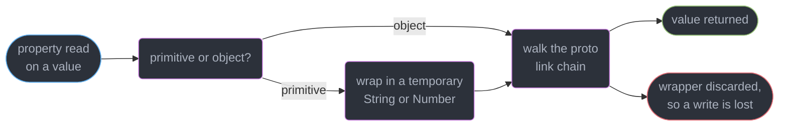
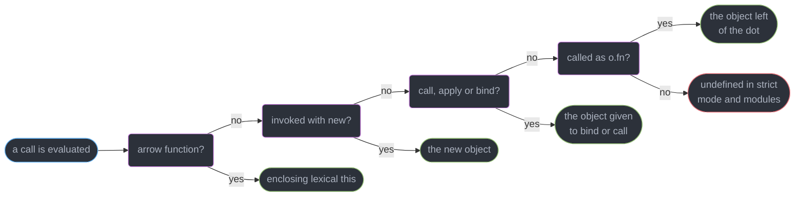
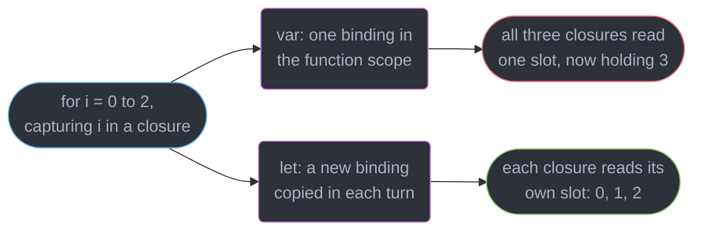
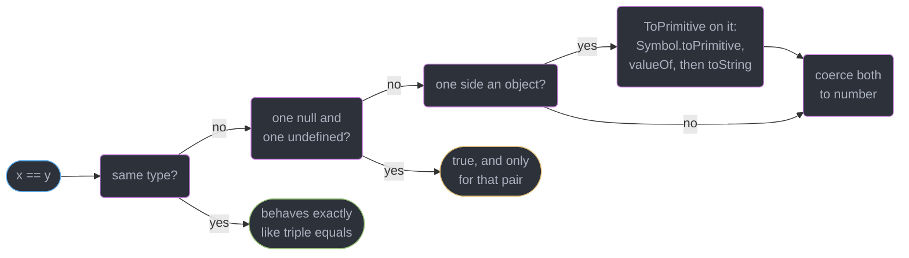
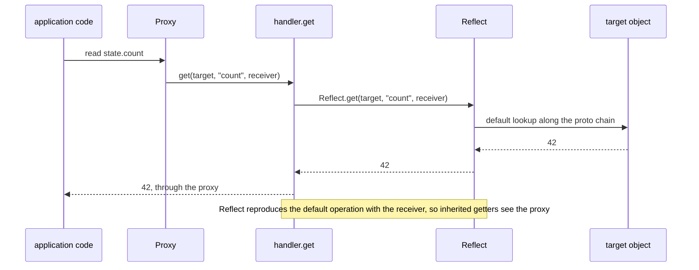
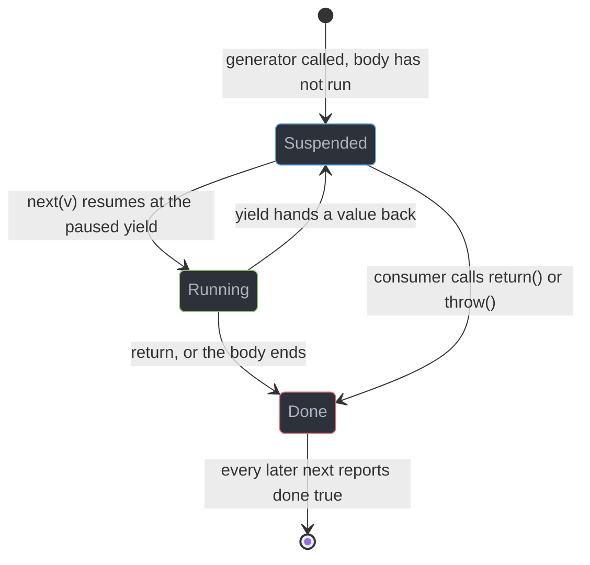

# JavaScript Language Semantics

---

## 1. Concept Overview

TypeScript erases to this, React components are these functions, and a bundler's tree-shaker
reasons about these module semantics. Six mechanisms generate every JavaScript surprise that
matters:

| Mechanism | What it decides | Where it bites |
|-----------|-----------------|----------------|
| The prototype chain | Where a property lookup finds its value | `class` inheritance, `instanceof`, polyfills |
| `this` binding | Which object a function body sees, per call | Extracted handlers, `forEach(obj.method)` |
| Lexical environments | Which binding a closure captured | The `var`-in-a-loop classic, module privacy |
| Coercion (ToPrimitive) | What `==`, `+` and truthiness produce | `0 == ""`, `[] + {}`, falsy guards |
| The iteration protocol | What `for...of` and spread consume | Custom collections, generators, streams |
| ESM live bindings | Whether an import sees later mutations | Cyclic imports, tree-shaking, HMR |

The target is **ECMAScript 2026**, ratified 2026-06-30 (Ecma 131st General Assembly, ECMA-262
17th edition). New at Stage 4 in this edition: `JSON.parse` source-text access, Iterator
Sequencing, `Uint8Array` to/from Base64, `Math.sumPrecise`, `Error.isError`, `Array.fromAsync`
and `RegExp.escape`. **Temporal is Stage 4 and in ES2026, but MDN marks it "Limited availability
— not Baseline"** — do not assume it is present. **Decorators sit at Stage 2.7**, below Stage 3,
because TC39 inserted 2.7 as an intermediate checkpoint and re-slotted existing proposals into
it, a process change rather than a rejection. **Records & Tuples were withdrawn**, archived
2025-04-15.

Three neighbours own material deliberately absent here: the event loop and microtask ordering
belong to [The Event Loop and Scheduling](../the_event_loop_and_scheduling/the_event_loop_and_scheduling.md),
GC and heap snapshots to
[Client Memory and Performance Debugging](../client_memory_and_performance_debugging/client_memory_and_performance_debugging.md),
the type system to [TypeScript Fundamentals](../../typescript/typescript_fundamentals_and_tsconfig/typescript_fundamentals_and_tsconfig.md).

---

## 2. Intuition

> JavaScript objects do not *contain* their inherited members — they hold a **pointer to another
> object** and ask it when a lookup misses. Almost everything else is a consequence.

**Mental model.** An object is a small dictionary with a forwarding address. A read checks the
dictionary, follows the address, follows that object's address, and stops at `null`. A write
almost always stops at the first object, which is why assignment shadows rather than mutates.

**Why it matters.** `class` is a nicer way to build that chain, not a different machine. `this`
is an argument the call site supplies, and `==` is a specified coercion algorithm — mechanisms,
not folklore.

**Key insight, and the one that catches everyone.** `[[Prototype]]` and `prototype` are different
things with confusingly similar names. `[[Prototype]]` is the internal link on *every* object;
`prototype` is an ordinary property on *constructor functions only*, whose value becomes the
`[[Prototype]]` of that constructor's instances.

---

## 3. Core Principles

1. **Seven primitives exist** — `string`, `number`, `boolean`, `bigint`, `symbol`, `undefined`,
   `null`. Everything else is an object; primitives are immutable and hold no own properties.
2. **Property access on a primitive boxes it** into a temporary wrapper, reads through the
   wrapper's prototype, and discards it — so `"a".toUpperCase()` works and `"a".x = 1` does not.
3. **Lookup walks the chain, assignment does not** — a write creates an own property on the
   receiver, shadowing anything above, unless a setter intervenes.
4. **`this` is bound per call, never captured** — except arrows, which read the lexical one.
5. **Closures capture bindings, not values** — `let` in a `for` head makes a new one each turn.
6. **Coercion is specified** — ToPrimitive consults `Symbol.toPrimitive`, `valueOf`, `toString`.
7. **Iteration is a protocol, not a type** — any `Symbol.iterator` returning `{ next() }` works.
8. **ESM bindings are live and its imports are static**, which is what makes tree-shaking work.

---

## 4. Types / Architectures / Strategies

### 4.1 The seven primitives and their wrappers

| Primitive | `typeof` | Wrapper | Notable trap |
|-----------|----------|---------|--------------|
| `string` | `"string"` | `String` | Immutable, index writes silently ignored |
| `number` | `"number"` | `Number` | IEEE-754 double, `0.1 + 0.2 === 0.30000000000000004` |
| `boolean` | `"boolean"` | `Boolean` | `new Boolean(false)` is an object, so it is truthy |
| `bigint` | `"bigint"` | `BigInt` | Cannot mix with `number` in arithmetic |
| `symbol` | `"symbol"` | `Symbol` | Skipped by `Object.keys` and `JSON.stringify` |
| `undefined` | `"undefined"` | none | The absence of a value |
| `null` | `"object"` | none | A 1995 bug kept for web compatibility |

### 4.2 The five `this` rules, in precedence order

| # | Rule | Trigger | `this` becomes |
|---|------|---------|----------------|
| 1 | `new` binding | `new Fn()` | The freshly created object |
| 2 | Explicit binding | `fn.call(o)`, `fn.apply(o)`, `fn.bind(o)` | `o`, and a `bind` is permanent |
| 3 | Method call | `o.fn()` | `o` — the object left of the dot, nothing more |
| 4 | Default binding | `fn()` | `undefined` in strict mode and modules, else `globalThis` |
| 5 | Lexical | an arrow function | Whatever `this` was where the arrow was *written* |

Rule 5 is barely a rule: an arrow has no `this` slot, so the lookup continues outward.

### 4.3 Declaration forms and hoisting

| Form | Hoisted? | Initialized to | Access before declaration |
|------|----------|----------------|---------------------------|
| `function f() {}` | Yes | The full function | Works |
| `var x` | Yes | `undefined` | `undefined` |
| `let` / `const` | Yes | Nothing (TDZ) | `ReferenceError` |
| `class C {}` | Yes | Nothing (TDZ) | `ReferenceError` |

### 4.4 Four ways to choose an object's prototype

```js
const proto = { greet() { return "hi " + this.name; } };
const a = Object.create(proto); a.name = "a";       // explicit, no constructor involved
const b = new (function () { this.name = "b"; })(); // constructor function
class C { constructor() { this.name = "c"; } }      // class sugar over the same chain
const d = { __proto__: proto, name: "d" };          // literal syntax
```

`Object.create(null)` is the fifth and most useful variant: a prototype-less dictionary with no
inherited `toString` or `__proto__`, and the standard defence against prototype pollution.

---

## 5. Architecture Diagrams

### The prototype chain of one instance

```
   const d = new Dog("rex");

   d  ---> { name: "rex" }                          own properties only
              |
              |  [[Prototype]]    ==  Object.getPrototypeOf(d)
              v
           { bark, constructor }  ==  Dog.prototype
              |          |
              |          +-- .constructor --> Dog --+
              |                                ^    |
              |  [[Prototype]]                 +----+   .prototype
              v
           { toString, valueOf, hasOwnProperty }  ==  Object.prototype
              |
              |  [[Prototype]]
              v
           null                  lookup ends, d.missing evaluates to undefined
```

`d.bark()` misses on `d` and hits on `Dog.prototype`, a 1-hop lookup; `d.toString()` is 2 hops;
`d.missing` walks all 3 links and yields `undefined`. The `constructor` and `.prototype` pointers
form the loop making `d.constructor === Dog` true.

### Primitives, boxing, and where a property read lands



### The five `this` rules as a decision path



### One `var` binding versus a fresh `let` binding per iteration



### What `==` does before it compares



### A proxied read: trap, then `Reflect`, then target



---

## 6. How It Works — Detailed Mechanics

### 6.1 Primitives, boxing, and the chain

```js
"use strict";
"abc".toUpperCase();      // "ABC" — boxed into a String, read, wrapper discarded
"abc".custom = 1;         // TypeError: Cannot create property 'custom' on string 'abc'
typeof null;              // "object" — the 1995 bug, kept for web compatibility

const base = { kind: "base", describe() { return this.kind; } };
const mid  = Object.create(base, { kind: { value: "mid", enumerable: true } });
const leaf = Object.create(mid);
leaf.describe();                 // "mid" — this is leaf, kind found 1 hop up
Object.hasOwn(leaf, "kind");     // false — inherited, and the ES2022 form is null-proto safe
leaf.kind = "leaf";              // creates an OWN property, shadowing mid
Object.getPrototypeOf(mid).kind; // "base" — the parent was never touched
```

Boxing allocates a `String`, reads `String.prototype`, discards the wrapper, and no primitive ever
gains an own property. Each lookup miss costs one link traversal — a 3-deep chain walks 3 objects
on a cold inline cache, after which V8 caches the shape and the hot path is a pointer compare.
`Object.setPrototypeOf` on a live object invalidates every inline cache that saw it.

### 6.2 `class` is sugar over prototypes, and where the sugar leaks

```js
class Animal {
  #secret = 42;                    // genuinely NOT sugar: an internal slot, not a property
  constructor(name) { this.name = name; }
  static isAnimal(o) { return #secret in o; }   // forgery-proof brand check, ES2022
}
typeof Animal;                     // "function" — a class IS a function object
Object.keys(new Animal("a"));      // ["name"] — prototype methods are non-enumerable
Animal("a");                       // TypeError: Class constructor Animal cannot be invoked

class Even { static [Symbol.hasInstance](n) { return typeof n === "number" && n % 2 === 0; } }
4 instanceof Even;                 // true — hasInstance replaces the default chain walk
```

The sugar is real for methods, `extends`, `super` and `static`. It leaks in four places: class
bodies are always strict mode, class declarations sit in a TDZ instead of hoisting, the
constructor refuses a call without `new`, and **`#private` fields are not sugar at all** — they
live in a per-class internal slot list, unreachable by `Object.keys`, `JSON.stringify`, a `Proxy`
trap or a bracket lookup, so `#secret in o` is forgery-proof where `instanceof` is not.

### 6.3 Property descriptors

```js
const o = {};
Object.defineProperty(o, "id", { value: 7 });   // ALL THREE flags default to false
o.id = 9;                                       // silently ignored in sloppy mode
Object.keys(o);                                 // []    — enumerable: false
delete o.id;                                    // false — configurable: false
```

The asymmetry is the trap: plain assignment sets all three flags `true`, while
`Object.defineProperty` defaults every unspecified flag to `false`. Default `instanceof` walks the
left operand's chain for `Right.prototype`, which is why it fails across realms (§6.10).

### 6.4 The five `this` rules in one file

```js
"use strict";
class Counter {
  count = 0;
  incProto() { this.count++; }              // shared on the prototype, this from the call site
  incField = () => { this.count++; };       // one closure allocated PER INSTANCE
}
const c = new Counter();
c.incProto();                               // rule 3 — this is c
const loose = c.incProto;
loose();                                    // TypeError: Cannot read properties of undefined
                                            //   (reading 'count')
c.incProto.bind(c).call({ count: 99 });     // rule 2 wins and is permanent — still increments c
[1, 2].forEach(c.incProto);                 // same TypeError — the reference lost its owner
[1, 2].forEach(c.incProto, c);              // thisArg fixes it, as does an arrow wrapper
```

`incField` is not free: 10,000 `Counter` instances allocate 10,000 closures at roughly 100 bytes
each against one shared prototype method, and a subclass cannot override an instance field.

### 6.5 Closures, the loop classic, TDZ and hoisting

```js
const fns = [];  for (var i = 0; i < 3; i++) fns.push(() => i);
fns.map(f => f());                       // [3, 3, 3] — one binding, read after the loop ended
const fns2 = []; for (let j = 0; j < 3; j++) fns2.push(() => j);
fns2.map(f => f());                      // [0, 1, 2]

console.log(hoistedVar);                 // undefined — declaration hoisted, initializer not
console.log(tdz);                        // ReferenceError: Cannot access 'tdz' before
var hoistedVar = 1;                      //   initialization
let tdz = 2;

const makeCounter = () => { let n = 0; return { inc: () => ++n, get: () => n }; };
```

`let` in a `for` head is specified to create a **fresh binding per iteration**, copying the
previous value forward before the update expression runs (`CreatePerIterationEnvironment`), while
`var` has one function-scoped binding all three closures share. The same mechanism gives
`makeCounter` its privacy: `n` is unreachable because no property for it exists.

### 6.6 Coercion, ToPrimitive, and the four equality algorithms

```js
0 == "0";            // true  — the string coerces to a number, and 0 == "" for the same reason
0 == null;           // false — null equals only undefined under ==
NaN == NaN;          // false — IEEE-754 says NaN equals nothing, itself included
[] == false;         // true  — [] -> "" -> 0, and false -> 0
Object.is(NaN, NaN); // true
Object.is(0, -0);    // false — with 1/-0, the only two places -0 is observable
[NaN].includes(NaN); // true  — includes uses SameValueZero, indexOf uses ===

const money = { amount: 5, [Symbol.toPrimitive](hint) {   // "number", "string" or "default"
  return hint === "string" ? "$5" : 5; } };
money + 1;           // 6 under the "default" hint, while `${money}` gives "$5"

[] + {};             // "[object Object]" — both stringify inside an expression
{} + [];             // 0 at a statement start: {} parses as an empty BLOCK, then +[] is 0
Boolean("0");        // true — falsy is exactly "", 0, -0, 0n, null, undefined, NaN, false
```

Four equality algorithms exist: loose (`==`, coercing), strict (`===`, type-first), SameValueZero
(`includes`, `Map`, `Set` — strict but `NaN` equals `NaN`), and SameValue (`Object.is`, which also
separates `-0`). `document.all` is the one specified falsy object, and the trap that costs money is
`if (!count)`, which fires on `0` — `opts.retries ?? 3` keeps it.

### 6.7 Iterators, generators, and async iteration

```js
class Range {
  constructor(from, to) { this.from = from; this.to = to; }
  [Symbol.iterator]() { let n = this.from, end = this.to;
    return { next: () => (n < end ? { value: n++, done: false } : { value: undefined, done: true }),
             [Symbol.iterator]() { return this; } };   // iterable-iterator, so for..of re-enters
  }
}
[...new Range(0, 3)];                 // [0, 1, 2] — spread, destructuring and for..of share this

function* fib() { let [a, b] = [0, 1]; while (true) { yield a; [a, b] = [b, a + b]; } }
function* firstN(it, n) { let i = 0; for (const v of it) { if (i++ >= n) return; yield v; } }
[...firstN(fib(), 8)];                // [0,1,1,2,3,5,8,13] — lazy over an infinite sequence
function* o2() { yield 1; yield* [2, 3]; return "x"; }
[...o2()];                            // [1, 2, 3] — a return value is NOT yielded

async function* pages(url) { let next = url;
  while (next) { const j = await (await fetch(next)).json(); yield* j.items; next = j.next; } }
for await (const item of pages("/api/items?page=1")) process(item);
```

`yield` suspends the frame with its locals intact and returns control to the caller, who resumes
it with `next(v)` — and `v` becomes the value the paused `yield` evaluates to, making the channel
bidirectional. `for await...of` consumes `Symbol.asyncIterator` and each `await` resumes in a
microtask — scheduling belongs to
[The Event Loop and Scheduling](../the_event_loop_and_scheduling/the_event_loop_and_scheduling.md).



### 6.8 `Symbol`, `Proxy`, `Reflect`, and the invariants

A `Proxy` has **13 traps**, one per internal object operation: `get`, `set`, `has`,
`deleteProperty`, `ownKeys`, `apply`, `construct`, `getPrototypeOf`, `setPrototypeOf`,
`isExtensible`, `preventExtensions`, `getOwnPropertyDescriptor`, `defineProperty`.

```js
Symbol.for("app") === Symbol.for("app");   // true — the cross-realm global registry
// Well-known: iterator, asyncIterator, hasInstance, toPrimitive, toStringTag, species

function track(target, onRead, onWrite) {
  return new Proxy(target, {
    get(t, k, recv) { onRead(k); return Reflect.get(t, k, recv); },
    set(t, k, v, recv) { const prev = t[k];
      const ok = Reflect.set(t, k, v, recv);          // returning false throws in strict mode
      if (ok && !Object.is(prev, v)) onWrite(k, prev, v);
      return ok; },
  });
}
new WeakMap().set(domNode, { listeners: [] });   // held weakly, the entry dies with the node
```

`Reflect` is the trap-shaped mirror of every default operation, and using it inside a trap is
correctness rather than style: `Reflect.get(t, k, receiver)` forwards the receiver so an inherited
getter runs with `this` as the proxy, while `t[k]` loses that. A proxy also cannot violate the
target's invariants — against a **non-configurable, non-writable** data property, `get` must report
the target's exact value or the engine throws `TypeError: 'get' on proxy: property 'x' is a
read-only and non-configurable data property on the proxy target but the proxy did not return its
actual value`, and `ownKeys` on a non-extensible target must list precisely its own keys. **This is
not academic:** `Proxy` is the machinery under Valtio and MobX (a `get` trap records which
component read which key, a `set` trap re-renders exactly those) and under Immer, whose
copy-on-write draft clones one branch per mutation so `React.memo` skips the untouched ones.

### 6.9 ESM: live bindings, cycles, top-level `await`

```js
// counter.js
export let count = 0;
export const bump = () => { count++; };
// app.js
import { count, bump } from "./counter.js";
console.log(count);   // 0
bump();
console.log(count);   // 1 — a LIVE binding, not a copy, and count = 5 in app.js throws

// a.js — a cycle
import { b } from "./b.js";
console.log("a sees", b);   // ReferenceError: Cannot access 'b' before initialization
// b.js: import { a } from "./a.js"; export const b = "b" + a;

export const flags = (await (await fetch("/config.json")).json()).flags;   // top-level await
```

CommonJS copies the value at `require` time, so its translation of the first example logs `0`
twice; an ESM import is a read-only *view* onto the exporter's binding, which is why `import` may
not appear inside a block, and top-level `await` blocks this module's importers. Because the graph
is linked before any code runs, one module in a cycle evaluates first and the other's `const`
bindings are still in their TDZ, while a `function` declaration survives. Static analyzability is
the payoff — what defeats it is dynamic access (`lib[name]`), barrel re-exports and unprovable side
effects; set `"sideEffects": false`, per
[Modules, Bundling and the Build Pipeline](../modules_bundling_and_the_build_pipeline/modules_bundling_and_the_build_pipeline.md).

### 6.10 Errors: `cause`, `AggregateError`, realms, `Error.isError`

```js
class HttpError extends Error {
  constructor(status, url, options) {
    super(`HTTP ${status} for ${url}`, options);   // options carries { cause }
    this.name = "HttpError"; this.status = status;
  }
}
try { await load(); } catch (err) { throw new HttpError(502, "/api/x", { cause: err }); }
await Promise.any([a(), b(), c()]);   // rejects with AggregateError, err.errors holds all 3
Error.isError(value);                 // ES2026, Stage 4 — tests the internal slot, cross-realm
value instanceof Error;               // false for an error thrown inside an iframe or worker
```

`instanceof` walks the chain for the *current realm's* `Error.prototype`, and an iframe, a `Worker`
and a Node `vm` context each carry their own intrinsics, so a structurally perfect error fails the
check. `Error.isError` is the guard; forward the options to `super` or the cause is dropped.

---

## 7. Real-World Examples

### The reactive store every modern state library ships

```js
const deps = new Map();                        // key -> Set of subscriber callbacks
export function reactive(target) {
  return new Proxy(target, {
    get(t, k, r) { currentEffect && (deps.get(k) ?? deps.set(k, new Set()).get(k)).add(currentEffect);
                   return Reflect.get(t, k, r); },
    set(t, k, v, r) { const prev = t[k]; const ok = Reflect.set(t, k, v, r);
                      if (ok && !Object.is(prev, v)) deps.get(k)?.forEach(fn => fn());
                      return ok; },
  });
}
```

That is Valtio and MobX in 10 lines: read-tracking in `get`, invalidation in `set`, `Object.is` so
writing the same value costs nothing. Vue's `reactive()` adds a `WeakMap` of dependency maps and a
scheduler in front of the notification.

### A polyfill whose descriptor does not lie

```js
if (!Array.prototype.at) {                     // presence check, never a version check
  Object.defineProperty(Array.prototype, "at", {
    value(n) { n = Math.trunc(n) || 0; if (n < 0) n += this.length;
               return n < 0 || n >= this.length ? undefined : this[n]; },
    writable: true, enumerable: false, configurable: true,   // MUST match a built-in
  });
}
```

Every built-in method is `writable: true, enumerable: false, configurable: true`. A polyfill that
assigns `Array.prototype.at = fn` gets `enumerable: true`, and every `for...in` over an array then
yields `"at"` — the classic Prototype.js-era breakage. The same discipline is why
`JSON.parse(JSON.stringify(x))` is a bad clone (`Date` to string, `Map` to `{}`, `undefined` gone,
`NaN` to `null`) while `structuredClone` keeps all five.

---

## 8. Tradeoffs

| Dimension | Prototype method | Class-field arrow |
|-----------|------------------|-------------------|
| Allocation | 1 per class | 1 per instance, roughly 100 bytes each |
| `this` on extraction | Lost, `undefined` in strict mode | Kept, always |
| Overridable by a subclass | Yes | No — the field shadows the prototype |
| Identity across instances | Stable, so `React.memo` holds | Fresh per instance, defeating memo |

| Dimension | `Object.create(null)` | Plain `{}` | `Map` |
|-----------|----------------------|-----------|-------|
| Prototype-pollution safe | Yes | No — `__proto__` is live | Yes |
| Key types | Strings and symbols | Same | Any value, objects included |
| Insertion order | Integer-like keys sort first | Same | Always insertion order |

| Dimension | ESM | CommonJS |
|-----------|-----|----------|
| Binding semantics | Live view of the exporter's variable | Value copy at `require` time |
| Resolution | Static and hoisted, before evaluation | Dynamic, at the call |
| Cycles | TDZ `ReferenceError` on a `const` | Partially-populated `exports` |
| Tree-shaking | Provable from the syntax | Effectively impossible |
| Top-level `await` | Supported | Not supported |

---

## 9. When to Use / When NOT to Use

**Reach for a `Proxy` when** you must observe or virtualise operations you do not control —
reactive state, a lazily-materialised API client, an unknown-key guard on a config object. Not on
a hot path: a proxied read runs roughly 5-50x a plain one, missing the usual inline caches.

**Reach for a generator when** the sequence is infinite, expensive per element, or paginated —
`for await...of` over a cursor reads like a loop and holds one page rather than all of them.

**Reach for `Object.create(null)` when** keys are attacker-influenced, and for **`WeakMap`** when
attaching data to objects you do not own.

**Do NOT** extend a built-in prototype in application code; a descriptor-correct polyfill is the
only defensible case. **Do NOT** use `==` outside the idiom `x == null`. **Do NOT** trust
`instanceof` across a realm or worker boundary — brand with a `#private` field or `Error.isError`.
**Do NOT** call `Object.setPrototypeOf` on a live object.

---

## 10. Common Pitfalls

### Pitfall 1: the extracted method (BROKEN → FIX)

```js
// BROKEN — the reference is passed without its owner, so rule 4 applies
class Uploader {
  constructor(bucket) { this.bucket = bucket; this.queue = []; }
  enqueue(file) { this.queue.push(file); }
}
const up = new Uploader("assets");
files.forEach(up.enqueue);
// TypeError: Cannot read properties of undefined (reading 'queue')

// FIX — keep the dot at the call site, or bind once in the constructor
files.forEach(f => up.enqueue(f));                 // or forEach(up.enqueue, up), the thisArg
// or, in the constructor: this.enqueue = this.enqueue.bind(this);
```

A `.bind()` in a render path is the version that hides: it returns a **new function on every
call**, so the prop identity changes each render and `React.memo` never skips.

### Pitfall 2: prototype pollution through a merge

```js
// BROKEN — a "__proto__" key in untrusted JSON writes to Object.prototype
function merge(target, src) {                      // for...in also walks the prototype chain
  for (const k in src) target[k] = src[k];
  return target;
}
merge({}, JSON.parse('{"__proto__":{"isAdmin":true}}'));
({}).isAdmin;                                      // true — for every object in the process

// FIX — block the three dangerous keys and use a null-prototype target
const BLOCKED = new Set(["__proto__", "constructor", "prototype"]);
function safeMerge(target, src) {
  for (const k of Object.keys(src)) {                        // own keys only
    if (BLOCKED.has(k)) continue;
    target[k] = src[k] && typeof src[k] === "object"
      ? safeMerge(target[k] ??= Object.create(null), src[k]) : src[k];
  }
  return target;
}
```

`Object.keys` also fixes the second bug — `for...in` sees anything a *previous* pollution added.
The browser-side attack surface belongs to
[Browser Security and the Client Threat Model](../browser_security_and_the_client_threat_model/browser_security_and_the_client_threat_model.md).

### Pitfall 3: falsy guards eating legitimate zeros

```js
const retries = opts.retries || 3;      // BROKEN — opts.retries === 0 silently becomes 3
if (!opts.offset) scrollToTop();        // BROKEN — fires on offset: 0, "already at top"
const retriesOk = opts.retries ?? 3;    // FIX — only null and undefined fall through
if (opts.offset == null) scrollToTop(); // FIX — the one legitimate == idiom
```

### Pitfall 4: forgetting `Reflect` inside a trap

```js
const target = { first: "Ada", get name() { return this.first; } };
const bad  = new Proxy(target, { get(t, k)       { return t[k]; } });          // receiver lost
const good = new Proxy(target, { get(t, k, recv) { return Reflect.get(t, k, recv); } });
Object.create(bad ).first = "Grace";   // getter runs with this === target, returns "Ada"
Object.create(good).first = "Grace";   // returns "Grace" — the getter saw the real receiver
```

---

## 11. Technologies & Tools

| Tool | Role | Relevance to language semantics |
|------|------|--------------------------------|
| V8 | Engine in Chrome, Edge, Node and Deno | Owns prototype lookup and inline caches |
| JavaScriptCore | Safari and Bun's engine | Second implementation, where conformance gaps surface |
| Node.js | Server runtime, 26 Current / 24 LTS | ESM-CJS interop, realms via `vm` |
| Bun | Runtime and toolkit, 1.4.0 | JavaScriptCore semantics, Zig-to-Rust core rewrite |
| ESLint | Linter, 10, flat config only | `no-prototype-builtins`, `eqeqeq`, `no-var` |
| Immer | Copy-on-write immutable updates | A `Proxy` draft whose `set` trap clones one branch |
| Valtio | Proxy state for React | `get`/`set` traps drive per-component subscriptions |
| MobX | Observable state | Proxy observables plus a derivation graph |
| core-js | Standard-library polyfills | The reference for descriptor-correct shims |

---

## 12. Interview Questions with Answers

**Q: Why does an extracted method lose its `this`?**
**Short:** Extracting a method copies only the function reference, and `this` is decided at the call site, so a bare call falls to the default binding.

`const f = obj.method` copies the function object and nothing else, so `f()` hits rule 4 and gives
`undefined` in strict mode and every ES module: `TypeError: Cannot read properties of undefined`.
Sloppy mode silently uses `globalThis`. Keep the dot at the call site, pass a `thisArg`, or bind.

**Q: Why does a `var` counter print 3, 3, 3 while `let` prints 0, 1, 2?**
**Short:** A `var` counter is one function-scoped binding shared by every closure, while `let` gets a fresh per-iteration binding with the previous value copied in.

All three `var` closures capture the same slot, which holds 3 once the loop ends. The spec gives
`let` in a `for` head `CreatePerIterationEnvironment`, allocating a new binding each turn and
copying the old value forward. It bites wherever a loop registers listeners, timers or promises.

**Q: What does `==` actually do that `===` does not?**
**Short:** Loose equality runs a coercion algorithm across types, so `0 == ""` is true, while strict equality compares types first and returns false immediately.

`==` follows a written table: `null` and `undefined` equal each other and nothing else, a boolean
becomes a number, and an object runs through ToPrimitive first — which is how `[] == false` is
true. Use `===` everywhere except `x == null`, which tests both nullish values in one operation.

**Q: What is the difference between `[[Prototype]]` and the `prototype` property?**
**Short:** `[[Prototype]]` is the internal link every object follows on lookup, while `prototype` is an ordinary property on constructor functions that supplies that link to new instances.

Every object has `[[Prototype]]`, readable with `Object.getPrototypeOf(o)`. Only functions carry a
`prototype` property, consulted exactly once: `new Fn()` sets the fresh object's `[[Prototype]]`
to it. So `d.prototype` is `undefined`, and arrows have no `prototype`, which is why `new` fails.

**Q: Is everything in JavaScript an object?**
**Short:** No — seven primitive types exist, and reading a property on one creates a temporary wrapper object that is discarded immediately afterwards.

The primitives are `string`, `number`, `boolean`, `bigint`, `symbol`, `undefined` and `null`, all
immutable with no own properties. `"abc".toUpperCase()` works only because the engine boxes the
string, reads `String.prototype`, then discards the wrapper, so `s.custom = 1` writes to nothing.

**Q: How does an arrow function in a class field differ from a prototype method?**
**Short:** A class-field arrow is allocated once per instance and captures `this` lexically, while a prototype method is shared once and takes `this` from the call site.

The arrow survives extraction, but 10,000 instances mean 10,000 closures at roughly 100 bytes each
instead of one shared function. Being an instance property it shadows the prototype, cannot be
overridden by a subclass, and changes identity per instance, which breaks `React.memo` downstream.

**Q: What is the temporal dead zone?**
**Short:** `let`, `const` and `class` bindings are hoisted but left uninitialized, so touching one before its declaration throws a ReferenceError instead of yielding undefined.

The binding exists from scope entry with no value until the declaration runs, so a read in between
gives `ReferenceError: Cannot access 'x' before initialization`, where `var` would give
`undefined`. The TDZ is also why a cyclic ESM import throws rather than handing back a stub.

**Q: Why is `NaN === NaN` false, and what does `Object.is` change?**
**Short:** IEEE-754 defines NaN as unequal to every value including itself, and `Object.is` special-cases it as equal while also separating -0 from +0.

`===` treats `NaN` as unequal to itself and `-0` as equal to `+0`; SameValueZero (`includes`,
`Map`, `Set`) matches it except that `NaN` equals `NaN`; SameValue (`Object.is`) also separates
`-0`. Hence `[NaN].indexOf(NaN)` is -1 while `[NaN].includes(NaN)` is true; use `Number.isNaN`.

**Q: Why does `[] + {}` produce "[object Object]" while `{} + []` can produce 0?**
**Short:** Both operands stringify inside an expression, but at the start of a statement the braces parse as an empty block, leaving unary plus applied to an empty array.

In `[] + {}`, `+` finds no numeric primitive, so ToPrimitive stringifies both. At a statement
position the parser reads `{}` as an empty block and evaluates `+[]`, which is `Number("")`, 0;
`({} + [])` restores the string. `+` is overloaded on ToPrimitive, so `1 + "1"` is `"11"`.

**Q: What are the property-descriptor attributes, and which default to false?**
**Short:** Every property carries writable, enumerable and configurable, which default to false under `Object.defineProperty` and true under plain assignment.

A data property has `value` plus those three flags; an accessor has `get`/`set` plus two.
`Object.defineProperty(o, "id", { value: 7 })` ignores assignment, hides from `Object.keys` and
refuses `delete`, whereas `o.id = 7` sets all three true — which is why a lazy polyfill leaks keys.

**Q: How does the iteration protocol work?**
**Short:** `for...of` calls the object's `Symbol.iterator` method to obtain an iterator, then calls `next()` repeatedly until a result reports `done: true`.

An iterator is any object with a `next()` returning `{ value, done }`; an iterable is any object
with a `Symbol.iterator` returning one. Spread, destructuring, `Array.from`, `Promise.all` and
`new Map(...)` all consume it, and an early `break` calls the optional `return()` to clean up.

**Q: What makes a generator a coroutine?**
**Short:** `yield` suspends the function with its stack frame and locals intact and hands control back to the caller, who decides when to resume it.

Calling a generator function runs no body code — it returns a suspended object. Each `next(v)`
runs to the following `yield`, and `v` becomes the value that paused `yield` evaluates to, making
the channel bidirectional. `yield*` delegates, so a generator's `return` never lands in a spread.

**Q: Which proxy traps fire for a property read, and what is `Reflect` for?**
**Short:** A read triggers the `get` trap, and `Reflect.get` performs the exact default operation the engine would have run, receiver included.

There are 13 traps, one per internal method: `get`, `set`, `has`, `deleteProperty`, `ownKeys`,
`apply`, `construct`, `getPrototypeOf`, `setPrototypeOf`, `isExtensible`, `preventExtensions`,
`getOwnPropertyDescriptor` and `defineProperty`. `Reflect.set` returns the boolean a trap owes.

**Q: What invariants can a Proxy not violate?**
**Short:** Traps cannot lie about non-configurable non-writable data, and a non-extensible target forces the reported key list and prototype to match exactly.

Against a non-configurable, non-writable property, `get` must return that exact value and
`getOwnPropertyDescriptor` must report it, or the engine throws. `ownKeys` on a non-extensible
target must list exactly its own keys, so a frozen object keeps its guarantees behind a proxy.

**Q: What is an ESM live binding?**
**Short:** An import is a read-only view onto the exporting module's variable, so a later reassignment inside that module is visible to every importer.

`export let count = 0` plus an exported `bump()` means an importer logging `count` after `bump()`
sees 1, where CommonJS sees 0 because `require` copied the value. Writing to it gives
`TypeError: Assignment to constant variable`, and static hoisted imports are what enable shaking.

**Q: Why does a cyclic ESM import throw instead of yielding undefined?**
**Short:** Evaluation order leaves the second module's `let` and `const` bindings in their temporal dead zone, so an early access throws rather than reading a placeholder.

The graph is linked before any code runs, then modules evaluate depth-first, so one module reaches
an import whose module has not evaluated and finds a hoisted-but-uninitialized `const`:
`ReferenceError: Cannot access 'b' before initialization`. CommonJS returns a partial `exports`.

**Q: How do you attach the underlying failure when rethrowing an error?**
**Short:** Pass `{ cause: err }` as the Error constructor's second argument, and use AggregateError when several failures must be carried at once.

`new HttpError(502, url, { cause: err })` preserves the original stack, and every modern reporter
renders the chain; before ES2022 the options were string concatenation or a bespoke `.original`.
`AggregateError` carries an `errors` array and is what `Promise.any` rejects with.

**Q: Why can `instanceof` fail on an error crossing a realm?**
**Short:** Each realm has its own `Error.prototype`, so a value from an iframe or worker fails the prototype-chain check even when it is structurally a real error.

`instanceof` walks the left operand's chain for the right operand's `prototype`, and an iframe, a
`Worker` and a Node `vm` context each carry separate intrinsics. The old workaround was
`Object.prototype.toString.call(v)`; `Error.isError(v)` tests the internal slot instead.

---

## 13. Best Practices

1. **Use `===` everywhere except `x == null`** — the one intended, complete coercion.
2. **Prefer `??` and `?.` to `||` and `&&` for defaults**, so a deliberate `0` or `""` survives.
3. **Declare `const` first, `let` when reassignment is real, never `var`** — the TDZ turns a
   silent `undefined` into a stack trace at the line that caused it.
4. **Keep prototype methods on the prototype** and bind once in the constructor rather than
   allocating a class-field arrow per instance or a `.bind()` per render.
5. **Always call `Reflect.*` inside a proxy trap**, forwarding the receiver — `t[k]` breaks
   inherited getters in ways that surface only under inheritance.
6. **Use `Object.create(null)` or a `Map` for attacker-influenced keys**, and skip `__proto__`,
   `constructor` and `prototype` in any recursive merge.
7. **Brand with a `#private` field, not `instanceof`**, across a realm boundary.
8. **Enumerate with `Object.keys` or `Object.entries`, never `for...in`**, which walks the chain.
9. **Attach `{ cause }` on every rethrow**, and **key by `WeakMap`** when the object is not yours.

---

## 14. Case Study

### A proxy-based store that leaked 380 MB per session

An analytics dashboard SPA holds 40 chart widgets over a shared reactive store built on `Proxy`,
in the shape of §7. Sessions run 6-8 hours on a wall display. After a 2026-05 release, memory
climbed from a steady 140 MB to 520 MB over 7 hours and the tab was OOM-killed twice a shift. A
heap snapshot showed 118,000 retained closures and 41,000 detached containers, from three bugs:

```js
// BROKEN 1 — a Map keyed by widget objects, so nothing is ever collectable
const deps = new Map();                 // widget -> Set of effect callbacks

// BROKEN 2 — the get trap subscribes on EVERY read, teardown reads included
get(t, k, r) { deps.get(currentWidget).add(effect); return Reflect.get(t, k, r); }

// BROKEN 3 — a var counter in the mounting loop, so every effect closed over the LAST i
for (var i = 0; i < widgets.length; i++) {
  mount(widgets[i], () => store.select(ids[i]));   // ids[40] is undefined for all 40 effects
}
```

Bug 3 is the `var` classic and produced the visible symptom: after the loop `i` is 40, so all 40
effects read `ids[40]`, which is `undefined`. The `get` trap subscribed every effect to the key
`undefined`, so one write invalidated all 40 widgets — 40x the intended re-render work, which made
the leak accumulate fast enough to notice.

```js
// FIX 1 — WeakMap: an entry dies with its widget, with no unsubscribe bookkeeping
const deps = new WeakMap();             // widget -> Map(key -> Set of effects)

// FIX 2 — subscribe only while an effect is actively tracking
get(t, k, r) {
  if (currentEffect) (deps.get(currentWidget) ?? seed(currentWidget)).get(k)?.add(currentEffect);
  return Reflect.get(t, k, r);          // Reflect, so inherited getters see the proxy
}

// FIX 3 — let gives each iteration its own binding
for (let i = 0; i < widgets.length; i++) mount(widgets[i], () => store.select(ids[i]));
```

The `WeakMap` change is the structural one. A `Map` keyed by a widget is a strong reference, so
removing a widget from the DOM freed nothing: the store held the widget, the widget held its
detached container, and that held its listeners. A `WeakMap` entry dies with its key, so the
subgraph became collectable with no teardown code — retention mechanics belong to
[Client Memory and Performance Debugging](../client_memory_and_performance_debugging/client_memory_and_performance_debugging.md).

**Outcome over 14 days.** Steady-state memory after 7 hours fell from 520 MB to 148 MB, a 71%
reduction; re-renders per store write fell from 40 to an average of 1.2; p75 interaction latency
fell from 310 ms to 84 ms; OOM kills went from 19 in the prior 14 days to zero. The diff was 11
lines, and an ESLint `no-var` rule made bugs 1 and 3 unrepeatable.

**The lesson.** All three bugs were language-semantics bugs wearing a framework costume: binding
lifetime in a loop, reference strength in a collection, and receiver forwarding in a trap. No
state-library expertise finds them — they are about which binding a closure captured, and which
references keep an object alive.
