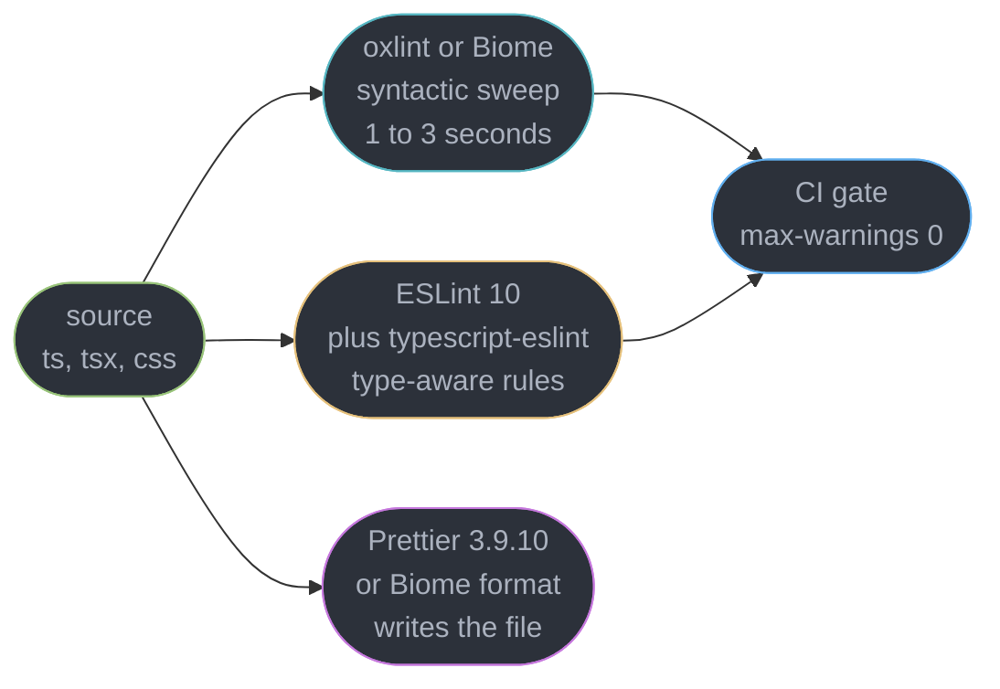
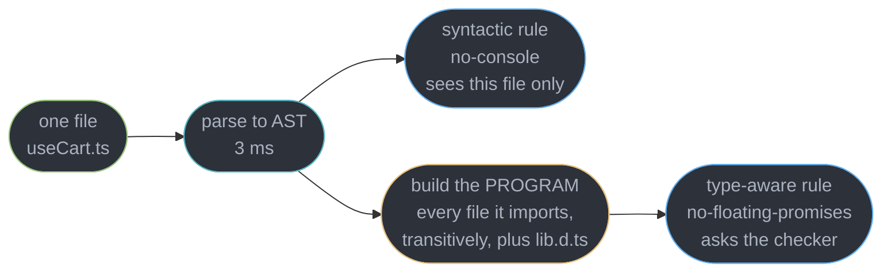
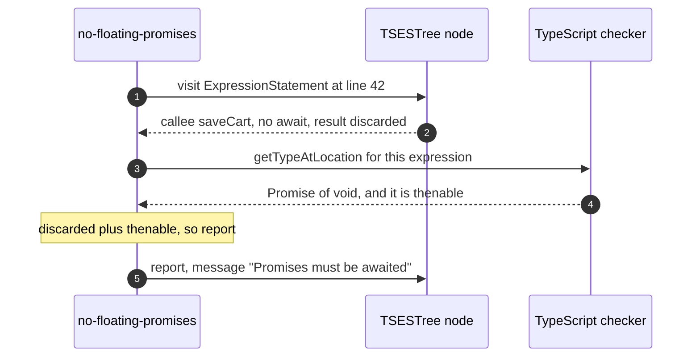
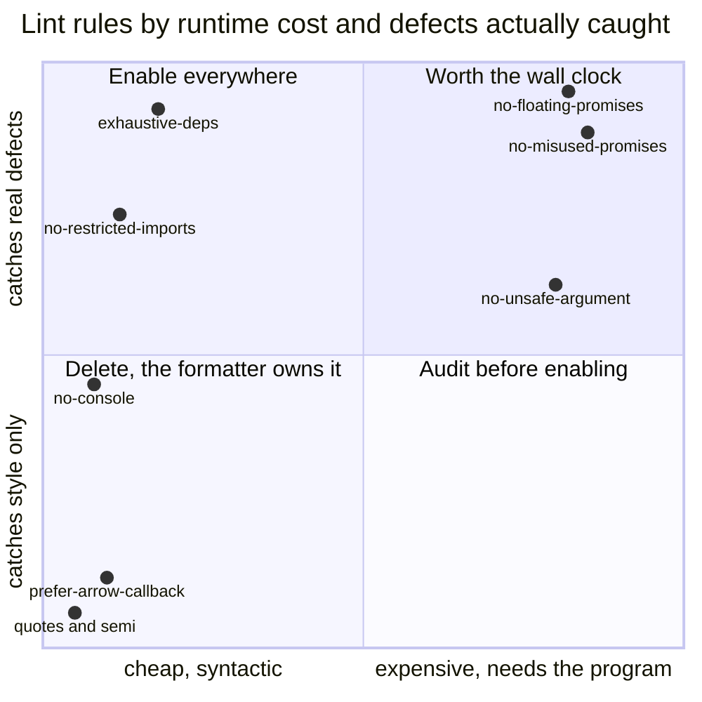
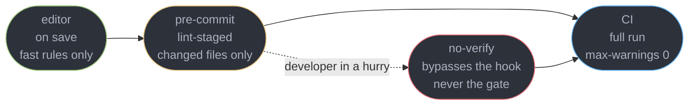
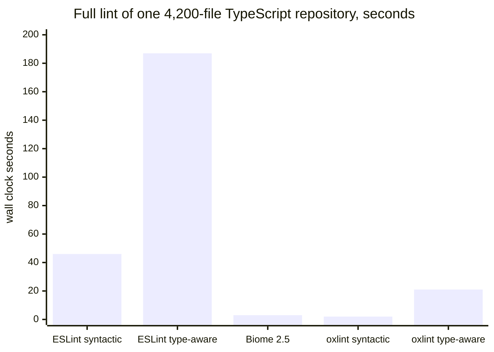

# Linting, Formatting and Code Quality

---

## 1. Concept Overview

A linter enforces the rules a compiler cannot express and a reviewer should not have to repeat.
That sentence is the whole scope, and both halves are load-bearing. The compiler proves types;
it has no opinion about an unawaited promise, an import that crosses an architectural boundary,
or a React effect whose dependency array is a lie. A reviewer *can* catch all three — once, on
one pull request, at a cost of roughly 12 minutes and some goodwill. A rule catches them on
every pull request forever at a cost of 40 milliseconds.

What a linter is **not**:

| It is not | Because |
|-----------|---------|
| a type checker | it does not prove anything; a type-aware rule *asks* the checker |
| a test suite | it never executes your code, so it cannot know what it computes |
| a design review | it matches syntax trees; it has no model of whether the abstraction is right |
| a formatter | formatting is a separate, deterministic, non-negotiable transform |
| a security scanner | most real flaws need interprocedural dataflow no rule models |

The honest frame, and the one that decides whether a config helps or hurts: **most of the value
comes from a small number of correctness rules.** A repository with 8 rules that catch real
defects plus a formatter beats one with 340 rules, 60 of them stylistic, producing 900 warnings
nobody reads. A rule that fires on style rather than defect is a tax paid in attention.

What this module does **not** own:

| Topic | Owner |
|-------|-------|
| `tsc --noEmit`, type performance, the TypeScript 7 Compiler API gap | [The TypeScript Compiler and Type Performance](../../typescript/the_typescript_compiler_and_type_performance/the_typescript_compiler_and_type_performance.md) |
| Bundlers stripping types without checking them | [Modules, Bundling and the Build Pipeline](../modules_bundling_and_the_build_pipeline/modules_bundling_and_the_build_pipeline.md) |
| Test runners, coverage, the shape of a front-end CI pipeline | [Testing and Frontend CI](../../react/testing_and_frontend_ci/testing_and_frontend_ci.md) |
| The Rules of React and what `eslint-plugin-react-hooks` enforces | [The React Compiler](../../react/the_react_compiler/the_react_compiler.md) |
| Layering, boundaries, and which architecture the rules defend | [React Architecture and Antipatterns](../../react/react_architecture_and_antipatterns/react_architecture_and_antipatterns.md) |

---

## 2. Intuition

> A linter is **a pattern matcher over syntax trees with a strong opinion and no idea what your
> program does.** Everything good and everything infuriating about it follows from that.

**Mental model.** Think of two inspectors walking a building. The first has the floor plan for
one room and can tell you that a door opens onto a wall — that is a syntactic rule, cheap,
instant, one file. The second has the plans for the whole building and can tell you that the
pipe leaving this room is connected to nothing three floors down — that is a type-aware rule,
which needs the entire program built before it can answer a single question, and costs
accordingly.

**Why it matters.** The bugs a linter catches are the ones that survive review: not the wrong
algorithm, which a reviewer notices, but the missing `await` on line 340 of a 400-line diff.
Across one 4,200-file repository, four rules — `no-floating-promises`, `no-misused-promises`,
`exhaustive-deps` and `no-unsafe-argument` — accounted for **71 of the 96 findings that mapped to
a real, previously shipped defect**.

**Key insight, and the one people get wrong.** Turning on more rules does not linearly increase
safety; past a point it decreases it, because a developer who sees 400 warnings stops reading
warnings, and the one that mattered is now camouflaged. A green lint is not evidence of quality.
It is evidence that you did not do the specific things you told it to check for.

---

## 3. Core Principles

1. **A rule earns its place by catching defects, not by expressing a preference.** If the fix is
   "move this brace", the formatter owns it.
2. **Syntactic rules see one file; type-aware rules see the program.** That is the entire cost
   difference, and it is roughly 4x on wall clock.
3. **Formatting is never a review comment.** It is a deterministic transform run by a machine.
4. **Config resolution must be explicit.** A plugin you can `import` is a plugin you can debug.
5. **Warnings decay into noise.** A finding is an error or it is deleted from the config.
6. **CI is the gate, the editor is the feedback loop.** A pre-commit hook sits between them and
   is bypassable by design.
7. **A linter cannot see intent.** Wrong logic, a bad abstraction and a misleading name all pass
   every rule you own.

---

## 4. Types / Architectures / Strategies

### 4.1 The four rule categories, ranked by what they are worth

| Category | Example rules | Needs types | Worth |
|----------|--------------|-------------|-------|
| Correctness | `no-floating-promises`, `no-misused-promises`, `exhaustive-deps`, `await-thenable` | mostly yes | the reason the tool exists |
| Architectural | `no-restricted-imports`, `no-restricted-syntax`, boundary plugins | no | enforces a decision review keeps re-litigating |
| Hygiene | `no-console`, `no-debugger`, `no-unused-vars` | no | cheap, small, real |
| Style | quote marks, semicolons, arrow parens, indent | no | negative — the formatter owns this |

### 4.2 The tool landscape as of 2026-09

| Tool | Written in | Formats | Type-aware | Ecosystem |
|------|-----------|---------|------------|-----------|
| **ESLint 10** | JavaScript | no | via typescript-eslint | thousands of plugins |
| **typescript-eslint 8.71.2** | JavaScript | no | yes, the reference implementation | the TypeScript rule set |
| **Prettier 3.9.10** | JavaScript | yes, exclusively | n/a | n/a |
| **Biome 2.5** | Rust | yes, one binary | yes | small, first-party only |
| **oxlint** | Rust | no, `oxfmt` is separate | yes, GA 2026-07-22 | small, first-party plus a JS plugin API |

ESLint 10 shipped around February 2026 and **removed the eslintrc config system entirely** —
flat config is the only option — and ESLint 9 reached end of life on **2026-08-06**, so "we are
still on 9" is an unpatched dependency, not a deferral.

### 4.3 Where each tool sits in one pipeline



The two lint lanes are a real choice, not a pipeline: teams run the fast one on every save and
the slow one in CI, or they run only one. The formatter lane never merges with either — it
rewrites files and reports nothing.

---

## 5. Architecture Diagrams

### 5.1 Syntactic versus type-aware, the whole cost story



One extra box, and it is the whole program. That box is why enabling a single type-aware rule
takes a lint run from 46 seconds to 187 seconds on a 4,200-file repository — the cost is not
per rule, it is paid once for the first type-aware rule and shared by all of them.

### 5.2 What a type-aware rule actually asks



Step 3 is the one that costs money. `getTypeAtLocation` can only answer after the checker has
resolved `saveCart` across however many files and `.d.ts` declarations stand between here and
its definition — which is exactly the analysis a syntactic linter skips.

### 5.3 Flat config resolution over one file

```
  eslint.config.js AS AN ORDERED ARRAY — EVERY MATCHING OBJECT MERGES, LAST ONE WINS

  file being linted:  src/features/cart/useCart.ts

  [0]  { ignores: ["dist/**"] }                        no match      skipped
  [1]  js.configs.recommended                          no files key  applies to ALL
  [2]  { files: ["**/*.ts"], rules: { A: "error" } }   MATCH         A = error
  [3]  { files: ["**/*.ts"], languageOptions: {...} }  MATCH         parser, projectService
  [4]  { files: ["**/*.test.ts"], rules: { A: "off" } } no match     skipped
  [5]  { files: ["src/**"], rules: { B: "warn" } }     MATCH         B = warn
  [6]  eslintConfigPrettier                            applies ALL   turns 40 style rules off
                                                       ------------------------------------
                                              effective: A error, B warn, style rules off
```

Position [6] is why `eslint-config-prettier` must be last: it wins only over what precedes it.
This resolution is a plain array reduction you can `console.log`, which is the entire argument
for flat config over the inheritance graph it replaced.

### 5.4 Which rules are worth their cost



The two left quadrants are free and should be on; the top right is the only reason to accept a
4x slower run. The bottom right — expensive rules mostly flagging stylistic `any` in generated
code — is where a type-aware config goes wrong.

### 5.5 Where enforcement actually happens



The dotted edge is the design, not a leak. A hook is a courtesy that saves a CI round trip;
because it is bypassable, **CI is the only real gate** and must run the same rules over the
whole repository, not just the staged files.

---

## 6. How It Works — Detailed Mechanics

### 6.1 Flat config, and why the migration was forced

An `eslint.config.js` file exports an array of config objects. Each object optionally has a
`files` glob; objects with no `files` key apply to everything. ESLint walks the array in order
and merges every object that matches the file being linted.

```js
// eslint.config.js — ESLint 10, the only supported format
import js from "@eslint/js";
import tseslint from "typescript-eslint";
import reactHooks from "eslint-plugin-react-hooks";
import prettier from "eslint-config-prettier";

export default [
  { ignores: ["dist/**", "coverage/**", "**/*.generated.ts"] },
  js.configs.recommended,
  ...tseslint.configs.recommendedTypeChecked,       // the type-aware set
  {
    files: ["**/*.{ts,tsx}"],
    languageOptions: {
      parserOptions: { projectService: true, tsconfigRootDir: import.meta.dirname },
    },
    plugins: { "react-hooks": reactHooks },
    rules: {
      "react-hooks/exhaustive-deps": "error",       // warn by default; raise it
      "@typescript-eslint/no-floating-promises": "error",
      "no-restricted-imports": ["error", {
        patterns: [{ group: ["**/data/**"], message: "UI reaches data via a feature hook." }],
      }],
    },
  },
  { files: ["**/*.test.{ts,tsx}"], rules: { "no-console": "off" } },  // narrower, so later
  prettier,                                          // LAST — disables style rules
];
```

**Why the old system had to go.** `.eslintrc` resolved `extends: "airbnb"` and
`plugins: ["import"]` by string, walking `node_modules` with rules that differed between npm,
pnpm and Yarn, differed again inside a monorepo, and could not be reasoned about without running
ESLint. Three symptoms every team hit: a shared config that worked in one package and not its
sibling because of hoisting; a plugin loaded twice under two versions with rules silently
disagreeing; and `--print-config` as the only way to discover what was actually enabled. Flat
config replaces all of it with `import` — Node resolves the module, you hold the object, and the
merge is an array reduction. **ESLint 10 removed eslintrc entirely**, so this is not a
preference. A repository still on the old format is on ESLint 9, which went end of life on
**2026-08-06**. Two smaller moves come with it: `ignores` replaces `.eslintignore`, and `env` is
gone in favour of `languageOptions.globals`.

### 6.2 Syntactic rules versus type-aware rules

A syntactic rule visits AST nodes in one file and asks structural questions only.

```ts
// A syntactic rule can prove this, from this file alone: a CallExpression whose callee is
// console.warn, inside src/, not in a test file.
console.warn("cart empty");            // no-console: Unexpected console statement.
```

A type-aware rule additionally calls into the TypeScript checker, which means the linter must
first build a **program** — every file reachable by import, transitively, plus every `.d.ts` in
`node_modules` those files touch.

```ts
// No syntactic rule can flag this. The AST says "a call whose result is discarded"; whether the
// result is a Promise depends on saveCart's declaration, three files away.
function onSubmit(cart: Cart) {
  saveCart(cart);        // returns Promise<void> — rejects silently, error never surfaces
}
```

**The cost is real and it is structural.** Building the program is the same work `tsc` does; a
lint run that was 46 seconds syntactic becomes 187 seconds with the first type-aware rule
enabled, and adding the next twenty type-aware rules costs almost nothing on top, because they
share the program. Three mitigations that work:

- `parserOptions.projectService: true` — typescript-eslint 8 builds and reuses one program
  instead of reloading a `tsconfig.json` per file. The single biggest win, and the default.
- **Split the CI job** — syntactic rules at 46 s, the type-aware job in parallel, both required.
- **Scope the expensive set** to `src/**`, never `scripts/**` or generated code.

The rules that earn the cost are a short list: **`no-floating-promises`**,
**`no-misused-promises`** (an async function passed where a `void` callback is expected — the
reason an `onClick={async () => ...}` swallows its own rejection), **`await-thenable`** (you
awaited something that was never a promise, so the code reads asynchronous and is not), and the
**`no-unsafe-*`** family, which tracks an `any` from an untyped `JSON.parse` or a third-party
`.d.ts` as it flows through three files and lands in a call argument.

**typescript-eslint 8.71.2 does not yet support TypeScript 7 or tsgo**, because TypeScript 7.0
shipped without a stable Compiler API — that is expected in 7.1. Type-aware linting therefore
still runs against the TypeScript 6.x checker even in a repository whose `tsc --noEmit` job has
moved to the native binary. Compiler details belong to
[The TypeScript Compiler and Type Performance](../../typescript/the_typescript_compiler_and_type_performance/the_typescript_compiler_and_type_performance.md).

### 6.3 The rules that actually catch bugs

**`no-floating-promises`** is the highest-value rule in front-end JavaScript, because the
failure it prevents is silent. An unhandled rejection in a browser fires
`window.onunhandledrejection` and nothing else: no red text, no failed request, no user-visible
symptom until the data is missing.

**`react-hooks/exhaustive-deps`** flags a dependency array that does not match what the effect
or memo actually reads. **Disabling it is nearly always wrong**, and the reason is precise: the
rule is not expressing a preference about arrays, it is telling you the effect closes over a
value it will never see updated. Suppressing it means the effect keeps a stale closure — the
classic "the filter works once, then ignores every subsequent change" bug. When the array feels
wrong, the effect is wrong: the dependency belongs in a ref, the function belongs outside the
component or inside `useCallback`, or the effect should not exist. This rule ships in
`eslint-plugin-react-hooks` alongside the rest of the Rules of React set, which is owned by
[The React Compiler](../../react/the_react_compiler/the_react_compiler.md).

**`no-restricted-imports`** is how an architectural decision stops being a code-review opinion.

```js
// A layered app: ui may not reach into data, and nothing may deep-import another feature.
"no-restricted-imports": ["error", { patterns: [
  { group: ["**/data/**"], message: "UI talks to data through a hook in features/." },
  { group: ["../*/internal/**"], message: "Internals are private to their feature." },
]}],
```

Which layering to defend is the subject of
[React Architecture and Antipatterns](../../react/react_architecture_and_antipatterns/react_architecture_and_antipatterns.md);
this rule is only the enforcement.

**`no-console`** belongs on production paths and off everywhere else — a `console.log` left in a
render path costs about 0.4 ms per call in Chrome with DevTools open and, worse, is a routine
way to leak a token or a user record into a shared screen share.

**Exhaustiveness** is a rule and a type trick working together:

```ts
// switch-exhaustiveness-check catches the missing case the moment a variant is added.
type Status = "idle" | "loading" | "error" | "cancelled";   // "cancelled" added today

function label(s: Status): string {
  switch (s) {
    case "idle": return "Ready";
    case "loading": return "Loading";
    case "error": return "Failed";
    default: { const never: never = s; return never; }  // TS2322 the moment a case is missed
  }
}
```

Contrast every one of these with the rules a formatter should own: quote style, semicolons,
arrow-function parentheses, trailing commas, indentation, maximum line length. Each of those can
produce hundreds of findings, none of which is a defect.

### 6.4 Formatters versus linters

Prettier parses to an AST and reprints from scratch, discarding your original whitespace
entirely. That is why it is deterministic and why it does not negotiate: there is one output for
one input, and no `.prettierrc` option changes that for a given config.

The overlap with a linter is a real problem, because a formatter and a style rule that disagree
produce a file that fails lint after formatting and fails format after linting.
**`eslint-config-prettier` turns off every ESLint rule that could conflict** — around 40 of them
— and it must be the **last** element of the flat config array.

```js
import prettier from "eslint-config-prettier";
export default [ /* ...everything else... */ prettier ];
```

The deeper argument, and the one worth making to a team: **formatting should never be a review
comment.** Every minute spent writing "nit: extra blank line" is a minute not spent on whether
the cache invalidation is correct, and it costs the author more than the minute — it is a
correction with a person attached. Handing it to a machine that runs on save removes the whole
category, which is also why Prettier does not belong inside ESLint via `eslint-plugin-prettier`:
that reports 200 formatting errors beside your real findings, roughly 3x slower.

### 6.5 The Rust generation

Biome 2.5 is a single Rust binary that lints and formats, with type-aware linting. oxlint is a
Rust linter whose **type-aware support went stable on 2026-07-22** — built on tsgolint, covering
**59 of the 61** type-aware rules typescript-eslint provides. Neither is experimental any more.



**What you gain:** wall clock measured in seconds rather than minutes, so linting fits inside a
save-on-keystroke loop; one binary instead of a `node_modules` tree of 40 plugins; and no plugin
resolution to debug, because there are no resolvable plugins.

**What you lose, and be honest about it: the plugin you depend on may not exist.** ESLint's
ecosystem is still its strongest argument by a wide margin — `eslint-plugin-react-hooks`,
`eslint-plugin-jsx-a11y`, `eslint-plugin-import`, testing-library and framework-specific plugins
have no complete equivalent in either tool, and a house rule you wrote as a custom ESLint rule
does not port. oxlint's own documentation notes incomplete rule coverage and elevated memory use
on very large repositories.

### 6.6 Enforcement that works

Three layers, and only one of them is a gate.

```json
{ "lint-staged": {
    "*.{ts,tsx,js,jsx}": ["oxlint --fix", "prettier --write"],
    "*.{css,md,json}": ["prettier --write"] } }
```

`lint-staged` runs on **staged files only**, which is the entire point: a 4,200-file repository
cannot afford a full lint on every commit, and a 6-file commit is done in 900 ms. Keep the
type-aware rules out of this layer — they need the program regardless of how few files changed,
so there is no saving to have.

**CI is the real gate**, and it runs `--max-warnings=0`.

```json
{ "scripts": {
    "lint": "eslint . --max-warnings=0",
    "lint:fast": "oxlint --max-warnings=0",
    "ci": "npm run lint:fast && npm run lint && tsc --noEmit && npm test"
} }
```

Without that flag a `"warn"` rule exits 0, and the predictable result over a year is 900 warnings
in which the twelve that matter are invisible. **A finding is an error, or it is deleted from the
config**; `warn` is only a dated staging state while a rule is being adopted.

**Migrating a large codebase: ratchet, do not big-bang.** Enabling
`recommendedTypeChecked` on a five-year-old repository produces something like 3,400 findings.
Fixing them in one pull request is unreviewable and conflicts with everything in flight.

```json
{ "no-floating-promises": 41, "no-unsafe-assignment": 380, "no-unsafe-member-access": 512 }
```

Freeze that count in a checked-in baseline, make the rule an **error** for new code, and fail CI
when any count **increases** — a 30-line comparison script is the whole mechanism. Two rules: the
baseline may only ever shrink, and a bulk `eslint-disable` sweep is not the same thing, because
those comments are permanent and invisible where a baseline is one visible falling number.

### 6.7 What a linter structurally cannot catch

| Not caught | Why not | What does catch it |
|-----------|---------|--------------------|
| Wrong business logic | the rule matches shape, not meaning | tests, review |
| A bad abstraction | "should this be one component or three" is not a tree pattern | review, design docs |
| A race across files | requires interprocedural execution modelling | tests, tracing |
| Most security flaws | needs dataflow from an untrusted source to a sink that a single rule does not model | review, SAST, threat modelling |
| Naming and intent | `calculateTotal` that returns a subtotal parses identically | review |
| Performance regressions | a rule cannot know an array is 40,000 items long | profiling, budgets |

`no-danger` catching `dangerouslySetInnerHTML` is not dataflow analysis but a string match on a
JSX attribute, which is why it fires on safe uses and misses the same sink reached through a
helper. **A green lint means you did not do the specific things you told it to check for, and is
not evidence of quality** — presenting it as one is how a team invents coverage it lacks.

---

## 7. Real-World Examples

**A payment that silently never happened.** A checkout handler called
`recordPurchase(order)` without awaiting it. The function posted to an analytics endpoint and
then wrote a ledger row; when the endpoint 502'd, the promise rejected, nothing caught it, and
the ledger row was never written. The order still completed, so no user complained. Finance
found the gap 23 days later, 1,180 orders short. Enabling `no-floating-promises` across `src/`
found 41 more instances of the same shape, four of them on paths that wrote data.

**A suppressed dependency array that shipped stale prices.** A currency selector's effect read
`currency` but listed `[]`, with an `// eslint-disable-next-line react-hooks/exhaustive-deps`
and the comment "runs once on mount". It did run once, and it captured the currency at mount, so
switching from USD to EUR re-rendered every label without refetching. The bug survived four
months and two reviewers because the disable comment read like a decision. The fix was three
lines and removed the comment.

---

## 8. Tradeoffs

| Dimension | ESLint 10 plus typescript-eslint | Biome 2.5 or oxlint |
|-----------|----------------------------------|---------------------|
| Full-repo wall clock, 4,200 files | 46 s syntactic, 187 s type-aware | 2-3 s syntactic, 21 s type-aware |
| Rule ecosystem | thousands of plugins, every framework | first-party sets, no a11y or hooks parity |
| Custom house rules | mature API, well-documented | limited, and not portable from ESLint |
| Formatting | separate tool, `eslint-config-prettier` needed | built in, no conflict to resolve |
| Config debuggability | an array of imported objects | one JSON file |

| Dimension | Syntactic only | Type-aware enabled |
|-----------|---------------|-------------------|
| Cost | one AST per file | the whole program, roughly 4x |
| Catches | shape, hygiene, boundaries | floating promises, `any` flow, misused promises |
| Editor feel | instant on save | 1-3 s lag on a large project |
| Fits pre-commit | yes, on staged files | no — the program is built regardless |

---

## 9. When to Use / When NOT to Use

**Enable type-aware rules when** the project is TypeScript and touches asynchronous code or
external JSON, which is nearly every front end — and put them in their own CI job. **Enable
`no-restricted-imports` when** a layering decision exists that reviewers keep re-explaining.
**Adopt oxlint or Biome for the inner loop when** an ESLint run on save exceeds about 2 seconds.
**Use `--max-warnings=0` always.** **Use a ratchet baseline when** enabling a rule produces more
than roughly 50 findings. **Use `lint-staged` when** the pre-commit run would otherwise exceed
about 3 seconds.

**Do NOT** enable a style rule the formatter already owns. **Do NOT** run Prettier through
`eslint-plugin-prettier` — separate commands, 3x faster, and formatting stays out of the
findings list. **Do NOT** put type-aware rules in a pre-commit hook. **Do NOT** disable
`exhaustive-deps` to make a warning go away; fix the effect. **Do NOT** treat a bulk
`eslint-disable` sweep as a migration. **Do NOT** report a green lint as a quality metric.

---

## 10. Common Pitfalls

### Pitfall 1: a floating promise that swallows its own error (BROKEN → FIX)

```ts
// BROKEN — saveCart returns Promise<void> and throws on a non-2xx. The call is a statement, the
// result is discarded, and the rejection reaches window.onunhandledrejection and nowhere else.
function onCheckout(cart: Cart) {
  saveCart(cart);              // no await, no catch
  router.push("/confirmation");  // navigates whether or not the save succeeded
}
// 42:3  error  Promises must be awaited...  @typescript-eslint/no-floating-promises
```

```ts
// FIX — await it, handle the failure, and only then navigate.
async function onCheckout(cart: Cart) {
  try {
    await saveCart(cart);
    router.push("/confirmation");
  } catch (err) {
    reportError(err);
    setBanner("We could not save your cart. Try again.");
  }
}

// The deliberate fire-and-forget case is spelled out, not implied:
void trackEvent("checkout_started", { items: cart.items.length });
```

`void` is the escape hatch the rule accepts, and that is the point — it makes "I meant this"
grep-able, whereas a bare call is indistinguishable from a forgotten `await`.

### Pitfall 2: an `eslint-disable` comment that outlives its reason (BROKEN → FIX)

```ts
// BROKEN — "runs once on mount" was true. Then someone made currency switchable, and this
// effect kept the mount-time value forever. The disable comment made it look deliberate.
useEffect(() => {
  fetchPrices(productId, currency).then(setPrices);
  // eslint-disable-next-line react-hooks/exhaustive-deps
}, []);
```

```ts
// FIX — list what the effect reads. If that causes a loop, the effect is the problem.
useEffect(() => {
  let cancelled = false;
  fetchPrices(productId, currency).then((p) => { if (!cancelled) setPrices(p); });
  return () => { cancelled = true; };
}, [productId, currency]);
```

Two habits keep this from recurring: require a **reason on the same line** (`-- why`, which
`eslint-comments/require-description` enforces), and run `eslint --report-unused-disable-directives`
so a comment whose rule no longer fires becomes an error rather than archaeology.

---

## 11. Technologies & Tools

| Tool | Role | Relevance |
|------|------|-----------|
| ESLint | Linter | Version 10, flat config only, eslintrc removed |
| typescript-eslint | Linter plugin | 8.71.2, the reference type-aware rule set |
| Prettier | Formatter | 3.9.10, deterministic reprint from the AST |
| eslint-config-prettier | Config | Disables the roughly 40 conflicting style rules |
| Biome | Linter | 2.5, Rust, linter and formatter in one binary |
| oxlint | Linter | Rust, type-aware GA 2026-07-22 via tsgolint |
| eslint-plugin-react-hooks | Linter plugin | Ships `exhaustive-deps` and the Rules of React |
| eslint-plugin-jsx-a11y | Linter plugin | Static accessibility checks on JSX |
| lint-staged | Git hook runner | Runs linters over staged files only |
| Husky | Git hooks | Installs and manages the pre-commit hook |
| Stylelint | Linter | CSS and SCSS, outside every JavaScript linter's scope |

---

## 12. Interview Questions with Answers

**Q: Why is type-aware linting so much slower than normal linting?**
**Short:** Answering a type question requires building the whole program first, so the linter pays the same parse-and-resolve cost as the compiler before a single rule runs.

A syntactic rule parses one file to an AST and asks structural questions. A type-aware rule
calls `getTypeAtLocation`, which the checker can only answer after resolving every transitively
imported file plus the `.d.ts` files they touch. On a 4,200-file repository that took a run from
46 s to 187 s. The cost is paid once for the first such rule and shared by the rest, so enable
`projectService: true`, put type-aware rules in their own parallel CI job, and never in a
pre-commit hook.

**Q: A dependency array warning is annoying. Why not just disable `exhaustive-deps`?**
**Short:** The warning is not about the array, it reports that the effect closes over a value it will never see change, so suppressing it ships a stale closure.

The effect captures the variable at the render where it last ran and keeps that value forever.
The real-world shape is a currency selector whose effect listed `[]` under a disable comment
reading "runs once on mount" — switching currency re-rendered every label and refetched nothing,
for four months. When the honest array causes a loop, the effect is wrong: move the value to a
ref, hoist the function out of the component, or delete the effect. Fix the effect, never the
warning.

**Q: What did flat config change, and why was the migration forced?**
**Short:** Configuration became an ordered array of imported objects that merge in sequence, replacing a string-based resolution scheme nobody could predict without running the tool.

`extends: "airbnb"` and `plugins: ["import"]` resolved through `node_modules` differently under
npm, pnpm and Yarn, differently again in a monorepo, and could load one plugin twice under two
versions. Now you `import` the plugin, hold the object, and the merge is a reduction you can
`console.log`. `ignores` replaces `.eslintignore` and `env` is gone in favour of
`languageOptions.globals`. ESLint 10 removed eslintrc entirely and ESLint 9 went end of life on
2026-08-06, so there is no version left that supports the old format.

**Q: What can a linter never catch, no matter how many rules you enable?**
**Short:** Anything requiring an understanding of what the program means — wrong business logic, a bad abstraction, a cross-file race, a misleading name, and most security flaws.

A rule matches syntax-tree shapes, so `calculateTotal` returning a subtotal parses identically to
one that does not. It cannot model execution ordering across files, cannot know an array holds
40,000 items, and cannot trace an untrusted value to a sink through a helper — which is why
`no-danger` fires on safe `dangerouslySetInnerHTML` uses and misses the dangerous indirect one.
Treat a green lint as "we did not do the specific things we listed", never as evidence of
quality.

**Q: Where does the line between a linter and a formatter sit?**
**Short:** Whitespace, quotes, semicolons and line length belong to a tool that rewrites the file, while a linter should only report things a machine cannot silently fix.

Prettier reprints from the AST and discards your original whitespace, which is why its output is
deterministic. Style rules left on in ESLint fight it, so `eslint-config-prettier` disables the
roughly 40 that conflict and must be the last element of the flat config array. Do not run
Prettier as an ESLint rule through `eslint-plugin-prettier`: it is roughly 3x slower and dumps
200 formatting errors into the same list as your real findings.

**Q: Which single rule catches the most real production bugs in a front end?**
**Short:** Discarding a promise is the highest-value finding, because an unhandled rejection in a browser produces no error text, no failed request and no user-visible symptom.

`no-floating-promises` flags a call whose promise result is neither awaited, `.catch`ed nor
explicitly `void`ed. One real case: `recordPurchase(order)` unawaited, the endpoint 502'd, the
ledger row was never written, and finance found 1,180 missing orders 23 days later. The same
sweep found 41 more instances, 4 on data-writing paths. Mark deliberate fire-and-forget with
`void`, so intent is grep-able instead of indistinguishable from a forgotten `await`.

**Q: Why does `--max-warnings=0` matter so much?**
**Short:** Without it a warning exits zero, so warnings accumulate until nobody reads the output and the findings that matter are buried in the ones that never were.

One repository reached 912 warnings with a green CI; its four floating-promise findings sat at
lines 338, 511, 690 and 844 of a log nobody had scrolled in eight months. Deleting every style
rule the formatter already owned took it to 71 real findings in an afternoon. The operating rule
is that a finding is an error or it is removed from the config, with `warn` reserved for a
dated, deliberate adoption window.

**Q: How do you turn on a strict rule in a five-year-old codebase?**
**Short:** Ratchet it — freeze today's violation count in a checked-in baseline, make the rule an error for new code, and fail CI whenever the count goes up.

Enabling `recommendedTypeChecked` on a mature repository commonly produces 3,000-plus findings;
one pull request fixing them is unreviewable and conflicts with everything in flight. A baseline
file of per-rule counts plus a 30-line comparison script gives you a number that may only ever
shrink and that everyone can watch fall. A bulk `eslint-disable` sweep is not the same thing —
those comments are permanent and invisible, whereas a baseline is one visible file.

**Q: Should we replace ESLint with Biome or oxlint?**
**Short:** Speed is a real 20x win and the plugin gap is a real loss, so most teams run the fast tool on save and keep the slow one as the CI gate.

Biome 2.5 and oxlint are single Rust binaries — 2-3 s syntactic where ESLint takes 46 s, and
oxlint's type-aware mode went stable on 2026-07-22 covering 59 of 61 rules. What does not port:
`eslint-plugin-react-hooks`, `jsx-a11y`, testing-library plugins, and any custom house rule you
wrote. ESLint's ecosystem is still its strongest argument, and running both costs one extra
config file for a 2-second inner loop.

**Q: How do you stop a layering decision from being re-litigated in every review?**
**Short:** Encode the boundary as a restricted-import rule so the violation is an error at commit time rather than a comment someone has to write again.

`no-restricted-imports` takes glob patterns with per-pattern messages, so `**/data/**` from the
UI layer fails with "UI talks to data through a hook in features/". It costs nothing to run —
the rule is purely syntactic. Which layering to defend is a design question owned by
[React Architecture and Antipatterns](../../react/react_architecture_and_antipatterns/react_architecture_and_antipatterns.md);
the rule is only the enforcement mechanism for a decision already made.

**Q: Pre-commit hook or CI — which one is the gate?**
**Short:** CI is the only gate, because a hook is bypassable with a single flag and runs against staged files rather than the whole repository.

`lint-staged` exists to keep the hook under about 900 ms on a 6-file commit, which is a courtesy
that saves a CI round trip. Anyone in a hurry passes `--no-verify` and the commit lands anyway,
by design. So CI must run the full rule set over the whole tree with `--max-warnings=0`, and the
hook must stay fast enough that nobody wants to bypass it — meaning syntactic rules and the
formatter only, never the type-aware set.

**Q: Which type-aware rules actually justify the wall clock?**
**Short:** Four families do: unhandled promises, async functions passed as void callbacks, awaits on non-thenables, and untyped values flowing from a parse into a call argument.

Those are `no-floating-promises`, `no-misused-promises`, `await-thenable` and the `no-unsafe-*`
set. `no-misused-promises` is the one people underestimate — it catches
`onClick={async () => ...}`, where the handler's rejection is discarded by a callback signature
that expects `void`. The rest of the type-checked preset is largely stylistic `any` policing;
enable the four on `src/**` and skip generated code and scripts entirely.

**Q: When is an `eslint-disable` comment acceptable?**
**Short:** Only with a written reason on the same line, and only when the rule is genuinely wrong about this code rather than inconvenient about it.

An undocumented suppression reads like a decision to the next person, which is precisely how a
stale dependency array survives four months. Require the reason with
`eslint-comments/require-description`, and run `--report-unused-disable-directives` so a comment
whose rule no longer fires becomes an error instead of archaeology. If a rule needs suppressing
in more than a handful of places, the rule is misconfigured — fix the config, not the call
sites.

**Q: Can typescript-eslint use TypeScript 7 and its native compiler?**
**Short:** Not yet: TypeScript 7.0 shipped without a stable Compiler API, so version 8.71.2 still builds its program with the 6.x checker even where the type-check job has moved.

The stable API is expected in 7.1. The practical consequence is a split: `tsc --noEmit` can run
on the fast native binary while type-aware linting keeps loading the JavaScript checker, so the
lint job stays the slow one and its memory profile is unchanged. Plan the migration when 7.1
lands rather than pinning the linter to a checker your build no longer uses. Compiler mechanics
belong to [The TypeScript Compiler and Type Performance](../../typescript/the_typescript_compiler_and_type_performance/the_typescript_compiler_and_type_performance.md).

**Q: How do you decide whether a rule belongs in the config at all?**
**Short:** Ask what defect it has ever caught here — a rule whose findings are all preference costs attention on every commit and buys nothing.

The four categories are correctness, architectural, hygiene and style, and only the first three
earn a slot. Style rules are the trap: they are easy to agree on, produce hundreds of findings,
and the formatter already handles every one of them. A useful audit is to run the rule over the
existing tree and read twenty findings — if none describes something you would fix in review,
delete it.

**Q: My bundler compiles the project fine, so why do I need a linter at all?**
**Short:** Bundlers strip types without verifying them and no compiler models an unawaited promise, so both checks are separate programs answering different questions.

esbuild, swc and Rolldown delete annotations syntactically, which is owned by
[Modules, Bundling and the Build Pipeline](../modules_bundling_and_the_build_pipeline/modules_bundling_and_the_build_pipeline.md).
`tsc --noEmit` adds type proof but has no opinion on floating promises, dependency arrays or
import boundaries. A complete gate is four independent jobs: lint, type check, test, build —
and none of the four subsumes another.

---

## 13. Best Practices

1. **Run `eslint . --max-warnings=0` in CI**, and treat any rule you would not fail a build on
   as a rule to delete.
2. **Put `eslint-config-prettier` last in the array** and let the formatter own every style
   question, including in review.
3. **Enable the four high-value type-aware rules** on `src/**` in their own parallel CI job,
   with `projectService: true`.
4. **Never suppress `exhaustive-deps`.** Change the effect.
5. **Keep the pre-commit hook under 3 seconds** with `lint-staged` and syntactic rules only.
6. **Require a written reason on every `eslint-disable`** and run
   `--report-unused-disable-directives`.
7. **Ratchet a strict rule in with a baseline count** that may only ever shrink.
8. **Never report a green lint as a quality signal** in a status update or a definition of done.

---

## 14. Case Study

### 912 warnings, four real bugs, and a 187-second CI job

A 4,200-file TypeScript front end, 14 engineers, five years old. Lint took **187 seconds** and
was the slowest required check. CI was green at **912 warnings**. Over the preceding two
quarters, three production incidents traced to shapes a rule already in the config would have
caught, and in each case the finding was present in the log and unread.

The config had grown by accretion: `.eslintrc` extending four shared presets, 60 style rules at
`warn`, the full `recommendedTypeChecked` set enabled repository-wide including `scripts/` and
generated API clients, no `--max-warnings` flag, and Prettier wired in through
`eslint-plugin-prettier`.

```js
// BROKEN — .eslintrc.json on ESLint 9, four months past its 2026-08-06 end of life.
{
  "extends": ["airbnb", "airbnb-typescript", "plugin:prettier/recommended", "plugin:@typescript-eslint/recommended-type-checked"],
  "parserOptions": { "project": ["./tsconfig.json"] },   // reloaded per file, no projectService
  "rules": { "quotes": ["warn", "double"], "semi": ["warn", "always"], "@typescript-eslint/no-unsafe-assignment": "warn" }
}
// $ npx eslint .        -> 912 problems (0 errors, 912 warnings)    exit code 0
```

```js
// FIX — eslint.config.js on ESLint 10. Style rules deleted, the expensive set scoped,
// Prettier removed from the lint path entirely, and the flag that makes any of it a gate.
import js from "@eslint/js";
import tseslint from "typescript-eslint";
import reactHooks from "eslint-plugin-react-hooks";
import prettier from "eslint-config-prettier";

export default [
  { ignores: ["dist/**", "src/api/generated/**", "scripts/**"] },
  js.configs.recommended,
  {
    files: ["src/**/*.{ts,tsx}"],
    languageOptions: { parserOptions: { projectService: true, tsconfigRootDir: import.meta.dirname } },
    plugins: { "react-hooks": reactHooks, "@typescript-eslint": tseslint.plugin },
    rules: {
      "@typescript-eslint/no-floating-promises": "error",
      "@typescript-eslint/no-misused-promises": "error",
      "@typescript-eslint/await-thenable": "error",
      "react-hooks/exhaustive-deps": "error",
      "no-restricted-imports": ["error", {
        patterns: [{ group: ["**/data/**"], message: "UI reaches data through a feature hook." }],
      }],
    },
  },
  prettier,
];
```

The `no-unsafe-*` family produced 892 of the original 912 findings, so it was ratcheted rather
than enabled: `lint-baseline.json` froze the count and CI failed on any increase. `oxlint` became
the 2-second save-time check, `prettier --write` moved into `lint-staged`, and the type-aware run
became its own parallel job.

**Outcome after six weeks.** The syntactic and type-aware jobs run in parallel at **41 s** and
**94 s**, so the critical path fell from 187 s to 94 s. The 912 warnings became **0 warnings and
47 errors**, fixed over nine days: 4 floating promises (two on data-writing paths), 11 misused
promises in click handlers, 9 suppressed dependency arrays, and 23 restricted imports recording a
layering violation nobody had noticed. The `no-unsafe-*` baseline fell from 892 to 601 as a side
effect of people typing the module they were already editing.

**The lesson.** Nothing was added. The repository already owned every rule that would have caught
all three incidents — it owned them at `warn`, next to 60 rules about quotation marks, in a log
nobody read. **The failure was not missing coverage, it was a config that made coverage
unreadable.** Configure a small number of rules you would genuinely fail a build on, delete
everything the formatter can do instead, and make the exit code mean something.
