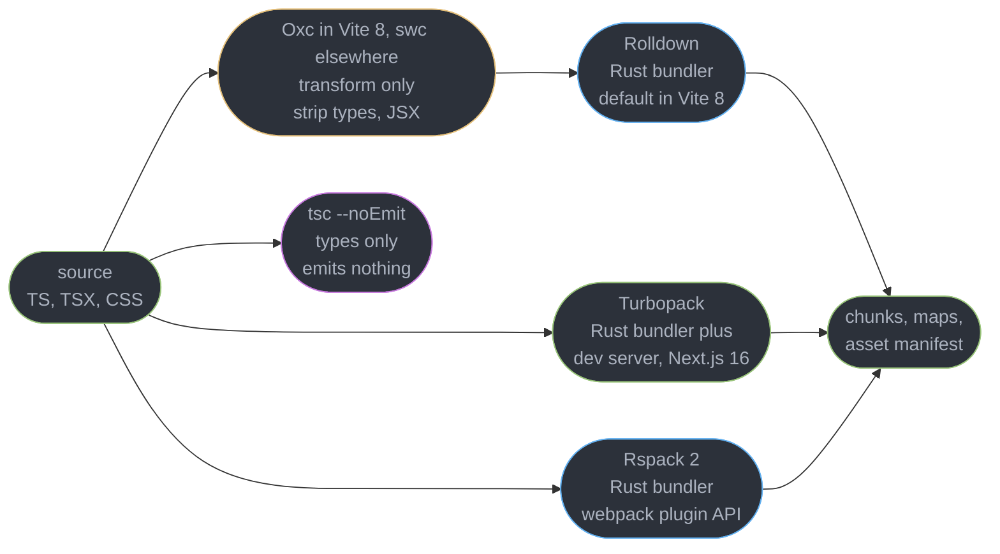
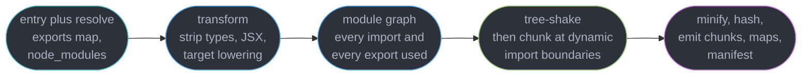
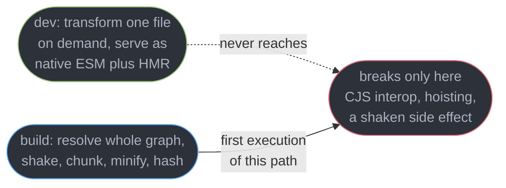
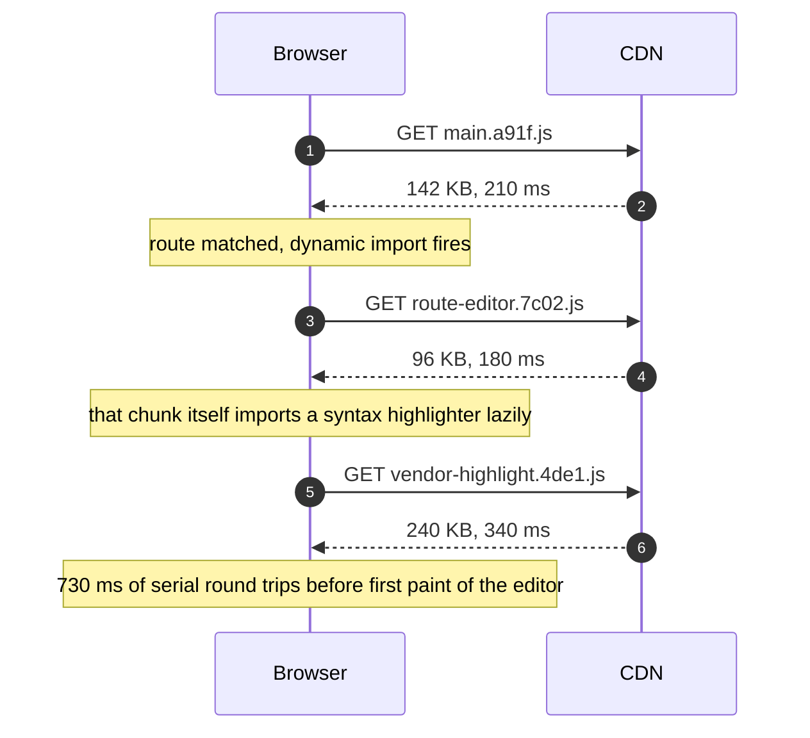
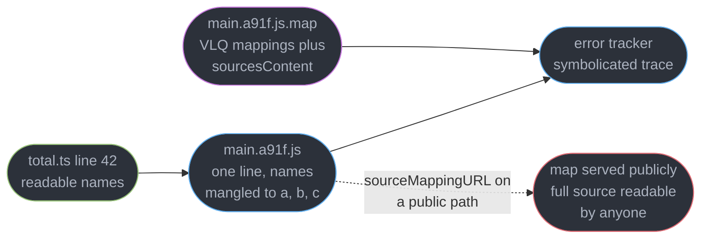
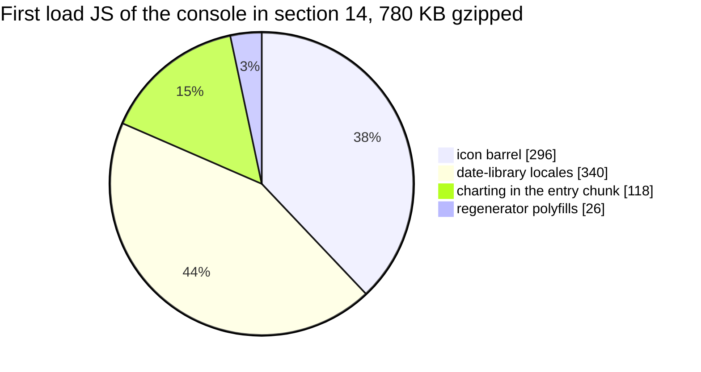

# Modules, Bundling and the Build Pipeline

---

## 1. Concept Overview

A browser loads ES modules natively, but nobody ships that way at scale: 1,400 source files is
1,400 requests, none minified, none deduplicated, and the tenth-level import cannot start
downloading until the ninth has been parsed. A bundler answers one question — **given an entry
point, what is the smallest set of bytes a browser must fetch before this route can render?** —
and everything here is a consequence of it:

| The question | The mechanism |
|--------------|---------------|
| What code is reachable at all? | module graph traversal over static `import`/`export` |
| What of that is provably unused? | tree-shaking, gated entirely by side effects |
| What can wait until later? | code splitting on `import()` boundaries |
| How do I debug the result? | source maps |
| How do I know it got worse? | a size budget enforced in CI |

The build is also where a class of bug is *manufactured*: the dev server and the production
build are two different programs over the same source, so a dependency that only breaks when
bundled is invisible until deploy. This module owns that seam. What it does **not** own:

| Topic | Owner |
|-------|-------|
| ESM semantics at the language level, live bindings, hoisting | [JavaScript Language Semantics](../javascript_language_semantics/javascript_language_semantics.md) |
| `exports` maps, `moduleResolution`, the dual-package hazard in TypeScript | [Modules, Resolution and Package Exports](../../typescript/modules_resolution_and_package_exports/modules_resolution_and_package_exports.md) |
| npm resolution, lockfiles, peer deps, duplicate copies of a package | [Package Management and Supply Chain](../package_management_and_supply_chain/package_management_and_supply_chain.md) |
| Asset hashing, CDN caching, the post-deploy chunk 404, map upload | [Frontend Delivery and Observability](../frontend_delivery_and_observability/frontend_delivery_and_observability.md) |
| LCP, INP and what bundle size costs in Web Vitals terms | [Web Performance and Core Web Vitals](../web_performance_and_core_web_vitals/web_performance_and_core_web_vitals.md) |
| `React.lazy`, Suspense boundaries, render-time splitting | [React Performance and Profiling](../../react/react_performance_and_profiling/react_performance_and_profiling.md) |

For why Rust toolchains are fast, see [Design a Fast Developer Tool in Rust](../../rust/case_studies/design_a_fast_developer_tool.md) in `rust/`.

---

## 2. Intuition

> A bundler is a **reachability analysis with a printer attached**. It walks your imports like
> a garbage collector walks a heap, and everything it cannot prove unreachable gets printed.

**Mental model.** The module graph is a lighting rig: the entry point is the switch, every
static `import` is a wire, and tree-shaking turns off the bulbs no wire reaches. A **side
effect** is a bulb wired to the mains directly — the bundler cannot prove removing it is safe,
so it stays lit forever, and everything it imports stays lit with it.

**Why it matters.** Bundle size is the one performance number decided entirely at build time,
before a user is involved. A 780 KB main chunk on a mid-range Android phone over 4G is roughly
3.4 s before your first line executes, and no runtime optimisation recovers it.

**Key insight, and the one people get wrong.** Tree-shaking is not "delete what I do not use",
it is "delete what the bundler can **prove** you do not use, given that evaluating a module
might do something observable." Almost every "why is this still in my bundle" question is a
side effect the author never thought of as one — an `Object.defineProperty` at module top
level, a polyfill import, a CSS import, a `console.log`.

---

## 3. Core Principles

1. **Static syntax is the whole enabling condition.** `import`/`export` declarations are
   analysable before execution; `require()` is a call whose argument can be computed, so its
   graph is knowable only at runtime.
2. **A module's evaluation is an observable event.** If it might do something, it cannot be
   dropped — even when none of its exports are used.
3. **Reachability is per-export in ESM, per-module in CJS.** That single difference is why a
   CommonJS dependency is shake-resistant.
4. **A chunk is a cache unit, not an organisational unit.** Split where invalidation and
   need-time differ, not where your folders differ.
5. **Dev and prod are different programs.** Anything true in one and not the other is a bug
   waiting for deploy day.
6. **Type checking is not part of bundling.** A bundler that "supports TypeScript" strips
   types; nothing verifies them unless you run a checker yourself.
7. **A number nobody measures always goes up.** Size is a budget or it is a surprise.

---

## 4. Types / Architectures / Strategies

### 4.1 Module formats you will meet in one `node_modules`

| Format | Analysable | Tree-shakes | Where you still hit it |
|--------|-----------|-------------|------------------------|
| ESM (`import`/`export`) | statically, per-export | fully | all modern source, most modern packages |
| CommonJS (`require`) | no, calls are dynamic | poorly, module-granularity at best | older deps, anything Node-first |
| UMD | no, a wrapper around both | no | legacy CDN-era libraries |
| Dual (`exports` map with both) | depends on the condition resolved | yes on the `import` branch | most well-maintained packages |

Two branches of the same package in one bundle is the **dual-package hazard** — owned by
[Modules, Resolution and Package Exports](../../typescript/modules_resolution_and_package_exports/modules_resolution_and_package_exports.md).

### 4.2 Code-splitting strategies, ranked by how often they are right

| Strategy | Boundary | Typical win | Cost |
|----------|----------|-------------|------|
| Route-level | the router's lazy route | 40-70% off first load | one round trip on navigation |
| Component-level | a heavy widget behind `import()` | 80-300 KB for a chart or editor | a loading state to design |
| Vendor by package | one chunk per large dependency | cache retention across deploys | more requests, more manifest |
| One big vendor chunk | all of `node_modules` | none, in practice | one dependency bump invalidates all of it |

### 4.3 Where each tool sits



Read the graph as two lanes that never merge. The lower lane is the type checker, and it
produces no output your users receive — which is exactly why forgetting to run it is silent.
In Vite 8 the transform box is Oxc, which also minifies the JS, and Lightning CSS minifies the
CSS. esbuild is an optional peer dependency that Vite 8 calls only when a config opts back in.

---

## 5. Architecture Diagrams

### 5.1 The pipeline, entry to manifest



Order is load-bearing. Shaking happens **after** the whole graph is known and **before**
chunking, so a chunk boundary can never resurrect dropped code — but a side effect found
during graph building keeps its module in every chunk that reaches it.

### 5.2 What a side effect does to reachability

```
  THE SAME IMPORT, TWO MODULE BODIES, TWO VERY DIFFERENT BUNDLES

  SHAKEABLE                              NOT SHAKEABLE
  main.ts                                main.ts
    +-- import { formatDate }              +-- import { formatDate }
        from "./utils"                         from "./utils"
              |                                      |
        utils/index.ts (barrel)                utils/index.ts (barrel)
          +-- export * from "./date"    KEEP   +-- export * from "./date"    KEEP
          +-- export * from "./crypto"  DROP   +-- export * from "./crypto"  KEEP
          +-- export * from "./charts"  DROP   +-- export * from "./charts"  KEEP
                                                       ^ charts.ts line 1 runs
                                                         Chart.register(BarElement)

  BUNDLE:  4.1 KB                        BUNDLE:  312 KB
```

Identical import, identical usage. The only difference is one top-level call in a file three
edges away that `main.ts` never mentions.

### 5.3 Dev server versus production build



The dotted edge is the point: dev never executes the code path that fails, because dev never
performs the transformation that breaks it.

### 5.4 The `import()` waterfall



Three sequential requests, none of which could start before the previous one parsed. A
`modulepreload` link emitted for the second and third at route-match time collapses this to
roughly 350 ms; delivery mechanics live in
[Frontend Delivery and Observability](../frontend_delivery_and_observability/frontend_delivery_and_observability.md).

---

## 6. How It Works — Detailed Mechanics

### 6.1 Why ESM made bundling smart

An `import` declaration is not a function call: its specifier must be a string literal, it
cannot sit inside an `if`, and it is hoisted. That triad is the entire reason a bundler can know
your dependency graph without running your code.

```ts
// STATIC — literal specifier, named bindings. The graph edge and the used-export set are
// both known at parse time: main.ts needs exactly `formatDate` and `parseIso` from ./date.
import { formatDate, parseIso } from "./date";

// DYNAMIC — still analysable, because the literal is visible. Becomes a CHUNK BOUNDARY.
const { Editor } = await import("./editor");

// NOT ANALYSABLE — computed specifier. The bundler cannot enumerate targets, so it either
// bails out or globs the whole directory into the bundle.
const mod = await import(`./locales/${userLocale}.js`);
```

CommonJS gives none of this: `require("./" + name)` is evaluated at runtime and
`module.exports` can be reassigned mid-file, so a bundler treats a CJS module as **one
indivisible unit** — all of it ships or none of it does.

**Live bindings** are the other ESM property that changes generated code. An imported binding
is a read-only view onto the exporter's variable, not a copy taken at import time:

```js
// counter.js
export let count = 0;
export function bump() { count += 1; }

// main.js
import { count, bump } from "./counter.js";
console.log(count);   // 0
bump();
console.log(count);   // 1 — re-reads the exporter's live variable. CommonJS prints 0 here.
// count = 5;         // TypeError: Assignment to constant variable
```

Bundlers preserve this when concatenating modules by rewriting `count` into a reference into the
exporting scope. Language-level semantics belong to
[JavaScript Language Semantics](../javascript_language_semantics/javascript_language_semantics.md).

**The interop tax.** `import pkg from "cjs-package"` must decide what `default` means for a
module that has no `default` — the source of the `__esModule` marker and the `pkg.default.default`
bug. When a package's CJS and ESM builds both land in one graph you get **two independent copies
of its module state**: separate singletons, separate caches, two context objects that fail an
identity check.

### 6.2 Tree-shaking and exactly what defeats it

Shaking runs on the finished graph and asks two questions per module: is any export used, and
**does evaluating this module do anything observable?** A "yes" to the second pins the module
even when the answer to the first is "no".

```ts
// analytics.ts — nothing imports these exports. All three statements survive the shake.
window.__analyticsReady = true;                 // writes a global
document.addEventListener("click", track);      // registers a listener
Chart.register(BarElement, LineElement);        // mutates an imported object
export function track() { /* ... */ }
```

A side effect is anything at top level that touches the outside world: a `window` or
`globalThis` assignment, `Object.defineProperty`, `addEventListener`, a `console.log`, an
`import "./styles.css"`, or any call whose body the bundler cannot inline.

**`sideEffects` is how a package tells the bundler to stop guessing.**

```json
{ "name": "@acme/ui", "sideEffects": ["*.css", "./src/polyfills.ts"] }
```

`"sideEffects": false` asserts that importing any file in the package and using none of its
exports is a **no-op**, letting the bundler drop modules without reading them. It is a promise,
not a hint: get it wrong and your CSS silently vanishes from production while dev, which never
shakes, looks perfect. The array form is the safe default for anything with a stylesheet.

`/*#__PURE__*/` annotates one call site instead of a whole package:

```js
// Reads as: "if nothing uses CalendarIcon, deleting this call changes nothing observable."
export const CalendarIcon = /*#__PURE__*/ createIcon("calendar", PATH_D);
```

**Why barrels are expensive.** A barrel `index.ts` re-exporting 200 modules creates 200 edges
from every file that imports one symbol. Shaking cuts them only if all 200 are ESM, none has a
top-level effect, and `export *` resolves completely; one offender pins itself and its
transitive dependencies. Measured in a real app: three icons from a 1,412-icon barrel added
**298 KB** of minified JavaScript, and the same three by deep path added **1.9 KB**. **CJS
dependencies are shake-resistant** for the reason above — a CommonJS date library with 62
locales in one entry ships all 62 whichever one you call.

### 6.3 Code splitting that survives contact with a deploy

Route-level is the default because it matches how users arrive — they land on one route and
most never see the others.

```ts
// Route-level — each import() is a chunk boundary; the router fetches only what it matches.
const routes = [
  { path: "/",        component: () => import("./pages/Dashboard") },
  { path: "/editor",  component: () => import("./pages/Editor") },    // 240 KB
  { path: "/reports", component: () => import("./pages/Reports") },   // 310 KB, charts
];

// Component-level — one heavy widget inside an otherwise light route.
async function openChart(el: HTMLElement) {
  const { renderChart } = await import("./widgets/chart");            // 186 KB, on click
  renderChart(el);
}
```

**Vendor chunking, and why the old advice inverted.** "Put all of `node_modules` in one
`vendor.js` so it caches forever" made sense with eight yearly-changing dependencies. With 60
direct dependencies and weekly merges, one patch bump rewrites the hash of a 420 KB chunk and
every returning user re-downloads all of it. Split by **change rate** instead:

```js
// vite.config.js, Vite 8: Rolldown's codeSplitting under build.rolldownOptions
build: {
  rolldownOptions: {
    output: {
      codeSplitting: {
        groups: [   // higher priority claims a module first
          { name: "vendor-react", test: /node_modules[\\/](react|react-dom|scheduler)[\\/]/, priority: 3 },
          { name: "vendor-charts", test: /node_modules[\\/](d3-|chart)/, priority: 2 },
          { name: "vendor", test: /node_modules[\\/]/, priority: 1 },  // the small, boring rest
        ],
      },
    },
  },
},
```

Chunks of 132 KB, 186 KB and 98 KB beat one of 416 KB the moment any single dependency moves,
but do not go further: below roughly **20 KB** a chunk costs more in request overhead and lost
compression context than it saves. The other limit is the **`import()` waterfall** of diagram
5.4 — fix it by emitting `modulepreload` for the second-level chunk when the route is
**matched** rather than rendered.

### 6.4 The toolchain, and why it went native

| Tool | What it is | Where it runs |
|------|-----------|---------------|
| **Rolldown** | Rust bundler, Rollup-compatible plugin API | Vite 8's default bundler, dev and build |
| **Vite 8** | dev server plus build orchestration on Rolldown | the whole pipeline |
| **Turbopack** | Rust bundler and dev server, incremental cache | default in Next.js 16 |
| **Rspack 2.2.9** | Rust bundler that implements webpack 5's config, loader and plugin API | webpack estates migrated in place; Rsbuild, Rslib, Rstest |
| **Oxc** | Rust parser, transformer and minifier | Vite 8's JS transforms and JS minification |
| **Lightning CSS 1.33.0** | Rust CSS parser, transformer and minifier | Vite 8's default CSS minifier |
| **esbuild 0.28.2** | Go transformer and bundler | standalone scripts and tests; Vite 8 only on opt-in `build.minify: 'esbuild'` |
| **swc 1.16.18** | Rust transformer, Babel-compatible plugins | type stripping, JSX, decorators, minify; Next.js |

The structural change in Vite 8 is that dev and build now use **one** bundler. Earlier versions
transformed with esbuild in dev and bundled with Rollup for production, so the two halves of
diagram 5.3 could disagree about interop and shaking; Rolldown collapses that seam. Vite 8 also
moved JS transforms and minification from esbuild to Oxc and CSS minification to Lightning CSS,
which made esbuild an optional peer dependency. swc is untouched: its role is transform, not bundle.

**Why Rust and Go.** A JavaScript bundler compiles JavaScript inside the same single-threaded
VM it targets, paying JIT warmup and GC on every build; a native binary parses across all cores
with neither, and cold production builds routinely fall from minutes to seconds. Speed was the
only motivation, and the cost is being paid down in public: a decade of plugins written against
Node APIs, plus correctness edge cases in `export *` resolution, decorators and CJS interop.
Rolldown keeping Rollup's plugin API is exactly why it could become Vite's default without
stranding that ecosystem — pin your bundler and read the changelog before a major bump.

**Rspack is the same move for webpack.** A large webpack 5 estate has years of custom loaders,
`DefinePlugin`, Module Federation and hand-written plugins; moving to Vite means rewriting all
of it against Rollup's plugin API. Rspack keeps webpack's configuration shape and plugin hooks,
so the migration is a dependency swap plus a short list of replacements:

```js
// rspack.config.mjs, from webpack.config.js
import { rspack } from "@rspack/core";

export default {
  module: {
    rules: [
      // was babel-loader or ts-loader: swc runs in Rust, inside the bundler process
      { test: /\.[jt]sx?$/, loader: "builtin:swc-loader", options: { /* swc options */ } },
    ],
  },
  plugins: [
    new rspack.DefinePlugin({ __APP_VERSION__: JSON.stringify("4.2.0") }),  // same name and options
    new rspack.CssExtractRspackPlugin(),     // replaces mini-css-extract-plugin
    new rspack.CopyRspackPlugin({ patterns: [{ from: "public" }] }),  // replaces copy-webpack-plugin
  ],
  cache: { type: "persistent" },             // webpack's type: "filesystem"
};
```

The scripts change from `webpack build` and `webpack serve` to `rspack build` and `rspack dev`.
Rspack 2.0 (2026-04-22) is a pure ESM package that needs Node.js 20.19 or 22.12 and later, drops
`@rspack/dev-server` from `@rspack/cli`'s dependencies (install it for `rspack dev`), and builds
CSS handling in: `experiments.css` is gone, and a rule with `type: "css/auto"` turns it on. On
the Rspack team's `rspack-react-10k-benchmark`, 2.0 builds for production in 3.1 s cold and 1.4 s with the
persistent cache, with 118 ms HMR. What does not carry over: plugins that reach into webpack
internals rather than public hooks, and the faster path for `html-webpack-plugin` users is
`html-rspack-plugin` or the built-in `rspack.HtmlRspackPlugin`. Next.js can run on it through
`next-rspack`.

### 6.5 Dev server versus production build, and HMR

The dev server does not bundle. It serves each module as native ESM, transforming files on
demand as the browser requests them, so start-up is O(1) in project size rather than O(n).
Third-party CommonJS dependencies are the exception — pre-bundled to ESM once and cached,
because 700 unbundled `lodash` modules would be 700 requests.

| Works in dev, breaks in prod | Cause |
|------------------------------|-------|
| a CJS dependency's named import | dev pre-bundles it, prod resolves the `exports` map differently |
| a module with an unmarked side effect | dev never shakes |
| a circular import | native ESM tolerates orderings a concatenated bundle does not |
| an env variable | dev reads `process.env`, prod inlined a build-time literal |
| minification changing behaviour | a function name used as a key, `Function.prototype.name` |

The mitigation is boring and non-negotiable: **run the production build in CI on every pull
request and smoke-test the built output**, never the dev server.

**HMR** replaces a module's code in a running page without reloading it, so component state,
scroll position and open dialogs survive. The runtime keeps a module registry and, on a change,
walks *upward* from the edited module looking for an accepting boundary:

```ts
export const config = { rows: 50 };

if (import.meta.hot) {
  import.meta.hot.accept((next) => {
    if (next) applyConfig(next.config);      // re-apply without discarding page state
  });
  import.meta.hot.dispose(() => teardownListeners());   // omit this and you leak per edit
}
```

If no ancestor accepts, propagation reaches the entry and the runtime performs a **full
reload**. The triggers: editing a module no importer accepts, changing a shared constants file,
mutating module-level state the replacement cannot reproduce, touching build config. Framework
plugins install accept boundaries per component, which is why a component edit preserves state
and a constants edit usually does not.

### 6.6 Source maps

A source map is JSON whose `mappings` field holds VLQ-encoded quadruples binding a generated
line and column back to a source file, line and column — which is how a frame at
`main.a91f.js:1:284915` becomes `src/checkout/total.ts:42:11`.



| Variant | What ships | Use when |
|---------|-----------|----------|
| external `.map` plus a `sourceMappingURL` comment | the comment; the map only if fetched | public, open-source apps |
| `hidden` | no comment at all, map uploaded out of band | production for a private codebase |
| `inline` | the map as a base64 data URI inside the chunk | never in production, it can triple the chunk |
| `eval` | each module wrapped in `eval` with its own map | dev only, fastest rebuild |

Maps commonly run **3-6x** the size of the chunk they describe, because `sourcesContent`
embeds your original files verbatim.

**The security rule.** A public map for a closed-source application publishes your source,
comments, internal API shapes and occasionally an inlined key. Use `hidden` and upload the maps
to your error tracker at deploy time — symbolication happens server-side and nothing reaches
the browser. Upload mechanics live in
[Frontend Delivery and Observability](../frontend_delivery_and_observability/frontend_delivery_and_observability.md).

### 6.7 Transpile-only is not type-checked

Oxc, esbuild, swc, Rolldown and Turbopack all handle TypeScript by **deleting the annotations**.
None builds a type graph, resolves a generic, or compares two interfaces. A file with 40 type
errors transpiles cleanly and ships.

```ts
// Compiles, bundles, ships. `tsc` rejects it; the bundler never looks.
function total(items: Item[]): number {
  return items.reduce((sum, i) => sum + i.prise, 0);   // typo: `prise` does not exist
}
// Runtime: sum + undefined -> NaN, rendered as "NaN" in the order total.
```

```json
{ "scripts": { "typecheck": "tsc --noEmit", "build": "vite build",
               "ci": "npm run typecheck && npm run build" } }
```

```
$ npm run typecheck
src/checkout/total.ts:3:44 - error TS2339: Property 'prise' does not exist on type 'Item'.
    Did you mean 'price'?
Found 1 error in src/checkout/total.ts:3
```

**TypeScript 7.0 ships as a native Go binary**, fast enough to check a full project on every
commit rather than nightly — but it changes nothing about the separation. Type checking and
transpilation are different concerns performed by different programs, and no bundler flag turns
one into the other. `isolatedModules` semantics follow from this: a transpiler sees one file at
a time and cannot know whether an exported name is a type, hence `import type`.

### 6.8 Measuring the bundle

```json
{
  "size-limit": [
    { "path": "dist/assets/main-*.js", "limit": "170 KB", "gzip": true },
    { "path": "dist/assets/vendor-react-*.js", "limit": "48 KB", "gzip": true }
  ]
}
```

`rollup-plugin-visualizer` turns the bundler's own module metadata into a treemap of which
module contributed which bytes; `source-map-explorer` works from a built chunk plus its map
alone, so it can analyse an artifact you did not build; `size-limit` is the enforcement, failing
the pull request when a chunk crosses its budget.

**"First load JS"** counts every byte fetched, parsed and executed before the route is
interactive — entry chunk, everything it statically imports, framework runtime, render-blocking
CSS — and **not** lazily imported route chunks. A dashboard reporting "main chunk 142 KB"
against a real first load of 380 KB is reporting the wrong number.



Those blocks are the classic surprises: a date library's **full locale set** for an app that
renders English, an **icon library imported as a barrel** (three icons, 298 KB, see 6.2), and a
**polyfill bundle for browsers you dropped** — a stale `browserslist` targeting Android 4 makes
the transpiler lower `async`/`await` to generators and inject regenerator plumbing everywhere,
and a modern target commonly cuts 15-25% of the output.

---

## 7. Real-World Examples

**A design system that shipped its own storybook.** A component package's `index.ts`
re-exported everything under `src/`, including a `dev/` folder of story fixtures importing a
mock data generator with a `Math.random()` seed call at module top level. Consumers importing
one `Button` pulled 210 KB of fixtures. Two lines fixed it — a narrower barrel and
`"sideEffects": ["*.css"]` — and first load fell from 486 KB to 268 KB.

**An env variable that only existed in dev.** A team read `process.env.API_URL` in a module.
The dev server shimmed `process.env` so it worked locally; the production build inlined
`undefined` because the variable was not prefixed for client exposure, and every API call went
to `undefined/orders`. It shipped because CI ran the dev server for its smoke test. The
permanent fix was running the real build in CI, not a lint rule.

---

## 8. Tradeoffs

| Dimension | Fewer, larger chunks | More, smaller chunks |
|-----------|---------------------|----------------------|
| Requests on first load | fewer, better on HTTP/1.1 | more, cheap on HTTP/2 and /3 |
| Cache retention across deploys | poor, one change invalidates all | good, changes are localised |
| Compression ratio | better, more shared context | worse below roughly 20 KB per chunk |
| Waterfall risk | low | high if chunks import chunks |

| Moving off webpack 5 | Rspack 2 | Vite 8 on Rolldown |
|----------------------|----------|--------------------|
| Config and custom plugins | mostly kept; same hooks and plugin names | rewritten against the Rollup plugin API |
| Loaders | most run as-is; `builtin:swc-loader` replaces Babel | replaced by Vite plugins |
| Module Federation | built in | through the `@module-federation/vite` plugin |
| Dev server model | bundles in dev, like webpack | serves source modules unbundled in dev |

---

## 9. When to Use / When NOT to Use

**Split a route when** its chunk exceeds roughly 30 KB gzipped and a meaningful share of users
never visit it. **Split a component when** it is a chart, editor, map, video player or PDF
viewer over 80 KB behind an interaction. **Split vendors by change rate when** you have more
than about 15 direct dependencies and merge updates weekly. **Set `"sideEffects": false` when**
you have audited every file in the package and there are no top-level effects. **Use `hidden`
source maps when** the codebase is private, which is nearly always. **Run `tsc --noEmit` as a
required check when** the project uses TypeScript at all — no exceptions.

**Do NOT** create a chunk under 20 KB; request overhead and worse compression eat the win.
**Do NOT** import from a barrel in application code when a deep path exists. **Do NOT** put
`"sideEffects": false` on a package that imports CSS. **Do NOT** ship `inline` source maps to
production. **Do NOT** assume a green dev server means a green build. **Do NOT** treat a
bundler's TypeScript support as type safety.

---

## 10. Common Pitfalls

### Pitfall 1: a barrel import that pulls in an entire icon library (BROKEN → FIX)

```ts
// BROKEN — the barrel is `export *` over 1,412 modules, several of which call a registration
// helper at top level, so the shaker cannot drop them or their SVG path data.
import { Calendar, Search, User } from "@acme/icons";
// Built output: main-a91f.js  298 KB  (icons account for 296.4 KB of it)

// FIX — deep imports address the three modules directly. No barrel edge, nothing to shake.
import Calendar from "@acme/icons/calendar";
import Search from "@acme/icons/search";
import User from "@acme/icons/user";
// Built output: main-6b03.js  1.9 KB of icons
```

Confirm the cause first: run the visualizer and check whether the library is ESM. If it is
CommonJS, deep imports are the *only* fix, because module-granularity removal cannot reach
inside a single-file bundle. A lint rule banning barrel imports from known-heavy packages keeps
it from returning.

### Pitfall 2: `"sideEffects": false` that deletes your stylesheets (BROKEN → FIX)

```json
// BROKEN — the package imports CSS from its component files. The bundler now believes that
// importing a component and using none of its exports is a no-op, so it drops the module and
// the CSS import inside it. Dev never shakes, so the styles look perfect locally.
{ "name": "@acme/ui", "sideEffects": false }
```

```json
// FIX — enumerate the files that genuinely do something on evaluation.
{ "name": "@acme/ui", "sideEffects": ["*.css", "*.scss", "./src/register-elements.ts"] }
```

The symptom is unstyled components in production only, with no error anywhere — the purest
form of this module's central failure mode: **a promise the author made to the bundler that the
code does not keep.**

---

## 11. Technologies & Tools

| Tool | Role | Relevance |
|------|------|-----------|
| Vite | Build tool | Version 8 bundles with Rolldown in dev and build |
| Rolldown | Bundler | Rust, Rollup-compatible plugin API |
| Rollup | Bundler | The plugin API and output config Rolldown implements |
| Turbopack | Bundler | Rust, default in Next.js 16 |
| webpack | Bundler | Still the incumbent in large legacy front ends |
| Rspack | Bundler | Rust, webpack-compatible config, loaders and plugins; 2.2.9 |
| Rsbuild | Build tool | Batteries-included layer over Rspack, the Vite-style entry point |
| Oxc | Transformer, minifier | Rust, Vite 8's JS transforms and minification |
| Lightning CSS | CSS minifier | Rust, Vite 8's default CSS minifier |
| esbuild | Transformer | Go, standalone transforms; an opt-in fallback in Vite 8 |
| swc | Transformer | Rust, type stripping, JSX, decorators; Next.js |
| TypeScript | Type checker | `tsc --noEmit`, native Go binary in 7.0 |
| rollup-plugin-visualizer | Analyser | Treemap of module contribution from build metadata |
| source-map-explorer | Analyser | Attributes a built chunk's bytes using its map |
| size-limit | CI gate | Fails the pull request on a budget breach |

---

## 12. Interview Questions with Answers

**Q: I do not use this function anywhere, so why is it still in my bundle?**
**Short:** Side effects block removal, so a module with any top-level observable statement is kept whole even when none of its exports are imported.

Tree-shaking drops a module only if it can prove that evaluating it does nothing observable.
Assigning to `window`, calling `addEventListener`, importing CSS, or any call the bundler cannot
inline all pin it, and everything it imports comes with it. Find the retaining edge with
`rollup-plugin-visualizer`, then fix the package's `sideEffects` or move the effect behind an
explicit initialisation call.

**Q: My bundler handles TypeScript, so does the build fail on a type error?**
**Short:** Type stripping deletes annotations without verifying them, so a file with forty type errors transpiles cleanly and ships to production.

Oxc, esbuild, swc, Rolldown and Turbopack all remove types syntactically; none builds a type graph.
`items.reduce((s, i) => s + i.prise, 0)` bundles fine and renders `NaN` at runtime. The fix is
`tsc --noEmit` as its own required CI job. TypeScript 7.0's native Go binary makes that cheap
enough to run per commit, but it does not merge the two concerns.

**Q: It works on the dev server and breaks in production. Where do you look first?**
**Short:** Dev serves each module unbundled over native ESM with no tree-shaking, so any bug caused by bundling, shaking or minification cannot appear until the real build runs.

The usual four: a CommonJS dependency whose named import survives dev pre-bundling but not
production `exports` resolution, a module dropped by the shaker on a wrong `sideEffects`, a
circular import native ESM tolerated, and an env variable shimmed in dev and inlined as
`undefined` in the build. Reproduce with a local production build, and make the real build a
required check on every pull request.

**Q: What does importing from a barrel file actually cost?**
**Short:** Re-exporting two hundred modules creates two hundred graph edges from every consumer, and one module with a top-level effect anywhere in that set pins the rest.

Shaking can cut those edges when every re-exported module is ESM and side-effect-free, but a
single offender defeats it and drags its transitive dependencies along. A measured case: three
icons from a 1,412-icon barrel added 298 KB, and the same three by deep path added 1.9 KB. Use
deep imports in application code, and keep barrels for small, audited, ESM-only surfaces.

**Q: What exactly does `"sideEffects": false` promise, and when is it wrong?**
**Short:** The flag promises that importing any file in the package and using none of its exports is a complete no-op, which lets the bundler drop modules without reading them.

It is an assertion, not a hint. Any package that imports CSS breaks it: the bundler removes the
module and the stylesheet import inside it, and because dev never shakes, the styles disappear
in production only, with no error. Use the array form — `["*.css", "./src/polyfills.ts"]` —
which is the safe default for anything with a stylesheet or a registration file.

**Q: Why can ESM be tree-shaken when CommonJS cannot?**
**Short:** Static import syntax is analysable before execution, while require is an ordinary function call whose argument and result are only known at runtime.

An `import` declaration has a literal specifier, named bindings and top-level-only placement,
so the bundler builds the graph and the per-export usage set by parsing. `require()` can take a
computed string and `module.exports` can be reassigned mid-file, so a CJS module is one
indivisible unit — which is why a CJS date library with 62 locales ships all 62.

**Q: Route-level or component-level code splitting — how do you choose?**
**Short:** Route boundaries align with how users arrive and should be the default, while component boundaries are for a single heavy widget inside an otherwise light route.

Split a route when its chunk exceeds roughly 30 KB gzipped and a real share of users never
visit it; split a component when it is a chart, editor, map or PDF viewer over about 80 KB
behind an interaction. Below roughly 20 KB, stop. In React the mechanism is `React.lazy` plus
Suspense — see [React Performance and Profiling](../../react/react_performance_and_profiling/react_performance_and_profiling.md).

**Q: Is "put all of node_modules in one vendor chunk" still good advice?**
**Short:** One vendor chunk turns any single dependency bump into a full re-download for every returning user, which is the opposite of the caching win it was supposed to buy.

It made sense with eight yearly-changing dependencies. With 60 direct dependencies and weekly
merges, a patch bump rewrites the hash of a 420 KB chunk. Split by change rate with Rolldown's
`codeSplitting.groups`: a stable framework chunk, one per large volatile library, a catch-all. One
measurement: a 512 KB vendor chunk went from a 4% cross-release cache hit rate to 71%.

**Q: What is an `import()` waterfall and how do you detect one?**
**Short:** Nested dynamic imports serialise round trips, because a lazily loaded chunk cannot begin fetching what it lazily imports until it has itself downloaded and parsed.

A 142 KB entry, a 96 KB route chunk and a 240 KB highlighter it imports lazily cost about
730 ms of strictly sequential network time, and it shows as a staircase in the network panel.
Fix it by emitting `modulepreload` for the second-level chunk when the route is *matched*
rather than rendered, or by making the inner import static.

**Q: Can you ship source maps to production?**
**Short:** Public maps hand your unminified source, comments and internal API shapes to anyone who opens DevTools, so a private codebase must never serve them.

Generate maps with the `hidden` variant — no `sourceMappingURL` comment in the bundle — and
upload them to your error tracker at deploy time, where symbolication happens server-side. Users
receive zero extra bytes and traces stay readable; public maps are for open-source apps only.
See [Frontend Delivery and Observability](../frontend_delivery_and_observability/frontend_delivery_and_observability.md).

**Q: What are the source-map variants and what does each cost?**
**Short:** Inline maps embed the whole map as base64 inside the chunk and can triple its size, which is why they belong to development and nothing else.

External is a separate `.map` fetched only when DevTools opens — the production default when
maps are public. `hidden` generates the file with no comment, for upload. `eval` wraps each
module in `eval` with its own map for the fastest dev rebuild. Maps commonly run 3-6x the size
of the chunk they describe, because `sourcesContent` embeds your original files verbatim.

**Q: How does HMR preserve state, and what makes it fall back to a full reload?**
**Short:** Module replacement swaps one module's code in a live registry and walks upward for the nearest accepting boundary, reloading the page only when the propagation reaches the entry.

A module self-accepts with `import.meta.hot.accept(cb)` and cleans up in `dispose`; framework
plugins install those boundaries per component, which is why a component edit keeps state. A
full reload is forced by editing a module no ancestor accepts, changing a shared constants
module, mutating module-level state the replacement cannot reproduce, or touching build config.
A missing `dispose` leaks a listener on every save.

**Q: What is a live binding, and where does it change the code a bundler emits?**
**Short:** Imported bindings are read-only views onto the exporter's variable rather than copies, so a later mutation in the exporting module is visible to every importer.

`export let count = 0` plus a `bump()` that increments it means the importer sees `1` after
calling it; CommonJS copies the value at `require` time and prints `0`. Assigning to an import
is a `TypeError`. When a bundler concatenates modules it rewrites the imported identifier into
a reference into the exporting scope to preserve this — a real source of interop bugs when a
CJS module is involved.

**Q: What is the dual-package hazard and how does it reach the browser?**
**Short:** Two copies of one package land in the same graph when different importers resolve different conditions in its exports map, giving you two independent module states.

The consequence is two singletons, two caches and two context objects that fail an identity
check — the same class of bug as duplicate React from a mismatched peer dependency. Detect it
with the visualizer, which shows the package twice at different paths. Resolution rules and
`exports` map conditions belong to
[Modules, Resolution and Package Exports](../../typescript/modules_resolution_and_package_exports/modules_resolution_and_package_exports.md).

**Q: Why did the ecosystem rewrite its bundlers in Rust and Go?**
**Short:** Native binaries avoid JIT warmup and garbage collection and parse across all cores, which is the entire reason cold builds fell from minutes to seconds.

A JavaScript bundler compiles JavaScript inside the same single-threaded VM it targets. Speed
was the only motivation, and the cost is being paid down in public: a decade of plugins written
against Node APIs, plus correctness edge cases in `export *`, decorators and CJS interop.
Rolldown kept Rollup's plugin API precisely so it could become Vite 8's default without
stranding that ecosystem. Pin your bundler and read the changelog before a major bump.

**Q: What is the migration path for a large webpack 5 front end that cannot afford a rewrite?**
**Short:** Rspack 2, a Rust bundler that implements webpack 5's config, loader and plugin API, so most config moves over unchanged while Vite would need every custom plugin rewritten.

Install `@rspack/core` and `@rspack/cli`, rename the config, swap `babel-loader` or `ts-loader`
for `builtin:swc-loader`, `mini-css-extract-plugin` for `rspack.CssExtractRspackPlugin`, and
`cache: { type: "filesystem" }` for `type: "persistent"`; `DefinePlugin` and most built-ins keep
their names. Rspack 2 is ESM-only and needs Node.js 20.19 or 22.12 and later. The work that remains is any
plugin reaching into webpack internals instead of public hooks. Choose Vite when you also want
unbundled dev serving and can afford the plugin rewrite.

**Q: What does "first load JS" actually count?**
**Short:** First load counts every byte fetched, parsed and executed before the route is interactive — the entry chunk, everything it statically imports, the framework runtime and render-blocking CSS.

It excludes lazily imported route chunks, which is the whole point of splitting. A dashboard
showing "main chunk 142 KB" against a real first load of 380 KB is measuring the wrong thing.
Read it from the build output or a treemap, track it per route, and connect it to LCP via
[Web Performance and Core Web Vitals](../web_performance_and_core_web_vitals/web_performance_and_core_web_vitals.md).

**Q: How do you keep bundle size from drifting upward over a year?**
**Short:** Budgets fail the pull request that crosses them, which converts an invisible ten-kilobyte-a-week drift into a review conversation at the moment it is cheap to fix.

Declare per-chunk gzipped limits in `size-limit` and make it a required check. Pair it with
`rollup-plugin-visualizer` on demand so the person who broke the budget can see which module
did it in one click, and `source-map-explorer` for artifacts you did not build. Without a gate,
size only gets attention during an incident, when the offending dependency is six months
entrenched.

**Q: What does a `/*#__PURE__*/` annotation do that `sideEffects` does not?**
**Short:** Pure annotations mark one call site as safe to delete when its result is unused, whereas the package flag makes a claim about entire files.

A bundler cannot see inside `createIcon("calendar", PATH_D)` to prove it is pure, so it keeps
the call; the annotation asserts that dropping it changes nothing observable. Library build
pipelines emit these automatically around factory calls and class declarations. Both are
promises the compiler trusts without verification — an incorrect annotation silently removes
code that mattered.

---

## 13. Best Practices

1. **Run the production build in CI on every pull request**, and smoke-test the built output.
   A green dev server proves nothing about the artifact users receive.
2. **Make `tsc --noEmit` a separate required check.** No bundler flag substitutes for it.
3. **Deep-import from heavy packages** and lint against barrel imports for known offenders.
4. **Declare `sideEffects` as an array, never a bare `false`**, unless every file is audited.
5. **Split vendors by change rate**, not by "is it in node_modules", keeping chunks above 20 KB.
6. **Generate `hidden` source maps and upload them to your error tracker.** Never serve maps
   publicly for a private codebase.
7. **Enforce per-chunk gzipped budgets with `size-limit`** and review a treemap whenever one
   moves more than 5%.
8. **Keep `browserslist` current.** A stale target injects polyfill plumbing into every file
   for browsers you no longer support.

---

## 14. Case Study

### A 780 KB first load on an internal analytics console

A B2B analytics console served about 9,000 daily users, roughly 40% on mid-range Android
hardware. After eighteen months of feature work the login-to-dashboard path had a first load of
**780 KB** gzipped, LCP at p75 of **4.9 s** against the 2.5 s threshold, and a `vendor.js` that
changed hash on 31 of the last 34 deploys. A `rollup-plugin-visualizer` treemap attributed the
780 KB exactly as the pie in 6.8 shows it.

```ts
// BROKEN 1 — three icons from a 1,412-module barrel, four of whose modules call a
// registration helper at top level, plus the whole locale set via a computed specifier.
import { Calendar, Search, User } from "@acme/icons";                   // 296 KB retained
const messages = await import(`./locales/${navigator.language}.json`);  // globs all 38

// BROKEN 2 — the chart is imported statically at the top of the dashboard route, so 118 KB
// of charting sits in the entry chunk for the 62% of sessions that never scroll to it.
import { RevenueChart } from "./widgets/RevenueChart";

// BROKEN 3 — every dependency in one chunk. Any patch bump re-downloads 512 KB.
codeSplitting: { groups: [{ name: "vendor", test: /node_modules[\\/]/ }] }
```

```ts
// FIX 1 — deep imports remove the barrel edge; an explicit map gives each locale its own
// chunk, so exactly one is fetched.
import Calendar from "@acme/icons/calendar";
import Search from "@acme/icons/search";
import User from "@acme/icons/user";
const LOCALES = {
  en: () => import("./locales/en.json"),
  de: () => import("./locales/de.json"),
  ja: () => import("./locales/ja.json"),
} as const;
const messages = await (LOCALES[lang] ?? LOCALES.en)();
```

```ts
// FIX 2 — the chart loads on intersection, and vendors split by change rate.
new IntersectionObserver(async ([e], obs) => {
  if (!e.isIntersecting) return;
  obs.disconnect();
  const { RevenueChart } = await import("./widgets/RevenueChart");   // 118 KB, on demand
  RevenueChart.mount(chartSlot);
}).observe(chartSlot);

codeSplitting: {                               // vite.config.ts, three hash rates
  groups: [
    { name: "vendor-react", test: /node_modules[\\/](react|react-dom|scheduler)[\\/]/, priority: 3 },
    { name: "vendor-charts", test: /node_modules[\\/](d3-|chart)/, priority: 2 },
    { name: "vendor", test: /node_modules[\\/]/, priority: 1 },
  ],
}
```

`browserslist` moved to `defaults and supports es6-module`, and `size-limit` was added with a
170 KB entry budget as a required check.

**Outcome after two weeks of real traffic.** First load fell from 780 KB to **214 KB** and LCP
at p75 from 4.9 s to **2.1 s**. The `vendor-react` chunk went 11 deploys without a hash change,
and the cross-release cache hit rate on vendor bytes rose from 4% to 71%. Build wall clock rose
9 s, all of it the `typecheck` job that had never run — which caught 23 pre-existing type
errors on its first pass, one a `NaN` in a currency subtotal four months old in production.

**The lesson.** None of the four regressions was a bad decision at the time. They were four
*defaults*: a barrel because it reads nicely, a template literal because it is concise, a
static import because the chart was small when written, and one vendor chunk because that was
the advice in 2019. A build gets worse by default and better only when something in CI fails.
