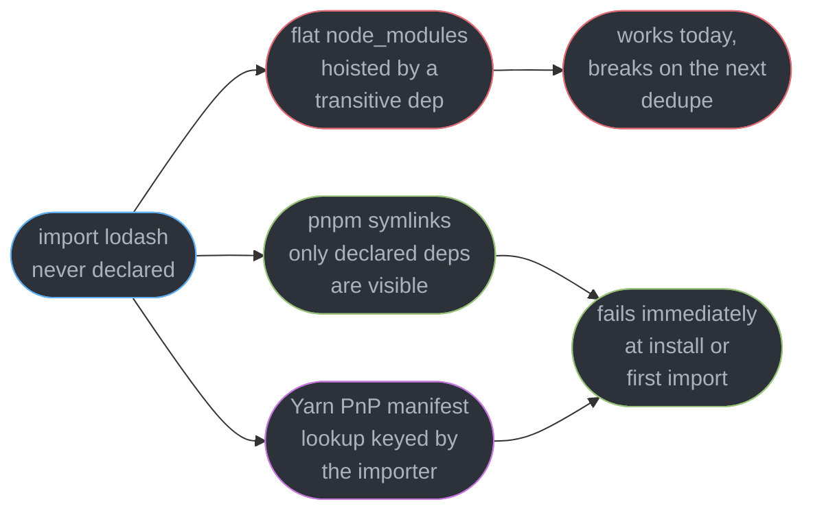
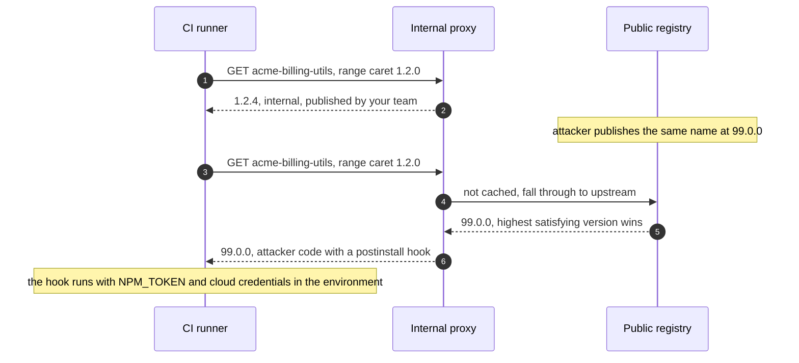
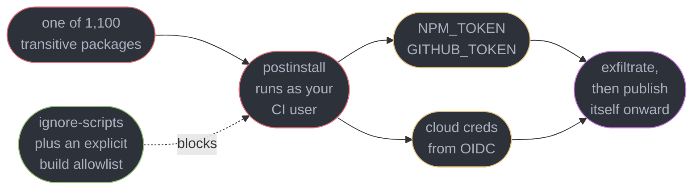
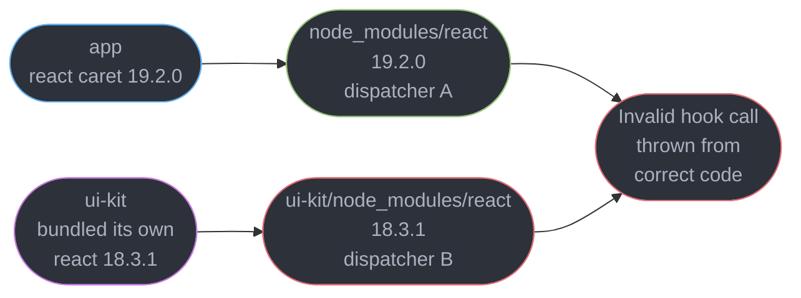
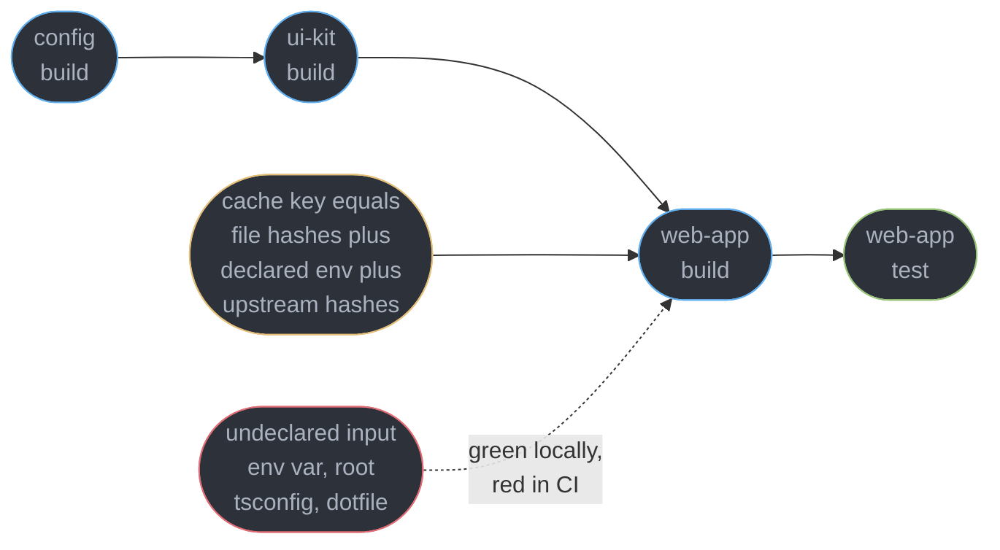

# Package Management and Supply Chain

---

## 1. Concept Overview

A front-end application with 30 direct dependencies resolves to roughly **1,100 packages** on
disk, published by several hundred people you have never met, and every one of them can run code
on your CI runner during `npm install`. A package manager answers two questions — **which exact
version of each package do we install, and where on disk does it live so that `import "x"` finds
it?** — and everything here follows: semver ranges frozen by a lockfile, a `node_modules` layout
deciding what is even resolvable, peer dependencies for packages that must not be duplicated,
workspaces and task graphs at repository scale, and the threat model that makes all of it
security-relevant. That last part is why this is a security module wearing a tooling module's
clothes. An install is not a download; it is **remote code execution you scheduled**, and the
blast radius is whatever credentials your CI job holds. What this module does **not** own:

| Topic | Owner |
|-------|-------|
| Bundling, tree-shaking, chunk splitting, `sideEffects` | [Modules, Bundling and the Build Pipeline](../modules_bundling_and_the_build_pipeline/modules_bundling_and_the_build_pipeline.md) |
| `exports` maps, `moduleResolution`, the dual-package hazard | [Modules, Resolution and Package Exports](../../typescript/modules_resolution_and_package_exports/modules_resolution_and_package_exports.md) |
| Project references, monorepo type builds, `composite` | [TypeScript in Large Codebases](../../typescript/typescript_in_large_codebases/typescript_in_large_codebases.md) |
| Browser-side supply chain, SRI, Magecart, third-party tags | [Browser Security and the Client Threat Model](../browser_security_and_the_client_threat_model/browser_security_and_the_client_threat_model.md) |
| Python and Go packaging | [Packaging and Project Tooling](../../python/packaging_and_project_tooling/packaging_and_project_tooling.md) |
| Deploy pipelines, artifact promotion, CI runners | [Frontend Delivery and Observability](../frontend_delivery_and_observability/frontend_delivery_and_observability.md) |

---

## 2. Intuition

> A package manager is a **constraint solver with a filesystem attached**. It reads a set of
> version ranges, picks one version per package satisfying all of them, and writes that solution
> to disk in a shape the module resolver can walk.

**Mental model.** `package.json` is a wish list, the lockfile is the signed contract, and
`node_modules` is the warehouse. Most incidents are one of three things: the wish list was vaguer
than you thought, the contract was regenerated unread, or the warehouse layout let you take
something you never ordered.

**Why it matters.** This is the only part of your build where a stranger's code executes with
your credentials before a single test runs. In September 2025 the **Shai-Hulud** worm did
exactly that: a `postinstall` script scanned the runner for npm and cloud tokens, exfiltrated
them, and used the stolen npm tokens to publish itself onward — self-propagating across roughly
500 packages in under two days. It came back in November 2025 as **Shai-Hulud 2.0**, which
moved the payload to a `preinstall` script so it ran even when installation failed, and pushed
stolen secrets into **more than 25,000 public GitHub repositories** in roughly two days. npm's
answer was structural: classic tokens could no longer be created, and every existing one was
**permanently revoked on 2025-12-09**, replaced by 2-hour session tokens and granular tokens
capped at 90 days. Any pipeline still authenticating with a classic token broke that morning,
which is the durable lesson — a credential with no expiry is a credential someone else will
eventually revoke for you, on their schedule.

**Key insight, and the one people get wrong.** Your dependency tree is not the list in
`package.json` — it is the transitive closure, it changes when *someone else's* range resolves,
and the only artifact recording what you shipped is the lockfile.

---

## 3. Core Principles

1. **`package.json` declares intent, the lockfile declares reality.** Only one is reproducible.
2. **Installing is executing.** Lifecycle scripts run before your code does, with your
   environment.
3. **Layout is resolution.** Where a package sits decides which copy an import finds, and
   whether an undeclared import resolves at all.
4. **Duplication is legal and invisible** until the duplicated package holds module-level state.
5. **A peer dependency is a demand on the consumer**, not a thing the library installs.
6. **The threat is transitive.** You audit 30 direct dependencies; the attacker publishes to one
   of the other 1,070. And a diff nobody reads is not a control.

---

## 4. Types / Architectures / Strategies

### 4.1 The three resolution models

| Model | Layout on disk | Undeclared import | Disk for 12 projects |
|-------|---------------|-------------------|---------------------|
| **Flat `node_modules`** (npm, Yarn Classic) | hoisted to the top level where possible, conflicts nested | **resolves silently** — the phantom dependency | 12 full copies, roughly 3.6 GB |
| **Symlinked store** (pnpm) | one content-addressed copy globally, hard-linked into `.pnpm`, direct deps symlinked | `ERR_MODULE_NOT_FOUND` at once | one store, roughly 340 MB |
| **Plug'n'Play** (Yarn Berry) | no `node_modules`; zipped packages plus a `.pnp.cjs` manifest | throws, naming the package | one zip cache, smallest |



The three models differ on exactly one design question: **should the resolver be able to find a
package you did not declare?** Flat says yes by accident, the other two say no by construction.

### 4.2 Semver ranges, and what each actually permits

| Range | Expands to | Upgrades on install |
|-------|-----------|--------------------|
| `4.18.0` | exactly `4.18.0` | never |
| `~4.18.0` | `>=4.18.0 <4.19.0` | patches |
| `^4.18.0` | `>=4.18.0 <5.0.0` | minors and patches |
| `^0.18.0` | `>=0.18.0 <0.19.0` | patches only — caret treats `0.x` as breaking |
| `*` / `latest` | anything published | anything, including a hostile release |

`^` is the default `npm install <pkg>` writes for you, so your build is **not reproducible
without a lockfile**: the same `package.json` installed on two days gives two trees. And semver is
a promise from a stranger — a patch release can and does break you.

### 4.3 Task orchestration in a monorepo

| Tool | Version | Model | Cache key |
|------|---------|-------|-----------|
| **Turborepo** | 2.10.12 | task graph from `dependsOn`, `^build` meaning "upstream first" | hashed inputs, declared `env`, task config, upstream hashes |
| **Nx** | 23.2.0 | project graph inferred from imports plus explicit targets | same shape plus inferred and named input sets |
| **plain workspaces** | npm 12, pnpm 11.25, Yarn 4.18 | `--workspaces --if-present`, topological order only | none |

---

## 5. Architecture Diagrams

### 5.1 pnpm's content-addressed store


Both layers matter. The hard links give one copy of `react@19.2.0` per machine; the symlink
layer is what makes an undeclared import fail, because only packages you listed get a link in
the top-level `node_modules`.

### 5.2 Dependency confusion, as the resolver sees it



Alex Birsan demonstrated this in February 2021 against Apple, Microsoft, PayPal, Netflix, Tesla
and Uber, collecting over **130,000 USD** in bounties. Nothing was hacked: the resolver did its
job, and the internal name was resolvable from a registry the attacker could publish to.

### 5.3 What a `postinstall` script reaches



The dotted edge is the highest-leverage control here, and it costs one line of configuration.

### 5.4 Two copies of React, one dispatcher



React keeps the active hook dispatcher in **module-level state**. Two module instances mean two
dispatchers: the component renders under one and calls `useState` from the other, and the error
names your component even though your component is fine.

### 5.5 A monorepo task graph and what a cache key must cover



`dependsOn: ["^build"]` draws the solid edges. The dotted edge is every "works on my machine"
report in a monorepo: an input that affects the output but was never declared, so a stale cache
entry is replayed where a rebuild was needed.

---

## 6. How It Works — Detailed Mechanics

### 6.1 Flattening, and the phantom dependency it invented

npm 3 flattened `node_modules` in 2015 to escape Windows path-length limits and npm 2's deep
duplicate trees. Every package is hoisted to the top level unless a version conflict forces it
to nest. The side effect nobody designed for is that **Node's resolver walks upward through
`node_modules` directories**, so the top level is visible to all of your code:

```js
// package.json declares: express, my-lib. It does NOT declare lodash.
import _ from "lodash";          // resolves — my-lib depends on it and it got hoisted
_.groupBy(orders, "customerId"); // ships to production, passes every test
```

This is a **phantom dependency**: code importing a package it never declared, working entirely
by accident of layout. It breaks the day the hoist target moves — a `my-lib` release bumping to
`lodash@5` nests the old copy, top level now holds `lodash@5`, and the import either fails or
silently picks up an incompatible API. Neither `package.json` nor your diff shows a cause.

pnpm removes the accident. Its `node_modules/` holds a symlink for **each declared dependency
and nothing else**; the real trees live under `node_modules/.pnpm/<name>@<version>/`,
hard-linked from a global content-addressed store, so twelve checkouts share one copy of every
file. Packages relying on phantom resolution genuinely break, which is why `.npmrc` keeps escape
hatches — `public-hoist-pattern[]=*eslint*`, or the bluntly named `shamefully-hoist=true`. Note
which pnpm you get: `pnpm@latest` is **11.25.0**, while **pnpm 12**, the Rust rewrite, went
stable on **2026-08-26** under the **`next-12`** dist-tag. Pin it in `packageManager` so Corepack
gives every developer and CI runner the same binary.

Yarn Berry's **Plug'n'Play** deletes `node_modules` altogether. Packages stay zipped in
`.yarn/cache/` and a generated `.pnp.cjs` maps *(importer, specifier)* to a location inside a
zip, with Node's resolver patched to read it. Resolution becomes a hash lookup, installs are the
fastest of the three, and an undeclared import throws by name. The cost is compatibility:
anything shelling out and expecting real files — some native builds, older editor tooling, a
script doing `fs.readdirSync("node_modules")` — needs a patch or the `nodeLinker: node-modules`
fallback.

### 6.2 Lockfiles: what is pinned, and why `ci` is not `install`

A lockfile records, for every package in the transitive closure, the **exact resolved version**,
the **tarball URL**, an **integrity hash**, and the **tree shape** resolution produced.

```json
// package-lock.json, lockfileVersion 3 — one entry, trimmed
"node_modules/nanoid": {
  "version": "5.1.7",
  "resolved": "https://registry.npmjs.org/nanoid/-/nanoid-5.1.7.tgz",
  "integrity": "sha512-Bo1RM0kL0EQZeCPxbLLZmQ8vMLh0dwF6/nZ6qzYAOOEZDwZ1v+eeGz6UQxNAn/1fqhaJmhc6nCpsK1LgVJXjUw=="
}
```

The `integrity` field is the security half: a Subresource Integrity hash of the tarball, verified
on every install, so a registry serving different bytes fails the install rather than executing
them. The two commands then differ in a way that decides reproducibility:

| | `npm install` | `npm ci` |
|---|---|---|
| Reads | `package.json`, lockfile as a hint | the lockfile only |
| Writes the lockfile | yes, whenever it can improve the tree | never |
| Existing `node_modules` | patched in place | deleted first |
| Lockfile out of sync | silently fixes it | **fails the build** |

```
$ npm ci
npm error `npm ci` can only install packages when your package.json and
npm error package-lock.json are in sync. Please update your lock file with `npm install`
npm error before continuing.
npm error Missing: zod@4.1.5 from lock file
```

That error is the feature. **CI must use `npm ci`** (or `pnpm install --frozen-lockfile`, the
default in CI, or `yarn install --immutable`) so a drifted lockfile is a red build, not a
silently different tree in production.

**Merge conflicts: regenerate, never hand-merge.** A lockfile conflict is a conflict between two
*solutions* to a constraint problem, and hand-picking hunks yields a tree satisfying neither —
most often a subtly duplicated transitive package. Take one side wholesale with
`git checkout --theirs package-lock.json`, run `npm install` against the merged `package.json`,
and commit the result. pnpm and Yarn Berry lockfiles are line-oriented YAML and merge far more
cleanly, but the rule is the same: a lockfile is a build output, so rebuild it.

**Commit it for applications, not for libraries.** An application is deployed and needs one
reproducible tree. A library is *installed into someone else's tree*, where npm ignores its
lockfile entirely — so committing one means CI tests a pinned tree no user will ever have, and a
broken peer range goes unnoticed until they hit it. Libraries test against resolved ranges.

### 6.3 Peer dependencies and the duplicate-React problem

A `dependency` says "install this for me". A **`peerDependency`** says "I will use the copy *you*
installed, and here is the range I work with". It exists for packages holding module-level state
or an identity check — React, `react-dom`, `@apollo/client`, most plugin hosts. If a UI library
listed `react` as a normal dependency, every library would install its own copy and nothing would
share a renderer. The library declares the range as a peer — `"peerDependencies": { "react":
"^18.0.0 || ^19.0.0" }` — keeps a dev dependency to test against, and marks any genuinely
optional peer in `peerDependenciesMeta`. When the range cannot be satisfied, the managers
diverge sharply:

| Manager | Unsatisfiable peer | Missing peer |
|---------|-------------------|--------------|
| npm 12 | hard `ERESOLVE` failure | auto-installs it (since npm 7) |
| pnpm 11 | error, with the conflicting requirements printed | auto-installs by default |
| Yarn Berry 4 | warning, install proceeds | warning only, nothing installed |

`npm install --legacy-peer-deps` ignores peer ranges completely. It is the most common way a
broken tree reaches production: the install goes green and the duplicate lands anyway. Treat it
as a temporary unblock with a ticket attached, never as a setting in `.npmrc`.

**The canonical failure.** Two copies of React in one tree produce this from correct code, and
one command confirms the cause:

```
Invalid hook call. Hooks can only be called inside of the body of a function component.
This could happen for one of the following reasons:
1. You might have mismatching versions of React and the renderer (such as React DOM)
2. You might be breaking the Rules of Hooks
3. You might have more than one copy of React in the same app

$ npm ls react
acme-console@2.4.0
├── react@19.2.0
└─┬ @acme/ui-kit@3.1.0
  └── react@18.3.1   invalid: "^19.2.0" from the root project
```

Reason 3 is the one actually happening most of the time. The escape hatch forces one version
across the whole tree; each manager spells it differently and all three rewrite the resolution
rather than the declared ranges:

```json
{ "overrides":   { "react": "19.2.0" },
  "pnpm":        { "overrides": { "react": "19.2.0" } },
  "resolutions": { "react": "19.2.0" } }
```

An override claims the pinned version satisfies everyone, and nothing verifies it. Comment which
dependency forced it and delete it when that dependency updates — an unexplained override
outlives the problem it solved by years.

### 6.4 Workspaces and task graphs

A workspace is one repository holding many packages that depend on each other by name. The
manager symlinks the local package into `node_modules` instead of downloading it.

```json
// pnpm-workspace.yaml lists packages: ["apps/*", "packages/*"]
// apps/web/package.json — the workspace protocol
{ "dependencies": { "@acme/ui-kit": "workspace:*", "react": "^19.2.0" } }
```

`workspace:*` means **"the local one, whatever version it is"**, and the manager fails the
install rather than silently falling back to the registry when it is missing. On publish the
specifier is rewritten to the real version, so consumers get `"@acme/ui-kit": "3.1.0"`. npm and
Yarn Berry understand `workspace:` too; a bare `"*"` under npm workspaces also links locally but
*will* fall through to the registry, which is how a private name gets fetched from public npm —
one step from dependency confusion.

Hoisting returns at monorepo scale. With flat workspaces one app's dependency is hoisted to the
repo root and every other app can import it, so the app builds in the monorepo and fails the
moment it is deployed alone. pnpm's layout prevents it; under npm or Yarn workspaces, building
each app from a fresh isolated install in CI is the only reliable detector.

**Task orchestration.** `pnpm -r build` runs in topological order and nothing more. Turborepo
2.10.12 and Nx 23.2.0 add the two things that matter at 40 packages: a **task graph** and
**content-addressed caching**.

```json
// turbo.json
{
  "tasks": {
    "build": { "dependsOn": ["^build"], "outputs": ["dist/**"],
               "inputs": ["src/**", "tsconfig.json", "package.json"],
               "env": ["NEXT_PUBLIC_API_URL"] }
  },
  "globalDependencies": ["tsconfig.base.json", ".nvmrc"]
}
```

`^build` means "build every upstream workspace dependency first". A task's cache key hashes its
declared `inputs`, its `env` values, the task config and its upstream tasks' hashes, so an
unchanged package replays `outputs` from cache in milliseconds.

**This is why "works on my machine but not in CI" is a task-graph problem.** The failure is
almost never flakiness; it is an **undeclared input** — an env var read at build time but absent
from `env`, a root `tsconfig.base.json` missing from `globalDependencies`, a generated file
written outside `outputs`, or an `.env` present locally and absent on the runner. Each produces a
hash that matches when the output should have changed, so a stale artifact is replayed. Diagnose
with `turbo run build --filter=web --dry=json`, which prints the resolved inputs and hash per
task, or `nx run web:build --verbose`. Type-level monorepo mechanics — project references,
`composite`, `tsc` build ordering — belong to
[TypeScript in Large Codebases](../../typescript/typescript_in_large_codebases/typescript_in_large_codebases.md).

### 6.5 The threat model

Two properties define it. **An install executes code**: `preinstall`, `install` and `postinstall`
scripts run as your user, with your environment, before any test. And **it is transitive**: 30
direct dependencies mean roughly 1,100 maintainer accounts with a path into your CI runner, where
the environment typically holds an `NPM_TOKEN`, a `GITHUB_TOKEN` with write scope, and
short-lived cloud credentials from OIDC.

| Attack class | How it works | Documented incident |
|-------------|-------------|--------------------|
| **Typosquatting** | publish a near-miss name and wait for a typo or a copied README | `crossenv` mimicking `cross-env`, 2017 — dozens of squats harvesting environment variables |
| **Dependency confusion** | publish an internal package name publicly at a higher version | Birsan, February 2021 — code execution inside Apple, Microsoft, PayPal, Netflix, Tesla, Uber; over 130,000 USD in bounties |
| **Account takeover** | phish or credential-stuff a maintainer, publish a malicious version of a real package | `ua-parser-js` 0.7.29 / 0.8.0 / 1.0.0, October 2021 — cryptominer plus credential stealer at roughly 8 million weekly downloads. `eslint-scope`, July 2018, stole `.npmrc` tokens. `@solana/web3.js` 1.95.6 / 1.95.7, December 2024 — key exfiltration |
| **Compromised build of a legitimate package** | the published artifact differs from the public source | **XZ Utils, CVE-2024-3094**, March 2024 — a backdoor present in the release tarball and absent from the git repository, after two years of social engineering to obtain co-maintainer status |
| **Ownership transfer** | a burned-out maintainer hands the package to a volunteer | `event-stream` 3.3.6, 2018 — the new owner added `flatmap-stream`, whose encrypted payload targeted the Copay bitcoin wallet only |
| **Maintainer sabotage** | the legitimate owner ships destructive code deliberately | `colors` 1.4.44-liberty-2 and `faker` 6.6.6, January 2022 — infinite loop breaking thousands of builds. `node-ipc` 10.1.1, March 2022 — overwrote files by geolocation |
| **Self-propagating worm** | stolen publish tokens inject the payload into further packages | **Shai-Hulud**, September 2025 — scanned runners for npm and cloud credentials, exfiltrated them, republished itself; roughly 500 packages affected. The same month a phish of the `chalk` and `debug` maintainer poisoned 18 packages with 2 billion combined weekly downloads with a browser wallet-address swapper. **Shai-Hulud 2.0**, November 2025 — the same worm on a `preinstall` hook, exposing secrets in over **25,000** GitHub repositories and forcing npm to revoke every classic token on 2025-12-09 |

Two patterns recur across the whole table. **The name is the identity** — nothing binds
`ua-parser-js` on the registry to the GitHub repository people read; and **the maintainer is a
single point of failure**, so every control assuming an account stays uncompromised is already
defeated.

### 6.6 Defences, in order of leverage

**1. Do not run install scripts.** Most front-end dependencies do not need them; the ones that do
are native builds you can enumerate. **pnpm 10 and later blocks lifecycle scripts by default**
and demands an explicit allowlist — adding a name to that list is a reviewable event, whereas
adding a package with a `postinstall` under npm's defaults is not.

```
# .npmrc — removes the postinstall execution path entirely
ignore-scripts=true

# package.json under pnpm — the allowlist of builds you actually need
#   { "pnpm": { "onlyBuiltDependencies": ["esbuild", "sharp"] } }
```

**2. Scope private packages and claim the scope.** Dependency confusion needs an internal name
resolvable from a public registry. Bind the scope, publish a placeholder `@acme` scope on public
npm so the name cannot be taken, and confirm your proxy does not fall through to upstream for
`@acme/*` — a permissive proxy reopens the hole `.npmrc` just closed.

```
# .npmrc — @acme resolves ONLY internally, never via an upstream fallthrough
@acme:registry=https://npm.acme.internal/
//npm.acme.internal/:_authToken=${INTERNAL_NPM_TOKEN}
```

**3. Delay adoption of brand-new versions.** Nearly every incident above was unpublished within
hours to days, so a cooling-off window turns most into a non-event: `minimumReleaseAge: 4320` in
`pnpm-workspace.yaml` refuses anything published less than three days ago.

**4. Verify provenance.** `npm publish --provenance` from a GitHub Actions or GitLab CI workflow
produces a **Sigstore**-signed attestation, recorded in a public transparency log, binding the
tarball's digest to a specific repository, commit and workflow run. It is the missing link
between "the code I read on GitHub" and "the tarball I installed" — exactly what would have
exposed the XZ Utils release. `npm audit signatures` verifies a whole tree at once. Pair it with
**trusted publishing**, OIDC-based with no long-lived token to steal, for what you publish.

**5. Pin exact versions for high-risk dependencies.** Build tooling, anything with a native build
step and anything near credentials get `"esbuild": "0.28.2"`, not `^0.28.2`, updated deliberately
through a bot PR you actually read.

**6. Review lockfile diffs, but make the review possible.** A 4,000-line diff is not reviewable,
and pretending otherwise is worse than admitting it. What works is a CI check that fails when the
lockfile moves without a corresponding `package.json` change — the shape of an injected
transitive dependency — plus a bot summarising **new packages** rather than lines.

**7. Know what `npm audit` does not tell you.** It matches installed version ranges against a
published advisory database with **no reachability analysis**, so a prototype-pollution advisory
in a dev-only test reporter reads identically to a deserialisation bug in your request path, and
it is silent on a malicious package with no advisory yet — every incident in 6.5, on the day it
mattered. Run `npm audit --omit=dev --audit-level=high` as a signal and triage by usage: "zero
vulnerabilities" describes the advisory database, not your application.

### 6.7 Auditing your own tree

Every question starts with **who pulled this in**. `pnpm why`, `npm ls <pkg> --all` and `yarn why`
print the path from something you declared to the package in question — the only way to decide
whether an advisory or an override is even relevant to you.

```bash
$ pnpm why minimist
dependencies:
@acme/build-tools 2.1.0
└─┬ mkdirp 0.5.6
  └── minimist 1.2.8

$ npm ls --omit=dev --depth=0     # what actually ships, ignoring the dev tree
$ npm view left-pad dist.unpackedSize versions time.modified maintainers
```

**Attribute bytes back to a package** with `source-map-explorer` or a bundler treemap — the same
measurement described in
[Modules, Bundling and the Build Pipeline](../modules_bundling_and_the_build_pipeline/modules_bundling_and_the_build_pipeline.md),
read here for a different purpose: not "which chunk is big" but "which dependency is worth its
transitive risk". And the question to ask **before** every `npm install`: what does this add
transitively, does it run install scripts, when was it last published, how many maintainers does
it have — and **could I write it in twenty lines instead?** Each dependency removed is a
maintainer account that can no longer reach your CI runner.

---

## 7. Real-World Examples

**A phantom dependency that survived two years.** A dashboard imported `classnames` in 14 files
and never declared it; a router dependency had hoisted it. Migrating to pnpm for CI speed turned
14 `ERR_MODULE_NOT_FOUND` failures into the first build, fixed by one `pnpm add classnames`. The
same import under npm would have broken on any release that moved the hoist target, at a moment
nobody was looking at dependencies.

**An `--legacy-peer-deps` that shipped a duplicate.** A team hit `ERESOLVE` upgrading to React 19
because one date-picker still declared `"react": "^18.0.0"`, and added `--legacy-peer-deps` to
the CI install to unblock the release. Install went green, the picker nested its own React
18.3.1, and every page using it threw `Invalid hook call` in production only, because the dev
server's pre-bundling had deduplicated them. `npm ls react` showed both copies in four seconds.

---

## 8. Tradeoffs

| Dimension | Flat `node_modules` | pnpm store | Yarn PnP |
|-----------|--------------------|-----------|----------|
| Ecosystem compatibility | total | very high, escape hatches exist | lowest, some tools need patches |
| Cold install speed | slowest | fast | fastest |
| Debuggability | open the folder | follow a symlink | read a manifest |

---

## 9. When to Use / When NOT to Use

**Use pnpm when** you have a monorepo, more than four projects on one machine, or you want
phantom dependencies to fail loudly — its strictness is the feature. **Use Yarn PnP when** install
speed and zero-install checkouts outrank tool compatibility and you can absorb patching a few
packages. **Use npm when** the team is small and ecosystem compatibility outranks everything.
**Commit the lockfile when** the package is deployed. **Add Turborepo or Nx when** you exceed
about eight packages and a four-minute build. **Pin exactly when** the dependency runs at build
time or near credentials.

**Do NOT** run `npm install` in CI — use `npm ci`, `pnpm install --frozen-lockfile`, or
`yarn install --immutable`. **Do NOT** hand-merge a lockfile conflict. **Do NOT** commit a
lockfile in a published library. **Do NOT** put `--legacy-peer-deps` in `.npmrc`. **Do NOT** treat
a green `npm audit` as evidence of anything. **Do NOT** let an internal package name be resolvable
from a public registry. **Do NOT** add a dependency you could write in twenty lines.

---

## 10. Common Pitfalls

### Pitfall 1: a phantom dependency that breaks when the tree dedupes differently (BROKEN → FIX)

```ts
// BROKEN — `date-fns` is nowhere in package.json. It resolves because @acme/ui-kit depends on
// it and npm hoisted it to the top level, where Node's upward resolver finds it.
//
//   $ npm ls date-fns
//   acme-console@2.4.0
//   └─┬ @acme/ui-kit@3.1.0
//     └── date-fns@3.6.0     <-- no path from the root project. Nothing declared this.
//
// Six weeks later ui-kit@3.2.0 moves to date-fns@4, whose formatISO signature changed.
// Nothing in the diff mentions date-fns. The build is green. Timestamps render "Invalid Date".
import { formatISO } from "date-fns";
export const stamp = (d: Date) => formatISO(d);
```

```ts
// FIX — declare it. `npm i date-fns@^3.6.0` adds it to package.json and the lockfile, so
// resolution becomes a stated constraint the solver must satisfy rather than a side effect.
import { formatISO } from "date-fns";
```

The systemic fix is the layout, not the import: under pnpm this fails at the first build with
`Cannot find package 'date-fns'`, six weeks before it can render a wrong date. Migrating a mature
repo surfaces 5 to 40 of these at once — a pre-existing backlog becoming visible, not a regression.

### Pitfall 2: an internal package name resolvable from public npm (BROKEN → FIX)

```
# BROKEN — .npmrc. A catch-all upstream with no scope rule. `@acme/billing-utils` is looked
# up internally, missed, and fetched from public npm, where anyone may publish it.
registry=https://npm.acme.internal/repository/npm-group/
always-auth=true
```

```
# FIX — bind the scope to the internal registry. It is never resolved anywhere else, so a
# public package of the same name is unreachable regardless of its version number.
@acme:registry=https://npm.acme.internal/
//npm.acme.internal/:_authToken=${INTERNAL_NPM_TOKEN}
registry=https://registry.npmjs.org/
```

Then do the two things the file cannot do: publish a placeholder to claim the `@acme` scope on
public npm, and confirm your proxy is configured **not** to fall through to upstream for that
scope. This is the configuration that would have stopped every case in Birsan's 2021 research.

---

## 11. Technologies & Tools

| Tool | Role | Relevance |
|------|------|-----------|
| npm | Package manager | 12.0.2, flat `node_modules`, `overrides`, provenance publishing |
| pnpm | Package manager | 11.25.0 latest, 12 on `next-12`; content-addressed store, strict |
| Yarn Berry | Package manager | 4.18.0, Plug'n'Play, `resolutions`, zero-install |
| Corepack | Version pinning | Pins the manager itself via `packageManager` |
| Turborepo | Task orchestration | 2.10.12, task graph and content-addressed cache |
| Nx | Task orchestration | 23.2.0, inferred project graph, distributed cache |
| Sigstore | Signing | Keyless signing and transparency log behind npm provenance |
| Renovate | Update automation | Grouped PRs, scheduling, cooling-off windows |
| Socket | Supply-chain analysis | Flags install scripts, network use and obfuscation in a PR |
| Syft | SBOM generation | Produces an SPDX or CycloneDX inventory from a tree |

---

## 12. Interview Questions with Answers

**Q: What is a phantom dependency, and why does it eventually break?**
**Short:** Flattening lifts transitive packages to the top of node_modules, so code can import something it never declared and work purely by accident of layout.

Node's resolver walks upward through `node_modules` and npm hoists everything it can, so a
package your dependency installed is visible to your source. It breaks when the hoist target
moves: an upstream release bumps its own copy, the old version nests, and your import resolves to
a different major or fails silently. pnpm fails at the first build instead; declare the dependency.

**Q: Why do two copies of React produce `Invalid hook call` from code that is correct?**
**Short:** Two module instances mean two dispatchers, so a component rendered under one copy calls useState from the other and the internal state lookup returns null.

React keeps the active hook dispatcher in module-level state. A library declaring `react` as a
normal dependency instead of a peer dependency, or an install run with `--legacy-peer-deps`, lands
a second copy nested under the library. `npm ls react` shows both copies immediately. Fix it at
the source with a correct `peerDependencies` range, and unblock locally with `overrides`.

**Q: What is the difference between `npm install` and `npm ci`, and which belongs in CI?**
**Short:** Install may rewrite the lockfile and patch an existing tree, while ci deletes node_modules, installs strictly from the lockfile, and fails when the two manifests disagree.

That failure is the point: it turns a drifted lockfile into a red build rather than a silently
different tree in production. `npm install` will happily resolve a caret range to a version
published an hour ago and deploy it with no record anywhere. CI uses `npm ci`,
`pnpm install --frozen-lockfile` or `yarn install --immutable`; developers use `install`.

**Q: What does dependency confusion exploit, and how do you close it?**
**Short:** Registry resolution picks the highest version satisfying a range across every configured source, so an internal name published publicly at a higher version wins.

Alex Birsan demonstrated it in February 2021 against Apple, Microsoft, PayPal, Netflix, Tesla and
Uber, earning over 130,000 USD purely by publishing internal names to public npm. The fix is
scoping: `@acme:registry=https://npm.acme.internal/` in `.npmrc` so the scope is never resolved
elsewhere, a proxy that does not fall through for it, and the `@acme` scope claimed on public npm.

**Q: Two branches changed dependencies and the lockfile conflicts. How do you resolve it?**
**Short:** Regenerating from the merged package.json is the only correct resolution, because a lockfile is one whole solution to a constraint problem rather than independent lines.

Hand-picking hunks produces a tree satisfying neither branch, most often a duplicated transitive
package that surfaces weeks later. Take one side wholesale with
`git checkout --theirs package-lock.json`, run `npm install` against the merged `package.json`,
and commit the result. A lockfile is a build output, so rebuild it rather than editing it.

**Q: Should a published library commit its lockfile?**
**Short:** Applications commit lockfiles because they are deployed and need one reproducible tree, while a library is installed into someone else's tree where its lockfile is ignored.

Committing one in a library means CI tests a pinned tree no consumer will ever have, so a broken
peer range or an incompatible transitive upgrade stays invisible until a user reports it.
Libraries should test against freshly resolved ranges, ideally a matrix over the oldest and newest
supported peer versions. Applications commit it, always, and CI installs from it strictly.

**Q: What does a caret range actually permit, and why does it defeat reproducibility?**
**Short:** Caret ranges resolve to anything below the next major, so the same package.json installed on two days can produce two different trees with nothing changed in the repository.

`^4.18.0` is `>=4.18.0 <5.0.0`; `~4.18.0` is patch-only; `^0.18.0` is patch-only too, because
caret treats `0.x` minors as breaking. The lockfile is what makes a caret range safe, which is why
an install ignoring it is the reproducibility bug. And a patch release can and does break you —
semver is a promise from a stranger, not a guarantee.

**Q: What actually runs during `npm install`, and what should you do about it?**
**Short:** Install scripts execute arbitrary code as your user before any test runs, so every transitive package holds whatever credentials are present in your CI environment.

`preinstall`, `install` and `postinstall` hooks reach `NPM_TOKEN`, `GITHUB_TOKEN`, OIDC cloud
credentials and your source tree — exactly the path the Shai-Hulud worm used in September 2025 to
steal tokens and republish itself across roughly 500 packages. Set `ignore-scripts=true` and
allowlist the native builds you need; pnpm 10 and later already blocks scripts by default.

**Q: What is a peer dependency and how do the managers differ on it?**
**Short:** Peer dependencies declare a package the consumer must supply rather than one the library installs, which is how a plugin shares a single instance with its host.

Any package holding module-level state or performing an identity check needs it: React,
`react-dom`, most plugin hosts. npm 12 auto-installs a missing peer and fails hard on an
unsatisfiable one; pnpm auto-installs by default and errors on conflict; Yarn Berry warns and
proceeds. `--legacy-peer-deps` disables the check and ships duplicates on a green build.

**Q: When is `overrides` or `resolutions` the right answer, and what is the risk?**
**Short:** Overrides force one version across the whole tree regardless of declared ranges, which unblocks a stale peer range but asserts a compatibility that nothing verifies.

npm uses `overrides`, pnpm `pnpm.overrides`, Yarn Berry `resolutions`; all three rewrite
resolution rather than the ranges. They are correct for pinning a single React across a monorepo
or forcing a patched transitive dependency ahead of an upstream release. Comment which dependency
forced each one and delete it when that dependency updates.

**Q: What does pnpm's layout actually change, and what breaks under it?**
**Short:** Symlinked node_modules exposes only your declared dependencies at the top level, so an undeclared import that flattening resolved by accident now fails at the first build.

The real trees live under `node_modules/.pnpm/<name>@<version>/`, hard-linked from a global
content-addressed store, so twelve checkouts share one copy of each file — roughly 340 MB against
3.6 GB. What breaks is anything relying on phantom resolution; `public-hoist-pattern[]` and
`shamefully-hoist` are the escape hatches. Note `pnpm@latest` is 11.25.0 while the Rust rewrite,
pnpm 12, ships under the `next-12` tag.

**Q: What does Yarn Plug'n'Play remove, and what does that cost?**
**Short:** Resolution through a generated manifest replaces the directory walk entirely, leaving packages zipped in a cache with Node's resolver patched to read a lookup table.

`.pnp.cjs` maps importer plus specifier to a location inside a zip in `.yarn/cache`, so installs
are the fastest of the three, resolution is a hash lookup, and an undeclared import throws with
the package named. The cost is compatibility: anything expecting real files on disk — native
builds, older editor tooling, `fs.readdirSync` — needs a patch or `nodeLinker: node-modules`.

**Q: What are the real limits of `npm audit`?**
**Short:** Advisory matching reports whether a vulnerable version range is present in your tree, with no analysis of whether your code can actually reach the vulnerable path.

A prototype-pollution advisory in a dev-only test reporter reads identically to a bug in your
request path, which trains teams to dismiss the output wholesale. It is also blind to malicious
packages with no advisory yet — every incident of the last decade, on the day it mattered. Run
`npm audit --omit=dev --audit-level=high` and triage by reachability.

**Q: What does npm provenance prove that a version number does not?**
**Short:** Provenance attestations bind a published tarball's digest to a specific repository, commit and CI workflow run, signed through Sigstore and recorded in a public transparency log.

Without it nothing connects the code you read on GitHub to the bytes you installed — precisely the
gap the XZ Utils backdoor used in March 2024, where the malicious code sat in the release tarball
and not in the git repository. Publish with `npm publish --provenance` from CI, prefer OIDC
trusted publishing so there is no long-lived token to steal, and verify with `npm audit signatures`.

**Q: What does `workspace:*` mean and why prefer it to a version range?**
**Short:** Local packages resolve to the sibling in the repository whatever its version, and the install fails loudly instead of silently falling back to the public registry.

On publish the specifier is rewritten to the real version, so consumers receive a normal range. A
bare `"*"` under npm workspaces also links locally but *will* fall through to the registry if the
local package is missing — which is how a private name gets fetched from public npm, one step from
dependency confusion. Use the explicit protocol everywhere it is supported.

**Q: A monorepo task passes locally and fails in CI. Where do you look?**
**Short:** Cache keys hash only declared inputs, so an env var or config file that affects the output but was never declared lets a stale artifact replay where a rebuild was needed.

The usual four: a build-time env var missing from `turbo.json`'s `env`, a root
`tsconfig.base.json` absent from `globalDependencies`, a generated file written outside `outputs`,
or a local `.env` the runner does not have. Print what the tool actually hashed with
`turbo run build --dry=json` or `nx run web:build --verbose`, then declare the missing input.

**Q: A transitive package has an advisory. How do you find out whether it matters?**
**Short:** Tree queries print the path from something you declared down to the package in question, which is the only way to tell a shipped dependency from a dev-only one.

`pnpm why minimist`, `npm ls minimist --all` and `yarn why minimist` all print that chain. Follow
it with `npm ls --omit=dev --depth=0` to see what actually ships, and attribute bytes back to a
package with `source-map-explorer`, the same measurement used in
[Modules, Bundling and the Build Pipeline](../modules_bundling_and_the_build_pipeline/modules_bundling_and_the_build_pipeline.md).

**Q: How do you decide whether to add a dependency at all?**
**Short:** Transitive weight and maintainer count are the real cost, because each added package is another account with a path into your CI runner and its credentials.

Ask four things before installing: how many packages it adds transitively, whether it runs install
scripts, when it was last published, and how many maintainers it has. Then ask the one that
removes most of them — could this be twenty lines of your own code? A date formatter,
`crypto.randomUUID()`, a `structuredClone` deep copy: each is one fewer account reaching your CI.

---

## 13. Best Practices

1. **Install with `ci`, `--frozen-lockfile` or `--immutable` in CI.** Never `npm install`.
2. **Commit the lockfile for applications, never for published libraries.**
3. **Pin the package manager** in `packageManager` so every machine runs the same binary.
4. **Set `ignore-scripts=true`** and allowlist the native builds you actually need.
5. **Scope private packages to an internal registry** and claim the scope on public npm.
6. **Regenerate lockfile conflicts**, never hand-merge them.
7. **Publish with `--provenance` from CI** and verify with `npm audit signatures`.
8. **Ban `--legacy-peer-deps`** anywhere it can be persisted; fix the peer range instead.
9. **Apply a cooling-off window**, and **declare every task input** including env vars.

---

## 14. Case Study

### A dependency-confusion near miss and the tree it exposed

A fintech front-end team ran a 24-package monorepo on npm workspaces: 41 direct dependencies,
**1,183 packages** resolved, CI installing with `npm install` on a runner holding an `NPM_TOKEN`,
a `GITHUB_TOKEN` with write scope, and 60-minute AWS credentials from OIDC. A routine `npm ls`
during an upgrade showed `@acme/analytics-sdk@0.0.1-security` in the tree — the placeholder name
npm assigns to a removed package. Their internal `@acme/analytics-sdk` was at `2.4.1`. Something
had briefly resolved a public package carrying their internal name.

```json
// BROKEN — three defaults lining up: a catch-all upstream with no scope binding, a local
// workspace package on a bare wildcard that falls through to the registry when it is missing,
// and a non-frozen install with scripts enabled and full credentials in the environment.
//   .npmrc     registry=https://npm.acme.internal/repository/npm-group/
//   ci step    run: npm install   with NPM_TOKEN and AWS_ROLE_ARN in env
{ "dependencies": { "@acme/analytics-sdk": "*", "esbuild": "^0.28.0" } }
```

```json
// FIX — the scope is bound internally and claimed on public npm, the workspace protocol fails
// rather than falling through, the build-time dependency is pinned exactly, and the install is
// frozen with scripts off and the one native build named explicitly.
//   .npmrc     @acme:registry=https://npm.acme.internal/
//              registry=https://registry.npmjs.org/
//              ignore-scripts=true
//   ci steps   npm ci --ignore-scripts | npm rebuild esbuild | npm audit signatures
{ "dependencies": { "@acme/analytics-sdk": "workspace:*", "esbuild": "0.28.2" } }
```

**What the audit found once the tree was visible.** `npm ls` surfaced **two copies of React**
(19.2.0 at the root, 18.3.1 nested under an internal chart wrapper whose peer range still read
`^18`), fixed with an `overrides` pin and an upstream PR. **31 packages declared install
scripts**; exactly one, `esbuild`, was needed. Eleven phantom dependencies appeared once each app
was built from a clean isolated install. `npm audit signatures` verified 1,183 registry signatures
and **only 641 provenance attestations**, which became the acceptance criterion for new
dependencies.

**Outcome after one quarter.** Zero further public-registry resolutions of an internal name. CI
install time fell from 94 s to 51 s with scripts disabled. Two dependencies were deleted outright
and replaced with 34 lines of local code. The team added `minimumReleaseAge` at 4,320 minutes
after the September 2025 `chalk` and `debug` compromise — where the malicious versions were
unpublished within roughly two hours — and their next upgrade window skipped them unnoticed.

**The lesson.** No individual choice here was reckless. A catch-all registry was convenient, a
`"*"` range read as "the local one", `npm install` was what the template generated, and full
credentials were there because one job needed them. The near miss was not an attacker being
clever; it was four defaults lining up, and the tree had been in that state for three years
before anyone ran `npm ls`.
