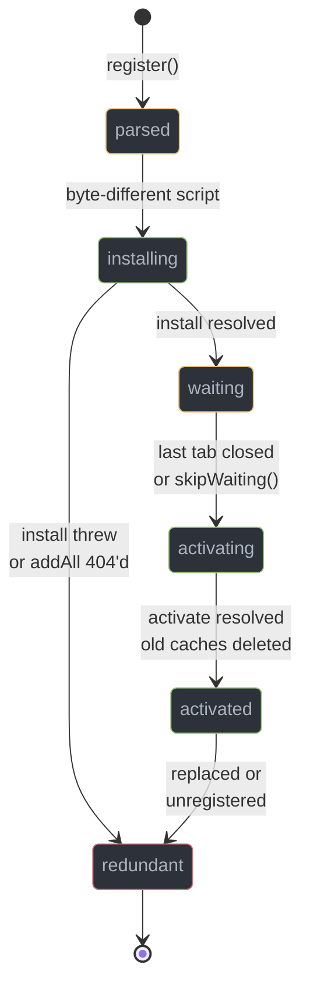
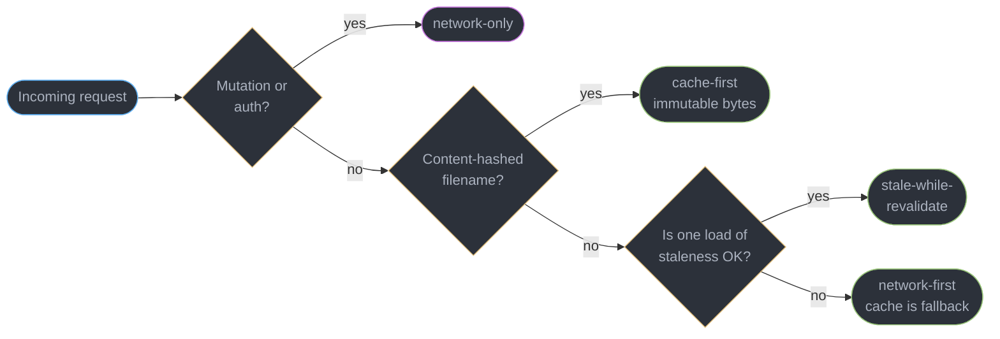
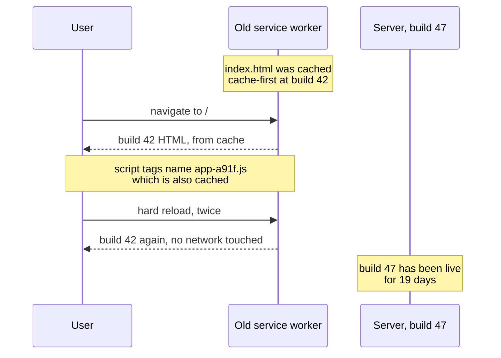
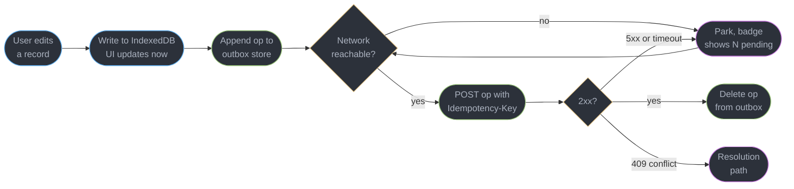
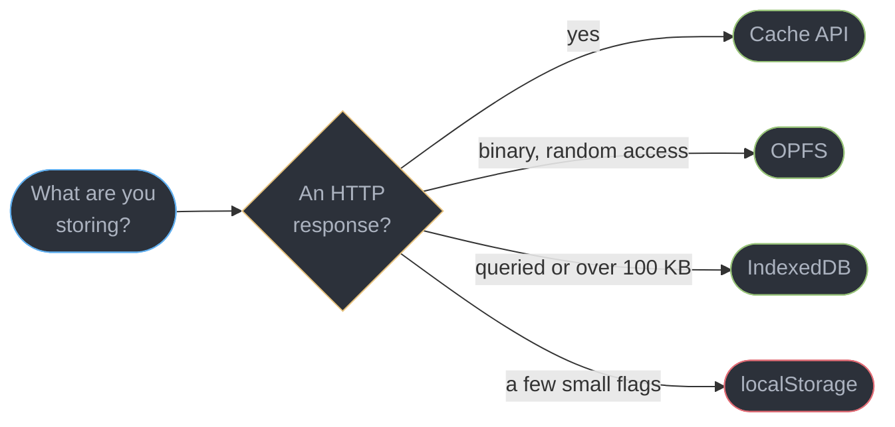
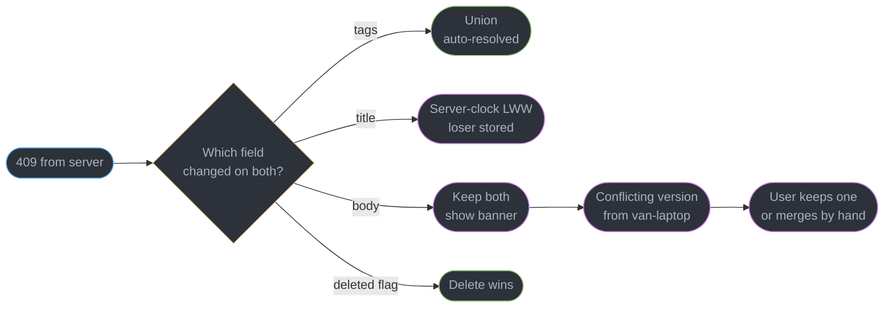

# PWA, Service Workers and Offline

---

## 1. Concept Overview

A Progressive Web App is not a framework and not a build target. It is three unrelated
platform capabilities that happen to ship together: a **persistent client-side store**, a
**programmable network proxy** that runs in its own thread whether or not your page is open,
and an **install surface** that lets the browser hand its window chrome over to you.

The API is small. What makes this module hard is that a service worker inverts the
deployment relationship every web engineer relies on: a bad server deploy is fixed by the
next deploy, while a bad service worker deploy can prevent the next deploy from ever
reaching the user. **A bad service worker is worse than none, because it persists.**

The second hard half is that offline is not a caching problem but a **replication** problem.
Once a user can write while disconnected you own a distributed system, and every question a
distributed database answers — ordering, conflict, deletion, convergence — is now a question
your front end answers. Section 14 is that problem end to end.

**Where the boundary is.** `fetch`, the browser's own HTTP cache, `Cache-Control` and `ETag`
belong to [`../http_in_the_browser_and_fetch/http_in_the_browser_and_fetch.md`](../http_in_the_browser_and_fetch/http_in_the_browser_and_fetch.md),
and this module never restates them. Reconnect and the send queue for a live connection are
[`../realtime_in_the_browser/realtime_in_the_browser.md`](../realtime_in_the_browser/realtime_in_the_browser.md);
asset hashing and the post-deploy chunk 404 are
[`../frontend_delivery_and_observability/frontend_delivery_and_observability.md`](../frontend_delivery_and_observability/frontend_delivery_and_observability.md);
CRDTs and operational transform are
[`../../react/case_studies/design_a_realtime_collaborative_editor.md`](../../react/case_studies/design_a_realtime_collaborative_editor.md);
edge caching is [`../../hld/cdn/cdn.md`](../../hld/cdn/cdn.md).

---

## 2. Intuition

> A service worker is a server you deploy to a device you do not own, on a schedule you do
> not control, and cannot recall.

**Mental model.** Registering a service worker installs a reverse proxy between your pages
and the network. It outlives every tab, survives reload and restart, and answers from a cache
you wrote. It updates only when the browser next checks the script, sees different bytes,
installs the copy, and the *old copy stops controlling every open page* — which by default
means when the user closes the last tab.

**Key insight.** Ask of every response: *if this became permanently stale, would the app
still be recoverable?* Where the answer is no — the HTML shell, the worker script, the auth
endpoints — never serve cache-first, at any hit rate.

---

## 3. Core Principles

1. **The HTML shell is never cache-first.** It is the pointer to every hashed asset. Pin it
   and you pin the whole application to one build, forever.
2. **The new worker waits on purpose.** An open page's JavaScript was compiled against a
   specific set of assets; swapping the server underneath it mid-session is exactly the
   race the waiting state exists to prevent.
3. **Cache names carry a version, and `activate` deletes everything else.** A cache with no
   version has no eviction story, and cache storage is not garbage-collected for you.
4. **Every replayed write must be idempotent.** An outbox retries. A retry that reaches a
   server which already applied the first attempt must be a no-op, not a second row.
5. **Deletes need a record.** In a replicated system, absence is indistinguishable from
   "not yet synced", so a delete is a write of a tombstone, never the removal of a row.
6. **A flaky connection is a worse adversary than no connection.** `navigator.onLine` is
   true, the socket opens, and the request hangs for 90 seconds — while airplane mode, the
   easy case, is the only one most code is tested against.

---

## 4. Types / Architectures / Strategies

### 4.1 The client storage APIs, chosen on criteria

| Store | Access | Holds | Typical cap | Choose it when |
|-------|--------|-------|-------------|----------------|
| `localStorage` | **synchronous, main thread** | strings only | about 5 MB per origin | a handful of small flags read once at boot |
| `sessionStorage` | synchronous | strings only | about 5 MB per tab | per-tab state that must die with the tab |
| **IndexedDB** | asynchronous, transactional | structured clone: objects, `Blob`, `ArrayBuffer`, `Date`, `Map` | share of the origin quota | the real application store — records, an outbox, anything queried |
| **Cache API** | asynchronous, promise | `Request`/`Response` pairs, headers intact | share of the origin quota | HTTP responses, from a service worker |
| **OPFS** | async, plus sync handles in a worker | file handles, byte ranges | share of the origin quota | SQLite in WASM, large binaries, random-access writes |

The decisive property is the first column. `localStorage` is the only one that blocks: a
`JSON.parse` of a 2 MB blob costs roughly 120 ms of frozen main thread on a mid-tier Android
phone against an INP budget of 200 ms at p75, so everything hot or large belongs in IndexedDB
or OPFS. Why blocking the main thread costs interactivity is
[`../the_event_loop_and_scheduling/the_event_loop_and_scheduling.md`](../the_event_loop_and_scheduling/the_event_loop_and_scheduling.md).

### 4.2 Quota, eviction and persistence

`navigator.storage.estimate()` reports `usage` and `quota` for the whole origin — IndexedDB,
Cache API and OPFS share one pool. Chromium's quota is up to about **60% of total disk**;
Firefox's group limit is 20% of a global limit that is itself 10% of disk, capped at 10 GiB.
Neither number is a promise: storage defaults to the **best-effort** bucket, and under disk
pressure the browser evicts least-recently-used origins whole, with no observable event.
WebKit also clears script-writable storage for a site with **no user interaction for 7
days**. `await navigator.storage.persist()` requests the **persistent** bucket, exempt from
automatic eviction — Chromium grants it silently on an engagement heuristic, Firefox
prompts, and a `false` return means you must tolerate losing everything.

### 4.3 The five caching strategies, each with its decision rule

| Strategy | Rule that selects it | Fits |
|----------|---------------------|------|
| **cache-first** | the URL's bytes can never change | content-hashed JS, CSS, fonts, images |
| **network-first** | stale is wrong, but nothing is better than an error | the HTML shell, API reads, anything authenticated |
| **stale-while-revalidate** | a version one load old is genuinely fine | avatars, settings, a question bank, a feed |
| **network-only** | serving a stored copy would be a correctness or security bug | mutations, auth, payments, analytics beacons |
| **cache-only** | precached at install and never fetched again | an offline fallback page, a bundled font |

Only the first column decides. "It gets a good hit rate" is never a reason: a cache-first
HTML shell has a superb hit rate and is the single most destructive mistake in this module.

---
## 5. Architecture Diagrams

### The lifecycle, and where the waiting state sits



`waiting` is the only state users experience as a bug ("I refreshed and nothing changed"),
and it is a deliberate guarantee: the old worker controls every open tab, and a reload
navigates *through* it.

### Choosing a strategy from the request, not from the hit rate



### The deploy that never arrived



Nothing breaks and no telemetry fires; the user lives in build 42 until they clear site
data, which is why this outranks every other pitfall here.

### The outbox: writing while disconnected



Every arrow back into `send` is why the key is generated once per **operation**.

### Picking the store



---

## 6. How It Works — Detailed Mechanics

### 6.1 Registration, scope and the HTTPS requirement

A service worker runs only over **HTTPS**, with `http://localhost` and `127.0.0.1` exempted
so development works. A worker that can rewrite every response for an origin is the most
valuable thing a network attacker could inject.

**Scope is the directory of the script, and everything below it.** A worker at `/app/sw.js`
controls `/app/*` and nothing else — `/login` is invisible to it. This is the most common
silent misconfiguration here: everything appears to work until one route falls outside scope
and quietly bypasses the cache forever.

```js
addEventListener("load", async () => {          // after load: never race the first paint
  if (!("serviceWorker" in navigator)) return;
  const reg = await navigator.serviceWorker.register("/sw.js", {
    scope: "/",              // must be at or below the script's own directory
    updateViaCache: "none",  // never serve sw.js or its imports from the HTTP cache
  });
  setInterval(() => reg.update(), 60 * 60 * 1000);   // tabs left open for days
});
```

Widening scope from a subdirectory requires `Service-Worker-Allowed: /` on the script
response; without it registration rejects with `SecurityError: The path of the provided scope
is not under the max scope allowed`. `updateViaCache: "none"` matters because a long-cached
worker script is how a broken worker outlives its own fix.

### 6.2 The update cycle, and why `skipWaiting()` is dangerous

The browser refetches the worker script on navigation within scope, and at most every 24
hours regardless. **One byte of difference** starts a new install. The new worker precaches,
reaches `installed`, and waits, because the old worker still controls every open page.

`skipWaiting()` promotes the waiting worker immediately; `clients.claim()` makes an activated
worker control pages that loaded without one. Both are dangerous for one reason: **they
change the server under a page that is already running.** A user opens build 42, whose router
will lazily request `chunk-a91f.js` on a click. Build 43 deploys, `skipWaiting()` runs, and
`activate` deletes the build-42 cache — the click now reaches a worker lacking the chunk and
a server that no longer serves it: `TypeError: Failed to fetch dynamically imported module`,
with no prompt and nothing the user did wrong. The deploy-time asset half is
[`../frontend_delivery_and_observability/frontend_delivery_and_observability.md`](../frontend_delivery_and_observability/frontend_delivery_and_observability.md).

The safe pattern gives the decision to the user:

```ts
reg.addEventListener("updatefound", () => {
  const next = reg.installing;
  next?.addEventListener("statechange", () => {
    // controller is null on the very first install -- that is not an update.
    if (next.state === "installed" && navigator.serviceWorker.controller) {
      showToast("A new version is ready", () => next.postMessage({ type: "SKIP_WAITING" }));
    }
  });
});

let reloading = false;
navigator.serviceWorker.addEventListener("controllerchange", () => {
  if (reloading) return;          // without this guard the page reloads in a loop
  reloading = true;
  location.reload();
});
```

The worker side is one line in a `message` handler calling `self.skipWaiting()`. The
`reloading` flag is not optional: `controllerchange` can fire more than once, and the loop it
produces cannot be broken from inside the page.

### 6.3 The strategies, in code

```js
// cache-first: correct ONLY for content-hashed URLs, whose bytes cannot change.
async function cacheFirst(req) {
  const hit = await caches.match(req);
  if (hit) return hit;
  const res = await fetch(req);
  if (res.ok) (await caches.open(SHELL)).put(req, res.clone());   // clone BEFORE reading
  return res;
}

// network-first: the shell and API reads. Cache is a fallback, never a source of truth.
async function networkFirst(req, timeoutMs = 3000) {
  try {
    const res = await fetch(req, { signal: AbortSignal.timeout(timeoutMs) });
    if (res.ok) (await caches.open(SHELL)).put(req, res.clone());
    return res;
  } catch {
    return (await caches.match(req)) ?? caches.match("/offline.html");
  }
}
```

`staleWhileRevalidate` is the third: return the cached copy, and let a background `fetch`
refresh the entry for next time. The `timeoutMs` is why network-first is usable offline at
all — without it a stalled socket leaves the shell blank for minutes instead of falling back
after 3 seconds. Abort mechanics and the one-shot body rule behind `res.clone()` are
[`../http_in_the_browser_and_fetch/http_in_the_browser_and_fetch.md`](../http_in_the_browser_and_fetch/http_in_the_browser_and_fetch.md).

A controlled request that finds the worker stopped waits for it to start before the `fetch`
handler runs: about 50 ms, 250 ms on mobile and over 500 ms on a slow device (web.dev,
navigation preload). Static routes, declared at install with `InstallEvent.addRoutes()` (Chromium 123+, Safari 27.0),
let the browser serve a matching request from the network or a named cache without starting the
worker at all:

```js
self.addEventListener("install", (event) => {
  if (!event.addRoutes) return;                  // TypeError in browsers without static routing
  event.waitUntil(event.addRoutes([
    { condition: { urlPattern: "/assets/*" }, source: { cacheName: SHELL } },  // hashed, precached
    { condition: { urlPattern: "/api/*" }, source: "network" },
  ]));
});
```

Requests that match no route still go through the `fetch` handler, so the shell keeps its
network-first logic. A miss in a `{ cacheName }` source goes straight to the network, never to the
`fetch` handler, so route to it only URLs the install step precached.

This repository's learning game ships the three strategies above, without static routes, in a
3,979-byte `game/sw.js`:
`addAll` of eight shell files, a cache name carrying a per-deploy build stamp,
stale-while-revalidate for generated JSON banks, and network-first with a capped 80-entry
bucket for `.md` pages. It calls `skipWaiting()` and `clients.claim()` unconditionally,
defensible **only** because the app is one unbundled `app.js` with no code-split chunks for a
swapped controller to fail to find.

### 6.4 The outbox in IndexedDB

```ts
import { openDB, type IDBPDatabase } from "idb";   // ~1.2 KB gzipped promise wrapper

interface Op { id: string; kind: "put" | "del"; noteId: string; body?: string; at: number; }

const db: Promise<IDBPDatabase> = openDB("notes", 1, {
  upgrade(d) {
    d.createObjectStore("notes", { keyPath: "id" }).createIndex("updatedAt", "updatedAt");
    d.createObjectStore("outbox", { keyPath: "id" });    // insertion order = replay order
  },
});

export async function saveLocal(note: Note) {
  // Both writes commit together, or neither does. A note saved without its
  // outbox op is a change that silently never syncs.
  const tx = (await db).transaction(["notes", "outbox"], "readwrite");
  await Promise.all([
    tx.objectStore("notes").put(note),
    tx.objectStore("outbox").put({
      id: crypto.randomUUID(), kind: "put", noteId: note.id, body: note.body, at: Date.now(),
    } satisfies Op),
    tx.done,
  ]);
}
```

### 6.5 Replaying the outbox

```ts
async function flushOutbox(): Promise<void> {
  const d = await db;
  for (const op of await d.getAll("outbox")) {          // FIFO: order is causality
    try {
      const res = await fetch(`/api/notes/${op.noteId}`, {
        method: op.kind === "del" ? "DELETE" : "PUT",
        headers: { "Content-Type": "application/json", "Idempotency-Key": op.id },
        body: op.kind === "del" ? undefined : JSON.stringify({ body: op.body, at: op.at }),
        signal: AbortSignal.timeout(10_000),
      });
      if (res.status === 409) { await resolveConflict(op, await res.json()); }
      else if (!res.ok && res.status < 500) { await d.delete("outbox", op.id); continue; }
      else if (!res.ok) return;                          // 5xx: stop, keep order, retry later
      await d.delete("outbox", op.id);                   // delete ONLY after the 2xx
    } catch { return; }                                  // offline or timeout: try again later
  }
}
```

**`Idempotency-Key` is `op.id`, generated when the user typed, not when the request was
sent.** The `PUT` reaches the server, the row is written, the response is lost to a dropped
packet, and the client replays 40 seconds later — a server keying on the operation id returns
the original 200 and writes nothing. Stopping on a 5xx rather than skipping is deliberate:
ops are causally ordered, and a rename replayed against a server that never saw the create
yields a 404 and a lost edit.

### 6.6 Background Sync, and what to do where it does not exist

The page calls `registration.sync.register("outbox")`; the worker answers a `sync` event
with `e.waitUntil(flushOutbox())`, and a rejected promise schedules another attempt.
Background Sync's real value is firing **with no tab open**, with the browser's own backoff
behind it. It is Chromium-only — Safari and Firefox have not shipped it — so it layers over a
manual path rather than replacing it: `flushOutbox()` on the `online` event, on
`visibilitychange` to visible, and on a 30-second interval for the online-but-lying case. The
`visibilitychange` trigger catches the common sequence where the phone was in a tunnel, the
user pocketed it, the tab froze, and no `online` event ever reached a page that was not
running to receive it.

### 6.7 The manifest and install

```json
{
  "name": "Fieldnotes", "short_name": "Fieldnotes",
  "id": "/?source=pwa", "start_url": "/?source=pwa", "scope": "/",
  "display": "standalone",
  "background_color": "#06070d", "theme_color": "#06070d",
  "icons": [
    { "src": "/icon-192.png", "sizes": "192x192", "type": "image/png" },
    { "src": "/icon-mask.png", "sizes": "512x512", "type": "image/png", "purpose": "maskable" }
  ]
}
```

`id` is the field teams omit and regret: without it, identity falls back to `start_url`, so
changing that URL later registers a **second** app rather than updating the first. A
`maskable` icon is not decoration — Android crops a non-maskable icon into its shape.
`display: "standalone"` removes the URL bar, so the app owns its own back navigation and
offline messaging. Chromium's installability check wants HTTPS, `name`, 192px and 512px
icons, a `start_url` and a `display` other than `browser`; on Android, also a `fetch` handler.

```ts
let deferred: BeforeInstallPromptEvent | null = null;
addEventListener("beforeinstallprompt", (e) => {
  e.preventDefault();          // suppress Chrome's mini-infobar; do NOT prompt() here
  deferred = e as BeforeInstallPromptEvent;
});
installButton.onclick = async () => {
  deferred!.prompt();
  const { outcome } = await deferred!.userChoice;   // "accepted" | "dismissed"
  deferred = null;                                  // single-use; a second prompt() throws
};
```

Firing `prompt()` inside the handler interrupts a user who has seen nothing of the app, and a
dismissal locks Chromium out of re-prompting for about 90 days. Gate it behind a real
engagement signal and acceptance commonly moves from around 3% to 20 to 25%. On iOS
installation is a manual "Add to Home Screen", worth a one-time hint only when Safari reports
`navigator.standalone === false`. Storage that survives is the other half:

```ts
const { usage = 0, quota = 0 } = await navigator.storage.estimate();
// Ask AFTER the user saves something real -- Chromium refuses an origin visited once.
const kept = (await navigator.storage.persisted()) || (await navigator.storage.persist());
if (!kept && usage / quota > 0.8) warnUnsynced(usage, quota);
```

### 6.8 Debugging honestly

DevTools **Application to Service Workers** is the whole surface: active and waiting workers
with their states, **Update on reload** (forces install and activation on every reload —
leave it on while you edit a worker), **Bypass for network**, `Offline` and `Unregister`.
**Clear site data** is the reset that actually resets: unregistering leaves the caches and
IndexedDB behind.

The trap is the definition of "offline". The Offline preset fails requests immediately,
exercising exactly one branch — the `catch`. The connection that breaks production resolves
DNS, opens a socket, sends nothing, and is neither online nor offline for 90 seconds.
Reproduce it at 20 kbps with 2,000 ms latency and 40% packet loss; every timeout in your
worker is untested until you do.

---

## 7. Real-World Examples

**The build that shipped for 19 days to nobody.** A team precached `/index.html` and served
it cache-first. Deploys went out, CI was green, and support said a fixed bug persisted:
analytics showed 34% of daily users on a build three releases old, a number that fell only
as devices ran out of disk. The fix was one line — routing navigations to `networkFirst` —
but recovery took six weeks, because the only path off the old build was the old worker
deciding to check for a new script.

**The duplicate expenses.** An expense tracker's outbox generated its idempotency key inside
the retry loop. On flaky airport Wi-Fi, uploads succeeded server-side and timed out
client-side: 1,847 duplicate rows in one month, 240 of them reimbursed twice. The fix moved
`crypto.randomUUID()` out to where the operation was created.

---

## 8. Tradeoffs

| Choice | Gains | Costs | Use when |
|--------|-------|-------|----------|
| Precache the shell | offline paint in 40 to 120 ms | `addAll` is atomic — one 404 kills install | a short, certain file list |
| `skipWaiting()` always | users get fixes in one reload | swaps assets under running pages | single-bundle apps, no lazy chunks |
| Prompted update | never breaks a live session | some users sit on a stale build for days | any code-split app |
| Background Sync | fires with no tab open, browser backoff | Chromium only | layered over an `online` flush |

---

## 9. When to Use / When NOT to Use

### Build offline support when

- Users create data where connectivity fails — field surveys, delivery, warehouses,
  aircraft, hospital basements.
- The app is read-heavy over a slow network and a one-load-stale copy is genuinely useful,
  or it is a daily-use tool where install and 100 ms cold starts change behaviour.

### Ship a service worker with **no** caching when

You only need push notifications or an install prompt. A worker with an empty `fetch`
handler takes on none of the invalidation risk.

### Do NOT

- **Do not cache-first the HTML shell**, ever, at any hit rate.
- **Do not add a service worker to a site whose content must be current** — news, prices,
  trading, live scores. You inherit invalidation for a win measured in milliseconds and lost
  in seconds of staleness.
- **Do not cache authenticated responses under a shared cache name.** Two users on one
  device will see each other's data; key by user, or use `network-only`.
- **Do not build offline writes without conflict resolution.** Last-write-wins is a
  *decision*, not a default; choosing it silently is choosing to lose edits silently.

---

## 10. Common Pitfalls

### Pitfall 1: the cache-first HTML shell that pins users to an old build

```js
// BROKEN: index.html precached and served cache-first. Every deploy after this
// one is invisible until the browser evicts the origin.
self.addEventListener("install", (e) => {
  e.waitUntil(caches.open("v1").then((c) => c.addAll(["/", "/index.html", "/app.js"])));
});
self.addEventListener("fetch", (e) => {
  e.respondWith(caches.match(e.request).then((hit) => hit || fetch(e.request)));
});
```

Three compounding faults: the cache name never changes so `activate` has nothing to clean;
the shell is served from cache before the network is ever consulted; and `/app.js` is an
unhashed name, so the same URL must serve different bytes over time — the one case where
cache-first is guaranteed wrong.

```js
// FIX: version the cache, network-first the navigation, cache-first only hashed URLs.
const V = "shell-2026-09-03-b41f";
const HASHED = /\/assets\/[^/]+-[a-f0-9]{8,}\.(js|css|woff2)$/;

self.addEventListener("activate", (e) => e.waitUntil((async () => {
  for (const k of await caches.keys()) if (k !== V) await caches.delete(k);
})()));

self.addEventListener("fetch", (e) => {
  if (e.request.method !== "GET") return;                   // never intercept mutations
  if (e.request.mode === "navigate") return e.respondWith(networkFirst(e.request, 3000));
  if (HASHED.test(new URL(e.request.url).pathname)) return e.respondWith(cacheFirst(e.request));
  e.respondWith(staleWhileRevalidate(e.request));
});
```

The `mode === "navigate"` test is the reliable way to identify a document request; matching
on `.html` misses `/settings` and every other extensionless route. The early `return` matters
just as much: a handler that calls `respondWith()` unconditionally takes ownership of `POST`
bodies, cross-origin analytics and `Range` requests for media, breaking video seeking with an
opaque failure.

### Pitfall 2: awaiting something unrelated inside an IndexedDB transaction

```ts
// BROKEN: the transaction auto-commits while the fetch is in flight.
const tx = db.transaction("notes", "readwrite");
const fresh = await fetch("/api/notes").then((r) => r.json());
await tx.objectStore("notes").put(fresh);
// DOMException: Failed to execute 'put' on 'IDBObjectStore':
// The transaction has finished.

// FIX: do all I/O first, open the transaction only around the writes.
const fresh2 = await fetch("/api/notes").then((r) => r.json());
const tx2 = db.transaction("notes", "readwrite");
await Promise.all([...fresh2.map((n) => tx2.store.put(n)), tx2.done]);
```

An IndexedDB transaction stays alive only while requests are pending on it. A macrotask
boundary — a `fetch`, a `setTimeout`, an unrelated promise — lets the microtask queue drain,
and the transaction commits and closes. The error names the transaction, not the `await`
that killed it.

---

## 11. Technologies & Tools

| Tool | What it is for | How you invoke it |
|------|---------------|-------------------|
| Workbox | Prebuilt caching strategies, precache manifest, routing | `workbox-build` or `injectManifest` |
| Vite PWA Plugin | Generates the worker and manifest for a Vite 8 build | `VitePWA()` in `vite.config.ts` |
| idb | Promise wrapper over IndexedDB, about 1.2 KB gzipped | `openDB(name, version, { upgrade })` |
| Dexie.js | Query layer and schema versioning over IndexedDB | `new Dexie("db").version(1)` |
| Lighthouse | Audits installability and the offline start URL | `npx lighthouse --view <url>` |

---

## 12. Interview Questions with Answers

**Q: We deployed three times and users still report the old version. What happened?**
**Short:** Caching the HTML shell cache-first pins every user to the build that was live when the worker installed, because the shell names the hashed assets.

The shell is the pointer to every other file, so a cached shell keeps referencing that
build's hashed bundles, which are themselves cached — the new deploy is never requested, and
nothing errors or reports. Route navigations network-first with a 3-second timeout and a
cached fallback, version the cache name, and cache-first only hashed URLs.

**Q: What is the risk of calling `skipWaiting()` on every deploy?**
**Short:** Swapping the controller mid-session changes the server under a running page whose JavaScript still expects the previous build's lazily loaded chunks.

The new worker activates immediately and its `activate` handler deletes the old cache. A user
mid-session clicks a route that lazily imports `chunk-a91f.js`, which now exists neither in
cache nor on the server: `TypeError: Failed to fetch dynamically imported module`. It is safe
only for a single bundle; a code-split app keeps the worker waiting behind a toast.

**Q: When do you use `localStorage`, IndexedDB, the Cache API and OPFS?**
**Short:** Synchronous access on the main thread is what disqualifies localStorage for anything hot or large, and the remaining three split by what you are storing.

`localStorage` is synchronous, string-only and about 5 MB, so it fits a handful of boot flags
— parsing 2 MB from it freezes the main thread for roughly 120 ms against a 200 ms INP
budget. IndexedDB is the real store: asynchronous, transactional, structured-clone capable.
The Cache API holds `Request`/`Response` pairs; OPFS gives the file handles SQLite WASM needs.

**Q: Why must every replayed write from an outbox be idempotent?**
**Short:** Replayed writes can arrive twice whenever a response is lost after the server already applied the first attempt, which a client cannot distinguish from a failure.

The common case is a flaky connection: the `PUT` lands, the server commits, the response dies
on the way back, and the client times out and retries. Send an `Idempotency-Key` generated
once per **operation** and stored with the outbox record — generating it inside the retry loop
is the bug that produced 1,847 duplicate expense rows in a month at one company.

**Q: Why does a newly installed service worker wait instead of taking over?**
**Short:** New workers wait because the previous one still controls every open page, and those pages were loaded against the assets that worker knows about.

The lifecycle is installing, installed (waiting), activating, activated. The waiting worker
takes over when every page it would control has closed — a reload is not enough, since it
navigates *through* the old worker. This looks like a bug to users and is a deliberate
consistency guarantee; `skipWaiting()` and DevTools "Update on reload" override it.

**Q: What does a service worker's scope control, and what are the registration requirements?**
**Short:** Scope is the directory the worker script is served from plus everything below it, and registration additionally requires HTTPS with localhost exempted.

A worker at `/app/sw.js` controls `/app/*` only, so `/login` bypasses it silently — the app
appears to work until one route never caches. Serve the script from the root for a root
scope, or send `Service-Worker-Allowed: /` to widen it, otherwise registration rejects with
`SecurityError`. HTTPS is required because a worker can rewrite every response for the origin.

**Q: How do you choose a caching strategy for a given request?**
**Short:** Freshness requirements pick the strategy, never hit rate: ask whether stale bytes for that URL would be wrong, and how wrong.

Content-hashed filenames can never change their bytes, so cache-first is correct and free.
The HTML shell and API reads are network-first with a short timeout and a cached fallback;
semi-fresh data takes stale-while-revalidate; mutations, auth and payments are network-only.
A cache-first shell has an excellent hit rate and is the worst mistake in this module.

**Q: Why does a service worker slow down requests it never caches, and how do static routes avoid it?**
**Short:** A controlled request waits for a stopped worker to boot, about 50 ms and 250 ms on mobile; addRoutes rules let the browser send matched requests to network or cache without starting it.

A `fetch` handler that only calls `fetch(event.request)` still costs a worker start on every
cold request, measured by web.dev at about 50 ms, 250 ms on mobile and over 500 ms on a slow
device. `InstallEvent.addRoutes()` (Chromium 123+, Safari 27.0) registers `urlPattern` rules
with a `"network"`, `"cache"`, `{ cacheName }`, `"fetch-event"` or
`"race-network-and-fetch-handler"` source, and the browser applies them before the worker runs.
Route API calls to `"network"` and precached hashed assets to their cache; leave navigations to
the handler.

**Q: How does the Cache API differ from the browser's own HTTP cache?**
**Short:** Explicit Request/Response pairs stored under your control ignore Cache-Control entirely, so nothing expires unless your code deletes it.

The HTTP cache is managed by the browser, honours `Cache-Control` and `ETag` and evicts on
its own; see [`../http_in_the_browser_and_fetch/http_in_the_browser_and_fetch.md`](../http_in_the_browser_and_fetch/http_in_the_browser_and_fetch.md).
The Cache API is a plain key-value store of responses with no expiry semantics at all — an
entry survives until `caches.delete` runs, which is why versioned names are not optional.

**Q: How much storage do you get, and what happens when the device runs low?**
**Short:** Eviction happens under disk pressure at whole-origin granularity, with no event and no warning, because quota is a share of free disk rather than an allocation.

`navigator.storage.estimate()` reports `usage` and `quota` across IndexedDB, Cache API and
OPFS together; Chromium allows up to roughly 60% of total disk per origin, Firefox limits a
group to 20% of a global limit that is 10% of disk capped at 10 GiB. Best-effort storage is
evicted least-recently-used, and WebKit also clears it after 7 days without user interaction.

**Q: What does `navigator.storage.persist()` actually change?**
**Short:** Persistent storage exempts the origin from automatic eviction, so data survives disk pressure and is removed only by the user or by your own code.

Chromium grants it silently on an engagement heuristic — installed, bookmarked, notification
permission — while Firefox prompts, and both can refuse. Call it after the user has invested
something, such as saving their first record, because an origin visited once will be denied.
A `false` return should drive a "sync now" nudge rather than being ignored.

**Q: Why is `navigator.onLine` not a reliable connectivity check?**
**Short:** Online only means a network interface exists, so a captive portal, a dead VPN or a tunnel all report true while nothing reaches your server.

Use it as a negative signal — `false` genuinely means do not bother attempting — and treat a
real request with a timeout as the only positive evidence. The `online` event is similarly
weak: a phone frozen in a tunnel may never deliver one, which is why an outbox flush also
triggers on `visibilitychange` to visible and on a 30-second interval.

**Q: Why is a flaky connection harder to handle than being fully offline?**
**Short:** Timeouts are what separate the two, and a stalled socket produces no error at all until one fires, so untimed code hangs indefinitely.

Fully offline fails fast: the `fetch` rejects, the `catch` runs, the cached copy is served.
A degraded connection opens the socket and stalls, and since `fetch` has no default timeout a
network-first shell can sit on a blank screen for minutes. Give every worker path an
`AbortSignal.timeout`, and test at 20 kbps with 2,000 ms latency and 40% packet loss.

**Q: Why did an IndexedDB write throw "The transaction has finished"?**
**Short:** IndexedDB transactions close as soon as the event loop drains with no pending request on them, so awaiting a fetch inside one kills it.

A transaction lives only while requests are outstanding; any macrotask boundary — a `fetch`,
a `setTimeout`, an unrelated promise — lets it auto-commit. The error names the `put` rather
than the `await` that caused it, which is why it is usually misdiagnosed. Do the network work
first, then open the transaction around the writes alone.

**Q: When is the Background Sync API the right answer, and what do you use otherwise?**
**Short:** Background Sync retries queued work with no tab open and its own backoff, which nothing else can do, but it ships only in Chromium.

`registration.sync.register("outbox")` asks the browser to fire a `sync` event in the worker
when it believes connectivity is back, and a rejected `waitUntil` schedules another attempt.
Safari and Firefox have not shipped it, so it must layer over a manual path: flush on
`online`, on `visibilitychange` to visible, and on an interval. Feature-detect it.

**Q: The same note was edited on a phone and a laptop while both were offline. How do you resolve it?**
**Short:** Last-write-wins discards the loser silently, so the choice between it, a field-level merge and prompting must be made from what the data means.

Whole-record last-write-wins is correct for a single-user preference and destructive for a
document — the loser's paragraph is gone with no trace. A per-field merge works when fields
are independent, such as a title on one device and a due date on the other. For concurrent
edits to the same text, prompt with both versions and never discard the loser.

**Q: Why does an offline-capable app need tombstones for deletes?**
**Short:** Deletes need a record because a missing row and a row that has not synced yet are indistinguishable, so a plain removal is resurrected on the next pull.

Device A deletes a note and syncs; device B, offline, still has it and pushes its copy on
reconnect, and without a marker the server sees a create. Write `{ id, deleted: true,
deletedAt }` instead, replicate it like any other change, filter it from the UI, and purge
tombstones only after a window longer than your worst realistic offline period.

**Q: When should you show the install prompt?**
**Short:** Capturing the prompt event and deferring it lets you ask after the user has done something that implies intent, instead of interrupting a stranger.

`beforeinstallprompt` fires when Chromium's criteria are met; call `preventDefault()`, stash
the event, and show your own button. Prompting on a first visit gets dismissed, and a
dismissal locks Chromium out of re-prompting for about 90 days; gating on a saved record
commonly moves acceptance from around 3% to 20 to 25%. iOS has no programmatic prompt.

**Q: What actually changes once a PWA is installed?**
**Short:** Installing changes the window, not the engine: the same origin, storage and worker run without browser chrome, plus an icon and OS-level entry points.

The app opens in its own window under `display: standalone`, gets a launcher icon, and can
use shortcuts, share targets and file handlers. Storage is unchanged — same origin, same
IndexedDB — though eviction pressure drops, since installation feeds the heuristic behind
`persist()`. Losing the URL bar means you own back navigation and every offline message.

---

## 13. Best Practices

1. **Never cache-first a navigation.** Route on `request.mode === "navigate"`: network-first,
   3-second timeout, cached shell as the fallback.
2. **Put a build stamp in every cache name and delete non-matching caches in `activate`.**
   There is no other eviction.
3. **Keep `install`'s `addAll` list short and certain** — it is atomic; one 404 makes the
   worker redundant.
4. **Do not `skipWaiting()` silently in a code-split app.** Offer a "new version available"
   toast, post `SKIP_WAITING`, reload on `controllerchange` behind a re-entry guard.
5. **Register with `updateViaCache: "none"` and call `reg.update()` hourly**; return early
   from `fetch` for non-`GET`, cross-origin and `Range` requests.
6. **Write the record and its outbox op in one IndexedDB transaction**, do all network I/O
   outside transactions, and use one idempotency key per operation, never per attempt.
7. **Ask for `persist()` after real engagement** and test with a lossy profile.

---

## 14. Case Study

> **This case study is an illustrative composite.** The data model, sync protocol, conflict
> rules and the mechanics of every fix are exact and reproducible; the product, its user counts
> and the measured deltas are constructed so the narrative is followable end to end on a real
> system.

### An offline-first notes app, and the conflicts it has to answer for

**The system.** Fieldnotes: 41,000 technicians on Android and iOS, 34 notes per user per
day, median note 1.8 KB. 22% of writes happen with no route to the server, the p95 offline
stretch is 41 minutes, and 68% of users work from two devices, which is what makes conflicts
routine rather than theoretical.

**The local-first data model.** The UI reads and writes IndexedDB only, never awaiting the
network, so a save is 4 to 9 ms rather than 300 to 1,200 ms and works identically offline.

```ts
interface Note {
  id: string;              // client-generated UUID -- no server round trip to create
  title: string; body: string; tags: string[];
  rev: number;             // server revision the client last saw
  updatedAt: number;       // hybrid timestamp: ms since epoch, low 12 bits = device id
  deleted?: true; deletedAt?: number;         // tombstone, never a row removal
  dirtyFields?: string[];  // which fields this device changed since `rev`
}
```

Three fields carry the sync. `rev` is the optimistic-concurrency token — the server rejects
a `PUT` whose `rev` is behind with a `409` and the current record. `updatedAt` embeds a
device id in its low bits so same-millisecond writes still order deterministically. And
`dirtyFields` is what makes a merge possible instead of a whole-record overwrite.

```ts
// BROKEN: whole-record last-write-wins, decided by the client's clock.
async function onConflict(local: Note, server: Note) {
  if (local.updatedAt > server.updatedAt) await forcePut(local);   // server edit gone
  else await db.put("notes", server);                              // local edit gone
}
```

Two defects. Whole-record LWW throws away every field the loser touched, so a technician who
fixed a title erased a colleague's 600-word body written the same afternoon. And the
comparison trusts the device clock: 3.1% of Android devices ran over 60 seconds skewed, and
one tablet two hours fast won every conflict it entered for eleven days. 214 notes lost
content in the first month, and users learned to photograph notes before syncing.

```ts
// FIX: merge per field, use the server clock for ordering, keep the loser.
async function onConflict(local: Note, server: Note): Promise<Note> {
  const dirty = new Set(local.dirtyFields ?? []);
  const merged: Note = { ...server, rev: server.rev };
  const contested: string[] = [];

  for (const f of ["title", "body", "tags"] as const) {
    if (!dirty.has(f)) continue;                       // server value wins by default
    const both = server.serverUpdatedAt > local.syncedAt;
    if (!both) { (merged as any)[f] = local[f]; continue; }          // only we changed it
    if (f === "tags") merged.tags = [...new Set([...local.tags, ...server.tags])];
    else { if (f === "title") (merged as any)[f] = local[f]; contested.push(f); }
  }
  if (contested.length) await db.put("conflicts", { noteId: local.id, mine: local, theirs: server });
  return merged;
}
```

**The rule per field, decided by what the data means, not by convention.**

| Field | Resolution | Why |
|-------|-----------|-----|
| `tags` | set union | tags are additive; a union loses nothing and duplicates are free |
| `title` | last-write-wins by server receipt time, loser kept | short, cheap to retype, a prompt is not worth the interruption |
| `body` | never auto-resolved — both versions kept, user chooses | it is the work product; silent loss here is the whole failure |
| `deleted` | delete wins over an edit | a technician who deleted a note has decided; an edit racing it is stale |
| `updatedAt` | server receipt time | device clocks are wrong 3.1% of the time |



**Telling the user their change lost.** A lost edit is never silent and never
unrecoverable: a merged note carries a banner — "This note was also edited on van-laptop at
14:52. View the other version" — opening a side-by-side diff from the `conflicts` store,
which keeps both copies for 90 days. Losing a title silently is acceptable; losing 600 words
silently is what destroyed trust in version one.

**Tombstones.** Deletes write `{ deleted: true, deletedAt }` and replicate normally; the
server retains them for **90 days**, since the longest observed offline stretch was 61 days
for a technician on leave. A device syncing later is force-reset rather than allowed to
resurrect 400 notes. At about 180 bytes each they add 2.4 MB a month across the fleet.

| Metric | Before | After |
|--------|--------|-------|
| Notes losing content per month | 214 | 3, all recoverable from `conflicts` |
| Conflicts auto-resolved without a prompt | 0% | 81% |
| Support tickets mentioning "lost my note" | 47 per month | 2 per month |

**What the team took away.**

1. Conflict resolution is a per-field product decision. There is no global answer, and the
   fields differ in what losing them costs.
2. Never let a device clock decide a winner. Order by server receipt time, and keep the
   device id in the client timestamp only as a deterministic tiebreak.
3. A delete must be a write, or deletion stays indistinguishable from "not yet synced".
4. Auto-resolution is a UX feature: 81% resolved silently is what made the remaining 19% of
   prompts credible enough that users read them.
