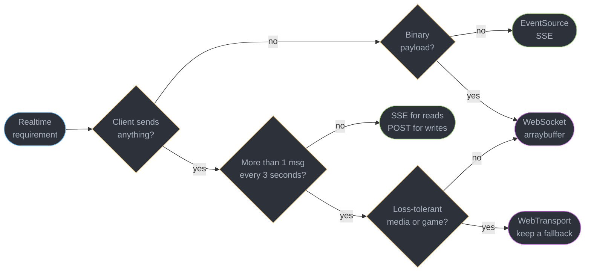
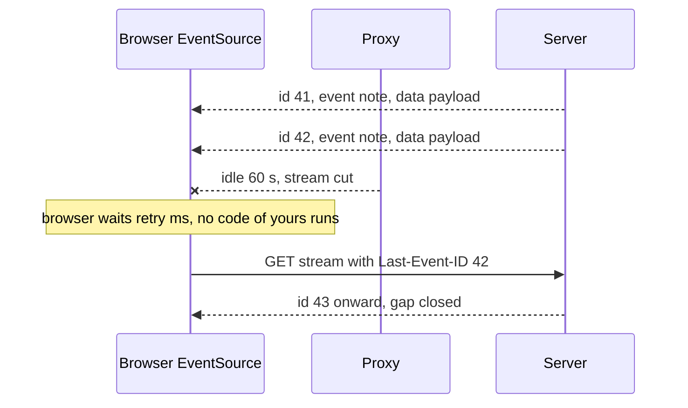
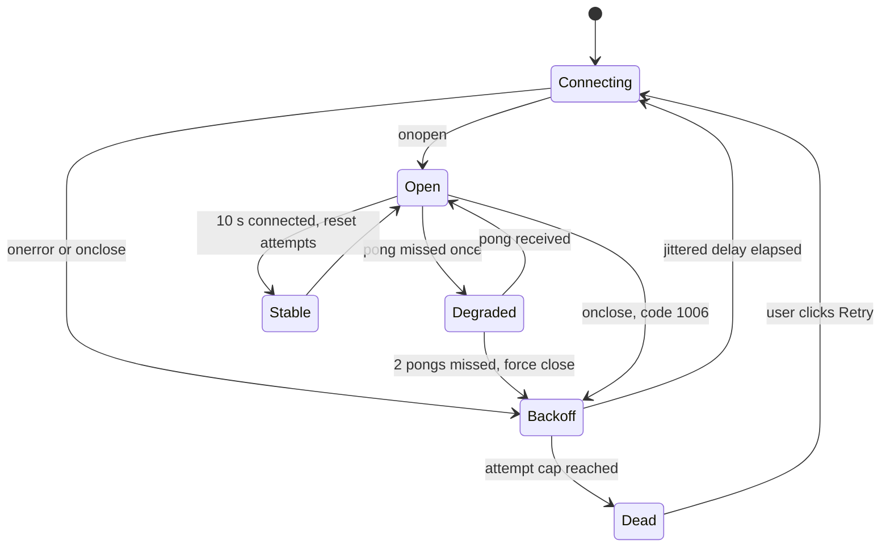
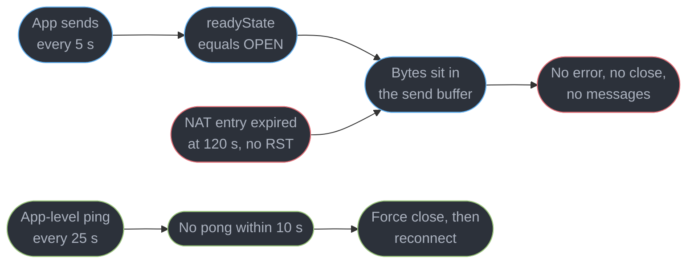
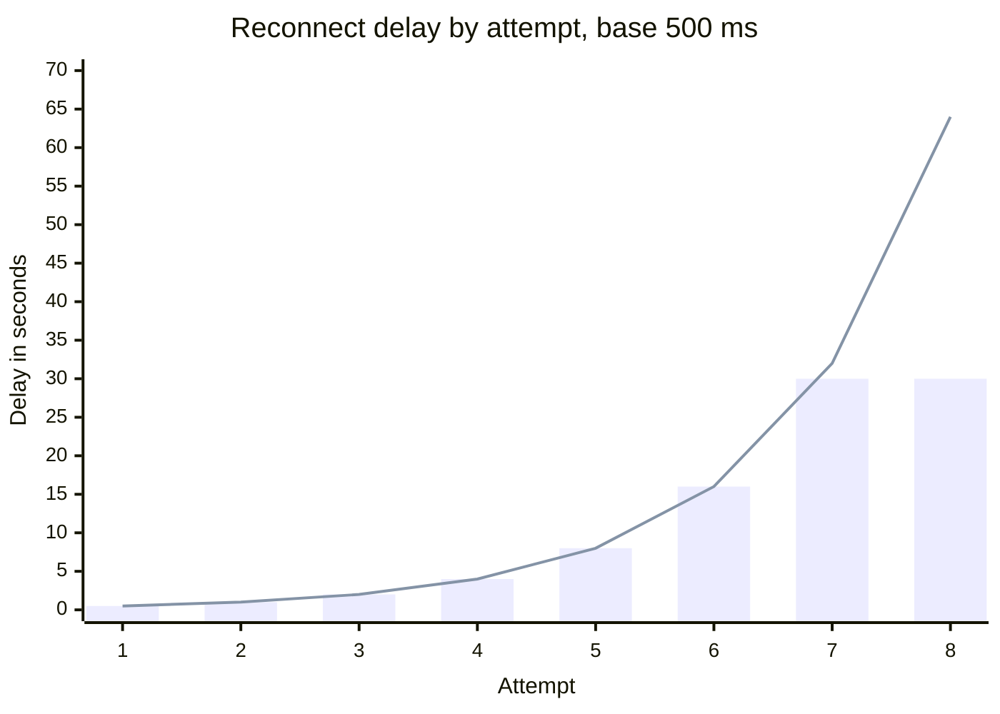
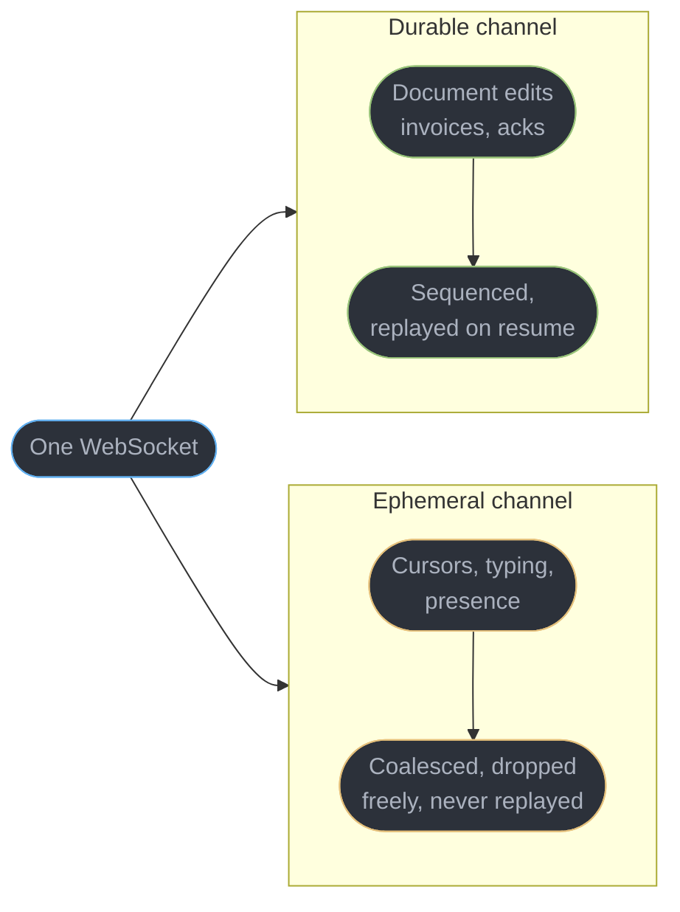

# Realtime in the Browser

---

## 1. Concept Overview

A realtime feature looks finished the moment the first message arrives in `onmessage`. It is
finished six weeks later, after a laptop has slept through a deploy, a proxy has dropped an
idle stream at 60 seconds, and 40,000 tabs have reconnected in the same millisecond because
the backoff had no jitter.

This module owns the **browser client** and nothing else. Framing, the `Upgrade` handshake,
server-side fan-out and connection scaling belong to
[`../../backend/websockets_and_sse/websockets_and_sse.md`](../../backend/websockets_and_sse/websockets_and_sse.md).
Choosing a transport at system-design scale — connection budgets, sticky routing, the pub/sub
tier behind it — belongs to
[`../../hld/realtime_updates/realtime_updates.md`](../../hld/realtime_updates/realtime_updates.md).
What is left, and what nobody else in this repository covers, is the part that runs in the
tab: which client API to reach for, what the API does *not* do for you, and how a connection
behaves when the network, the tab lifecycle and the user all misbehave at once.

The recurring theme is that **the browser gives you one of two extremes**. `EventSource`
reconnects, resumes and traverses proxies automatically, and can only receive. `WebSocket`
does everything and automates nothing — no reconnect, no heartbeat, no ordering across a
reconnect, no delivery guarantee, one number (`bufferedAmount`) standing in for backpressure.
Most production bugs live in that gap.

---

## 2. Intuition

> A WebSocket is a phone line with no dial tone. It tells you when the call connects and
> when you hang up, and it will happily let you talk into a dead handset for ninety seconds.

**Mental model.** Separate the *pipe* from the *protocol you run over it*. Everything a user
perceives as "realtime working" — messages in order, nothing lost after a reconnect, the
presence dot going grey when a lid closes — is protocol you write on top. `WebSocket` sells
you the pipe and hands you the protocol as homework.

**Why it matters.** The failure mode is not "it doesn't connect", caught in the first hour. It
is a connection reporting OPEN, delivering nothing and never erroring for 3% of users behind
one carrier's NAT — invisible in dashboards, because the server thinks it is fine too.

**Key insight.** Reconnecting is easy; reconnecting *correctly* is the whole subject. Correct
means jittered, capped, resumable from a known point, idempotent on replay, and paced so a
server restart does not turn your own users into a denial-of-service attack.

---

## 3. Core Principles

1. **Direction decides the transport.** If the server is the only speaker, SSE is smaller,
   cheaper and self-healing. Bidirectionality is the only thing that earns a WebSocket.
2. **A connection has three states, not two.** Connected, disconnected, and *believed
   connected* — the third is where the bugs live, and only an application heartbeat can
   distinguish it from the first.
3. **Reconnect is a distributed-systems problem in a single tab.** Backoff without jitter
   synchronises the fleet; without a cap it abandons the user; reset on `open` rather than on
   *stability* and a flapping connection resets it forever.
4. **Delivery is at-most-once until you build otherwise.** The browser gives you no ack, no
   sequence, no replay — if a message matters, number it. And **a reconnect replays**, so
   every handler must be safe running twice.
5. **Ephemeral and durable traffic must not share a channel.** Cursors at 60 Hz and an
   invoice-paid event want opposite things from loss, ordering and buffering.
6. **The tab is not always in front.** Hidden tabs are throttled, radios switch networks,
   bfcache freezes pages, and a SPA that never closes a socket leaks one per route change.

---

## 4. Types / Architectures / Strategies

### 4.1 The five transports, and what actually separates them

| Transport | Direction | Payload | Reconnect | Proxy risk | Typical fit |
|-----------|-----------|---------|-----------|-----------|-------------|
| Polling (`setInterval` + `fetch`) | request/response | any | trivial, stateless | none | updates slower than 30 s, tiny scale |
| Long polling | server push, emulated | any | per message | low | a fallback you still maintain |
| **SSE (`EventSource`)** | server to client | UTF-8 text only | **built in, with resume** | none — plain HTTP | feeds, notifications, token streams |
| **WebSocket** | bidirectional | text and binary | none — you write it | moderate: `Upgrade` can be stripped | chat, collaboration, trading |
| **WebTransport** | bidirectional, multi-stream | binary, reliable or not | none | high — needs HTTP/3 end to end | games, media, loss-tolerant streams |

### 4.2 The decision procedure

Run it in order, stopping at the first answer. Do not start from a feature table.

1. **Does the client need to send more than a heartbeat?** No: SSE, and you are done. A
   client that only receives should not pay for a socket it must babysit. Yes: continue.
2. **How many client-to-server messages per second?** Under roughly one every few seconds
   (a chat message, a form save), `POST` for the write path plus SSE for the read path beats
   a WebSocket, because the write path gets HTTP retries, caching semantics, standard auth
   headers and your existing observability for free. Above that — cursors, drawing, game
   input — the per-request overhead dominates and you want a socket.
3. **Is the payload binary?** SSE is UTF-8 `text/event-stream` only, so base64 inside it costs
   33% plus a decode; real binary means WebSocket with `binaryType = "arraybuffer"`.
4. **Will your infrastructure carry it?** SSE is an ordinary HTTP response, so every proxy,
   CDN and corporate middlebox already handles it, and under HTTP/2 it multiplexes on the
   existing connection. A WebSocket needs the `Upgrade` to survive every hop; WebTransport
   needs HTTP/3 and UDP unblocked, which some enterprise networks do not allow.
5. **What must happen on reconnect?** If "resume from where I stopped" is a requirement and
   the stream is server-driven, SSE's `Last-Event-ID` is a wire feature; otherwise you are
   writing sequence numbers and a resume handshake yourself.

### 4.3 Hybrid shapes worth knowing

**SSE for reads plus `POST` for writes** is the common case and keeps auth, retries and
tracing on ordinary HTTP. **One socket carrying two logical channels** separates ephemeral
from durable traffic on a single connection. **A WebSocket degrading to SSE** survives
networks that strip `Upgrade`, at the cost of two server paths. And **streaming `fetch` with
a `ReadableStream`** is the escape hatch when you need headers `EventSource` cannot send —
see [`../http_in_the_browser_and_fetch/http_in_the_browser_and_fetch.md`](../http_in_the_browser_and_fetch/http_in_the_browser_and_fetch.md).

---

## 5. Architecture Diagrams

### Choosing the transport



Note what the tree never asks: which API feels more modern.

### SSE resumption with `Last-Event-ID`



The reconnect and the header are the browser's work. Your obligation is a server that can
seek to an id — usually a ring buffer of the last 1,000 events.

### The connection lifecycle a WebSocket client must implement



`Degraded` and `Stable` are the two states people leave out: without the first a dead socket
is never noticed, without the second a flapping connection resets its backoff on every open.

### Why `readyState` lies



TCP has no liveness opinion on an idle connection, and the middlebox told neither side.

### Backoff delay, with and without a cap



Bars are capped at 30 s, the line is uncapped doubling: by attempt 8 that client is 64
seconds from noticing the server returned. Jitter then picks uniformly in `[0, delay]`.

### Two channels, two sets of guarantees



One transport, two policies. Merged, you buffer cursor spam for a disconnected client or drop
an edit because cursors were noisy.

---

## 6. How It Works — Detailed Mechanics

### 6.1 `EventSource`: the API that already does the hard part

```ts
const es = new EventSource("/api/stream", { withCredentials: true });

es.addEventListener("note", (e: MessageEvent<string>) => {
  render(JSON.parse(e.data));          // one event type
});
es.onmessage = (e) => handleDefault(e.data);   // events with no `event:` field

// onerror fires on every drop, but the browser is ALREADY reconnecting unless state is CLOSED
es.onerror = () => { if (es.readyState === EventSource.CLOSED) showPermanentFailure(); };
```

Three things are free here and cost real code everywhere else: the browser reconnects itself,
it sends `Last-Event-ID` with the last `id:` it saw, and the stream is an ordinary `GET`, so
HTTP/2 multiplexes it alongside your other requests.

### 6.2 The wire format, which is the whole protocol

```
: keepalive comment, ignored by the client, resets proxy idle timers

id: 42
event: note
retry: 5000
data: {"user":"kim","text":"ship it"}
```

Fields are `data`, `event`, `id`, `retry`; a blank line dispatches the event and repeated
`data` lines join with `\n`. `retry:` sets the browser's reconnect delay in milliseconds
(default 3000), the one lever a server has over client backoff — under load it can push
clients to 30000 as it sheds them. A line starting with `:` is a comment, and sending one
every 20 to 30 seconds is the keepalive that stops an idle proxy cutting the stream.

### 6.3 The two real limits of SSE

**It cannot send a request.** `EventSource` issues a `GET` with no body and no custom headers,
so `Authorization: Bearer …` is unavailable. Three options: cookies with
`withCredentials: true` (right for a first-party app — see
[`../auth_in_the_browser/auth_in_the_browser.md`](../auth_in_the_browser/auth_in_the_browser.md)),
a short-lived single-use stream ticket in the query string, or parsing the stream yourself:

```ts
const res = await fetch("/api/stream", {
  headers: { Authorization: `Bearer ${token}`, Accept: "text/event-stream" },
  signal: controller.signal,
});
for await (const chunk of res.body!.pipeThrough(new TextDecoderStream())) {
  // You now own event parsing, reconnect, Last-Event-ID and buffering: everything EventSource did for free.
}
```

Never put a long-lived token in the query string — it lands in access logs, proxy logs and
`Referer`. A ticket valid for 30 seconds and one use survives review.

**Under HTTP/1.1 it eats a connection.** Browsers allow 6 per origin and an open stream holds
one for its whole life, so two tabs plus a stream and the third tab's images queue. Under
HTTP/2 it is one of roughly 100 streams on a single connection and the problem disappears —
which makes "are we HTTP/2 end to end, including the last proxy" the question that decides
whether SSE scales for you.

### 6.4 `WebSocket`: everything is yours

```ts
const ws = new WebSocket("wss://api.example.test/socket");
ws.binaryType = "arraybuffer";        // default is "blob", which forces an async read

ws.onopen    = () => flushOutbox();
ws.onmessage = (e) => (typeof e.data === "string" ? onText(e.data) : onBinary(e.data));
ws.onclose   = (e) => scheduleReconnect(e.code);   // 1000 deliberate, 1006 abnormal
ws.onerror   = () => {};              // fires before onclose and carries no useful detail
```

`readyState` is `CONNECTING 0`, `OPEN 1`, `CLOSING 2`, `CLOSED 3`. Sending in any state but
`OPEN` throws `InvalidStateError`, which is why every send goes through a guard. Close code
`1006` means "no close frame was received" — the transport vanished; you will see it far more
than any other code, and it carries no diagnostic information at all.

Use `wss://` always: plaintext `ws://` is blocked outright on an HTTPS page, and unencrypted
`Upgrade` traffic is what intermediaries mangle most.

### 6.5 `bufferedAmount` is the only backpressure `WebSocket` gives you

```ts
const HIGH_WATER = 1 << 20;           // 1 MiB queued is already far too much

function trySend(ws: WebSocket, payload: string): boolean {
  if (ws.readyState !== WebSocket.OPEN) return false;
  if (ws.bufferedAmount > HIGH_WATER) return false;   // drop or queue: do NOT send
  ws.send(payload);
  return true;
}
```

`send()` returns `undefined` and never blocks. Bytes accepted but not yet on the network sit
in `bufferedAmount`, which on a stalled link grows without limit until the OS kills the tab
for memory, and there is no `drain` event — you poll. The rule for high-rate ephemeral data:
above one megabyte, **drop the message**, because the newest cursor position makes the rest
worthless.

The receive side is worse: `onmessage` fires for every frame the browser reads, whether or not
the page can keep up, so a slow consumer turns into an unbounded queue of pending events. The
socket API has no way to tell the server to slow down.

**`WebSocketStream` is the streams-based client that fixes both directions.** It speaks the same
wire protocol, so the server does not change, and it exposes the connection as a
`ReadableStream` and a `WritableStream`:

```ts
const wss = new WebSocketStream("wss://api.example.test/socket", {
  protocols: ["v2"],
  signal: AbortSignal.timeout(5_000),        // aborts the handshake only
});
const { readable, writable } = await wss.opened;
const writer = writable.getWriter();

for await (const msg of readable) {          // the next frame is read only when this loop asks
  await render(msg);                         // fragment: a slow render slows the sender
  await writer.write(ack(msg));              // resolves when the frame is handed off
}
const { closeCode, reason } = await wss.closed;   // rejects on an unclean close
```

On the read side the browser stops pulling frames off the TCP socket once the stream's queue is
full, the kernel receive window fills, and TCP flow control pushes back on the server. That is
real end-to-end backpressure, which `onmessage` cannot express. On the write side
`await writer.write()` (or `await writer.ready`) waits instead of growing a hidden buffer, so the
1 MiB polling guard becomes an `await`. `wss.close({ closeCode: 1000, reason: "done" })` closes
it. Chrome and Edge 124 ship it; Firefox and Safari do not, and it is not yet in a standard, so
feature-detect `"WebSocketStream" in self` and keep the `WebSocket` path above as the fallback.
Reconnect, heartbeats and resumption are still yours: it changes flow control, not delivery
guarantees.

### 6.6 Reconnect: backoff, jitter, cap, stability

```ts
const BASE = 500, CAP = 30_000, MAX_ATTEMPTS = 12, STABLE_MS = 10_000;
let attempt = 0, stableTimer: number | undefined;

// full jitter: uniform in [0, ceiling], so no two clients pick the same instant
const nextDelay = () => Math.random() * Math.min(CAP, BASE * 2 ** attempt);

function connect() {
  const ws = new WebSocket(URL);
  // Do NOT reset attempt here: a socket that opens and dies in 200 ms resets forever.
  ws.onopen = () => { stableTimer = setTimeout(() => { attempt = 0; }, STABLE_MS); };
  ws.onclose = () => {
    clearTimeout(stableTimer);
    if (++attempt > MAX_ATTEMPTS) return showReconnectButton();   // ~7 min of trying
    setTimeout(connect, nextDelay());
  };
}
```

**Why jitter and not just backoff.** Deterministic doubling means every client that dropped at
the same instant retries at the same instant. A restart disconnects 40,000 tabs, and 500 ms
later all 40,000 arrive together — a self-inflicted thundering herd that stops the server
finishing its own startup, so it fails again and the fleet re-synchronises harder. Full jitter
spreads the same attempts across the ceiling: at attempt 6 that is a 16-second window, roughly
2,500 connections a second instead of 40,000 at once.

**Why the cap, and why stability rather than `open`.** Uncapped doubling reaches 64 seconds by
attempt 8 and 17 minutes by attempt 11, long after the server returned. And a load balancer
that accepts a connection then closes it 100 ms later produces a perfect `onopen` every time,
so resetting the counter there turns backoff into a tight loop at `BASE`.

**When to give up.** On a *classification*, not just a count: a `4001` "token rejected" or a
`1008` policy close must never be retried, while `1006` and `1011` should be. Past the attempt
cap, show a Retry control — retrying forever in a background tab is a battery bug.

### 6.7 Heartbeats and the connection that is dead but OPEN

```ts
const PING_MS = 25_000, PONG_TIMEOUT_MS = 10_000;
let pongTimer: number | undefined;
const beat = setInterval(() => {
  if (ws.readyState !== WebSocket.OPEN) return;
  ws.send(JSON.stringify({ t: "ping", at: Date.now() }));
  pongTimer = setTimeout(() => ws.close(4000, "pong timeout"), PONG_TIMEOUT_MS);
}, PING_MS);

function onPong() { clearTimeout(pongTimer); }
```

A TCP connection whose peer disappeared without an `RST` — a NAT table entry expiring, a
laptop lid closing, a phone moving from Wi-Fi to cellular — stays OPEN in the browser
indefinitely. Nothing errors. `readyState` reads 1. Your sends succeed. Only an expected
reply proves the path is alive.

**Why 25 seconds.** Idle timeouts cluster at 30 to 60 seconds — nginx `proxy_read_timeout`
and an AWS Application Load Balancer both default to 60 s, many corporate proxies use 30 s —
so a ping inside the shortest one keeps the connection warm *and* detects death, while
anything over 30 s risks being cut by the thing you were trying to outlive.

The protocol has ping/pong control frames, but **the browser exposes neither**: you cannot
send one from JavaScript or observe one arriving. Server-side pings keep the connection alive
and tell your client nothing, so an application-level ping in your own message schema is the
only version you can see.

### 6.8 Ordering, delivery and resumption

Within one uninterrupted socket, order is guaranteed — it is TCP underneath. **Across a
reconnect nothing is guaranteed**: messages sent while you were away were dropped by the
server, or buffered, or fanned out to a different backend that has a different view.

```ts
let lastSeq = 0;

function onEnvelope(env: { seq: number; type: string; body: unknown }) {
  if (env.seq <= lastSeq) return;                    // duplicate from a replay: ignore
  if (env.seq > lastSeq + 1) return resync(lastSeq); // gap: ask for the range, do not guess
  lastSeq = env.seq;
  apply(env);
}

// On reconnect, tell the server where you stopped.
ws.onopen = () => ws.send(JSON.stringify({ t: "resume", since: lastSeq }));
```

**At-most-once versus at-least-once.** Raw `send()` is at-most-once: no ack, and a message
handed to a socket that dies 5 ms later is gone with no error. At-least-once needs a server
ack and a client retry, which guarantees **the same message sometimes arrives twice** — on
resume, on a retry, on a failover. So every handler must be idempotent: dedupe by message id,
or make the operation naturally idempotent (`set status = paid`, not `increment count`).

**The outbox.** Messages composed while disconnected must not vanish:

```ts
let outbox: { id: string; body: string }[] = [];

export function sendReliable(body: string) {
  const msg = { id: crypto.randomUUID(), body };    // id survives every retry: dedupe key
  outbox.push(msg);
  if (!trySend(ws, JSON.stringify(msg))) markPendingInUi(msg.id);
}

const flushOutbox = () => outbox.forEach(m => trySend(ws, JSON.stringify(m)));  // dedupe by id
const onAck = (id: string) => { outbox = outbox.filter(m => m.id !== id); };
```

Cap the outbox at 200 messages or 1 MiB and fail visibly rather than growing until the tab
dies. Persist to IndexedDB only if a reload must not lose the queue — that trades a network
problem for a storage problem with quotas and eviction.

### 6.9 Presence, cursors and high-frequency channels

Presence and cursors have the opposite requirements to document traffic: worthless one second
later, arriving at 60 Hz, and losing 90% of them changes nothing visible. On the durable
channel they force one of two bad outcomes — replaying 4,000 stale positions to a
reconnecting client, or making the durable channel lossy to cope.

```ts
// Coalesce: keep only the newest value per key, flush on a fixed timer.
const pending = new Map<string, unknown>();
setInterval(() => {
  if (!pending.size || ws.bufferedAmount > 1 << 20) return pending.clear();
  ws.send(JSON.stringify({ ch: "ephemeral", updates: [...pending] }));
  pending.clear();
}, 50);                                     // 20 Hz: below the ~16 ms frame budget's noise

export const moveCursor = (x: number, y: number) => pending.set("cursor", { x, y });
```

A 120 Hz pointer becomes 20 messages a second carrying only the latest position, and the queue
is discardable under backpressure. Batch incoming updates into one `requestAnimationFrame`
paint rather than setting state per message —
[`../the_event_loop_and_scheduling/the_event_loop_and_scheduling.md`](../the_event_loop_and_scheduling/the_event_loop_and_scheduling.md)
owns why. Presence is server-derived: the server marks a user offline when the socket closes
or the heartbeat lapses, because a crashed client cannot say goodbye. The full
collaborative-editing design is
[`../../react/case_studies/design_a_realtime_collaborative_editor.md`](../../react/case_studies/design_a_realtime_collaborative_editor.md).

### 6.10 Lifecycle: hidden tabs, mobile networks, bfcache, unmount

```ts
document.addEventListener("visibilitychange", () => {
  if (document.visibilityState === "hidden") {
    if (!needsBackgroundUpdates) ws.close(1000, "tab hidden");
  } else if (ws.readyState !== WebSocket.OPEN) {
    attempt = 0;                    // a user-initiated return is not a failed retry
    connect();
  }
});

addEventListener("pagehide", (e) => { if (e.persisted) ws.close(1000, "bfcache"); });
addEventListener("pageshow",  (e) => { if (e.persisted) connect(); });
addEventListener("online", () => { if (ws.readyState !== WebSocket.OPEN) connect(); });
```

**Hidden tabs.** `setInterval` is clamped to roughly once per minute in a hidden Chromium tab,
longer than the 25-second heartbeat — the ping stops, a proxy cuts the stream, and the tab
wakes to a socket that is OPEN and dead. Either close when hidden and reconnect on return, or
keep it and re-validate on `visibilitychange`.

**Mobile.** Wi-Fi to cellular changes the source IP, so the socket dies the instant the switch
completes and no event fires. `navigator.onLine` reports a local interface, not reachability,
so the heartbeat is what catches this.

**bfcache.** A page restored from the back/forward cache resumes with a frozen socket the
browser may already have discarded, and holding one open can make the page ineligible for
bfcache at all. Close on `pagehide` when `persisted`, reconnect on `pageshow`.

**Unmount.** Every subscription in a SPA must tear down:

```ts
export function openStream(onMsg: (m: unknown) => void) {
  const ws = new WebSocket(URL);
  ws.onmessage = (e) => onMsg(JSON.parse(e.data));
  return () => { ws.onclose = null; ws.close(1000, "unmount"); };   // null first: no reconnect
}
```

Nulling `onclose` first matters: a deliberate close still fires it, and a reconnect scheduler
that cannot tell the difference will faithfully reopen the socket you just tore down.

---

## 7. Real-World Examples

**The deploy that took the cluster down twice.** A trading dashboard held 38,000 WebSockets
with `setTimeout(connect, 1000 * 2 ** attempt)` — backoff, no jitter, no cap. A rolling deploy
dropped every connection at once; one second later 38,000 handshakes arrived inside 80 ms, the
new pods exhausted their file descriptors during startup and crashed, and the clients
re-synchronised on attempt 2. Adding `Math.random() *` spread attempt 2 over 2 seconds and the
next deploy was invisible.

**The 3% who never received anything.** A support tool showed "Connected" while delivering
nothing to users behind one carrier's CGNAT, whose idle timeout was 120 seconds. The server
saw healthy sockets and `readyState` was 1. A 25-second ping with a 10-second pong deadline
turned the silent failure into a 35-second reconnect.

---

## 8. Tradeoffs

| Choice | Gains | Costs | Use when |
|--------|-------|-------|---------|
| SSE over WebSocket | reconnect and resume for free; traverses every proxy; HTTP/2 multiplexing | one-way; text only; no request headers | the server is the only speaker |
| WebSocket over SSE | bidirectional; binary; lowest per-message overhead | you write reconnect, heartbeat, ordering, backpressure | client sends more than once every few seconds |
| WebTransport | independent streams, unreliable mode, no head-of-line blocking | HTTP/3 required end to end; UDP often blocked | games and media with a fallback |
| At-least-once + acks | no silent message loss | duplicates, so every handler must be idempotent | anything a user would notice losing |
| `WebSocketStream` over `WebSocket` | read and write backpressure that reaches the server through TCP | Chromium only, not standardized, so a fallback path is mandatory | bulk or bursty streams a slow client must not buffer unboundedly |

---

## 9. When to Use / When NOT to Use

### Use SSE when

- Traffic is server to client: notifications, live feeds, job progress, LLM token streams
  (see [`../../react/case_studies/design_an_ai_chat_streaming_ui.md`](../../react/case_studies/design_an_ai_chat_streaming_ui.md)).
- You are on HTTP/2 end to end, or few enough streams that the six-connection limit misses you.
- "Resume from where I stopped" is a requirement and `Last-Event-ID` can answer it.

### Use a WebSocket when

- The client sends frequently: cursors, drawing, game input, live filters.
- The payload is binary — audio, protobuf, a CRDT update — and base64's 33% overhead matters.
- Round-trip latency per message is the product, as in trading or multiplayer.

### Do NOT

- **Reach for a WebSocket because it sounds like the realtime answer** — if the client only
  receives, you have chosen to hand-write reconnect, heartbeat and resume for no gain.
- **Poll every second.** At 5,000 users that is 5,000 requests per second delivering nothing
  most of the time.
- **Retry forever, unjittered, or without classifying the close code** — all three are
  outages waiting for a deploy — or **trust `readyState`, `navigator.onLine`, or ordering
  across a reconnect**.
- **Put ephemeral and durable traffic on one channel**, or ship a socket with no cleanup path.

---

## 10. Common Pitfalls

### Pitfall 1: the reconnect loop with no jitter and no cap

```ts
// BROKEN: every disconnected client retries at the same instant, forever.
// A restart drops 40,000 tabs; 1 s later 40,000 handshakes arrive inside 80 ms.
ws.onclose = () => {
  attempt++;
  setTimeout(connect, 1000 * 2 ** attempt);   // no jitter, no cap, no give-up
};
ws.onopen = () => { attempt = 0; };           // and a 200 ms socket resets it to a tight loop
```

```ts
// FIX: full jitter, a 30 s ceiling, an attempt cap, and reset only after 10 s of stability.
ws.onclose = (e) => {
  clearTimeout(stableTimer);
  if (e.code === 4001 || e.code === 1008) return showAuthError();   // never retry these
  if (++attempt > 12) return showReconnectButton();
  setTimeout(connect, Math.random() * Math.min(30_000, 500 * 2 ** attempt));
};
ws.onopen = () => { stableTimer = setTimeout(() => { attempt = 0; }, 10_000); };
```

The signature: reconnect storms correlating exactly with deploy timestamps.

### Pitfall 2: re-registering handlers on every reconnect

```ts
// BROKEN: `connect` adds a listener to the same emitter each time. After 6 reconnects
// every message is rendered 6 times, and memory grows with the reconnect count.
function connect() {
  ws = new WebSocket(URL);
  store.addEventListener("change", pushLocalEdits);   // FIX: register once, outside connect
  ws.onmessage = onEnvelope;
}
```

`ws.onmessage = fn` is assignment and safe on a fresh socket; `addEventListener` on anything
longer-lived than the socket is not. The tell is a render count growing by one per reconnect.

### Pitfall 3: one socket per tab instead of one per user

A user with the dashboard open in six tabs opens six sockets, and the server counts six
subscribers where there is one person. At 5,000 users averaging 2.4 tabs that is 12,000
connections and 12,000 fan-out writes for 5,000 readers, and every one of them re-sends the
same payload to the same machine. It is also how an app hits the browser's per-origin
connection ceiling from nothing but ordinary tab habits.

```ts
// BROKEN: every tab connects. Nothing coordinates them.
const ws = new WebSocket(URL);
ws.onmessage = render;
```

```ts
// FIX A -- one SharedWorker holds the only socket; tabs are ports.
// worker.js
const ports = [];
const ws = new WebSocket(URL);
ws.onmessage = (e) => ports.forEach(p => p.postMessage(e.data));
onconnect = (e) => { const p = e.ports[0]; ports.push(p); p.start(); };
```

```ts
// FIX B -- leader election, when SharedWorker is not an option.
// navigator.locks holds the lock for the leader tab's whole lifetime; when that tab
// closes the lock releases and the next waiting tab immediately becomes leader.
const bus = new BroadcastChannel("rt");
navigator.locks.request("rt-leader", { mode: "exclusive" }, () => {
  const ws = new WebSocket(URL);                       // only the leader connects
  ws.onmessage = (e) => bus.postMessage(e.data);       // fan out to the followers
  return new Promise(() => {});                        // hold the lock until this tab dies
});
bus.onmessage = (e) => render(e.data);                 // every tab, leader included
```

Prefer FIX B unless you need the worker for other reasons: `navigator.locks` handles the
handover for free, where a SharedWorker still needs a per-port cleanup path and is
unsupported in some mobile browsers. Either way the outbound path has to route through the
leader too, or a follower tab's send has nowhere to go. The signature of the bug is a
connection count that tracks tabs rather than users, and a fan-out cost that scales with a
number nobody is measuring.

### Pitfall 4: a socket outliving the token that authenticated it

A WebSocket authenticated at handshake time stays open long after its access token expires, so
a 15-minute token backs an 8-hour connection. Re-authenticate over the socket, or have the
server close with an application code when the token lapses so the client refreshes.

### Pitfall 5: assuming `onerror` tells you anything

The `error` event on both APIs is deliberately opaque — no status, no reason — because
explaining a cross-origin failure would leak network topology. Diagnose from the close *code*
(`1006` abnormal, `1011` server error, `1008` policy) and from server logs.

---

## 11. Technologies & Tools

| Tool | What it is for | How you invoke it |
|------|---------------|-------------------|
| EventSource | The built-in SSE client with reconnect and resume | `new EventSource(url)` |
| WebSocket | The bidirectional browser socket | `new WebSocket("wss://...")` |
| WebSocketStream | A WebSocket exposed as readable and writable streams | `await new WebSocketStream(url).opened` |
| WebTransport | HTTP/3 multi-stream transport | `new WebTransport(url)` |
| BroadcastChannel | Share one connection's messages across tabs | `new BroadcastChannel("rt")` |
| Socket.IO | Reconnect, rooms, acks and fallbacks over a socket | `io(url)` client plus its server |
| Phoenix Channels | Channel multiplexing and presence | `new Socket()` plus `channel.join()` |
| Ably | Hosted pub/sub with resume and presence | `new Ably.Realtime()` |

Server-side fan-out, sticky routing and connection budgets are owned by
[`../../hld/realtime_updates/realtime_updates.md`](../../hld/realtime_updates/realtime_updates.md).

---

## 12. Interview Questions with Answers

**Q: When is SSE the better choice than a WebSocket?**
**Short:** Plain HTTP framing lets SSE traverse every proxy, multiplex over HTTP/2 and reconnect itself, so a receive-only client should never hand-write a socket.

Choosing a WebSocket for a one-way feed buys bidirectionality you do not use and obliges you
to hand-write reconnect, heartbeat, resumption and backpressure — four subsystems
`EventSource` provides free, `Last-Event-ID` resume included. The line moves once the client
sends more than one message every few seconds; until then, SSE for reads plus `POST` for
writes.

**Q: Why must exponential backoff include jitter?**
**Short:** Unjittered backoff synchronises every disconnected client onto the same retry instant, so a restarted server is hit by the entire fleet in one burst.

A deploy drops 40,000 sockets at once; with deterministic doubling all 40,000 retry within
milliseconds of each other, the new pods exhaust descriptors during startup, crash, and the
fleet re-synchronises harder. Full jitter picks uniformly in `[0, ceiling]`, spreading
attempt 6 over 16 seconds — 2,500 connections a second, not 40,000 — for one `Math.random()`.

**Q: A socket reports `readyState === OPEN` but no messages arrive. What is happening?**
**Short:** TCP silently dies at a NAT box or a sleeping radio without an RST, so the browser keeps reporting OPEN and your sends keep succeeding into nothing.

A carrier NAT entry expiring at 120 seconds, a lid closing, or a Wi-Fi to cellular switch all
remove the peer with no close frame, and neither end is told. `send()` accepts the bytes, they
sit in `bufferedAmount`, nothing errors. The only detector is an application ping with a pong
deadline — 25-second interval, 10-second timeout, then force `close()` and reconnect.

**Q: What does `bufferedAmount` tell you, and what should you do with it?**
**Short:** Bytes queued in the send buffer that have not reached the network yet, which is the only backpressure signal the WebSocket API exposes at all.

`send()` never blocks and returns nothing, so on a stalled link the buffer grows until the tab
is killed for memory — and there is no `drain` event, so you poll. Set a high-water mark near
1 MiB: above it drop ephemeral messages such as cursor positions, whose newest value makes
older ones worthless, and queue only what a user would notice losing. Cap that queue too.

**Q: How does `WebSocketStream` fix the backpressure problem of `WebSocket`?**
**Short:** It exposes the socket as streams, so the browser stops reading frames when the consumer falls behind and TCP slows the server, and writes are awaited instead of buffered without limit.

With `WebSocket`, `onmessage` fires for every frame regardless of how fast the page handles
them and `send()` queues silently. `WebSocketStream` hands back a `ReadableStream` that pulls a
frame only when the reader asks, so a full queue closes the TCP receive window and the server
blocks; `await writer.write()` paces the sender. The wire protocol is unchanged, so no server
work is needed. It ships in Chrome and Edge 124 only and is not standardized, so feature-detect
it, keep the `bufferedAmount` path as the fallback, and still write reconnect and resume.

**Q: How does `Last-Event-ID` work, and what does the server have to provide?**
**Short:** The browser replays the last id it saw as a request header on reconnect, so the server can resume the stream from exactly that point.

Each event carries an `id:` field; the client stores the most recent and sends it as
`Last-Event-ID` on the automatic reconnect, with no code from you. The server's obligation is
to seek — a ring buffer of the last 1,000 events, or a durable log offset. If the id has aged
out, send a resync event telling the client to refetch rather than pretending there was no gap.

**Q: What are the real limitations of `EventSource`?**
**Short:** Under HTTP/1.1 the stream consumes one of six connections per origin, and the API can send no request body and no custom headers.

No headers means no `Authorization: Bearer`, so auth is cookies with `withCredentials: true`
or a single-use stream ticket expiring in 30 seconds — never a long-lived token, which lands
in access and proxy logs. The payload is UTF-8 `text/event-stream`, so binary costs base64's
33%. Under HTTP/2 the connection limit vanishes, making end-to-end HTTP/2 the deciding fact.

**Q: Is a WebSocket message delivered at-most-once or at-least-once?**
**Short:** Delivery is at-most-once by default, because the browser gives you no acknowledgement and a message handed to a dying socket disappears with no error at all.

`send()` returning means the local buffer accepted the bytes, not that anyone received them.
At-least-once needs a server ack plus a client retry from an outbox, which guarantees you will
sometimes deliver a duplicate. So every handler must be idempotent: dedupe by a message id
generated once on the client, or use naturally idempotent operations (`set status = paid`).

**Q: How do you detect that you missed messages across a reconnect?**
**Short:** Monotonic per-channel sequence numbers make a gap visible, so the client requests a replay of the range instead of silently rendering inconsistent state.

Ordering holds within one uninterrupted socket because TCP underlies it, and holds for nothing
across a reconnect — the server may have dropped messages, buffered them, or failed over to a
backend with a different view. Track `lastSeq`, treat anything at or below it as a replay, and
on `seq > lastSeq + 1` resync — refetching whole state counts when the gap is large.

**Q: What is a client-side outbox and why do you need one?**
**Short:** Queueing sends locally while the socket is down and flushing them on reconnect, each carrying an id generated once so the server can dedupe the replay.

Without it, a message composed 200 ms before a disconnect is lost with no error and no UI
signal — the user watched it appear in the thread and it is gone. Generate the id at compose
time, not send time, so a retry reuses it. Cap the outbox at 200 messages or 1 MiB and fail
visibly; persist to IndexedDB only if a reload must not lose the queue.

**Q: Why should presence and cursors not share the document channel?**
**Short:** Presence and cursors are lossy, high-rate and worthless one second later, while the durable channel is sequenced and replayed, so mixing them poisons both.

With 12 people in a room cursors are easily 96% of message volume, so on the sequenced channel
a reconnecting client replays 40 seconds of stale cursor history before the first real edit.
Give ephemeral traffic its own channel on the same socket, coalesced and freely droppable.

**Q: How do you keep a 60 Hz cursor stream from flooding the connection?**
**Short:** Coalescing keeps only the newest value per key and flushes on a fixed timer, turning a 120 Hz pointer into roughly 20 messages a second.

Throttling drops messages on a timer; coalescing also collapses them, which is what you want
when only the latest position matters. Hold pending updates in a `Map` keyed by what they
describe, flush every 50 ms, and clear the map without sending when `bufferedAmount` is over
the high-water mark. On receive, batch into one `requestAnimationFrame` paint.

**Q: What goes wrong with a realtime connection in a hidden tab?**
**Short:** A hidden tab still holds the socket while its timers are clamped to about once a minute, so the heartbeat stops firing and a proxy quietly cuts the connection.

The tab wakes to a socket that reports OPEN and delivers nothing — the same silent death the
heartbeat existed to catch. Two valid designs: close on `visibilitychange` to hidden and
reconnect on return, right for a dashboard, or keep it and re-validate with a ping on return,
right for chat. Reset the attempt counter on a user-initiated return; that is not a retry.

**Q: How does a SPA end up with 30 open sockets?**
**Short:** Every effect that opens a connection must return a close function, or each route change leaks one live socket that no code will ever shut down.

Past the per-origin connection limit the newest subscription silently never connects, so the
symptom is "realtime stops working after twenty minutes of navigating", not an error. Null
`onclose` before calling `close()` in the teardown: a deliberate close still fires `onclose`,
and a reconnect scheduler that cannot tell will faithfully reopen the socket you tore down.

**Q: What is the difference between `binaryType` `"blob"` and `"arraybuffer"`?**
**Short:** Setting binaryType to arraybuffer gives synchronous typed-array access, while the default Blob forces an async read before you can touch a single byte.

`e.data instanceof ArrayBuffer` lets you wrap a `DataView` and parse inside the handler; a
`Blob` needs `await blob.arrayBuffer()`, which pushes decoding into a later task and reorders
processing relative to text frames on the same socket. Set it immediately after construction,
before any message can arrive. Blob wins only when the data goes straight to a `Blob` consumer.

**Q: What does WebTransport give you that a WebSocket cannot?**
**Short:** Independent unreliable and reliable streams over HTTP/3 remove head-of-line blocking, which a single TCP-backed WebSocket structurally cannot offer.

One dropped packet on a WebSocket stalls every logical channel multiplexed over it, because
TCP must deliver in order; QUIC streams are independent, and datagram mode skips
retransmission entirely for data that is stale on arrival — game state, audio. The cost is
HTTP/3 end to end and unblocked UDP, which many networks refuse. Keep a WebSocket fallback.

**Q: Long polling still exists. When would you actually use it?**
**Short:** Holding a request open until data arrives costs a full request cycle per message, which is acceptable only as a fallback for networks that break streaming.

Every message means a response, a teardown and a fresh request, so at any real rate it is
strictly worse than SSE, which amortises that over one stream. It survives where SSE does not:
a proxy that buffers rather than streams, or a middlebox that rewrites `text/event-stream`.
Hold the server side 25 to 30 seconds so intermediaries do not time it out first.

---

## 13. Best Practices

1. **Run the decision procedure before writing code**: direction, message rate, payload type,
   infrastructure, reconnect requirements. Default to SSE for reads plus `POST` for writes
   until something forces a socket.
2. **Every reconnect is jittered, capped at 30 s, attempt-limited, and classifies the close
   code** — never retry a `4001` auth rejection or a `1008` policy close.
3. **Reset the backoff counter only after 10 s of stable connection**, never in `onopen`, and
   **ship an application-level ping/pong** at 25 s with a 10 s deadline — the protocol's own
   ping frames are invisible to JavaScript, so they do not count.
4. **Number your messages.** Detect gaps, resync on one, and make every handler idempotent
   because a resume replays.
5. **Cap both queues** — `bufferedAmount` at 1 MiB, the outbox at 200 messages — and **split
   ephemeral from durable traffic** onto separate logical channels, coalescing ephemeral
   updates on a 50 ms timer and painting incoming batches on one animation frame.
6. **Handle the lifecycle explicitly**: `visibilitychange`, `pagehide`/`pageshow` for bfcache,
   `online`, and a teardown that nulls `onclose` before closing.
7. **Instrument what the API hides**: reconnect count, time to first message, p95 pong latency
   and gap events, none of which are visible server-side.

---

## 14. Case Study

### The support console that was "connected" and delivering nothing

**The system.** A B2B support console: one WebSocket per agent for ticket updates and typing
indicators, 2,400 concurrent agents, a Node fleet behind an AWS Application Load Balancer at
its default 60-second idle timeout. Agents were on office Wi-Fi and mobile hotspots.

**The symptom.** Two unrelated complaints. First, a steady 3% of agents reported "tickets
stop updating" with the UI showing Connected — never reproducible in the office. Second,
every deploy produced a 90-second window where nobody could connect at all, which the team
had come to treat as normal.

**Step 1 — the silent deaths.** Time-since-last-message came out bimodal: healthy sockets
under 40 seconds, and a tail with no message for over an hour while `readyState` read 1. Every
affected agent was on a hotspot, whose CGNAT dropped the mapping after 120 seconds of silence
— and idle gaps over two minutes were routine. Neither end received an `RST`.

**Step 2 — the deploy storm.** The reconnect logic was three lines:

```ts
// BROKEN: 2,400 clients, one clock. A deploy drops them all inside the same second,
// and 1 s later 2,400 handshakes arrive together, repeatedly.
ws.onclose = () => setTimeout(connect, 1000 * 2 ** attempt++);
ws.onopen  = () => { attempt = 0; };
```

Each pod accepted about 800 connections in its first 200 ms, spent 4 seconds on per-connection
session lookups, failed its readiness probe and was restarted — disconnecting everyone again.
Three cycles per deploy, and because the counter reset on `onopen`, a pod that accepted and
died put every client straight back to a 1-second retry.

**Step 3 — the fix, both halves in one patch.**

```ts
// FIX: heartbeat proves liveness; jitter, cap and stability fix the storm.
const beat = setInterval(() => {
  if (ws.readyState !== WebSocket.OPEN) return;
  ws.send('{"t":"ping"}');
  pongTimer = setTimeout(() => ws.close(4000, "pong timeout"), 10_000);
}, 25_000);                                   // inside the ALB's 60 s idle timeout

ws.onclose = (e) => {
  clearInterval(beat); clearTimeout(stableTimer);
  if (e.code === 1008) return showAuthError();
  if (++attempt > 12) return showReconnectButton();
  setTimeout(connect, Math.random() * Math.min(30_000, 500 * 2 ** attempt));
};
ws.onopen = () => { stableTimer = setTimeout(() => { attempt = 0; }, 10_000); };
```

**Step 4 — what the heartbeat exposed next.** Dead sockets now closed in 35 seconds, so
reconnects became visible and agents began reporting *missing* updates rather than frozen
ones: the server had never buffered for a disconnected client. A per-agent sequence number, a
1,000-event ring buffer and a `{"t":"resume","since":lastSeq}` frame on `onopen` closed the
gap, with handlers keyed on ticket id and revision because a resume replays.

**Step 5.** Typing indicators moved to an ephemeral channel, coalesced on a 50 ms timer and
excluded from the ring buffer: 71% less socket traffic, no stale typing replay on reconnect.

| Metric | Before | After |
|--------|--------|-------|
| Agents with a silently dead socket | 3.1% | 0.04% |
| Median detection time for a dead connection | never | 34 s |
| Peak reconnects per second during a deploy | ~2,400 | 190 |

**What the team took away.**

1. `readyState` answers "did I close this socket", not "is the peer reachable". Only an
   expected reply answers the second question.
2. Heartbeat interval follows the shortest infrastructure idle timeout: 25 s against an ALB
   that cuts at 60.
3. Jitter was 14 characters and removed a class of deploy incident. Fixing detection then
   surfaced a data-loss bug the dead connections had hidden, which looked like a regression.
