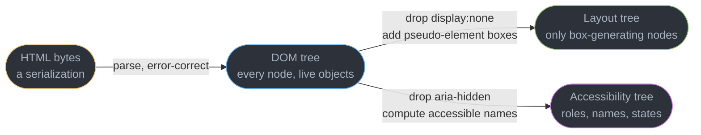
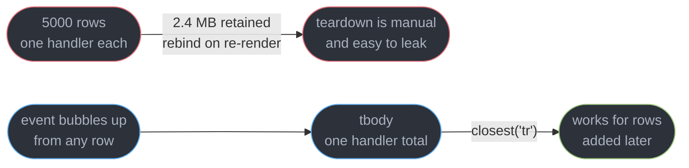
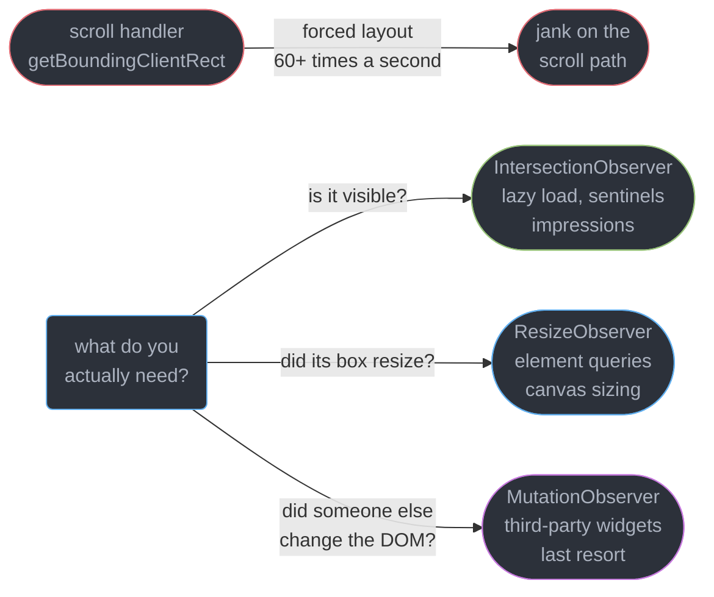
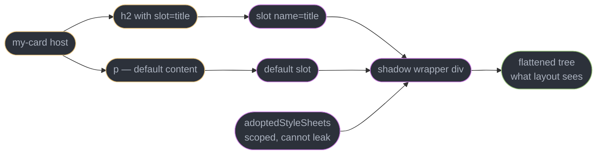
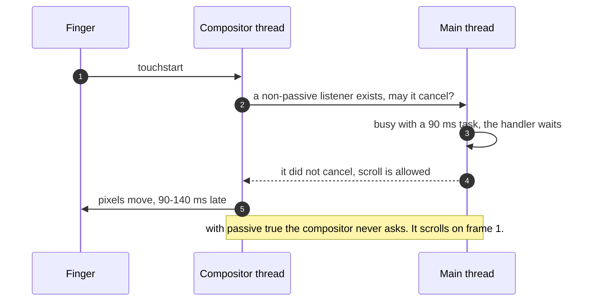
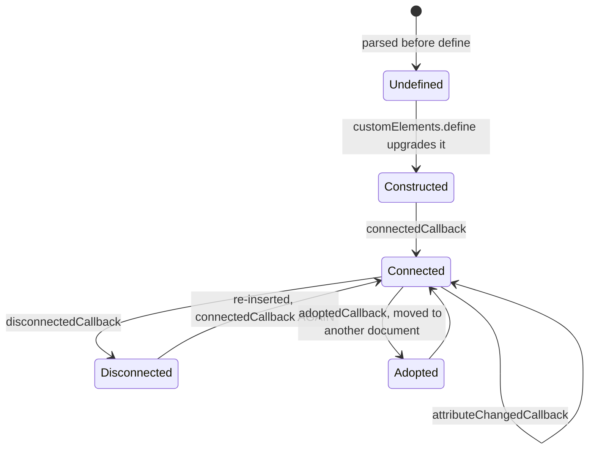

# The DOM and Web APIs

---

## 1. Concept Overview

Every front-end framework is a wrapper over one interface: a tree of objects the browser
exposes to JavaScript, plus the events and observers that report changes. React, Svelte, Vue
and Angular differ in how they decide *what* to change; every one ends at `appendChild`,
`setAttribute` and `addEventListener`.

| Layer | What it is | Who owns it |
|-------|-----------|-------------|
| HTML | bytes on the wire, a serialization | the network and the parser |
| DOM | a live tree of objects with methods | this module |
| Layout tree | only the nodes that generate a box | the rendering pipeline |
| Accessibility tree | a parallel projection for assistive tech | the accessibility module |

Three trees, one source. A `display: none` element is a full participant in the DOM — you can
query it, attach listeners, observe it — and it exists in neither of the other two. This module
owns the **object model and the APIs on top of it**, and not what surrounds it:

| Topic | Owner |
|-------|-------|
| Layout, paint, composite, forced synchronous layout | [Browser Architecture and the Rendering Pipeline](../browser_architecture_and_the_rendering_pipeline/browser_architecture_and_the_rendering_pipeline.md) |
| Tasks, microtasks, `requestAnimationFrame`, `scheduler.yield()` | [The Event Loop and Scheduling](../the_event_loop_and_scheduling/the_event_loop_and_scheduling.md) |
| XSS sinks, CSP, Trusted Types, sanitization | [Browser Security and the Client Threat Model](../browser_security_and_the_client_threat_model/browser_security_and_the_client_threat_model.md) |
| The accessibility tree, ARIA, keyboard and focus | [Accessibility and WCAG](../accessibility_and_wcag/accessibility_and_wcag.md) |
| Prototypes, `this`, closures, ESM live bindings | [JavaScript Language Semantics](../javascript_language_semantics/javascript_language_semantics.md) |

The boundary crossed by accident is the first: **that module tells you what reading
`offsetHeight` costs; this one tells you what it is an interface to, and which API lets you
never read it.**

---

## 2. Intuition

> The DOM is a **live database with a query language you already know**, and every mutation
> fires a trigger.

**Mental model.** A spreadsheet shared with a rendering engine. You write into cells; the
recalculation happens on someone else's schedule, and reading a result forces it now. The event
system is the audit log, and it flows both ways — down from the root to the cell, then back.

**Why it matters.** The interview question is never "how do I add a node". It is "you have
5,000 rows and a click handler; where does the listener go", and the answer is a property of
the event model, not of any framework.

**Key insight, and the one that catches everyone.** The DOM is not slow — a modern engine does
roughly 1-2 million `createElement` calls per second and dispatches an event through a 40-deep
tree in under 10 microseconds. What is expensive is *layout*, which the DOM merely triggers, and
what is unmanageable is *state drifting out of sync with the tree*. Frameworks answer the
second problem, not the first.

---

## 3. Core Principles

1. **HTML is a serialization; the DOM is the object model.** They diverge the moment the
   parser fixes malformed markup or JavaScript mutates anything.
2. **Everything is a `Node`; only some nodes are `Element`s.** Text, comments and the document
   itself are nodes with no tag name, and whitespace is a text node.
3. **Reading is cheap, measuring is not** — `element.className` is a field read,
   `element.offsetWidth` a layout flush. And **some collections are live**, re-querying on
   access, which turns an innocent `for` loop into an infinite one.
4. **Events have three phases** — capture down, target, bubble up — and delegation is the direct
   consequence of the third.
5. **A listener that cannot cancel is a listener the browser need not wait for**, which is what
   passive listeners encode; and **push beats poll**, which is why the three observers exist.

---

## 4. Types / Architectures / Strategies

### 4.1 The node type hierarchy

| Interface | `nodeType` | Examples | Has attributes |
|-----------|-----------|----------|----------------|
| `Node` | base | everything below | no |
| `Element` | 1 | any tag, including SVG and MathML | yes |
| `HTMLElement` | 1 | `Element` plus `dataset`, `style`, `hidden`, `click()` | yes |
| `Text` | 3 | the whitespace between two tags | no |
| `Comment` | 8 | an HTML comment | no |
| `DocumentFragment` | 11 | a detached container, also the shadow root | no |

`SVGElement` is an `Element` but **not** an `HTMLElement`, which is why `svgNode.className`
returns an `SVGAnimatedString` rather than a string — use `classList` on SVG, always.

### 4.2 Collections, and which one bites

| Returned by | Type | Live | Iterable with `for...of` | Has `.map` |
|-------------|------|------|--------------------------|------------|
| `querySelectorAll()` | `NodeList` | **no** — a static snapshot | yes | no |
| `childNodes` | `NodeList` | **yes** | yes | no |
| `getElementsByTagName()`, `getElementsByClassName()` | `HTMLCollection` | **yes** | no | no |
| `children`, `document.forms`, `form.elements` | `HTMLCollection` | **yes** | no | no |

The asymmetry worth memorising: **`querySelectorAll` returns the only non-live `NodeList`, and
`childNodes` returns a live one.** The type name tells you nothing about liveness.

### 4.3 The three observers

`IntersectionObserver` answers "is it in the viewport" and replaced `getBoundingClientRect()`
in a scroll handler; `ResizeObserver` answers "did this box change size" and replaced
`window.onresize` plus a manual measure; `MutationObserver` answers "did this subtree change"
and replaced the old `DOMSubtreeModified` mutation events. All three are **push**, all three
batch their records, and all three need an explicit `disconnect()`.

---

## 5. Architecture Diagrams

### 5.1 One document, three trees



Only the DOM can be addressed directly, and `innerHTML` re-serializes it back to HTML — which is
why round-tripping silently normalises your markup.

### 5.2 The three phases of event propagation

```
  a button clicked, inside  body > main > form > button

        CAPTURE (down)                    BUBBLE (up)
   window     1 ------------------------------- 9
   document   2 ------------------------------- 8
   body       3 ------------------------------- 7
   form       4 ------------------------------- 6
   button              5  TARGET (capture listeners, then bubble)

   event.target        = button -- identical at all 9 steps
   event.currentTarget = whichever node's listener is running now
```

`{ capture: true }` fires on the way down at steps 1-4, a normal listener on the way up at 6-9,
and both fire at step 5 in registration order. `event.currentTarget` reads as `null` once
dispatch finishes, so capturing it inside a `setTimeout` gives you nothing.

### 5.3 Delegation: one listener instead of five thousand



The listener count is the smaller half of the win: a delegated handler also works for rows that
do not exist yet, so appending 200 rows requires no rebinding.

### 5.4 The three observers against the polling antipattern



`IntersectionObserver` computes intersections as part of work the compositor already does, so the
answer costs nothing extra and arrives off the scroll path.

### 5.5 Shadow DOM: two trees, one rendered result



Slotted nodes stay in the light DOM: `document.querySelector("h2")` still finds them and they
inherit the page's fonts. Only the shadow root's own nodes hide from outside selectors.

---

## 6. How It Works — Detailed Mechanics

### 6.1 The DOM is not your HTML

The parser error-corrects. Write `<table><div>x</div><tr><td>c</td></tr></table>` and the
`div` is *foster-parented* out to become a previous sibling of the table, a `tbody` you never
wrote appears, and a stray `<p>` implicitly closes the one before it — so `innerHTML` returns
a re-serialization of the corrected tree, not your file. Whitespace is the other surprise:
every newline between two tags is a real `Text` node.

For a `<ul>` written across three indented lines, `ul.childNodes.length` is **5** (text, li,
text, li, text) while `ul.children.length` is **2**, and `ul.firstChild` is a `#text` node
holding `"\n  "` — the classic off-by-whitespace bug. Use `children`, `firstElementChild` and
`nextElementSibling` unless you genuinely need text nodes; the `Node`-flavoured names are the
trap.

### 6.2 Finding nodes, and the liveness bug

`getElementById` is a hash-map lookup on the document's id table. `querySelector` parses the
selector, then matches **right to left**: `.sidebar a` starts from every anchor and walks up,
which is why a deep descendant selector costs more than a single class. On a 20,000-node
document an id lookup takes roughly 0.05 microseconds and `querySelectorAll(".row")` over 3,000
matches roughly 1.1 ms — fine once, not 60 times a second in a scroll handler.

```js
// BROKEN — infinite loop: the live collection re-queries, so appending grows it forever
const items = document.getElementsByClassName("item");
for (let i = 0; i < items.length; i++) document.body.append(items[i].cloneNode(true));

// FIX — snapshot first, and get a real Array with map and filter for free
for (const el of [...document.querySelectorAll(".item")]) document.body.append(el.cloneNode(true));
```

### 6.3 Batching insertion with a `DocumentFragment`

A `DocumentFragment` lives outside the document, so mutating it triggers no style, layout or
paint invalidation, and appending it moves every child in one operation.

```js
const frag = document.createDocumentFragment();
for (const row of data) {                       // data.length === 1000
  const tr = document.createElement("tr"), td = document.createElement("td");
  tr.dataset.id = row.id;                       // -> data-id, read back via tr.dataset.id
  td.textContent = row.name;                    // text, never parsed as markup
  tr.append(td); frag.append(tr);               // no invalidation: frag is out of the document
}
tbody.replaceChildren(frag);                    // one mutation, one style pass
```

Measured on a 1,000-row table in Chrome 141 on an M2: 1,000 direct `tbody.append()` calls take
31 ms, the fragment version 4.2 ms — the gap is the invalidation each append schedules, not the
DOM calls ([pipeline](../browser_architecture_and_the_rendering_pipeline/browser_architecture_and_the_rendering_pipeline.md)).
`replaceChildren()` with no argument empties a node, safer than `innerHTML = ""`.

### 6.4 Three ways to put content in a node

| API | Parses HTML | Safe with untrusted input | Preserves child listeners |
|-----|-------------|---------------------------|---------------------------|
| `textContent` | no | **yes** | n/a, replaces all children |
| `createElement` plus `append` | no | **yes** | yes |
| `innerHTML` | yes | **no** | no, every child is rebuilt |
| `setHTML()` | yes, then sanitizes | yes, with the default config | no |

```js
const name = '';
el.textContent = name;   // renders the literal characters. The only correct default.
el.innerHTML  = name;    // parses it. The img fails to load, onerror runs. XSS.
el.setHTML(name);        // parses, then strips event handlers and script-y URLs.
```

`innerHTML` does **not** execute an inline `<script>` it inserts, which is why people believe
it is safe; it executes everything else — `onerror`, `onload`, `autofocus` plus `onfocus`,
`<iframe srcdoc>`. `textContent` is not "the escaping option", it is the option where no parser
runs, and it rebuilds every child, so listeners, focus and form state are lost. Sinks and
sanitizer config belong to
[Browser Security](../browser_security_and_the_client_threat_model/browser_security_and_the_client_threat_model.md).

### 6.5 The event model in practice

`addEventListener` takes four options that matter: `capture` to fire on the way down, `once` to
auto-remove after the first dispatch, `passive` to promise you will not cancel, and `signal` to
remove via an `AbortController` — the teardown that scales, since one `abort()` removes forty
listeners with no function references to keep.

| Call | Stops propagation to other nodes | Stops other listeners on **this** node | Cancels the default action |
|------|----------------------------------|----------------------------------------|----------------------------|
| `preventDefault()` | no | no | **yes** |
| `stopPropagation()` | **yes** | no | no |
| `stopImmediatePropagation()` | **yes** | **yes** | no |

```js
// Delegation: one listener, works for rows added later, survives a full re-render
tbody.addEventListener("click", (e) => {
  const btn = e.target.closest("button[data-action]");   // target is the deepest node hit
  if (!btn || !tbody.contains(btn)) return;              // clicked padding, or outside
  actions[btn.dataset.action](btn.closest("tr").dataset.id);
}, { signal: controller.signal });
```

`e.target` is the deepest element under the pointer — often a `<span>` *inside* the button — so
`closest()` is not optional; `e.currentTarget` is `tbody` here, always. **Events that do not
bubble:** `focus`, `blur`, `load`, `error`, `mouseenter`, `mouseleave` and most media events —
delegate their bubbling twins `focusin`, `focusout`, `mouseover`, `mouseout`.

### 6.6 Passive listeners

`touchstart`, `touchmove`, `wheel` and `mousewheel` are **passive by default** when registered
on `window`, `document` or `document.body`. On any other element the default is still
non-passive:

```js
carousel.addEventListener("touchstart", onTouch);                    // blocks the compositor
carousel.addEventListener("touchstart", onTouch, { passive: true }); // 90-140 ms faster
```



Calling `preventDefault()` inside a passive listener does **nothing at all**, and Chrome logs
`[Intervention] Unable to preventDefault inside passive event listener invocation.` That is the
design: a non-passive listener *might* cancel, so the compositor cannot move a pixel until the
main thread reports back, and the region becomes a non-fast scroll region. To genuinely cancel
a gesture — a pull-to-refresh, a drawing canvas — pass `{ passive: false }` explicitly, or use
CSS `touch-action: none`, which needs no main-thread round trip at all.

### 6.7 The three observers

```js
// Lazy loading, with a 200px head start so images arrive decoded. Callback body as in §10.
const io = new IntersectionObserver(loadAndUnobserve, {
  root: null,               // null means the viewport; pass an element for a scroll container
  rootMargin: "200px 0px",  // fire 200px before the element enters the root box
  threshold: 0,             // 1 visible pixel. Use 0.5 for "half seen", or an array of stops.
});
```

`rootMargin` and `threshold` are the two knobs. Impression tracking wants `threshold: 0.5` plus
a dwell timer, because "50% visible for 1 second" is the industry definition and the observer
gives you both edges of that window free. An infinite-scroll sentinel is one empty `<div>` after
the last row.

`ResizeObserver` answers the second question. Its callback runs **after layout and before
paint**, and each entry already carries `contentBoxSize`, `borderBoxSize` and
`devicePixelContentBoxSize` — so read `e.contentBoxSize[0].inlineSize` and never call
`getBoundingClientRect()` inside it. Writing a style that changes the observed element's own size inside
the callback creates a cycle; the browser breaks it after one extra pass and logs
`ResizeObserver loop completed with undelivered notifications.` Avoid it by writing only
properties that cannot change the observed box (a colour class, not padding), by observing a
parent and writing to a child, or by comparing against the last applied value. A CSS
**container query** often removes the JavaScript entirely — see
[CSS Layout and the Cascade](../css_layout_and_the_cascade/css_layout_and_the_cascade.md).

`MutationObserver` is the last resort, for DOM you do not control:
`mo.observe(document.body, { childList: true, subtree: true })` delivers batched records as a
microtask before paint. It is unbounded work on someone else's schedule — add
`attributes: true` on a busy SPA and you get tens of thousands of records a minute. Legitimate
uses are narrow: a third-party widget, an auto-upgrading directive, DOM-clobbering detection.
Scope tightly, `disconnect()` on teardown — and if your own code made the change, you know.

### 6.8 Custom elements and shadow DOM

```js
class ToggleSwitch extends HTMLElement {
  static observedAttributes = ["checked", "disabled"];   // gates attributeChangedCallback
  static formAssociated = true;                          // enables the attachInternals APIs
  #internals = this.attachInternals();
  #root = this.attachShadow({ mode: "open", delegatesFocus: true });

  connectedCallback() {                  // in the document. Runs again on every move.
    this.#root.innerHTML = `<button part="knob" role="switch"><slot></slot></button>`;
    this.#root.adoptedStyleSheets = [sheet];   // one parsed sheet shared by every instance
    this.addEventListener("click", this.#toggle);
  }
  disconnectedCallback() { /* remove listeners, disconnect observers, cancel timers */ }
  attributeChangedCallback(n, oldV, newV) { this.#render(); }
  #toggle = () => {
    this.toggleAttribute("checked");
    this.#internals.setFormValue(this.hasAttribute("checked") ? "on" : "");
    this.dispatchEvent(new CustomEvent("change", { bubbles: true, composed: true }));
  };
}
customElements.define("toggle-switch", ToggleSwitch);   // name MUST contain a hyphen
```



Four rules that are not obvious. **The name needs a hyphen** — the platform will never ship a
hyphenated tag, which is the forward-compatibility guarantee. **`connectedCallback` can run many
times**, so it must be idempotent and `disconnectedCallback` must undo everything it did. **The
constructor may not touch attributes or children**, since it can run during parsing before
children exist. **`composed: true` is required** for an event to escape a shadow root, and such
an event is *retargeted* — outside the boundary `event.target` reads as the host.

Style encapsulation is total: a page rule `button { background: red }` cannot reach inside and
the shadow root's rules cannot leak out. Inherited properties (`color`, `font-family`) still
cross, and the deliberate holes are `::part()`, `:host` / `:host-context()` and CSS custom
properties — how design systems theme components without exposing internals. **Form
participation** needs `static formAssociated = true` plus `attachInternals()` and
`setFormValue()`, or the component is invisible to `FormData`; **framework interop** is the
friction point, and React 19 and later set custom-element properties rather than stringifying
them into attributes, so passing an object needs no imperative ref. They earn their keep in a
design system that must outlive a framework choice.

### 6.9 Selection, `Range`, and why `contenteditable` is a trap

A `Range` addresses positions as `(node, offset)` pairs — `getSelection().getRangeAt(0)` gives
`startContainer` (usually a `Text` node), `startOffset` (a character index inside that text
node, but a *child index* inside an element), and `collapsed`, `true` for a caret. That model
is exact, and it is why selection code is fragile: split one text node and every stored offset
after it is wrong. Four things then make `contenteditable` hard. **Every engine normalises differently** — press
Enter and Chromium produces a `div`, Firefox a `br` or a `div` by context, Safari differs again,
and a paste from Word carries whatever the clipboard's `text/html` flavour holds. **Selection is
browser state**, so a re-render replacing a text node destroys the caret. **Undo belongs to the
browser** and desynchronises the moment you mutate the DOM yourself. **`beforeinput` is the only
real control point** — it fires before the mutation with a cancellable `inputType`
(`insertText`, `formatBold`, 30-plus values), while `input` fires after the damage is done.

```js
editor.addEventListener("beforeinput", (e) => {
  if (e.inputType === "formatBold") {
    e.preventDefault();                       // never let the browser produce its own markup
    applyToModel({ type: "toggleMark", mark: "strong" });   // your model is the truth
  }
});
```

This is why ProseMirror, Lexical and Slate all do the same thing: keep an **explicit
schema-validated document model**, render the DOM from it, cancel `beforeinput` for anything the
model should handle, and treat the DOM as an untrusted output device to be re-synced.
ProseMirror even keeps a DOM-observer safety net for IME composition, which cannot be cancelled.
For plain text, use `contenteditable="plaintext-only"`.

### 6.10 Why frameworks exist

Imperative DOM code is not slow. It is **unmanageable**, and the failure is always the same:
two representations of the same fact drift apart.

```js
// The bug that motivates every framework: state and DOM updated in two places
let cart = [];
function addItem(item) {
  cart.push(item);                                   // representation 1
  list.append(renderRow(item));                      // representation 2
  badge.textContent = cart.length;                   // representation 3
}
function removeItem(id) {
  cart = cart.filter(i => i.id !== id);              // 1 updated
  document.getElementById(`row-${id}`).remove();     // 2 updated -- badge forgotten.
}                                                    // Three sources of truth, two stale.
```

The declarative answer collapses the three into one: write `ui = f(state)`, mutate only `state`,
and let the framework compute the DOM operations. That is the entire value proposition — not
speed. A framework does strictly more work than a correct hand-written mutation; it wins because
"correct" is hard to keep true across 400 interactions.

The honest counterweight: **the DOM is fast enough that a hand-written app can be fast.** This
repository's own learning game is the worked example — `game/app.js` is roughly 578 KB of
dependency-free vanilla JavaScript with no build step, no virtual DOM and no framework, running
a full reader, a quiz engine, spaced-repetition scheduling and Mermaid rendering. It works
because it obeys the discipline a framework would enforce: state lives in one object, render
functions are the only writers, the DOM is rebuilt from state rather than patched. That is a
convention, and a convention holds only as long as everyone reads the file — the real tradeoff
is not milliseconds, it is how many people can safely change the code.

---

## 7. Real-World Examples

**Delegation on a virtualised grid.** A trading dashboard rendered 4,000 rows with six
interactive controls each — 24,000 listeners, 2.4 MB of retained closures and 340 ms of
rebinding on every filter change. One delegated `click` listener on the grid container took
rebinding to 0 ms and cut heap by 2.4 MB.

**Impression tracking that stopped causing jank.** An ad platform measured viewability with
`getBoundingClientRect()` on 40 slots inside a `scroll` handler, adding 60-90 ms to the scroll
path. An `IntersectionObserver` with `threshold: [0, 0.5, 1]` and a 1-second dwell timer
produced the same IAB-standard numbers with zero forced layouts.

**A design system that outlived two framework migrations.** A bank shipped its button, input,
modal and date picker as custom elements with shadow roots and `::part()` theming hooks. Over
six years the consuming apps moved from AngularJS to React to Next.js and the components were
never rewritten — the only friction was form participation and passing objects from React.

---

## 8. Tradeoffs

| Dimension | Per-element listeners | Delegated listener |
|-----------|----------------------|--------------------|
| Listeners for 5,000 rows | 5,000 | 1 |
| Works for nodes added later | no, must rebind | yes |
| Teardown | one `removeEventListener` per node | one, or an `AbortController` |
| Non-bubbling events (`focus`, `mouseenter`) | works | needs `focusin` / `mouseover` |

On 1,000 rows `innerHTML` costs 22 ms and `setHTML()` 26 ms against 4.2 ms for `createElement`
through a fragment — and only the fragment path preserves child listeners and focus, while only
it and `setHTML()` are safe with untrusted input.

A custom element survives a framework migration and a framework component does not; in
exchange the framework component gets native object props, native server rendering, and a
deep ecosystem of devtools and typings. Custom elements need React 19+ or an imperative ref
for object props, and declarative shadow DOM for server rendering.

---

## 9. When to Use / When NOT to Use

**Delegate when** the container is stable and the children are many or dynamic — table rows,
list items, a toolbar. **Use `IntersectionObserver` for** anything phrased as "when this becomes
visible": lazy images, infinite scroll, impressions, sticky-header triggers, autoplay on view.
**Use `ResizeObserver` when** an element must react to its own box, after checking whether a CSS
container query already does it, and **a `DocumentFragment`** past about 20 nodes in one pass. **Reach for custom elements when** a component must outlive the
current framework — a design system, an embeddable widget, a migration.

**Do NOT** poll `getBoundingClientRect()` in a `scroll`, `resize` or `mousemove` handler; every
one has a push-based replacement, and this is the most common source of scroll jank. **Do NOT**
use `innerHTML` with any value from user input, a URL or an API response, **do NOT** use
`MutationObserver` on DOM your own code writes, **do NOT** build a rich text editor directly on
`contenteditable`, and **do NOT** call `stopPropagation()` where delegated listeners sit above.

---

## 10. Common Pitfalls

### Pitfall 1: polling geometry in a scroll handler

```js
// BROKEN — 40 forced layouts on every one of ~60 scroll events per second
window.addEventListener("scroll", () => {
  for (const card of cards) {                       // cards.length === 40
    const r = card.getBoundingClientRect();         // flush layout, every card
    if (r.top < innerHeight && r.bottom > 0) card.classList.add("seen");
  }
});
// [Violation] 'scroll' handler took 84ms

// FIX — the browser computes intersections anyway; ask it to tell you
const io = new IntersectionObserver((entries) => {
  for (const e of entries) {
    if (!e.isIntersecting) continue;
    e.target.classList.add("seen");
    io.unobserve(e.target);                         // one-shot per card
  }
}, { threshold: 0 });
cards.forEach(c => io.observe(c));
```

Measured on a 40-card feed in Chrome 141: 84 ms per scroll event down to 0 ms and 0 forced
layouts, because the observer callback runs after paint, off the scroll path. The scroll handler
is deleted, not optimised.

### Pitfall 2: `innerHTML +=` in a loop

```js
// BROKEN — quadratic: each += re-serializes the whole list and reparses it
for (const row of rows) list.innerHTML += `<li>${row.name}</li>`;   // 500 rows: 1,240 ms

// FIX — build detached, insert once, and never parse user text as markup
const frag = document.createDocumentFragment();
for (const row of rows) frag.append(Object.assign(
  document.createElement("li"), { textContent: row.name }));       // 500 rows: 5 ms
list.append(frag);
```

`+=` reads `innerHTML` (serialize the whole subtree), concatenates, then writes (destroy every
child and reparse) — at 500 rows, 500 serializations of a growing list, each pass destroying
every listener and every bit of focus state below it.

### Pitfall 3: listeners that outlive their nodes

```js
// BROKEN — el.remove() later leaves detached DOM retained by this closure. A leak.
function mountPanel(el) {
  window.addEventListener("resize", () => el.style.width = measure() + "px");
}

// FIX — one AbortController per mount, aborted on unmount
function mountPanel(el) {
  const ac = new AbortController();
  window.addEventListener("resize", onResize, { signal: ac.signal });
  return () => ac.abort();          // teardown removes every listener registered with it
}
```

A listener on `window` or `document` whose closure captures a DOM node keeps that node and its
whole subtree out of GC — heap-snapshot technique belongs to
[Client Memory and Performance Debugging](../client_memory_and_performance_debugging/client_memory_and_performance_debugging.md).

---

## 11. Technologies & Tools

| Tool | Role | Relevance to the DOM |
|------|------|---------------------|
| Chrome DevTools | Inspector and profiler | Elements panel, event listener breakpoints, the Layers panel |
| Lit | Custom-element base class | Reactive properties and templating over the native API |
| Testing Library | DOM test utilities | Queries by accessible role, not by CSS selector |
| ProseMirror | Rich text editor toolkit | Explicit document model over `contenteditable` |
| Lexical | Rich text editor framework | Same model-first approach, from Meta |
| DOMPurify | HTML sanitizer | Cleans untrusted markup before `innerHTML` |
| Playwright | Browser automation | Drives the real DOM across Chromium, Firefox and WebKit |

---

## 12. Interview Questions with Answers

**Q: What does event delegation buy you, and when does it not work?**
**Short:** One listener on a stable container handles clicks from every descendant, including nodes added after the listener was attached, instead of one listener per row.

Attach to `tbody` and dispatch with `e.target.closest("[data-action]")`: 5,000 rows need one
listener rather than 5,000, appending rows requires no rebinding, and teardown is a single
`removeEventListener`. It fails for events that do not bubble — `focus`, `blur`, `mouseenter`,
`mouseleave`, `load` — so delegate `focusin`, `focusout`, `mouseover` and `mouseout` instead.

**Q: What is the difference between `event.target` and `event.currentTarget`?**
**Short:** Target is the deepest element the event originated on and never changes during dispatch, while currentTarget is whichever node's listener is executing right now.

Click an `<svg>` icon inside a `<button>` inside a `<tr>` with a listener on `tbody`:
`e.target` is the `svg`, `e.currentTarget` is the `tbody`, which is why delegation needs
`e.target.closest("button")`. `currentTarget` is set only while the listener runs and reads as
`null` afterwards, so capturing it in a `setTimeout` gives you nothing — copy it out first.

**Q: Why is `IntersectionObserver` better than checking `getBoundingClientRect()` in a scroll handler?**
**Short:** The browser already computes intersection as part of compositing, so the observer costs no extra layout and its callback runs after paint, off the scroll path entirely.

A scroll handler calling `getBoundingClientRect()` on 40 elements forces 40 synchronous layouts
per scroll event, roughly 84 ms of main-thread work 60 times a second, on the exact path the
compositor is waiting on. The observer delivers batched entries with `isIntersecting`,
`intersectionRatio` and a cached rect. Tune with `rootMargin` and `threshold`.

**Q: What is the difference between `innerHTML` and `textContent`?**
**Short:** Setting innerHTML runs the HTML parser over the string so any markup in it becomes real nodes, while textContent inserts the characters literally with no parser involved.

`textContent` is safe with untrusted input by construction — nothing is parsed, so there is
nothing to escape. `innerHTML` is an XSS sink: it will not execute an inserted `<script>` tag,
which misleads people, but it happily runs ``, and it rebuilds every
child, dropping listeners, focus and form state. Default to `textContent`.

**Q: What is the difference between `stopPropagation`, `stopImmediatePropagation` and `preventDefault`?**
**Short:** preventDefault cancels the browser's default action but lets the event keep travelling, stopPropagation halts travel to other nodes, and stopImmediatePropagation also skips remaining listeners on the current node.

`preventDefault()` on a link click stops navigation while document-level analytics still see
the event. `stopPropagation()` is the dangerous one in a shared codebase: it silently breaks
every delegated handler above the node, including a framework's root listener. Prefer a flag on
the event object, and check `event.defaultPrevented` rather than racing other handlers.

**Q: Which collections in the DOM are live, and why does that matter?**
**Short:** Every HTMLCollection is live and so is childNodes, but querySelectorAll returns a static NodeList snapshot, and a live collection re-runs its match on every access.

`getElementsByClassName`, `getElementsByTagName`, `children` and `form.elements` re-query the
tree each time you read `.length` or an index, so a loop appending matching nodes while reading
`.length` never terminates. Take a snapshot with `[...document.querySelectorAll(...)]` when you
mutate during iteration; it also gives you a real Array with `map` and `filter`.

**Q: What does `{ passive: true }` do, and what happens if you call `preventDefault()` anyway?**
**Short:** Passive promises the listener will not cancel the gesture, so the compositor scrolls without waiting for the main thread, and a preventDefault call inside one is ignored with a console warning.

Chrome logs `[Intervention] Unable to preventDefault inside passive event listener invocation.`
and scrolls anyway. `touchstart`, `touchmove` and `wheel` are passive by default on `window`,
`document` and `document.body` only — elsewhere the default still blocks, adding 90-140 ms of
scroll latency per touch on mid-range Android. Mark them passive, or use CSS `touch-action`.

**Q: Why is the DOM not the same thing as your HTML?**
**Short:** HTML is a serialization that the parser error-corrects into a tree, so the DOM contains inserted tbody elements, foster-parented nodes, implicitly closed tags and a text node for every whitespace run.

`<table><div>x</div><tr>` yields a `div` moved out before the table and a `tbody` you never
wrote, with no warning. Whitespace between tags is a real `Text` node, so `ul.childNodes` counts
5 where `ul.children` counts 2. Use `children`, `firstElementChild` and `nextElementSibling`.

**Q: What is in the DOM that is not in the render tree?**
**Short:** Anything that generates no box — a display none subtree, head, script and comment nodes — is a full DOM participant with none of it reaching layout.

You can query a `display: none` element, read its attributes, attach listeners and observe it;
it simply has no geometry, so `getBoundingClientRect()` returns all zeros and `offsetParent` is
`null`. `visibility: hidden` is the opposite — it lays out and occupies space but never paints.
Pipeline consequences: [the rendering pipeline](../browser_architecture_and_the_rendering_pipeline/browser_architecture_and_the_rendering_pipeline.md).

**Q: Why use a `DocumentFragment` instead of appending nodes one at a time?**
**Short:** A fragment lives outside the document, so building inside it schedules no style or layout invalidation, and appending it moves all children in a single mutation.

Inserting 1,000 rows directly takes about 31 ms because each insertion dirties style and layout;
building in a fragment and inserting once takes about 4.2 ms. `replaceChildren(frag)` swaps the
contents in one call, and with no argument it is the fastest way to empty a node. The win is
invalidation avoided, not DOM calls avoided.

**Q: How do `querySelector` and `getElementById` differ, and does it matter?**
**Short:** getElementById is a hash-map lookup on the document's id table, while querySelector parses a selector string and matches right to left against candidate elements.

On a 20,000-node document an id lookup is roughly 0.05 microseconds and
`querySelectorAll(".row")` over 3,000 matches roughly 1.1 ms — both irrelevant once, both a
problem inside a scroll handler. The bigger cost is selector shape: `.sidebar a` starts from
every anchor and walks up. Cache the result, and prefer one class over a descendant chain.

**Q: What causes the ResizeObserver loop error, and how do you avoid it?**
**Short:** Writing a style inside the callback that changes the observed element's own size re-triggers the observer, and the browser breaks the cycle after one extra pass with an undelivered-notifications error.

The message is `ResizeObserver loop completed with undelivered notifications.` Fix it by writing
only properties that cannot change the observed box, by observing a parent while writing to a
child, or by comparing against the last applied value. Read the measurement from the entry's
`contentBoxSize`, not `getBoundingClientRect()`. A CSS container query often removes the JS.

**Q: When is `MutationObserver` the right tool, and why is it usually not?**
**Short:** It is for watching DOM your own code does not write — a third-party widget or an injected banner — and it is unbounded work on someone else's schedule.

`subtree: true` plus `attributes: true` on `document.body` in a busy SPA delivers tens of
thousands of records a minute, each callback a microtask running before paint. Scope the target
tightly, enable only the flags you need, and always `disconnect()` on teardown. If your own code
made the change you already know it happened, and a direct call is cheaper and traceable.

**Q: What are the custom element lifecycle callbacks, and which one surprises people?**
**Short:** connectedCallback, disconnectedCallback, attributeChangedCallback and adoptedCallback, and the surprise is that connectedCallback runs again every time the element is moved in the DOM.

`attributeChangedCallback` only fires for names listed in `static observedAttributes`.
`connectedCallback` must be idempotent and `disconnectedCallback` must undo everything it did —
listeners, observers, timers — or moving a node leaks. The constructor may not touch attributes
or children, and the tag name must contain a hyphen or `customElements.define` throws.

**Q: How does shadow DOM encapsulation actually work, and where does it leak?**
**Short:** A shadow root creates a separate tree whose nodes are invisible to outside selectors and whose styles cannot escape, but inherited properties and custom properties cross the boundary by design.

`color`, `font-family` and `line-height` inherit in, and CSS custom properties pierce the
boundary — which is exactly how design systems theme components. The other deliberate holes are
`::part()` and `:host` / `:host-context()`. Slotted content stays in the light DOM, so
`document.querySelector` still finds it. Use `adoptedStyleSheets` for 500 instances, one sheet.

**Q: Why does an event from inside a shadow root not reach the page, and how is `target` reported?**
**Short:** An event only crosses a shadow boundary when dispatched with composed set to true, and once it crosses, retargeting rewrites target to the host element rather than the internal node.

`new CustomEvent("change", { bubbles: true, composed: true })` is the required shape; most native
UI events are already composed, but a custom one defaults to `false` and stops dead at the
boundary. Retargeting is the encapsulation guarantee holding — outside code learns which
component fired, never which internal button. Use `event.composedPath()` for the full path.

**Q: Why is building a rich text editor on `contenteditable` so hard?**
**Short:** Each engine normalises typed input into different markup, selection is browser-owned state expressed as node-and-offset pairs, and the browser's undo stack desynchronises the moment you mutate the DOM yourself.

Press Enter and Chromium emits a `div` while Firefox may emit a `br`; paste from Word and you get
whatever the clipboard's HTML flavour holds. A `Range` addresses positions as `(node, offset)`,
so splitting one text node invalidates every stored offset after it. This is why ProseMirror,
Lexical and Slate keep an explicit document model and cancel `beforeinput` to drive it.

**Q: If the DOM is fast, why do frameworks exist?**
**Short:** Imperative DOM code fails on maintainability rather than speed — state and DOM become separate representations of the same fact and drift apart across hundreds of interactions.

Add an item in three places and forget one on removal, and you have three sources of truth, two
stale. The declarative answer collapses them: mutate state, let the framework derive the DOM. A
framework does strictly more work than a correct hand-written mutation. Vanilla stays viable
with discipline — this repo's `game/app.js` is 578 KB of dependency-free JS, no build step.

---

## 13. Best Practices

1. **Delegate to a stable container** rather than binding per row, and always resolve the
   real target with `closest()`.
2. **Register teardown with an `AbortController` signal** — one `abort()` removes every
   listener a component added, with no function references to track.
3. **Default to `textContent`**; treat every `innerHTML` assignment as a security review item,
   and prefer `setHTML()` when markup is genuinely required.
4. **Replace every geometry poll with the matching observer** — a `getBoundingClientRect()`
   inside `scroll`, `resize` or `mousemove` is a question one of the three answers for free.
5. **Snapshot live collections** with the spread operator before mutating during iteration, and
   **batch insertions through a `DocumentFragment`** landed with `replaceChildren()`.
6. **Mark scroll-adjacent listeners `{ passive: true }`**, **disconnect every observer** where
   you remove the node, and keep `connectedCallback` idempotent so a moved custom element does
   not double-bind.

---

## 14. Case Study

### An infinite-scroll feed that froze the tab at 2,000 items

A social product's feed loaded 40 posts per page and became unresponsive after roughly ten pages,
scrolling at 8 fps. A 12-second Performance trace at 2,000 items showed 71% of main-thread time
in `Layout`, all of it nested inside a `scroll` handler, plus 118 ms of style recalculation per
appended page and heap growing 4.6 MB per page. Three defects, all in the same 30 lines:

```js
// BROKEN 1 — visibility polled per post, per scroll event: 2,000 forced layouts at 60 Hz
window.addEventListener("scroll", () => {
  for (const post of document.getElementsByClassName("post")) {   // live: re-queries
    const r = post.getBoundingClientRect();                       // READ -> flush layout
    if (r.top < innerHeight && r.bottom > 0) trackImpression(post.dataset.id);
  }
  if (scrollY + innerHeight > document.body.scrollHeight - 400) loadNextPage();
});

// BROKEN 2 — each post appended individually, and each one binds six listeners
function appendPost(p) {
  feed.insertAdjacentHTML("beforeend", template(p));   // parses + invalidates, 40x per page
  for (const btn of feed.lastElementChild.querySelectorAll("[data-action]"))
    btn.addEventListener("click", () => handle(p, btn.dataset.action));   // captures p
}
```

The live `HTMLCollection` was the accelerant: `getElementsByClassName` re-matched the whole
document on every loop access, and the loop ran on every scroll event. The per-post listeners
retained the full post object — 12,000 closures over 2,000 payloads, none ever reclaimed
because nothing was removed — which is where the 4.6 MB per page went.

```js
// FIX 1 — an observer for impressions, a sentinel for paging. The scroll handler is deleted.
const seen = new IntersectionObserver((entries) => {
  for (const e of entries) if (e.isIntersecting) {
    trackImpression(e.target.dataset.id);
    seen.unobserve(e.target);                       // one impression per post, then stop
  }
}, { threshold: 0.5 });                             // IAB definition: 50% visible
new IntersectionObserver(([e]) => { if (e.isIntersecting) loadNextPage(); },
  { rootMargin: "400px 0px" })                      // same 400px lookahead, no polling
  .observe(document.querySelector("#feed-sentinel"));

// FIX 2 — one delegated listener for the whole feed, one fragment per page
feed.addEventListener("click", (e) => {
  const btn = e.target.closest("[data-action]");
  if (btn) handle(btn.closest(".post").dataset.id, btn.dataset.action);   // an id, not a payload
});
function appendPage(posts) {
  const frag = document.createDocumentFragment();
  for (const p of posts) { const el = renderPost(p); frag.append(el); seen.observe(el); }
  feed.insertBefore(frag, document.querySelector("#feed-sentinel"));   // one mutation
}
```

Two further changes came out of the same trace: `content-visibility: auto` with
`contain-intrinsic-size: auto 480px` on `.post`, and a cap removing posts more than 60 items
above the viewport, disconnecting their observers in the pass.

**Outcome, measured over 14 days of real traffic at p75.** Scroll frame rate went from 8 fps to
a steady 58-60 fps; main-thread time per scroll event from 96 ms to 0 ms, the handler no longer
existing; style recalculation per appended page from 118 ms to 9 ms; heap at 2,000 items from
231 MB to 34 MB; and INP from 940 ms to 118 ms, moving from failing to passing the 200 ms
threshold in [Core Web Vitals](../web_performance_and_core_web_vitals/web_performance_and_core_web_vitals.md).
The diff was 34 lines removed and 22 added.

**The lesson.** No algorithm here was slow and no framework was needed. Three ordinary DOM
mistakes stacked: a **question asked by polling** that the platform answers by pushing, a **live
collection iterated during mutation**, and **per-node listeners retaining objects** with no
teardown. Each is a two-line fix alone; together they made the product unusable — and all three
are invisible in code review, obvious in a 12-second trace.
