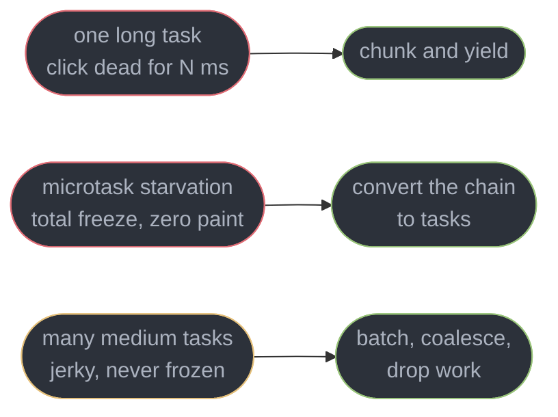
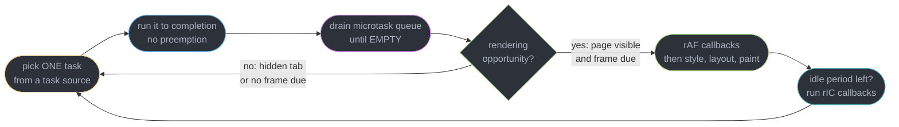
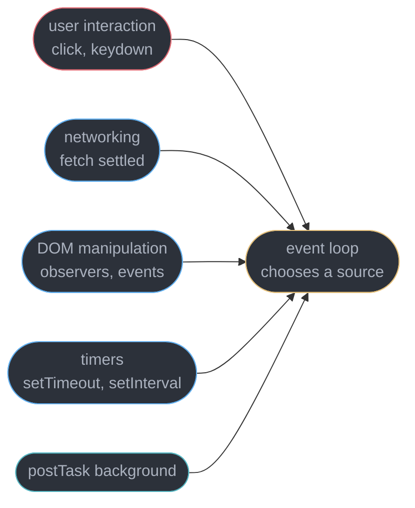
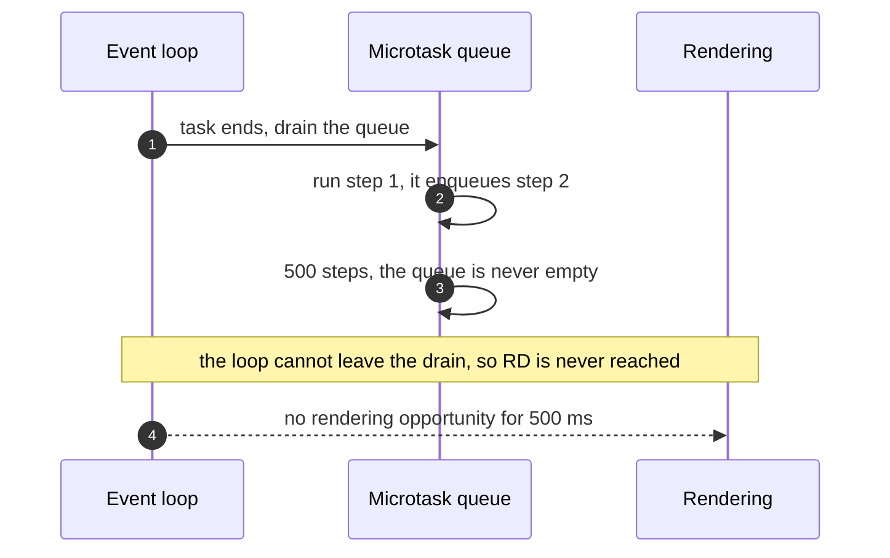
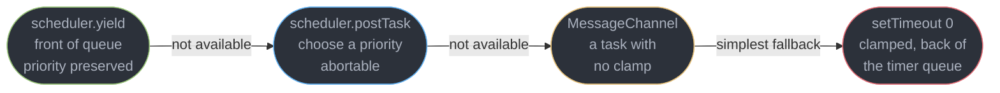
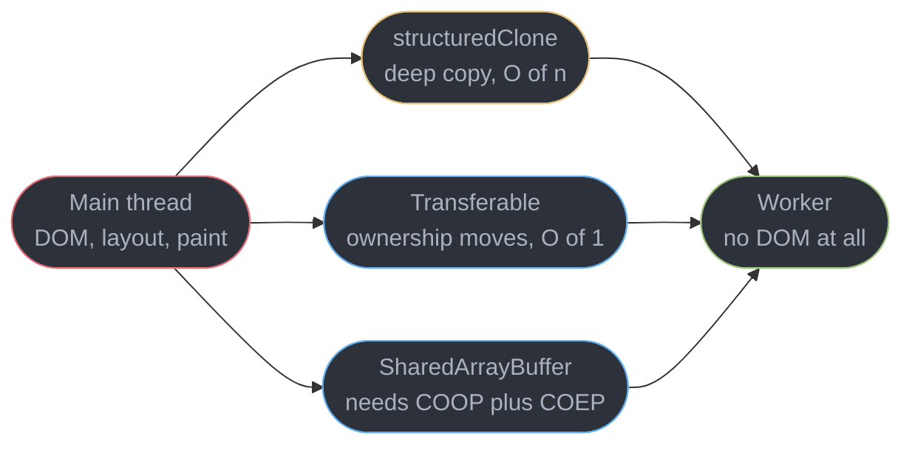

# The Event Loop and Scheduling

---

## 1. Concept Overview

A browser tab has **one thread that can touch the DOM**, and it does everything: runs your
JavaScript, dispatches clicks, recalculates style, lays out boxes, and paints. The event loop
is the algorithm that decides what that thread does next.

Almost every "the page froze" bug is the same shape: some code held the main thread past the
next rendering opportunity, and nothing else could run. The fix is never "make it faster" —
it is **put the work somewhere else**, and there are only four somewhere-elses:

| Where | Mechanism | Buys you |
|-------|-----------|----------|
| Later in the same turn | microtask queue | ordering guarantees, drains before rendering |
| A later turn | `setTimeout`, `scheduler.postTask()`, `scheduler.yield()` | a rendering opportunity in between |
| Just before paint | `requestAnimationFrame` | a write that lands in the frame it belongs to |
| Another thread | Web Worker | real parallelism, at the cost of no DOM |

This module owns **scheduling**: what runs, in what order, and how to get off the thread. It
does not own what the thread is doing when it renders:

| Topic | Owner |
|-------|-------|
| Layout, paint, composite, forced synchronous layout, the frame budget | [Browser Architecture and the Rendering Pipeline](../browser_architecture_and_the_rendering_pipeline/browser_architecture_and_the_rendering_pipeline.md) |
| Event dispatch, capture and bubble, delegation, passive listeners | [The DOM and Web APIs](../the_dom_and_web_apis/the_dom_and_web_apis.md) |
| Promise, `async`/`await` and generator *semantics* | [JavaScript Language Semantics](../javascript_language_semantics/javascript_language_semantics.md) |
| INP, LCP and CLS definitions and thresholds | [Web Performance and Core Web Vitals](../web_performance_and_core_web_vitals/web_performance_and_core_web_vitals.md) |
| React's own scheduler, `startTransition`, time slicing | [Concurrent Rendering and Transitions](../../react/concurrent_rendering_and_transitions/concurrent_rendering_and_transitions.md) |
| Node's libuv phases — a **different loop**, do not conflate | [The Node and Edge Runtimes](../the_node_and_edge_runtimes/the_node_and_edge_runtimes.md) |
| The general OS-level concept of an event loop | [Async I/O and Event Loops](../../cs_fundamentals/processes_threads_and_context_switching/async_io_and_event_loops.md) |

The boundary people cross by accident is the first one: **that module tells you what a layout
costs; this one tells you why the layout never got a chance to run.**

---

## 2. Intuition

> The main thread is a **single-lane road with no overtaking**. The event loop is the traffic
> light at the top of it, and it only changes between vehicles — never in the middle of one.

**Mental model.** A restaurant with one waiter. Each order (a task) is served start to finish;
the waiter will not abandon it halfway. Microtasks are the follow-up requests that same
customer makes before the waiter walks away — "and a fork, and salt" — all honoured *before
the next customer is looked at*. Keep adding them and the kitchen never sends a plate.

**Why it matters.** Rendering is not a task. It is a **rendering opportunity** the browser
takes between tasks, if it gets one. A 180 ms task at 60 Hz costs 10 consecutive frames.

**Key insight, and the one that catches everyone.** Tasks and microtasks look
interchangeable — both "run this later" — and they are not. A `setTimeout` chain lets the
page render between every link; an identical `queueMicrotask` chain renders **zero frames**,
because the microtask queue must be *empty* before the loop moves on, and a microtask that
enqueues a microtask never lets it empty.

---

## 3. Core Principles

1. **One task per turn, run to completion.** Nothing preempts a running task — not a click,
   not a timer, not the compositor asking for a frame.
2. **The microtask queue drains to empty** after every task, and before rendering. It is
   drained, not stepped.
3. **There is not one task queue.** The spec defines multiple **task sources**, and the
   browser picks which to service — which is why a click can jump ahead of a pending timer.
4. **Rendering is an opportunity, not a queue entry.** The browser takes it roughly at the
   display refresh rate, and skips it entirely when the page is hidden.
5. **`requestAnimationFrame` is inside the frame; `setTimeout` is between frames**, and a
   worker gives you a second thread but never a second DOM.
6. **50 ms is the line.** A task at or above 50 ms is a *long task* by spec and is the unit
   in which unresponsiveness is measured.
7. **Yielding costs wall-clock time and buys responsiveness.** Chunked work finishes later
   and feels faster; that trade is the whole point.

---

## 4. Types / Architectures / Strategies

### 4.1 Task sources and their relative priority

The spec requires the loop to pick a task from *a* task source, and deliberately leaves the
choice to the browser so it can prioritise. Chromium's ordering, highest first:

| Task source | Examples | Practical priority |
|-------------|----------|--------------------|
| User interaction | `click`, `keydown`, `pointerdown` | highest — serviced ahead of pending timers |
| `postTask` user-blocking | `scheduler.postTask(fn, { priority: "user-blocking" })` | equal to input |
| Networking | `fetch` response, XHR `load` | high |
| DOM manipulation | `MutationObserver` delivery, custom events | normal |
| Timers | `setTimeout`, `setInterval` | normal, and clamped |
| `postTask` background | `{ priority: "background" }` | lowest that still runs |
| Idle | `requestIdleCallback` | only in leftover frame time |

This is why `setTimeout(fn, 0)` is not "run immediately": it is "run in a future turn, from a
mid-priority queue, no earlier than the clamp allows".

### 4.2 The five places you can put deferred work

| Mechanism | Runs | Renders in between | Use it for |
|-----------|------|--------------------|------------|
| `queueMicrotask` / `.then` | end of the current task | **never** | ordering, state consistency |
| `scheduler.postTask` | a future task, at a chosen priority | yes | prioritised background work |
| `scheduler.yield` | a future task, at the *original* priority | yes | splitting a long task in place |
| `setTimeout(fn, 0)` | a future task, clamped | yes | the universal fallback |
| `requestAnimationFrame` | before the next paint | that frame | visual writes only |
| `requestIdleCallback` | leftover time after paint | yes | genuinely optional work |

### 4.3 The three ways a page becomes unresponsive



Only the middle one produces no paint at all, which is why a total freeze is diagnostically
useful: it points at a microtask chain, not at slow code.

---

## 5. Architecture Diagrams

### 5.1 One turn on a timeline, and one turn that overruns

```
  ONE EVENT-LOOP TURN AT 60 Hz - a rendering opportunity every 16.7 ms

  0 ms                                                           16.7 ms
  |--------------------------------------------------------------------|
  | task    | microtask drain | rAF callbacks | style+layout | paint   |
  | click   | promise jobs    | write styles  | recalc       | draw    |
  | 3.1 ms  | 0.8 ms          | 2.4 ms        | 4.2 ms       | 2.0 ms  |
  |--------------------------------------------------------------------|
    ^ exactly ONE       ^ drains to EMPTY        12.5 ms used, 4.2 spare
      task per turn       before rendering

  THE NEXT TURN - one 180 ms task, and the rendering opportunity never comes

  0 ms         16.7        33.3        50.0       ...        180 ms
  |------------|-----------|-----------|-----------|-----------|
  |    one 180 ms task on the main thread, not preemptible     |
  |------------|-----------|-----------|-----------|-----------|
        ^ click at 9 ms                             ^ handler at 180 ms
        10 rendering opportunities missed, 171 ms of input delay
```

The two bars differ in one respect only: the length of the first box. Nothing in the second is
slow in a rendering sense — style, layout and paint never ran at all, because the loop cannot
reach them until the task returns.

### 5.2 The loop itself, one full turn



The microtask box is the dangerous one: it is a **loop**, not a step. Anything it enqueues is
appended to the same queue it is draining, so the arrow to the rendering opportunity is never
taken.

### 5.3 Why a click overtakes a pending timer



A `setTimeout(fn, 0)` registered at t=0 and a click at t=1 ms both have tasks queued when the
loop next turns. The click wins: the loop chooses the higher-priority source. Timer *order
among timers* is still FIFO by expiry.

---

## 6. How It Works — Detailed Mechanics

### 6.1 The loop, as the spec writes it

```js
// The HTML spec's event loop processing model, compressed to what matters.
while (true) {
  const task = pickTaskFromSomeTaskSource();   // ONE task, chosen source, may be none
  if (task) run(task);                         // runs to completion, nothing preempts it

  while (microtaskQueue.length) {              // DRAIN, not step
    run(microtaskQueue.shift());               // a microtask may push onto this same queue
  }

  if (isRenderingOpportunity()) {              // roughly at the display refresh rate
    runAnimationFrameCallbacks();              // rAF, in registration order
    recalculateStyle(); layout(); paint();     // owned by the rendering-pipeline module
  }
  if (idleTimeRemainsInThisFrame()) runIdleCallbacks();
}
```

Three facts fall out of this shape. `run(task)` has no timeout, so a slow task is a frozen
page. The microtask `while` has no bound, so an unbounded chain never exits it. And rendering
sits after both, so both can starve it.

### 6.2 Tasks versus microtasks — the distinction that matters most

Same work, same total CPU, two schedulers. Each step burns exactly 1 ms:

```js
function work() { const end = performance.now() + 1; while (performance.now() < end); }

let a = 0;
(function viaMicrotask() {                     // 500 x 1 ms, chained as microtasks
  work();
  if (++a < 500) queueMicrotask(viaMicrotask); // appended to the queue being drained
})();
// One turn, ~500 ms long. Frames painted: 0. Clicks handled: 0. The tab is frozen.

let b = 0;
(function viaTask() {                          // the identical work, chained as tasks
  work();
  if (++b < 500) setTimeout(viaTask, 0);       // a NEW task -> the loop turns
})();
// 500 turns, ~2,500 ms wall clock (1 ms work + a >= 4 ms clamp each).
// Frames painted: ~150. Clicks handled: all of them, within one frame.
```

The task version takes **5x longer** and the page stays usable throughout. That trade — slower
in total, responsive at every moment — is the entire discipline.



### 6.3 Promise scheduling, and the ordering question you will be asked

```js
console.log("1");                                          // synchronous
setTimeout(() => console.log("2"), 0);                     // task
Promise.resolve().then(() => console.log("3"));            // microtask, queued 1st
queueMicrotask(() => console.log("4"));                    // microtask, queued 2nd
(async () => { console.log("5"); await null; console.log("6"); })();
console.log("7");                                          // synchronous
// Output: 1 5 7 3 4 6 2
```

Three phases. **Synchronously**, top to bottom: `1`, then `5` (an `async` body runs eagerly
until its first `await`), then `7`; the `await null` suspends and queues the resumption as the
third microtask. **The drain** then runs the queue FIFO: `3`, `4`, `6` — `queueMicrotask` and
`.then` share one queue, so registration order is the only tiebreak. **Then** the task: `2`.

`await` is not a scheduling primitive of its own: `await g()` schedules its continuation
exactly as `g().then(...)` does. A native promise or a plain value costs **one microtask
tick**; a *thenable* costs an extra tick, because the engine must call its `then` to classify
it. The consequence that bites: `await Promise.resolve()` inside a loop is not a yield point.
Semantics belong to
[JavaScript Language Semantics](../javascript_language_semantics/javascript_language_semantics.md).

### 6.4 `requestAnimationFrame` — inside the frame, before paint

An rAF callback runs after the microtask drain and **before style, layout and paint in the
same turn**, which makes it the correct place to write a visual change: the write lands right
before the layout that was going to happen anyway.

```js
// The read-then-write pattern. Measure OUTSIDE the callback, write INSIDE it.
const start = el.getBoundingClientRect().top;               // one layout flush, in this task
requestAnimationFrame(() => {
  el.style.transform = `translateY(${target - start}px)`;   // write only, no reads
});
```

Reading geometry *inside* the callback is the trap: callbacks run in registration order, so a
read in the second flushes layout the first just dirtied — a forced synchronous layout, owned
by
[Browser Architecture and the Rendering Pipeline](../browser_architecture_and_the_rendering_pipeline/browser_architecture_and_the_rendering_pipeline.md).

rAF fires at the display's refresh rate — **16.7 ms at 60 Hz, 8.3 ms at 120 Hz**, so never
assume 60 — and **does not run at all in a background tab**: correct for animation, disastrous
if you used it as a general-purpose timer.

### 6.5 `requestIdleCallback` — the leftover time

If a frame's work finishes early, the remainder is an **idle period**. The deadline caps
`timeRemaining()` at **50 ms**, and it counts down in real time as your callback runs:

```js
const queue = [...pendingAnalytics];                  // 4,000 low-value items
function drain(deadline) {
  while (queue.length && (deadline.timeRemaining() > 1 || deadline.didTimeout)) {
    send(queue.shift());                              // ~0.4 ms each
  }
  if (queue.length) requestIdleCallback(drain, { timeout: 2000 });
}
requestIdleCallback(drain, { timeout: 2000 });
```

Check `timeRemaining()` **before every item, not once at the top**. The `timeout` option is the
escape hatch: after 2,000 ms the callback is promoted to a normal task and runs whether or not
the browser is idle, with `didTimeout` set to `true`. Without one, an idle callback on a
permanently busy page **may never run at all**, so nothing user-visible may depend on it.
Support is the weakest of anything here: Chromium 47+ and Firefox 55+, but Safari has kept it
**disabled by default through Safari 27** — about 80.7% of global traffic.

### 6.6 Long tasks, INP, and how to yield

A **long task** occupies the main thread for **50 ms or more** — the Long Tasks API's
definition, not a rule of thumb — and input arriving during one waits for it.

```js
new PerformanceObserver(list => {                      // Chromium 123+, the useful one
  for (const frame of list.getEntries()) {
    if (frame.blockingDuration < 50) continue;         // what INP actually reflects
    for (const s of frame.scripts) {
      beacon({ url: s.sourceURL, fn: s.sourceFunctionName, dur: Math.round(s.duration) });
    }
  }
}).observe({ type: "long-animation-frame", buffered: true });
```

The older `{ type: "longtask" }` observer fires at the same 50 ms threshold but attributes cost
only to a container document, so it tells you something was slow and never what.
`long-animation-frame` names the **script URL and function**. INP is good below **200 ms at the
75th percentile** of real users; the metric itself is defined in
[Web Performance and Core Web Vitals](../web_performance_and_core_web_vitals/web_performance_and_core_web_vitals.md).

**Yielding** breaks one long task into several short ones so the loop can turn between them:

```js
const yieldToMain = globalThis.scheduler?.yield
  ? () => scheduler.yield()
  : () => new Promise(resolve => {                     // no 4 ms clamp, unlike setTimeout
      const ch = new MessageChannel();
      ch.port1.onmessage = () => resolve();
      ch.port2.postMessage(null);
    });

async function renderRows(rows) {                      // rows.length === 20000
  for (let i = 0; i < rows.length; i++) {
    appendRow(rows[i]);
    if (i % 250 === 249) await yieldToMain();          // resume at the SAME priority
  }
}
```

`scheduler.yield()` resolves in a future task, and the continuation keeps the original task's
priority and goes to the **front** of its queue — so your own remaining work is not overtaken
by every unrelated timer that piped up meanwhile. That is the one thing `setTimeout(0)` cannot
do. It ships in Chromium 129+ and Firefox 142+, is absent in Safari, and reaches about 72.8%
of global traffic, so always feature-detect.



`scheduler.postTask()` is the other half of the API: it posts a **new** task at
`user-blocking`, `user-visible` (the default) or `background`, and returns a promise that a
`TaskController` can re-prioritise or abort.

```js
const ctrl = new TaskController({ priority: "background" });
scheduler.postTask(() => buildSearchIndex(docs), { signal: ctrl.signal });
searchBox.addEventListener("focus", () => ctrl.setPriority("user-blocking"));  // promote
router.addEventListener("navigate", () => ctrl.abort());                       // drop it
```

Use `yield()` to split work you are already doing; use `postTask()` to schedule work you have
not started. React's scheduler solves the same problem inside its own render loop — see
[Concurrent Rendering and Transitions](../../react/concurrent_rendering_and_transitions/concurrent_rendering_and_transitions.md).

### 6.7 Web Workers — a second thread, not a second DOM

```js
// main.js — a 40 MB CSV parse that used to block the thread for 1.8 s
const worker = new Worker(new URL("./parse.worker.js", import.meta.url), { type: "module" });
worker.postMessage({ buffer }, [buffer]);      // TRANSFER: O(1), `buffer` is detached here
worker.onmessage = e => renderTable(e.data);   // back on the main thread, ready to paint

// parse.worker.js — no document, no window, no DOM of any kind
self.onmessage = ({ data }) => {
  self.postMessage(parseCsv(new Uint8Array(data.buffer)));   // 1.8 s, off the main thread
};
```



`postMessage` uses the **structured clone algorithm**: a deep copy whose cost lands **on the
sending thread** — roughly 40-90 ms for a 10 MB graph of small objects, which is main-thread
time you were trying to save. A **transferable** (`ArrayBuffer`, `MessagePort`, `ImageBitmap`,
`OffscreenCanvas`) moves ownership instead, at constant cost, leaving the sender's handle
detached. A **`SharedArrayBuffer`** needs no message at all, coordinated with `Atomics.wait`
and `Atomics.notify` — but it requires **cross-origin isolation**:
`Cross-Origin-Opener-Policy: same-origin` plus `Cross-Origin-Embedder-Policy: require-corp`,
with `self.crossOriginIsolated === true`. Those headers break third-party embeds that do not
send CORP, which is the real cost.

The honest limit: **a worker cannot touch the DOM.** It helps computation and helps nothing
else. If a profile shows 40 ms of `Layout` against 6 ms of scripting, a worker changes
nothing — only `OffscreenCanvas`, which moves canvas *drawing* to a worker, crosses that line.

### 6.8 Timers, honestly

```js
let depth = 0;
const t0 = performance.now();
(function nest() {
  if (++depth === 10) console.log(depth, "levels in", Math.round(performance.now() - t0), "ms");
  else setTimeout(nest, 0);                    // "0" is a request, not a promise
})();
// Chromium 141: "10 levels in 23 ms" — levels 1-5 are near-immediate, 6-10 cost >= 4 ms each
```

Once a timer's **nesting level exceeds 5**, its timeout is raised to a minimum of **4 ms**, so
a self-rescheduling `setTimeout(fn, 0)` loop runs at most 250 times a second, not as fast as
the machine allows. `MessageChannel` has no such clamp, which is why it was the pre-`scheduler`
chunking primitive of choice.

Backgrounding is the second surprise. A hidden page's timers are throttled to roughly **once
per second**, and Chromium's **intensive throttling** takes over after a page has been hidden
for **5 minutes**, dropping them to **once per minute**; `requestAnimationFrame` stops
completely. Anything that must survive backgrounding computes elapsed time from a timestamp
rather than counting ticks, and checks `document.visibilityState` on `visibilitychange`.

---

## 7. Real-World Examples

**An analytics beacon that owned the click.** A retail checkout button ran a 340 ms
serialisation of the cart inside the `click` handler before navigating. INP at p75 was 620 ms
against the 200 ms threshold. The work was not removable — the beacon was contractual — so it
moved: `scheduler.postTask(serialise, { priority: "background" })` after an immediate
`navigator.sendBeacon` of a minimal payload. INP fell to 118 ms with the data intact.

**A countdown timer that lied.** A live-auction page decremented a counter with
`setInterval(fn, 1000)` and displayed the running total. Users who switched tabs came back to a
clock minutes behind: intensive throttling had reduced the interval to once per minute after
5 minutes hidden. The fix was to stop counting ticks and compute `endsAt - Date.now()` on each
tick, plus a resync on `visibilitychange` — the interval became a repaint trigger rather than
the source of truth.

---

## 8. Tradeoffs

| Dimension | Microtask | Task | rAF | rIC |
|-----------|-----------|------|-----|-----|
| Renders before it runs again | never | yes | it *is* the frame | yes |
| Latency to run | sub-millisecond | >= 4 ms if a clamped timer | up to 16.7 ms | unbounded |
| Runs in a hidden tab | yes | throttled to 1/s, then 1/min | **no** | rarely |
| Can starve rendering | **yes, completely** | no | only by overrunning | no |
| Right for | state consistency, ordering | chunked work | visual writes | optional work |

| Dimension | `scheduler.yield()` | `scheduler.postTask()` | `setTimeout(0)` | `MessageChannel` |
|-----------|--------------------|-----------------------|-----------------|------------------|
| Queue position on resume | front, priority kept | by chosen priority | back of timers | back, unclamped |
| Minimum delay | none | none | 4 ms past 5 nested | none |
| Abortable / re-prioritisable | no | yes, `TaskController` | `clearTimeout` only | no |
| Global support | 72.8% | Chromium and Firefox | universal | universal |

---

## 9. When to Use / When NOT to Use

**Use a microtask when** ordering within the current task is the point: settling a promise, or
flushing state writes before anything observes them. Prefer `queueMicrotask` over
`Promise.resolve().then` — it does not swallow a throw into a rejected promise.

**Use `requestAnimationFrame` when** the work is a visual write, and only then. **Use
`scheduler.yield()` when** you have a loop over more than roughly 200 items, or any single
function measured above 50 ms. **Use `scheduler.postTask({ priority: "background" })` when**
the work is real but nobody is waiting: prefetching, index building, warming a cache. **Use a
Web Worker when** the work is pure computation over 100 ms: parsing, diffing, crypto, WASM.

**Do NOT** use a microtask chain to iterate a collection — that is the freeze. **Do NOT** use
`requestAnimationFrame` as a general timer; it stops dead in a background tab. **Do NOT** put
anything the user will notice behind `requestIdleCallback` without a `timeout`. **Do NOT**
reach for a worker to fix jank whose profile is layout and paint — it cannot help, and the
`postMessage` clone can make it worse. **Do NOT** treat `setTimeout(fn, 0)` as "now".

---

## 10. Common Pitfalls

### Pitfall 1: a synchronous loop over a large array (BROKEN → FIX)

```js
// BROKEN — 20,000 rows formatted in one task; the click that started it is the last thing
// the page does for 1.4 s. DevTools: [Violation] 'click' handler took 1412ms
function renderReport(rows) {                        // rows.length === 20000
  const frag = document.createDocumentFragment();
  for (const row of rows) frag.appendChild(buildRow(row));   // ~0.07 ms each
  table.appendChild(frag);
}

// FIX — same work, 80 tasks of ~18 ms each. The loop turns between chunks, so every
// intermediate frame paints and every click is answered within one frame.
async function renderReport(rows) {
  const frag = document.createDocumentFragment();
  for (let i = 0; i < rows.length; i++) {
    frag.appendChild(buildRow(rows[i]));
    if (i % 250 === 249) {
      table.appendChild(frag);                       // commit what is ready, show progress
      await yieldToMain();                           // scheduler.yield(), see 6.6
    }
  }
  table.appendChild(frag);
}
```

Total time went **up**, from 1,412 ms to about 1,600 ms, and INP at p75 went from 1,480 ms to
94 ms. Measure the right thing: nobody perceives the 190 ms; everybody perceives the freeze.

### Pitfall 2: a recursive microtask that looks like a normal loop

```js
// BROKEN — the queue never empties, so rendering never happens. No error, no stack overflow.
function processAll(items) {
  if (!items.length) return;
  handle(items.shift());
  Promise.resolve().then(() => processAll(items));   // still the SAME microtask drain
}

// FIX — one item per task. The loop turns, the page paints, the user can cancel.
async function processAll(items) {
  while (items.length) {
    handle(items.shift());
    await yieldToMain();                             // a real task boundary
  }
}
```

The broken version is worse than a plain `for` loop, not better: it has all the freeze and adds
per-item microtask overhead. `await` inside a loop is only a yield point if what you await
actually resolves in a *later task* — `await Promise.resolve()` is not one.

---

## 11. Technologies & Tools

| Tool | Role | Relevance to scheduling |
|------|------|------------------------|
| Chrome DevTools | Profiler | Performance panel flags every task at or above 50 ms |
| PerformanceObserver | Browser API | `longtask` and `long-animation-frame` in the field |
| Scheduler API | Browser API | `postTask`, `yield`, `TaskController` |
| Web Workers | Browser API | A second thread with no DOM |
| Lighthouse | Lab audit | Total Blocking Time and the long-task list |
| web-vitals | Field library | INP attribution to a target element and script |
| Perfetto | Trace viewer | Full Chromium traces across threads and processes |

---

## 12. Interview Questions with Answers

**Q: What does this print — a `console.log`, a `setTimeout(0)`, a `Promise.resolve().then` and an `await` — and why?**
**Short:** Synchronous code runs first in source order, then the whole microtask queue drains in registration order, and only then does the timer task run.

For `log(1); setTimeout(log(2)); Promise.then(log(3)); queueMicrotask(log(4)); async{log(5);
await; log(6)}; log(7)` the output is **1 5 7 3 4 6 2**. An `async` body runs eagerly until its
first `await`, which is why `5` is synchronous and `6` is not. `queueMicrotask` and `.then`
share one queue, so registration order decides `3` before `4`. The task always runs last.

**Q: Why does an infinite microtask chain freeze the page when an equivalent `setTimeout` chain does not?**
**Short:** An unbounded microtask chain never lets the drain loop exit, and rendering sits after that loop, so the browser never reaches a rendering opportunity.

The event loop drains the microtask queue **to empty** before rendering; a microtask that
enqueues another is appended to the queue being drained, so the exit condition is never met.
The same 500 x 1 ms of work chained as microtasks paints **0 frames**; chained as tasks it
paints about 150 and stays clickable, at 5x the wall-clock time. Chain tasks, not microtasks.

**Q: What makes a task "long", and why does that number matter?**
**Short:** Any task occupying the main thread for 50 ms or more is a long task by the Long Tasks API definition, because input arriving during it cannot be handled until it returns.

Tasks run to completion with no preemption, so a 180 ms task means up to 180 ms of input delay
plus 10 dropped frames at 60 Hz. Observe them with `PerformanceObserver` on `longtask`, or
better on `long-animation-frame` (Chromium 123+), whose `blockingDuration` and per-script
`sourceURL` name the function. The user-facing consequence is INP, good below 200 ms at p75.

**Q: How do you break up a long task, and what does `scheduler.yield()` give you that `setTimeout(0)` does not?**
**Short:** Awaiting a scheduler yield point splits one task into several and resumes at the front of its own priority queue, so unrelated timers cannot overtake the remaining work.

Insert `await scheduler.yield()` every 200-250 items and each chunk becomes its own task, with
a rendering opportunity in between. `setTimeout(fn, 0)` also yields, but the continuation goes
to the **back** of a mid-priority queue and is clamped to 4 ms once nesting exceeds 5 levels,
so a page with busy timers can starve your own work. Feature-detect: `scheduler.yield()`
reaches about 72.8% of traffic and Safari has no `scheduler` at all.

**Q: What is the difference between `requestAnimationFrame` and `setTimeout(fn, 16)`?**
**Short:** Frame callbacks fire once per rendering opportunity immediately before style and layout, while a timer fires on its own schedule with no relationship to the frame.

rAF is inside the frame, so a style write there lands in the paint that is about to happen; a
timer can fire at any point, including just after a paint, costing a whole frame of latency.
rAF also tracks the real refresh rate — 8.3 ms on a 120 Hz panel — and **stops entirely in a
background tab**, while timers are only throttled. Use rAF for visual writes, never as a timer.

**Q: When exactly does code after an `await` run?**
**Short:** Resumption after await is queued as a microtask, so it runs in the current turn's drain, before rendering and before any pending task.

`await` is `.then` with different syntax: `async f(){ const v = await g(); use(v); }` schedules
`use(v)` exactly as `g().then(use)` does. A native promise or a plain value costs one microtask
tick; a thenable costs an extra tick because the engine must call its `then` to classify it.
The consequence that bites: `await Promise.resolve()` inside a loop is **not** a yield point.

**Q: Is `setTimeout(fn, 0)` the same as running `fn` immediately?**
**Short:** Nested timers clamp to a 4 ms minimum once nesting exceeds five levels, and every timer waits for the current task plus a full microtask drain regardless.

`0` is a lower bound on a request, not a promise. The task also enters a mid-priority queue, so
a pending click is serviced first. A self-rescheduling `setTimeout(fn, 0)` therefore runs at
most 250 times per second. `MessageChannel` posts a task with no clamp, which is why it was the
standard chunking primitive before the Scheduler API existed.

**Q: When is `requestIdleCallback` the wrong tool?**
**Short:** Idle callbacks may never run on a page whose main thread stays busy, so anything a user can perceive must not depend on one.

The callback fires only in leftover frame time, and `deadline.timeRemaining()` caps at 50 ms
and counts down while you work — check it before every item, not once. The `timeout` option
promotes the callback to a normal task after N ms with `didTimeout` set, and is mandatory for
anything semi-important. Safari has kept it disabled by default through Safari 27.

**Q: What can a Web Worker not fix?**
**Short:** Workers own no DOM, so they remove computation from the main thread and remove nothing from style, layout or paint.

A worker has no `document`, no `window` and no `getComputedStyle`, so every `appendChild` and
every style write still happens on the one thread that owns the DOM. If the flame chart shows
40 ms of `Layout` against 6 ms of scripting, a worker changes nothing. The exception is
`OffscreenCanvas`, which moves canvas drawing to a worker. See
[Browser Architecture and the Rendering Pipeline](../browser_architecture_and_the_rendering_pipeline/browser_architecture_and_the_rendering_pipeline.md).

**Q: What does `postMessage` cost, and how do you avoid paying it?**
**Short:** Copying a message runs the structured clone algorithm on the sending thread, so a 10 MB object graph costs roughly 40-90 ms of the main-thread time you were trying to save.

Pass a **transferable** instead — `ArrayBuffer`, `MessagePort`, `ImageBitmap`,
`OffscreenCanvas` — as the second argument, and ownership moves at constant cost, leaving the
sender's handle detached and unusable. Structure the worker contract around binary buffers and
typed arrays rather than deep object trees, and send one large message instead of many small
ones, since each carries fixed dispatch overhead.

**Q: What does `SharedArrayBuffer` require, and why is that requirement expensive?**
**Short:** Cross-origin isolation via COOP same-origin plus COEP require-corp is mandatory, and turning it on breaks every third-party embed that does not send CORP headers.

Serve `Cross-Origin-Opener-Policy: same-origin` and `Cross-Origin-Embedder-Policy:
require-corp`, then check `self.crossOriginIsolated === true` before constructing one. The
requirement exists because Spectre made shared memory plus a high-resolution timer into a
side-channel read primitive. In exchange you get zero-copy shared memory across threads,
coordinated with `Atomics.wait` and `Atomics.notify`.

**Q: Is there one task queue, and how can a click run before an earlier timer?**
**Short:** Task sources are separate queues and the spec lets the browser choose which to service, so user interaction is picked ahead of a timer that was queued first.

Chromium services input and `user-blocking` tasks above networking, above DOM manipulation and
timers, above `background` tasks, above idle callbacks. Ordering is only guaranteed **within**
a source: two timers with the same expiry run in registration order. This is also why
`postTask` priorities work at all, and why a page flooded with timers still answers a click.

**Q: How is INP related to long tasks, and what are the three parts of it?**
**Short:** Input delay is only the first of three phases — waiting for the thread, running the handlers, then rendering the result — and a long task inflates the first.

INP measures the worst (roughly p98) interaction latency on the page, from input to the next
paint reflecting it. Input delay is time the event spent queued behind a running task;
processing time is your handlers; presentation delay is style, layout and paint. Fixing only
handler duration is the common mistake — often the fix is yielding *before* the interaction
happens. Thresholds live in
[Web Performance and Core Web Vitals](../web_performance_and_core_web_vitals/web_performance_and_core_web_vitals.md).

**Q: Do `queueMicrotask` and `Promise.resolve().then` differ?**
**Short:** Both enqueue onto the same single microtask queue in registration order, so the only real difference is error handling and intent.

A throw inside `queueMicrotask` surfaces as an uncaught error on `window`, where your error
reporter will see it; a throw inside `.then` produces a rejected promise that is silent until
something rejects on it or `unhandledrejection` fires. `queueMicrotask` also allocates no
promise. Prefer it when you want a microtask and not a promise chain.

**Q: What happens to timers and animation frames when a tab goes to the background?**
**Short:** Backgrounded pages get their timers throttled to about once per second, then to once per minute after five minutes hidden, while animation frames stop completely.

Chromium's intensive throttling applies the one-per-minute budget after a page has been hidden
for 5 minutes. Anything time-dependent must therefore compute elapsed time from a stored
timestamp rather than counting ticks, and resync on `visibilitychange`. Use
`navigator.sendBeacon` or a `visibilitychange` handler for anything that must be sent before
the page is discarded.

**Q: Why prefer `long-animation-frame` over `longtask` for field data?**
**Short:** Attribution to a script URL and function name is what makes an entry actionable, and `longtask` gives you only a duration and a container.

A `longtask` entry names `self` or `same-origin-descendant` and nothing more, so you learn that
something was slow and never what. `long-animation-frame` (Chromium 123+) reports a `scripts`
array with `sourceURL`, `sourceFunctionName`, `duration` and `forcedStyleAndLayoutDuration`,
plus a `blockingDuration` that matches what INP reflects. Report both if you must, act on the
second.

**Q: What do `scheduler.postTask()`'s priorities mean in practice?**
**Short:** Posting with an explicit priority lets background work sit behind input permanently, and a TaskController can promote or abort it after the fact.

`user-blocking` is peer to input and should be rare; `user-visible` is the default and suits
anything the user is waiting on; `background` runs only when nothing better is queued —
prefetching, index building, cache warming. Construct a `TaskController`, pass its `signal`,
and call `setPriority("user-blocking")` when the user asks for the result, or `abort()` on
navigation. The task's promise then rejects with an `AbortError`.

**Q: What exactly is a "rendering opportunity", and when does the browser skip one?**
**Short:** The rendering opportunity is a checkpoint the loop reaches after every microtask drain, and the browser skips it whenever painting would produce nothing a user could see.

It is taken at most once per display refresh — 16.7 ms at 60 Hz, 8.3 ms at 120 Hz — and skipped
entirely for a hidden document, a cross-origin iframe scrolled out of view, or a document with
no visible change pending. This is why rAF callbacks never fire in a background tab, and why a
long task does not merely delay a frame: it deletes every opportunity that fell inside it.

---

## 13. Best Practices

1. **Chain tasks, never microtasks**, for anything that iterates a collection. A microtask
   chain is the one construct that can paint zero frames.
2. **Yield every 200-250 items or every 50 ms**, whichever comes first, via a
   `yieldToMain()` helper with a `MessageChannel` fallback.
3. **Keep `requestAnimationFrame` callbacks write-only**, and always pass a `timeout` to
   `requestIdleCallback` so nothing a user perceives depends on idle time.
4. **Observe `long-animation-frame` in production**, not just `longtask`, and alert on
   `blockingDuration` rather than raw duration.
5. **Move computation over 100 ms to a worker, and send transferables** — measure the clone
   before assuming the worker helped.
6. **Never count timer ticks for elapsed time.** Compute from a timestamp and resync on
   `visibilitychange`.
7. **Profile with 4x CPU throttling.** A 40 ms task on a laptop is a 160 ms long task on a
   mid-range Android device, and that is where INP is measured.

---

## 14. Case Study

### A CSV import screen that failed INP on every upload

An internal reconciliation tool lets finance upload a 12 MB CSV of about 48,000 rows, parse it
in the browser, validate every row against a rules table, and render a paged preview. After a
2026-05 release, users reported the tab "dying" for 6-9 seconds after choosing a file, with the
cancel button unclickable throughout. Field INP at p75 was **2,140 ms** against the 200 ms
threshold.

A 12-second Chrome trace showed two tasks and nothing else of consequence: one of **4,180 ms**
labelled `parseAndValidate`, and one of **1,930 ms** labelled `renderPreview`. Both were
single, unbroken blocks, and `long-animation-frame` from real users named both functions.

```js
// BROKEN 1 — one task does everything: parse, validate, and build 48,000 DOM rows.
// The cancel button exists in the DOM and can never be clicked.
function importCsv(text) {
  const rows = parseCsv(text);                           // 1,900 ms
  const errors = rows.map(r => validate(r, rulesTable)); // 2,280 ms, pure computation
  const frag = document.createDocumentFragment();
  for (let i = 0; i < rows.length; i++) frag.appendChild(buildRow(rows[i], errors[i]));
  preview.appendChild(frag);                             // the loop above costs 1,930 ms
}

// BROKEN 2 — the first attempted fix. This is not a yield point: every continuation lands
// in the SAME microtask drain, so the page still paints zero frames and now allocates
// 48,000 promises on top of the freeze.
function step(i, rows, errors) {
  if (i >= rows.length) return preview.appendChild(frag);
  frag.appendChild(buildRow(rows[i], errors[i]));
  return Promise.resolve().then(() => step(i + 1, rows, errors));
}
```

The shipped fix separated the two problems. Parsing and validation are **pure computation over
a buffer** and belong on another thread. Rendering **must** be on the main thread, so it is
chunked instead.

```js
// FIX 1 — parse and validate in a worker, sending the file as a transferable.
const worker = new Worker(new URL("./import.worker.js", import.meta.url), { type: "module" });
const buffer = await file.arrayBuffer();                // 12 MB
worker.postMessage({ buffer, rules }, [buffer]);        // O(1) transfer, not a 12 MB clone
const { rows, errors } = await new Promise(r => { worker.onmessage = e => r(e.data); });
```

```js
// FIX 2 — render on the main thread, but yield every 250 rows so the loop turns.
// yieldToMain() is the scheduler.yield() helper with the MessageChannel fallback from 6.6.
async function renderPreview(rows, errors, signal) {
  const frag = document.createDocumentFragment();
  for (let i = 0; i < rows.length; i++) {
    if (signal.aborted) return;                         // cancel is now actually reachable
    frag.appendChild(buildRow(rows[i], errors[i]));
    if (i % 250 === 249) { preview.appendChild(frag); await yieldToMain(); }
  }
  preview.appendChild(frag);
}
```

**Outcome, over 14 days of real traffic.** The longest main-thread task fell from 4,180 ms to
**19 ms**. Total wall clock from file-select to full preview rose from 6.1 s to **6.8 s**, an
11% regression that no user reported. INP at p75 fell from 2,140 ms to **86 ms**, and the
cancel button became usable at any point. The diff was 61 lines.

**The lesson.** Neither defect was a slow algorithm — `parseCsv` was already efficient, and the
fix made the total slower. One was **the wrong thread**: pure computation sitting on the only
thread that can answer a click. The other was **a fake yield point**: a promise chain that
looks like chunking, reads like chunking in review, and schedules every continuation into the
same microtask drain it was supposed to escape.
