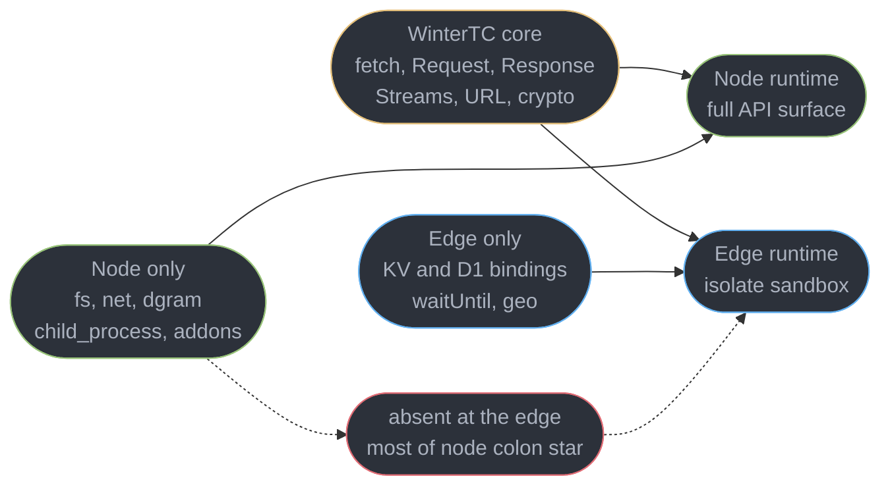
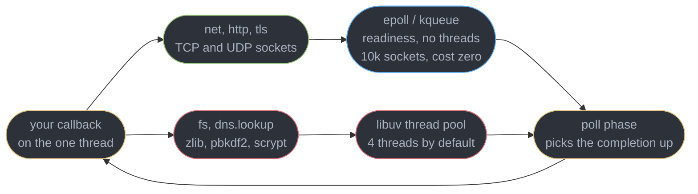
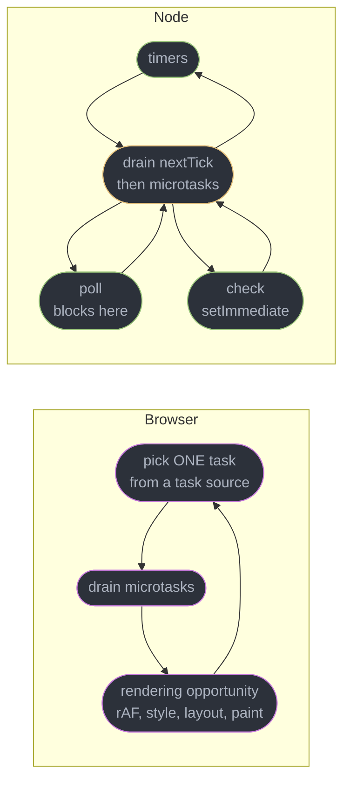
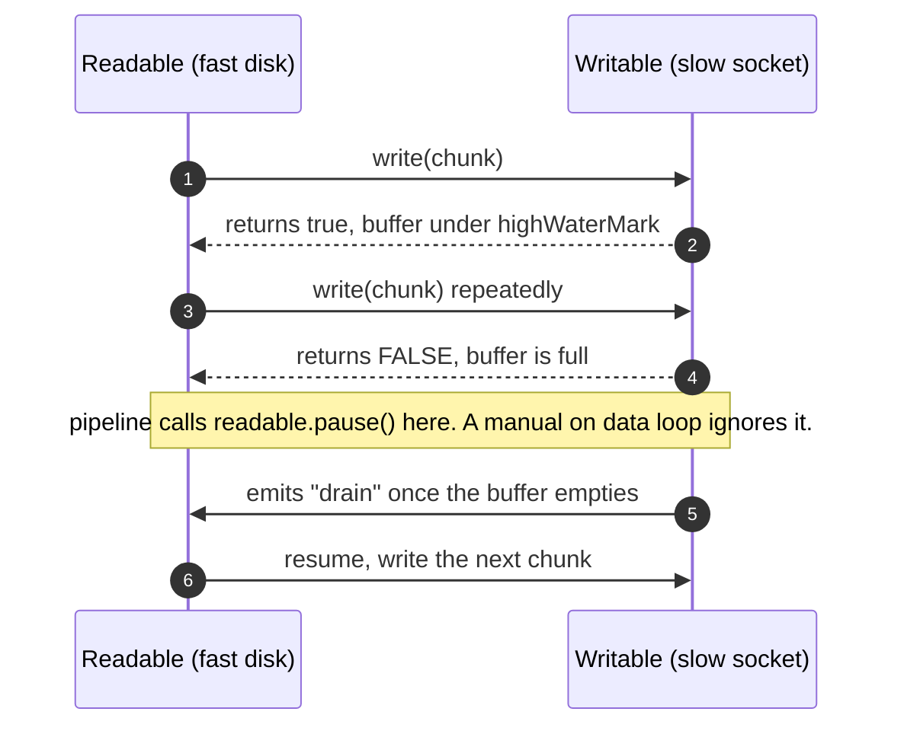
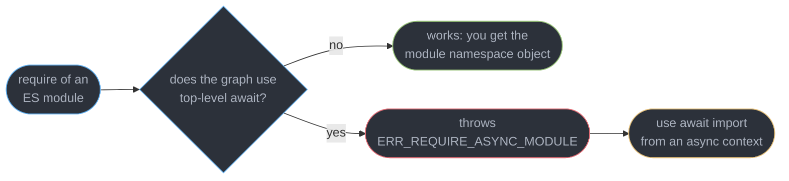
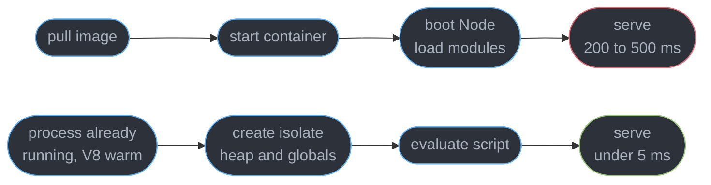

# The Node and Edge Runtimes

---

## 1. Concept Overview

You can ship a product that runs only in a browser and still have Node on the critical path of
everything you do. Node runs your bundler, your dev server, your type-checker, your test
runner, your linter, your CI job and your server-side render. When the build hangs, when
`npm test` leaks a handle and never exits, when the SSR box OOMs at 09:00, the thing
misbehaving is a Node process — and browser knowledge does not fully transfer, because
**Node's event loop is a different loop from the browser's**.

| What | Browser | Node |
|------|---------|------|
| The loop | one spec loop, task sources chosen by the UA | **libuv**, six named phases in a fixed cycle |
| Deferral queues | microtasks | microtasks **plus** a higher `process.nextTick` queue |
| Extra threads | Web Workers, no DOM | `worker_threads`, plus a 4-thread pool you did not ask for |

This module owns Node's phases, streams, module system, threading model, and the constrained
edge runtimes that look like Node and are not. It does not own:

| Topic | Owner |
|-------|-------|
| The **browser** loop, tasks vs microtasks, `requestAnimationFrame`, long tasks | [The Event Loop and Scheduling](../the_event_loop_and_scheduling/the_event_loop_and_scheduling.md) |
| TypeScript at runtime, type stripping, `--erasableSyntaxOnly` | [TypeScript at Runtime](../../typescript/typescript_at_runtime_node_deno_bun/typescript_at_runtime_node_deno_bun.md) |
| ESM/CJS **resolution**, `exports` maps, conditions | [Modules, Resolution and Package Exports](../../typescript/modules_resolution_and_package_exports/modules_resolution_and_package_exports.md) |
| Bundlers, tree-shaking, the build pipeline | [Modules, Bundling and the Build Pipeline](../modules_bundling_and_the_build_pipeline/modules_bundling_and_the_build_pipeline.md) |
| Deploys, edge hosting, RUM, source maps | [Frontend Delivery and Observability](../frontend_delivery_and_observability/frontend_delivery_and_observability.md) |
| React Server Components and server functions | [Server Components and Server Functions](../../react/server_components_and_server_functions/server_components_and_server_functions.md) |
| Framework route config and rendering modes | [Meta-Frameworks and Routing](../../react/meta_frameworks_and_routing/meta_frameworks_and_routing.md) |
| `epoll`, readiness vs completion, the general theory | [Async I/O and Event Loops](../../cs_fundamentals/processes_threads_and_context_switching/async_io_and_event_loops.md) |

**Versions, verified 2026-09-02:** Node **26** Current, Node **24 "Krypton"** Active LTS
(initial release 2025-05-06, promoted to Active LTS in October 2025; the 30-month support
window is measured from the initial release), Node **22** in Maintenance. Deno **2.9**,
Bun **1.4.0**. Node's native TypeScript type stripping is stable and unflagged.

---

## 2. Intuition

> The browser's loop is a **traffic light between cars**. Node's loop is a **postal sorting
> office with six numbered benches**, and the round always visits them in the same order.

**Mental model.** Every lap visits bench 1 (timers), 2 (deferred errors), 3 (internal), 4 (the
letterbox, where the clerk *waits*), 5 (`setImmediate`), 6 (closes). After every single letter
handled at any bench, the clerk empties two personal in-trays first — `process.nextTick`, then
promises — before touching the next letter. Only bench 4 is allowed to sleep.

**Why it matters.** There is exactly one clerk for your JavaScript. A handler that spends
400 ms hashing a password holds the whole office: no other request is read, no timer fires, no
health check is answered. In a browser that costs a dropped frame; on a server it costs every
concurrent user at once.

**Key insight, and the one that catches everyone.** Node looks concurrent because I/O is
concurrent — thousands of sockets, one thread, no problem. That concurrency is **entirely
borrowed from the kernel**. The moment your code computes instead of waiting, the borrowing
stops and Node becomes the most serial server you have ever deployed.

---

## 3. Core Principles

1. **One thread runs your JavaScript.** Everything else — threads, processes, the kernel —
   exists to keep that thread from waiting.
2. **The loop has named phases in a fixed order**, and a callback lands in the phase that owns
   it. Order between two callbacks is only defined once you know both phases.
3. **`process.nextTick` outranks promises.** Node drains the nextTick queue to empty, then the
   microtask queue to empty, after every callback and between every phase.
4. **Network I/O is free; file, DNS, zlib and CPU-bound crypto are not.** The first is
   `epoll`/`kqueue`; the second is a **4-thread** pool that serialises under load.
5. **Backpressure is a protocol, not a feature.** It works only if every link propagates it,
   and one manual `on("data")` handler breaks the whole chain.
6. **Blocking is a correctness bug, not a performance issue.** A blocked loop fails liveness:
   timeouts do not fire, health checks fail, the orchestrator restarts you.
7. **The edge is a smaller platform, not a faster Node.** No filesystem, no raw sockets, hard
   CPU budgets — you choose it for placement and pay in capability.

---

## 4. Types / Architectures / Strategies

### 4.1 The three server-side JavaScript targets

| | Node.js | Edge (workerd, Vercel Edge, Deno Deploy) | Browser |
|---|---------|------------------------------------------|---------|
| Isolation unit | OS process | **V8 isolate**, thousands per process | tab process |
| Cold start | 200-500 ms | **under 5 ms** | n/a |
| Filesystem | full `node:fs` | **none** | none |
| Raw TCP/UDP | `node:net`, `node:dgram` | **none** — `fetch` only | none |
| CPU budget | whatever the box has | 10 ms free tier, 30 s paid default | none |
| Native addons, `child_process` | yes | **no** | no |



**WinterTC** (Ecma TC55, formerly the WinterCG community group) standardises the shared middle
box: `fetch`, `Request`/`Response`/`Headers`, `URL`, `AbortController`, Web Streams,
`crypto.subtle`, `TextEncoder`, `structuredClone`. Write a handler against that surface and it
runs on all three. Reach for `node:fs` and you have chosen Node forever.

### 4.2 The four ways to get work off the one thread

| Mechanism | Isolation | Start cost | Data transfer | Use it for |
|-----------|-----------|-----------|---------------|------------|
| `worker_threads` | shared process, own heap | 15-40 ms | clone, transferables, `SharedArrayBuffer` | CPU-bound work in-process |
| `child_process` | separate process | 30-80 ms fork | serialised IPC or pipes | untrusted code, native tools |
| `cluster` | N processes, one socket | one per core | none — separate memory | using all cores for HTTP |
| A queue plus a worker service | separate deployment | seconds | the broker | anything over a second |

`cluster` solves **throughput**; `worker_threads` solves **one slow handler**. They are not
substitutes — 8 cluster workers each blocked for 400 ms serve 8 concurrent requests, not 8,000.

---

## 5. Architecture Diagrams

### 5.1 One libuv iteration, with the drain points marked

```
  ONE LIBUV LOOP ITERATION - six phases, always in this order

      +-----------------------------+
   -->|  1  timers                  |  setTimeout / setInterval whose time has come
      +-----------------------------+
         | nextTick queue -> empty, then microtask queue -> empty
      +-----------------------------+
      |  2  pending callbacks       |  deferred system errors, e.g. TCP ECONNREFUSED
      +-----------------------------+
         | nextTick queue -> empty, then microtask queue -> empty
      +-----------------------------+
      |  3  idle / prepare          |  libuv internal only, never yours
      +-----------------------------+
         | nextTick queue -> empty, then microtask queue -> empty
      +-----------------------------+
      |  4  poll                    |  BLOCKS in epoll/kqueue for new I/O. Wakes on
      |     sockets, completed fs   |  I/O, or after a timeout computed from the
      +-----------------------------+  nearest pending timer.
         | nextTick queue -> empty, then microtask queue -> empty
      +-----------------------------+
      |  5  check                   |  setImmediate callbacks - always right after poll
      +-----------------------------+
         | nextTick queue -> empty, then microtask queue -> empty
      +-----------------------------+
      |  6  close callbacks         |  socket.on("close"), handle teardown
      +-----------------------------+
         | nextTick queue -> empty, then microtask queue -> empty
   <---+  no handles and no requests left?  ->  the process exits
```

Two facts read off it. **Phase 4 is the only one that sleeps**, which is why a `setTimeout` is
late rather than early: the poll timeout is what wakes the loop. And **the drain happens after
every callback, not once per lap** — so a `nextTick` scheduled inside a timer callback runs
before the *next timer callback in the same phase*, never at the end of the loop.

### 5.2 Where an async operation actually goes



The lower path is the one nobody expects: four `crypto.pbkdf2` calls run in parallel and the
fifth waits for a thread, even on a 16-core box with an idle loop.

### 5.3 The browser loop against Node's loop



Three differences that change how you reason. Node has **no rendering step**, so nothing
bounds how long a callback may run except your own discipline. Node **blocks on purpose** in
poll, so an idle process burns zero CPU. And Node has **an extra queue above microtasks** that
the browser has no equivalent of. Promise and `await` semantics are identical, and belong to
[The Event Loop and Scheduling](../the_event_loop_and_scheduling/the_event_loop_and_scheduling.md).

---

## 6. How It Works — Detailed Mechanics

### 6.1 What the loop does between laps

Two things govern the cycle in §5.1. The **poll timeout** is `0` when a `setImmediate` is
pending and otherwise the milliseconds until the nearest timer, so an idle process sleeps in
the kernel rather than spinning. And after every lap libuv recomputes whether any **referenced
handle or request** remains — which is why `node script.js` sometimes never exits: one open
server, one unref'd interval or one live database pool keeps that count above zero.
`process.exit()` hides the bug; `server.close()` and `pool.end()` fix it.

### 6.2 `setTimeout(fn, 0)` versus `setImmediate(fn)`

```js
// main module: NONDETERMINISTIC. Run it 100 times and you get both orders.
setTimeout(() => console.log("timeout"), 0);     // clamped to 1 ms, lands in phase 1
setImmediate(() => console.log("immediate"));    // lands in phase 5

// inside an I/O callback: DETERMINISTIC. setImmediate ALWAYS wins.
readFile("config.json", () => {                  // we are now in the POLL phase
  setTimeout(() => console.log("timeout"), 0);
  setImmediate(() => console.log("immediate"));
});
// Always "immediate, timeout" - check (5) is the very next phase, timers (1) is a lap away.
```

`setTimeout(fn, 0)` is clamped to **1 ms**, and the loop reaches the timers phase some
microseconds or some milliseconds later depending on how busy startup was. If 1 ms has elapsed
the timer is due and fires first; if not, the loop falls through to check. Both outcomes are
correct, so "it depends" is the right answer for the main module.

### 6.3 `process.nextTick` jumps the microtask queue

```js
Promise.resolve().then(() => console.log("promise 1"));
process.nextTick(() => {
  console.log("tick 1");
  process.nextTick(() => console.log("tick 2"));   // appended to the queue being drained
});
setImmediate(() => console.log("immediate"));
console.log("sync");
// sync, tick 1, tick 2, promise 1, immediate
```

Node drains **the whole nextTick queue, then the whole microtask queue**, after every callback
and between every phase. Both drain to empty, so both can starve the loop: a recursive
`process.nextTick` pins a core at 100% and never accepts another connection, with no stack
overflow and no error. Reserve `nextTick` for letting a caller attach listeners before you
emit, and use `queueMicrotask` otherwise.

### 6.4 The thread pool nobody expects

```js
// UV_THREADPOOL_SIZE defaults to 4. Each pbkdf2 below takes ~180 ms of pure CPU.
import { pbkdf2 } from "node:crypto";
const t0 = Date.now();
for (let i = 0; i < 8; i++) {
  pbkdf2("pw", "salt", 600_000, 32, "sha512", () => console.log(i, Date.now() - t0, "ms"));
}
// 0..3 finish near 185 ms. 4..7 finish near 370 ms. Two batches of four, on a 16-core box.
```

The pool serves **`fs`** (everything but the watchers), **`dns.lookup`** (which is
`getaddrinfo`, a blocking C call — `dns.resolve*` speaks DNS over a socket and does not),
**`zlib`**, and the CPU-bound `crypto` functions `pbkdf2`, `scrypt` and `randomBytes`. It is
**4 threads** by default with a ceiling of 1024, and `UV_THREADPOOL_SIZE` must be set before
first use, so set it in the environment rather than in code.

**Sockets do not use it.** `net`, `http`, `https` and `tls` register with `epoll` (Linux),
`kqueue` (macOS/BSD) or IOCP (Windows) and cost no thread at all — which is why Node holds
10,000 idle connections on one thread and still stalls on the fifth concurrent `fs.readFile`.

### 6.5 Streams and backpressure

A readable produces, a writable consumes, a transform does both. The point is that a 2 GB file
moves through a 64 KiB window instead of a 2 GB buffer — which holds only if the slow side can
tell the fast side to stop.



```ts
import { pipeline } from "node:stream/promises";
import { createReadStream, createWriteStream } from "node:fs";
import { createGzip } from "node:zlib";

// pipeline() propagates backpressure AND destroys every stream in the chain on any error.
await pipeline(
  createReadStream("export.csv"),            // 2.1 GB
  createGzip(),
  createWriteStream("export.csv.gz"),
);                                           // steady RSS ~90 MB, whatever the file size
```

`highWaterMark` is the **threshold at which `write()` starts returning `false`**, not a hard
cap: **65536 bytes (64 KiB)** for byte streams on Node 22 and later, **16 objects** in object
mode. `write()` never rejects a chunk — it always buffers and only *advises* you to stop.
Ignore the advice and the buffer grows without limit until the process dies with
`JavaScript heap out of memory`; see Pitfall 1. Web Streams (`ReadableStream`,
`TransformStream`) are the same idea with the API the edge runtimes give you, and bridge via
`Readable.fromWeb()` / `Readable.toWeb()`.

### 6.6 ESM and CJS inside Node

```json
{ "type": "module", "exports": { ".": "./dist/index.js" }, "engines": { "node": ">=24" } }
```

`"type": "module"` makes every `.js` file in that package ESM, and the per-file overrides beat
it: **`.mjs` is always ESM, `.cjs` is always CJS**. Resolution itself — the `exports` map,
conditions, `imports`, self-reference — belongs to
[Modules, Resolution and Package Exports](../../typescript/modules_resolution_and_package_exports/modules_resolution_and_package_exports.md).

```js
// ESM has no __dirname, no __filename, no require. These are the replacements.
import { readFile } from "node:fs/promises";
const here = import.meta.dirname;          // stable since Node 21.2; .filename is its sibling
const cfg = JSON.parse(await readFile(`${here}/config.json`, "utf8"));  // top-level await
if (import.meta.main) start(cfg);          // the CJS require.main === module check
```



**`require()` of an ES module works** on Node 24 and 26: the loader evaluates the graph
synchronously and hands back the namespace object, so `require("./esm-only.js").default`
resolves. The one hard failure left is a graph containing **top-level await**, which cannot be
made synchronous — that throws `ERR_REQUIRE_ASYNC_MODULE`, and the fix is `await import()`.
The reverse has always worked: `import express from "express"` gives you `module.exports` as
the default, with named exports detected by static analysis, which is why
`import { Router } from "express"` sometimes fails where the default import succeeds.

### 6.7 Worker threads, child processes and cluster

```ts
// server.ts - a 400 ms report build that must not hold the request thread.
import { Worker } from "node:worker_threads";

function buildReport(rows: Row[]): Promise<Buffer> {
  return new Promise((resolve, reject) => {
    const w = new Worker(new URL("./report.worker.js", import.meta.url), {
      workerData: rows,                     // structuredClone semantics, cost on THIS thread
      resourceLimits: { maxOldGenerationSizeMb: 512 },  // a runaway worker cannot OOM the box
    });
    w.once("message", resolve);
    w.once("error", reject);
    w.once("exit", code => code !== 0 && reject(new Error(`worker exit ${code}`)));
  });
}
```

`workerData` and `postMessage` use **structured clone**, so a 40 MB array costs 40 MB of copy
on the sending thread — the exact time you were trying to save. Put an `ArrayBuffer` in the
`transferList` for an O(1) handover, or share a `SharedArrayBuffer` coordinated with
`Atomics.wait`/`Atomics.notify`; unlike the browser, Node needs no COOP/COEP headers for it.

Choose by reason, not by speed: `worker_threads` for CPU-bound work you want to `await`,
`child_process` for crash isolation or shelling out to a real binary, and `cluster` —
`cluster.fork()` once per `os.availableParallelism()`, the primary respawning on a non-zero
exit — purely to use every core for HTTP. In a container prefer **one process per container**
and let the orchestrator replicate; `cluster` in a 1-vCPU pod just adds memory, and each
worker's in-process cache is a separate copy, so hit rate falls by roughly the worker count.

### 6.8 Edge runtimes and their constraints

```ts
// A workerd / Vercel Edge / Deno Deploy handler. Note: no imports from node:*.
export default {
  async fetch(req: Request, env: Env, ctx: ExecutionContext): Promise<Response> {
    const country = req.headers.get("cf-ipcountry") ?? "US";          // geo, at zero cost
    const sid = req.headers.get("cookie")?.match(/sid=([^;]+)/)?.[1];
    const user = sid && await env.KV.get(`u:${sid}`, "json");         // ~2 ms edge-local read
    if (!user) return Response.redirect(new URL("/login", req.url), 302);
    ctx.waitUntil(env.ANALYTICS.writeDataPoint({ blobs: [country] })); // after the response
    return new Response(null, { headers: { "x-variant": pick(country) } });
  },
};
```

**What is absent:** `node:fs`, `node:net`, `node:dgram`, `node:child_process`, native addons,
and most of `node:*` beyond the shims each vendor ships. There is no filesystem to read a
template from and no socket to open a Postgres connection over — a database is reached through
an HTTP data proxy or a platform binding, never `pg`. **The CPU budget is real and it is CPU
time, not wall time:** Cloudflare Workers allow **10 ms of CPU per request on the free tier**
and **30 s by default on paid** (configurable to 5 minutes), and time awaiting `fetch` does
not count. Exceed it and the isolate is terminated mid-request.



The model is the explanation: an isolate is a **V8 heap and global object inside an
already-running process**, so there is no image, no kernel namespace and no runtime boot. It
is also why the capability list is short — you share a process with strangers, so you cannot
be handed a filesystem or a socket. **Right at the edge:** redirects, A/B bucketing,
auth-cookie checks, geolocation, header rewriting, personalising a cached page. **Wrong at the
edge:** image processing, PDF generation, anything reading a file or holding a long
connection.

### 6.9 Choosing a runtime per route

```ts
export const config = { matcher: ["/((?!_next|favicon).*)"] };  // proxy.ts, always Node
export const runtime = "nodejs";  // app/api/thumbnail/route.ts - needs sharp, a native addon
export const runtime = "edge";    // app/api/flag/route.ts - a 3 ms KV read, wants to be near
```

In Next.js 16 `proxy.ts` sits in front of every matched request and runs on the Node runtime
— that is fixed, not a default you can override — while each route segment declares its own
target independently. Decide per route on one question: **does this handler need a Node-only capability?** If yes it
is Node and the placement argument is over. If no, the edge removes a 200-500 ms cold start
and a round trip to the origin region. Route conventions belong to
[Meta-Frameworks and Routing](../../react/meta_frameworks_and_routing/meta_frameworks_and_routing.md).

### 6.10 Operating it

```ts
// Request context without threading an argument through 30 functions.
import { AsyncLocalStorage } from "node:async_hooks";
export const als = new AsyncLocalStorage<{ requestId: string; userId?: string }>();

app.use((req, res, next) => als.run({ requestId: crypto.randomUUID() }, next));

export function log(msg: string) {
  const { requestId } = als.getStore() ?? { requestId: "-" };   // survives every await
  process.stdout.write(JSON.stringify({ requestId, msg }) + "\n");
}
```

`AsyncLocalStorage` follows the async resource tree, so the store survives `await`, timers and
stream callbacks — it is how every OpenTelemetry Node SDK propagates a trace context. Budget
roughly 2-6% throughput on a hot path.

**Graceful shutdown is five ordered steps**, shown in full in §14: fail the readiness probe,
wait about 5 seconds for the load balancer to stop routing, `server.close()` to drain in-flight
requests, close pools and flush logs, then a hard-exit timer — `unref()`ed, or it alone keeps
the loop alive — set below the grace period. A container that ignores `SIGTERM` is `SIGKILL`ed
after that period, 30 seconds by default in Kubernetes, and every in-flight request 502s.

**Debugging.** `node --inspect=127.0.0.1:9229` opens the Chrome DevTools protocol; connect via
`chrome://inspect` over an SSH tunnel and you get the same Memory and Performance panels as
the browser, against a live server heap. **Never bind it to `0.0.0.0`** — the inspector port
is unauthenticated remote code execution. Without a debugger, `v8.writeHeapSnapshot()` writes
a `.heapsnapshot` DevTools can load, stopping the world for roughly 1-4 seconds per GB. Loop
health is `monitorEventLoopDelay()` from `node:perf_hooks`: a p99 above 100 ms means something
is blocking. Leak-hunting technique is owned by
[Client Memory and Performance Debugging](../client_memory_and_performance_debugging/client_memory_and_performance_debugging.md).

---

## 7. Real-World Examples

**The SSR box that fell over at 200 requests per second.** A marketing site rendered React to
a string per request. `renderToString` is synchronous: 34 ms of pure CPU each, one thread, so
the ceiling was 29 requests per second per process however many were queued. p99 latency at
200 rps was 6.8 s and the health check timed out, so Kubernetes killed pods that were merely
busy. `renderToPipeableStream` plus a readiness probe reporting loop delay fixed both.

---

## 8. Tradeoffs

| Dimension | Node runtime | Edge runtime |
|-----------|--------------|--------------|
| Cold start | 200-500 ms | under 5 ms |
| API surface | everything | WinterTC core plus vendor bindings |
| CPU per request | unbounded | 10 ms free, 30 s paid default |
| Database access | any driver over TCP | HTTP data proxy or binding only |
| Placement | one or a few regions | 300-plus locations |
| Debugging | full DevTools, heap snapshots | logs and traces only |

---

## 9. When to Use / When NOT to Use

**Use `setImmediate` when** you want to run after the current I/O completes but before the loop
takes another lap. **Use `process.nextTick` when** you must let a caller attach a listener
before you emit — and almost never otherwise. **Use `worker_threads` when** a single handler
burns more than about 50 ms of CPU. **Use `cluster`** only when you control the box; in
Kubernetes let the orchestrator replicate. **Use `pipeline()` for every stream chain you
write**, without exception. **Use the edge for** redirects, auth gates, bucketing and
geolocation — cheap decisions that want to be close to the user.

**Do NOT** run synchronous crypto, `JSON.parse` of a 50 MB body, or `fs.readFileSync` in a
request handler. **Do NOT** raise `UV_THREADPOOL_SIZE` to fix HTTP concurrency — sockets never
touched the pool. **Do NOT** consume a stream with `on("data")` and a manual write; you have
deleted backpressure. **Do NOT** put anything on the edge that needs a filesystem, a raw socket
or more than a few milliseconds of CPU. **Do NOT** end a server with `process.exit()`: it drops
in-flight responses and unflushed writes. **Do NOT** expose `--inspect` beyond `127.0.0.1`.

---

## 10. Common Pitfalls

### Pitfall 1: an `on("data")` loop that loses backpressure (BROKEN → FIX)

```ts
// BROKEN - a 2.1 GB export streamed from disk to a slow S3 socket. RSS climbs to the
// container limit in ~40 s and the process dies with:
//   FATAL ERROR: Reached heap limit Allocation failed - JavaScript heap out of memory
src.on("data", chunk => {
  gzip.write(chunk);            // returns false at 64 KiB and we ignore it
  upload.write(gzip.read());    // the socket writes at 8 MB/s, the disk reads at 400 MB/s
});
src.on("end", () => upload.end());
// The readable is in flowing mode and nothing calls pause(). Every unwritten chunk is
// retained in the writable's internal buffer array, which has no upper bound.

// FIX - pipeline() reads the false from write(), pauses the source, resumes on "drain",
// and destroys every stream in the chain if any one of them errors.
import { pipeline } from "node:stream/promises";
await pipeline(src, gzip, upload, { signal: AbortSignal.timeout(600_000) });
// Steady RSS ~90 MB for the same 2.1 GB. The disk now reads at the socket's 8 MB/s.
```

`write()` returning `false` is the **only** backpressure signal a writable gives you, and it is
advisory — the chunk is always accepted. Code that calls `write()` without honouring the return
value has an unbounded queue by construction, and it only fails at the input size nobody tested.

### Pitfall 2: one blocking call in a request handler (BROKEN → FIX)

```js
// BROKEN - bcrypt at cost 12 is ~250 ms of synchronous CPU. During it the process answers
// nothing: not other logins, not /healthz, not the 30 s timeout you set.
app.post("/login", (req, res) => {
  const ok = bcrypt.compareSync(req.body.password, user.hash);   // 250 ms, thread held
  res.json({ ok });
});
// At 20 logins/second the loop is 5 s behind within a second, and Kubernetes restarts the
// pod on a failed liveness probe - a CPU bug that presents as a crash loop.

// FIX - the async form runs on the libuv thread pool, so 4 hashes overlap and the loop
// stays free to accept sockets, fire timers and answer /healthz.
app.post("/login", async (req, res) => {
  res.json({ ok: await bcrypt.compare(req.body.password, user.hash) });
});
// Still only 4 concurrent hashes by default: set UV_THREADPOOL_SIZE to the vCPU count.
```

The generalisation matters more than bcrypt. Every `*Sync` function in `node:fs`, `JSON.parse`
of a large body, `zlib.gzipSync`, a regex that backtracks catastrophically and a `while` loop
over 10 million rows are the same bug: a function that returns a value instead of a promise and
does real work blocked every concurrent request to do it.

---

## 11. Technologies & Tools

| Tool | Role | Relevance |
|------|------|-----------|
| Node.js | Runtime | 26 Current, 24 Krypton Active LTS, 22 Maintenance |
| libuv | Event-loop library | Phases, the 4-thread pool, epoll and kqueue |
| Deno | Runtime | 2.9, secure by default, npm compatible |
| Bun | Runtime | 1.4.0, JavaScriptCore, bundler and test runner built in |
| Cloudflare Workers | Edge platform | workerd isolates, KV, D1, Durable Objects |
| Vercel Edge | Edge platform | Edge runtime for routes and proxy |
| Deno Deploy | Edge platform | Deno-based isolates |
| Clinic.js | Diagnostics | Flame graphs and loop-delay bubbleprof |
| 0x | Profiler | One-command CPU flame graph |
| pino | Logger | Fast structured logs, AsyncLocalStorage friendly |

---

## 12. Interview Questions with Answers

**Q: Why does one CPU-bound request handler make every concurrent request slow, not just its own?**
**Short:** A single thread executes every handler, so a callback that computes rather than awaits holds the loop and no other socket, timer or health check is serviced until it returns.

Node's concurrency is borrowed from the kernel: 10,000 sockets cost no threads because `epoll`
watches them. The instant your code computes, the borrowing stops. A 250 ms `compareSync` at 20
requests per second puts the loop 5 seconds behind within a second, and the failed liveness
probe presents as a crash loop rather than a CPU bug. Move anything over roughly 50 ms of CPU
off the loop.

**Q: Will `setTimeout(fn, 0)` or `setImmediate(fn)` run first?**
**Short:** Order is nondeterministic from the main module and deterministic from inside an I/O callback, where setImmediate always wins because check is the phase right after poll.

From the main module it depends on whether 1 ms has elapsed by the time the loop reaches the
timers phase, so both orders are correct and the same script prints both across runs. Inside an
`fs.readFile` callback you are already in the poll phase: `check` is next and `timers` is a full
lap away, so `setImmediate` always precedes `setTimeout(fn, 0)`.

**Q: What does an edge runtime not give you that Node does?**
**Short:** No filesystem, no raw TCP or UDP sockets, no child processes, no native addons, and a hard CPU-time budget per request enforced by terminating the isolate.

Edge code runs in a V8 isolate sharing a process with thousands of others, so it gets no
`node:fs`, no `node:net`, no `node:child_process` and only the vendor's chosen shims of
`node:*`. A database is reached over an HTTP data proxy or a platform binding, never `pg`.
Cloudflare allows 10 ms of CPU per request free and 30 s by default on paid — pick the edge
for placement, not for compute.

**Q: How does a stream lose backpressure, and what is the first symptom?**
**Short:** Backpressure disappears the moment code calls write() without honouring its false return value, and the first symptom is unbounded memory growth under a large input, not an error.

`write()` always accepts the chunk and only *advises* you to stop, by returning `false` once the
writable's buffer passes `highWaterMark`. A manual `src.on("data", c => dest.write(c))` never
reads that value, never pauses the source, and buffers the gap between a 400 MB/s disk and an
8 MB/s socket until the heap limit is hit. Use `pipeline()` for every chain you write.

**Q: How do `process.nextTick` and `queueMicrotask` differ in Node?**
**Short:** The nextTick queue is drained completely before the promise microtask queue, and both are drained to empty after every callback and between every loop phase.

Order is sync code, then all nextTicks including ones scheduled during the drain, then all
microtasks, then the next phase. Because the nextTick queue drains to empty, a recursive
`process.nextTick` starves the loop entirely: 100% CPU, no new connections, no stack overflow
and no error. Reserve `nextTick` for letting a caller attach listeners before you emit.

**Q: What is the libuv thread pool and what runs on it?**
**Short:** Four background threads by default serve fs, dns.lookup, zlib and the CPU-bound crypto functions, so a burst of that work serialises four at a time regardless of core count.

`UV_THREADPOOL_SIZE` defaults to 4 with a ceiling of 1024 and must be set in the environment
before the pool is first used. Eight concurrent `crypto.pbkdf2` calls at 180 ms each finish in
two batches of four on a 16-core box while the loop sits idle. Raise it toward the vCPU count
for real file, compression or KDF work; note `dns.lookup` uses it while `dns.resolve4` does not.

**Q: Does network I/O use the libuv thread pool?**
**Short:** Sockets are polled by epoll, kqueue or IOCP and consume no pool thread at all, which is why 10,000 idle connections are free but five concurrent file reads are not.

`net`, `http`, `https` and `tls` register file descriptors with the kernel's readiness mechanism
and the poll phase collects whatever is ready. This is the whole reason Node scales to tens of
thousands of connections on one thread. The practical consequence: raising `UV_THREADPOOL_SIZE`
does nothing for an HTTP proxy and everything for a service writing uploads to disk.

**Q: How is Node's event loop different from the browser's?**
**Short:** Six named phases in a fixed cycle with a blocking poll step and an extra queue above microtasks, versus one task picked from prioritised sources followed by a rendering opportunity.

Node runs timers, pending callbacks, idle/prepare, poll, check and close callbacks in order,
draining `process.nextTick` then microtasks after every callback. It blocks on purpose in poll,
so an idle process burns zero CPU, and it has **no rendering step** — nothing bounds how long a
callback may run. Promise and `await` semantics are identical in both.

**Q: Can you `require()` an ES module in Node today?**
**Short:** Requiring an ES module works and returns its namespace object, unless the graph contains top-level await, which throws ERR_REQUIRE_ASYNC_MODULE because it cannot be made synchronous.

Node 24 and 26 evaluate the ESM graph synchronously for `require()`, so `require("./esm.js")`
returns the namespace and `.default` is the default export. Only top-level await is a hard stop,
and the fix there is `await import()` from an async context. The reverse has always worked:
`import express from "express"` yields `module.exports`, with named exports detected by static
analysis, which is why the default import sometimes succeeds where a named one fails.

**Q: What replaces `__dirname` and `__filename` in ESM?**
**Short:** Path helpers moved onto import.meta, where dirname and filename give absolute paths directly and url gives the file URL for resolving sibling assets.

`import.meta.dirname` and `import.meta.filename` have been stable since Node 21.2 and need no
`fileURLToPath` dance. `import.meta.url` is still what you pass to `new URL("./x", ...)` or to a
`Worker` constructor. ESM also gives you top-level `await` with no async wrapper, and
`import.meta.main` for the entry-point check that CJS spelled `require.main === module`.

**Q: When do you reach for `worker_threads` over `child_process` or `cluster`?**
**Short:** Threads share a process and can move data with transferables or SharedArrayBuffer, processes buy crash isolation, and cluster exists only to use every core for HTTP.

Use `worker_threads` for CPU-bound work you want to `await` inside one request — 15-40 ms to
start, `SharedArrayBuffer` available with no COOP/COEP headers. Use `child_process` when a crash
must not take the server with it, or you need a real binary. Use `cluster` for throughput, but
in Kubernetes prefer one process per container and let the orchestrator replicate.

**Q: Why are edge cold starts milliseconds when a container's are hundreds?**
**Short:** Isolates start inside a process that is already running, so there is no image pull, no container start and no runtime boot — only a new V8 heap, globals and one script evaluation.

A container cold start pulls an image, creates namespaces, boots Node and loads your module
graph, which is 200-500 ms. An isolate is a heap and a global object inside a warm process,
which is under 5 ms. The same design is why the capability list is short: you share a process
with thousands of strangers, so you cannot be handed a filesystem, a socket or a native addon.

**Q: Why use `pipeline()` instead of `.pipe()`?**
**Short:** Only pipeline destroys every stream in the chain when one errors, so pipe leaves the others open and leaks file descriptors and sockets on failure.

`.pipe()` propagates backpressure correctly but not errors: if the destination fails, the source
keeps its file descriptor open and nothing is cleaned up. `pipeline()` from
`node:stream/promises` gives you an awaitable, destroys the whole chain on any error, and takes
an `AbortSignal` for cancellation. In a long-running server the difference surfaces as
`EMFILE: too many open files` days after deploy.

**Q: What is `highWaterMark` and what happens when you exceed it?**
**Short:** The watermark is the buffer threshold at which write() begins returning false, not a hard cap, so exceeding it buffers without limit rather than rejecting the chunk.

Defaults are 65536 bytes for byte streams on Node 22 and later, and 16 objects in object mode. A
writable always accepts what you give it; the return value is the only signal that the consumer
is behind. Raising it trades memory for fewer pause/resume cycles, which helps a high-throughput
pipe and hurts a memory-constrained container — tune it only after measuring RSS at the real
input size.

**Q: What problem does `AsyncLocalStorage` solve?**
**Short:** A store keyed to the async resource tree carries request-scoped data across await points, timers and stream callbacks without threading a context argument through every function.

Call `als.run(store, next)` in a middleware and any `als.getStore()` deeper in the call graph
sees it, including after several `await`s — which is exactly how OpenTelemetry propagates a trace
context in Node. It is not free: budget roughly 2-6% throughput on a hot path. Use it for request
id, tenant and trace context, not as a general global.

**Q: What breaks when a container ignores SIGTERM?**
**Short:** Ignoring SIGTERM means the orchestrator sends SIGKILL after the grace period, and every request in flight at that instant terminates as a 502 on every single deploy.

Kubernetes sends `SIGTERM`, waits `terminationGracePeriodSeconds` (30 by default) and then kills
the process. The correct sequence is: fail the readiness probe, wait about 5 seconds for the
load balancer to stop routing, `server.close()` to drain in-flight requests, close pools and
flush logs, with an `unref()`ed hard-cap timer below the grace period. Never end a server with
`process.exit()` — it drops in-flight responses and unflushed writes.

**Q: How do you decide Node or Edge for a given route?**
**Short:** Latency to the user only decides it when the handler needs nothing Node-only, so ask about required capabilities first and treat placement as the tiebreak.

If the route needs a filesystem, a native addon, a raw database socket or more than a few
milliseconds of CPU, it is Node and there is no argument to have. If it needs none of those — a
redirect, an auth-cookie check, geolocation, A/B bucketing — the edge removes a 200-500 ms cold
start and a round trip to the origin region. In Next.js 16 the proxy entry point is `proxy.ts`,
which always runs on Node and offers no runtime knob, while each route segment sets its own
`export const runtime`.

**Q: How do you debug a memory or CPU problem on a live Node server?**
**Short:** Attaching a debugger binds an unauthenticated port that grants full code execution, so bind the inspector to loopback and tunnel to it rather than exposing it.

`node --inspect=127.0.0.1:9229` gives you the same DevTools Memory and Performance panels as the
browser, including heap snapshots of a live server. Without a debugger,
`v8.writeHeapSnapshot()` writes a `.heapsnapshot` you load into DevTools, at a stop-the-world
cost of roughly 1-4 seconds per GB. For loop health use `monitorEventLoopDelay()` from
`node:perf_hooks` and alert when p99 delay exceeds 100 ms.

---

## 13. Best Practices

1. **Treat any synchronous call over 10 ms as a correctness bug.** Grep for `Sync(` in request
   paths and for `JSON.parse` on unbounded bodies.
2. **Use `pipeline()` for every stream chain**, always with an `AbortSignal`. Never `.pipe()`,
   never a manual `on("data")` write loop.
3. **Set `UV_THREADPOOL_SIZE` to the vCPU count** in the environment when the service does real
   file, compression or KDF work — and leave it alone when it does not.
4. **Export `monitorEventLoopDelay()` p99 as a metric** and fail readiness on it, so a blocked
   loop is visible as a blocked loop rather than as a crash loop.
5. **Handle `SIGTERM` in every service**: fail readiness, pause 5 s, `server.close()`, close
   pools, then hard-exit under the grace period with an `unref()`ed timer.
6. **Write handlers against the WinterTC surface** — `Request`, `Response`, Web Streams — so the
   Node-or-edge decision stays a deployment choice.
7. **Pin the runtime.** `"engines": { "node": ">=24" }` plus an `.nvmrc`, and run the LTS line in
   production; Current is for trying things.

---

## 14. Case Study

### An SSR service that OOM'd twice a day and dropped requests on every deploy

A content platform served 4,200 requests per second of server-rendered pages from 12 Node 24
pods behind Kubernetes. Two symptoms had been treated as unrelated for a month: pods were
`OOMKilled` at a 1.5 GB limit roughly twice a day with no traffic spike, and every deploy
produced a 30-90 second band of 502s in the edge logs.

Instrumentation came first. `monitorEventLoopDelay()` exported as a histogram showed p99 loop
delay flat at 4 ms, then vertical to 8,000 ms about 40 seconds before each OOM — so the process
was **blocked before it was full**, not slow because it was full. A `v8.writeHeapSnapshot()`
taken inside one of those windows showed 1.1 GB retained by a single writable stream's buffer.

```ts
// BROKEN 1 - the sitemap endpoint. 380,000 rows from Postgres, streamed to the response.
// Nothing reads the return value of write(), so the gap between a 900 KB/s client and a
// 60 MB/s database is retained in the writable's buffer until:
//   FATAL ERROR: Reached heap limit Allocation failed - JavaScript heap out of memory
rows.on("data", row => {
  res.write(`<url><loc>${row.url}</loc></url>\n`);      // returns false at 64 KiB, ignored
});
rows.on("end", () => res.end("</urlset>"));

// BROKEN 2 - there is no SIGTERM handler at all, so Kubernetes SIGKILLs the pod after 30 s
// and every in-flight render becomes a 502.
const server = app.listen(3000);
```

Both defects were invisible in staging: the sitemap was requested by crawlers only, and staging
deploys had no in-flight traffic to drop.

```ts
// FIX 1 - a Readable that generates rows on demand, joined by pipeline(). Backpressure now
// runs from the socket all the way back to the database cursor.
import { pipeline } from "node:stream/promises";
import { Transform } from "node:stream";

const toXml = new Transform({
  objectMode: true,
  transform: (row, _enc, done) => done(null, `<url><loc>${row.url}</loc></url>\n`),
});
await pipeline(cursorStream(db), toXml, res, { signal: AbortSignal.timeout(120_000) });

// FIX 2 - graceful shutdown, ordered so the load balancer stops routing before we close.
let ready = true;
app.get("/readyz", (_req, res) => res.status(ready ? 200 : 503).end());

process.on("SIGTERM", () => {
  ready = false;                                       // 1. fail readiness immediately
  setTimeout(() => server.close(async () => {          // 2. drain after the LB notices
    await db.end();                                    // 3. close the pool
    process.exit(0);
  }), 5_000);
  setTimeout(() => process.exit(1), 25_000).unref();   // 4. hard cap under the 30 s grace
});
```

A third change was operational: the readiness probe now returns 503 when p99 loop delay exceeds
250 ms, so a blocked pod leaves rotation instead of being restarted.

**Outcome, over 21 days.** Peak RSS during a sitemap request fell from 1.48 GB to **112 MB**,
and `OOMKilled` events went from 61 in the previous 21 days to **0**. Deploy-window 502s went
from an average of 2,340 per rollout to **0**. p99 page latency was unchanged at 186 ms; the
sitemap endpoint itself got slower, 4.1 s to 5.3 s, because it now runs at the client's pace.
The diff was 44 lines.

**The lesson.** Neither bug was in the rendering code the team spent a month profiling. One was
a **stream that was never a stream** — `write()` inside a `data` handler is an unbounded queue
wearing a stream's API, and it fails only at an input size nobody tested. The other was **a
missing four-line signal handler**, the most common reason a containerised Node service drops
requests, and the only one that reproduces on every deploy forever until someone writes it.
