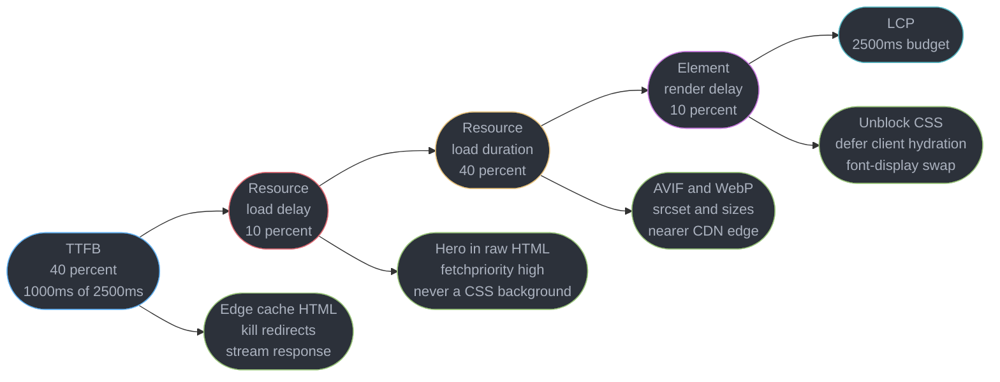
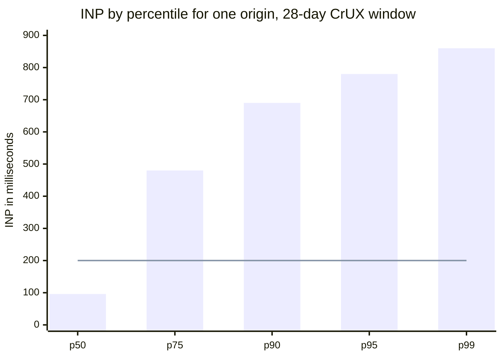
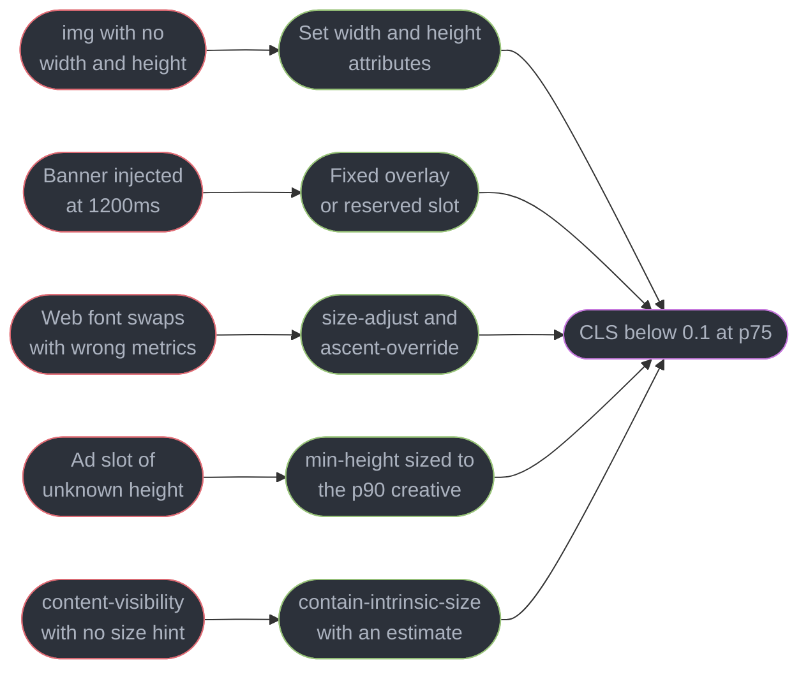
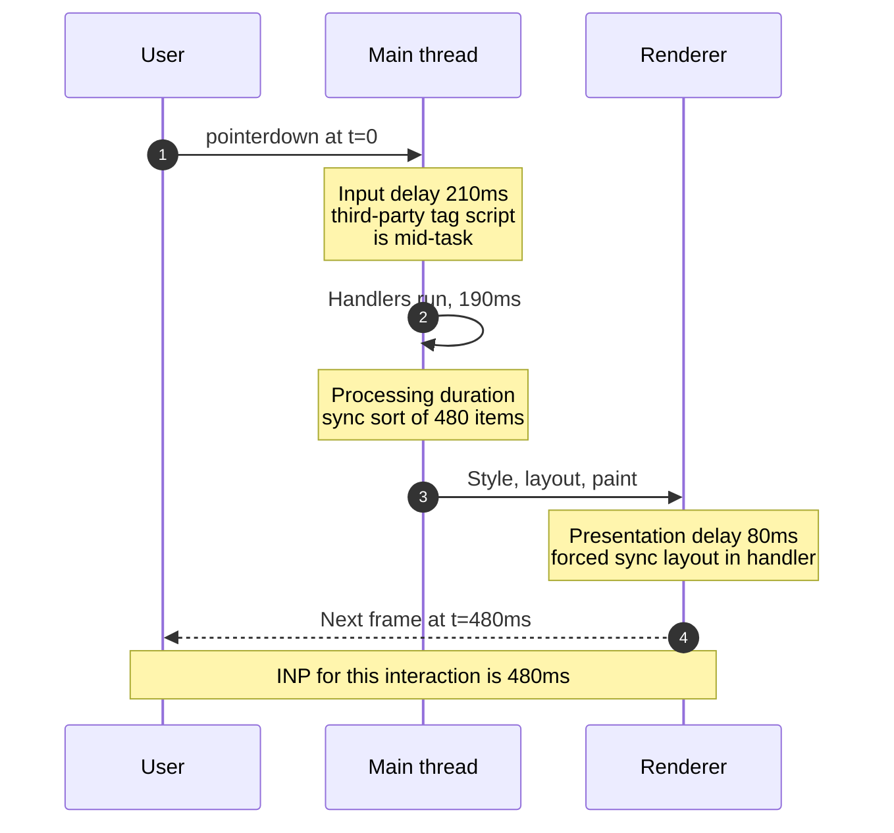
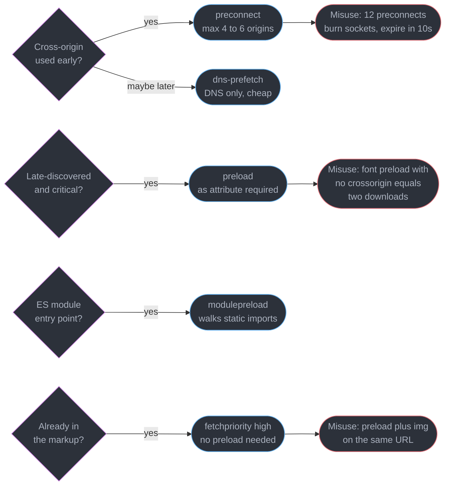

# Web Performance and Core Web Vitals

---

## 1. Concept Overview

Core Web Vitals are the three field-measured metrics Google uses to grade a page's real user
experience: **LCP** (Largest Contentful Paint) for loading, **INP** (Interaction to Next Paint) for
responsiveness, and **CLS** (Cumulative Layout Shift) for visual stability. Each threshold is only
half a definition until you attach the percentile.

| Metric | Good | Needs improvement | Poor | Measured at |
|--------|------|-------------------|------|-------------|
| LCP | **below 2.5s** | 2.5s to 4.0s | above 4.0s | **75th percentile of real users** |
| INP | **below 200ms** | 200ms to 500ms | above 500ms | **75th percentile of real users** |
| CLS | **below 0.1** | 0.1 to 0.25 | above 0.25 | **75th percentile of real users** |

A URL passes only when **all three** sit in the good band at p75; two out of three is a failure. The
p75 comes from the **Chrome User Experience Report (CrUX)**, a rolling 28-day aggregate of real
Chrome visits, so a fix deployed today is not fully reflected for 28 days.

**INP fully replaced FID (First Input Delay) on 12 March 2024.** FID timed only the input delay of
the *first* interaction and was passed by roughly 90% of origins, making it nearly useless as a
signal. INP measures the full latency of essentially the worst interaction across the page lifetime
and is the metric most sites fail. Anything still reporting FID is reporting a retired metric.

Two more metrics are **not** Core Web Vitals: **TTFB** (good below 800ms at p75) and **FCP** (good
below 1.8s at p75). They are *diagnostic* — they never gate the verdict, but they decompose LCP and
you cannot debug LCP without them.

This module owns measurement discipline and the load path. Long tasks and scheduling belong to
[The Event Loop and Scheduling](../the_event_loop_and_scheduling/the_event_loop_and_scheduling.md),
code splitting to
[Modules, Bundling and the Build Pipeline](../modules_bundling_and_the_build_pipeline/modules_bundling_and_the_build_pipeline.md),
and edge caching to [CDN](../../hld/cdn/cdn.md).

---

## 2. Intuition

> **One-line analogy**: LCP is how long until the main course arrives, INP is how long the waiter
> takes to react when you raise your hand, and CLS is whether the table gets shoved sideways while
> you are eating.

**Mental model**: each vital measures a different thread of pain. LCP is a discovery problem — the
browser cannot render the hero until it knows the hero exists. INP is a main-thread problem — every
millisecond a script holds the thread is a millisecond the user's tap waits. CLS is a reservation
problem: every unreserved pixel is stolen from content already being read.

**Why it matters**: these are the only performance numbers with a published threshold, a public
dataset and an A/B-tested revenue link — Vodafone Italy measured a 31% LCP gain worth 8% more sales.

**Key insight**: **the p75 is the whole game.** Your laptop on office fibre is roughly the p10 of
your user distribution. The user who decides your score is on a mid-range Android phone with a CPU
4x to 8x slower than yours, a congested network, and a cold cache. Optimizing what you personally
experience optimizes a user who was already fine.

---

## 3. Core Principles

- **Field is truth, lab is a hypothesis generator.** CrUX p75 decides whether you pass; Lighthouse
  decides what to try next. Optimizing the score moves the score, not the p75.
- **Every threshold carries a percentile.** "LCP 2.5s" is wrong; "LCP below 2.5s at p75 over a
  trailing 28-day CrUX window" is the actual claim.
- **Decompose before you optimize.** A 4.2s LCP caused by TTFB and a 4.2s LCP caused by resource
  load delay share nothing — not the fix, not the team.
- **Reserve space before you need it.** Every layout shift is a dimension the browser had to guess;
  `width`/`height`, `aspect-ratio`, `min-height` and metric-matched fallbacks all encode that.
- **Discovery beats bandwidth.** An LCP image found in raw HTML at byte 900 beats a smaller one
  discovered after CSSOM construction — the preload scanner reads HTML before the parser blocks.
- **The main thread is a single lane.** INP improves when tasks get shorter, never because the
  network got faster.
- **Regressions are cheaper to prevent than to find.** A budget failing a PR costs ten minutes; the
  same regression found in CrUX costs a 28-day feedback loop.

---

## 4. Types / Architectures / Strategies

### 4.1 What each metric measures and what it attributes to

| Metric | Measures | Attributes to | Ends when |
|--------|----------|---------------|-----------|
| LCP | Render time of the largest contentful element in the viewport | One element: an `img`, an `image` in SVG, a `video` poster, an element with a CSS `background-image`, or a block-level element containing text | The element paints, or the user interacts |
| INP | Full latency of a discrete click, tap or keypress | One interaction and its target element | The next frame is presented |
| CLS | Largest burst of unexpected layout shift scores | The largest shift's source element | Never — accumulated over the page lifetime |

LCP element sizing has a trap: an image's LCP size is the **smaller of its intrinsic and displayed
size**, so serving a 2400x1600 image into a 390px slot just wastes 1.3 MB. INP is not the strict
maximum either — below 50 interactions it reports the worst one, above that it discards one per 50,
so a 150-interaction page reports roughly the third-worst. That is robust to one freak GC pause and
not at all robust to a handler that is slow every time.

CLS uses a **session window**: shifts group into windows that close after a 1-second gap or after 5
seconds total, and CLS is the worst window, not the lifetime sum. Before this change in June 2021,
long-lived single-page applications accumulated an unbounded score simply by staying open. Shifts
within 500ms of an input carry `hadRecentInput` and are excluded, so an accordion is free.

### 4.2 Lab versus field, and the five reasons they disagree

| | Lab (Lighthouse, synthetic) | Field (RUM, CrUX) |
|---|---|---|
| Sample | One load, or a median of 3 to 5 | Thousands of visits, graded at p75 |
| Cache | Always cold | Mixed — repeat visitors hit a warm cache |
| Extensions | Clean profile, none | Ad blockers, password managers, injected scripts |
| CPU | Throttled 4x on the mobile preset | Whatever the user owns |
| Network | 1.6 Mbps down, 750 Kbps up, 150ms RTT on mobile | 5G to a train tunnel |
| INP | **Not measurable in a cold load** — no interaction occurs | Measured over the real session |
| CLS | Only shifts before the run ends | Everything, including shifts on scroll |

The INP row matters most: **Lighthouse cannot produce an INP for a plain navigation**, so it reports
**Total Blocking Time (TBT)** — the sum of every long task's duration above 50ms — as a proxy. TBT is
load-time only, INP is lifetime, and a page with a perfect TBT can have a 700ms INP because the slow
handler sits on a filter button nobody clicks in a lab run. A p75 of 480ms against a p50 of 96ms is
a *bimodal* page, and no single lab run will surface it.

---

## 5. Architecture Diagrams

### 5.1 LCP's four sub-parts and which fix targets which



The four sub-parts are sequential and always sum to LCP, which is why the first question about a bad
LCP is "which of the four?" and never "is the server slow?".

### 5.2 A field distribution, and why only the p75 counts



Bars are the origin's INP distribution, the flat line the 200ms good threshold. The p50 of 96ms is
comfortably good — what the team's own laptops reported, and why they believed the page was fast.
The p75 of 480ms is the number Google grades.

### 5.3 Where layout shifts come from



Every source on the left is a dimension the browser had to guess; every fix is the same remedy.

### 5.4 The load waterfall after optimization

```
ms         0    200   400   600   800  1000  1200  1400  1600
           |----|----|----|----|----|----|----|----|
HTML doc   [============]                              TTFB 550ms, edge HIT
main.css                [====]                         render-blocking, 180ms
app.js                  [==========]                   defer, 420ms
hero.avif                 [=====]                      fetchpriority high, 210ms
inter.woff2               [===]                        preload crossorigin, 120ms
tile-9.avif                             [=====]        loading lazy, below fold
                              ^                        FCP 780ms
                                       ^               LCP 1140ms
```

The optimization is visible as geometry: `hero.avif` starts the moment the HTML arrives because the
preload scanner found it in raw markup, it overlaps the render-blocking CSS instead of queueing
behind it, and FCP at 780ms to LCP at 1140ms is just the 360ms the image needs.

---

## 6. How It Works — Detailed Mechanics

### 6.1 Measuring in the field with the web-vitals library

The `web-vitals` library (v6.2.3, 2026-10-05; `onFID` was removed in v5) finalizes LCP on
the first interaction, groups CLS into session windows, and flushes on page hide. The **attribution
build** is the one worth shipping — a separate entry point, roughly 3 KB gzipped more, and it turns
"LCP is 4.2s" into "1,480ms of it is resource load delay on `div.hero`".

Chrome 151 enables Soft Navigations by default. With `{ reportSoftNavs: true }`, web-vitals v6
reports LCP, INP and CLS again for each SPA route change, with `navigationType` set to
`'soft-navigation'`, `navigationURL` set to the route the metric belongs to, and TTFB reported as 0.
The flag also finalizes the landing URL's CLS and INP at the first soft navigation. Browsers
without soft-navigation support ignore it.

```js
import { onLCP, onINP, onCLS, onTTFB, onFCP } from 'web-vitals/attribution';

const queue = new Set();
const send = (row) => queue.add(row);
const opts = { reportSoftNavs: true };

onLCP((m) => send({ name: 'LCP', v: m.value, navType: m.navigationType, url: m.navigationURL,
  element: m.attribution.element,                     // CSS selector of the LCP element
  ttfb: m.attribution.timeToFirstByte,
  loadDelay: m.attribution.resourceLoadDelay,         // TTFB -> request start
  loadDuration: m.attribution.resourceLoadDuration,
  renderDelay: m.attribution.elementRenderDelay }), opts);  // bytes done -> painted

onINP((m) => send({ name: 'INP', v: m.value, navType: m.navigationType, url: m.navigationURL,
  target: m.attribution.interactionTarget, inputDelay: m.attribution.inputDelay,
  processing: m.attribution.processingDuration, presentation: m.attribution.presentationDelay,
  // Long Animation Frames name the offending script and function
  scripts: m.attribution.longAnimationFrameEntries.flatMap((f) =>
    f.scripts.map((s) => ({ src: s.sourceURL, fn: s.sourceFunctionName, ms: s.duration }))) }), opts);

onCLS((m) => send({ name: 'CLS', v: m.value, navType: m.navigationType, url: m.navigationURL,
  target: m.attribution.largestShiftTarget }), opts);
onTTFB((m) => send({ name: 'TTFB', v: m.value }));   // diagnostic, decomposes LCP
onFCP((m) => send({ name: 'FCP', v: m.value }));

// Do NOT use 'unload' — unreliable on iOS, and it makes the page bfcache-ineligible,
// which itself degrades field LCP for returning users.
addEventListener('visibilitychange', () => {
  if (document.visibilityState === 'hidden' && queue.size) {
    navigator.sendBeacon('/rum', JSON.stringify([...queue]));
    queue.clear();
  }
});
```

### 6.2 INP anatomy: three components, three different culprits



- **Input delay** — the thread was already busy: a third-party tag, a client hydration pass, or a
  `JSON.parse` of a large payload. Almost never your own handler.
- **Processing duration** — your handlers, the only segment fixed by editing the handler. See
  [The Event Loop and Scheduling](../the_event_loop_and_scheduling/the_event_loop_and_scheduling.md)
  for `scheduler.yield()` and task-splitting mechanics.
- **Presentation delay** — the frame afterwards: a huge DOM write, an expensive layout, or a forced
  synchronous layout (reading `offsetHeight` after writing a class).

The primitive underneath is the **Long Animation Frames API** (`long-animation-frame`, Chrome 123+),
reporting any rendering frame of 50ms or more with per-script durations and `blockingDuration`. It
supersedes `longtask`, which could say a 50ms+ task happened but never which script caused it.

### 6.3 How a layout shift score is computed, and how to reserve space

A single shift scores `impact fraction x distance fraction`. Take an element occupying 50% of the
viewport, pushed down by 25% of viewport height:

```
impact fraction    = union of before (0..50%) and after (25..75%) = 75% = 0.75
distance fraction  = 25% of viewport height                              = 0.25
layout shift score = 0.75 x 0.25                                         = 0.1875
```

One banner, one shift, already 1.875x the entire 0.1 budget: the score scales with how much of the
screen is involved, so "it only moves things a little" is never a defence.

```html
<!-- BROKEN: the browser learns the aspect ratio only when the bytes arrive -->

<!-- FIX: width/height establish the aspect-ratio before a byte lands. Rendered size still
     comes from CSS — these are ratio hints, not hard sizes. -->

```

```css
.product-tile img { width: 100%; height: auto; aspect-ratio: 3 / 2; background: #2c313a; }
/* Ad and embed slots: reserve the p90 creative height, not the average */
.ad-slot { min-height: 280px; contain: layout; }
/* content-visibility skips off-screen rendering and is a large paint win, but WITHOUT
   contain-intrinsic-size the browser assumes zero height, the scrollbar jumps, and you
   have traded paint cost for CLS. The size hint is not optional. */
.article-section { content-visibility: auto; contain-intrinsic-size: auto 1200px; }
```

### 6.4 Resource hints, and how each one is misused



```html
<!-- preconnect: DNS + TCP + TLS up front. Costs a socket, and an unused one is dropped after
     ~10s having bought nothing. Budget 4 to 6, for origins used in the first second. -->
<link rel="preconnect" href="https://img.example-cdn.com">
<link rel="dns-prefetch" href="https://analytics.example.com">  <!-- DNS only, a few bytes -->
<!-- preload: for what the preload scanner CANNOT find, such as a font referenced inside a
     stylesheet. `as` is mandatory or the fetch happens twice at the wrong priority.
     `crossorigin` is mandatory on fonts even same-origin: fonts are always fetched in CORS
     mode, so a no-cors preload is a cache miss and downloads the file twice. -->
<link rel="preload" href="/f/inter-var.woff2" as="font" type="font/woff2" crossorigin>
<!-- modulepreload: parses and compiles the module AND recursively fetches its static import
     graph. `preload as="script"` fetches only the entry file, in the wrong mode. -->
<link rel="modulepreload" href="/js/app.entry.js">
<!-- fetchpriority: reprioritizes a request the parser already found. Images start at Low. -->

```

### 6.5 Images: formats, `srcset`, and the lazy-loading trap

```html
<!-- BROKEN: the LCP image is lazy-loaded. The request waits until layout proves the image is
     in the viewport, so it starts hundreds of ms late and at Low priority. -->


<!-- FIX: eager and high priority, modern formats, right-sized variants. `sizes` gives the CSS
     width BEFORE layout; a wrong `sizes` is worse than none, because it silently downloads
     the 2400px variant. Add a webp `source` for the middle fallback tier. -->
<picture>
  <source type="image/avif"
          srcset="/hero-400.avif 400w, /hero-800.avif 800w, /hero-1600.avif 1600w"
          sizes="(max-width: 700px) 100vw, 720px">
  
</picture>

<!-- Below the fold, from roughly the third tile down, lazy is correct and free -->

```

Format arithmetic on a typical photographic hero at equivalent quality: JPEG 1,400 KB, WebP about
950 KB (30% smaller), AVIF about 700 KB (50% smaller). Right-sizing does far more: the same photo at
800px instead of 2400px is 88 KB in AVIF, a 94% cut, and that is the reduction that actually moves
resource load duration. `fetchpriority="low"` on carousel slides 2 through N is almost always right.

### 6.6 Fonts: FOIT, FOUT, and metric overrides

```css
/* font-display: block = ~3s block then infinite swap (FOIT). swap = 100ms block then
   infinite swap (FOUT, plus a shift unless metrics match). fallback = 100ms block, 3s
   swap. optional = 100ms block, 0s swap, so the fallback may stand for this whole page
   load: zero CLS risk, and the font is warm for the next navigation. */

@font-face {
  font-family: "Inter"; src: url("/f/inter-var.woff2") format("woff2-variations");
  font-weight: 100 900; font-display: swap;
  unicode-range: U+0000-00FF, U+2000-206F;  /* Latin subset only: one 24 KB file */
}

/* Without this, `swap` fixes FOIT and creates CLS: Arial and Inter differ in ascent,
   descent and advance width, so every line moves when the swap lands. These four
   descriptors force the fallback into an identical box, making the swap invisible. */
@font-face {
  font-family: "Inter Fallback"; src: local("Arial");
  size-adjust: 107%; ascent-override: 90%; descent-override: 22%; line-gap-override: 0%;
}

body { font-family: "Inter", "Inter Fallback", system-ui, sans-serif; }
```

The rule: **`swap` plus a metric-matched fallback** for body text, because FOIT delays a text LCP
element by up to 3 seconds. **`optional`** for headings, where never shifting beats always showing
the brand face. `block` is only correct for icon fonts. Self-host: since cache partitioning shipped
in 2020 a third-party font CDN gives zero cross-site cache reuse and costs an extra connection.

### 6.7 The performance budget as a CI gate

```js
// lighthouserc.js — runs on every pull request against a preview deployment. numberOfRuns: 5
// with the median is the minimum that survives shared-CI noise; a single run on a noisy
// runner varies by 10 to 20 percent on Total Blocking Time alone.
module.exports = { ci: {
  collect: { url: ['https://preview.example.com/c/trail'], numberOfRuns: 5 },
  assert: { assertions: {
    'largest-contentful-paint': ['error', { maxNumericValue: 2000 }],
    'total-blocking-time':      ['error', { maxNumericValue: 200 }],
    'cumulative-layout-shift':  ['error', { maxNumericValue: 0.05 }],
    'server-response-time':     ['error', { maxNumericValue: 600 }],
    // Byte budgets catch a regression one release BEFORE the metric cliff
    'resource-summary:script:size': ['error', { maxNumericValue: 180000 }],
    'resource-summary:image:size':  ['error', { maxNumericValue: 400000 }],
  } },
} };
```

Three rules make this a gate rather than decoration. **It must fail the build**, not warn. **Lab
thresholds must be tighter than field targets** (2000ms in CI against a 2500ms field goal). And
**byte budgets matter more than metric budgets**: bundle size regresses smoothly, LCP in a cliff.

---

## 7. Real-World Examples

**Vodafone Italy** ran a randomized A/B test: the variant with a 31% better LCP produced **8% more
sales**, 15% more lead-form visits and 11% more cart clicks.

**Rakuten 24** improved LCP by 53% and CLS by 33%; revenue per visitor rose 53.37%, conversion rose
33.13% and spend per visitor rose 21.2%.

**Yahoo! JAPAN News** took CLS from 0.2 to 0.0 by reserving space for images and ads: page views per
session rose 15% and session duration 13%, with no loading change at all. **The Economic Times** cut
CLS from 0.25 to 0.09 and measured a 43% drop in bounce rate.

**redBus** attacked INP after the March 2024 switchover, cutting it roughly 72% by breaking up long
tasks and deferring third-party work — the bottleneck was input delay from third-party scripts, not
their own handlers. The pattern across all five: **the metric that moved the business was whichever
one sat in the poor band**, not whichever one the team found most interesting.

---

## 8. Tradeoffs

### 8.1 `font-display` choice

| Value | FOIT risk | CLS risk | LCP impact on text | Use for |
|-------|-----------|----------|--------------------|---------|
| `block` | Up to 3s invisible | Low | Severe — blocks a text LCP | Icon fonts only |
| `swap` | None | High unless metrics match | None | Body text, with a metric-matched fallback |
| `fallback` | 100ms | Medium | None | Secondary text |
| `optional` | 100ms | None | None | Headings and brand faces you can live without |

### 8.2 Rendering strategy against the three vitals

| Strategy | LCP | INP | CLS |
|----------|-----|-----|-----|
| Static HTML at the edge | Best — TTFB under 100ms | Best — little JavaScript | Best |
| Streaming server rendering | Good — the LCP element can sit in the first chunk | Better — client hydration is chunked | Good if slot dimensions are in the first chunk |
| Server rendering with client hydration | Good TTFB, client hydration adds render delay | Risk — the client hydration pass is a long task inflating input delay | Risk — it can resize server markup |

---

## 9. When to Use / When NOT to Use

**Optimize LCP first when** CrUX LCP p75 is above 2.5s and TTFB or resource load delay is more than
half of it — a CDN cache rule and a `fetchpriority` attribute routinely take 1,500ms off with no
application changes.

**Optimize INP first when** LCP already passes, or when the page is an application rather than a
document (filters, search-as-you-type, editors, carts). INP work means touching handlers and
third-party contracts, so do not start while a 1,200ms resource load delay sits untouched.

**Optimize CLS first when** it is above 0.25: attributes on images, a `min-height` and a fallback
`@font-face` are the highest ratio of user pain fixed to engineering effort in the whole list.

**Do NOT chase the Lighthouse score.** It is a weighted composite (LCP 25%, TBT 30%, CLS 25%, FCP
10%, Speed Index 10%) of *lab* numbers, none of which appear in the verdict. A 100 and a failing
CrUX p75 are entirely compatible.

**Do NOT trust a field number in the first 28 days after a deploy.** CrUX is a trailing aggregate, so
a week-old fix is diluted by three weeks of old code. Use your own RUM, filtered to post-deploy
sessions.

**Do NOT add `content-visibility: auto` to short sections.** Below roughly 1,000px of skipped
content the saving is negligible and you have added a CLS risk.

---

## 10. Common Pitfalls

**Lazy-loading the LCP image.** A blanket `loading="lazy"` from a CMS or component default is the
most common cause of a 3s+ LCP: layout must complete before the browser knows the image is in view,
so the request starts after CSS and often after JavaScript. Cost: 500ms to 1,200ms of load delay.

**Preloading a font without `crossorigin`.**

```html
<!-- BROKEN: fonts are always fetched in CORS mode. This preload is no-cors, so the real
     font request is a cache MISS and the file downloads a second time. -->
<link rel="preload" href="/f/inter-var.woff2" as="font" type="font/woff2">

<!-- FIX -->
<link rel="preload" href="/f/inter-var.woff2" as="font" type="font/woff2" crossorigin>
```

**Preconnect sprawl.** Twelve `preconnect` tags open twelve sockets and run twelve TLS handshakes,
competing with the LCP image on the constrained networks where p75 users live. Budget 4 to 6.

**Forced synchronous layout inside an interaction handler.** Reading `offsetHeight` or
`getBoundingClientRect()` after writing to the DOM forces layout to run immediately, inside your
handler, and it lands in INP's presentation delay. Batch reads before writes.

**Treating TBT as INP.** Different metrics on different clocks: a page can have a 30ms TBT and a
700ms INP because the expensive handler only exists on the checkout button.

**Averaging vitals.** A mean LCP of 2.1s across a bimodal distribution with a p75 of 4.2s describes
nobody — a mean hides exactly the users you are graded on. Relatedly, teams conclude "the fix did
nothing" eight days after a deploy and revert it: the 28-day window means your own RUM is the only
same-day signal.

---

## 11. Technologies & Tools

| Tool | Purpose |
|------|---------|
| Lighthouse | Lab audit: LCP, TBT, CLS, opportunities, filmstrip |
| Lighthouse CI | Runs Lighthouse in CI with assertion-based budgets |
| PageSpeed Insights | Lighthouse plus the public CrUX field p75 for the URL and origin |
| web-vitals | The reference JavaScript library for field measurement |
| Chrome DevTools | Performance panel, Insights, Web Vitals overlay, LoAF traces |
| WebPageTest | Multi-location synthetic testing on real devices |
| sharp | Server-side AVIF and WebP encoding, responsive variants |
| Playwright | Scripted interaction traces for measuring INP in a lab |

---

## 12. Interview Questions with Answers

**Q: Why can a page score 100 in Lighthouse and still fail Core Web Vitals?**
**Short:** Lighthouse is one throttled cold-cache lab run while the verdict comes from the p75 of real CrUX visits, and Lighthouse cannot measure INP at all.

Lighthouse loads the URL once, on a clean profile with an empty cache and a fixed 4x CPU throttle.
CrUX aggregates thousands of real visits across every device, network and extension set and grades
the 75th percentile over 28 days. The gap that matters most is INP: a cold navigation involves no
interaction, so Lighthouse reports TBT as a proxy — a page whose only slow handler sits on the
checkout button shows a perfect TBT and a 700ms field INP.

**Q: What replaced First Input Delay, when, and why was the change made?**
**Short:** INP fully replaced FID on 12 March 2024 because FID timed only the first interaction's input delay and around 90% of origins passed it trivially.

FID measured the gap between a user's first interaction and the moment its handler began. It never
measured how long the handler ran, never measured the frame after it, and never looked past the
first interaction — easy to pass and nearly uninformative. INP observes every click, tap and
keypress across the page lifetime, from input to the next painted frame.

**Q: What does "LCP under 2.5s" mean as a complete claim?**
**Short:** That the 75th percentile of real Chrome visits over a trailing 28-day CrUX window is below 2.5 seconds, and that the URL must also pass INP and CLS.

Every part is load-bearing. The percentile means one user in four can be slower and you still pass,
and that your own laptop near p10 tells you nothing. The 28-day window means a deploy takes four
weeks to be fully reflected. The verdict is conjunctive: LCP below 2.5s, INP below 200ms and CLS
below 0.1 must all hold at p75, so two out of three is a failure.

**Q: Why is INP the most commonly failed of the three Core Web Vitals?**
**Short:** Sampling runs across the whole page lifetime rather than at load, so every third-party script is live and competing for one main thread.

LCP is a single early moment and CLS is largely fixed by adding dimensions. INP is sampled
continuously after load, when the tag manager, consent platform, chat widget and analytics beacon
all run on the same thread as your handlers, and only one of its three failure modes is your code.
One slow path — a filter, a large sort, a click-triggered client hydration — sets the number for the
whole session.

**Q: Is `loading="lazy"` on the hero image a good optimization?**
**Short:** No — lazy-loading anything in the initial viewport is an anti-pattern that reliably adds hundreds of milliseconds of LCP resource load delay.

Lazy loading defers the request until layout proves the image intersects the viewport, so it starts
after CSS is parsed, often after JavaScript has run, and at Low priority. For the LCP image that is
backwards: you want it found by the preload scanner in raw HTML and promoted to High, with
`loading="eager"` and `fetchpriority="high"`. It is correct from the third below-fold image on.

**Q: A team adds `preconnect` to twelve origins and the page gets slower. What happened?**
**Short:** Each preconnect opens a socket and runs a TLS handshake, so twelve of them compete for bandwidth with the LCP resource on the constrained networks that set your p75.

`preconnect` performs DNS resolution, the TCP handshake and TLS negotiation up front. That is
valuable for the two or three origins used in the first second and pure overhead otherwise — the
browser drops an unused connection after about 10 seconds. On a 1.6 Mbps link that contention delays
the hero image directly. Budget 4 to 6, and use `dns-prefetch` for origins that might come later.

**Q: What are LCP's four sub-parts and which optimization targets each?**
**Short:** TTFB, resource load delay, resource load duration and element render delay — fixed by cache and server, discoverability, bytes, and render-blocking work respectively.

They are sequential and sum to LCP, with rough targets of 40%, 10%, 40% and 10% of the 2.5s budget.
TTFB is fixed by edge-caching HTML, removing redirects and streaming. Load delay is fixed by
discoverability — the LCP element in raw HTML with `fetchpriority="high"`, never a CSS background.
Load duration is fixed by bytes (AVIF, `srcset`, a nearer edge) and render delay by smaller critical
CSS and deferred client hydration.

**Q: How is a layout shift score calculated?**
**Short:** Each shift scores impact fraction times distance fraction, and CLS reports the largest 5-second session window of those scores rather than the lifetime total.

Impact fraction is the union of the element's pre-shift and post-shift area as a share of the
viewport; distance fraction is the furthest any unstable element moved as a share of the viewport's
larger dimension. An element covering 50% of the viewport pushed down 25% of viewport height gives a
union of 75% and a distance of 25%, so 0.75 x 0.25 = 0.1875, nearly twice the whole 0.1 budget.

**Q: A team fixed invisible text with `font-display: swap` and CLS got worse. Why, and what is the complete fix?**
**Short:** Swapping to a web font with different metrics reflows every line, so the FOIT fix trades a paint delay for a shift unless the fallback is metric-matched.

`font-display: block` produces FOIT — up to three seconds of invisible text, which also delays LCP
when the LCP element is text. `swap` shows the fallback after a 100ms block period and swaps on
arrival, fixing FOIT and creating a shift, because the fallback and the web font differ in ascent,
descent and advance width. The fix keeps `swap` and adds a fallback `@font-face` with `size-adjust`,
`ascent-override`, `descent-override` and `line-gap-override` tuned to match.

**Q: Why does preloading a font without `crossorigin` download it twice?**
**Short:** Fonts are always fetched in CORS mode, so a preload without crossorigin stores a no-cors cache entry the real request cannot reuse.

The browser keys its memory cache on request mode as well as URL. A `preload as="font"` without
`crossorigin` issues a no-cors request; the subsequent `@font-face` fetch is CORS-mode and therefore
a miss, so the file downloads again — even for same-origin fonts. Omitting `as` causes the same
class of bug at the wrong priority, and DevTools warns about both.

**Q: What are INP's three components, and what does each one blame?**
**Short:** Input delay blames other scripts holding the main thread, processing duration blames your handlers, and presentation delay blames the rendering of the resulting frame.

Input delay runs from the user's input to your first handler starting — the thread was already busy,
usually with a third-party tag, a client hydration pass or a large `JSON.parse`. Processing duration
covers all handlers and is the only segment fixed by editing your handler; presentation delay runs
from the last handler to the painted frame. Long Animation Frames names the exact script.

**Q: Why can CLS be near zero in Lighthouse and 0.25 in the field?**
**Short:** Lighthouse stops measuring when the load ends, while field CLS accumulates for the whole page lifetime including shifts triggered by scrolling.

A Lighthouse navigation run ends shortly after load, so shifts from lazily-loaded content appearing
on scroll, a consent banner firing on a delay, an ad refresh, or `content-visibility` sections
without `contain-intrinsic-size` are never observed. It also runs with no consent state, so a banner
shown only to first-time European visitors never fires. Reproduce it in Playwright.

**Q: How do you attribute a bad LCP or INP to a specific element in production?**
**Short:** Ship the web-vitals attribution build, which reports the LCP element selector with its four sub-part timings and the INP target with script-level Long Animation Frame data.

`import { onLCP, onINP } from 'web-vitals/attribution'` costs roughly 3 KB gzipped over the standard
build and attaches `metric.attribution`. For LCP that is `element` as a CSS selector, `url`,
`timeToFirstByte`, `resourceLoadDelay`, `resourceLoadDuration` and `elementRenderDelay`. For INP:
`interactionTarget`, `inputDelay`, `processingDuration`, `presentationDelay` and
`longAnimationFrameEntries`, whose `scripts` array names the offending file and function.

**Q: What is the CLS session window and what problem did it solve?**
**Short:** A session window groups shifts less than 1 second apart, caps at 5 seconds, and CLS reports the worst window instead of the lifetime sum.

Under the original definition CLS summed every shift for the life of the page, which unfairly
punished long-lived single-page applications: a well-behaved app could fail simply by being used for
twenty minutes. The June 2021 change groups shifts into windows closing after a 1-second gap or 5
seconds of shifting and reports the worst one — far closer to what a user experiences.

**Q: When do you use `preload` versus `modulepreload` versus `fetchpriority`?**
**Short:** preload for resources the scanner cannot find, modulepreload for an ES module graph, and fetchpriority to reprioritize a request the browser already knows about.

`preload` targets late-discovered critical resources such as a font referenced inside CSS, and its
`as` attribute is mandatory. `modulepreload` fetches, parses and compiles an ES module and
recursively fetches its static import graph, which `preload as="script"` does not. `fetchpriority`
raises the priority of a request the parser already found, which an `img` needs since images
start at Low.

**Q: Where do TTFB and FCP fit if they are not Core Web Vitals?**
**Short:** They are diagnostic metrics — TTFB good below 800ms and FCP below 1.8s at p75 — that decompose LCP without ever affecting the verdict.

Neither gates anything; their value is splitting LCP in two. TTFB is the first of LCP's four
sub-parts and answers "is this a server, redirect or cache problem?" — above 800ms at p75 the fix is
in infrastructure. FCP marks the first pixel of content, so `LCP - FCP` is the work after the page
stopped being blank: a 3.2s LCP with a 0.6s FCP is a resource problem, with a 2.9s FCP a blocking one.

**Q: How do you make a performance budget a real CI gate given Lighthouse's run-to-run variance?**
**Short:** Run five iterations and assert on the median, set lab thresholds tighter than field targets, and gate on bundle bytes as well as metrics.

A single Lighthouse run on a shared CI runner varies by 10 to 20% on Total Blocking Time, so a
one-run assertion produces flaky failures that teams disable within a month. Lighthouse CI with
`numberOfRuns: 5` and median aggregation is the practical minimum, run against a preview deployment.
Set budgets tighter than the field target (2000ms LCP against 2500ms) and assert at `error`.

**Q: Do back/forward cache restores and soft navigations count, and how do they distort field data?**
**Short:** bfcache restores report near-instant LCP and flatter the aggregate; soft navigations report per route only in Chromium 151+ with reportSoftNavs, so segment field data by navigationType.

A bfcache restore resumes a fully-constructed page, so its LCP is a handful of milliseconds and
`navigationType` is `'back-forward-cache'`. Those samples land in the same CrUX aggregate as cold
loads and pull the distribution toward good, so an aggregate improvement can come from bfcache
eligibility rather than optimization, and an `unload` listener silently degrades field LCP.

Soft navigations are the mirror image. Without soft-navigation support, every interaction in an
SPA session counts against the landing URL, so a slow in-app route sinks the homepage's INP.
Chromium 151 enables Soft Navigations by default and emits `soft-navigation` and
`interaction-contentful-paint` entries; web-vitals v6 with `reportSoftNavs: true` turns them into
per-route LCP, INP and CLS tagged `'soft-navigation'`, with TTFB reported as 0. Chrome has not
said how CrUX will report soft navigations, so RUM can grade each route while CrUX still grades
the landing URL.

---

## 13. Best Practices

- Ship the `web-vitals` attribution build from day one: a vitals number without a selector is not
  actionable, and the 3 KB is recovered by the first fix it points at.
- Report on `visibilitychange` to `hidden` with `navigator.sendBeacon`, never on `unload` — it is
  unreliable on iOS and disables bfcache, which itself worsens field LCP.
- Record `navigationType` on every metric and segment dashboards by it, so a bfcache-driven
  improvement is never mistaken for optimization.
- Put the LCP element in raw HTML with `width`, `height`, `loading="eager"` and
  `fetchpriority="high"`. Never a CSS background, never lazy, never injected by JavaScript.
- Set `width` and `height` on every `img`. One attribute pair eliminates the largest single
  category of layout shift.
- Serve AVIF with WebP and JPEG fallbacks via `picture`, right-sized with `srcset` and an accurate
  `sizes`; right-sizing beats format choice by roughly 5x on a typical hero.
- Self-host fonts, subset with `unicode-range`, use one variable font, and pair `font-display: swap`
  with a metric-matched fallback `@font-face`.
- Cap `preconnect` at 4 to 6 origins used in the first second; use `dns-prefetch` for the rest.
- Enforce Lighthouse CI budgets at `error` with `numberOfRuns: 5`, tighter than field thresholds,
  plus byte budgets. Measure INP with a scripted Playwright trace — a navigation-only run cannot.
- Quote every threshold with its percentile. "LCP 2.5s at p75 over 28 days" is a claim; "LCP 2.5s"
  is a slogan.

---

## 14. Case Study

> **This case study is an illustrative composite.** The metric definitions, sub-part arithmetic and
> the mechanics of every fix are exact and reproducible; the site, timings and measured deltas are
> constructed so the narrative is followable end to end on a real site.

### The starting state

A mid-size outdoor-apparel retailer. The product listing page `/c/trail` is 38% of organic landing
traffic, and Search Console flags it as failing on mobile. CrUX p75 over the trailing 28 days:
**LCP 4.2s (poor), INP 480ms (needs improvement, one release from poor), CLS 0.28 (poor).**
Lighthouse scored **91**, treated as truth for eleven months. INP p50 was 96ms, matching every
developer's own experience.

### Step 1 — diagnosis, not optimization

They shipped the `web-vitals` attribution build to 100% of traffic and waited 48 hours for volume.

```
LCP p75 = 4,200ms
  TTFB ..................... 1,150ms  (27%)  origin render, no edge cache for HTML
  resource load delay ...... 1,480ms  (35%)  <- the largest single sub-part
  resource load duration ..... 920ms  (22%)  1.4 MB JPEG at 2400px wide
  element render delay ....... 650ms  (16%)  render-blocking third-party font CSS

INP p75 = 480ms   target: button.filter-apply
  input delay ................ 210ms  tag manager task of 320ms, seen in LoAF entries
  processing duration ........ 190ms  synchronous re-sort of 480 products
  presentation delay .......... 80ms  forced synchronous layout inside the handler

CLS p75 = 0.28
  0.17  cookie consent banner injected at ~1,200ms, pushes the grid down
  0.07  product tile images with no width/height attributes
  0.04  web font swap, Inter against an Arial fallback with different metrics
```

The decisive line was `resourceLoadDelay: 1480` on `div.hero`: the LCP element was a CSS
`background-image`, invisible to the preload scanner, so the fetch could not begin until the
stylesheet had downloaded and CSSOM was built.

### Step 2 — the LCP work

```html
<!-- BROKEN: hero is a CSS background (`.hero { background-image: url("/img/hero-2400.jpg") }`),
     so there is nothing for the preload scanner to find. The first tile is lazy as well. -->
<div class="hero"></div>


<!-- FIX: the hero is real markup found in the first few hundred bytes of HTML, promoted to
     High priority, right-sized, AVIF first. Lazy loading now starts from tile 3. -->
<picture>
  <source type="image/avif"
          srcset="/img/hero-400.avif 400w, /img/hero-800.avif 800w, /img/hero-1600.avif 1600w"
          sizes="(max-width: 700px) 100vw, 720px">
  
</picture>

```

| Intervention | Sub-part | Before | After | Delta |
|--------------|----------|--------|-------|-------|
| Hero moved from CSS background to `img` with `fetchpriority="high"`, first tile un-lazied | Resource load delay | 1,480ms | 200ms | **-1,280ms** |
| CDN cache for anonymous HTML, `s-maxage=120, stale-while-revalidate=600` | TTFB | 1,150ms | 550ms | **-600ms** |
| AVIF at 800px via `srcset`, 1.4 MB down to 88 KB | Resource load duration | 920ms | 210ms | **-710ms** |
| Self-hosted subset font, inlined critical CSS, third-party font CSS removed | Element render delay | 650ms | 180ms | **-470ms** |

Sum of the optimized parts: 550 + 200 + 210 + 180 = **1,140ms**. The measured CrUX p75 landed at
**1.8s**, not 1.14s — a p75 is not the sum of four p75s. Adding optimized sub-parts understates the
real p75; use it as a direction, not a forecast.

### Step 3 — the INP work

```js
// BROKEN: everything synchronous, and a layout read after a DOM write.
// input delay 210ms (tag manager) + processing 190ms (sort) + presentation 80ms
filterButton.addEventListener('click', () => {
  const products = sortProducts(allProducts, currentSort);   // 480 items, ~150ms
  grid.innerHTML = renderGrid(products);                     // large DOM write
  const h = grid.offsetHeight;                               // forced synchronous layout
  grid.classList.toggle('tall', h > 2000);
  localStorage.setItem('lastFilter', JSON.stringify(currentFilter)); // ~15ms, blocking
});
```

```js
// FIX: paint the acknowledgement first, yield, then do the heavy work. Reads are batched
// before writes, so no forced synchronous layout occurs inside the handler.
filterButton.addEventListener('click', async () => {
  filterButton.setAttribute('aria-busy', 'true');   // instant visual response
  grid.classList.add('is-loading');
  await scheduler.yield();                          // let the frame paint

  const products = sortCache.get(currentSort) ?? sortProducts(allProducts, currentSort);
  sortCache.set(currentSort, products);
  grid.innerHTML = renderGrid(products);            // string built off-DOM
  grid.classList.remove('is-loading');
  filterButton.removeAttribute('aria-busy');
  requestIdleCallback(() => localStorage.setItem('lastFilter', JSON.stringify(currentFilter)));
});
```

| Intervention | Component | Before | After | Delta |
|--------------|-----------|--------|-------|-------|
| Tag manager deferred to first interaction or 3s idle | Input delay | 210ms | 45ms | **-165ms** |
| Sort memoized, work moved after `scheduler.yield()`, storage write to idle | Processing duration | 190ms | 40ms | **-150ms** |
| Layout read removed from the handler | Presentation delay | 80ms | 55ms | **-25ms** |

### Step 4 — the CLS work

```css
/* FIX 1: the banner leaves document flow, so nothing below it moves at 1,200ms */
.consent-banner { position: fixed; inset-block-end: 0; inset-inline: 0; z-index: 100; }
/* FIX 2: every tile image gets a reserved box before its bytes arrive */
.product-tile img { width: 100%; height: auto; aspect-ratio: 3 / 2; }
/* FIX 3: metric-matched fallback so the Inter swap moves nothing */
@font-face {
  font-family: "Inter Fallback"; src: local("Arial");
  size-adjust: 107%; ascent-override: 90%; descent-override: 22%; line-gap-override: 0%;
}
body { font-family: "Inter", "Inter Fallback", system-ui, sans-serif; }
```

| Intervention | Source | Before | After | Delta |
|--------------|--------|--------|-------|-------|
| Consent banner converted to a fixed overlay | Injected banner | 0.17 | 0.00 | **-0.17** |
| `width`/`height` plus `aspect-ratio` on tile images | Undimensioned images | 0.07 | 0.00 | **-0.07** |
| Metric-matched fallback `@font-face` | Font swap | 0.04 | 0.005 | **-0.035** |

### The end state

| Metric | Before (p75) | After (p75) | Change | Band |
|--------|--------------|-------------|--------|------|
| LCP | 4.2s | **1.8s** | -57% | Good |
| INP | 480ms | **145ms** | -70% | Good |
| CLS | 0.28 | **0.02** | -93% | Good |
| TTFB (diagnostic) | 1,150ms | 550ms | -52% | Good |
| FCP (diagnostic) | 2,400ms | 900ms | -63% | Good |
| Lighthouse score | 91 | 99 | +8 | Was never the point |
| Hero image transfer | 1,400 KB | 88 KB | -94% | |
| Bounce rate on `/c/trail` | 54% | 41% | -13pp | |

```mermaid
xychart-beta
    title "Field p75 as a percentage of each metric good threshold, before then after"
    x-axis ["LCP", "INP", "CLS", "TTFB", "FCP"]
    y-axis "Percent of the good threshold" 0 --> 300
    bar [168, 240, 280, 144, 133]
    bar [72, 73, 20, 69, 50]
```



Each pair is one metric as a percentage of its own good threshold — first bar before, second after,
everything above 100 failing. Plotting against the threshold rather than milliseconds is what makes
three metrics on three different scales comparable on one chart.

### The three lessons

**The 28-day window nearly killed the project.** The LCP work shipped in week 1. At the week-2 review
CrUX had barely moved — three weeks of pre-fix data still dominated the aggregate — and a director
proposed reverting it. The team's own RUM, filtered to sessions after the deploy timestamp, already
showed 1.8s. **Own field measurement for a same-day signal; CrUX is the slow confirmation.**

**The Lighthouse score is why the problem lasted eleven months.** A 91 is a comfortable number, and
also a weighted composite of lab measurements that cannot see INP, cannot see a consent banner shown
only to European first-time visitors, and cannot see the p75 device.

**Diagnosis took 2 days and the fixes took 9.** One line — `resourceLoadDelay: 1480` on `div.hero` —
determined the entire first phase, and it cost 3 KB of attribution code to obtain. Every hour spent
guessing which optimization to try is an hour attribution would have made unnecessary.
