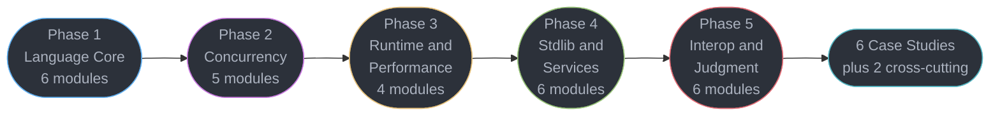

# Go — Senior Engineer & Interview Prep Guide

A comprehensive, one-stop reference for mastering **pure Go** — from the language core and its memory layout, through the GMP scheduler, the concurrent garbage collector and escape analysis, to the production-grade standard library that turns a service into a single static binary. Go is the implementation language of nearly every system the [DevOps](../devops/README.md) and [Technologies](../technologies/README.md) sections already teach — Kubernetes, Docker, Terraform, Prometheus, etcd, Consul, Vault, Cilium. Those sections cover how to *operate* them; this one covers how to *write* one.

> **No runnable application** — all content is Markdown with compilable-shaped Go 1.27 code blocks.

---

## 1. Section Overview

This section covers:

- **Language core** — value semantics and the slice header, method sets and the typed-nil interface trap, errors as values, generics and the judgment of when not to use them, modules and minimal version selection
- **Concurrency** — the GMP scheduler and work stealing, `hchan` internals, the `sync` primitives and the formal memory model, `context` propagation, and the goroutine-leak patterns that take a service down at 4am
- **Runtime & performance** — the tricolor concurrent collector and its pacer, `GOGC` versus `GOMEMLIMIT` against a container limit, escape analysis, pprof and the execution tracer
- **Standard library & services** — `net/http` server and client, `database/sql` as a connection pool, JSON, gRPC, and `log/slog` + OpenTelemetry
- **Interop, judgment & production** — reflection and `unsafe`, cgo's real cost, idiomatic package design, static builds and supply chain, and a direct comparison against Java and Python

**Primary target: Go 1.27** (released 2026-08-19). Go 1.26 shipped 2026-02-10; supported releases are 1.26 and 1.27. Version tags such as `[1.27]` mark only genuinely version-gated features — Go's compatibility promise means most of this section is true across every supported release.

---

## 2. Module Table

| # | Module Directory | Phase | Difficulty | Key Topics |
|---|-----------------|-------|-----------|-----------|
| 1 | [go_fundamentals_and_idioms](go_fundamentals_and_idioms/go_fundamentals_and_idioms.md) | 1 — Language Core | Beginner | Packages, zero values, `:=` shadowing, `defer` LIFO and argument evaluation at defer time, value semantics, named returns, `iota` |
| 2 | [data_structures_and_memory_layout](data_structures_and_memory_layout/data_structures_and_memory_layout.md) | 1 — Language Core | Intermediate | Slice header (ptr/len/cap), `append` reallocation and aliasing, `copy`, Swiss-table maps, map non-addressability, string vs `[]byte` vs `rune`, struct padding |
| 3 | [interfaces_methods_and_embedding](interfaces_methods_and_embedding/interfaces_methods_and_embedding.md) | 1 — Language Core | Advanced | Method sets, pointer vs value receivers, the `(type, value)` pair and the typed-nil trap, `itab`, embedding vs inheritance, type switches |
| 4 | [errors_and_panics](errors_and_panics/errors_and_panics.md) | 1 — Language Core | Intermediate | Errors as values, sentinel vs typed errors, `%w` wrapping, `errors.Is`/`As`/`Join`/`AsType`, panic/recover boundary discipline |
| 5 | [generics_and_type_parameters](generics_and_type_parameters/generics_and_type_parameters.md) | 1 — Language Core | Advanced | Type parameters, constraints and `~` approximation, inference limits, `comparable`, `slices`/`maps`, generic methods, when NOT to reach for generics |
| 6 | [packages_modules_and_tooling](packages_modules_and_tooling/packages_modules_and_tooling.md) | 1 — Language Core | Intermediate | `go.mod`, minimal version selection, `go.sum` and the checksum DB, workspaces, vendoring, `toolchain`, build tags, `go fix` modernizers |
| 7 | [goroutines_and_the_scheduler](goroutines_and_the_scheduler/goroutines_and_the_scheduler.md) | 2 — Concurrency | Advanced | GMP model, run queues and work stealing, `sysmon`, asynchronous preemption, 2 KB stacks that grow by copying, container-aware `GOMAXPROCS` |
| 8 | [channels_and_select](channels_and_select/channels_and_select.md) | 2 — Concurrency | Advanced | `hchan` internals (ring buffer, `sendq`/`recvq`), buffered vs unbuffered handoff, close semantics and the who-closes rule, nil-channel disabling |
| 9 | [sync_primitives_and_memory_model](sync_primitives_and_memory_model/sync_primitives_and_memory_model.md) | 2 — Concurrency | Advanced | `Mutex` normal vs starvation mode, `RWMutex` writer starvation, `WaitGroup.Go`, `Once`, typed atomics, `sync.Map`, `sync.Pool` and GC, `-race` |
| 10 | [context_and_cancellation](context_and_cancellation/context_and_cancellation.md) | 2 — Concurrency | Intermediate | The context tree, `WithTimeout`/`WithCancelCause`/`AfterFunc`, deadline propagation across RPC boundaries, the `context.Value` abuse rule |
| 11 | [concurrency_patterns_and_pitfalls](concurrency_patterns_and_pitfalls/concurrency_patterns_and_pitfalls.md) | 2 — Concurrency | Advanced | Pipelines, bounded worker pools, `errgroup` + `SetLimit`, `semaphore`, goroutine leaks and the `goroutineleak` profile, graceful shutdown |
| 12 | [the_runtime_and_garbage_collector](the_runtime_and_garbage_collector/the_runtime_and_garbage_collector.md) | 3 — Runtime & Performance | Advanced | Tricolor concurrent mark-sweep, hybrid write barrier, the pacer, sub-millisecond STW, `GOGC` vs `GOMEMLIMIT` and the arithmetic that prevents `OOMKilled`, Green Tea GC |
| 13 | [escape_analysis_and_performance](escape_analysis_and_performance/escape_analysis_and_performance.md) | 3 — Runtime & Performance | Advanced | `-gcflags=-m`, stack vs heap, interface boxing, `[]byte`/`string` conversions, PGO, inlining budget, bounds-check elimination |
| 14 | [profiling_and_tracing](profiling_and_tracing/profiling_and_tracing.md) | 3 — Runtime & Performance | Advanced | `net/http/pprof`, CPU/heap/block/mutex/goroutine profiles, pprof labels, `benchstat`, continuous profiling |
| 15 | [testing_benchmarking_and_fuzzing](testing_benchmarking_and_fuzzing/testing_benchmarking_and_fuzzing.md) | 3 — Runtime & Performance | Intermediate | Table-driven tests and subtests, `t.Cleanup`, `httptest`, `testing/synctest`, native fuzzing, `b.Loop`, golden files, stdlib vs testify |
| 16 | [net_http_server](net_http_server/net_http_server.md) | 4 — Standard Library & Services | Intermediate | `ServeMux` method and wildcard patterns, handlers and middleware as closures, all four `Server` timeouts, `Shutdown`, `ResponseController`, HTTP/2 |
| 17 | [http_clients_and_resilience](http_clients_and_resilience/http_clients_and_resilience.md) | 4 — Standard Library & Services | Advanced | `Transport` pooling and the `MaxIdleConnsPerHost = 2` default, the unclosed-`resp.Body` fd leak, per-attempt vs total timeouts, retries, `httptrace` |
| 18 | [json_and_serialization](json_and_serialization/json_and_serialization.md) | 4 — Standard Library & Services | Intermediate | `encoding/json` reflection cost, struct tags, `omitempty` vs `omitzero`, streaming `Decoder`, custom marshalers, `encoding/json/v2` and `jsontext` |
| 19 | [database_sql_and_data_access](database_sql_and_data_access/database_sql_and_data_access.md) | 4 — Standard Library & Services | Advanced | The pool that is not a driver: conn limits and lifetimes, the `rows.Close()` leak, context variants, `sql.Null*`, pgbouncer, `pgx`/`sqlc`/GORM |
| 20 | [grpc_and_protobuf_in_go](grpc_and_protobuf_in_go/grpc_and_protobuf_in_go.md) | 4 — Standard Library & Services | Advanced | `protoc-gen-go`, the four RPC modes, unary and stream interceptors, `status`/`codes`, deadlines, `connect-go`, buf |
| 21 | [observability_and_opentelemetry](observability_and_opentelemetry/observability_and_opentelemetry.md) | 4 — Standard Library & Services | Advanced | `log/slog` handlers and context attrs, `NewMultiHandler`, OTel Go SDK wiring, propagation through `context`, `runtime/metrics`, cardinality control |
| 22 | [time_io_and_stdlib_essentials](time_io_and_stdlib_essentials/time_io_and_stdlib_essentials.md) | 5 — Interop, Judgment & Production | Intermediate | `time` monotonic vs wall clock, `Timer`/`Ticker` leaks, unbuffered time channels, the `io` interface algebra, `bufio`, `signal.NotifyContext`, `embed` |
| 23 | [reflection_and_unsafe](reflection_and_unsafe/reflection_and_unsafe.md) | 5 — Interop, Judgment & Production | Advanced | `reflect.Type`/`Value`, settability, struct-tag parsing, the three laws of reflect, `unsafe.Pointer`'s six valid patterns, `go:linkname` restrictions |
| 24 | [cgo_and_ffi](cgo_and_ffi/cgo_and_ffi.md) | 5 — Interop, Judgment & Production | Advanced | The cgo calling convention and its per-call cost, pointer-passing rules, why cgo forfeits easy cross-compilation and static linking, `purego`, WASM/`wasip1` |
| 25 | [idiomatic_api_and_package_design](idiomatic_api_and_package_design/idiomatic_api_and_package_design.md) | 5 — Interop, Judgment & Production | Advanced | Accept interfaces return structs, consumer-defined interfaces, functional options, `internal/`, package naming, DI without a framework, error contracts |
| 26 | [build_deployment_and_supply_chain](build_deployment_and_supply_chain/build_deployment_and_supply_chain.md) | 5 — Interop, Judgment & Production | Advanced | Static `CGO_ENABLED=0` builds, distroless images (~10-20 MB), `-ldflags`/`-trimpath`, the `GOOS`/`GOARCH` matrix, reproducible builds, `govulncheck`, SBOM |
| 27 | [go_vs_java_and_python](go_vs_java_and_python/go_vs_java_and_python.md) | 5 — Interop, Judgment & Production | Advanced | CSP and goroutines vs JVM virtual threads vs `asyncio`; concurrent low-pause GC vs G1/ZGC vs refcounting; error values vs exceptions; which to pick for what |

### Deep-Dive Sub-Files

Three, and only three. Each exists because it needs a **different study tier from its parent page** — the one thing a sub-file expresses that a longer module page cannot.

| File | Parent | Why separate |
|------|--------|--------------|
| [generics_implementation_and_gcshape](generics_and_type_parameters/generics_implementation_and_gcshape.md) | Generics & Type Parameters | GC-shape stenciling and runtime dictionaries; why `[T any]` can be slower than an interface. Using generics is senior craft; knowing what the compiler emits is a principal-only cost argument |
| [the_go_memory_model](sync_primitives_and_memory_model/the_go_memory_model.md) | Sync Primitives | The formal happens-before specification and atomic ordering guarantees; why `-race` proves nothing about untested interleavings |
| [execution_tracer_and_flight_recorder](profiling_and_tracing/execution_tracer_and_flight_recorder.md) | Profiling & Tracing | `runtime/trace` answers "why did this goroutine not run for 40 ms", which pprof cannot. The 3am tool |

---

## 3. 5-Phase Learning Path

### Phase 1 — Language Core

| # | Module | Key Topics |
|---|--------|-----------|
| 1 | [Go Fundamentals & Idioms](go_fundamentals_and_idioms/go_fundamentals_and_idioms.md) | Packages, zero values, `:=` shadowing, `defer` LIFO and argument evaluation at defer time, value semantics, named returns, `iota` |
| 2 | [Data Structures & Memory Layout](data_structures_and_memory_layout/data_structures_and_memory_layout.md) | Slice header (ptr/len/cap), `append` reallocation and aliasing, `copy`, Swiss-table maps, map non-addressability, string vs `[]byte` vs `rune`, struct padding |
| 3 | [Interfaces, Methods & Embedding](interfaces_methods_and_embedding/interfaces_methods_and_embedding.md) | Method sets, pointer vs value receivers, the `(type, value)` pair and the typed-nil trap, `itab`, embedding vs inheritance, type switches |
| 4 | [Errors & Panics](errors_and_panics/errors_and_panics.md) | Errors as values, sentinel vs typed errors, `%w` wrapping, `errors.Is`/`As`/`Join`/`AsType`, panic/recover boundary discipline |
| 5 | [Generics & Type Parameters](generics_and_type_parameters/generics_and_type_parameters.md) | Type parameters, constraints and `~` approximation, inference limits, `comparable`, `slices`/`maps`, generic methods, when NOT to reach for generics |
| 6 | [Packages, Modules & Tooling](packages_modules_and_tooling/packages_modules_and_tooling.md) | `go.mod`, minimal version selection, `go.sum` and the checksum DB, workspaces, vendoring, `toolchain`, build tags, `go fix` modernizers |

### Phase 2 — Concurrency

| # | Module | Key Topics |
|---|--------|-----------|
| 7 | [Goroutines & the Scheduler](goroutines_and_the_scheduler/goroutines_and_the_scheduler.md) | GMP model, run queues and work stealing, `sysmon`, asynchronous preemption, 2 KB stacks that grow by copying, container-aware `GOMAXPROCS` |
| 8 | [Channels & select](channels_and_select/channels_and_select.md) | `hchan` internals (ring buffer, `sendq`/`recvq`), buffered vs unbuffered handoff, close semantics and the who-closes rule, nil-channel disabling |
| 9 | [Sync Primitives & the Memory Model](sync_primitives_and_memory_model/sync_primitives_and_memory_model.md) | `Mutex` normal vs starvation mode, `RWMutex` writer starvation, `WaitGroup.Go`, `Once`, typed atomics, `sync.Map`, `sync.Pool` and GC, `-race` |
| 10 | [Context & Cancellation](context_and_cancellation/context_and_cancellation.md) | The context tree, `WithTimeout`/`WithCancelCause`/`AfterFunc`, deadline propagation across RPC boundaries, the `context.Value` abuse rule |
| 11 | [Concurrency Patterns & Pitfalls](concurrency_patterns_and_pitfalls/concurrency_patterns_and_pitfalls.md) | Pipelines, bounded worker pools, `errgroup` + `SetLimit`, `semaphore`, goroutine leaks and the `goroutineleak` profile, graceful shutdown |

### Phase 3 — Runtime & Performance

| # | Module | Key Topics |
|---|--------|-----------|
| 12 | [The Runtime & Garbage Collector](the_runtime_and_garbage_collector/the_runtime_and_garbage_collector.md) | Tricolor concurrent mark-sweep, hybrid write barrier, the pacer, sub-millisecond STW, `GOGC` vs `GOMEMLIMIT` and the arithmetic that prevents `OOMKilled`, Green Tea GC |
| 13 | [Escape Analysis & Performance](escape_analysis_and_performance/escape_analysis_and_performance.md) | `-gcflags=-m`, stack vs heap, interface boxing, `[]byte`/`string` conversions, PGO, inlining budget, bounds-check elimination |
| 14 | [Profiling & Tracing](profiling_and_tracing/profiling_and_tracing.md) | `net/http/pprof`, CPU/heap/block/mutex/goroutine profiles, pprof labels, `benchstat`, continuous profiling |
| 15 | [Testing, Benchmarking & Fuzzing](testing_benchmarking_and_fuzzing/testing_benchmarking_and_fuzzing.md) | Table-driven tests and subtests, `t.Cleanup`, `httptest`, `testing/synctest`, native fuzzing, `b.Loop`, golden files, stdlib vs testify |

### Phase 4 — Standard Library & Services

| # | Module | Key Topics |
|---|--------|-----------|
| 16 | [net/http Server](net_http_server/net_http_server.md) | `ServeMux` method and wildcard patterns, handlers and middleware as closures, all four `Server` timeouts, `Shutdown`, `ResponseController`, HTTP/2 |
| 17 | [HTTP Clients & Resilience](http_clients_and_resilience/http_clients_and_resilience.md) | `Transport` pooling and the `MaxIdleConnsPerHost = 2` default, the unclosed-`resp.Body` fd leak, per-attempt vs total timeouts, retries, `httptrace` |
| 18 | [JSON & Serialization](json_and_serialization/json_and_serialization.md) | `encoding/json` reflection cost, struct tags, `omitempty` vs `omitzero`, streaming `Decoder`, custom marshalers, `encoding/json/v2` and `jsontext` |
| 19 | [database/sql & Data Access](database_sql_and_data_access/database_sql_and_data_access.md) | The pool that is not a driver: conn limits and lifetimes, the `rows.Close()` leak, context variants, `sql.Null*`, pgbouncer, `pgx`/`sqlc`/GORM |
| 20 | [gRPC & Protobuf in Go](grpc_and_protobuf_in_go/grpc_and_protobuf_in_go.md) | `protoc-gen-go`, the four RPC modes, unary and stream interceptors, `status`/`codes`, deadlines, `connect-go`, buf |
| 21 | [Observability & OpenTelemetry](observability_and_opentelemetry/observability_and_opentelemetry.md) | `log/slog` handlers and context attrs, `NewMultiHandler`, OTel Go SDK wiring, propagation through `context`, `runtime/metrics`, cardinality control |

### Phase 5 — Interop, Judgment & Production

| # | Module | Key Topics |
|---|--------|-----------|
| 22 | [Time, I/O & Stdlib Essentials](time_io_and_stdlib_essentials/time_io_and_stdlib_essentials.md) | `time` monotonic vs wall clock, `Timer`/`Ticker` leaks, unbuffered time channels, the `io` interface algebra, `bufio`, `signal.NotifyContext`, `embed` |
| 23 | [Reflection & unsafe](reflection_and_unsafe/reflection_and_unsafe.md) | `reflect.Type`/`Value`, settability, struct-tag parsing, the three laws of reflect, `unsafe.Pointer`'s six valid patterns, `go:linkname` restrictions |
| 24 | [cgo & FFI](cgo_and_ffi/cgo_and_ffi.md) | The cgo calling convention and its per-call cost, pointer-passing rules, why cgo forfeits easy cross-compilation and static linking, `purego`, WASM/`wasip1` |
| 25 | [Idiomatic API & Package Design](idiomatic_api_and_package_design/idiomatic_api_and_package_design.md) | Accept interfaces return structs, consumer-defined interfaces, functional options, `internal/`, package naming, DI without a framework, error contracts |
| 26 | [Build, Deployment & Supply Chain](build_deployment_and_supply_chain/build_deployment_and_supply_chain.md) | Static `CGO_ENABLED=0` builds, distroless images (~10-20 MB), `-ldflags`/`-trimpath`, the `GOOS`/`GOARCH` matrix, reproducible builds, `govulncheck`, SBOM |
| 27 | [Go vs Java vs Python](go_vs_java_and_python/go_vs_java_and_python.md) | CSP and goroutines vs JVM virtual threads vs `asyncio`; concurrent low-pause GC vs G1/ZGC vs refcounting; error values vs exceptions; which to pick for what |

---

## Learning Paths

This section is exhaustive by design — 27 modules across 5 phases, from `defer` semantics through supply-chain hardening. That is the right depth for a reference and the wrong shape for someone two weeks from an interview. So there are **three ways through it**; the browser learning game's **Study** view surfaces them as a Full / Senior / Principal toggle (Full is the default).

### Full Path (27 modules)

The complete curriculum in the order above — see [5-Phase Learning Path](#3-5-phase-learning-path). Use it for genuine mastery: every language mechanic, the whole concurrency surface, the runtime and its collector, the standard library's service stack, and the interop and judgment material. Nothing is dropped.

<!-- study-path-table senior -->
### Senior Path (10 modules)

| # | Module | Files |
|---|--------|-------|
| 1 | [go_fundamentals_and_idioms](go_fundamentals_and_idioms/go_fundamentals_and_idioms.md) | module page only |
| 2 | [data_structures_and_memory_layout](data_structures_and_memory_layout/data_structures_and_memory_layout.md) | module page only |
| 3 | [interfaces_methods_and_embedding](interfaces_methods_and_embedding/interfaces_methods_and_embedding.md) | module page only |
| 4 | [errors_and_panics](errors_and_panics/errors_and_panics.md) | module page only |
| 5 | [generics_and_type_parameters](generics_and_type_parameters/generics_and_type_parameters.md) | module page only |
| 6 | [packages_modules_and_tooling](packages_modules_and_tooling/packages_modules_and_tooling.md) | module page only |
| 7 | [goroutines_and_the_scheduler](goroutines_and_the_scheduler/goroutines_and_the_scheduler.md) | module page only |
| 8 | [channels_and_select](channels_and_select/channels_and_select.md) | module page only |
| 9 | [sync_primitives_and_memory_model](sync_primitives_and_memory_model/sync_primitives_and_memory_model.md) | module page only |
| 10 | [context_and_cancellation](context_and_cancellation/context_and_cancellation.md) | module page only |

**Not in this path** (17 of 27, Full Path only): `concurrency_patterns_and_pitfalls`, `the_runtime_and_garbage_collector`, `escape_analysis_and_performance`, `profiling_and_tracing`, `testing_benchmarking_and_fuzzing`, `net_http_server`, `http_clients_and_resilience`, `json_and_serialization`, `database_sql_and_data_access`, `grpc_and_protobuf_in_go`, `observability_and_opentelemetry`, `time_io_and_stdlib_essentials`, `reflection_and_unsafe`, `cgo_and_ffi`, `idiomatic_api_and_package_design`, `build_deployment_and_supply_chain`, `go_vs_java_and_python`
<!-- /study-path-table -->

A ruthless cut to what a **senior Go interview** actually probes, anchored on the language mechanics that produce bugs and the concurrency surface that produces outages. Same learning order, a strict subset of the Full Path.

| Group | Why it's tested |
|-------|-----------------|
| Language Core | Method sets and the typed-nil interface, slice aliasing after `append`, `defer` argument evaluation — the three traps that appear in almost every Go screen |
| Concurrency | The GMP scheduler, unbuffered channel handoff, who-closes-a-channel, and goroutine leaks: the half of Go that a Java or Python background does not transfer |
| Runtime & Stdlib | Escape analysis, pprof, and the `net/http`/`database/sql` defaults that silently cap a service — `MaxIdleConnsPerHost = 2` and the unclosed response body |

<!-- study-path-table principal -->
### Principal Path (4 modules)

| # | Module | Files |
|---|--------|-------|
| 5 | [generics_and_type_parameters](generics_and_type_parameters/generics_and_type_parameters.md) | module page only |
| 7 | [goroutines_and_the_scheduler](goroutines_and_the_scheduler/goroutines_and_the_scheduler.md) | module page only |
| 9 | [sync_primitives_and_memory_model](sync_primitives_and_memory_model/sync_primitives_and_memory_model.md) | 2 files |
| 12 | [the_runtime_and_garbage_collector](the_runtime_and_garbage_collector/the_runtime_and_garbage_collector.md) | module page only |

**Not in this path** (23 of 27, Full Path only): `go_fundamentals_and_idioms`, `data_structures_and_memory_layout`, `interfaces_methods_and_embedding`, `errors_and_panics`, `packages_modules_and_tooling`, `channels_and_select`, `context_and_cancellation`, `concurrency_patterns_and_pitfalls`, `escape_analysis_and_performance`, `profiling_and_tracing`, `testing_benchmarking_and_fuzzing`, `net_http_server`, `http_clients_and_resilience`, `json_and_serialization`, `database_sql_and_data_access`, `grpc_and_protobuf_in_go`, `observability_and_opentelemetry`, `time_io_and_stdlib_essentials`, `reflection_and_unsafe`, `cgo_and_ffi`, `idiomatic_api_and_package_design`, `build_deployment_and_supply_chain`, `go_vs_java_and_python`
<!-- /study-path-table -->

A different cut, not senior-plus-extras. The Principal Path probes runtime and organisational judgment rather than language mechanics: what `GOGC` and `GOMEMLIMIT` cost against a container limit, why cgo is a decision you make once for a whole team, what an API contract owes its callers, and when Go is the wrong answer. Roughly half of it is material the Senior Path never covers, and it is the smaller list — depth of judgment, not depth of syllabus.

---

## Knowledge-Question Map

| If you can't answer this | Read |
|--------------------------|------|
| "Why is this non-nil interface holding a nil pointer?" | [interfaces_methods_and_embedding](interfaces_methods_and_embedding/interfaces_methods_and_embedding.md) |
| "Why did my slice mutation show up in the caller?" | [data_structures_and_memory_layout](data_structures_and_memory_layout/data_structures_and_memory_layout.md) |
| "Why did `defer` capture the wrong value?" | [go_fundamentals_and_idioms](go_fundamentals_and_idioms/go_fundamentals_and_idioms.md) |
| "Why is my pod `OOMKilled` when the heap looks fine?" | [the_runtime_and_garbage_collector](the_runtime_and_garbage_collector/the_runtime_and_garbage_collector.md) |
| "Why is my Go service throttled at 40% CPU in Kubernetes?" | [goroutines_and_the_scheduler](goroutines_and_the_scheduler/goroutines_and_the_scheduler.md) |
| "Where did these 400,000 goroutines come from?" | [concurrency_patterns_and_pitfalls](concurrency_patterns_and_pitfalls/concurrency_patterns_and_pitfalls.md) |
| "Why does my HTTP client cap out at two connections per host?" | [http_clients_and_resilience](http_clients_and_resilience/http_clients_and_resilience.md) |
| "Why did the connection pool exhaust when every query returned?" | [database_sql_and_data_access](database_sql_and_data_access/database_sql_and_data_access.md) |
| "Is this allocation on the stack or the heap?" | [escape_analysis_and_performance](escape_analysis_and_performance/escape_analysis_and_performance.md) |
| "Should this be a generic or an interface?" | [generics_and_type_parameters](generics_and_type_parameters/generics_and_type_parameters.md) |
| "Why can't I cross-compile this any more?" | [cgo_and_ffi](cgo_and_ffi/cgo_and_ffi.md) |
| "Go or Java for this service, and why?" | [go_vs_java_and_python](go_vs_java_and_python/go_vs_java_and_python.md) |

---

## Study Plan

| Window | Cover |
|--------|-------|
| **Weekend crash (2 days)** | Phase 1 modules 1-4, then `goroutines_and_the_scheduler`, `channels_and_select`, `context_and_cancellation`. Enough to read production Go and survive a screen |
| **Two weeks** | The Senior Path in order, plus `design_a_high_throughput_ingest_service` and `design_a_realtime_websocket_fanout` |
| **One month** | Full Path phases 1-4, all six case studies, both cross-cutting files |
| **Staff prep** | The Principal Path, then `go_vs_java_and_python` and `idiomatic_api_and_package_design` twice — those two are the ones you get asked to defend |

---

## 4. Version Notes

**Primary target: Go 1.27** (2026-08-19). Go ships every **February and August**, so re-verify this pin against `go.dev/doc/devel/release` before any audit pass.

| Tag | Gated behind |
|-----|--------------|
| `[1.27]` | Generic methods; `encoding/json/v2` and `encoding/json/jsontext` as real packages; `goroutineleak` profile GA; size-specialized allocation (up to 30% faster under 80 bytes); time channels always unbuffered; `bytes.CutLast`/`strings.CutLast`; `testing/synctest.Sleep`; `database/sql.ConvertAssign` |
| `[1.26]` | Green Tea GC on by default (10-40% less GC overhead); `new(expr)`; self-referential generic types; `errors.AsType`; `log/slog.NewMultiHandler`; `signal.NotifyContext` cancels with a cause; `reflect` iterator methods; `ServeMux` trailing-slash redirect now 307; cgo call overhead down ~30% |
| `[1.25]` | `testing/synctest`; execution-trace flight recorder; container-aware `GOMAXPROCS`; `WaitGroup.Go` |
| `[1.24]` | Swiss-table maps; `b.Loop`; `omitzero`; `go tool` for module tools; generic type aliases |
| `[1.23]` | Iterators / range-over-func; `unique`; `Timer`/`Ticker` GC changes |
| `[1.22]` | Per-iteration loop variables; `ServeMux` method and wildcard patterns |
| `[1.21]` | `log/slog`; PGO generally available; `min`/`max`/`clear` |
| `[1.19]` | `GOMEMLIMIT` |
| `[1.18]` | Generics; native fuzzing |

---

## 5. Case Studies

All six are **Go-runtime** studies, not architecture studies — they stop where [hld/](../hld/README.md) starts. 11-section principal template.

| Case Study | Focus |
|-----------|-------|
| [Design a High-Throughput Ingest Service](case_studies/design_a_high_throughput_ingest_service.md) | 500k events/s in one binary: zero-allocation hot path, bounded worker pool, sharded batching, `GOMEMLIMIT` budget, backpressure vs shed |
| [Design a Kubernetes Controller](case_studies/design_a_kubernetes_controller.md) | `controller-runtime` reconcile loop, informers, workqueue and rate limiter, CRDs, leader election, idempotent reconcile, finalizers, status conditions |
| [Design a Realtime WebSocket Fan-out](case_studies/design_a_realtime_websocket_fanout.md) | 1M concurrent connections in one process: goroutine-per-connection cost arithmetic, sharded hub, write-buffer pooling, slow-consumer eviction |
| [Design a Cross-Platform CLI Tool](case_studies/design_a_cross_platform_cli_tool.md) | Single-binary CLI: command tree, config precedence, streaming output and TTY detection, `signal.NotifyContext`, release matrix, testable command boundaries |
| [Design a gRPC Edge Proxy](case_studies/design_a_grpc_edge_proxy.md) | An L7 Go proxy: dynamic config, per-RPC interceptors, hot reload, `SO_REUSEPORT` zero-downtime restart, p99 budget under GC |
| [Design an Embedded KV Store](case_studies/design_an_embedded_kv_store.md) | LSM/WAL in Go: mmap vs `read` and the runtime, why millions of live pointers wreck GC scan time, off-heap value logs, crash recovery |

**Cross-cutting** (referenced by the principal studies, excluded from the tier paths by `CS_EXCLUDE_DIRS`):

| File | Focus |
|------|-------|
| [benchmarking_go_correctly](case_studies/cross_cutting/benchmarking_go_correctly.md) | `b.Loop`, `benchstat` p-values, dead-code elimination sinking a benchmark, PGO measurement, stating the machine |
| [gc_and_memory_budgets](case_studies/cross_cutting/gc_and_memory_budgets.md) | `GOGC` x `GOMEMLIMIT` arithmetic against a container limit, live-heap estimation, when to set `GOGC=off` with a hard limit |

See [case_studies/case_studies.md](case_studies/case_studies.md) for the full learning path, dependency map and interview-prep shortcuts.

---

## 6. Cross-Section Links

| For | Go module | See also |
|-----|-----------|----------|
| Concurrency models compared | `goroutines_and_the_scheduler` | [java/structured_concurrency_and_loom](../java/structured_concurrency_and_loom/structured_concurrency_and_loom.md), [python/asyncio_and_event_loop](../python/asyncio_and_event_loop/asyncio_and_event_loop.md) |
| Memory models compared | `sync_primitives_and_memory_model` | [java/java_memory_model](../java/java_memory_model/java_memory_model.md), [cs_fundamentals/memory_models_and_concurrency_theory](../cs_fundamentals/memory_models_and_concurrency_theory/memory_models_and_concurrency_theory.md) |
| GC compared | `the_runtime_and_garbage_collector` | [java/jvm_internals](../java/jvm_internals/jvm_internals.md), [python/cpython_memory_model](../python/cpython_memory_model/cpython_memory_model.md) |
| Profiling method | `profiling_and_tracing` | [backend/performance_engineering_method](../backend/performance_engineering_method/performance_engineering_method.md), [backend/off_cpu_and_ebpf_analysis](../backend/off_cpu_and_ebpf_analysis/off_cpu_and_ebpf_analysis.md) |
| Writing an operator | `case_studies/design_a_kubernetes_controller.md` | [devops/kubernetes_operators_and_crds](../devops/kubernetes_operators_and_crds/kubernetes_operators_and_crds.md) |
| Shipping the binary | `build_deployment_and_supply_chain` | [devops/containers_and_docker](../devops/containers_and_docker/containers_and_docker.md), [devops/devsecops_and_supply_chain_security](../devops/devsecops_and_supply_chain_security/devsecops_and_supply_chain_security.md) |

---

## 7. Build Manifest

| # | File | Status |
|---|------|--------|
| 1 | `go_fundamentals_and_idioms/go_fundamentals_and_idioms.md` | done |
| 2 | `data_structures_and_memory_layout/data_structures_and_memory_layout.md` | done |
| 3 | `interfaces_methods_and_embedding/interfaces_methods_and_embedding.md` | done |
| 4 | `errors_and_panics/errors_and_panics.md` | done |
| 5 | `generics_and_type_parameters/generics_and_type_parameters.md` | done |
| 6 | `generics_and_type_parameters/generics_implementation_and_gcshape.md` | done |
| 7 | `packages_modules_and_tooling/packages_modules_and_tooling.md` | done |
| 8 | `goroutines_and_the_scheduler/goroutines_and_the_scheduler.md` | done |
| 9 | `channels_and_select/channels_and_select.md` | done |
| 10 | `sync_primitives_and_memory_model/sync_primitives_and_memory_model.md` | done |
| 11 | `sync_primitives_and_memory_model/the_go_memory_model.md` | done |
| 12 | `context_and_cancellation/context_and_cancellation.md` | done |
| 13 | `concurrency_patterns_and_pitfalls/concurrency_patterns_and_pitfalls.md` | done |
| 14 | `the_runtime_and_garbage_collector/the_runtime_and_garbage_collector.md` | done |
| 15 | `escape_analysis_and_performance/escape_analysis_and_performance.md` | done |
| 16 | `profiling_and_tracing/profiling_and_tracing.md` | done |
| 17 | `profiling_and_tracing/execution_tracer_and_flight_recorder.md` | done |
| 18 | `testing_benchmarking_and_fuzzing/testing_benchmarking_and_fuzzing.md` | done |
| 19 | `net_http_server/net_http_server.md` | done |
| 20 | `http_clients_and_resilience/http_clients_and_resilience.md` | done |
| 21 | `json_and_serialization/json_and_serialization.md` | done |
| 22 | `database_sql_and_data_access/database_sql_and_data_access.md` | done |
| 23 | `grpc_and_protobuf_in_go/grpc_and_protobuf_in_go.md` | done |
| 24 | `observability_and_opentelemetry/observability_and_opentelemetry.md` | done |
| 25 | `time_io_and_stdlib_essentials/time_io_and_stdlib_essentials.md` | done |
| 26 | `reflection_and_unsafe/reflection_and_unsafe.md` | done |
| 27 | `cgo_and_ffi/cgo_and_ffi.md` | done |
| 28 | `idiomatic_api_and_package_design/idiomatic_api_and_package_design.md` | done |
| 29 | `build_deployment_and_supply_chain/build_deployment_and_supply_chain.md` | done |
| 30 | `go_vs_java_and_python/go_vs_java_and_python.md` | done |
| 31 | `case_studies/design_a_high_throughput_ingest_service.md` | done |
| 32 | `case_studies/design_a_kubernetes_controller.md` | done |
| 33 | `case_studies/design_a_realtime_websocket_fanout.md` | done |
| 34 | `case_studies/design_a_cross_platform_cli_tool.md` | done |
| 35 | `case_studies/design_a_grpc_edge_proxy.md` | done |
| 36 | `case_studies/design_an_embedded_kv_store.md` | done |
| 37 | `case_studies/cross_cutting/benchmarking_go_correctly.md` | done |
| 38 | `case_studies/cross_cutting/gc_and_memory_budgets.md` | done |
| 39 | `case_studies/case_studies.md` | done |

---

<!-- study-paths
     THE source of truth for this section's file inventory and study-tier membership.
     Every module, every file it owns (module page AND deep-dive sub-files), and every
     case study is listed here with the tiers it belongs to; `-` means Full path only.
     Content files carry NO structural metadata -- a deep dive holds its topic, nothing
     else. Order is never declared here: it comes from STUDY_ORDER in game/app.js.
     The tier TABLES higher in this file are generated from this block by
     `python3 game/extract.py --write-paths`. A file on disk that is missing from this
     block, or listed here and absent from disk, FAILS `extract.py --strict`.
go_fundamentals_and_idioms
  go_fundamentals_and_idioms.md  senior
data_structures_and_memory_layout
  data_structures_and_memory_layout.md  senior
interfaces_methods_and_embedding
  interfaces_methods_and_embedding.md  senior
errors_and_panics
  errors_and_panics.md  senior
generics_and_type_parameters
  generics_and_type_parameters.md  senior, principal
packages_modules_and_tooling
  packages_modules_and_tooling.md  senior
goroutines_and_the_scheduler
  goroutines_and_the_scheduler.md  senior, principal
channels_and_select
  channels_and_select.md  senior
sync_primitives_and_memory_model
  sync_primitives_and_memory_model.md  senior, principal
  the_go_memory_model.md               principal
context_and_cancellation
  context_and_cancellation.md  senior
the_runtime_and_garbage_collector
  the_runtime_and_garbage_collector.md  principal
-->
