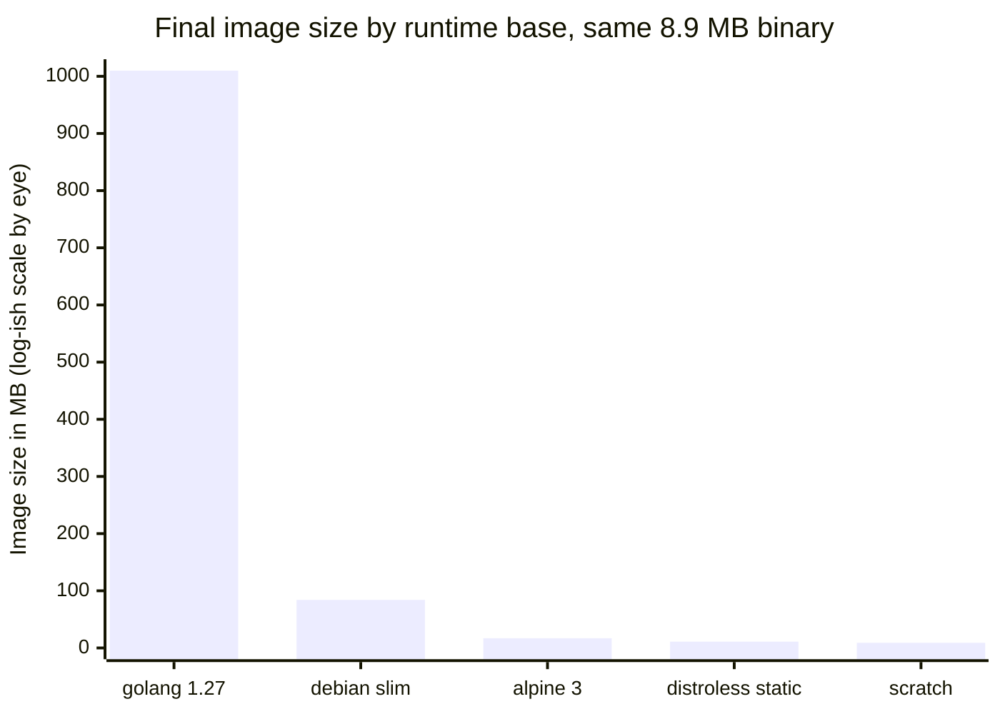
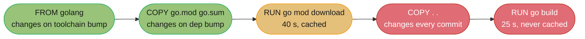
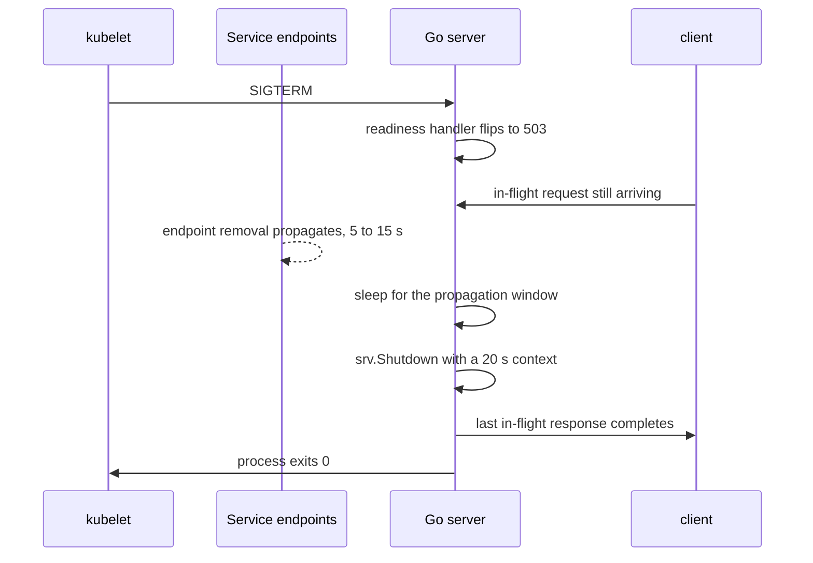

# Build, Deployment and Supply Chain

## 1. Concept Overview

Go's central operational claim is that `go build` produces **one file**, and that file is the
entire deliverable. There is no interpreter to install on the host, no virtualenv to activate,
no JRE whose minor version has to match, no `LD_LIBRARY_PATH` to get right. The unit you test,
the unit you scan, the unit you sign, and the unit you run are the same bytes.

That single decision cascades through every stage of a delivery pipeline:

- **Cross-compilation is free.** With cgo off, `GOOS=linux GOARCH=arm64 go build` on a macOS
  laptop produces a working Linux ARM64 binary. No cross toolchain, no sysroot, no QEMU.
- **Container images collapse.** A multi-stage build that compiles in `golang:1.27` (~1 GB) and
  copies one binary into `gcr.io/distroless/static` ships **10–20 MB total** — a 50–100x
  reduction, and the runtime layer contains no shell, no package manager, and no CVE surface
  that is not your own code.
- **The dependency graph is auditable end to end.** `go.sum` pins every module by hash, the
  public checksum database is an append-only transparency log, and `govulncheck` reports only
  vulnerabilities in functions your binary can actually reach.
- **Provenance is cheap.** Go builds are reproducible byte-for-byte given a fixed toolchain
  version and `-trimpath`, and `go version -m ./binary` reads the full module list and VCS
  revision back out of a shipped artifact with no side-channel metadata.

This module is about the judgment calls in that pipeline: what `CGO_ENABLED=0` costs you, which
build flags are safe and which quietly break your 3am debugging, where the container-size ladder
stops paying, and how a Go service's runtime knobs (`GOMEMLIMIT`, `GOMAXPROCS`) have to be
reconciled with the container limits it runs under. The cgo mechanics themselves live in
[cgo and FFI](../cgo_and_ffi/cgo_and_ffi.md); the container and CI machinery lives in
[Containers and Docker](../../devops/containers_and_docker/containers_and_docker.md) and
[DevSecOps and Supply Chain Security](../../devops/devsecops_and_supply_chain_security/devsecops_and_supply_chain_security.md).
Here we care about the Go-shaped decisions.

---

## 2. Intuition

> Shipping a Go service is like mailing a fully assembled appliance instead of a flat-pack box
> plus an instruction sheet plus a bag of screws that may or may not be the right size. The
> recipient plugs it in. There is no assembly step at the destination, so there is no assembly
> step that can fail at the destination.

**Mental model.** Every other mainstream server language ships an *incomplete* artifact and
relies on the target host to complete it — Python needs a matching interpreter plus site-packages,
Java needs a JRE plus a classpath. Go moves the whole completion step to build time, on your
machine, under your test suite. Deployment stops being a resolution problem and becomes a copy.

**Key insight:** the static binary is not primarily a *performance* win, it is a *variance* win.
The class of production incident it deletes is "worked in staging, failed in prod because the
host had a different libc / a different Python patch release / a stale JRE". That class of
incident is not rare, and it is unusually expensive because it is invisible until deploy.

```
attack surface = your code + everything else in the runtime layer
```

**In plain terms.** "A `distroless/static` image contains your binary, a CA bundle, and
essentially nothing else — so the only package a scanner can find a CVE in is the one you wrote."

| Symbol | What it is |
|--------|------------|
| `golang:1.27` | The full build image: compiler, git, C toolchain, ~1 GB |
| `debian:bookworm-slim` | Minimal Debian: ~75 MB, has a shell and apt |
| `alpine:3` | musl-based minimal distro: ~8 MB, has a shell and apk |
| `distroless/static` | CA certs, tzdata, `/etc/passwd`, nonroot user: ~2 MB, no shell |
| `scratch` | Literally empty: 0 bytes |

**Walk one example.** A `net/http` service with a Postgres driver and OpenTelemetry, built with
`CGO_ENABLED=0`:

```
  binary, plain go build                    12.4 MB
  binary, -ldflags="-s -w"                   8.9 MB   (28% smaller, DWARF + symtab gone)

  final image on golang:1.27                  ~1.0 GB  (build image kept as runtime — the bug)
  final image on debian:bookworm-slim        ~84 MB   (75 MB base + 9 MB binary)
  final image on alpine:3                    ~17 MB   (8 MB base + 9 MB binary)
  final image on distroless/static           ~11 MB   (2 MB base + 9 MB binary)
  final image on scratch                      ~9 MB   (0 MB base + 9 MB binary)

  the ladder's payoff, top to bottom:        1.0 GB -> 11 MB   = 91x
  the last rung's payoff, distroless->scratch:  11 MB -> 9 MB  = 1.2x
```

That second-to-last line is the whole argument, and the last line is the whole caveat. Almost all
of the win is in *not shipping the build image*, which costs you nothing. The final 2 MB from
`distroless/static` down to `scratch` costs you CA certificates, the timezone database, and
`/etc/passwd` — three things you will then re-add by hand, badly. Take the 91x and stop.

**Why this matters:** image pull time dominates cold-start latency in autoscaled Kubernetes
deployments. Pulling 1 GB across a 200 Mbit/s node link takes ~40 s before your process starts;
pulling 11 MB takes under a second. On a service that scales out under load, that difference is
the difference between absorbing a traffic spike and shedding it.

---

## 3. Core Principles

1. **The artifact is the binary, and everything else is packaging.** A container image, a `.deb`,
   a Homebrew formula, and a GitHub release asset are four wrappers around the same file. Design
   the build to produce that file well, then wrap it however each channel needs.

2. **`CGO_ENABLED=0` is a deployment decision, not an optimization.** It is what makes the binary
   truly static, what makes cross-compilation a single environment variable, and what makes
   `FROM scratch` possible. What it costs is the C ecosystem: SQLite via `mattn/go-sqlite3`,
   some image codecs, and glibc's NSS-backed `os/user` and DNS resolution.

3. **Cross-compilation is `GOOS` and `GOARCH` and nothing else — when cgo is off.** Turn cgo on
   and you have inherited the entire C cross-compilation problem, including a target sysroot.
   This is the single largest hidden cost of one `import "C"` line.

4. **Build flags strip metadata, never behaviour.** `-s`, `-w` and `-trimpath` change what a
   debugger and a profiler can tell you. None of them changes what the program does. Choose them
   by asking what you are willing to give up at 3am.

5. **Reproducibility is a property of inputs, not of intent.** Fix the toolchain version, fix the
   module graph with `go.sum`, pass `-trimpath`, keep cgo off, and stamp nothing that varies
   (no build timestamp, no hostname). Then two builds of the same commit are byte-identical, and
   that identity is the strongest provenance claim you can make.

6. **The runtime layer should contain only what the binary dereferences.** CA certificates if you
   make TLS calls, the timezone database if you format local times, `/etc/passwd` if something
   resolves a username. Everything else in that layer is CVE surface with no compensating value.

7. **Reachability beats presence in vulnerability scanning.** A generic scanner reports every CVE
   in every module in `go.sum`. `govulncheck` reports only the ones whose vulnerable *function*
   is reachable from your `main`. The first list is longer and mostly noise; the second list is
   the one a team can actually act on.

8. **The container's memory limit and the Go runtime's memory model must be told about each
   other.** The GC has no idea a cgroup exists unless you set `GOMEMLIMIT`. `GOMAXPROCS` became
   container-aware in `[1.25]`, but the heap ceiling never was and never will be automatic.

9. **Graceful shutdown is an ordering problem with the load balancer, not a code problem.**
   Calling `srv.Shutdown()` the instant SIGTERM lands is a source of 502s, because the LB is
   still routing to you. Fail readiness first, wait for propagation, then drain.

---

## 4. Types / Architectures / Strategies

### 4.1 Build modes

| Mode | Command | Binary | Cross-compile | Use when |
|------|---------|--------|---------------|----------|
| Default (cgo on, dynamic) | `go build` | Dynamically linked against libc | Needs a C cross toolchain | Local dev on the target OS |
| Pure Go static | `CGO_ENABLED=0 go build` | Fully static, no interpreter section | One env var | Every container and every release artifact |
| cgo, static libc | `CGO_ENABLED=1 go build -ldflags '-linkmode external -extldflags "-static"'` | Static, but glibc's static linking is partially unsupported (NSS) | Painful | Only when a C dep is mandatory and the target has no matching libc |
| cgo, musl static | Build inside `golang:alpine`, `CGO_ENABLED=1` | Static against musl | Per-target build container | SQLite in a scratch image, the usual reason |
| Plugin | `go build -buildmode=plugin` | `.so`, must match toolchain and flags exactly | No | Almost never. The version-lock rules make it fragile |
| WASM | `GOOS=wasip1 GOARCH=wasm go build` | `.wasm` module | Native | Edge runtimes and sandboxed plugins |

### 4.2 The base-image ladder

| Base | Size | Shell | CA certs | tzdata | Non-root user | Verdict |
|------|------|-------|----------|--------|---------------|---------|
| `golang:1.27` | ~1 GB | yes | yes | yes | no | Build stage only. Never a runtime stage |
| `ubuntu:24.04` | ~78 MB | yes | yes | yes | no | Only if you need apt packages at runtime |
| `debian:bookworm-slim` | ~75 MB | yes | yes | yes | no | The "I need `curl` in the image" answer. Usually a smell |
| `alpine:3` | ~8 MB | yes | via `apk add ca-certificates` | via `apk add tzdata` | no | Good when you genuinely want a shell |
| `gcr.io/distroless/static-debian12` | ~2 MB | no | yes | yes | yes (`nonroot`, 65532) | **The default for a `CGO_ENABLED=0` binary** |
| `gcr.io/distroless/base-debian12` | ~20 MB | no | yes | yes | yes | For a cgo binary needing glibc |
| `scratch` | 0 B | no | **no** | **no** | no | Only with deliberate hand-assembly |

### 4.3 Distribution channels for the same binary

| Channel | What it wraps | Signing story |
|---------|---------------|---------------|
| Container image | Binary + minimal base | cosign sign, keyless via Fulcio/Rekor |
| GitHub release asset | Tarball per `GOOS`/`GOARCH` | cosign sign-blob + checksums file |
| Homebrew / Scoop | Downloads the release asset | Formula pins the SHA-256 |
| `.deb` / `.rpm` | Binary + systemd unit | Distro signing key (nfpm generates these) |
| `go install` | Source, rebuilt by the user | The checksum database is the signature |

### 4.4 Vulnerability-scanning strategies

| Approach | What it sees | False-positive rate | Verdict |
|----------|--------------|---------------------|---------|
| Image scanner (Trivy, Grype) on the OS layer | Distro packages | Low on `distroless/static` — there are almost none | Keep it. It is cheap and catches base-image drift |
| Image scanner on the Go binary | Every module in the buildinfo | **High** — presence, not reachability | Noise. Do not gate a pipeline on it |
| `govulncheck` on source | Only vulnerable functions reachable from `main` | Very low | The gate. This is the one that blocks a merge |
| `govulncheck -mode=binary ./app` | Same reachability analysis, from a built binary | Low | For artifacts you did not build yourself |

---

## 5. Architecture Diagrams

### The multi-stage build, end to end


*The only stage that touches a compiler is the second box. Everything after `BIN` moves the same
8.9 MB of bytes through verification and packaging without ever rebuilding them — which is why
the signature you attach at `SIGN` still means something at `POD`.*

### The image-size ladder



*The first bar is the mistake — keeping the build image as the runtime image. It is 91x the
distroless result. The last three bars differ by 8 MB total, which is why the argument between
alpine, distroless and scratch is far less important than the argument for multi-stage at all.*

### Layer caching: what invalidates what



*Copying the whole tree before `go mod download` puts the 40-second download behind a layer that
changes on every commit. The two-step copy is worth 40 s per CI run, every run.*

### Graceful shutdown against the load balancer



*The sleep between flipping readiness and calling `Shutdown` is the part everyone omits, and it is
the part that prevents 502s. Endpoint removal is eventually consistent across kube-proxy on every
node, and nothing tells your process when it has finished.*

---

## 6. How It Works — Detailed Mechanics

### 6.1 What `CGO_ENABLED=0` actually changes

With cgo enabled (the default when a C compiler is present), the linker produces a dynamically
linked ELF that requires the target's libc at runtime, and two standard-library packages switch
implementations:

- `net` uses the **cgo resolver**, calling glibc's `getaddrinfo`, which honours
  `/etc/nsswitch.conf` — meaning LDAP, mDNS, and NIS name sources work.
- `os/user` calls `getpwuid`, which likewise honours NSS.

With `CGO_ENABLED=0`, both fall back to pure-Go implementations. The pure-Go resolver reads
`/etc/resolv.conf` and `/etc/hosts` directly and speaks DNS itself; `os/user` parses `/etc/passwd`
directly. For a containerized service this is almost always what you want, and it is what makes
the binary static.

```bash
# Confirm you actually got a static binary. Anything other than this is a bug.
$ CGO_ENABLED=0 go build -o app ./cmd/app
$ file app
app: ELF 64-bit LSB executable, x86-64, statically linked, Go BuildID=...

$ ldd app
        not a dynamic executable
```

You give up the C ecosystem. The concrete losses in practice are `mattn/go-sqlite3` (use
`modernc.org/sqlite`, a pure-Go transpilation, instead), some image and video codecs, and any
vendor SDK shipped as a `.so`. See [cgo and FFI](../cgo_and_ffi/cgo_and_ffi.md) for the calling
convention and the pointer-passing rules.

### 6.2 Cross-compilation

```bash
# The whole story, when cgo is off.
CGO_ENABLED=0 GOOS=linux   GOARCH=amd64 go build -o dist/app-linux-amd64   ./cmd/app
CGO_ENABLED=0 GOOS=linux   GOARCH=arm64 go build -o dist/app-linux-arm64   ./cmd/app
CGO_ENABLED=0 GOOS=darwin  GOARCH=arm64 go build -o dist/app-darwin-arm64  ./cmd/app
CGO_ENABLED=0 GOOS=windows GOARCH=amd64 go build -o dist/app-windows-amd64.exe ./cmd/app

# Everything the toolchain can target:
go tool dist list
```

Microarchitecture levels tune the instruction set within an architecture:

| Variable | Values | Default | What it buys |
|----------|--------|---------|--------------|
| `GOAMD64` | `v1`–`v4` | `v1` | `v3` enables AVX2 and BMI, typically 2–8% on hot numeric loops. Fails with SIGILL on pre-Haswell hardware |
| `GOARM` | `5`, `6`, `7` | `7` | Hardware float on 32-bit ARM. Irrelevant on `arm64` |
| `GOARM64` | `v8.0`–`v9.x` | `v8.0` | Newer ARM extensions. Same SIGILL risk on older cores |

The `GOAMD64=v3` decision is a fleet-homogeneity question, not a performance question. If you
cannot assert that every node is Haswell-or-newer, the 2–8% is not worth an unbootable pod.

Platform support moves, and it reaches CI:

- `[1.27]` **macOS 13 Ventura is the minimum.** A macOS 12 build runner stops working.
- `[1.27]` `linux/ppc64` now uses the **ELFv2** ABI.
- `[1.26]` **`windows/arm` (32-bit) was removed.** `windows/arm64` is unaffected.
- `[1.26]` `linux/riscv64` gained the **race detector**, so `-race` is now available there.

### 6.3 Build flags: what each one costs

```bash
go build -trimpath -ldflags="-s -w -X main.version=$(git describe --tags)" -o app ./cmd/app
```

| Flag | Removes | What you lose |
|------|---------|---------------|
| `-w` | DWARF debug information | **Delve cannot debug the binary.** No variable inspection, no breakpoints by line |
| `-s` | The symbol table | **cgo/C frames in a traceback lose their names.** Go frames are unaffected |
| `-trimpath` | Absolute build paths | `pprof list` and `dlv` cannot find your source files without `-source-path` |

The single most repeated wrong claim about `-s -w` is that it makes Go panics unreadable. It does
not. Go stack traces are produced from the **pcln table**, which the runtime requires in order to
unwind at all, so the linker never strips it — with or without `-s`. A panic in a
`-ldflags="-s -w"` binary prints exactly the same Go function names, files and line numbers:

```
panic: runtime error: index out of range [5] with length 3

goroutine 1 [running]:
main.process(0x0?, 0x0?)
        /src/cmd/app/main.go:42 +0x1d
main.main()
        /src/cmd/app/main.go:18 +0x25
```

What `-s` genuinely costs is the *C* half of a mixed traceback, and what `-w` costs is Delve.
Together they typically remove 20–30% of binary size (12.4 MB to 8.9 MB in the example above).
For a container image where the debugging workflow is "pull the same tag locally and run it under
Delve", both are safe. For a binary you ship to customers and then have to debug on their machine,
keep `-w` off.

### 6.4 Version stamping: two mechanisms, one of which is free

```go
package main

import (
    "fmt"
    "runtime/debug"
)

// Set by the linker: -ldflags="-X main.version=v1.4.2"
var version = "dev"

func printBuildInfo() {
    fmt.Println("version:", version)

    info, ok := debug.ReadBuildInfo()
    if !ok {
        return
    }
    fmt.Println("go:", info.GoVersion)
    fmt.Println("module:", info.Main.Path)
    for _, s := range info.Settings {
        switch s.Key {
        case "vcs.revision", "vcs.time", "vcs.modified", "GOARCH", "GOAMD64", "-trimpath":
            fmt.Printf("%s: %s\n", s.Key, s.Value)
        }
    }
}
```

`-X` writes a string into a package-level variable at link time. It is the only way to inject a
value the toolchain does not already know — a semantic version derived from a tag, for instance.

`debug.ReadBuildInfo()` costs nothing and gets more. When `go build` runs inside a Git checkout
with `git` on `PATH`, the toolchain automatically stamps `vcs.revision`, `vcs.time` and
`vcs.modified` (the dirty-tree flag). It also records every module in the build, the Go version,
and the build settings including `-trimpath` and `GOAMD64`.

The failure mode to know: **VCS stamping is silently skipped** if the build directory is not a
repository, or `git` is absent, or the repo is a shallow clone that the toolchain refuses to
trust. That last one bites in CI constantly, because `actions/checkout` defaults to depth 1. Set
`fetch-depth: 0` and `git config --global --add safe.directory` inside the build container.

### 6.5 Reading provenance back out of a shipped binary

```bash
$ go version -m ./app
./app: go1.27.1
        path    github.com/acme/svc/cmd/app
        mod     github.com/acme/svc      v1.4.2   h1:0mXQ...=
        dep     github.com/jackc/pgx/v5  v5.7.6   h1:qLB2...=
        dep     go.opentelemetry.io/otel v1.39.0  h1:aP1s...=
        build   -buildmode=exe
        build   -compiler=gc
        build   -trimpath=true
        build   CGO_ENABLED=0
        build   GOARCH=amd64
        build   GOOS=linux
        build   GOAMD64=v1
        build   vcs=git
        build   vcs.revision=8f3c1e9d5a2b4c7e0f1a2b3c4d5e6f7a8b9c0d1e
        build   vcs.time=2026-08-27T09:14:03Z
        build   vcs.modified=false
```

This is a free, always-present, tamper-evident inventory of what went into the binary. It answers
"which commit is running in prod" and "does this artifact contain the vulnerable pgx" without any
external metadata store. It is also what `govulncheck -mode=binary` reads.

### 6.6 Reproducible builds

A Go build is byte-for-byte reproducible when these are all fixed:

1. **Toolchain version** — pin it with a `toolchain go1.27.1` line in `go.mod`, and let
   `GOTOOLCHAIN` fetch exactly that. Two different patch releases produce different bytes.
2. **Module content** — `go.sum` guarantees it. This is the part Go gives you for free.
3. **`-trimpath`** — without it the binary embeds `/home/alice/src/...` and no two machines agree.
4. **`CGO_ENABLED=0`** — otherwise the host C toolchain leaks into the output.
5. **No varying stamps** — never `-X main.buildTime=$(date)`. Use `vcs.time` instead, which is the
   commit time and therefore constant for a given commit.

```bash
# Verify. Two builds of the same commit, different directories.
$ (cd /tmp/a && CGO_ENABLED=0 go build -trimpath -o app ./cmd/app && sha256sum app)
9f2c...e41  app
$ (cd /tmp/b && CGO_ENABLED=0 go build -trimpath -o app ./cmd/app && sha256sum app)
9f2c...e41  app
```

Why it matters: a reproducible build turns "trust our CI" into "verify it yourself". A third party
can rebuild your tagged commit and confirm the hash matches the artifact you signed. That is a
strictly stronger claim than a signature, which only proves *someone with the key* produced those
bytes, not that those bytes correspond to the published source.

### 6.7 The multi-stage Dockerfile, annotated

```dockerfile
# ---- build stage ----
FROM golang:1.27 AS build
# Without this ARG the ${VERSION} below expands to the empty string and stamps
# nothing, silently. Pass it with --build-arg VERSION=$(git describe --tags).
ARG VERSION=dev
WORKDIR /src

# Copy ONLY the manifests first. This layer changes when dependencies change,
# not when source changes, so the 40-second download is cached across commits.
COPY go.mod go.sum ./
RUN --mount=type=cache,target=/go/pkg/mod \
    go mod download

# Now the source. This layer changes every commit, and everything below it reruns.
COPY . .

RUN --mount=type=cache,target=/go/pkg/mod \
    --mount=type=cache,target=/root/.cache/go-build \
    CGO_ENABLED=0 GOOS=linux go build \
      -trimpath \
      -ldflags="-s -w -X main.version=${VERSION}" \
      -o /out/app ./cmd/app

# ---- runtime stage ----
FROM gcr.io/distroless/static-debian12:nonroot
COPY --from=build /out/app /app
USER 65532:65532
EXPOSE 8080
ENTRYPOINT ["/app"]
```

The two BuildKit cache mounts matter more than they look. `/go/pkg/mod` is `GOMODCACHE`, so a
warm cache skips the network entirely. `/root/.cache/go-build` is the compiler cache, so an
unchanged package is not recompiled — on a large service this takes an incremental CI build from
90 s to 15 s.

`distroless/static-debian12:nonroot` already contains `/etc/passwd` with UID 65532, a CA bundle at
`/etc/ssl/certs/ca-certificates.crt`, and `/usr/share/zoneinfo`. That is why it is the default
answer rather than `scratch`.

### 6.8 If you insist on `scratch`

```dockerfile
FROM golang:1.27 AS build
WORKDIR /src
COPY go.mod go.sum ./
RUN go mod download
COPY . .
# time/tzdata must be imported by the program; see the Go snippet below.
RUN CGO_ENABLED=0 go build -trimpath -ldflags="-s -w" -o /out/app ./cmd/app

FROM scratch
COPY --from=build /out/app /app
# scratch has NO CA certificates. Every HTTPS call fails with
# "x509: certificate signed by unknown authority" until you copy them in.
COPY --from=build /etc/ssl/certs/ca-certificates.crt /etc/ssl/certs/
# scratch has NO /etc/passwd, so USER can only be numeric.
COPY --from=build /etc/passwd /etc/passwd
USER 65534:65534
ENTRYPOINT ["/app"]
```

And the timezone database has to come from inside the binary, because there is no
`/usr/share/zoneinfo` to read:

```go
package main

// Embeds the IANA timezone database (~450 KB) into the binary so that
// time.LoadLocation works with no filesystem. Required on scratch.
import _ "time/tzdata"
```

Three hand-assembled pieces, ~450 KB added back to the binary, to save 2 MB of image. The
arithmetic does not favour `scratch` unless you have a specific policy reason.

### 6.9 Debugging a shell-less image

You did not lose debuggability, you moved it. Kubernetes ephemeral containers attach a full
userland to the running pod's namespaces without restarting it:

```bash
kubectl debug -it pod/svc-7d9f8 --image=busybox:1.37 --target=app -- sh
# /proc/1/root is the app container's filesystem
# netstat, wget, and strace now see the app's network and PID namespace
```

For Go specifically, the better answer is usually `net/http/pprof` on an internal port — see
[Profiling and Tracing](../profiling_and_tracing/profiling_and_tracing.md). A shell in the image
is a permanent CVE surface bought to solve a problem you can solve with an HTTP endpoint.

### 6.10 The module supply chain

```
go get github.com/foo/bar@v1.2.3
        |
        v
GOPROXY (default https://proxy.golang.org,direct)
        |  serves an immutable, cached copy of the module zip
        v
GOSUMDB (default sum.golang.org)
        |  an append-only Merkle transparency log of module hashes
        v
go.sum  records the hash locally; every later build re-verifies it
```

`go.sum` is a **tamper-evidence** mechanism, not a trust mechanism. It proves the bytes you get
today are the bytes you got the first time, and the checksum database proves everyone else got
the same bytes. Neither says the code is good. A maintainer who publishes a malicious `v1.2.4`
produces a perfectly valid `go.sum` entry.

| Variable | Default | What to set it to |
|----------|---------|-------------------|
| `GOPROXY` | `https://proxy.golang.org,direct` | Your internal proxy, then `direct`. Never just `direct` in CI |
| `GONOPROXY` | (from `GOPRIVATE`) | Internal module path prefixes that must bypass the proxy |
| `GONOSUMDB` | (from `GOPRIVATE`) | Internal prefixes that must not be checked against the public log |
| `GOPRIVATE` | empty | `github.com/acme/*` — sets both of the above in one line |
| `GOFLAGS` | empty | `-mod=readonly` in CI, so a build never silently edits `go.mod` |

Running an **internal proxy** (Athens, JFrog Artifactory, Google Artifact Registry) buys three
things: availability when `proxy.golang.org` or an upstream host is down, an audit log of exactly
which modules your organisation pulls, and a chokepoint where you can block a known-bad version
fleet-wide in one place.

`[1.27]` note: `bzr` module fetching was removed. A module hosted only in Bazaar can no longer be
fetched directly, and must be vendored or mirrored through a proxy.

### 6.11 `govulncheck` and why reachability changes the argument

```bash
$ go install golang.org/x/vuln/cmd/govulncheck@latest
$ govulncheck ./...

=== Symbol Results ===

Vulnerability #1: GO-2026-4137
    Denial of service via crafted HTTP/2 CONTINUATION frames
  More info: https://pkg.go.dev/vuln/GO-2026-4137
  Standard library
    Found in: net/http@go1.27.0
    Fixed in: net/http@go1.27.1
    Example traces found:
      #1: internal/api/server.go:64:22: api.Serve calls http.Server.ListenAndServe

Your code is affected by 1 vulnerability from the Go standard library.
This scan also found 6 vulnerabilities in packages you import and 11
vulnerabilities in modules you require, but your code doesn't appear to call
these vulnerabilities.
```

Read the last sentence carefully — that is the entire value proposition. A generic scanner would
report **18** findings here. `govulncheck` reports **1** and explains why the other 17 cannot be
triggered by this binary: the vulnerable functions are in code paths your program never reaches.

The mechanism is static call-graph analysis from every `main` and every exported symbol, against
the Go vulnerability database at `vuln.go.dev`, which is curated with per-function affected
symbols rather than per-module version ranges.

The practical consequence is that `govulncheck` can be a **blocking** CI gate and a generic
scanner cannot. A gate with a 94% false-positive rate gets an exception file within two weeks and
is then permanently ignored, which is worse than not having it. A gate that fires once a quarter
and is right every time gets fixed.

```yaml
# .github/workflows/ci.yml — the gate
- name: govulncheck
  run: |
    go install golang.org/x/vuln/cmd/govulncheck@latest
    govulncheck ./...
```

For binaries you did not build, `govulncheck -mode=binary ./app` runs the same analysis using the
buildinfo embedded by the toolchain — no source required.

### 6.12 SBOM, signing and provenance

```bash
# SBOM straight from the module graph (CycloneDX).
cyclonedx-gomod app -json -output sbom.json ./cmd/app

# Or from the built artifact, which also captures the base image contents.
syft packages ./app -o spdx-json > sbom.spdx.json

# Keyless signing: no long-lived key. Fulcio issues a short-lived cert bound to the
# CI workload's OIDC identity, and Rekor records the signature in a public log.
cosign sign --yes ghcr.io/acme/svc@sha256:9f2c...e41

# Attach the SBOM as an attestation rather than a loose file.
cosign attest --yes --predicate sbom.spdx.json --type spdxjson \
  ghcr.io/acme/svc@sha256:9f2c...e41

# The consumer side, enforced by an admission controller.
cosign verify \
  --certificate-identity-regexp '^https://github.com/acme/svc/\.github/workflows/.*' \
  --certificate-oidc-issuer https://token.actions.githubusercontent.com \
  ghcr.io/acme/svc@sha256:9f2c...e41
```

The identity flags are the point. A bare `cosign verify` proves only that *something* signed the
image. Pinning the certificate identity to your workflow file and the issuer to GitHub's OIDC
endpoint proves it was signed by *that pipeline*, which is the claim you actually want.

**SLSA provenance** goes one level further: it is a signed statement describing the build itself —
which source commit, which builder, which parameters. SLSA Build Level 3 requires the build to run
on a hosted, non-falsifiable builder, which is what `slsa-framework/slsa-github-generator` provides
for GitHub Actions.

The layers stack like this, weakest to strongest:

| Layer | Proves | Does not prove |
|-------|--------|----------------|
| `go.sum` | The dependencies are the same bytes as last time | That they are safe |
| Checksum database | Everyone in the world got those same bytes | That they are safe |
| `govulncheck` | No known-vulnerable function is reachable | Unknown vulnerabilities, or malice |
| Image signature | These bytes were signed by that identity | That the bytes match the source |
| SLSA provenance | This builder built these bytes from that commit | That the commit is trustworthy |
| Reproducible build | Anyone can rebuild the commit and get these bytes | That the commit is trustworthy |

### 6.13 Runtime knobs against container limits

```yaml
resources:
  requests: { cpu: "500m", memory: "512Mi" }
  limits:   { cpu: "2",    memory: "512Mi" }
env:
  # 85% of the 512Mi limit. Leaves headroom for stacks, the runtime's own
  # allocations, and non-heap mappings the GC does not account for.
  - name: GOMEMLIMIT
    value: "435MiB"
```

`GOMEMLIMIT` `[1.19]` is a **soft** ceiling: the GC runs more aggressively as the total mapped
heap approaches it, but it will not spend more than 50% of CPU on GC to honour it. It converts a
hard `OOMKilled` into a visible, gradual CPU-cost increase you can alert on. Set it; the default
`GOGC=100` alone has no idea a cgroup exists. The arithmetic and the death-spiral failure mode are
in [The Runtime and Garbage Collector](../the_runtime_and_garbage_collector/the_runtime_and_garbage_collector.md).

`GOMAXPROCS` became **container-aware in `[1.25]`** — the runtime reads the cgroup CPU limit and
sets `GOMAXPROCS` from it, instead of blindly using the host core count. Before that, a pod with a
`cpu: 2` limit on a 96-core node ran 96 Ps, 96 goroutine run queues, and a GC that sized its
worker pool for 96 cores, then got throttled hard by the CFS quota. If any of your build runs on a
pinned older toolchain, set `GOMAXPROCS` explicitly from the limit.

Probes for a Go server:

```go
mux.HandleFunc("GET /healthz", func(w http.ResponseWriter, r *http.Request) {
    // Liveness: is the process wedged? Do NOT check dependencies here.
    // A DB outage must not cause Kubernetes to restart every replica.
    w.WriteHeader(http.StatusOK)
})

mux.HandleFunc("GET /readyz", func(w http.ResponseWriter, r *http.Request) {
    // Readiness: should traffic come here right now? Dependencies belong here,
    // and so does the shutdown flag.
    if shuttingDown.Load() || db.PingContext(r.Context()) != nil {
        http.Error(w, "not ready", http.StatusServiceUnavailable)
        return
    }
    w.WriteHeader(http.StatusOK)
})
```

The distinction is not cosmetic. Putting a database check in the liveness probe converts a
30-second database blip into a full rolling restart of every replica, and the restarts then hit
the recovering database with a thundering herd of reconnects.

### 6.14 Graceful shutdown, in the correct order

```go
func run(ctx context.Context) error {
    srv := &http.Server{Addr: ":8080", Handler: mux}

    // NotifyContext cancels with a CancelCauseFunc naming the signal received [1.26].
    ctx, stop := signal.NotifyContext(ctx, syscall.SIGINT, syscall.SIGTERM)
    defer stop()

    errCh := make(chan error, 1)
    go func() { errCh <- srv.ListenAndServe() }()

    select {
    case err := <-errCh:
        return err
    case <-ctx.Done():
    }

    // 1. Fail readiness FIRST, so the endpoint controller starts removing us.
    shuttingDown.Store(true)

    // 2. Keep serving while endpoint removal propagates to every node's kube-proxy.
    //    This is eventually consistent and nothing notifies us when it finishes.
    time.Sleep(10 * time.Second)

    // 3. Now drain. Shutdown stops accepting and waits for in-flight handlers.
    shutCtx, cancel := context.WithTimeout(context.Background(), 20*time.Second)
    defer cancel()
    return srv.Shutdown(shutCtx)
}
```

The budget has to fit inside `terminationGracePeriodSeconds` (default 30), or the kubelet sends
SIGKILL mid-drain. Here 10 s of propagation plus 20 s of drain is exactly 30 — set the grace period
to 40 to leave margin. See [net/http Server](../net_http_server/net_http_server.md) for the
`Shutdown` semantics and [Concurrency Patterns and Pitfalls](../concurrency_patterns_and_pitfalls/concurrency_patterns_and_pitfalls.md)
for draining background workers alongside the server.

### 6.15 Release automation

```yaml
# .goreleaser.yaml
builds:
  - env: [CGO_ENABLED=0]
    goos: [linux, darwin, windows]
    goarch: [amd64, arm64]
    flags: [-trimpath]
    ldflags:
      - -s -w -X main.version={{.Version}} -X main.commit={{.FullCommit}}

archives:
  - format_overrides:
      - goos: windows
        format: zip

dockers:
  - image_templates: ["ghcr.io/acme/svc:{{ .Version }}-amd64"]
    dockerfile: Dockerfile.release
    use: buildx
    build_flag_templates: ["--platform=linux/amd64"]

sboms:
  - artifacts: archive

signs:
  - cmd: cosign
    args: ["sign-blob", "--yes", "--output-signature=${signature}", "${artifact}"]
    artifacts: checksum
```

One `goreleaser release` produces six binaries, six archives, a checksums file, SBOMs, cosign
signatures, a multi-arch image manifest, and a GitHub release with notes. The reason this is
tractable in Go and painful elsewhere is §6.2: the six-platform matrix is six invocations of the
same compiler with different environment variables, on one machine, in about 30 seconds.

---

## 7. Real-World Examples

**Kubernetes** ships every component — `kube-apiserver`, `kubelet`, `kube-scheduler`,
`kube-controller-manager` — as a static Go binary in a distroless image. The `kubectl` release is
a single binary per platform with a published SHA-256, which is why `curl | install` is the
documented install path on every OS. Cluster operators routinely set `GOMEMLIMIT` on the apiserver
so that a `LIST` storm against a large cluster degrades into GC pressure rather than an
`OOMKilled` control plane.

**Prometheus** distributes `prometheus`, `promtool`, and every exporter as single binaries with no
runtime dependency, which is precisely why exporters became ubiquitous: adding monitoring to a
host means copying one file and writing one systemd unit. The official images are built
`CGO_ENABLED=0` from a scratch-adjacent base.

**HashiCorp Terraform** ships one binary per platform, with providers as separate binaries fetched
at `terraform init` and verified against a signature. The entire provider plugin ecosystem is
viable because a provider is a file, not an installed package.

**Docker and containerd** are themselves Go binaries. `containerd`'s shim (`containerd-shim-runc-v2`)
is a static Go binary the daemon execs per container — the shim must survive daemon restarts, and
having no shared-library dependency is what makes that safe.

**Cilium** builds its Go userspace agent statically and ships it in a minimal image alongside the
eBPF objects. The agent runs on nodes with wildly varying host distributions, and a dynamic link
against the node's libc would be an immediate portability failure.

**Grafana Loki and Tempo** use `GOMEMLIMIT` as the primary memory-safety mechanism rather than
tuning `GOGC`, because their live heap varies by two orders of magnitude between idle and a large
query, and a proportional-only knob cannot express "never exceed the container limit".

---

## 8. Tradeoffs

### Static vs dynamic linking

| Dimension | `CGO_ENABLED=0` static | cgo dynamic |
|-----------|------------------------|-------------|
| Cross-compile | One env var | Full cross toolchain + sysroot |
| Base image | `scratch` or `distroless/static` (~2 MB) | `distroless/base` (~20 MB) minimum |
| Binary size | Larger (libc statically included) | Smaller on disk, but the libc is in the image |
| DNS | Pure-Go resolver, `/etc/resolv.conf` only | glibc `getaddrinfo`, honours NSS (LDAP, mDNS) |
| libc CVE | Yours to rebuild for | Patched by a base-image bump |
| C libraries | Unavailable | Available |
| Verdict | The default for services and CLIs | Only when a C dependency is mandatory |

### Base-image choice

| Dimension | `alpine` | `distroless/static` | `scratch` |
|-----------|----------|---------------------|-----------|
| Size added | ~8 MB | ~2 MB | 0 |
| Shell for `kubectl exec` | yes | no | no |
| CA certificates | `apk add ca-certificates` | included | you copy them |
| tzdata | `apk add tzdata` | included | `import _ "time/tzdata"` |
| Non-root user | you create it | `nonroot`, UID 65532 | numeric UID only |
| CVE surface | musl, busybox, apk | ~none | none |
| Verdict | When a shell is genuinely required | **Default** | Policy-driven only |

### Vulnerability gating

| Dimension | Generic image scanner | `govulncheck` |
|-----------|----------------------|---------------|
| Granularity | Module version present in buildinfo | Vulnerable function reachable from `main` |
| Typical findings on a real service | 15–25 | 0–2 |
| False-positive rate | Very high for Go modules | Very low |
| Catches base-image CVEs | Yes | No |
| Suitable as a blocking gate | No | Yes |
| Verdict | Run it, do not block on the Go findings | Block on this |

### Version stamping

| Dimension | `-ldflags -X` | `debug.ReadBuildInfo()` |
|-----------|---------------|-------------------------|
| Cost | A linker flag per value | Free |
| Semantic version from a tag | Yes | No |
| Commit SHA, commit time, dirty flag | Manual | Automatic |
| Full dependency list | No | Yes |
| Readable from a shipped binary | Only via the program | `go version -m` |
| Verdict | Use for the human-facing version string | Use for everything else |

---

## 9. When to Use / When NOT to Use

**Use `CGO_ENABLED=0` when:**
- You are building a container image, which is essentially always
- You cross-compile for more than one platform
- You want `distroless/static` or `scratch`
- You want reproducible builds without pinning a C toolchain

**Do NOT use `CGO_ENABLED=0` when:**
- A mandatory dependency is a C library with no pure-Go equivalent
- You need NSS-backed name resolution (LDAP or mDNS hostnames in `/etc/nsswitch.conf`)
- You are calling a vendor SDK shipped only as a shared object

**Use `distroless/static` when:** the binary is pure Go — the default for every service.

**Use `alpine` when:** an operator workflow genuinely requires `kubectl exec` into a shell, and
ephemeral containers are unavailable (a pre-1.25 cluster, or a non-Kubernetes runtime).

**Use `scratch` when:** a security policy mandates an empty base and you accept hand-assembling CA
certificates, tzdata, and `/etc/passwd`. The 2 MB saving is not itself a reason.

**Use `-ldflags="-s -w"` when:** the debugging workflow is to reproduce locally with an unstripped
build. Skip `-w` for binaries you must debug on a customer machine.

**Use `GOAMD64=v3` when:** you can assert every node is Haswell-or-newer and you have measured a
win on your workload. Otherwise the SIGILL risk dominates the 2–8%.

**Use an internal module proxy when:** you have private modules, an availability requirement that
survives an upstream outage, or a compliance need for a dependency audit log. Below roughly ten
engineers the public proxy plus `GOPRIVATE` is usually enough.

**Do NOT put a shell in the runtime image** to make debugging easier. Use ephemeral containers and
`net/http/pprof`. A shell is a permanent CVE surface bought for an occasional convenience.

**Do NOT gate CI on a generic scanner's Go findings.** The false-positive rate guarantees the gate
gets bypassed, and a bypassed gate is worse than no gate because it looks like coverage.

---

## 10. Common Pitfalls

### 10.1 The build image shipped as the runtime image

A team's single-stage Dockerfile produced a **1.06 GB** image. On a service autoscaling from 4 to
40 replicas during a traffic spike, each new node pulled 1.06 GB before the process started —
roughly 42 s on a 200 Mbit/s link, against a HorizontalPodAutoscaler that expected pods ready in
15 s. The scale-out never caught up with the spike and the service shed 8% of requests for
11 minutes. Converting to a multi-stage build took the image to **11 MB** and pull time to under a
second.

```dockerfile
# BROKEN: the compiler, git, and the entire module cache ship to production.
FROM golang:1.27
WORKDIR /src
COPY . .
RUN go build -o /app ./cmd/app
ENTRYPOINT ["/app"]
# 1.06 GB. Contains a C compiler and a package manager, in production.
```

```dockerfile
# FIX: build in the heavy image, ship only the binary.
FROM golang:1.27 AS build
WORKDIR /src
COPY go.mod go.sum ./
RUN go mod download
COPY . .
RUN CGO_ENABLED=0 go build -trimpath -ldflags="-s -w" -o /out/app ./cmd/app

FROM gcr.io/distroless/static-debian12:nonroot
COPY --from=build /out/app /app
USER 65532:65532
ENTRYPOINT ["/app"]
# 11 MB. Contains one binary and a CA bundle.
```

### 10.2 `scratch` with no CA certificates

A payments integration was migrated to a `scratch` image. Every outbound HTTPS call failed with
`x509: certificate signed by unknown authority`. It passed CI, because the integration tests used
an `httptest` server over plain HTTP. It failed on the first production request, and because the
error surfaced as a generic transport error the on-call engineer spent 40 minutes on DNS and
network policy before reading the wrapped error text. Fix: copy
`/etc/ssl/certs/ca-certificates.crt` from the build stage, or use `distroless/static`, which
already has it.

### 10.3 Copying source before downloading modules

A repository with 180 direct dependencies took **73 s** in `go mod download` on every CI run,
because `COPY . .` preceded it and invalidated the cache on every commit. Reordering to copy
`go.mod`/`go.sum` first cut the median CI build from 2 m 10 s to 47 s. Across ~120 builds a day
this returned roughly 2.5 engineer-hours of wall-clock waiting per day.

### 10.4 `GOMEMLIMIT` unset in a memory-limited pod

A JSON-heavy ingest service with a `512Mi` limit was `OOMKilled` roughly every 90 minutes under
peak load, always mid-request, always losing the in-flight batch. Heap profiles showed only
~200 MB live — the kills happened during the GC's normal 2x growth to the `GOGC=100` goal, which
put total mapped memory over the cgroup limit. Setting `GOMEMLIMIT=435MiB` eliminated the kills
entirely; GC CPU rose from 4% to 7% at peak, which was a trade the team took immediately. See
[The Runtime and Garbage Collector](../the_runtime_and_garbage_collector/the_runtime_and_garbage_collector.md)
for why the limit is soft and what a death spiral looks like.

### 10.5 `Shutdown()` called immediately on SIGTERM

A deploy of 30 replicas produced a reliable spike of ~2,400 HTTP 502s per rollout. The server was
calling `srv.Shutdown()` in the SIGTERM handler with no delay, so it stopped accepting connections
while kube-proxy on other nodes was still routing to its IP. Adding a 10-second sleep between
flipping readiness to 503 and calling `Shutdown` took the per-rollout 502 count to zero. Nothing
about the shutdown code was wrong in isolation — the ordering against an eventually-consistent
endpoint controller was.

### 10.6 A dirty or shallow checkout silently losing VCS stamping

An incident review needed to know which commit was running. `go version -m` on the pulled image
showed no `vcs.revision` at all, because CI used `actions/checkout` at its default `fetch-depth: 1`
and the toolchain declined to stamp from a shallow clone. The team had assumed the stamping was
automatic and had removed their `-X main.commit` flag six months earlier. The failure is silent —
there is no warning, the field is simply absent. Set `fetch-depth: 0`, and assert the field exists
in CI rather than trusting it.

### 10.7 `GOAMD64=v3` deployed to a heterogeneous fleet

A team enabled `GOAMD64=v3` after measuring an 6% throughput win on their benchmark host. Two
weeks later a cluster autoscaler added older nodes to satisfy a capacity request, and every pod
scheduled there crashed with `SIGILL: illegal instruction` inside a stdlib function. Because the
crash happened before the first log line, it presented as a `CrashLoopBackOff` with an empty log,
which took ~90 minutes to diagnose. The 6% was not worth it; they reverted to `v1`.

### 10.8 Trusting a bare `cosign verify`

An admission policy ran `cosign verify` without `--certificate-identity-regexp`. It therefore
accepted **any** image signed by **any** Fulcio identity, including an image an attacker could
sign with their own GitHub account in thirty seconds. The policy read as security and provided
none. Always pin both the identity regex and the OIDC issuer.

### 10.9 A generic scanner as a blocking gate

A pipeline blocked merges on a Trivy scan of the Go binary's buildinfo. It reported 19 findings on
a typical service, of which `govulncheck` confirmed 0 were reachable. Within three sprints the
team had a 40-line allowlist, and two months later a genuinely reachable stdlib vulnerability was
allowlisted by pattern-match during a release crunch. The gate had trained everyone to dismiss it.

---

## 11. Technologies & Tools

| Tool | What it does | When you need it |
|------|--------------|------------------|
| `go build` | Produces the binary | Always |
| `go version -m` | Reads module list, VCS revision and build settings from a binary | Incident response, provenance checks |
| `govulncheck` | Reachability-based vulnerability analysis, source or binary mode | Every CI run, as a blocking gate |
| `goreleaser` | Cross-platform release automation: binaries, archives, images, SBOMs, signatures | Any project with a public release |
| `ko` | Builds and pushes a Go container image with no Dockerfile | Kubernetes controllers and operators |
| `cosign` | Keyless artifact signing and attestation via Sigstore | Signing images and release blobs |
| `syft` | SBOM generation from images and binaries (SPDX, CycloneDX) | Compliance and vendor requirements |
| `cyclonedx-gomod` | SBOM generation from the Go module graph specifically | Go-accurate dependency inventory |
| `grype` / `trivy` | CVE scanning of image layers | Base-image drift, not as a Go gate |
| Athens | Self-hosted Go module proxy | Availability and audit for private modules |
| BuildKit | Cache mounts, multi-platform builds, secret mounts | Every container build |
| `nfpm` | Generates `.deb` and `.rpm` from a binary | Non-container distribution |
| `slsa-github-generator` | SLSA Build L3 provenance for GitHub Actions | Provenance requirements |
| `upx` | Compresses the binary further | Rarely. Breaks some scanners and adds startup cost |
| `delve` | Source-level debugger | Requires a build without `-w` |

---

## 12. Interview Questions with Answers

**Q: Why does `CGO_ENABLED=0` matter more for deployment than for performance?**
**Short:** It is what makes the binary fully static, so cross-compilation becomes one environment variable and the runtime image can be nearly empty.

Performance is essentially unaffected — the pure-Go DNS resolver and `os/user` are not measurably slower for a server. What changes is the deployment surface. A cgo build links dynamically against the target's libc, so it needs a matching libc in the runtime image (`distroless/base`, ~20 MB minimum, never `scratch`), and cross-compiling it needs a full C cross toolchain plus a target sysroot. Turning cgo off makes `GOOS=linux GOARCH=arm64 go build` work from a macOS laptop with nothing installed, and lets the runtime layer be `distroless/static` at ~2 MB. The cost is the C ecosystem and NSS-backed name resolution. Treat it as the default for anything containerized and turn it back on only when a specific C dependency forces you.

**Q: Your `scratch`-based image cannot reach any HTTPS endpoint — what is wrong?**
**Short:** The image has no CA certificate bundle, so every TLS handshake fails with an unknown-authority error until you copy one in.

`FROM scratch` is literally empty: no `/etc/ssl/certs/ca-certificates.crt`, so Go's TLS stack has no root store to validate a server certificate against and every outbound HTTPS call fails with `x509: certificate signed by unknown authority`. The fix is either `COPY --from=build /etc/ssl/certs/ca-certificates.crt /etc/ssl/certs/` or, better, switching the runtime base to `gcr.io/distroless/static-debian12`, which ships the bundle, the timezone database, and a nonroot user for about 2 MB. This bug is a classic CI escape because integration tests usually hit an `httptest` server over plain HTTP, so nothing exercises the certificate path until the first real production request.

**Q: Does `-ldflags="-s -w"` make Go panic stack traces unreadable?**
**Short:** No — Go frames stay fully symbolized because the runtime needs the pcln table to unwind, which the linker never strips.

The pcln (program counter to line) table maps instruction addresses to function names, files and line numbers, and the runtime requires it to produce a traceback at all, so it survives both flags. A panic in a stripped binary prints the same `main.process(...)  /src/cmd/app/main.go:42` you would see unstripped. What `-s` actually costs is the symbol table, which matters for **cgo and C frames** in a mixed traceback and for external tools reading ELF symbols. What `-w` costs is DWARF, which means **Delve cannot debug the binary** — no breakpoints by line, no variable inspection. Together they typically remove 20–30% of binary size. Ship them when your debugging workflow is to reproduce locally with an unstripped build.

**Q: Why does your Docker build re-download every module on every commit?**
**Short:** Because `COPY . .` runs before `go mod download`, putting the download behind a layer that changes on every commit.

Docker invalidates a layer and everything below it when its inputs change. If the source tree is copied before the download step, every commit changes that layer, so the download reruns from scratch — on a repository with 180 dependencies that is around 70 seconds per build. The fix is a two-step copy: `COPY go.mod go.sum ./` then `RUN go mod download`, and only then `COPY . .`. The download layer now changes only when dependencies change. Add BuildKit cache mounts on `/go/pkg/mod` and `/root/.cache/go-build` and the incremental compile drops too — a large service typically goes from about 90 seconds to 15.

**Q: How do you stamp a version into a Go binary, and when should you not bother?**
**Short:** Use `-ldflags="-X main.version=..."` only for the human-facing version string, because `debug.ReadBuildInfo` supplies commit, time and dependencies for free.

`-X importpath.name=value` writes a string into a package-level variable at link time, and it is the only mechanism for a value the toolchain cannot derive — a semantic version from a Git tag, typically. Everything else is already there: when `go build` runs in a Git checkout with `git` on `PATH`, the toolchain stamps `vcs.revision`, `vcs.time` and `vcs.modified`, plus the full module graph and build settings, all readable via `debug.ReadBuildInfo()` in-process or `go version -m ./app` from outside. Never stamp a build timestamp with `-X` — it destroys reproducibility, and `vcs.time` gives you a stable equivalent. The trap is that VCS stamping is silently skipped for a shallow clone, which is the CI default.

**Q: What makes a Go build reproducible, and how do you verify what shipped?**
**Short:** Fix the toolchain version, keep cgo off, pass `-trimpath`, stamp nothing that varies, and let `go.sum` fix the module graph.

Those five inputs are sufficient: two builds of the same commit on different machines then produce byte-identical output, verifiable with `sha256sum`. `-trimpath` is the one people forget — without it the binary embeds absolute build directories and no two workspaces agree. Pin the toolchain with a `toolchain go1.27.1` line in `go.mod`; a different patch release produces different bytes. To verify what shipped, `go version -m ./app` prints the module path, every dependency with its hash, the build settings including `CGO_ENABLED` and `-trimpath`, and the VCS revision. Reproducibility is a strictly stronger provenance claim than a signature, because a signature proves only that a key-holder produced those bytes, not that the bytes correspond to published source.

**Q: Why does `govulncheck` report far fewer findings than a generic image scanner, and which do you believe?**
**Short:** It reports only vulnerabilities whose vulnerable function is reachable from your `main`, which is why it can be a blocking gate and a generic scanner cannot.

A generic scanner reads the module list out of the buildinfo and flags every CVE affecting any version present — presence, not reachability. `govulncheck` builds a static call graph from `main` and every exported symbol and matches it against the Go vulnerability database, which records affected *symbols* rather than only version ranges. On a real service that is typically 15–25 findings versus 0–2. The difference is not cosmetic: a gate with a 90%-plus false-positive rate acquires an allowlist within two sprints and is then permanently ignored, which is worse than no gate because it reads as coverage. Block merges on `govulncheck ./...`, keep the image scanner for base-image drift, and never block on its Go findings.

**Q: What does `GOOS=linux GOARCH=arm64 go build` actually need on the build machine?**
**Short:** Nothing beyond the Go toolchain, provided cgo is disabled — the compiler and linker emit every supported target natively.

Go ships a single toolchain that can emit code for every platform in `go tool dist list`, so cross-compilation is two environment variables and no cross compiler, no sysroot, no QEMU. That property depends entirely on cgo being off: the instant a package imports `"C"`, the build needs a C cross toolchain and target headers and libraries, which is the full cross-compilation problem Go otherwise avoids. Within an architecture, `GOAMD64` (v1 to v4), `GOARM` (5, 6, 7) and `GOARM64` select instruction-set levels. Raising `GOAMD64` to v3 buys roughly 2–8% on hot numeric loops and crashes with SIGILL on any pre-Haswell CPU, so it is a fleet-homogeneity decision rather than a performance one.

**Q: What does `-trimpath` break?**
**Short:** It removes absolute source paths from the binary, so `pprof list` and Delve can no longer locate your source files without being told where they are.

The flag rewrites every file path in the binary to be module-relative, which is exactly what reproducibility needs — otherwise `/home/alice/src/svc/main.go` and `/builds/ci/svc/main.go` produce different bytes for the same commit. The cost is that tools which resolve a recorded path to a file on disk stop finding anything: `go tool pprof` shows line numbers but cannot print annotated source, and Delve cannot map a breakpoint to a line. Both accept an explicit override — pprof's `-source_path` and Delve's substitute-path configuration — pointed at a local checkout of the same commit. Use `-trimpath` in every release build; the reproducibility is worth one flag in your profiling command.

**Q: Your Go pod is OOMKilled at 512 Mi even though the heap profile shows 200 MB live — why?**
**Short:** With `GOGC=100` and no `GOMEMLIMIT`, the collector lets the heap grow to twice the live set before collecting, and the runtime cannot see the cgroup limit.

`GOGC=100` means "collect when the heap reaches 2x the live heap after the last cycle", so a 200 MB live set targets a 400 MB heap goal, and total mapped memory — heap plus goroutine stacks plus runtime metadata plus any off-heap mappings — comfortably clears 512 Mi. Nothing in that arithmetic consults the container limit. Setting `GOMEMLIMIT` to roughly 85% of the limit (435 MiB here) makes the collector run more aggressively as total memory approaches the ceiling, converting a hard kill into a gradual, alertable rise in GC CPU. It is deliberately a soft limit: the runtime will not spend more than 50% of CPU on GC to honour it, so it is not an OOM guarantee if your live set genuinely exceeds the budget.

**Q: How should a Go HTTP server handle SIGTERM in Kubernetes?**
**Short:** Fail readiness first, wait roughly ten seconds for endpoint removal to propagate, and only then call `srv.Shutdown` with a bounded context.

Calling `Shutdown` immediately is the standard source of 502s during rollouts: endpoint removal is eventually consistent across every node's kube-proxy, so other nodes keep routing to your pod IP for several seconds after the signal, and a server that has stopped accepting refuses those connections. The correct order is flip the readiness handler to 503, sleep for the propagation window, then `Shutdown` with a context of about 20 seconds so in-flight handlers finish. The whole budget must fit inside `terminationGracePeriodSeconds` or the kubelet sends SIGKILL mid-drain — 10 plus 20 against a default of 30 leaves no margin, so raise the grace period to 40. `signal.NotifyContext` is the idiomatic entry point, and since `[1.26]` it cancels with a cause naming the signal received.

**Q: What is `go.sum` actually protecting you against, and what is it not?**
**Short:** It is tamper evidence proving the module bytes never changed, and it says nothing whatsoever about whether that code is safe.

`go.sum` records a cryptographic hash per module version, and every build re-verifies it, so a mutated tag, a compromised mirror, or a man-in-the-middle is detected immediately. The public checksum database at `sum.golang.org` is an append-only Merkle transparency log, which extends that guarantee globally: everyone who fetched that version got the same bytes, and a maintainer cannot quietly serve different content to one victim. What neither provides is any judgment about the code. A maintainer who publishes a malicious `v1.2.4` produces a perfectly valid `go.sum` entry and a perfectly valid log inclusion proof. Integrity and trustworthiness are separate problems; `govulncheck` and dependency review address the second.

**Q: Times are all UTC in your scratch container even though you set TZ — why?**
**Short:** There is no `/usr/share/zoneinfo` in the image, so `time.LoadLocation` fails and the code falls back to UTC.

Go reads the IANA timezone database from the filesystem at runtime, and `scratch` contains no filesystem at all. `time.LoadLocation("Europe/Berlin")` returns an error, and code that ignores that error — which most code does, because it looks infallible — silently keeps a UTC location. The fix is a blank import of `time/tzdata` in the program, which embeds the whole database (~450 KB) into the binary and makes `LoadLocation` work with no files present. The alternative is `distroless/static`, which ships `/usr/share/zoneinfo` for free. This is one of the three things `scratch` costs you, alongside CA certificates and `/etc/passwd`, and collectively they are why `distroless/static` is the better default.

**Q: When would you deliberately NOT use distroless or scratch?**
**Short:** When an operator workflow genuinely needs a shell in the container and ephemeral containers are unavailable in that environment.

The shell-less base is right almost always, and the usual objection — "we cannot exec in to debug" — is answered by ephemeral containers: `kubectl debug -it pod/x --image=busybox --target=app` attaches a full userland to the running pod's namespaces without restarting it, and Go services should be exposing `net/http/pprof` on an internal port anyway. The genuine exceptions are a runtime without ephemeral container support, a pre-1.25 cluster, or an image that must run a helper binary or a shell entrypoint script. A cgo build also needs `distroless/base` rather than `static`, because it still needs glibc. Adding a shell "just in case" buys an occasional convenience for a permanent CVE surface in every deployed replica.

**Q: What is the difference between `GOAMD64=v3` and building on a v3 machine?**
**Short:** The build host's CPU is irrelevant — `GOAMD64` is a target instruction-set floor the compiler is allowed to assume, independent of where the compile runs.

Go cross-compiles by design, so nothing about the builder's hardware leaks into the output; the emitted instruction set is exactly what `GOAMD64` permits, defaulting to `v1` (baseline x86-64). Setting `v3` allows AVX2, BMI1/BMI2 and FMA, which typically buys 2–8% on hot numeric and string-scanning loops. The risk is that the binary then crashes with `SIGILL: illegal instruction` on any pre-Haswell CPU — and because the crash usually happens inside a stdlib function before the first log line, it presents as a `CrashLoopBackOff` with an empty log, which is genuinely slow to diagnose. Use it only when you can assert fleet homogeneity, and remember an autoscaler can add older node types without asking you.

**Q: How do you run a Go container as non-root when there is no `/etc/passwd`?**
**Short:** Use a numeric UID and GID in the `USER` directive, since name resolution needs a passwd file that a minimal base may not have.

`USER nonroot` requires the runtime to resolve that name, which needs `/etc/passwd`. `distroless` images ship one with UID 65532, so `USER nonroot` and `USER 65532:65532` both work there — prefer the numeric form anyway, because Kubernetes `runAsNonRoot` validation can only verify a numeric UID without starting the container. On `scratch` there is no passwd file at all, so numeric is the only option, and you should also copy `/etc/passwd` from the build stage if anything in your program calls `os/user`. Pair this with a read-only root filesystem and a dropped capability set in the pod spec; a static Go binary needs neither write access nor any capability beyond binding a port above 1024.

**Q: What breaks when your internal module proxy goes down, and how do you avoid it?**
**Short:** Every build that needs an uncached module fails, unless `GOPROXY` lists a fallback after the internal one.

`GOPROXY` is a comma-separated fallback chain, and the toolchain tries each entry in order — `https://athens.internal,https://proxy.golang.org,direct` keeps building through an outage of your own proxy, while a bare `https://athens.internal` turns that outage into a full CI stoppage. The counter-consideration is that a fallback partially defeats the audit-log and chokepoint arguments for running a proxy in the first place, so many organisations accept the single point of failure deliberately and make the proxy highly available instead. Either way, private modules need `GOPRIVATE=github.com/acme/*` so they bypass both the public proxy and the public checksum database, and CI should set `GOFLAGS=-mod=readonly` so a build fails loudly rather than silently editing `go.mod`.

**Q: Which platforms did recent Go releases drop or change, and why does that reach your CI?**
**Short:** Go 1.27 raised the macOS minimum to Ventura 13, Go 1.26 removed 32-bit `windows/arm`, and 1.27 moved `linux/ppc64` to the ELFv2 ABI.

Each of those can break a pipeline rather than a program. The macOS 13 minimum `[1.27]` retires older macOS build runners and older deployment targets for a Go CLI you distribute. The `windows/arm` removal `[1.26]` deletes a target from a release matrix — `windows/arm64` is unaffected, so the fix is usually a one-line matrix edit. The `linux/ppc64` ELFv2 switch `[1.27]` changes the ABI, which matters if anything links against that binary. On the additive side, `linux/riscv64` gained the race detector in `[1.26]`, so `-race` is now available there. The habit worth building is reading the Platforms section of each release note before bumping the toolchain, because Go's compatibility promise covers the language and not the target list.

**Q: Why does `GOMAXPROCS` still deserve attention even though the runtime is container-aware since 1.25?**
**Short:** The awareness covers only the CPU limit, arrived in `[1.25]`, and does nothing for the heap ceiling, which never becomes automatic.

Before `[1.25]` the runtime read the host's core count, so a pod limited to 2 CPUs on a 96-core node ran 96 Ps with 96 run queues and sized GC worker parallelism for 96 cores, then got throttled hard by the CFS quota — visible as latency spikes correlated with GC cycles rather than with load. The runtime now reads the cgroup CPU limit directly, which removes the need for `uber-go/automaxprocs` on a current toolchain. Two caveats remain: anything pinned to an older toolchain still needs the explicit setting, and a CPU *request* without a *limit* leaves nothing for the runtime to read. Memory is the separate half — no release makes the GC cgroup-aware, so `GOMEMLIMIT` is always a manual setting.

**Q: Is signing the container image enough for supply-chain provenance?**
**Short:** No — a signature proves who produced the bytes, not that those bytes were built from the source you published.

`cosign sign` binds an identity to a digest, which is real but narrow. A bare `cosign verify` is narrower still and close to useless: without `--certificate-identity-regexp` and `--certificate-oidc-issuer` it accepts any image signed by any Sigstore identity, including one an attacker creates in thirty seconds. The layers above it are SLSA provenance, a signed statement naming the source commit, the builder and the build parameters, requiring a hosted non-falsifiable builder at Build Level 3; and a reproducible build, which lets any third party rebuild the commit and confirm the digest independently. Signature answers "who", provenance answers "from what", and reproducibility lets someone verify the answer rather than trust it.

---

## 13. Best Practices

1. **Default every container build to `CGO_ENABLED=0 GOOS=linux go build -trimpath -ldflags="-s -w"`.** Deviate only with a stated reason.
2. **Use `gcr.io/distroless/static-debian12:nonroot` as the runtime base.** It is the right default; `scratch` needs three manual additions to reach parity and `alpine` costs 6 MB and a CVE surface.
3. **Copy `go.mod` and `go.sum` and run `go mod download` before copying source.** This one reordering is typically worth 40–70 s per CI run.
4. **Add BuildKit cache mounts for `/go/pkg/mod` and `/root/.cache/go-build`.** Incremental compiles drop from roughly 90 s to 15 s on a large service.
5. **Block CI on `govulncheck ./...`.** Run an image scanner too, but never gate on its Go findings.
6. **Pin the toolchain with a `toolchain` directive in `go.mod`** so every machine and every CI runner compiles with the same patch release.
7. **Set `GOMEMLIMIT` to about 85% of the container memory limit on every deployment.** There is no default that knows about your cgroup.
8. **Use `debug.ReadBuildInfo()` for commit and dependency data, and `-X` only for the semantic version.** Never stamp a build timestamp.
9. **Assert in CI that `go version -m` on the artifact shows a non-empty `vcs.revision`.** Shallow clones lose it silently.
10. **Order shutdown as readiness-fail, sleep, `Shutdown`,** and size `terminationGracePeriodSeconds` above the sum of the two waits.
11. **Pin `--certificate-identity-regexp` and `--certificate-oidc-issuer` in every `cosign verify`.** An unpinned verify is theatre.
12. **Set `GOPRIVATE` for internal module prefixes and put a fallback after your internal proxy in `GOPROXY`.**
13. **Set `GOFLAGS=-mod=readonly` in CI** so a build fails on an out-of-date `go.mod` instead of quietly rewriting it.
14. **Keep the runtime filesystem read-only and drop all capabilities.** A static Go binary needs neither.
15. **Do not reach for `upx`.** It saves a few MB, adds decompression to every cold start, and confuses scanners that read the ELF sections.

---

## 14. Case Study

### Cutting a 1.2 GB deploy to 11 MB, and making the pipeline mean something

**Context.** A 40-engineer platform team ran 14 Go microservices on Kubernetes. Deploys were slow,
the security team's scanner produced a report nobody read, and the rollout of any service produced
a reliable burst of 502s that had been normalised as "just the deploy blip".

**Baseline measurements.**

| Metric | Before |
|--------|--------|
| Median image size | 1.21 GB |
| Median CI build | 3 m 40 s |
| Cold-start pull-to-ready | 46 s |
| 502s per rollout (30 replicas) | ~2,400 |
| Scanner findings per service | 21 |
| Findings actually actioned in six months | 0 |
| `OOMKilled` events per week | 34 |

**Step 1 — multi-stage build.** Every Dockerfile was single-stage, on `golang:1.24`.

```dockerfile
# BROKEN: the compiler, git, and 900 MB of module cache go to production,
# the build runs as root, and the base image has a package manager in it.
FROM golang:1.24
WORKDIR /src
COPY . .
RUN go build -o /app ./cmd/api
CMD ["/app"]
```

```dockerfile
# FIX: separate build from runtime; cache the module download; ship one binary.
FROM golang:1.27 AS build
WORKDIR /src
COPY go.mod go.sum ./
RUN --mount=type=cache,target=/go/pkg/mod go mod download
COPY . .
ARG VERSION=dev
RUN --mount=type=cache,target=/go/pkg/mod \
    --mount=type=cache,target=/root/.cache/go-build \
    CGO_ENABLED=0 GOOS=linux go build \
      -trimpath -ldflags="-s -w -X main.version=${VERSION}" \
      -o /out/api ./cmd/api

FROM gcr.io/distroless/static-debian12:nonroot
COPY --from=build /out/api /api
USER 65532:65532
EXPOSE 8080
ENTRYPOINT ["/api"]
```

Result: 1.21 GB to **11.4 MB**, and CI from 3 m 40 s to **51 s** (the module-download reorder was
worth 68 s of that, the compiler cache mount another 61 s).

Two services failed immediately. One imported `mattn/go-sqlite3` for a local cache and would not
build with cgo off — replaced with `modernc.org/sqlite`, a pure-Go implementation, at a measured
18% write-throughput cost that was irrelevant for a cache. The other resolved internal hostnames
through an LDAP entry in `/etc/nsswitch.conf`, which the pure-Go resolver ignores; those names
were moved into CoreDNS, which was the correct place for them regardless.

**Step 2 — the vulnerability gate.** The image scanner was left running for base-image drift but
removed as a merge gate. `govulncheck ./...` was added as blocking. Across all 14 services it
reported **3** findings against the scanner's 294, and all 3 were real: one reachable
`net/http` HTTP/2 issue fixed by a patch bump, and two in a JWT library that were fixed the same
afternoon. Six months of unactioned scanner reports had contained the HTTP/2 issue in the noise.

**Step 3 — runtime knobs.** Every deployment got `GOMEMLIMIT` at 85% of its memory limit, and the
services still pinned to Go 1.23 had `GOMAXPROCS` set explicitly from the CPU limit until they
were moved to 1.27's container-aware behaviour. Weekly `OOMKilled` events went from **34 to 0**.
Aggregate GC CPU across the fleet rose from 4.1% to 6.8%, which bought the elimination of a
recurring incident class.

**Step 4 — shutdown ordering.** The shared HTTP bootstrap package was calling `Shutdown`
synchronously in the signal handler.

```go
// BROKEN: stops accepting the instant SIGTERM lands, while kube-proxy on other
// nodes is still routing to this pod's IP. Every in-flight and newly-routed
// connection is refused, which the ingress reports as a 502.
func serve(srv *http.Server) error {
    sig := make(chan os.Signal, 1)
    signal.Notify(sig, syscall.SIGTERM)
    go func() {
        <-sig
        srv.Shutdown(context.Background()) // no readiness flip, no propagation wait
    }()
    return srv.ListenAndServe()
}
```

```go
// FIX: fail readiness first, let endpoint removal propagate, then drain.
func serve(srv *http.Server, ready *atomic.Bool) error {
    ctx, stop := signal.NotifyContext(context.Background(),
        syscall.SIGINT, syscall.SIGTERM)
    defer stop()

    errCh := make(chan error, 1)
    go func() { errCh <- srv.ListenAndServe() }()

    select {
    case err := <-errCh:
        if !errors.Is(err, http.ErrServerClosed) {
            return err
        }
        return nil
    case <-ctx.Done():
    }

    ready.Store(false)                 // /readyz now returns 503
    time.Sleep(10 * time.Second)       // endpoint removal propagates

    shutCtx, cancel := context.WithTimeout(context.Background(), 20*time.Second)
    defer cancel()
    return srv.Shutdown(shutCtx)       // drain in-flight handlers
}
```

`terminationGracePeriodSeconds` was raised from 30 to 40 to leave margin over the 30-second budget.
502s per rollout went from ~2,400 to **0**.

**Step 5 — provenance.** `goreleaser` replaced 14 hand-written release scripts. Images are signed
keylessly with cosign, SBOMs are attached as attestations, and a Kyverno admission policy verifies
the signature with both `--certificate-identity-regexp` pinned to the org's workflow paths and
`--certificate-oidc-issuer` pinned to GitHub. `-trimpath` plus the pinned `toolchain go1.27.1`
directive made builds reproducible, which the team verified in CI by building twice into different
directories and comparing SHA-256.

**Final numbers.**

| Metric | Before | After |
|--------|--------|-------|
| Median image size | 1.21 GB | 11.4 MB |
| Median CI build | 3 m 40 s | 51 s |
| Cold-start pull-to-ready | 46 s | 1.9 s |
| 502s per rollout | ~2,400 | 0 |
| Blocking-gate findings per service | 21 (all ignored) | 0–1 (all fixed) |
| `OOMKilled` per week | 34 | 0 |
| Fleet GC CPU | 4.1% | 6.8% |

**What the team would say about it afterwards.** The 91x image reduction is the headline and was
the least interesting change — it was four hours of Dockerfile editing with an obvious answer. The
two changes that mattered were replacing a 294-finding scanner gate with a 3-finding reachability
gate, which turned security review from ritual into work, and adding a ten-second sleep before
`Shutdown`, which deleted an incident class the team had spent two years accepting as normal.

---

## Related / See Also

- [Packages, Modules and Tooling](../packages_modules_and_tooling/packages_modules_and_tooling.md) — `go.mod`, minimal version selection, `GOTOOLCHAIN`, build tags
- [cgo and FFI](../cgo_and_ffi/cgo_and_ffi.md) — the calling convention, pointer rules, and why one `import "C"` forfeits cross-compilation
- [The Runtime and Garbage Collector](../the_runtime_and_garbage_collector/the_runtime_and_garbage_collector.md) — `GOGC` and `GOMEMLIMIT` arithmetic against a container limit
- [Goroutines and the Scheduler](../goroutines_and_the_scheduler/goroutines_and_the_scheduler.md) — `GOMAXPROCS` and the GMP model
- [net/http Server](../net_http_server/net_http_server.md) — `Server.Shutdown`, timeouts, request-context cancellation
- [Profiling and Tracing](../profiling_and_tracing/profiling_and_tracing.md) — `net/http/pprof` as the shell-less debugging answer
- [Observability and OpenTelemetry](../observability_and_opentelemetry/observability_and_opentelemetry.md) — what to emit from a container so you never need to exec in
- [Containers and Docker](../../devops/containers_and_docker/containers_and_docker.md) — layer mechanics, BuildKit, registry internals
- [DevSecOps and Supply Chain Security](../../devops/devsecops_and_supply_chain_security/devsecops_and_supply_chain_security.md) — SLSA, Sigstore, admission policy in depth
- [Kubernetes Workloads and Objects](../../devops/kubernetes_workloads_and_objects/kubernetes_workloads_and_objects.md) — probes, grace periods, rollout strategies
