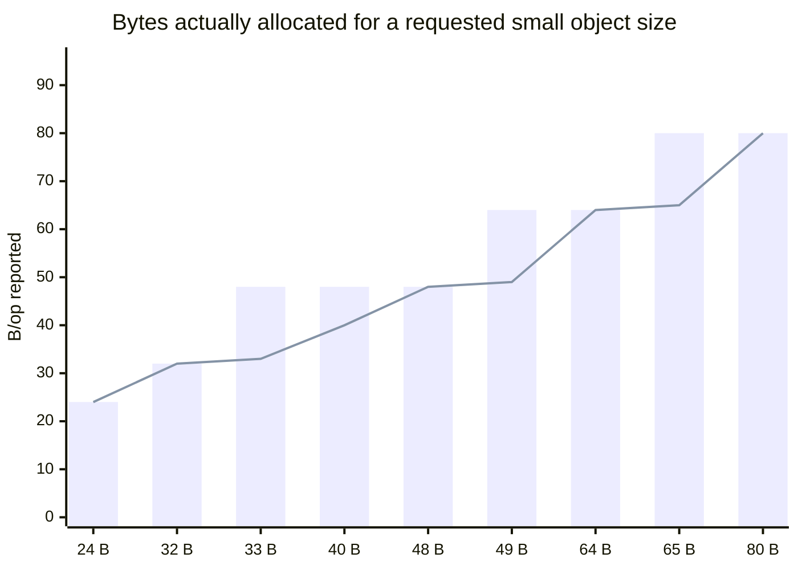

# Benchmarking Go Correctly

## 1. Concept Overview

A Go benchmark is a function `func BenchmarkX(b *testing.B)` that `go test -bench` runs repeatedly, growing the iteration count until the run lasts at least `-benchtime` (default one second), then dividing total elapsed time by iterations to report `ns/op`. With `-benchmem` it also reports `B/op` and `allocs/op`. That is the whole mechanism, and it is deceptively simple: the hard part is not running the benchmark, it is making the number mean something.

Three things stand between a `ns/op` figure and a fact about your program.

**The compiler is an adversary.** Go's optimiser is permitted to delete any computation whose result is never observed. A benchmark that calls a pure function and discards the result may be measuring an empty loop. The historic workaround was a package-level sink variable; `b.Loop` `[1.24]` made it a language-level guarantee.

**One run is an anecdote.** Run-to-run variance on a shared CI machine is routinely 5-15%, which is larger than most optimisations worth shipping. A single `go test -bench` invocation cannot distinguish a 4% improvement from thermal drift. The answer is `-count=10` and `benchstat`, which reports a p-value rather than a number.

**The benchmark's call site is not production's call site.** A value that stays on the stack in real code will escape to the heap if the benchmark assigns it to an `any` sink. The benchmark then reports an allocation production never pays, and optimising it away is optimising a fiction.

This file is the measurement discipline the Go case studies in this section cite when they quote a number. The **general statistics** of performance measurement — A/A testing, confidence intervals, sample-size selection, the mechanics of significance testing — live in [Backend: Benchmarking Methodology](../../../backend/benchmarking_methodology/benchmarking_methodology.md) and are not re-derived here. What follows is what is *specific to Go*: the compiler's optimisation behaviour, `testing.B`'s API, the allocator's size classes, the runtime's own version-to-version changes, and the tooling that ties a benchmark to a profile.

---

## 2. Intuition

**One-line analogy**: a benchmark is a scientific experiment in which the compiler is actively trying to delete your apparatus, the operating system is trying to move it to a colder core, and the garbage collector is trying to run during your third trial.

**Mental model**: `go test -bench` measures *wall-clock time divided by a count you did not choose*. Everything that can inflate the numerator (a GC cycle, a scheduler migration, a CPU frequency drop) or shrink the denominator's meaning (an optimised-away body, an inlined-differently call) is a threat to validity. Benchmarking correctly is a checklist for eliminating those threats, run in the same order every time.

**Why it matters**: performance work is the one engineering discipline where doing it badly is worse than not doing it at all. A wrong benchmark does not merely fail to help — it actively directs effort at the wrong code, ships complexity for no gain, and creates a number that everyone downstream trusts. The ingest case study in this section rejects a hand-rolled JSON scanner at 50,000 events/second and accepts it at 500,000 purely on measured ns/op; if that measurement were wrong in either direction, the conclusion inverts.

**Key insight**: the most common Go benchmarking bug is not measuring the wrong thing slowly, it is **measuring nothing quickly**. A benchmark reporting 0.31 ns/op is not fast code; it is an empty loop, and 0.31 ns is roughly one clock cycle on modern hardware. Treat any sub-nanosecond result as a bug report against your own benchmark.

---

## 3. Core Principles

**1. The result must be observed, or it does not exist.** Dead-code elimination is not a bug and cannot be disabled. Use `b.Loop` `[1.24]`, which keeps the loop body's parameters and results alive by construction.

**2. A single run is not a measurement.** `-count=10` minimum, compared with `benchstat`, and a change is real only when the p-value says so. Anything else is reading tea leaves.

**3. Measure at production's call site, not the benchmark's.** Verify with `-gcflags=-m` that the same things escape in the benchmark as escape in real code. An allocation that only exists because of the benchmark's sink is not an allocation.

**4. State the machine, the Go version, and the flags.** Go's runtime changes between releases in ways that move benchmark numbers: Green Tea GC became the default in 1.26 (10-40% less GC overhead), and size-specialized allocation in 1.27 made allocations under 80 bytes up to 30% faster. A `ns/op` without a Go version is not reproducible.

**5. Allocation size is quantised.** The allocator rounds every small object up to one of its size classes, so `B/op` moves in steps. A struct growing from 32 to 33 bytes reports 48 B/op — a 50% jump for one byte.

**6. A benchmark that builds its own input measures the builder.** Setup belongs outside the timed region. With `b.Loop`, "outside the loop" is literally outside the timed region, which is one of its quieter advantages.

**7. Microbenchmarks answer "which of these two", never "how fast is my service".** The second question needs a load test — [Backend: Load and Performance Testing](../../../backend/load_and_performance_testing/load_and_performance_testing.md) — and the two disagree often enough that the disagreement is itself information.

---

## 4. Types / Architectures / Strategies

| Strategy | The question it answers | What it cannot tell you |
|---|---|---|
| **Microbenchmark** (`b.Loop`) | Is implementation A faster than B for this input? | Whether A is faster in your service, where cache state and call sites differ |
| **Allocation benchmark** (`-benchmem`) | How many allocations and bytes per operation? | Whether those allocations survive long enough to cost a GC cycle |
| **Parallel benchmark** (`b.RunParallel`) | How does throughput scale under contention? | Per-operation latency — the reported ns/op is throughput-derived |
| **Table-driven sub-benchmarks** (`b.Run`) | How does cost vary with input size or shape? | Anything about a size you did not include |
| **Profile-attached benchmark** (`-cpuprofile`) | Where inside the operation does the time go? | Whether the profile's hot spot is worth fixing |
| **PGO A/B** (`-pgo=` with and without) | What does profile-guided optimisation buy? | Anything, if you profiled the same workload you then measured |
| **Macrobenchmark / load test** | What does the *service* do under real traffic? | Which line of code to change |

The strategies compose in a fixed order, and skipping a step is the usual cause of wasted work:

1. **Load test first** to find out whether this component matters at all. Optimising a function that is 0.4% of the service's CPU is a hobby.
2. **CPU profile** the load test to find where the time actually goes.
3. **Microbenchmark** the specific function the profile named, with realistic input.
4. **`benchstat` with `-count=10`** to decide whether the change is real.
5. **Load test again** to confirm the microbenchmark win survived contact with the service. It often does not, and finding out why is where the real understanding is.

---

## 5. Architecture Diagrams

```mermaid
flowchart LR
    classDef start  fill:#61afef,stroke:#2e86c1,color:#1a1a1a,font-weight:bold
    classDef run    fill:#98c379,stroke:#27ae60,color:#1a1a1a,font-weight:bold
    classDef stat   fill:#e5c07b,stroke:#f39c12,color:#1a1a1a
    classDef good   fill:#c678dd,stroke:#9b59b6,color:#fff,font-weight:bold
    classDef bad    fill:#e06c75,stroke:#c0392b,color:#fff,font-weight:bold
    classDef prof   fill:#56b6c2,stroke:#0097a7,color:#1a1a1a

    write(["Write the benchmark<br/>b.Loop, realistic input<br/>setup outside the loop"])
    quiet(["Quiet the machine<br/>pin cores, disable turbo<br/>nothing else running"])
    base(["Run baseline<br/>count=10, benchmem<br/>save to old.txt"])
    chg(["Apply the change"])
    newrun(["Run again<br/>identical flags<br/>save to new.txt"])
    bstat(["benchstat old.txt new.txt<br/>median, delta, p-value"])
    sig(["Is p below 0.05?"])
    ship(["Real change<br/>record machine, Go version, flags"])
    noise(["Not distinguishable<br/>from noise"])
    more(["Raise count<br/>or lengthen benchtime"])
    cprof(["go test -cpuprofile<br/>pprof to find the why"])

    write --> quiet --> base --> chg --> newrun --> bstat --> sig
    sig -->|"yes"| ship
    sig -->|"no"| noise --> more --> newrun
    ship -.-> cprof

    class write,quiet start
    class base,chg,newrun run
    class bstat,sig stat
    class ship good
    class noise bad
    class more,cprof prof
```



The loop that matters is `noise -> more -> newrun`. A result that is not significant is not a failure of the change, it is a failure of the *experiment*, and the response is more samples rather than a shrug and a merge.

### The allocator's size classes make `B/op` a step function



The bars are what `-benchmem` reports; the line is what you asked for. Adding a single `bool` field to a 32-byte struct moves it into the 48-byte class and reports a 50% increase in `B/op` with no change to your logic. Conversely, shaving a struct from 33 bytes to 32 halves nothing and yet shows a 33% `B/op` improvement. Neither is a bug, both mislead, and the fix is to read `B/op` as "which size class" rather than "how many bytes".

---

## 6. How It Works — Detailed Mechanics

### 6.1 How `go test -bench` chooses the iteration count

The framework runs the benchmark once with `b.N = 1`, measures, and estimates how many iterations would fill `-benchtime`. It then re-runs with a larger `b.N` — growing by at most 100x per step and rounding up to a readable number (1, 2, 3, 5 times a power of ten) — repeating until the measured duration reaches `-benchtime`. **Only the final run is reported.**

Two consequences that surprise people. Your benchmark function body runs many times in total, so any state it mutates outside the loop must be idempotent or re-created. And the iteration count differs between the baseline and the change, which is exactly why comparing raw `ns/op` across two runs with different `b.N` is legitimate (the division normalises it) but comparing wall-clock totals is not.

```bash
-benchtime=1s      # default: grow N until the run lasts one second
-benchtime=10s     # longer runs, less relative variance, GC amortised
-benchtime=5000x   # EXACTLY 5000 iterations, no growth loop at all
```

`-benchtime=Nx` is the right choice when you want two runs to do identical work — comparing allocation counts, or benchmarking something whose cost depends on how many times it has already run. `-benchtime=Ns` is right for everything else, because a fixed iteration count on a faster machine finishes too quickly to average out noise.

### 6.2 `b.Loop` `[1.24]`, and what it replaced

```go
// The modern form.
func BenchmarkParse(b *testing.B) {
    input := loadFixture(b)  // setup, NOT timed -- the timer starts at the
                             // first b.Loop() call and stops when it returns false
    for b.Loop() {
        Parse(input)
    }
    // teardown here is also outside the timed region
}
```

`b.Loop` does three things the `for i := 0; i < b.N; i++` form did not:

**It prevents dead-code elimination of the value under test.** The runtime keeps the loop body's function parameters and results alive, so the compiler cannot delete a call whose result is discarded. This is a guarantee, not a heuristic, and it is the single reason to prefer `b.Loop` over the index loop.

**It handles the timer.** The timer starts on the first `b.Loop()` call and stops when it returns false, so `b.ResetTimer()` after setup is unnecessary and setup cost is excluded automatically.

**It runs the body exactly the intended number of times per `-count` run**, which makes iteration accounting predictable in ways the growth loop was not.

The historic workaround it replaced was the **sink variable**:

```go
// The old pattern. You will still meet it in every existing codebase.
var sinkInt int

func BenchmarkOldStyle(b *testing.B) {
    input := loadFixture(b)
    b.ResetTimer()
    var r int
    for i := 0; i < b.N; i++ {
        r = Hash(input)   // without the assignment the compiler may delete Hash
    }
    sinkInt = r           // package-level, so the compiler cannot prove it dead
}
```

The sink works, and it carries a trap `b.Loop` does not: if the sink is `any` or an interface, assigning to it **forces a heap allocation** that the real call site does not pay. See §10.

**The inlining wrinkle, which the version tags matter for.** In Go 1.24 and 1.25, `b.Loop`'s body was not inlined. That meant a `b.Loop` benchmark of a small function measured a *non-inlined* call, while production would inline it — a systematic overestimate for exactly the tiny functions microbenchmarks are used on. **As of `[1.26]` `b.Loop` no longer prevents inlining**, so the benchmark now sees the same inlining decisions as the caller. If you are comparing a benchmark number recorded on 1.25 with one recorded on 1.26 or later, small-function benchmarks are not comparable, and that is not noise.

### 6.3 The timer API and the trap inside it

```go
b.ResetTimer()    // zero the clock and the allocation counters
b.StopTimer()     // pause
b.StartTimer()    // resume
b.ReportAllocs()  // per-benchmark equivalent of -benchmem
b.SetBytes(n)     // adds an MB/s column, for throughput-shaped work
b.ReportMetric(v, "frames/op")  // any custom unit
```

**`StopTimer` and `StartTimer` each call `runtime.ReadMemStats`, which stops the world.** That is not a figure of speech: the pair exists to keep the allocation counters accurate across the paused region, and `ReadMemStats` requires a stop-the-world to get a consistent view of the heap. Calling them once per benchmark is free. Calling them *inside the loop* performs a stop-the-world per iteration, which typically costs far more than whatever you were trying to exclude and produces a number that is mostly `ReadMemStats`.

```go
// BROKEN -- a stop-the-world on every one of a million iterations.
for i := 0; i < b.N; i++ {
    b.StopTimer()
    input := makeInput(i)
    b.StartTimer()
    Process(input)
}

// FIX -- build all the inputs up front, outside the timed region.
inputs := make([][]byte, 512)
for i := range inputs {
    inputs[i] = makeInput(i)
}
for b.Loop() {
    Process(inputs[idx%len(inputs)])
    idx++
}
```

The general rule: if you find yourself reaching for `StopTimer` inside a loop, the setup belongs outside the loop instead. Pre-generating a ring of inputs and cycling through them is almost always the right shape, and it has the side benefit of defeating the perfect branch prediction a single repeated input would give you.

### 6.4 `b.RunParallel`

```go
func BenchmarkCacheGet(b *testing.B) {
    c := newCache()
    warm(c)
    b.RunParallel(func(pb *testing.PB) {
        // PER-GOROUTINE setup goes HERE. Anything created outside the closure
        // is shared by every goroutine, which either adds contention you did
        // not intend to measure or hides contention you did.
        rng := rand.New(rand.NewPCG(1, 2))
        for pb.Next() {
            c.Get(keys[rng.IntN(len(keys))])
        }
    })
}
```

`RunParallel` starts `GOMAXPROCS` goroutines by default (`b.SetParallelism(p)` makes it `p * GOMAXPROCS`) and hands each a `*testing.PB` that draws from a shared iteration budget. Three things about it are consistently misread:

**It measures throughput, not latency.** The reported `ns/op` is total wall time divided by total iterations across all goroutines, so on 16 cores a 16 ns/op result may mean each operation takes 256 ns and sixteen happen at once. It is the right tool for "does this scale" and the wrong tool for "how long does one call take".

**`b.Loop` does not compose with it.** Inside `RunParallel` you use `pb.Next()`. There is no parallel form of `b.Loop`, so the sink discipline of §6.2 still applies inside a `RunParallel` body.

**Shared state in the closure is the point *or* the bug**, and only you know which. A shared `rand.Rand` in the closure serialises every goroutine on its mutex, and the benchmark then measures `math/rand` contention rather than your cache. Create per-goroutine state inside the closure.

### 6.5 `benchstat`: why one run means nothing

```bash
go install golang.org/x/perf/cmd/benchstat@latest

go test -run='^$' -bench=BenchmarkParse -benchmem -count=10 > old.txt
# apply the change
go test -run='^$' -bench=BenchmarkParse -benchmem -count=10 > new.txt
benchstat old.txt new.txt
```

```
goos: linux
goarch: amd64
pkg: example.com/ingest
cpu: AMD EPYC 9354 32-Core Processor
                │   old.txt   │              new.txt               │
                │   sec/op    │   sec/op     vs base               │
Parse-16          1.340µ ± 2%   0.610µ ± 1%  -54.48% (p=0.000 n=10)
ParseSmall-16     412.0n ± 3%   405.5n ± 4%        ~ (p=0.211 n=10)

                │   old.txt    │               new.txt               │
                │     B/op     │     B/op      vs base               │
Parse-16          688.0 ± 0%      96.00 ± 0%  -86.05% (p=0.000 n=10)

                │  old.txt   │              new.txt               │
                │ allocs/op  │ allocs/op   vs base                │
Parse-16          12.00 ± 0%    3.000 ± 0%  -75.00% (p=0.000 n=10)
```

Read it in this order. The **`± %`** is the run-to-run variation within each group — anything above about 5% means the machine was noisy and the comparison is weak regardless of the p-value. The **delta** is the median-to-median change. The **p-value** comes from a Mann-Whitney U test, a rank-based test that makes no normality assumption, which suits benchmark data because timing distributions are right-skewed. **`~` means benchstat could not distinguish the two groups**, which is a result, not a missing result: `ParseSmall` genuinely did not change.

`-count=10` is the working minimum. benchstat warns below six samples because the U test cannot reach p < 0.05 with fewer, no matter how large the difference. For a change you expect to be small, `-count=20` and `-benchtime=5s` is a cheap way to buy resolution.

The statistical machinery — why a rank test, what a p-value is and is not, why you should run an A/A comparison of the baseline against itself before trusting any A/B — is covered in [Backend: Benchmarking Methodology](../../../backend/benchmarking_methodology/benchmarking_methodology.md). The one Go-specific thing worth adding: **run the A/A test.** Save two baselines from the unchanged code and `benchstat` them against each other. If that comparison shows a significant difference, your machine is lying and no A/B on it will mean anything.

### 6.6 Go-specific noise sources

| Source | Effect | Control |
|---|---|---|
| **A GC cycle landing mid-run** | A single cycle inside a 1 s run can move `ns/op` by several percent | `-benchtime=10s` to amortise, or `GOGC=off` if the benchmark genuinely allocates nothing you care about |
| **`GOMAXPROCS` differences** | The `-16` suffix is `GOMAXPROCS`. A result from an 8-core laptop is not comparable to one from a 32-core server | `-cpu=1,4,16` to make the scaling explicit; never compare across suffixes |
| **Allocator size classes** | `B/op` is a step function; one byte can move it 50% (§5) | Read `B/op` as a class, not a byte count |
| **Size-specialized allocation `[1.27]`** | Allocations under 80 bytes got up to 30% faster; allocation-heavy programs ~1% overall | State the Go version. `GOEXPERIMENT=nosizespecializedmalloc` isolates it |
| **Green Tea GC `[1.26]`** | GC overhead down 10-40%; any benchmark with a live heap moved between 1.25 and 1.26 | State the Go version. `GOEXPERIMENT=nogreenteagc` isolates it |
| **Heap base randomisation `[1.26]`** | Cache and TLB alignment differs per process, adding run-to-run variance | `-count=10` absorbs it; `GOEXPERIMENT=norandomizedheapbase64` removes it for a bisect |
| **CPU frequency scaling and turbo** | The first run is fast, later runs throttle — a systematic bias favouring whichever ran first | Pin the governor to `performance`, disable turbo, alternate the run order |
| **Thermal throttling on a laptop** | A 10-minute benchmark suite on a laptop drifts monotonically slower | Do not benchmark on a laptop. If you must, interleave A and B runs |
| **Noisy neighbours in CI** | Shared runners vary 15%+ between invocations | Dedicated bare metal, or `perflock` to serialise runs on a shared box |

```bash
# The quiet-machine recipe on Linux.
sudo cpupower frequency-set -g performance
echo 1 | sudo tee /sys/devices/system/cpu/intel_pstate/no_turbo
taskset -c 4-11 go test -run='^$' -bench=. -benchmem -count=10 -benchtime=5s
```

### 6.7 Profiling a benchmark directly

```bash
go test -run='^$' -bench=BenchmarkParse -benchtime=10s \
    -cpuprofile=cpu.out -memprofile=mem.out -benchmem

# go test leaves the compiled test binary behind, which pprof needs for symbols.
go tool pprof -http=:8080 cpu.out
# [1.26] the web UI opens on the FLAME GRAPH by default; /ui/graph for the
# old node graph.

# Allocation A/B, the fastest way to see what a change did to the heap:
go tool pprof -http=:8080 -diff_base=mem_before.out mem_after.out
```

`-blockprofile` and `-mutexprofile` also work on benchmarks and are the right tools when `RunParallel` scaling is worse than linear — they answer "what is everyone waiting on", which a CPU profile cannot. `b.ArtifactDir()` `[1.26]` with the `-artifacts` flag gives each benchmark a directory to write profiles into, which makes per-sub-benchmark profiling tractable.

Details of reading the profiles themselves are in [Profiling and Tracing](../../profiling_and_tracing/profiling_and_tracing.md).

### 6.8 Measuring PGO honestly

Profile-guided optimisation `[1.21]` feeds a CPU profile back to the compiler, which uses it to drive inlining and layout decisions. `go build` picks up a file named `default.pgo` in the main package's directory automatically.

```bash
# Baseline: build and benchmark with PGO explicitly OFF.
go test -run='^$' -bench=. -count=10 -pgo=off > nopgo.txt

# With the profile.
go test -run='^$' -bench=. -count=10 -pgo=./default.pgo > pgo.txt

benchstat nopgo.txt pgo.txt
```

**The trap is measuring on the workload you profiled.** If `default.pgo` was collected by running the same benchmark you now compare, the compiler has been trained on the test. The result is an upper bound on what PGO can do, not a forecast of what it will do — and the gap can be large, because a benchmark exercises a far narrower set of call paths than production.

The honest procedure: **collect the profile from production traffic** (`/debug/pprof/profile?seconds=60` on a real node, merged across several), and **measure on a held-out workload** — a different benchmark, a different traffic replay, or a load test rather than a microbenchmark. The Go project reports typical PGO improvements in the low single digits of percent for most programs, which is worth having and is also small enough that a contaminated measurement can easily manufacture a much more exciting number.

---

## 7. Real-World Examples

**The Go project's own performance dashboard** (`perf.golang.org`, driven by `golang.org/x/benchmarks`) is the reference implementation of this discipline. It runs a fixed suite on dedicated hardware, stores every result with its full machine and toolchain provenance, and uses `benchstat`'s statistics to flag regressions. The reason it exists on dedicated hardware rather than shared CI is precisely §6.6: the Go team measured that shared runners cannot resolve the size of regression they need to catch.

**`benchstat` itself** was rewritten in 2022 to report medians with a variation percentage and a Mann-Whitney p-value, replacing an older mean-and-delta format. The change is instructive: the older format made it too easy to read a delta as meaningful, and the redesign made the *uncertainty* the most prominent thing on the screen.

**`b.Loop` `[1.24]`** exists because the sink-variable pattern was a footgun the standard library could not fix from the outside. Read the Go 1.24 release notes and the 1.26 note that it no longer prevents inlining together: the feature shipped, was found to have a measurable side effect on exactly the benchmarks it was meant to serve, and was fixed two releases later. That is the shape of every good benchmarking tool's history.

**`etcd` and `Kubernetes`** both maintain benchmark suites in-tree, and both have public issues where a "clear" microbenchmark win failed to reproduce in a cluster-level load test. Those threads are worth reading for the failure mode in §4: a function that is 30% faster and 0.4% of total CPU is a 0.12% improvement.

**Library README benchmark tables** are the most-consumed and least-trustworthy benchmarks in the ecosystem. Almost none state the Go version, few state the machine, most report a single run, and several benchmark a competitor's library through an adapter that adds an allocation. Treat any comparison table without `-count` and `benchstat` output as marketing, and re-run it yourself against your own input shape before believing it.

**VictoriaMetrics** publishes microbenchmarks alongside its zero-allocation parsing code, and its commit history shows the pattern §4 recommends: a profile from production identifies the function, a microbenchmark drives the change, and a load test confirms it. The hand-rolled scanner in [Design a High-Throughput Ingest Service](../design_a_high_throughput_ingest_service.md) is justified by exactly this chain.

---

## 8. Tradeoffs

### `b.Loop` versus the `b.N` index loop

| | `for b.Loop()` `[1.24]` | `for i := 0; i < b.N; i++` |
|---|---|---|
| Dead-code elimination | Prevented by the runtime | Needs a sink or `runtime.KeepAlive` |
| Timer handling | Automatic; setup outside the loop is excluded | Needs `b.ResetTimer()` |
| Inlining of the body | Matches production `[1.26]`; suppressed in 1.24-1.25 | Always matches production |
| Access to the index `i` | Not available; keep a counter yourself | Available |
| Works inside `RunParallel` | No | Not applicable — use `pb.Next()` |
| Verdict | **Default for everything** | When you need the index, or on a pre-1.24 toolchain |

### `-benchtime` in duration versus iterations

| | `-benchtime=10s` | `-benchtime=5000x` |
|---|---|---|
| Work done per run | Varies with machine speed | Identical everywhere |
| GC cycles absorbed | Many; amortised | Whatever falls in 5000 iterations |
| Comparable across machines | `ns/op` yes, totals no | Totals yes |
| Right for | Almost everything | Allocation counting, stateful benchmarks, bisecting |

### Microbenchmark versus load test

| | Microbenchmark | Load test |
|---|---|---|
| Answers | Which implementation is faster | What the service does |
| Cache state | Hot, unrealistically | Realistic |
| Branch prediction | Near-perfect on repeated input | Realistic |
| Contention, GC pressure, scheduler | Absent unless you build it in | Present |
| Feedback loop | Seconds | Minutes to hours |
| Failure mode | A win that does not reproduce | Cannot tell you which line to change |

The two disagree often, and the disagreement is the interesting part. A microbenchmark win that vanishes under load usually means the function was never on the critical path, or the win was in a cache-resident case the service never hits.

### `benchstat` versus reading the numbers

| | `-count=1`, eyeball it | `-count=10` plus `benchstat` |
|---|---|---|
| Time cost | 1 second | 20 seconds |
| Smallest detectable change | ~20%, optimistically | ~2% on a quiet machine |
| Tells you it is inconclusive | Never | Explicitly, with `~` |
| Verdict | Fine for a 10x change | **Required for anything you will ship** |

---

## 9. When to Use / When NOT to Use

**Benchmark when:**

- A profile from a load test has named a specific function, and you have two candidate implementations.
- You are changing a data structure or an algorithm on a path you have measured to be hot.
- You are choosing a dependency and the choice hinges on per-operation cost with *your* input shape.
- You are guarding a hot path against regression in CI — see [Backend: Performance Regression Detection](../../../backend/performance_regression_detection/performance_regression_detection.md).
- You need to price a tradeoff for a design document, as the case studies in this section do.

**Do not benchmark when:**

- You have not profiled. You are guessing which function matters, and the base rate for guessing right is poor.
- The function is not on the hot path. A 30% win on 0.4% of CPU is 0.12%.
- The question is about the *service*: throughput, tail latency under load, capacity. That is a load test.
- You need to compare against a different language or runtime. Cross-language microbenchmarks measure the benchmark author's fluency in whichever language they know less well.
- The change is obviously correct and obviously cheap. Do not spend twenty minutes proving that removing an allocation from a loop is good.
- You cannot get a quiet machine. A benchmark on a noisy shared runner produces a number that looks authoritative and is not, which is worse than having no number.

---

## 10. Common Pitfalls

**Measuring an empty loop.** The classic:

```go
// BROKEN -- Sum is pure, its result is unused, the compiler deletes it.
func BenchmarkSum(b *testing.B) {
    for i := 0; i < b.N; i++ {
        Sum(data)
    }
}
// reports: BenchmarkSum-16   1000000000   0.31 ns/op
```

0.31 ns/op is roughly one clock cycle. **Any sub-nanosecond result is a bug report against your benchmark**, and it is the easiest one to catch because the number is absurd. The fix is `for b.Loop() { Sum(data) }`.

**The sink that allocates.** The subtler version of the same problem, and it does not produce an absurd number:

```go
// BROKEN -- assigning to an `any` sink forces Parse's result onto the heap.
var sink any

func BenchmarkParse(b *testing.B) {
    for i := 0; i < b.N; i++ {
        sink = Parse(input)   // 1 alloc/op that production never pays
    }
}
```

Production calls `Parse` and uses the result locally, where escape analysis keeps it on the stack. The benchmark reports an allocation, someone spends a day removing it, and the service does not change. Confirm with `go test -bench=Parse -gcflags=-m 2>&1 | grep escapes` and compare against the same output for the real call site — details in [Escape Analysis and Performance](../../escape_analysis_and_performance/escape_analysis_and_performance.md). `b.Loop` avoids this entirely: it keeps results alive without forcing them to the heap.

**`StopTimer` inside the loop.** Covered in §6.3. Each call is a stop-the-world `runtime.ReadMemStats`. A benchmark structured this way was measured at 340 ns/op where the function itself took 12 ns; the other 328 ns was the timer API. It looks like careful methodology and it is the opposite.

**A single run treated as a result.** A 6% improvement from one `go test -bench` on a laptop is indistinguishable from the laptop having warmed up. The A/A test in §6.5 is the cheap way to find out how much your machine lies before you trust it about anything.

**Comparing across Go versions without saying so.** A benchmark recorded on 1.25 and compared to one on 1.27 is comparing three changes at once: your code, Green Tea GC `[1.26]`, and size-specialized allocation `[1.27]`. For a small-allocation-heavy benchmark, the toolchain difference alone can be double-digit percent.

**Benchmarking with an unrealistically hot cache.** A benchmark that hammers the same 4 KiB of input has every line in L1 and a perfectly predicted branch on every iteration. Production touches cold data. The result is systematically optimistic for anything memory-bound, and the standard mitigation — cycling through a ring of a few hundred distinct inputs — costs three lines.

**`b.N` used as a data size.** `make([]int, b.N)` inside the benchmark makes the *work per iteration* grow with the iteration count, so `ns/op` is meaningless and usually increases as the framework grows `b.N`. If the input size is the variable, use `b.Run` sub-benchmarks with explicit sizes.

**Per-goroutine state created outside `RunParallel`'s closure.** A shared `*rand.Rand` serialises every goroutine on its internal mutex, and the benchmark measures `math/rand` contention. The symptom is a `RunParallel` result that gets *worse* with more cores for code that has no shared state.

**PGO measured on its own training data.** §6.8. The number is real and it does not generalise, which is the most dangerous combination a benchmark can produce.

**Publishing a number without provenance.** `go test` prints `goos`, `goarch`, `pkg` and `cpu` for free. It does not print the Go version, the flags, whether turbo was disabled, or what else was running. All four belong next to any number anyone else will act on.

---

## 11. Technologies & Tools

| Tool | What it is for |
|---|---|
| `go test -bench` | The benchmark runner; `-benchmem`, `-count`, `-benchtime`, `-cpu` are the flags that matter |
| `testing.B` | `b.Loop` `[1.24]`, `ReportAllocs`, `ResetTimer`, `RunParallel`, `SetBytes`, `ReportMetric` |
| `benchstat` (`golang.org/x/perf`) | Median, variation, delta and Mann-Whitney p-value across `-count` runs. Non-optional |
| `perflock` (`golang.org/x/perf`) | Serialises benchmark runs on a shared machine so two do not overlap |
| `go tool pprof` | CPU, heap, block, mutex profiles from `-cpuprofile` and friends; `-diff_base` for A/B |
| `go tool trace` | Scheduling and GC-assist timelines when a benchmark's variance has no obvious cause |
| `-gcflags=-m` | Escape analysis output — proves the benchmark's call site matches production's |
| `-gcflags=-S` | Assembly output, for confirming a loop was not eliminated |
| `benchcmp` | Predecessor of `benchstat`; you will meet it in old scripts. `benchstat` supersedes it |
| `cpupower` / `intel_pstate` | Governor and turbo control — the quiet-machine recipe in §6.6 |
| `taskset` | CPU pinning so the scheduler cannot migrate the benchmark mid-run |
| `-pgo=off` / `-pgo=<file>` | The two sides of an honest PGO A/B |
| `GOEXPERIMENT` toggles | `nogreenteagc` `[1.26]`, `nosizespecializedmalloc` `[1.27]`, `norandomizedheapbase64` `[1.26]` — for isolating a runtime change from your own |
| `b.ArtifactDir()` `[1.26]` | Per-benchmark output directory, with the `-artifacts` flag |
| `go test -json` | Machine-readable results for a CI regression gate |

---

## 12. Interview Questions with Answers

**Q: Your benchmark reports 0.31 ns/op. What happened?**

The compiler deleted the loop body. 0.31 nanoseconds is roughly one clock cycle on modern hardware, which no function call can achieve, so the number is a bug report against the benchmark rather than a result. Go's optimiser is allowed to eliminate any computation whose result is never observed, and a benchmark that calls a pure function and discards the return value gives it permission. The historic fix was assigning the result to a package-level sink variable so the compiler could not prove it dead. The modern fix is `for b.Loop()` `[1.24]`, which keeps the loop body's parameters and results alive by construction — it is a runtime guarantee rather than a trick, and it has no sink-related side effects.

**Q: What does `b.Loop` do that the `b.N` index loop did not, and what changed about it in 1.26?**

Three things. It prevents dead-code elimination of the value under test, which previously required a sink variable. It manages the timer, starting on the first call and stopping when it returns false, so setup before the loop and teardown after it are excluded without `b.ResetTimer`. And it makes the iteration count per `-count` run predictable. The 1.26 change is that `b.Loop` no longer prevents inlining. In 1.24 and 1.25 the loop body was not inlined, so a benchmark of a small function measured a non-inlined call that production would have inlined — a systematic overestimate on exactly the tiny functions microbenchmarks target. The practical consequence is that small-function benchmark numbers from 1.25 are not comparable with numbers from 1.26 or later, and that is a real difference rather than noise.

**Q: Why is a single benchmark run meaningless, and what do you do instead?**

Run-to-run variance on ordinary hardware is routinely 5-15%, which is larger than most changes worth shipping, so a single run cannot distinguish a genuine 4% improvement from the CPU having warmed up. Run with `-count=10` on both sides and compare with `benchstat`, which reports the median for each group, a `± %` variation, the delta, and a p-value from a Mann-Whitney U test — a rank-based test, chosen because benchmark timing distributions are right-skewed and not normal. When benchstat prints `~` it means it could not distinguish the two groups, and that is a result rather than a missing one. Ten is the working minimum because the U test cannot reach p below 0.05 with fewer than about six samples regardless of effect size. Before trusting any A/B, run an A/A: save two baselines from unchanged code and compare them. If that shows a significant difference, the machine is lying and nothing measured on it means anything.

**Q: Explain why `b.StopTimer` inside a loop is a serious mistake.**

Because `StopTimer` and `StartTimer` each call `runtime.ReadMemStats`, which stops the world. They do that so the allocation counters stay accurate across the paused region, which is correct behaviour and is free when called once per benchmark. Called once per iteration, it performs a stop-the-world per iteration, and the measurement becomes mostly `ReadMemStats` — one case measured 340 ns/op for a function that takes 12 ns. The shape it looks like careful methodology and is not. The fix is structural: whatever you wanted to exclude belongs outside the loop. Pre-generate a ring of a few hundred inputs before the loop and cycle through them, which also defeats the perfect branch prediction a single repeated input would otherwise give you.

**Q: Your benchmark shows one allocation per operation and the production call site shows zero. How is that possible?**

The benchmark's sink forced a heap escape that production does not. Assigning a result to a package-level `any` or interface variable boxes it, and boxing requires the value to be heap-allocated; at the real call site the value is used locally and escape analysis keeps it on the stack. The benchmark therefore reports an allocation nobody pays, and removing it is optimising a fiction. Confirm with `go test -bench=X -gcflags=-m` and compare the escape decisions against the same output for the real caller. `b.Loop` avoids this class of bug entirely, because it keeps results alive through the runtime without requiring them to be observable through an interface.

**Q: Why does `B/op` sometimes jump 50% for a one-byte change?**

Because Go's small-object allocator rounds every allocation up to one of its size classes — 8, 16, 24, 32, 48, 64, 80, 96 and so on. A struct at exactly 32 bytes fits the 32-byte class. Adding a single `bool` takes it to 33 bytes, which rounds to the 48-byte class, and `-benchmem` reports 48 B/op: a 50% increase for one byte of data. This cuts both ways — shaving a struct from 33 to 32 bytes shows a 33% `B/op` improvement while removing one byte. The practical reading is to treat `B/op` as "which size class" rather than "how many bytes", and when you are field-packing a hot struct, aim for a class boundary rather than for the smallest possible size.

**Q: What Go-runtime changes have moved benchmark numbers recently, and why does that matter for a published result?**

Three in the last two releases. Green Tea GC became the default in 1.26 and reduces GC overhead by 10-40%, so any benchmark with a live heap changed. Size-specialized allocation arrived in 1.27 and makes allocations under 80 bytes up to 30% faster, about 1% overall in allocation-heavy programs, so any small-allocation benchmark changed. And `b.Loop`'s inlining behaviour changed in 1.26, so small-function benchmarks changed. A published `ns/op` without a Go version is therefore not reproducible, and comparing a number from 1.25 against one from 1.27 conflates three effects with whatever you actually did. When you need to isolate a runtime change from your own, the `GOEXPERIMENT` toggles — `nogreenteagc`, `nosizespecializedmalloc`, `norandomizedheapbase64` — let you turn each off for a bisect.

**Q: How do you measure what PGO buys, and what is the trap?**

Build and benchmark twice, once with `-pgo=off` and once with `-pgo=./default.pgo`, at `-count=10` each, and compare with `benchstat`. The trap is collecting the profile by running the same benchmark you then measure. That trains the compiler on the test: inlining and layout decisions are tuned for exactly the call paths the benchmark exercises, and the result is an upper bound rather than a forecast. The honest procedure is to collect the profile from production traffic, merged across several nodes, and measure on a held-out workload — a different benchmark, a traffic replay, or a load test. It matters because the real effect is in the low single digits of percent for most programs, which is worth having and is also small enough that a contaminated measurement can easily manufacture a much more impressive number.

**Q: What does `b.RunParallel` actually measure, and what are its pitfalls?**

It measures aggregate throughput under contention. It starts `GOMAXPROCS` goroutines by default and hands each a `*testing.PB` drawing from a shared iteration budget, and the reported `ns/op` is total wall time divided by total iterations across all goroutines — so on 16 cores a 16 ns/op result may mean each operation takes 256 ns with sixteen in flight. It is the right tool for "does this scale" and the wrong one for "how long does one call take". Three pitfalls. Per-goroutine state must be created inside the closure; a shared `*rand.Rand` serialises every goroutine on its mutex and the benchmark measures `math/rand` contention. `b.Loop` does not compose with it, so the sink discipline still applies inside the body. And when scaling is worse than linear, a CPU profile will not explain it — reach for `-blockprofile` or `-mutexprofile`, which answer "what is everyone waiting on".

**Q: When is `-benchtime=5000x` the right choice over `-benchtime=10s`?**

When you need both sides to do identical work rather than take identical time. Allocation counting is the clearest case: with a duration, a faster machine runs more iterations and the totals are not comparable, while `B/op` and `allocs/op` are per-iteration and stay meaningful either way. It also matters for a benchmark whose cost depends on how many times it has already run — anything that warms a cache, grows a pool, or amortises a resize — because a variable iteration count makes the amortisation different between runs. And it is useful when bisecting, since a fixed count removes one source of difference between two runs. For everything else, use a duration, because a fixed iteration count on a fast machine finishes too quickly to average out noise.

**Q: A microbenchmark shows a 40% improvement and the service does not get faster. What are the explanations?**

Four, roughly in order of likelihood. The function was not on the hot path: 40% of 0.4% of CPU is 0.16%, which no load test can resolve. The benchmark ran with a hot cache and perfect branch prediction on a single repeated input, and production touches cold, varied data, so the win existed only in a regime the service never enters. The service is not CPU-bound at all — it is waiting on I/O, on a lock, or on GC assist — and making a CPU path faster does not move a queueing bottleneck. Or the benchmark's call site differs from production's: something escaped in the benchmark that does not escape in real code, or the inlining decisions differ. The diagnosis order is to check the profile share first, because it is the cheapest and it is usually the answer.

**Q: How do you set up a machine to produce trustworthy benchmark numbers?**

Pin the CPU governor to `performance` and disable turbo, because otherwise the first run is fast and later runs throttle — a systematic bias that favours whichever variant you ran first. Pin the process to specific cores with `taskset` so the scheduler cannot migrate it mid-run. Make sure nothing else is running, and on a shared machine use `perflock` to serialise benchmark invocations. Do not use a laptop: thermal throttling makes a ten-minute suite drift monotonically slower, which is indistinguishable from a real regression. Then validate the setup with an A/A test — two baselines from identical code, compared with benchstat — and only trust the box if that comparison comes back as `~`. Finally, record what you did: `go test` prints goos, goarch, pkg and cpu for free, but the Go version, the flags, and the turbo setting are on you.

**Q: What belongs next to a benchmark number you publish?**

The `go test` header gives you goos, goarch, package and CPU model for free. Add the Go version, because Green Tea GC in 1.26 and size-specialized allocation in 1.27 both move numbers materially. Add the exact flags, particularly `-count` and `-benchtime`, so the reader knows whether this is one run or ten. Add whether frequency scaling and turbo were disabled and whether the machine was otherwise idle. And add the `benchstat` output rather than the bare `ns/op`, because the `± %` and the p-value are the part that tells the reader whether to believe you. A comparison table with none of this — which is most library README benchmark tables — should be re-run against your own input shape before you act on it.

**Q: Walk me through the order you would do performance work in.**

Load test first, to establish that this component matters and to get a realistic profile. CPU-profile the load test to find where the time actually goes, because guessing which function is hot has a poor base rate. Microbenchmark the specific function the profile named, with realistic input and `b.Loop`. Use `-count=10` and benchstat to decide whether the change is real. Then load test again to confirm the win survives contact with the service. That last step is the one people skip and it is the one that most often changes the answer — a microbenchmark win that vanishes under load usually means the function was never on the critical path, or the win only existed with a hot cache. The disagreement between the microbenchmark and the load test is information, not an annoyance.

**Q: How would you gate a hot path against performance regressions in CI?**

Store a baseline of `-count=10` results per benchmark, produced on dedicated hardware rather than a shared runner — this is the reason the Go project's own performance dashboard runs on dedicated machines. On each change, run the same benchmarks with identical flags and the same Go version, and compare with benchstat. Fail only on a statistically significant regression above a threshold you have calibrated from the noise floor, which you find by running A/A comparisons of the baseline against itself. Two mistakes to avoid: gating on a raw `ns/op` threshold, which produces a flaky check that everyone learns to re-run until it passes; and running the gate on shared CI, where 15% variance means the threshold has to be so loose it catches nothing. The general design of a regression gate — thresholds, flake budgets, what to do on a legitimate regression — is in [Backend: Performance Regression Detection](../../../backend/performance_regression_detection/performance_regression_detection.md).

**Q: Your `RunParallel` benchmark gets slower as you add cores, and the code has no shared state. What is wrong?**

The benchmark has shared state even though the code does not. The most common cause is per-goroutine state created outside the `RunParallel` closure — a `*rand.Rand`, a buffer, a client — which every goroutine then contends on. A shared `*rand.Rand` serialises on its internal mutex, so the benchmark measures `math/rand` contention and reports it as your code failing to scale. Move the creation inside the closure so each goroutine gets its own. If that does not fix it, the next suspects are false sharing (two goroutines writing to fields in the same cache line, which is invisible in a CPU profile because it looks like ordinary memory access) and the atomic counter behind `pb.Next()` becoming the bottleneck for an operation that is only a few nanoseconds long. `-blockprofile` and `-mutexprofile` distinguish the first case; the second is diagnosed by the operation being implausibly cheap.

**Q: Is there a case where you should benchmark with `GOGC=off`?**

Yes, narrowly: when you want to isolate a pure-CPU change from GC timing noise, and you have confirmed the code under test does not allocate meaningfully. A single GC cycle landing inside a one-second run can move `ns/op` by several percent, and with `-count=10` that appears as inflated variance rather than a clean signal. Turning the collector off removes it. The caveat is that you have then changed what you are measuring: if the change under test *reduces allocations*, `GOGC=off` hides the very benefit you are trying to demonstrate, because the saved GC work never happens in either arm. The safer default is `-benchtime=10s`, which amortises GC cycles across the run rather than removing them, and reporting `allocs/op` alongside `ns/op` so the allocation effect is visible in its own column.

---

## 13. Best Practices

- **Use `for b.Loop()`** for every new benchmark. It removes the sink, removes `ResetTimer`, and removes the whole dead-code-elimination class of bug.
- **`-count=10` and `benchstat`, always.** A number without a p-value is not a measurement, and the extra nineteen seconds is the cheapest quality gate in engineering.
- **Run the A/A test before trusting the machine.** Two baselines from identical code should compare as `~`. If they do not, fix the machine before measuring anything.
- **Set up realistic input outside the loop**, cycling through a ring of a few hundred distinct values rather than one repeated input, so branch prediction and cache residency are not doing your work for you.
- **Never call `StopTimer` inside a loop.** Restructure so the setup is outside it.
- **Check escape analysis with `-gcflags=-m`** and confirm the benchmark's call site allocates the same things production's does.
- **Read `B/op` as a size class**, and when packing a hot struct, aim at a class boundary rather than at the smallest byte count.
- **State the Go version, machine, and flags** with every published number. Three separate runtime changes across 1.26 and 1.27 move benchmark results.
- **Profile the benchmark with `-cpuprofile`** rather than guessing why one implementation is faster — the reason is often not the one you would name.
- **Measure PGO on a held-out workload**, never on the traffic you profiled.
- **Load test before and after the microbenchmark.** Before, to establish the function matters; after, to confirm the win is real at the service level.
- **Do not benchmark on a laptop**, and do not gate CI on a shared runner's benchmark numbers.

---

## 14. Case Study: taking an ingest decode path from 47 allocations to zero

This is the measurement half of §4.1 of [Design a High-Throughput Ingest Service](../design_a_high_throughput_ingest_service.md). The service must absorb 500,000 events/second in one Go process; the decode of a single 380-byte JSON event is the hot path, and the question is which of four implementations to ship.

### Step 0: establish that this matters

A load test at 500,000 events/second, CPU-profiled for 30 seconds, showed 22% of process CPU in `runtime.mallocgc` and a further 19% inside `encoding/json`. That is 41% of the machine in one code path — the threshold for "worth a week" comfortably cleared, and the reason to write a microbenchmark at all.

### Step 1: a benchmark that measures the right thing

```go
package ingest

import (
    "testing"
)

// A ring of 512 distinct real events, loaded once. One repeated event would
// give perfect branch prediction and an L1-resident input, neither of which
// the service enjoys.
var corpus = loadCorpus("testdata/events_512.ndjson")

func BenchmarkDecode(b *testing.B) {
    for _, impl := range []struct {
        name string
        fn   func(*decoder, []byte) (event, error)
    }{
        {"map_any", (*decoder).decodeMapAny},
        {"typed_encjson", (*decoder).decodeTypedV1},
        {"jsonv2_reused", (*decoder).decodeV2Reused},
        {"scanner_unsafe", (*decoder).decodeScanner},
    } {
        b.Run(impl.name, func(b *testing.B) {
            d := newDecoder()
            b.ReportAllocs()
            i := 0
            for b.Loop() {
                // b.Loop keeps the arguments and results alive, so no sink is
                // needed and -- crucially -- no interface boxing is introduced.
                // A `var sink any` here would force the returned event onto
                // the heap and manufacture an allocation the service never pays.
                _, _ = impl.fn(d, corpus[i&511])
                i++
            }
        })
    }
}
```

Two decisions in that code carry most of the value. The corpus ring makes the input realistic. And using `b.Loop` rather than a sink is what keeps `allocs/op` honest — an earlier version assigned the returned `event` to a package-level `any` and reported `scanner_unsafe` at 1 alloc/op, which sent someone looking for an allocation that only the benchmark had.

### Step 2: measure on a quiet machine

```bash
sudo cpupower frequency-set -g performance
echo 1 | sudo tee /sys/devices/system/cpu/intel_pstate/no_turbo

# A/A first: is this box trustworthy?
taskset -c 4-19 go test -run='^$' -bench=BenchmarkDecode -benchmem \
    -count=10 -benchtime=3s > a1.txt
taskset -c 4-19 go test -run='^$' -bench=BenchmarkDecode -benchmem \
    -count=10 -benchtime=3s > a2.txt
benchstat a1.txt a2.txt     # every row must read ~
```

The A/A came back `~` on every row with `± 1-2%` variation, which is the licence to believe the A/B. On the first attempt it did not: `± 9%` and two rows showing a "significant" 4% difference between identical code. The cause was a `containerd` snapshotter GC running on the same box. Finding that cost twenty minutes and saved a wrong conclusion.

### Step 3: the comparison

```
goos: linux
goarch: amd64
pkg: example.com/ingest
cpu: AMD EPYC 9354 32-Core Processor
go: 1.27.1

                          │   sec/op    │
Decode/map_any-16           4.180µ ± 2%
Decode/typed_encjson-16     1.340µ ± 1%
Decode/jsonv2_reused-16     610.2n ± 1%
Decode/scanner_unsafe-16    188.4n ± 2%

                          │    B/op     │
Decode/map_any-16           2.648Ki ± 0%
Decode/typed_encjson-16     688.0  ± 0%
Decode/jsonv2_reused-16     96.00  ± 0%
Decode/scanner_unsafe-16    0.000  ± 0%

                          │ allocs/op  │
Decode/map_any-16           47.00 ± 0%
Decode/typed_encjson-16     12.00 ± 0%
Decode/jsonv2_reused-16     3.000 ± 0%
Decode/scanner_unsafe-16    0.000 ± 0%
```

### Step 4: convert `ns/op` into a decision

A benchmark table is not a decision. The decision needs the rate:

```
At 500,000 events/second, core-seconds per second of decode:

  map_any         500,000 x 4,180 ns = 2.090   (13.1% of a 16-vCPU box)
  typed_encjson   500,000 x 1,340 ns = 0.670   ( 4.2%)
  jsonv2_reused   500,000 x   610 ns = 0.305   ( 1.9%)
  scanner_unsafe  500,000 x   188 ns = 0.094   ( 0.6%)

The scanner saves 0.211 core-seconds/second over encoding/json/v2 --
one eighth of a vCPU, permanently -- in exchange for ~240 lines of pointer
arithmetic carrying a lifetime hazard no Go tool can detect.

At 50,000 events/second the same choice saves 0.021 core-seconds/second.
```

That is the whole argument of §5 of the ingest case study, and it could not have been made without the `ns/op` figures. It also identifies the crossover: the hand-rolled scanner is defensible at half a million events per second and is not at fifty thousand, and stating the crossover is more useful than naming a winner.

### Step 5: confirm at the service level

The microbenchmark predicted a 12.5-percentage-point CPU reduction from `map_any` to `scanner_unsafe`. The load test delivered 19 points, because the microbenchmark could not see the second-order effect: 23.5 million allocations per second were also driving 3.4 GC cycles per second and taxing the decode goroutines with mark assist. Removing the allocations removed the assist as well.

**The load test found more than the benchmark predicted, and the direction of that surprise is the normal one for allocation work.** A microbenchmark prices the allocation; it cannot price the collection, the assist, or the cache pollution. That is the standing reason §4 puts the load test on both ends of the loop rather than only at the start.
