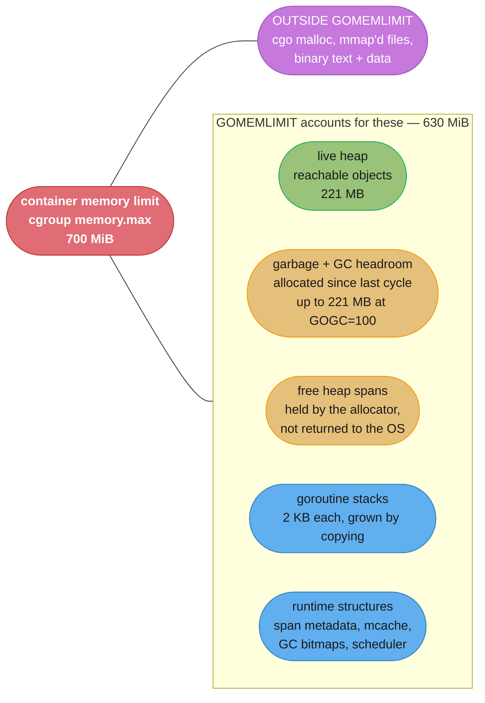
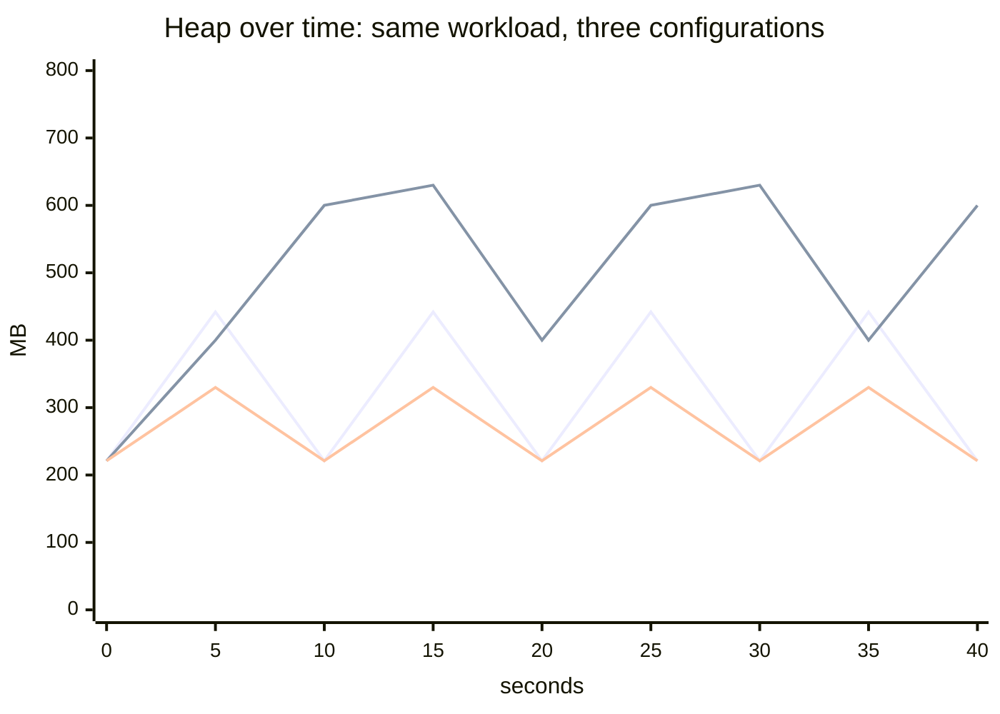
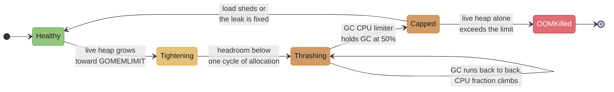

# GC and Memory Budgets

> Cross-cutting reference for the Go case studies. This file is the **budget arithmetic** — how to pick a container limit, a `GOMEMLIMIT`, and a `GOGC` for a service whose live heap you have measured. For how the collector itself works — tricolour marking, the write barrier, the pacer, sub-millisecond stop-the-world — read [the_runtime_and_garbage_collector](../../the_runtime_and_garbage_collector/the_runtime_and_garbage_collector.md) first. Everything here assumes you already know that.

---

## 1. Concept Overview

Every Go service running in a container is sized by somebody who picked a number. Most of the time that number came from watching a heap profile, adding some slack, and rounding up. Then the pod gets `OOMKilled` at 3am, the number gets doubled, and nobody learns anything.

The number is derivable. A Go process's resident set is the sum of five things — live heap, heap that the allocator is holding but not using, goroutine stacks, the runtime's own bookkeeping, and any memory that bypasses the Go heap entirely — and the garbage collector's headroom is governed by two knobs with completely different semantics:

- **`GOGC`** (default 100) is a *ratio*. It says: let the heap grow to `(1 + GOGC/100)` times the live heap before collecting again. It scales with your workload, which is what you want, and it has no idea a container limit exists, which is what kills you.
- **`GOMEMLIMIT`** `[1.19]` is a *soft ceiling in bytes*. It says: do whatever it takes — including running the collector continuously — to keep total Go-managed memory under this. It knows about the limit and nothing about your workload.

Used together they are complementary, and the recommended production configuration is exactly that: `GOMEMLIMIT` at roughly 90% of the container's memory limit, `GOGC` left at 100. `GOGC` governs the common case and keeps GC cheap; `GOMEMLIMIT` catches the tail — a traffic spike, an unexpectedly large request, a slow leak — and trades CPU for survival instead of dying.

The failure this prevents is specific and common: a heap profile says 400 MB, the container gets 512 MiB, and at `GOGC=100` the process legitimately tries to reach 800 MB before collecting. Exit 137. The heap profile was not wrong. It was answering a different question than the one that mattered.

---

## 2. Intuition

**One-line analogy.** `GOGC` is "clean the kitchen when it is twice as dirty as it was after the last clean." `GOMEMLIMIT` is "the kitchen is this big; if you are about to run out of counter space, stop cooking and clean now, however often that has to happen."

**Mental model.** Draw the heap as a sawtooth. The bottom of each tooth is the **live heap** — what your program actually needs at that instant. The top is the **GC target**, which at `GOGC=100` sits at twice the live heap. Your RSS is the top of the sawtooth, plus everything outside the heap, plus whatever the allocator has not handed back to the OS yet. Sizing a container from the bottom of the sawtooth is the classic bug; sizing it from the top, with the non-heap terms added, is the correct procedure.

**Why it matters.** Memory is the one resource where being 20% wrong is not 20% slower — it is `SIGKILL`. The Linux OOM killer does not negotiate, does not run your deferred functions, does not flush your logs, and does not appear in your error rate until the restart shows up as connection resets. And the cost of getting it wrong in the *other* direction is a fleet of pods requesting 4 GiB and using 600 MB, which is invisible and expensive forever.

**Key insight.** `GOGC` sets peak heap as a *multiple of live heap*, so a service whose live heap doubles under load has its peak heap double too — the very moment you have least slack. `GOMEMLIMIT` converts that multiplicative behaviour into a hard-ish additive one. The whole discipline is: measure live heap honestly at peak, then decide how much of the remaining space you are buying GC headroom with and how much you are keeping as spike insurance.

---

## 3. Core Principles

1. **Live heap is the input. Everything else is derived.** Measure it at peak, under real traffic. A number from startup or from a synthetic benchmark is not it.
2. **RSS is not heap.** Goroutine stacks, runtime metadata, mmap'd files, and cgo allocations are all outside the Go heap and all inside the OOM killer's accounting.
3. **`GOGC` is a ratio, `GOMEMLIMIT` is a ceiling.** They answer different questions and belong together.
4. **`GOMEMLIMIT` is soft.** The runtime will burn arbitrary CPU to respect it, and will still be exceeded rather than fail an allocation. It prevents the *common* OOM, not every OOM.
5. **The runtime does not read your cgroup.** `GOMAXPROCS` became container-aware `[1.25]`; memory did not. If you do not set `GOMEMLIMIT`, Go believes it owns the machine.
6. **Headroom is a decision, not a leftover.** Write down how much of the limit is GC headroom and how much is spike insurance, and check it against your actual traffic variance.
7. **GC CPU is observable and bounded.** The runtime's GC CPU limiter caps the collector at 50% of `GOMAXPROCS`. A service sitting near that cap is in a death spiral, and that is a measurable, alertable condition.

---

## 4. Types / Architectures / Strategies

Four configurations, and the honest case for each.

| Strategy | Config | Peak heap | When it is right |
|---|---|---|---|
| **Default** | nothing set | 2 x live | Local development, batch jobs with generous memory, anything not in a container. The moment there is a memory limit, this is a latent OOM. |
| **Recommended** | `GOMEMLIMIT` = 90% of container limit, `GOGC=100` | min(2 x live, limit) | Almost every long-running service. `GOGC` governs the normal case; `GOMEMLIMIT` catches the tail. |
| **Latency-tuned** | `GOMEMLIMIT` = 90%, `GOGC=200`–`400` | min(3–5 x live, limit) | Services with a small live heap and a very high allocation rate, where GC cycles are the CPU cost. You are spending memory to buy CPU. |
| **Hard-capped** | `GOGC=off`, `GOMEMLIMIT` = 90% | grows to the limit, then GC continuously | Narrow: a workload whose live heap is *known, stable, and far below* the limit, where you want the fewest possible GC cycles. Dangerous otherwise — see §10.2. |

**The strategy that no longer exists: the ballast.** Before `[1.19]` the trick was to allocate a large `[]byte` at startup that was never touched, inflating the apparent live heap so `GOGC`'s ratio produced a bigger absolute target. It worked, it was clever, and it is now strictly worse than `GOMEMLIMIT` in every respect: the ballast is a fixed lie about your live heap, so it does not adapt, and it inflates the target even when you are near the limit — the exact opposite of what you want there. If you find a ballast in a codebase, deleting it and setting `GOMEMLIMIT` is a straight upgrade.

### Setting the knobs

```go
import "runtime/debug"

// Programmatic, so the value can be derived from the cgroup at startup
// rather than duplicated in a Deployment manifest.
debug.SetMemoryLimit(630 << 20) // 630 MiB
debug.SetGCPercent(100)         // the default, stated explicitly
```

```yaml
# Or through the environment, which is where most services do it.
env:
  - name: GOMEMLIMIT
    value: "630MiB"     # note: MiB/GiB, not MB. GOMEMLIMIT parses byte suffixes
  - name: GOGC
    value: "100"
resources:
  limits:
    memory: 700Mi
  requests:
    memory: 700Mi       # requests == limits, so the pod is Guaranteed QoS
```

`GOMEMLIMIT` accepts a plain byte count or a suffix (`B`, `KiB`, `MiB`, `GiB`). It does **not** accept `MB`/`GB` — a value of `630MB` is a parse error and the process refuses to start, which is the good failure. `debug.SetMemoryLimit(math.MaxInt64)` restores the unlimited default.

---

## 5. Architecture Diagrams

### What actually occupies RSS



The box on the right is the one that surprises people. **`GOMEMLIMIT` accounts for the Go runtime's memory and nothing else.** A service that mmaps a 300 MB index, or calls into a C library that allocates on the C heap, has memory the runtime cannot see and will not collect against. Your `GOMEMLIMIT` must be set below `container limit − that unmanaged amount`, and the runtime cannot help you compute it.

### The sawtooth, and what each strategy does to it



Three lines, all with a live heap of 221 MB. The first is `GOGC=100` with no limit: a clean sawtooth peaking at 442 MB, one collection per tooth. The second is `GOGC=off, GOMEMLIMIT=630MiB`: the heap climbs unimpeded to the ceiling, then the collector runs back-to-back to hold it there — fewer cycles overall, far more CPU once it arrives. The third is `GOGC=50`: teeth half as tall, twice as many, peak 330 MB.

Read the picture as a budget, not a performance graph. The area under a tooth is memory you are renting; the number of teeth is CPU you are spending. `GOGC` moves you along that trade, and `GOMEMLIMIT` is the wall you are not allowed to hit.

### The death spiral



The transition that matters is `Tightening → Thrashing`. `GOMEMLIMIT` is soft, so as the live heap approaches it the runtime does not fail — it collects more and more often, because the space between "current heap" and "the limit" is the only room it has to allocate into. Throughput collapses while every health check still passes and every allocation still succeeds. Then either the live heap alone crosses the limit (the runtime cannot collect its way out of *live* data, so the OOM killer takes over anyway) or load drops and it recovers. Both outcomes look identical for the first ninety seconds, which is why you alert on GC CPU fraction rather than on memory.

---

## 6. How It Works — Detailed Mechanics

### 6.1 `GOGC` arithmetic

The rule is one line: **the next collection targets `live_heap × (1 + GOGC/100)`.**

| `GOGC` | Target multiple | Peak heap at 221 MB live | GC cycles per unit of allocation | Notes |
|---|---|---|---|---|
| `25` | 1.25 x | 276 MB | 4.0 x baseline | Memory-desperate. GC CPU usually unacceptable |
| `50` | 1.5 x | 332 MB | 2.0 x | A reasonable "I am tight on memory" setting |
| `100` (default) | 2.0 x | 442 MB | 1.0 x (baseline) | The default for good reasons |
| `200` | 3.0 x | 663 MB | 0.5 x | Halves GC cycles; needs 1.5x the memory |
| `400` | 5.0 x | 1,105 MB | 0.25 x | Only with a small, stable live heap |
| `off` | unbounded | grows until `GOMEMLIMIT` or OOM | 0 until the ceiling | See §10.2 |

Two properties fall out of the ratio that people repeatedly get wrong:

**The cycle count scales inversely, not the CPU.** Going from `GOGC=100` to `GOGC=200` halves the *number* of cycles, but each cycle marks the same live heap, so mark cost per cycle is unchanged. Total GC CPU roughly halves. Going to `GOGC=400` halves it again — and you have now spent 663 MB of extra memory for the second halving versus 221 MB for the first. Diminishing returns arrive fast; past `GOGC=300` you are usually buying very little.

**It is a ratio, so it amplifies growth.** If a traffic spike doubles your live heap from 221 MB to 442 MB, `GOGC=100` doubles your peak from 442 MB to 884 MB. The margin you thought you had disappears at exactly twice the rate you expected. This is the single strongest argument for always pairing `GOGC` with `GOMEMLIMIT`.

### 6.2 `GOMEMLIMIT` mechanics

`GOMEMLIMIT` `[1.19]` sets a **soft** ceiling on the total memory the Go runtime manages: heap, stacks, and runtime metadata. The pacer treats it as a second constraint alongside `GOGC` and collects at whichever target comes first.

```
next GC target = min( live_heap x (1 + GOGC/100),
                      GOMEMLIMIT - (stacks + runtime metadata + free spans) )
```

Three behaviours follow, in order of how close you are to the ceiling:

1. **Far below it**: `GOGC` wins every time. `GOMEMLIMIT` is inert and costs nothing.
2. **Approaching it**: the second term becomes smaller, so cycles start earlier and more often. GC CPU rises smoothly — this is the intended behaviour and it is the tail case you set the limit for.
3. **At it**: the runtime collects continuously and the scavenger returns free spans to the OS aggressively. If the *live* heap alone approaches the limit, there is nothing left to collect and the runtime will exceed the limit rather than fail an allocation. **`GOMEMLIMIT` never causes an out-of-memory panic; it causes CPU spend, and then it gives up.**

**The GC CPU limiter is the guardrail on behaviour 3.** The runtime caps the collector at **50% of `GOMAXPROCS`** — without it, a program in the spiral would stop making progress entirely, which is worse than being killed because it never recovers and never crashes. With the limiter, a spiralling process runs at roughly half throughput, which is (a) survivable if the pressure is transient and (b) unmistakable on a dashboard.

### 6.3 Reading `GODEBUG=gctrace=1`

```text
gc 47 @18.412s 3%: 0.089+12.4+0.014 ms clock, 0.71+2.1/11.9/0.31+0.11 ms cpu, 428->441->221 MB, 442 MB goal, 3 MB stacks, 1 MB globals, 8 P
```

| Field | Value | Meaning |
|---|---|---|
| `gc 47` | 47 | Cycle number since start. Divide by uptime for cycles/sec |
| `@18.412s` | 18.4 s | Time since program start |
| `3%` | 3% | **Cumulative** share of CPU spent in GC since start. Under 5% is healthy; 25%+ is a problem; toward 50% is the limiter |
| `0.089+12.4+0.014 ms clock` | | STW sweep termination + concurrent mark + STW mark termination. Both STW phases sub-millisecond, always |
| `0.71+2.1/11.9/0.31+0.11 ms cpu` | | Same three phases in CPU-time: assist / background / idle for the mark phase |
| `428->441->221 MB` | | Heap **at start** of GC, **at end** of GC, and **live** after. That last number is what you want |
| `442 MB goal` | 442 | The target this cycle was pacing toward — `221 x 2` at `GOGC=100` |
| `3 MB stacks` | 3 | Goroutine stacks. 1,500 goroutines at 2 KB each |
| `1 MB globals` | 1 | Package-level variables |
| `8 P` | 8 | `GOMAXPROCS` at the time |

The three diagnoses you can make from this line alone:

- **`428->441->221`**: only 13 MB was allocated during the cycle, so mark speed is keeping up comfortably. If the middle number were much larger than the first, the program is out-allocating the collector.
- **`442 MB goal` versus your `GOMEMLIMIT`**: if the goal is being pulled *below* `2 x live`, `GOMEMLIMIT` is now the binding constraint. That is the early-warning signal.
- **cycles per second**: `gc 47 @18.412s` is 2.6 cycles/sec. Compare against your allocation rate. Above ~20 cycles/sec on a steady workload, something is wrong: a huge allocation rate, or the tightening in §6.2.

`GODEBUG=gctrace=1` writes one line per cycle to stderr, so it is a debugging tool, not a production setting. For production use `runtime/metrics`.

### 6.4 Measuring live heap honestly

**`/gc/heap/live:bytes` from `runtime/metrics` is the number.** It is the live heap as of the last completed cycle — exactly the bottom of the sawtooth, exactly the input to every calculation in this file.

```go
import "runtime/metrics"

var liveHeapDesc = []metrics.Sample{
    {Name: "/gc/heap/live:bytes"},                  // the input to every budget here
    {Name: "/memory/classes/total:bytes"},          // all memory mapped by the runtime
    {Name: "/memory/classes/heap/free:bytes"},      // free spans, not yet returned
    {Name: "/memory/classes/heap/released:bytes"},  // returned to the OS
    {Name: "/memory/classes/os-stacks:bytes"},      // goroutine stacks
    {Name: "/cpu/classes/gc/total:cpu-seconds"},    // cumulative GC CPU
}

func sampleMemory() {
    s := append([]metrics.Sample(nil), liveHeapDesc...)
    metrics.Read(s)
    live := s[0].Value.Uint64()
    total := s[1].Value.Uint64()
    // Export both. Alerting on `live` catches a leak; alerting on `total`
    // against the container limit catches everything else.
    liveHeapGauge.Set(float64(live))
    runtimeTotalGauge.Set(float64(total))
}
```

Prefer `runtime/metrics` over `runtime.ReadMemStats`: `ReadMemStats` stops the world for the duration of the read, which on a large heap is a latency spike you have introduced yourself for the sake of a dashboard. `runtime/metrics` does not.

**Measure at peak, not at startup.** This is the single most common methodological error. A heap profile taken 30 seconds after boot, before caches are warm, before connection pools are full, and before the largest request of the day has arrived, understates live heap by 2–5x in a typical service. The honest procedure:

1. Export `/gc/heap/live:bytes` continuously.
2. Run real production traffic for at least one full daily cycle, including the batch job that runs at 02:00.
3. Take the **p99 over that window**, not the mean. Peak live heap is what the budget must survive.
4. Include the pathological request. If one caller can ask for a 200,000-row export, that request's working set is part of your live heap whether it happens hourly or weekly.

### 6.5 The complete decision procedure

Given a measured peak live heap `L` and a container limit `C`:

```
Step 1 — measure the non-heap terms.  From /memory/classes/*:
           stacks S, runtime metadata M, and any cgo/mmap amount X
           (X is NOT visible to the runtime -- measure it as
            RSS minus /memory/classes/total:bytes)

Step 2 — GOMEMLIMIT = 0.9 x C  -  X
           The 10% covers the binary's text and data, the allocator's
           lag in returning spans, and page-cache accounting the cgroup
           charges you for. Never set GOMEMLIMIT to C.

Step 3 — check the headroom ratio:
           headroom = GOMEMLIMIT / L
           headroom >= 2.0   -> GOGC=100 will never bind. Ship it.
           1.3 <= headroom < 2.0 -> GOGC=100 with GOMEMLIMIT binding at
                                    the tail. Fine, and expect a few
                                    percent more GC CPU under load.
           headroom <  1.3  -> DANGER. You are one traffic spike from
                               the death spiral. Raise C or cut L.
           headroom <  1.0  -> the live heap does not fit. No setting
                               saves this.

Step 4 — set GOMAXPROCS from the CPU limit  [1.25 does this for you]
           and verify: GC assist work is charged to the allocating
           goroutine, so a CPU-throttled container makes every GC
           slower and every latency percentile worse.

Step 5 — alert:
           GC CPU fraction > 20% for 5 min      -> warning
           GC CPU fraction > 40% for 2 min      -> page (spiral)
           /gc/heap/live:bytes > 0.7 x GOMEMLIMIT -> capacity warning
```

**Worked example — the controller from [design_a_kubernetes_controller](../design_a_kubernetes_controller.md).**

```
L (peak live heap, informer cache of 40,000 objects) = 221 MB
X (cgo/mmap)                                         = 0
C (container limit)                                  = 700 MiB = 734 MB

Step 2: GOMEMLIMIT = 0.9 x 734 = 660 MB.  Round down to 630 MiB = 661 MB.
Step 3: headroom = 661 / 221 = 2.99  -> comfortable. GOGC=100 binds first
        at 442 MB, well under the limit, and GOMEMLIMIT never activates
        in steady state -- which is exactly what a well-sized service
        looks like.
Step 4: 2 vCPU limit -> GOMAXPROCS=2 automatically  [1.25]
Step 5: warn if live heap exceeds 0.7 x 661 = 463 MB, which is roughly
        the 2x growth the platform expects in 18 months. The alert IS
        the capacity plan.
```

**Second worked example — a cache-heavy service where the arithmetic says no.**

```
L = 3.1 GB (an in-process LRU holding 8M entries)
C = 4 GiB = 4.29 GB
X = 0

Step 2: GOMEMLIMIT = 0.9 x 4.29 = 3.86 GB
Step 3: headroom = 3.86 / 3.1 = 1.24  -> DANGER

No GOGC setting fixes this. At GOGC=100 the target is 6.2 GB, so
GOMEMLIMIT binds constantly and the service lives in permanent
tightening. The real answers, in order:
  1. Raise C to 8 GiB   -> headroom 2.3, and it is cheaper than
                           an engineer week
  2. Cap the LRU by BYTES, not entry count, at 1.5 GB
  3. Move the cache out of process (Redis) and stop paying GC to
     scan 8M live pointers every cycle
```

The third option deserves its own note: a large map of pointers is not merely memory, it is **mark work**. The collector must trace every reachable pointer every cycle, so an 8-million-entry `map[string]*Entry` makes every single GC cycle expensive forever, in a way an 8-million-entry `map[string][]byte` with inline values does not. See [data_structures_and_memory_layout](../../data_structures_and_memory_layout/data_structures_and_memory_layout.md) for the layout side of that.

### 6.6 Green Tea GC `[1.26]` and what it does not change

Green Tea is the default collector as of Go 1.26, delivering a **10–40% reduction in GC overhead**, with a further ~10% on newer amd64 (Intel Ice Lake, AMD Zen 4 and later). `GOEXPERIMENT=nogreenteagc` reverts to the previous collector.

**What it changes**: the CPU cost of collecting. If your service was spending 8% of CPU in GC, it now spends roughly 5–7%. Pointer-dense workloads — the 8M-entry map above, a large object graph, an informer cache — benefit most, because the win comes from better memory locality during marking.

**What it does not change, at all**: every number in §6.1 and §6.5. `GOGC=100` still targets `2 x live`. `GOMEMLIMIT` is still a soft ceiling. Peak heap is unchanged, headroom is unchanged, and the container limit you need is unchanged. Green Tea makes the *teeth of the sawtooth cheaper to cut*; it does not make them shorter.

The practical consequence is one of judgment: because GC CPU is now lower, a service that was at `GOGC=200` purely to reduce GC CPU may be able to return to `GOGC=100` and hand back a third of its memory. That is a measurement, not an assumption — check GC CPU fraction before and after.

`[1.27]` adds **size-specialized allocation routines**: up to 30% faster for allocations under 80 bytes and about 1% overall in allocation-heavy programs, at a cost of roughly 60 KB of binary size (`GOEXPERIMENT=nosizespecializedmalloc` to disable). Same category of win — allocation gets cheaper, the budget arithmetic is untouched.

### 6.7 `GOMAXPROCS` and GC assist

Container-aware `GOMAXPROCS` `[1.25]` means the runtime reads the cgroup CPU limit and sets `GOMAXPROCS` accordingly instead of counting the host's cores. Before that, a pod with a 2-CPU limit on a 64-core node ran with `GOMAXPROCS=64`, which produced 64 Ps competing for 2 CPUs' worth of quota and severe throttling.

It interacts with memory through **GC assist**. When a goroutine allocates while a collection is in progress and the collector is behind, that goroutine is made to do a proportional slice of marking work before its allocation is granted. This is the mechanism that stops a program out-allocating the collector, and it means GC pressure shows up as *latency in the allocating request*, not as a separate background cost. Two consequences:

- A CPU-throttled container makes assists slower, which makes every allocating request slower, which is why a memory problem so often first appears as a p99 latency problem.
- The `0.71+2.1/11.9/0.31+0.11 ms cpu` field in `gctrace` breaks the mark phase into assist / background / idle. A large assist number means your goroutines are paying for GC inline, and the fix is either less allocation or more headroom — not a smaller `GOGC`.

---

## 7. Real-World Examples

**Kubernetes controllers and operators** are the canonical live-heap-dominated shape. The informer cache holds every watched object for the process's whole lifetime, so live heap scales linearly with cluster size and barely varies with request rate — the opposite of a request-handling service. That makes them easy to size (`headroom = GOMEMLIMIT / live` is stable and meaningful) and easy to get catastrophically wrong, because one `client.Get` on an uncached type starts caching every object of that type cluster-wide. See §9.3 of [design_a_kubernetes_controller](../design_a_kubernetes_controller.md) for the 6.2 GB version of that mistake.

**Prometheus** is the well-documented case for `GOMEMLIMIT` being the right tool. Its live heap depends on active series and on how large a query someone runs, so peak live heap is genuinely unpredictable and can multiply within seconds. The community's operational guidance settled on exactly the §4 recommendation: `GOMEMLIMIT` at 90% of the container limit with `GOGC` at its default, because it makes an oversized query cost CPU instead of killing the process and dropping every in-flight scrape.

**Cortex and Thanos** made `GOMEMLIMIT` adoption visible at scale, and both surfaced the same second-order lesson: once the limit is set, the OOM disappears and is replaced by a latency regression under the same conditions. That is a strictly better failure — it is gradual, it is observable, and it can be autoscaled on — but a team that alerts only on restarts will not notice the service degrading. Alert on GC CPU fraction, not on pod restarts.

**Any service using cgo** — a Go binary wrapping a C library for image decoding, compression, or crypto — has the §5 problem in its sharpest form: the C heap is entirely invisible to the Go runtime and to `GOMEMLIMIT`, and it is entirely visible to the cgroup. These services need `GOMEMLIMIT` set well below the limit, with the gap sized by measuring `RSS − /memory/classes/total:bytes` under load. There is no shortcut; the runtime cannot see that memory.

---

## 8. Tradeoffs

| Axis | Lower `GOGC` (25–50) | Default (100) | Higher `GOGC` (200–400) |
|---|---|---|---|
| Peak heap | 1.25–1.5 x live | 2 x live | 3–5 x live |
| GC CPU | 2–4 x baseline | baseline | 0.25–0.5 x baseline |
| p99 latency | worse (frequent assists) | baseline | better, until a cycle lands badly |
| Spike tolerance | poor (no slack) | moderate | good |
| Right for | memory-constrained, low allocation rate | almost everything | small stable live heap, huge allocation rate |

| | `GOGC` alone | `GOMEMLIMIT` alone (`GOGC=off`) | Both (recommended) |
|---|---|---|---|
| Knows about the container limit | no | yes | yes |
| Adapts to workload size | yes | no | yes |
| Steady-state GC cost | proportional and predictable | zero until the ceiling, then extreme | proportional |
| Behaviour on a leak | OOM at 2x the leaked heap | continuous GC, then OOM | continuous GC, then OOM |
| Behaviour on a spike | peak doubles with the spike | absorbed until the ceiling | absorbed, GC CPU rises |
| Failure mode | `SIGKILL`, no warning | throughput collapse, then `SIGKILL` | throughput degradation, observable |
| Cost of being wrong | a restart | a latency incident | a dashboard line |

| Where the memory went | Visible to `GOMEMLIMIT` | Visible in a heap profile | Charged by the cgroup |
|---|---|---|---|
| Live heap objects | yes | yes | yes |
| Garbage awaiting collection | yes | partly (`inuse` vs `alloc`) | yes |
| Free spans not yet released | yes | no | yes |
| Goroutine stacks | yes | no | yes |
| Runtime metadata, GC bitmaps | yes | no | yes |
| cgo `malloc` | **no** | **no** | yes |
| `mmap`'d files | **no** | **no** | yes (page cache) |
| Binary text and data | no | no | yes |

That last table is the whole "why did it OOM when the heap profile said 400 MB" question, answered. A heap profile sees one row.

---

## 9. When to Use / When NOT to Use

**Set `GOMEMLIMIT` when:**

- The process runs with a memory limit — a container, a cgroup, a VM you share. This is nearly always.
- Live heap is variable and demand-driven (query engines, caches, anything where one request can be 100x another).
- An OOM kill is more expensive than a slowdown, which is true for any stateful or long-warmup service.
- You are running multiple Go processes on one host and want each to stay in its lane.

**Do not bother when:**

- It is a short-lived CLI or a batch job with generous memory. Startup cost is real; the benefit is not.
- The process genuinely owns the machine and has no limit. `GOMEMLIMIT` at the machine's physical memory is not protection — the OOM killer arrives before the runtime can react.

**Change `GOGC` only when you have measured the thing you are trading.** Lower it when GC CPU is comfortably low and memory is the binding constraint. Raise it when GC CPU fraction is above ~10%, the live heap is small and stable, and you have the memory to spare. Do not change it because a blog post said so, and never change both knobs in the same deploy — you will not know which one did what.

**Use `GOGC=off` with a hard `GOMEMLIMIT` when, and only when, all of these hold:**

1. Peak live heap is **known, measured, and stable** — a fixed-size cache, a bounded in-memory dataset.
2. It is far below the limit, giving at least 3x headroom.
3. Allocation rate is high enough that GC cycle count is a real cost you have measured.
4. You have an alert on GC CPU fraction, because the failure mode is silent until it is total.

If any of those is uncertain, use `GOGC=100` with `GOMEMLIMIT`. §10.2 is what happens when assumption 1 turns out to be false.

---

## 10. Common Pitfalls

### 10.1 Sizing the container from the heap profile

The most common memory bug in Go services, and it is a reasoning error rather than a code error. `go tool pprof -inuse_space` shows ~400 MB of live objects; the container gets 512 MiB with "a bit of headroom". At `GOGC=100` the runtime correctly targets 800 MB, the cgroup kills the process around 512, and the restart loop begins. Nothing in the profile was wrong — the profile shows the *bottom* of the sawtooth and the OOM killer measures the *top*, plus stacks, plus metadata, plus unreleased spans.

```
# BROKEN
resources: {limits: {memory: 512Mi}}     # and no GOMEMLIMIT

# FIX
resources: {limits: {memory: 1Gi}}       # 400MB live x 2 (GOGC) + non-heap
env:
  - name: GOMEMLIMIT
    value: "900MiB"                      # 0.9 x 1Gi
```

The generalisation: **`inuse_space` is an input to the budget, not the budget.**

### 10.2 `GOGC=off` when live heap turns out not to be stable

A team sets `GOGC=off` with `GOMEMLIMIT=3.6GiB` on a 4 GiB service holding a fixed 800 MB cache. It works beautifully for four months: essentially zero GC cycles in steady state, minimal GC CPU, clean latency percentiles.

Then a feature adds per-tenant state and live heap grows to 3.4 GB across a quarter, invisibly, because the memory graph looked identical the whole time — with `GOGC=off` the heap always sits at the ceiling, so "heap at the ceiling" was the normal picture from day one. With only 200 MB of headroom the runtime began collecting continuously, GC CPU went from 2% to the 50% limiter cap, throughput halved, and p99 went from 40 ms to 2.1 s. The dashboard everyone watched — memory — did not move at all.

**Why `GOGC=off` hides this.** With `GOGC` on, live-heap growth shows up immediately as the sawtooth floor rising. With it off, there is no sawtooth. The one honest signal is `/gc/heap/live:bytes` and, secondarily, GC CPU fraction. If you run `GOGC=off`, both are mandatory, not optional.

```
# The alert that would have caught it four months earlier.
- alert: GoLiveHeapApproachingLimit
  expr: go_live_heap_bytes / go_memlimit_bytes > 0.6
  for: 30m
```

### 10.3 Forgetting that `GOMEMLIMIT` cannot see cgo or mmap

A service embedding a C image decoder set `GOMEMLIMIT` to 90% of its 2 GiB limit and still OOMKilled under load. The Go heap peaked at 900 MB — comfortably inside — while the C library held 1.2 GB of decode buffers on the C heap. The runtime saw 900 MB, was satisfied, and never collected harder; the cgroup saw 2.1 GB and killed it.

**Detection.** Compare RSS against what the runtime thinks it has mapped:

```go
// If this gap is large and grows with load, the memory is not the Go
// runtime's and no GOGC or GOMEMLIMIT setting will control it.
gap := processRSS() - metricsTotal() // /memory/classes/total:bytes
```

**Fix.** Size `GOMEMLIMIT` as `0.9 × limit − peak_unmanaged`, and bound the unmanaged part in its own terms — a semaphore over concurrent decodes, an explicit buffer pool with a fixed cap. The Go runtime cannot help you here; this is manual accounting.

### 10.4 `sync.Pool` misread as a memory optimisation

`sync.Pool` reduces allocation *rate*, which reduces GC cycle frequency. It does not reduce live heap, and pooled objects are cleared on every GC cycle (with a one-cycle grace via the victim cache), so a pool is not a cache and never holds anything reliably.

The pitfall is subtler: pooling **variable-size** buffers makes memory worse. A pool that gets a 32 MB buffer returned to it will hand that 32 MB buffer to a caller who needs 4 KB, and hold it. The classic symptom is RSS that ratchets upward and never comes down.

```go
// BROKEN -- the pool converges on the largest buffer ever seen.
bufPool.Put(buf) // buf may be 32 MB after one pathological request

// FIX -- refuse to pool an outlier.
if cap(buf) <= 64<<10 {
    bufPool.Put(buf[:0])
}
```

### 10.5 Alerting on RSS instead of on GC CPU

A dashboard showing container memory usage cannot distinguish a healthy service using its headroom from a service about to spiral — both look like "memory near the limit", which is what a correctly configured `GOMEMLIMIT` service is *supposed* to look like at peak. Meanwhile the signal that actually separates them, GC CPU fraction, moves from 4% to 45% and nobody is watching it.

```
# The three that matter, in priority order.
- alert: GoGCCPUHigh          # the spiral, and the only leading indicator
  expr: rate(go_gc_cpu_seconds_total[5m]) / go_gomaxprocs > 0.25
  for: 5m
- alert: GoLiveHeapGrowth     # a leak, or genuine capacity growth
  expr: go_live_heap_bytes / go_memlimit_bytes > 0.7
  for: 15m
- alert: GoOOMKilled          # the lagging indicator you already had
  expr: increase(kube_pod_container_status_terminated_reason{reason="OOMKilled"}[10m]) > 0
```

### 10.6 Changing both knobs at once, or tuning without a control

Deploying `GOGC=200` and `GOMEMLIMIT=3GiB` together, on a Friday, with no A/B, is how teams end up with a configuration nobody can justify a year later. Change one variable, run it on a fraction of the fleet, and compare GC CPU fraction, p99 latency, and peak RSS against the unchanged fraction. The measurement discipline for that comparison — including why a single before/after run tells you almost nothing — is in [benchmarking_go_correctly](benchmarking_go_correctly.md).

---

## 11. Technologies & Tools

| Tool | Role | Note |
|---|---|---|
| `runtime/metrics` | The production interface to live heap, memory classes, and GC CPU | Preferred over `ReadMemStats`, which stops the world for the read |
| `runtime/debug` | `SetMemoryLimit`, `SetGCPercent`, `FreeOSMemory` | Lets you derive the limit from the cgroup at startup instead of duplicating it in a manifest |
| `GODEBUG=gctrace=1` | One line per GC cycle to stderr | Debugging only. Read it with §6.3's table beside you |
| `net/http/pprof` heap profile | `inuse_space` (live) and `alloc_space` (cumulative) | `inuse_space` is one row of the §8 table; never the whole budget |
| `KimMachineGun/automemlimit` | Reads the cgroup memory limit and sets `GOMEMLIMIT` | Removes the "manifest says 2Gi, env says 900MiB" drift class of bug |
| `automaxprocs` (Uber) | Pre-`[1.25]` container-aware `GOMAXPROCS` | Redundant on Go 1.25+; harmless to keep during a migration |
| `benchstat` | Statistical comparison of before/after | The only defensible way to claim a GC tuning change helped |
| cgroup v2 `memory.max` / `memory.high` | The actual limit and a soft throttle point | `memory.high` throttles rather than kills — useful as an early-warning tripwire |
| Grafana / Prometheus | `go_memstats_*`, plus custom `runtime/metrics` gauges | Dashboard live heap and GC CPU fraction, not just RSS |
| `pprof -diff_base` | Two heap profiles subtracted | The fastest way to find what grew between two points in a leak hunt |

---

## 12. Interview Questions with Answers

**Q: What does `GOGC=100` actually mean?**

It means the next garbage collection targets a heap size of twice the live heap measured at the end of the previous cycle — `live × (1 + GOGC/100)`. It is a ratio, not a byte count, so peak heap scales with your workload: if live heap doubles under load, peak heap doubles too. That scaling is usually what you want, and it is also the reason `GOGC` alone cannot protect a container limit, since the runtime has no idea a limit exists.

**Q: Why did my service OOMKill when the heap profile said 400 MB?**

Because a heap profile's `inuse_space` shows live heap — the bottom of the sawtooth — and the OOM killer measures RSS, which is the top of the sawtooth plus everything outside the heap. At `GOGC=100` the runtime legitimately grows to 800 MB before collecting; add goroutine stacks, span metadata, GC bitmaps, and free spans the allocator has not returned to the OS, and you are near a gigabyte. Sizing a container from `inuse_space` is the single most common Go memory bug, and the fix is to treat that number as one input to the budget rather than as the budget.

**Q: What is `GOMEMLIMIT` and in what sense is it soft?**

`GOMEMLIMIT` `[1.19]` is a byte ceiling on the memory the Go runtime manages — heap, stacks, and runtime metadata. The pacer collects at whichever target comes first, the `GOGC` ratio or the limit. It is soft in that the runtime will never fail an allocation or panic to respect it: as the limit approaches it runs the collector more and more often, and if the live heap alone exceeds the limit it will go over rather than refuse to allocate. So it converts an OOM kill into CPU spend, which is a strictly better failure because it is gradual and observable — but it is not a guarantee.

**Q: Describe the `GOMEMLIMIT` death spiral and how you detect it.**

As live heap approaches the limit, the space the runtime has left to allocate into shrinks, so cycles start earlier and closer together until the collector is running essentially continuously — reclaiming very little each time, because the memory is live. Throughput collapses while every health check still passes and memory sits flat at the ceiling, which is exactly what a healthy service at peak also looks like. The signal that separates them is GC CPU fraction: the runtime's GC CPU limiter caps the collector at 50% of `GOMAXPROCS`, so a spiralling process climbs toward that cap. Alert on GC CPU fraction above 25% for five minutes; `gctrace`'s cumulative percentage and cycles-per-second confirm it.

**Q: What is the recommended production configuration and why that one?**

`GOMEMLIMIT` at about 90% of the container's memory limit, with `GOGC` left at its default of 100. The two knobs cover different regimes: `GOGC` governs steady state, where it scales sensibly with workload and keeps GC cost proportional; `GOMEMLIMIT` covers the tail, where a spike or an oversized request would otherwise push peak heap past the limit. The 10% margin covers the binary's text and data, the scavenger's lag in returning spans, and page-cache accounting the cgroup charges you for. Setting `GOMEMLIMIT` equal to the container limit removes exactly the margin that makes it work.

**Q: When is `GOGC=off` with a hard `GOMEMLIMIT` right, and when is it dangerous?**

It is right when peak live heap is known, measured, and stable — a fixed-size cache, a bounded dataset — sits at least 3x below the limit, and the allocation rate is high enough that cycle count is a cost you have actually measured. You get near-zero GC in steady state. It is dangerous the moment assumption one stops holding, and it hides that from you: with `GOGC` on, a growing live heap raises the sawtooth floor visibly, but with it off the heap always sits at the ceiling, so the memory graph looks identical whether live heap is 800 MB or 3.4 GB. When headroom finally runs out you get continuous GC, throughput halved by the CPU limiter, and no warning on the dashboard people watch. If you run `GOGC=off`, alerting on `/gc/heap/live:bytes` and GC CPU fraction is mandatory.

**Q: How do you measure live heap honestly?**

`/gc/heap/live:bytes` from `runtime/metrics`, exported continuously, and take the p99 over at least a full daily cycle of real production traffic. Three things make the naive measurement wrong: taking it at startup, before caches are warm and connection pools are full, understates it by 2–5x; taking the mean rather than a high percentile hides the peak that the budget must survive; and forgetting the pathological request — the one caller who can ask for a 200,000-row export — leaves its working set out of a number that must include it. Prefer `runtime/metrics` over `runtime.ReadMemStats`, which stops the world for the duration of the read.

**Q: Walk me through a `gctrace` line.**

Take `gc 47 @18.412s 3%: 0.089+12.4+0.014 ms clock, ..., 428->441->221 MB, 442 MB goal, 3 MB stacks, 1 MB globals, 8 P`. Cycle 47 at 18.4 seconds in; 3% is cumulative GC CPU since start, and under 5% is healthy. The clock triple is STW sweep termination, concurrent mark, STW mark termination — both STW phases are sub-millisecond, always. The `428->441->221 MB` triple is heap at start of GC, at end, and live afterwards: only 13 MB was allocated during the cycle, so the collector is comfortably ahead. `442 MB goal` is `221 × 2` at `GOGC=100`, which tells you `GOGC` is the binding constraint and not `GOMEMLIMIT`; the moment that goal is pulled below `2 × live`, the limit has started binding, which is your early warning.

**Q: Green Tea GC is on by default in Go 1.26. What changes in your budget?**

Nothing in the budget. Green Tea reduces GC *overhead* by 10–40% — a further ~10% on newer amd64 — so a service spending 8% of CPU on GC now spends roughly 5–7%, with pointer-dense workloads benefiting most. But `GOGC=100` still targets twice the live heap, `GOMEMLIMIT` is still a soft ceiling, peak heap is unchanged, and the container limit you need is unchanged. It makes the teeth of the sawtooth cheaper to cut, not shorter. The one judgment call it enables: a service that was at `GOGC=200` purely to reduce GC CPU may now be able to return to 100 and hand back a third of its memory — measure GC CPU fraction before and after rather than assuming it.

**Q: What occupies a Go process's RSS besides live heap?**

Five things. Garbage awaiting the next collection, which at `GOGC=100` can equal the live heap. Free heap spans the allocator holds but has not returned to the OS. Goroutine stacks, 2 KB each initially and grown by copying, which at 100,000 goroutines is a real number. The runtime's own structures — span metadata, per-P caches, GC bitmaps, the scheduler. And anything allocated outside the Go heap: cgo `malloc`, `mmap`'d files, the binary's own text and data. The first four are inside `GOMEMLIMIT`'s accounting; the fifth is not, and it is fully charged by the cgroup — which is why a cgo-using service needs `GOMEMLIMIT` set to `0.9 × limit − peak_unmanaged`.

**Q: Does `GOMEMLIMIT` account for cgo allocations? What do you do about it?**

No. `GOMEMLIMIT` covers only memory the Go runtime manages, so a C library's `malloc` and any `mmap`'d region are entirely invisible to it and entirely visible to the cgroup. A service can hold 900 MB of Go heap — comfortably inside its limit — plus 1.2 GB of C decode buffers, and be killed while the runtime believes everything is fine. Detect it by comparing process RSS against `/memory/classes/total:bytes`: a large and load-correlated gap is unmanaged memory. Then set `GOMEMLIMIT` below `0.9 × limit − peak_unmanaged` and bound the unmanaged part in its own terms — a semaphore over concurrent decodes, a fixed-cap buffer pool. The runtime cannot help; this is manual accounting.

**Q: How does `GOMAXPROCS` interact with GC, and what changed in Go 1.25?**

`[1.25]` made `GOMAXPROCS` container-aware: the runtime reads the cgroup CPU limit rather than counting host cores, so a pod with a 2-CPU limit on a 64-core node no longer runs 64 Ps against 2 CPUs of quota. The memory connection is GC assist — when a goroutine allocates during an active collection and the collector is behind, that goroutine is made to do a proportional share of marking before its allocation is granted. So GC pressure surfaces as latency inside the allocating request, and a CPU-throttled container makes every assist slower and every percentile worse. It is the main reason a memory problem is so often first reported as a p99 latency problem.

**Q: What is the memory ballast pattern and why is it obsolete?**

Before `GOMEMLIMIT` existed, you allocated a large `[]byte` at startup and never touched it, inflating the apparent live heap so that `GOGC`'s ratio produced a bigger absolute collection target. It worked and it was a genuinely clever use of the only knob available. It is strictly worse than `GOMEMLIMIT` now: the ballast is a fixed lie about live heap, so it does not adapt as the workload changes, and it inflates the target *most* when you are near the limit — precisely backwards. Finding one in a codebase, deleting it, and setting `GOMEMLIMIT` is a straight upgrade with no downside.

**Q: You have a 3.1 GB live heap and a 4 GiB container. What do you do?**

Refuse to tune it and say why. `GOMEMLIMIT` lands at 3.86 GB, giving 1.24x headroom — well inside the danger band, where any traffic spike puts you in the death spiral. No `GOGC` setting fixes it: at 100 the target is 6.2 GB, so `GOMEMLIMIT` binds continuously and the service lives in permanent tightening. The real options are to raise the limit to 8 GiB, which is cheaper than an engineer-week; to cap the cache by *bytes* rather than entry count at something like 1.5 GB; or to move it out of process entirely. The third has a second benefit worth naming: millions of live pointers are not merely memory, they are mark work every single cycle, so an 8-million-entry map of pointers makes every GC expensive forever in a way an equivalent map of inline values does not.

**Q: Someone proposes `GOGC=400` to cut GC CPU. How do you evaluate it?**

Check the returns and the risk separately. Going from 100 to 200 halves GC cycles for one extra multiple of live heap; going from 200 to 400 halves them again but costs two more multiples — so the second halving is three times as expensive in memory as the first, and past about 300 you are buying very little. Then check headroom: at `GOGC=400`, peak heap is 5x live, so it is only safe when live heap is small and stable relative to the limit. Finally, insist on the measurement — one variable changed, on part of the fleet, comparing GC CPU fraction, p99 latency, and peak RSS against the unchanged part. Changing both knobs in one deploy leaves you unable to attribute either effect.

**Q: What should you alert on for Go memory, and in what order?**

GC CPU fraction first, because it is the only *leading* indicator: above 25% of `GOMAXPROCS` for five minutes means the collector is fighting for headroom, and it moves well before memory does. Live heap as a fraction of `GOMEMLIMIT` second, above 0.7 for fifteen minutes, which catches both a slow leak and genuine capacity growth and doubles as the capacity plan. `OOMKilled` restarts last, because by then it has already happened. The common mistake is alerting only on container memory usage, which cannot distinguish a correctly sized service using its headroom at peak from one about to spiral — both look like memory near the limit, and only GC CPU tells them apart.

**Q: Does `sync.Pool` reduce memory usage?**

Not live heap, no. It reduces allocation *rate*, which reduces how often the collector runs, and pooled objects are cleared on every GC cycle — with a one-cycle grace period via the victim cache — so a pool is not a cache and never reliably holds anything. It can also make memory strictly worse: pooling variable-size buffers means a pool that once received a 32 MB buffer will hand that buffer to a caller who needed 4 KB and keep it alive, so RSS ratchets upward and never comes back down. The fix is a size guard on `Put` — refuse to pool anything above a cap — and the general rule is to reach for `sync.Pool` when profiling shows allocation rate is the cost, not when you want to use less memory.

**Q: `GOMEMLIMIT=630MB` fails to start. Why?**

`GOMEMLIMIT` parses byte suffixes from the binary set — `B`, `KiB`, `MiB`, `GiB` — and does not accept the decimal `MB`/`GB` forms. The process refuses to start rather than guessing, which is the right failure: silently interpreting it as 630 bytes or as 630 megabytes would produce two very different and equally undebuggable outcomes. Write `630MiB`, or set it programmatically with `debug.SetMemoryLimit(630 << 20)`, which is the better option anyway because it lets you derive the value from the cgroup at startup instead of duplicating the limit in a Deployment manifest where the two will drift apart.

---

## 13. Best Practices

1. **Always set `GOMEMLIMIT` in a container**, at ~90% of the memory limit, with `GOGC` left at 100. This is the default position; deviate only with a measurement.
2. **Derive the limit from the cgroup at startup** (`automemlimit`, or read `memory.max` yourself and call `debug.SetMemoryLimit`) rather than writing the number twice. A manifest that says `2Gi` and an env var that says `900MiB` will drift, and the drift is silent.
3. **Set `requests == limits`** for a memory-sensitive Go service, so the pod gets Guaranteed QoS and is not the first thing evicted under node pressure.
4. **Export `/gc/heap/live:bytes` and GC CPU from day one.** You cannot size a service you have not measured, and you cannot retrofit the measurement during an incident.
5. **Alert on GC CPU fraction, not on RSS.** RSS near the limit is what a correctly configured service looks like at peak.
6. **Take live heap as a p99 over a full traffic cycle**, including scheduled jobs and the largest request any caller can make.
7. **Bound every in-process cache by bytes**, never by entry count. Entry count is not a memory budget when entry size varies.
8. **Prefer inline values over pointers in large collections.** Mark cost scales with reachable pointers, so `map[string][]byte` and `map[string]*Entry` have very different GC costs at 8 million entries even at equal size.
9. **Change one knob at a time**, on part of the fleet, and compare with `benchstat`.
10. **Delete any memory ballast you find** and replace it with `GOMEMLIMIT`. It is a straight upgrade.
11. **Account for cgo and mmap separately.** Measure `RSS − /memory/classes/total:bytes` and subtract it from the limit before computing `GOMEMLIMIT`.
12. **Do not call `debug.FreeOSMemory()` on a timer.** It forces a full collection plus an aggressive scavenge, so it makes the graph look better and the service slower. It is a tool for a one-off measurement, not a production loop.

---

## 14. Case Study

### Scenario: the ingest service that got 2 GiB and needed 700 MiB

A team ran an event-ingest service — batching, transforming, and forwarding roughly 40,000 events per second per pod. It was provisioned at 2 GiB per pod across 60 pods, and it had been OOMKilling "occasionally" for months, which the team had addressed by raising the limit twice.

**The starting picture.** Container limit 2 GiB, no `GOMEMLIMIT`, `GOGC` at its default. Heap profile `inuse_space` showed 340 MB. Memory usage looked like a sawtooth between roughly 700 MB and 1.9 GB, with an OOM kill every few days, always during the 02:00 reprocessing job.

**The measurement.** Exporting `/gc/heap/live:bytes` for a week produced the number nobody had: live heap was 320 MB at p50 and **710 MB at p99**, with the p99 landing squarely on the 02:00 job, which held a full hour of events in memory to deduplicate them. At `GOGC=100` a 710 MB live heap targets 1.42 GB, plus ~90 MB of stacks and runtime metadata, plus free spans the scavenger had not returned — which is how a 2 GiB limit was being touched.

**The first fix, which was wrong.** The team's instinct was `GOGC=50`, capping peak at ~1.07 GB. It stopped the OOMs. It also took GC CPU fraction from 6% to 19% and moved p99 forwarding latency from 85 ms to 240 ms, because assists were now landing inside the hot path. They had bought memory safety with latency, without deciding to.

**The correct fix.** Two changes, in order, one at a time.

```
1. Bound the actual problem. The 02:00 job's dedup set was unbounded and
   held pointers to full event structs. Capping it by BYTES at 200 MB and
   storing a 16-byte hash instead of the event took p99 live heap from
   710 MB to 265 MB. This was 80% of the win and it was a code change,
   not a knob.

2. Then set the budget from the new measurement:
     L = 265 MB (p99 live heap)
     X = 0 (no cgo, no mmap)
     C = 700 MiB = 734 MB          <-- reduced from 2 GiB
     GOMEMLIMIT = 0.9 x 734 = 660 MB  ->  630 MiB
     headroom = 661 / 265 = 2.49   ->  comfortable
     GOGC = 100 (restored)
```

**The result.**

| | Before | After `GOGC=50` | After the real fix |
|---|---|---|---|
| p99 live heap | 710 MB | 710 MB | 265 MB |
| Peak RSS | 1.92 GB | 1.14 GB | 604 MB |
| Container limit | 2 GiB | 2 GiB | 700 MiB |
| GC CPU fraction | 6% | 19% | 5% |
| p99 forward latency | 85 ms | 240 ms | 78 ms |
| OOM kills / week | 2.3 | 0 | 0 |
| Cluster memory reserved | 120 GiB | 120 GiB | 41 GiB |

**The three lessons, in the order they were learned.**

1. **The heap profile was not the live heap.** `inuse_space` was sampled during business hours and never saw the 02:00 job. The p99 of `/gc/heap/live:bytes` over a full daily cycle was more than double it, and that gap was the entire bug.
2. **A knob is the wrong first response to a memory problem.** `GOGC=50` was a real fix for the symptom and it cost 155 ms of p99. The unbounded dedup set was the cause, and fixing it made every subsequent number better rather than trading one for another.
3. **Right-sizing pays twice.** Dropping the limit from 2 GiB to 700 MiB across 60 pods returned 79 GiB of cluster reservation — enough to remove three nodes — and it was only defensible *because* `GOMEMLIMIT` now converts a bad day into a latency blip rather than a restart. The tighter limit and the safety mechanism are the same decision.

**The `// BROKEN` → `// FIX` at the centre of it:**

```go
// BROKEN -- an unbounded set of pointers to full event structs. Live heap
// is unbounded in the job's duration, and every GC cycle must trace every
// one of those pointers.
type Deduper struct {
    seen map[string]*Event
}

func (d *Deduper) Add(e *Event) bool {
    if _, dup := d.seen[e.ID]; dup {
        return false
    }
    d.seen[e.ID] = e
    return true
}

// FIX -- bounded by BYTES, and storing a 16-byte hash instead of a pointer
// to a live object. Live heap is now a stated constant, and the GC has one
// pointer-free map to sweep instead of 1.8 million object references.
type Deduper struct {
    seen     map[[16]byte]struct{}
    maxBytes int
    approx   int // len(seen) x (16 + overhead)
}

func (d *Deduper) Add(e *Event) bool {
    h := blake3.Sum128([]byte(e.ID))
    if _, dup := d.seen[h]; dup {
        return false
    }
    if d.approx >= d.maxBytes {
        // Whole-shard eviction, not exact LRU: an LRU costs a linked-list
        // node per entry and buys nothing over a 1-hour dedup window.
        d.evictOldestShard()
    }
    d.seen[h] = struct{}{}
    d.approx += 48
    return true
}
```

The pointer-free map is the part worth carrying away. A `map[[16]byte]struct{}` contains no pointers at all, so the collector can skip scanning its contents entirely — the mark cost of the dedup set went from proportional to its size to effectively zero. That property, "make large data structures pointer-free", is often a bigger GC win than any amount of knob tuning, and it never shows up in a memory graph because the memory did not change. See [data_structures_and_memory_layout](../../data_structures_and_memory_layout/data_structures_and_memory_layout.md) for how to tell whether a type contains pointers, and [escape_analysis_and_performance](../../escape_analysis_and_performance/escape_analysis_and_performance.md) for keeping the allocations that feed all of this off the heap in the first place.
