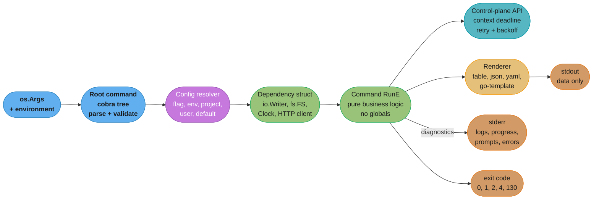
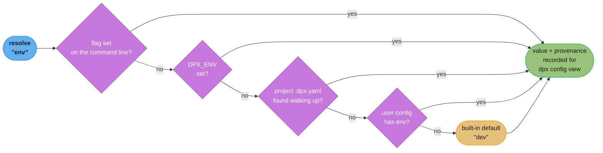
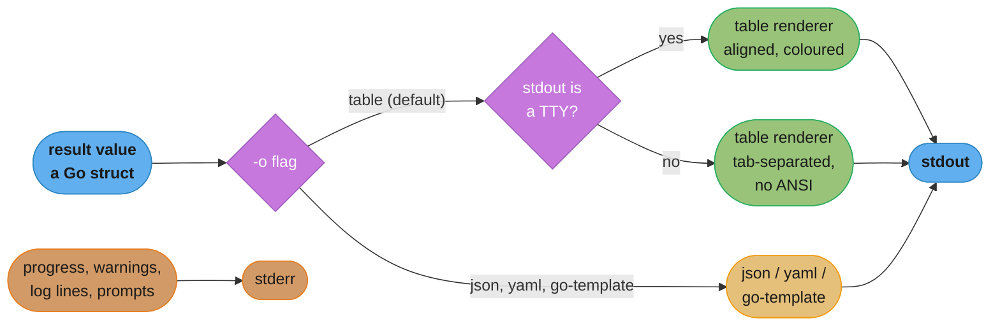
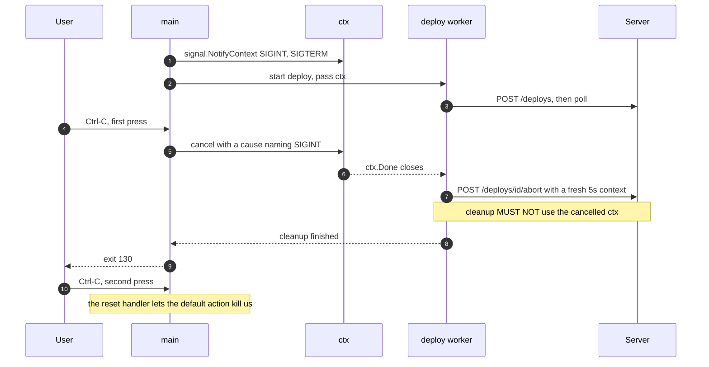

# Case Study: Design a Cross-Platform CLI Tool

## Intuition

> **Design intuition**: A CLI is not a program with a text interface. It is a **library whose caller is a shell script you will never read**, running on an operating system you did not choose, with a terminal that may not exist. Every design decision follows from that: your output is somebody's `jq` input, your exit code is somebody's `if` statement, and your ANSI colour codes are somebody's corrupted log file. The user typing at a prompt is the *minority* caller — and the one who complains loudest, which is why teams optimise for them and break everyone else.

**Key insight for this design**: the two hardest problems in a CLI are not parsing arguments. They are **precedence** — five places a setting can come from, and users must be able to predict which wins without reading the source — and **the stdout/stderr split**, because getting it wrong makes your tool unpipeable and unautomatable in a way that no amount of features compensates for. Go dominates this space (`kubectl`, `terraform`, `gh`, `docker`, `hugo`, `helm`, `flyctl`, `cosign`) for exactly one reason: `GOOS=windows GOARCH=arm64 go build` produces a working single file with no runtime to install, and that turns "distribute a tool to 12,000 engineers on three operating systems" from a packaging project into a `for` loop.

Nothing else in this repo covers CLI and tooling binaries. This file is the Go engineer's version: the command tree, the precedence table, the output contract, cancellation, the release matrix, and the boundaries that make any of it testable.

---

## 1. Requirements Clarification

### The system

We are building `dpx`, an internal platform CLI. It talks to a control-plane API, manages local credentials, runs long deployments, and is installed on every engineer's laptop and in every CI runner.

```
dpx deploy start --env prod --service checkout --wait
dpx env list -o json | jq -r '.items[].name'
dpx auth login
dpx config set default.env staging
dpx secret get db-password --env prod
```

### Functional requirements

- A noun/verb command tree, three levels deep at most, with `--help` at every node and generated completion for bash, zsh, fish and PowerShell.
- Configuration from five sources with a documented, testable precedence order.
- Two output modes: a human-readable table by default, and `-o json` / `-o yaml` / `-o go-template=...` for machines.
- Long-running commands (`deploy start --wait`, up to 25 minutes) with a progress display that degrades correctly in CI, and clean cancellation on Ctrl-C.
- Credentials stored per-OS in the right place, never world-readable, never in the repo.
- `dpx version` reporting the exact commit, and `dpx upgrade` performing a verified self-update.
- A plugin mechanism so other teams can ship `dpx-<name>` subcommands without a PR to this repo.

### Non-functional requirements

- **Startup**: `dpx --help` and `dpx version` return in under 30 ms on a cold page cache. This is not vanity — a CLI in a shell prompt or a tight CI loop is invoked thousands of times.
- **Binary size**: under 45 MB per platform, so a CI image layer stays reasonable.
- **Zero install dependencies**: one file, `chmod +x`, run — no runtime, no shared libraries; works on `scratch`, Alpine (musl), and Windows Server Core.
- **Backward compatibility**: any flag, `-o json` field name, or exit code is a public API — removing one is as breaking as removing an HTTP endpoint.

### Explicitly out of scope

- A TUI. `dpx` composes with pipes; a full-screen interface does not, and mixing the two produces a tool that is bad at both. If a dashboard is wanted, it is a separate binary.
- Windows-native installers (MSI). Scoop and winget cover the audience.

### Clarifying questions worth asking in the interview

1. **Who is the primary caller — a human or a script?** It changes the default output format, whether you may prompt, and how much you can ever change the human-readable rendering.
2. **What is the compatibility promise?** "Flags are stable, human output is not, `-o json` is" is a good answer and it must be written down before v1, because you cannot retrofit it.
3. **Does it handle secrets?** If yes, file permissions, OS keychains, and the "never print it to a log" rule become first-class design constraints rather than polish.

---

## 2. Scale Estimation

### Users and invocations

```
Engineers with dpx installed:  12,000  x ~18 invocations/day = 216,000
CI runners with dpx installed:  3,400  x ~140/day            = 476,000
                                                               -------
Total 692,000/day = 8 invocations/sec avg; ~65/sec at the 09:15
EU+US overlap peak.  ~72% are read-only and hit a cache.
```

That average is the number that justifies the 30 ms startup budget. A CLI that takes 200 ms to print `--help` burns `692,000 x 0.17 s = 32 engineer-hours per day` of pure waiting, most of it inside CI jobs where it is invisible and unattributed.

### Startup budget, measured

```
Go binary, cobra tree of 60 commands, cold page cache:
  exec + dynamic loader (static binary, so ~0)     ~1 ms
  runtime init, GC setup, GOMAXPROCS detection     ~1 ms
  package-level var init across all imports        3-12 ms   <-- the variable
  cobra command tree construction                  2-4 ms
  config file read + parse (one 2 KB YAML)         ~1 ms
                                                   --------
  dpx --help total                                 8-19 ms

Same laptop: a Node CLI (commander + 40 deps) 80-160 ms; a Python
CLI (click + boto3 imported eagerly) 350-900 ms.
```

The 3-12 ms of package-level init is the only part under your control and the only part that regresses silently. A single `var defaultClient = aws.NewConfig()` at package scope, imported transitively, adds tens of milliseconds to *every* invocation including `--help`. See §9.1.

### Distribution volume

```
Release matrix: 6 platforms.  Binary: 38 MB raw -> 27 MB with
-ldflags "-s -w" -> 9.8 MB gzipped.  Cadence ~3 releases/week.

60% of users upgrade within 48 h: 12,000 x 0.6 x 9.8 MB = 70 GB
per release, plus CI images 3,400 rebuilds/day x 9.8 MB = 33 GB/day.

CDN egress ~250 GB/week -- cheap. Skip compression or ship the
unstripped 38 MB binary and the same week is ~970 GB.
```

`-ldflags "-s -w"` (strip the symbol table and DWARF) is a two-word change that takes 30% off every download forever. It costs you readable stack traces from the field, which is why `dpx` ships stripped release binaries and keeps unstripped ones in the build artifact store, keyed by version, for symbolising a crash report.

---

## 3. High-Level Architecture



Two structural commitments in that picture. **Everything a command needs arrives through the `DEPS` struct** — never a package-level global, never a direct `os.Stdout` or `os.ReadFile` call — which is what makes §4.8's tests possible. And **`stdout` carries data and nothing else**: progress bars, warnings, prompts, and the log line "using config from ~/.config/dpx" all go to stderr, so `dpx env list -o json > envs.json` gets valid JSON even while the tool is warning about something.

### Command tree shape

```
dpx
├── auth      login | logout | status | token
├── env       list | get | create | delete
├── deploy    start | status | rollback | logs
├── secret    get | set | list | delete
├── config    get | set | unset | view | path
├── plugin    list | install | uninstall
├── version
└── upgrade
```

Nouns at level one, verbs at level two. Verb-first (`dpx list envs`, `dpx get secret`) reads more naturally in English and is worse in practice: `dpx <TAB>` then lists 8 verbs that say nothing about what the tool manages, and adding a noun means touching every verb. Noun-first makes `dpx <TAB>` a table of contents. `kubectl` is verb-first, and it is the one thing about `kubectl` that nobody copies.

---

## 4. Component Deep Dives

### 4.1 The command tree: cobra, urfave/cli, or stdlib `flag`

All three are defensible. The honest comparison:

| | stdlib `flag` | `urfave/cli` | `cobra` |
|---|---|---|---|
| Dependencies | 0 | 1 | ~5 transitively (pflag, viper if you take it) |
| Binary size added | 0 | ~1.2 MB | ~3.5 MB |
| Subcommands | hand-rolled (`flag.NewFlagSet` per command, dispatch on `os.Args[1]`) | first-class | first-class, arbitrary depth |
| Flag style | `-flag` and `--flag` both accepted; **no `-abc` bundling**, and `-h` is not `--help` | GNU-ish | full GNU: `--flag`, `-f`, `-abc` bundling, `--` terminator |
| Shell completion | none | bash/zsh | bash, zsh, fish, PowerShell, generated |
| Used by | `go` itself, `gofmt`, most single-purpose tools | `docker` (historically), `snapd` | `kubectl`, `hugo`, `gh`, `helm`, `istioctl`, `cosign` |

**Take `flag` when the tool has one job**, no subcommands, and you care about binary size or zero dependencies. `gofmt` has four flags and does not need a framework. The stdlib's non-GNU flag parsing is a genuine surprise to users (`-v` and `--v` are the same flag; `-abc` is one flag named `abc`), so the moment you have more than a handful of flags it becomes a support cost.

**Take `cobra` for anything with a command tree**, which is this design. The 3.5 MB and the dependency are worth generated completion alone — writing and maintaining correct zsh completion by hand is a genuinely miserable project. Do **not** automatically take viper with it; see §4.2.

```go
func newRootCmd(d *Deps) *cobra.Command {
    root := &cobra.Command{
        Use:   "dpx",
        Short: "Platform control CLI",
        // SilenceUsage stops cobra printing the full help text after a
        // RUNTIME error -- usage is the right response to a bad flag, and
        // pure noise after "connection refused".
        SilenceUsage:  true,
        // SilenceErrors stops cobra printing the error itself, so main()
        // owns the format and the exit code. See 4.5.
        SilenceErrors: true,
        PersistentPreRunE: func(cmd *cobra.Command, _ []string) error {
            return d.Resolve(cmd) // see 4.2
        },
    }

    // Persistent flags are inherited by every subcommand.
    root.PersistentFlags().String("env", "", "environment name")
    root.PersistentFlags().StringP("output", "o", "table", "output: table|json|yaml|go-template=...")
    root.PersistentFlags().Bool("no-color", false, "disable colour even on a TTY")
    root.PersistentFlags().CountP("verbose", "v", "increase log verbosity (-v, -vv, -vvv)")

    root.AddCommand(newAuthCmd(d), newEnvCmd(d), newDeployCmd(d),
        newSecretCmd(d), newConfigCmd(d), newPluginCmd(d),
        newVersionCmd(d), newUpgradeCmd(d))
    return root
}
```

`SilenceUsage` and `SilenceErrors` are the two settings every cobra CLI should set and most do not. Without them, a failed API call prints a 40-line help screen underneath the error, which trains users to ignore help output entirely.

### 4.2 Configuration precedence

**This is the number-one CLI bug report**, and it is almost never reported as "precedence is unclear". It arrives as "the tool ignored my `--env` flag" or "it deployed to prod and I set staging in my config". The fix is not better code; it is a **stated, testable order** and a command that shows the user what resolved and from where.

The order, highest wins:

| Rank | Source | Example | Rationale |
|---|---|---|---|
| 1 | Explicit flag | `--env prod` | The most specific and most deliberate act. Nothing overrides it. |
| 2 | Environment variable | `DPX_ENV=prod` | How CI injects settings, and how a user overrides for one shell. |
| 3 | Project config | `./.dpx.yaml`, walking up to the repo root | "This directory is a staging project" should follow the directory. |
| 4 | User config | `$XDG_CONFIG_HOME/dpx/config.yaml` | Personal defaults, machine-wide. |
| 5 | Built-in default | `env: dev` | Never `prod`. A missing setting must fail safe. |



The load-bearing detail is **provenance**. Resolving a value is easy; explaining it six months later at 2am is the hard part, and it costs about twenty lines:

```go
type Resolved struct {
    Value  string
    Origin string // "--env", "DPX_ENV", "/repo/.dpx.yaml:4", "~/.config/dpx/config.yaml:9"
}

// resolve walks the layers in ASCENDING precedence and lets later ones win,
// so adding a source means adding one entry in one ordered slice.
func resolve(key string, layers []layer) Resolved {
    out := Resolved{Value: builtinDefaults[key], Origin: "built-in"}
    for _, l := range layers { // ordered: user, project, env, flag
        if v, origin, ok := l.lookup(key); ok {
            out = Resolved{Value: v, Origin: origin}
        }
    }
    return out
}
```

And the command that pays for it:

```
$ dpx config view --show-origin
KEY            VALUE      SOURCE
env            prod       --env (flag)
api.endpoint   api.dpx.internal   /Users/rp/work/checkout/.dpx.yaml:4
output         table      built-in
timeout        30s        DPX_TIMEOUT
```

**On viper**: it implements exactly this and more, and it is what most cobra tutorials reach for. It is also 1.4 MB, pulls in file-format decoders you will not use, and its precedence is *configured* rather than stated — so the answer to "why did it pick prod" lives in your `init()` rather than in a table in your `--help`. For five fixed layers, the 40 lines above are the smaller thing to own. Take viper for live reloading or remote (etcd/consul) config.

**The trap with environment variables**: mapping `--api.endpoint` to `DPX_API_ENDPOINT` requires replacing `.` and `-` with `_`, and that mapping is not injective — `--api-endpoint` and `--api.endpoint` collide. Pick one flag-name convention (dots for nesting, never hyphens inside a nested key) and assert at startup, in a test, that the generated env-var names are unique.

### 4.3 Output design: the stdout/stderr contract



Four rules, each of which is a real incident somewhere:

**1. Data to stdout, everything else to stderr.** `dpx env list -o json | jq` must work while the tool is warning about a deprecated config key. A warning on stdout corrupts the JSON, and the user's error is `parse error: Invalid numeric literal` — which says nothing about your warning.

**2. Detect the TTY, do not assume it.** Colour, spinners, and box-drawing characters are for a human at a terminal; everywhere else they are literal escape bytes in a log file.

```go
type UI struct {
    Out, Err io.Writer
    Color    bool
    TTY      bool
}

func newUI(out, errw io.Writer, noColor bool) *UI {
    tty := false
    if f, ok := out.(*os.File); ok {
        tty = term.IsTerminal(int(f.Fd()))
    }
    color := tty && !noColor &&
        os.Getenv("NO_COLOR") == "" && // the NO_COLOR convention: any value disables
        os.Getenv("TERM") != "dumb" &&
        os.Getenv("CI") == ""
    return &UI{Out: out, Err: errw, Color: color, TTY: tty}
}
```

The `NO_COLOR` check is the cheap one people skip. It is a cross-language convention, users set it globally, and honouring it costs one line.

**3. Progress must degrade, not disappear.** A spinner needs `\r` and a TTY. In CI you still want to know the deploy is alive — CI systems kill jobs with no output for N minutes — so emit a line every 30 seconds instead:

```go
func (u *UI) Progress(ctx context.Context, label string, done <-chan struct{}) {
    if u.TTY {
        u.spinner(ctx, label, done) // \r + frames, redrawn every 100ms
        return
    }
    // Non-TTY: append-only heartbeat. No \r, no ANSI, timestamped so a CI
    // log tells you where the 20 minutes went -- and so the CI system does
    // not kill the job for producing no output.
    t := time.NewTicker(30 * time.Second)
    defer t.Stop()
    start := time.Now()
    for {
        select {
        case <-done:
            return
        case <-ctx.Done():
            return
        case now := <-t.C:
            fmt.Fprintf(u.Err, "%s: still waiting (%s elapsed)\n",
                label, now.Sub(start).Round(time.Second))
        }
    }
}
```

**4. Buffer stdout, and flush it exactly once.** `os.Stdout` in Go is an unbuffered `*os.File` — every `fmt.Fprintf` is a `write(2)` syscall. Rendering a 900-row table one cell at a time is thousands of syscalls:

```go
// BROKEN -- ~11,000 write() syscalls for a 900-row, 6-column table.
// Measured at 240 ms on macOS; the data fetch took 40 ms.
for _, row := range rows {
    for _, cell := range row {
        fmt.Fprintf(os.Stdout, "%s\t", cell)   // os.Stdout is unbuffered
    }
    fmt.Fprintln(os.Stdout)
}

// FIX -- one buffered writer, flushed once. Same output, ~14 syscalls, 6 ms.
w := bufio.NewWriterSize(ui.Out, 64*1024)
defer w.Flush()          // and check the error -- see below
tw := tabwriter.NewWriter(w, 0, 0, 2, ' ', 0)
for _, row := range rows {
    fmt.Fprintln(tw, strings.Join(row, "\t"))
}
tw.Flush()
```

The subtle half: **a buffered writer moves your write errors to `Flush()`**. `defer w.Flush()` discards that error, so a full disk or a closed pipe becomes a silent truncation and exit code 0. Assign the flush error into a named return, or flush explicitly and return it.

**SIGPIPE, and why `dpx logs | head -5` is special.** When the reader of your stdout pipe exits, the next write raises `SIGPIPE`. Go's runtime handles this deliberately: `SIGPIPE` on file descriptors 1 or 2 kills the process with the signal, exactly like a C program, so `dpx logs | head -5` terminates instead of erroring. On any *other* descriptor the signal is swallowed and the write returns `EPIPE`. The consequence for you: do not install a handler for `SIGPIPE` and do not treat an `EPIPE` from stdout as a bug to report — it means the user got what they asked for.

### 4.4 Exit codes are an API

```
0    success
1    a generic runtime failure (network, server error, permission denied)
2    usage error -- unknown flag, missing required argument, bad value
4    the operation ran and the ANSWER is "no" (deploy check failed,
     policy violated, drift detected). NOT an error -- a result.
70   internal error, a panic we recovered and want distinguishable
130  interrupted by SIGINT (128 + 2, the shell convention)
143  terminated by SIGTERM (128 + 15)
```

Code 4 is the one worth arguing for. `terraform plan` uses `-detailed-exitcode` to distinguish "no changes" (0) from "changes present" (2) from "error" (1), and that distinction is what makes it usable in a pipeline. Without a dedicated code, a script has to grep your human-readable output, which then makes your human-readable output a compatibility surface you can never change.

```go
type ExitError struct {
    Code int
    Err  error
}

func (e *ExitError) Error() string { return e.Err.Error() }

func main() {
    // os.Exit does NOT run deferred functions. Every cleanup this program
    // needs must happen inside run(), before it returns.
    os.Exit(run())
}

func run() int {
    ctx, stop := signal.NotifyContext(context.Background(),
        os.Interrupt, syscall.SIGTERM)
    defer stop()

    d := newDeps(os.Stdout, os.Stderr, os.Args[1:])
    err := newRootCmd(d).ExecuteContext(ctx)
    if err == nil {
        return 0
    }

    // Cancellation is not a failure to report as one.
    if errors.Is(err, context.Canceled) {
        fmt.Fprintln(d.UI.Err, "cancelled")
        return 130
    }
    var ee *ExitError
    if errors.As(err, &ee) {
        fmt.Fprintf(d.UI.Err, "dpx: %v\n", ee.Err)
        return ee.Code
    }
    fmt.Fprintf(d.UI.Err, "dpx: %v\n", err)
    return 1
}
```

`os.Exit` skipping defers is the Go-specific trap here. A CLI that closes a log file, releases a lock file, or flushes a trace exporter in a `defer` in `main()` loses all of it the moment somebody adds an early `os.Exit(1)`. The `main()` / `run() int` split is the standard fix and it costs four lines. The error-wrapping discipline behind `errors.As` here is in [errors_and_panics](../errors_and_panics/errors_and_panics.md).

### 4.5 Cancellation: `signal.NotifyContext`, causes, and double Ctrl-C

`signal.NotifyContext` returns a context cancelled when one of the named signals arrives. As of `[1.26]` it cancels with a **cause naming the signal received**, so `context.Cause(ctx)` tells you whether you are unwinding from a user's Ctrl-C or from an orchestrator's SIGTERM — a distinction that used to require a parallel channel.



Two things go wrong and both are common.

**The cleanup context.** Once the reconcile context is cancelled, every call made with it fails instantly — including the abort call you need to make. Cleanup gets a *fresh* context with its own short deadline:

```go
func runDeploy(ctx context.Context, d *Deps, id string) error {
    if err := d.API.Start(ctx, id); err != nil {
        return err
    }
    err := d.API.Wait(ctx, id) // blocks until done or ctx cancelled
    if err != nil && errors.Is(err, context.Canceled) {
        // BROKEN: d.API.Abort(ctx, id) -- ctx is already dead, this
        // returns context.Canceled without sending a byte, and the
        // deploy keeps running server-side.
        // FIX: detach, with a deadline of its own.
        cleanupCtx, cancel := context.WithTimeout(context.WithoutCancel(ctx), 5*time.Second)
        defer cancel()
        if aerr := d.API.Abort(cleanupCtx, id); aerr != nil {
            fmt.Fprintf(d.UI.Err, "warning: could not abort deploy %s: %v\n", id, aerr)
            fmt.Fprintf(d.UI.Err, "it may still be running: dpx deploy status %s\n", id)
        }
        return err
    }
    return err
}
```

`context.WithoutCancel` is the right primitive: it keeps the parent's values (trace ids, auth) and drops its cancellation. The general rule and the tree semantics are in [context_and_cancellation](../context_and_cancellation/context_and_cancellation.md).

**The double Ctrl-C.** A user who presses Ctrl-C wants out. If your cleanup hangs — a wedged TCP connection, a 30-second retry — a second Ctrl-C must kill the process immediately. `signal.NotifyContext`'s `stop()` function restores the default disposition, so calling it as soon as the first signal is observed gives you exactly that behaviour for free:

```go
ctx, stop := signal.NotifyContext(context.Background(), os.Interrupt, syscall.SIGTERM)
go func() {
    <-ctx.Done()
    // First signal seen. Report which one, then restore default handling so
    // a second press terminates the process immediately.
    if cause := context.Cause(ctx); cause != nil && !errors.Is(cause, context.Canceled) {
        fmt.Fprintf(os.Stderr, "\n%v received, cleaning up (press Ctrl-C again to force quit)\n", cause)
    }
    stop()
}()
```

**Windows has no SIGINT.** The Go runtime maps a console Ctrl-C event to `os.Interrupt`, so the code above works; `syscall.SIGTERM` has no console equivalent, and `taskkill /F` terminates with no notification and no cleanup. Any state that must survive an abrupt kill belongs on disk or on the server, never only in memory.

### 4.6 Filesystem locations and credentials on three operating systems

`os.UserConfigDir()` and `os.UserCacheDir()` already implement the per-OS rules. Reimplementing them by hand is how tools end up writing `~/.dpx` on Windows.

| | Linux | macOS | Windows |
|---|---|---|---|
| Config | `$XDG_CONFIG_HOME/dpx` → `~/.config/dpx` | `~/Library/Application Support/dpx` | `%AppData%\dpx` |
| Credentials | secret-service / kwallet, else a 0600 file | Keychain via `security` | Credential Manager / DPAPI |

```go
func configDir() (string, error) {
    // Honour an explicit override first -- CI needs it, and so does anyone
    // running two profiles side by side.
    if d := os.Getenv("DPX_CONFIG_DIR"); d != "" {
        return d, nil
    }
    base, err := os.UserConfigDir() // XDG / ~/Library / %AppData%
    if err != nil {
        return "", fmt.Errorf("locating user config dir: %w", err)
    }
    return filepath.Join(base, "dpx"), nil
}
```

**Never write a secret to a file that is not `0600`, and know that `0600` is a lie on Windows.** `os.Chmod` on Windows only toggles the read-only attribute — the mode bits are not enforced. Three consequences:

```go
// Correct on Unix. On Windows this compiles, runs, and protects nothing.
f, err := os.OpenFile(tokenPath, os.O_WRONLY|os.O_CREATE|os.O_TRUNC, 0600)
```

1. On Unix, create with `0600` **at open time**, never with a later `Chmod` — the gap between create and chmod is a real race on a shared machine. On Windows the per-user ACL on `%AppData%` is the actual protection, so do not claim a file mode you do not have.
2. Better than either: **put the token in the OS keychain** and keep only a non-secret reference in the config file. `zalando/go-keyring` wraps Keychain, Credential Manager, and the freedesktop secret service behind one interface. Fall back to the 0600 file only when no keychain exists (headless Linux, most CI), and say so in the output.

The rule that catches the remaining leaks: **a credential must never be a flag value.** `--token abc123` lands in the shell history, in `ps` output, and in the CI job log. Accept it on stdin or from an environment variable, and if you must have a flag, make it `--token-file`.

### 4.7 The release matrix

```
GOOS     GOARCH   Why
-------- -------- --------------------------------------------------
linux    amd64    CI runners, servers
linux    arm64    Graviton runners, arm64 CI
darwin   arm64    every Mac since 2020
darwin   amd64    Intel Macs still in the fleet (~11% and falling)
windows  amd64    laptops
windows  arm64    Surface / Dev Kit, small but growing

Dropped deliberately: linux/386, linux/arm (v6/v7), freebsd, netbsd.
Each costs a build slot, a test slot, and a support promise. Add one
when a real user asks, not speculatively -- `go tool dist list` offers
40+ combinations and none of them are free.
```

```bash
# The whole cross-compilation story, and the reason Go owns this space.
CGO_ENABLED=0 GOOS=windows GOARCH=arm64 \
  go build -trimpath -ldflags "-s -w -X main.version=$VERSION -X main.commit=$SHA" \
  -o dist/dpx_windows_arm64.exe ./cmd/dpx
```

- **`CGO_ENABLED=0` is the load-bearing flag.** With cgo on, cross-compiling needs a C toolchain per target, and the resulting Linux binary links `glibc` — so it fails on Alpine with `no such file or directory`, which is the most confusing error message in container work (the file is there; the *interpreter* is not). With cgo off you get a static binary that runs on scratch, Alpine, and distroless alike. The cost: `net` and `os/user` switch to their pure-Go implementations, so DNS resolution stops consulting `nsswitch.conf`. For a CLI that is a feature, not a loss — you get identical resolution behaviour on every machine.
- **`-trimpath`** strips your build machine's absolute paths out of the binary; without it `/Users/rp/go/src/...` ships to 12,000 people and reproducible builds are impossible. **`-ldflags "-s -w"`** strips the symbol table and DWARF: 38 MB → 27 MB here.
- **`-X main.version=`** injects the version at link time. `runtime/debug.ReadBuildInfo()` gives you module version and VCS state for free when the tool was installed with `go install`, and nothing useful otherwise — ship both, prefer the injected value.

**goreleaser** turns that into one `.goreleaser.yaml` and one `goreleaser release` in CI: the matrix, archives, `checksums.txt`, cosign signatures, an SBOM, a GitHub release, a Homebrew tap formula, a Scoop manifest, and `nfpm`-built `.deb`/`.rpm`. Writing it by hand is a weekend, and maintaining it is the part you underestimate.

**Signing and verification.** Publish `checksums.txt` and sign *that*, not each binary — one signature, and the checksum file is what an installer script verifies. Keyless cosign with an OIDC identity is the low-friction option; the property that matters is that a user can verify without you distributing a public key out of band. See [devsecops_and_supply_chain_security](../../devops/devsecops_and_supply_chain_security/devsecops_and_supply_chain_security.md) for provenance and SLSA levels, and [packages_modules_and_tooling](../packages_modules_and_tooling/packages_modules_and_tooling.md) for `govulncheck` in the release pipeline.

**Distribution channels, ranked by support burden:**

| Channel | Audience | Burden |
|---|---|---|
| Homebrew tap | macOS + Linux devs | Low; goreleaser writes the formula |
| Scoop bucket / winget | Windows devs | Low; goreleaser writes the manifest |
| `curl \| sh` installer | onboarding | Medium; you now own a shell script that must work on five shells, and you have taught your org to pipe the internet into a shell |

**Self-update** (`dpx upgrade`) is convenient and it is a code-execution channel pointed at 12,000 machines. Non-negotiables: fetch over TLS with certificate verification; verify the signature on the checksum file and then the checksum of the binary, **before** it touches the filesystem; write to a temp file in the *same directory* as the target and `os.Rename` it into place (atomic on the same filesystem, and the only way it works on Windows, where a running `.exe` cannot be overwritten but *can* be renamed out of the way first); and never auto-update silently — check, tell the user, let them run it.

### 4.8 Testability: inject the world

The single change that makes a CLI testable is refusing to call `os.Stdout`, `os.ReadFile`, `time.Now`, and `http.DefaultClient` from business logic.

```go
type Deps struct {
    UI    *UI            // wraps Out/Err io.Writer
    FS    fs.FS          // reads; os.DirFS(".") in production
    Store ConfigStore    // writes; an interface, memory-backed in tests
    Now   func() time.Time
    HTTP  *http.Client
    Env   func(string) string
}
```

```go
// BROKEN -- untestable without a real terminal, a real clock, a real HTTP
// server, and a real home directory. The only way to check the output is
// to capture os.Stdout globally, which makes the test unparallelisable.
func runEnvList(cmd *cobra.Command, args []string) error {
    cfg, err := os.ReadFile(filepath.Join(os.Getenv("HOME"), ".config/dpx/config.yaml"))
    if err != nil {
        return err
    }
    resp, err := http.Get(endpointFrom(cfg) + "/envs")
    ...
    fmt.Printf("%-20s %-10s %s\n", e.Name, e.Region, e.CreatedAt.Format(time.RFC3339))
}

// FIX -- everything arrives through Deps. The test constructs one.
func runEnvList(ctx context.Context, d *Deps, out string) error {
    envs, err := d.API.ListEnvs(ctx)
    if err != nil {
        return fmt.Errorf("listing environments: %w", err)
    }
    return d.Render(out, envs)
}
```

```go
func TestEnvListTable(t *testing.T) {
    var stdout, stderr bytes.Buffer
    d := &Deps{
        UI:  &UI{Out: &stdout, Err: &stderr, Color: false, TTY: false},
        FS:  fstest.MapFS{".dpx.yaml": {Data: []byte("env: staging\n")}},
        Now: func() time.Time { return time.Date(2026, 9, 2, 12, 0, 0, 0, time.UTC) },
        API: &fakeAPI{envs: []Env{{Name: "prod", Region: "eu-west-1"}}},
    }

    if err := runEnvList(t.Context(), d, "table"); err != nil {
        t.Fatal(err)
    }
    golden(t, "envlist_table.txt", stdout.String())

    // stderr must be empty: nothing diagnostic happened.
    if stderr.Len() != 0 {
        t.Errorf("unexpected stderr: %q", stderr.String())
    }
}
```

Golden files fit CLI output precisely because the output *is* the contract: a diff in `testdata/` during review is a visible change to a user-facing surface. Two rules make them survivable — **normalise** anything nondeterministic (timestamps via the injected clock, absolute paths, durations, random ids) before comparing, and never let `-update` run in CI.

For end-to-end coverage of the *whole* binary — flag parsing, exit codes, stderr, file side effects — `rogpeppe/go-internal/testscript` is worth the dependency. It runs `.txtar` script files that look like a shell session, and it is what the Go toolchain itself uses to test `go`:

```
exec dpx env list -o json
stdout '"name": "prod"'
! stderr .
! exec dpx env get nope
stderr 'not found'
```

The broader testing discipline — table-driven subtests, `t.Cleanup`, `t.Context`, fuzzing your flag parser — is in [testing_benchmarking_and_fuzzing](../testing_benchmarking_and_fuzzing/testing_benchmarking_and_fuzzing.md).

### 4.9 Plugins: subprocess discovery, not `plugin.Open`

Three models, and only one of them works.

**Go's `plugin` package is a dead end for a distributed CLI.** The constraints are absolute, not merely inconvenient: Linux, FreeBSD, and macOS only (no Windows, which alone disqualifies it here); the plugin and the host must be built with the *exact* same Go toolchain version; every shared dependency must be at the exact same version; the plugin's `init()` runs on load and there is no unload; and `CGO_ENABLED=0` static binaries cannot load one at all. You would be asking every plugin author to rebuild on your release day, and you would have given up the static binary that made your distribution story work.

**`kubectl`-style subprocess discovery is the model to copy.** Any executable named `dpx-<name>` on `PATH` is a subcommand:

```go
func findPlugins() map[string]string {
    found := map[string]string{}
    for _, dir := range filepath.SplitList(os.Getenv("PATH")) {
        entries, err := os.ReadDir(dir)
        if err != nil {
            continue // an unreadable PATH element is normal, not an error
        }
        for _, e := range entries {
            name := strings.TrimSuffix(e.Name(), ".exe") // Windows
            if !strings.HasPrefix(name, "dpx-") {
                continue
            }
            sub := name[len("dpx-"):]
            if _, seen := found[sub]; !seen { // first on PATH wins
                found[sub] = filepath.Join(dir, e.Name())
            }
        }
    }
    return found
}
```

Its virtues are all consequences of the process boundary: any language, no ABI, a crashing plugin cannot take down the host, and the security story is the one the OS already provides. Pass context through the environment (`DPX_ENV`, `DPX_API_ENDPOINT`, a short-lived token on a pipe rather than in the environment), forward stdin/stdout/stderr untouched so the plugin's own piping works, and propagate its exit code. Two details that are easy to miss: strip `.exe` when matching on Windows, and **never let a plugin shadow a built-in command** — resolve built-ins first, or a `dpx-deploy` on someone's `PATH` silently hijacks your deploys.

**`hashicorp/go-plugin` is the middle option**: still a subprocess, but with a gRPC contract over a handshake on stdout, so the host and plugin exchange typed messages instead of text. Terraform's providers work this way. Take it when plugins must return structured data and be called many times in one run; the subprocess-per-invocation model above is simpler and correct when a plugin is a whole subcommand.

### 4.10 Shell completion and telemetry

**Completion** is generated, never hand-written. Cobra emits bash, zsh, fish, and PowerShell scripts from the command tree, so it stays correct as commands change:

```
dpx completion zsh > "${fpath[1]}/_dpx"
```

Dynamic completion — completing `--env <TAB>` with the environments the user can see — calls your API from inside the completion function, which runs on every `<TAB>`. Cache it (`~/.cache/dpx/completion/envs.json`, 5-minute TTL) with a hard 300 ms timeout and silent failure: a completion that hangs the shell is worse than none, and users disable the whole thing rather than report it.

**Telemetry** is a trust decision before it is an engineering one. The defensible shape, and the one the Go toolchain itself adopted: collect locally, aggregate locally, upload **nothing** until the user opts in with an explicit command, and make the collected data inspectable (`dpx telemetry view`). Never send command *arguments* — they contain environment names, service names, and occasionally a token somebody typed in the wrong place. Counters of command names and error kinds answer nearly every product question you actually have.

---

## 5. Design Decisions & Tradeoffs

| Decision | Chosen | Alternative | Why |
|---|---|---|---|
| Config layering | 40 lines of our own | viper | Precedence must be a stated table, not an `init()`. viper wins if you need remote or live-reloading config. |
| Default output | human table | JSON | The majority of *interactive* uses are human. `-o json` is the stable contract; the table is explicitly not. |
| Cancellation | `signal.NotifyContext` + `stop()` on first signal | a raw `signal.Notify` channel | Free double-Ctrl-C behaviour and a cause naming the signal `[1.26]`. |
| Credentials | OS keychain, 0600 file fallback | always a file | On Windows a file mode protects nothing; the keychain is the only real answer. |
| Cross-compile | `CGO_ENABLED=0` | cgo for the system resolver | Static binaries run on Alpine, distroless, and scratch; identical DNS behaviour everywhere. |
| Plugins | `PATH` subprocess discovery | Go `plugin` package | `plugin` has no Windows support and demands a toolchain match. It cannot work here. |
| Self-update | opt-in, signature verified | automatic background update | It is remote code execution on 12,000 machines. It gets a human in the loop. |
| Exit codes | 0/1/2/4/130 documented | 0 and 1 only | Without code 4, scripts grep your human output, and your human output becomes an API. |
| Testing | injected `Deps` + golden files + testscript | capture `os.Stdout` globally | Global capture makes tests serial and misses the stdout/stderr split entirely. |

### The tradeoff worth arguing about: how stable is human output?

The honest position is that **`-o json` is a versioned contract and the default table is not**, and you must say so in `--help`, in the docs, and in the release notes. The moment you are vague about it, someone writes `dpx env list | awk '{print $2}'` into a deployment pipeline, and your next column-width change is an outage in a team you have never met.

Saying it is not enough, so make the machine path *easier* than parsing: `-o json` on every command from day one, `-o go-template` for people who want one field, and a documented `--quiet` printing one value per line. `gh` does this well; tools that shipped `-o json` late never fully recover.

---

## 6. Real-World Implementations

**`kubectl`** is the reference for output design and for plugins. `-o json|yaml|jsonpath|go-template|custom-columns|wide` is the widest machine-readable surface of any mainstream CLI, and it is why `kubectl` is scriptable at all. Its plugin model — any `kubectl-foo` on `PATH`, discovered by `kubectl plugin list`, installed by Krew — is the design §4.9 copies wholesale, and it has scaled to hundreds of community plugins with no ABI and no coordinated releases. What *not* to copy is verb-first structure: `kubectl get pods` reads well and makes `kubectl <TAB>` useless as a table of contents.

**`terraform`** is the reference for exit codes and for the plugin-as-subprocess-with-a-protocol model. `terraform plan -detailed-exitcode` returning 0/1/2 for no-changes/error/changes is the pattern behind our code 4; it is the difference between a pipeline that can gate on drift and one that greps output. Its providers are separate binaries speaking gRPC over `hashicorp/go-plugin`, downloaded and *checksum-verified* per project — a strong answer to "how do I let third parties extend me without trusting them with my process".

**`gh`** is the reference for authentication, config, and the human/machine split done deliberately. `gh auth login` walks a device-code flow and stores the token in the OS keychain when one is available; `gh api` exposes the raw surface; `--json`, `--jq` and `--template` mean users almost never need to parse the pretty output. It is also the best example of accepting that the human rendering will change: it is documented as unstable, and the escape hatch is one flag away.

**`docker`** is the cautionary tale, instructive because it got the big things right and one small thing wrong for a decade: `docker ps` output was never a documented contract, was parsed by everything, and column changes broke CI worldwide until `--format` arrived. It is also the canonical daemon-versus-CLI split — a thin client, so startup is fast and every failure mode is a network failure mode, which is why its error messages had to get much better than a local tool's would need to be.

---

## 7. Technologies & Tools

| Tool | Role | Note |
|---|---|---|
| `spf13/cobra` | Command tree, help, generated completion | The default for a multi-command CLI. Set `SilenceUsage` and `SilenceErrors`. |
| `spf13/viper` | Config layering, remote config | Take it for live reload or etcd/consul backends, not for five fixed layers. |
| `golang.org/x/term` | `IsTerminal`, raw mode, password prompts | The TTY check in §4.3, and `ReadPassword` for prompts that must not echo. |
| `zalando/go-keyring` | Keychain / Credential Manager / secret-service | One API across three OSes; degrade to a 0600 file with a warning. |
| `goreleaser` | Build matrix, archives, checksums, signing, taps, packages | One YAML replaces a week of release engineering. |
| `sigstore/cosign` | Keyless signatures on `checksums.txt` | Users verify without you distributing a key. |
| `rogpeppe/go-internal/testscript` | End-to-end CLI tests as `.txtar` scripts | What the Go toolchain uses on itself. Covers exit codes and stderr. |

---

## 8. Operational Playbook

### Release

1. Tag. CI runs `go test ./...` on linux, macOS, and Windows runners — Windows is not optional, and it is where path handling and `os.Chmod` assumptions break.
2. `govulncheck ./...`; fail the release on a reachable vulnerability.
3. `goreleaser release --clean` builds the six-platform matrix, archives, `checksums.txt`, cosign signatures, SBOM, Homebrew formula, Scoop manifest, `.deb`/`.rpm`.
4. Smoke test each artifact in a clean container/VM: `--help`, `version`, and one networked command. A binary that does not start is the failure mode a unit test cannot see.
5. Publish, announcing exit-code and flag changes first — those are the breaking surface.

### Support runbook

| Report | First check | Usual cause |
|---|---|---|
| "It ignored my flag" | `dpx config view --show-origin` | An env var above it, or a `.dpx.yaml` in a parent directory they forgot |
| "It hangs in CI" | Is there a TTY? Is it prompting? | An interactive prompt reached a non-TTY context |
| "Slow to start" | `time dpx --help` | Package-level init in a transitively imported package — §9.1 |
| "Upgrade failed on Windows" | Is the binary running? | Overwriting a running `.exe`; rename-then-replace instead |

### The compatibility checklist for every PR

- Did a flag change name, shorthand, or default? Breaking.
- Did an `-o json` field get renamed or removed? Breaking. Added? Fine.
- Did an exit code change for an existing condition? Breaking.
- Did output move between stdout and stderr? Breaking, and the most silent one.

---

## 9. Common Pitfalls & War Stories

### 9.1 The 340 ms `--help` — package-level init in a transitive import

**What happened.** A PR added AWS SDK support to `dpx secret`. The import chain pulled `aws-sdk-go-v2/config` into the root command's package graph, and one package in that chain built a default configuration in a package-level `var`. Package-level initialisation runs **before `main()`**, for every import in the binary, on every invocation — including `dpx --help` and `dpx version`, which have nothing to do with AWS.

**The measurement.** `dpx --help` went from 14 ms to 340 ms. Nobody noticed for three weeks because no human perceives 340 ms as slow. CI noticed: `dpx` is invoked ~140 times per pipeline, so every pipeline got 46 seconds slower, across 3,400 runners.

```
$ GODEBUG=inittrace=1 dpx version 2>&1 | sort -k5 -n -r | head -3
init config @14 ms, 218 ms clock, 41926448 bytes, 486321 allocs
init endpoints @9.1 ms, 71 ms clock, 19244032 bytes, 122400 allocs
```

**The fix.** `GODEBUG=inittrace=1` names the package and the cost — run it in CI, not just when someone complains. Then make the expensive dependency lazy: construct the client inside `RunE`, behind the `Deps` struct, so only the commands that need it pay for it. In the worst case, put the heavy subcommand behind a build tag or move it to a plugin.

```go
// BROKEN -- runs on every invocation of every command.
var awsCfg = mustLoadAWSConfig()

// FIX -- constructed on demand, once, only when a command needs it.
type Deps struct {
    awsOnce sync.Once
    awsCfg  aws.Config
}

func (d *Deps) AWS() aws.Config {
    d.awsOnce.Do(func() { d.awsCfg = mustLoadAWSConfig() })
    return d.awsCfg
}
```

**Guard it permanently** with a test that fails the build on a regression:

```go
func TestStartupBudget(t *testing.T) {
    bin, start := buildBinary(t), time.Now()
    if out, err := exec.Command(bin, "version").CombinedOutput(); err != nil {
        t.Fatalf("%v: %s", err, out)
    }
    if d := time.Since(start); d > 60*time.Millisecond {
        t.Errorf("dpx version took %v, budget 60ms -- run GODEBUG=inittrace=1", d)
    }
}
```

### 9.2 The warning that broke every pipeline — one `fmt.Println` on stdout

**What happened.** A deprecation notice was added for an old config key: `fmt.Println("warning: 'cluster' is deprecated, use 'env'")`. `fmt.Println` writes to **stdout**. Every pipeline running `dpx env list -o json | jq -r '.items[].name'` began failing with `parse error: Invalid numeric literal at line 1, column 8`.

**The blast radius.** 1,100 CI pipelines across 84 repositories failed within 40 minutes of the release. Median time to diagnose was 25 minutes, because the error message names `jq`, not `dpx`, and the config key in question was set by a template most of those repos had never edited. Total: roughly 180 engineer-hours.

**The fix, and the guard that makes it permanent.**

```go
// BROKEN -- fmt.Print* default to stdout.
fmt.Println("warning: 'cluster' is deprecated, use 'env'")

// FIX -- diagnostics go through the UI, which owns stderr.
ui.Warnf("'cluster' is deprecated, use 'env'")
```

```go
// The test that would have caught it, and now runs on every command.
func TestMachineOutputIsPureData(t *testing.T) {
    for _, cmd := range allCommandsSupportingJSON(t) {
        t.Run(cmd, func(t *testing.T) {
            var stdout, stderr bytes.Buffer
            runCommand(t, &stdout, &stderr, cmd, "-o", "json")
            var v any
            if err := json.Unmarshal(stdout.Bytes(), &v); err != nil {
                t.Fatalf("stdout is not JSON: %v\nstdout: %s", err, stdout.String())
            }
        })
    }
}
```

Then ban the mistake at the linter: `forbidigo` with a rule against `fmt.Print*` and `println` outside the `ui` package. A convention that only lives in a review checklist gets violated the week a reviewer is on holiday.

### 9.3 Ctrl-C left 90 deploys running

**What happened.** `dpx deploy start --wait` polled the API until the deploy finished. On Ctrl-C the process exited immediately: the server never learned the client had gone, and the deploy continued. Over one incident night an engineer pressed Ctrl-C on 90 retries of a failing deploy, and all 90 were still running server-side, rate-limiting the real fix.

**Three bugs, not one.**

1. There was no signal handling at all; the process died on the default SIGINT action.
2. When one was added, `Abort` was called with the already-cancelled context, so it returned instantly without sending a byte. See the `WithoutCancel` fix in §4.5 — this is the single most common Go cancellation bug and it looks correct in review.
3. Even with cleanup working, the user was told nothing. A cancelled deploy that may still be running must print the deploy id and the command to check it.

**The design rule that came out of it.** *The client is not the source of truth for a long operation.* The server owns a lease on the deploy and cancels it if the client stops heartbeating within 60 seconds — so a `kill -9`, a laptop lid, or a dropped VPN converges to the same place as a clean Ctrl-C. Client-side cleanup is an optimisation that makes the common case fast; it can never be the only mechanism, because there is no client-side handler for `SIGKILL`.

### 9.4 The credential in the shell history

**What happened.** `dpx auth login --token ghp_xxxx` was documented in the onboarding guide. The token landed in `~/.zsh_history` on every laptop, in `ps aux` output for the lifetime of the process (readable by any local user on shared build machines), and — because CI echoed commands — in 6,000 CI job logs retained for 90 days. A routine secret scan found 214 live tokens.

**The fix.**

```go
// BROKEN -- a secret as a flag value.
cmd.Flags().String("token", "", "API token")

// FIX -- three acceptable inputs, none of them a flag value:
//   --token-file (or "-" for stdin), DPX_TOKEN, or a non-echoing prompt.
func readToken(d *Deps, tokenFile string) (string, error) {
    if tokenFile != "" {
        if tokenFile == "-" {
            b, err := io.ReadAll(os.Stdin)
            return strings.TrimSpace(string(b)), err
        }
        b, err := os.ReadFile(tokenFile)
        return strings.TrimSpace(string(b)), err
    }
    if t := d.Env("DPX_TOKEN"); t != "" {
        return t, nil
    }
    if !d.UI.TTY {
        return "", &ExitError{Code: 2, Err: errors.New(
            "no token: set DPX_TOKEN or pass --token-file (no TTY for a prompt)")}
    }
    fmt.Fprint(d.UI.Err, "API token: ")
    b, err := term.ReadPassword(int(os.Stdin.Fd()))
    fmt.Fprintln(d.UI.Err)
    return string(b), err
}
```

Two details that are easy to miss: the prompt goes to **stderr**, so `dpx auth login > out.txt` still shows the user what it is asking; and the non-TTY path fails with an actionable message and exit code 2 rather than hanging on a stdin that will never arrive.

### 9.5 `os.Exit` ate the deferred flush

**What happened.** `dpx deploy logs --output-file run.log` streamed logs through a `bufio.Writer` with `defer w.Flush()`. A later PR added an early `os.Exit(1)` inside the streaming loop for an auth-expiry case. `os.Exit` does not run deferred functions, so up to 64 KB of buffered log — usually including the last lines before the failure, which are the ones anyone cares about — was silently discarded. The file existed, was non-empty, and was wrong.

**The general shape of the bug.** Any `os.Exit`, and any `log.Fatal` (which calls it), destroys every pending `defer` in every frame: buffered writers, `os.Remove` of temp files, lock-file release, trace-exporter shutdown.

```go
// BROKEN -- log.Fatalf anywhere below main() is an os.Exit in disguise,
// so the deferred w.Flush() never runs and the tail of the log is lost.
func stream(w *bufio.Writer) {
    defer w.Flush()
    for line := range lines {
        if expired(line) {
            log.Fatalf("session expired")
        }
        fmt.Fprintln(w, line)
    }
}

// FIX -- return the error; main() is the only place that exits.
func stream(w *bufio.Writer) (err error) {
    defer func() {
        if ferr := w.Flush(); err == nil {
            err = ferr    // a flush failure must not vanish either
        }
    }()
    for line := range lines {
        if expired(line) {
            return &ExitError{Code: 1, Err: errors.New("session expired")}
        }
        fmt.Fprintln(w, line)
    }
    return nil
}
```

The named-return pattern in that `defer` is the part worth internalising: `defer w.Flush()` silently discards the flush error, so a full disk truncates the file and the tool exits 0. `go vet`'s `errcheck` companion catches the unchecked `Flush`; nothing catches the missing exit-code discipline except the `main()`/`run() int` structure in §4.4.

---

## 10. Capacity Planning

A CLI's "capacity" is startup latency, binary size, and release throughput. All three have hard budgets and all three regress silently.

### Startup budget

```
Target:            dpx --help  <  30 ms   (p95, warm page cache)
                   dpx version <  30 ms

Current breakdown (measured with GODEBUG=inittrace=1 + a shell loop):
  runtime + package init                 4 ms
  cobra tree construction (60 commands)  3 ms
  config resolution (2 files, stat + parse)  2 ms
  render + write                         1 ms
                                        ------
                                        10 ms   (20 ms of headroom)

Cost of exceeding it:
  every +10 ms x 692,000 invocations/day = 1.9 engineer-hours/day
  and it lands mostly inside CI, where nobody attributes it to you.

Guard: the TestStartupBudget test in 9.1, at a 60 ms ceiling (2x target,
so it fails on a real regression and not on a noisy CI runner).
```

### Binary size budget

```
Target: < 45 MB per platform

  base runtime + stdlib                   ~7 MB
  cobra + pflag                           ~3.5 MB
  our command tree and business logic     ~6 MB
  API client + generated types            ~5 MB
  yaml + json + template renderers        ~2 MB
  AWS SDK (secret backend)               ~14 MB   <-- 37% of the binary
                                         -------
  raw                                     38 MB
  -ldflags "-s -w"                        27 MB   (-29%)
  gzipped for download                    9.8 MB

Levers, in order of value:
  1. -ldflags "-s -w" and -trimpath             -29%, free, always
  2. drop one large SDK for its ~4 REST calls   -14 MB
  3. move a rarely used subcommand to a plugin  varies
  4. UPX: -60% and NOT RECOMMENDED -- antivirus false positives,
     slower start, breaks macOS notarisation
```

`go tool nm -size -sort size dist/dpx | head -40` answers "what is actually in here". The usual answer is one SDK pulled in for a handful of calls; replacing it with hand-written REST calls is a boring, high-value afternoon.

### Release throughput

```
Per release on a 4-vCPU CI runner: tests on 3 OSes 4-7 min,
govulncheck 40 s, 6 cross-compiles (warm cache) 90 s, archive +
checksum + sign + SBOM 60 s, smoke test 6 artifacts 3 min
= ~12 min wall clock.  At 3 releases/week, 36 min of CI: free.

The scaling risk is not compute -- it is the SUPPORT surface. Each
extra GOOS/GOARCH is a matrix cell, a smoke test, an artifact to
sign, and a promise you cannot quietly withdraw.
```

The build cache is what keeps six cross-compiles at 90 seconds instead of 9 minutes. `GOCACHE` must be persisted between CI runs and keyed on the Go version plus `go.sum`; a cold cache costs about 6x, every time.

### Growth planning

| Growth | Signal | Response |
|---|---|---|
| Binary 45 → 70 MB | one new SDK dependency | `go tool nm -size`; replace the SDK or move the command to a plugin |

---

## 11. Interview Discussion Points

**Q: Why does Go dominate the CLI space, concretely?**

Three properties compound. First, `CGO_ENABLED=0 GOOS=windows GOARCH=arm64 go build` produces a working binary for a platform you do not own, with no C toolchain and no cross-compilation environment — the entire release matrix is a `for` loop over six pairs. Second, the output is a single static file with no runtime to install, so distribution is "download and chmod" rather than "manage a Python virtualenv on 12,000 laptops". Third, startup is 8-19 ms against 80-160 ms for a Node CLI and 350-900 ms for a Python one, which matters enormously in CI where a tool is invoked a hundred times per pipeline. None of these is about the language's expressiveness; all of them are about the toolchain and the linker.

**Q: State your configuration precedence and defend it.**

Flag, environment variable, project config, user config, built-in default — highest first. Flag wins because it is the most deliberate and most specific act a user can perform; nothing should ever override an explicit `--env prod`. Environment sits above project config because it is how CI injects settings and how a user overrides for one shell without editing files. Project config sits above user config because "this directory is a staging project" should follow the directory rather than the person. And the built-in default must fail safe — `dev`, never `prod`. The part people miss is that stating the order is not enough: you need provenance, so `dpx config view --show-origin` can say "`env=prod` came from `--env`" or "from `/repo/.dpx.yaml:4`". Precedence bugs are almost never reported as precedence bugs; they arrive as "it ignored my flag".

**Q: Why is the stdout/stderr split the most important output decision?**

Because it determines whether your tool composes. `stdout` carries data and nothing else, so `dpx env list -o json | jq` works even while the tool is warning about a deprecated config key; `stderr` carries progress, warnings, prompts, and errors. Get it wrong and the failure is silent and remote: a single `fmt.Println` warning on stdout corrupts every consumer's JSON, and their error message names `jq`, not you. We had exactly that incident — 1,100 pipelines across 84 repositories, ~180 engineer-hours. The permanent fixes are a test that asserts `-o json` stdout parses as JSON for every command, and a `forbidigo` lint rule banning `fmt.Print*` outside the UI package.

**Q: What does `signal.NotifyContext` give you, and what is the classic bug around it?**

It returns a context cancelled when a named signal arrives, and as of `[1.26]` it cancels with a cause naming the signal — so `context.Cause(ctx)` distinguishes a user's Ctrl-C from an orchestrator's SIGTERM without a parallel channel. The classic bug is doing cleanup with the cancelled context: you catch cancellation, call `API.Abort(ctx, id)`, and it returns `context.Canceled` instantly without sending a byte, so the server-side operation keeps running. Cleanup needs a fresh context — `context.WithTimeout(context.WithoutCancel(ctx), 5*time.Second)` — which keeps trace ids and auth from the parent while dropping its cancellation. The second detail: call `stop()` as soon as you observe the first signal, which restores default signal handling so a second Ctrl-C kills the process immediately if cleanup hangs.

**Q: Design the exit codes.**

0 for success, 2 for a usage error (unknown flag, missing argument), 1 for a runtime failure, 130 for SIGINT (128+2, the shell convention), and — the interesting one — a dedicated code for "the operation ran and the answer is no". `terraform plan -detailed-exitcode` returns 2 for "changes present", and that is what lets a pipeline gate on drift. Without such a code, a script must grep your human-readable output to distinguish "failed" from "found nothing", which silently turns your table format into a compatibility surface you can never change. Exit codes are as much a public API as flags: changing one for an existing condition is a breaking change.

**Q: Where do config and credentials go on Linux, macOS, and Windows?**

Use `os.UserConfigDir()` and `os.UserCacheDir()` rather than reimplementing the rules — they resolve to `$XDG_CONFIG_HOME` or `~/.config` on Linux, `~/Library/Application Support` on macOS, and `%AppData%` on Windows. Credentials are a separate question: prefer the OS keychain (Keychain, Credential Manager, freedesktop secret service) and keep only a non-secret reference in the config file, falling back to a `0600` file when no keychain exists, such as headless CI. The Windows trap is that `os.Chmod` only toggles the read-only attribute — mode bits are not enforced — so a `0600` file protects nothing there and the real protection is the per-user ACL on `%AppData%`. And no credential is ever a flag value: `--token abc` lands in shell history, in `ps` output, and in CI logs.

**Q: Why is Go's `plugin` package the wrong choice for CLI plugins?**

Its constraints are disqualifying rather than inconvenient. It works only on Linux, FreeBSD, and macOS — no Windows at all, which ends the discussion for a cross-platform tool. Host and plugin must be built with the identical Go toolchain version and identical versions of every shared dependency, so every plugin author must rebuild on your release day. There is no unload, `init()` runs on load, and a static `CGO_ENABLED=0` binary cannot load one — so it also costs you the single-file distribution that made the tool easy to ship. The model that works is `kubectl`'s: any executable named `dpx-<name>` on `PATH` is a subcommand. Any language, no ABI, a crashing plugin cannot take down the host, and the OS provides the isolation. `hashicorp/go-plugin` is the middle ground when plugins must exchange typed data — still a subprocess, but speaking gRPC.

**Q: How do you make CLI commands testable?**

Refuse to touch the world directly from business logic. Every command receives a `Deps` struct holding `io.Writer` for out and err, an `fs.FS` for reads, a `ConfigStore` interface for writes, a `func() time.Time` clock, and an HTTP client. A test constructs one with `bytes.Buffer`s and an `fstest.MapFS` and asserts on the exact bytes. That gives you three things a global `os.Stdout` capture cannot: parallel tests, a real assertion that stderr was empty when it should be, and golden files that make a change to user-facing output a visible diff in review. Above that, `testscript` runs the whole binary from `.txtar` files and covers exit codes and file side effects — it is what the Go toolchain uses on itself. Normalise timestamps and paths before comparing, and never let `-update` run in CI.

**Q: Your `--help` got 25x slower after a dependency was added. Diagnose it.**

`GODEBUG=inittrace=1` prints per-package initialisation time and allocations, sorted it names the culprit immediately. The cause is almost always a package-level `var` in a transitively imported package doing real work — building an SDK config, compiling regexes, loading embedded data — because package init runs before `main()` for every import in the binary, regardless of which command the user typed. The fix is a `sync.Once`-guarded accessor on the `Deps` struct so only commands that need the dependency pay for it. Then guard it permanently: a test that execs the built binary with `version` and fails above a 60 ms ceiling. This matters more than it sounds because the cost lands in CI, where the tool runs 140 times per pipeline and nobody attributes the extra 46 seconds to your PR.

**Q: What is your policy on the stability of human-readable output?**

`-o json` is a versioned contract; the default table is explicitly not, and that has to be stated in `--help`, in the docs, and in the release notes. But stating it is insufficient on its own, because someone will still write `dpx env list | awk '{print $2}'` into a pipeline. The real defence is making the machine path easier than parsing: ship `-o json` on every command from day one, add `-o go-template` for people who want one field, and provide a documented `--quiet` that prints one value per line. `docker ps` is the cautionary tale — output that was never a contract, parsed by everything, and unchangeable for a decade until `--format` arrived.

**Q: What are the security requirements for a self-updater?**

Treat it as remote code execution against every machine that runs it, because that is what it is. Fetch over TLS with certificate verification; verify a signature over `checksums.txt` and then the binary's checksum against that file, *before* writing anything to disk; download to a temp file in the same directory as the target and `os.Rename` it into place, which is atomic on one filesystem and is the only sequence that works on Windows, where a running `.exe` cannot be overwritten but can be renamed aside; and never update silently — check, tell the user, let them run it. Signing the checksum file rather than each binary means one signature to verify and one thing for an installer script to check. Keyless cosign with an OIDC identity avoids distributing a public key out of band.

**Q: `CGO_ENABLED=0` — what do you gain and what do you give up?**

You gain a genuinely static binary that runs on scratch, Alpine (musl), and distroless with no shared-library dependency, and you gain free cross-compilation with no per-target C toolchain. The specific failure it prevents is the most confusing error in container work: a cgo-enabled Linux build links glibc, and on Alpine it dies with `no such file or directory` — pointing at the binary, which is right there. The interpreter is what is missing. What you give up is the system resolver: `net` switches to the pure-Go DNS implementation, so `nsswitch.conf`, LDAP, and mDNS integration stop being consulted, and `os/user` reads `/etc/passwd` directly instead of calling `getpwuid`. For a CLI both are improvements, because they make behaviour identical on every machine instead of dependent on host configuration.

