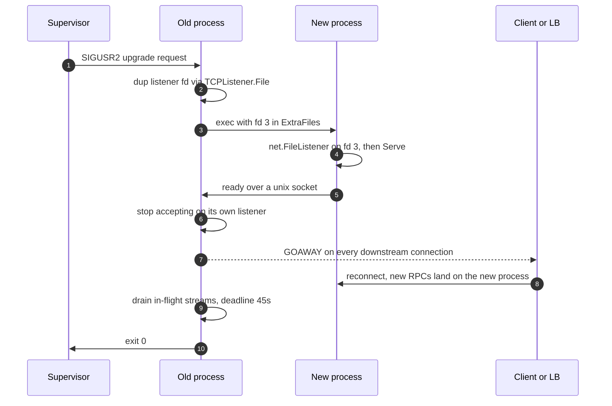

# Case Study: Design a gRPC Edge Proxy in Go

## Intuition

> **Design intuition**: A proxy has no work of its own. Every nanosecond it spends is pure overhead added to somebody else's request, so the design question is never "how do I make this fast" but "how few things can I be made to do per byte". The naive gRPC proxy decodes each message into a Go struct, looks at nothing, and re-encodes it — paying a full protobuf round-trip to move bytes it never read. Delete that one step and the CPU cost drops by an order of magnitude, the allocation rate drops from 3 GB/s to 100 MB/s, and the garbage collector stops being the dominant term in your p99.

This is a **Go runtime and Go networking** case study. It is deliberately not a study of *operating* a proxy: [Technologies: Envoy Proxy](../../technologies/envoy_proxy/envoy_proxy.md) already covers running Envoy — its xDS API, listener and cluster configuration, filter chains, and the operational surface of a C++ data plane you configure but do not compile. **This study is the other half: writing the Go one.** Every design decision here is answerable to the Go runtime — the scheduler, the collector, `crypto/tls`, `grpc-go`'s transport — rather than to a YAML schema.

The specific question: **what does one Go binary have to look like to sit in front of a service mesh, forward 50,000 gRPC RPCs/second across arbitrary methods it has no generated stubs for, apply auth and rate limiting per RPC, hot-reload its routing table without dropping a connection, restart without dropping a stream, and add under 2 ms at p99?**

**Key insight for this design**: the centrepiece is a codec that does nothing. `grpc.UnknownServiceHandler` plus a raw `encoding.CodecV2` that passes `mem.BufferSlice` through untouched turns the proxy into a byte mover that happens to speak gRPC framing. Everything else in the design — the atomic config snapshot, the buffer refcounting, the interceptor ordering — exists to keep that hot path free of locks, free of allocations, and free of parsing.

Everything here builds on:
[gRPC and Protobuf in Go](../grpc_and_protobuf_in_go/grpc_and_protobuf_in_go.md),
[The Runtime and Garbage Collector](../the_runtime_and_garbage_collector/the_runtime_and_garbage_collector.md),
[Escape Analysis and Performance](../escape_analysis_and_performance/escape_analysis_and_performance.md),
[Sync Primitives and the Memory Model](../sync_primitives_and_memory_model/sync_primitives_and_memory_model.md),
[Context and Cancellation](../context_and_cancellation/context_and_cancellation.md),
[net/http Server](../net_http_server/net_http_server.md),
[HTTP Clients and Resilience](../http_clients_and_resilience/http_clients_and_resilience.md),
and [Profiling and Tracing](../profiling_and_tracing/profiling_and_tracing.md).

For the Rust data-plane counterpart, see [Design a High-Performance L7 Proxy in Rust](../../rust/case_studies/design_a_high_performance_l7_proxy.md) in `rust/`.

---

## 1. Requirements Clarification

### What this is, and what Envoy already is

Envoy is the default answer, and choosing to write this in Go needs a defence, not an assumption. The honest industry pattern is **Go control plane, C++ or Rust data plane** — `go-control-plane` serves xDS to Envoy in Contour, Envoy Gateway, Istio's `istiod`, and Kuma. This study is about the cases where the data plane itself is Go: when the proxy's value is a piece of *business* logic (a bespoke auth scheme, a tenant router, a protocol shim) that would otherwise be a WASM filter or an external-processing hop, and when the operational cost of a second language exceeds the ~20% CPU you give up against a hand-tuned C++ data plane. §5 argues both sides with numbers.

### Functional Requirements

- Terminate TLS 1.3 from external clients, present a per-SNI certificate, and re-originate **mTLS** to upstream mesh workloads with a SPIFFE-style client certificate.
- Forward **any** gRPC method — unary, client-streaming, server-streaming, bidirectional — **without generated stubs for it**. The proxy is deployed once and must route methods added by teams that never redeploy it.
- Route on the gRPC method path (`/package.Service/Method`), plus header-based routing for canary splits, to a named **cluster** of upstream endpoints.
- Apply, per RPC: authentication (mTLS peer identity or a JWT), per-route authorization, a per-IP pre-auth rate limit, a per-tenant quota, a global in-flight concurrency cap, and a retry budget.
- **Hot-reload** routes, clusters and endpoints from an xDS-style control plane without dropping a TCP connection, an HTTP/2 stream, or an in-flight RPC.
- Per-cluster health checking (the `grpc.health.v1.Health` protocol) and passive **outlier ejection** on consecutive failures.
- Propagate W3C `traceparent` and emit a server span and a client span per RPC.
- **Restart with zero dropped connections** during a rolling deploy.

### Non-Functional Requirements

- **50,000 RPCs/second sustained** per instance, 80,000/second for 60-second bursts.
- **p99 added latency under 2 ms**, p99.9 under 10 ms. "Added" means proxy-observed total minus proxy-observed upstream time — the only number the proxy is accountable for.
- Container limit **8 vCPU, 4 GiB**. Steady-state RSS under 2.2 GiB.
- **GC CPU fraction under 3%** and no sustained mark-assist on request goroutines.
- A config push must take effect within 5 seconds and must never fail an in-flight RPC.
- Median request 1.2 KiB, median response 4 KiB, p99 response 96 KiB. Payloads are **opaque** — the proxy never inspects a message body, which is precisely what makes the transparent design legal.

### Out of Scope (and where it lives instead)

- Operating and configuring Envoy, its filter chains and xDS resource types — [Technologies: Envoy Proxy](../../technologies/envoy_proxy/envoy_proxy.md).
- The gRPC wire protocol, protobuf encoding rules, and schema evolution — [Backend: gRPC and Protobuf](../../backend/grpc_and_protobuf/grpc_and_protobuf.md) and [Go: gRPC and Protobuf in Go](../grpc_and_protobuf_in_go/grpc_and_protobuf_in_go.md).
- Rate-limit *policy* design (algorithms, distributed counters, fairness) — [HLD: Rate Limiting](../../hld/rate_limiting/rate_limiting.md). This study covers only where the check goes and what it costs.
- General API-gateway concerns (versioning, aggregation, BFF) — [Backend: API Gateway Patterns](../../backend/api_gateway_patterns/api_gateway_patterns.md).
- HTTP/2 framing, HPACK, and flow-control theory — [Backend: HTTP Protocols](../../backend/http_protocols/http_protocols.md).

---

## 2. Scale Estimation

### Byte arithmetic — every byte is touched at least four times

```
Rate:                        50,000 RPC/sec
Median request:              1.2 KiB     ->  60 MB/s ingress
Median response:             4.0 KiB     -> 200 MB/s egress
Payload bytes through proxy: 260 MB/s in one logical direction

Each byte crosses the process twice (read from one socket, write to
the other), so the minimum memcpy traffic is:

  2 x 260 MB/s = 520 MB/s of copies

TLS is applied on BOTH legs (terminate downstream, re-originate upstream):

  520 MB/s decrypt + 520 MB/s encrypt = ~1.04 GB/s of AEAD
  AES-128-GCM with AES-NI: ~3.0 GB/s per core
  Crypto cost: 1.04 / 3.0 = 0.35 core-seconds/sec  (4.4% of 8 vCPU)
```

TLS is not the problem. That surprises people who have not measured it: on any CPU made in the last decade, symmetric AEAD is nearly free and the handshake is the only expensive part of TLS.

### The CPU budget per RPC

```
Container:                   8 vCPU
Core-seconds available:      8 per wall-clock second
RPCs per second:             50,000

Total core-time per RPC:     8 / 50,000 = 160 microseconds

Reserve for GC (3%):         0.24 core-sec/s
Reserve for TLS:             0.35 core-sec/s
Reserve for runtime, HTTP/2
framing, metrics, headroom:  3.20 core-sec/s  (40%)
Left for proxy logic:        4.21 core-sec/s

Budget per RPC:              4.21 / 50,000 = 84 microseconds
Design target (2x margin):   42 microseconds of core time per RPC
```

Forty-two microseconds is comfortable — until you price the naive forwarder.

### Why the naive forwarder dies

The obvious implementation decodes each message into a protobuf value and re-encodes it. Without generated stubs the only way to do that is `dynamicpb` driven by a descriptor the proxy has fetched. On the reference box (`c7i.2xlarge`, Go 1.27, `grpc-go`, AES-NI, `GOMAXPROCS=8`):

```
dynamicpb round-trip of a 4 KiB message:  18.4 microseconds, 141 allocs, 28.6 KB garbage
Same for the 1.2 KiB request:              5.9 microseconds,  47 allocs,  8.4 KB garbage

Per RPC (one request + one response):
  CPU:        24.3 microseconds       -> 58% of the entire 42 us target, doing nothing
  Allocs:     188                     -> 9.4 million allocs/sec at 50k RPS
  Garbage:    37 KB                   -> 1.85 GB/sec

Add per-RPC control structures (context chain, metadata maps, OTel spans,
interceptor closures) at ~23 KB and the garbage rate is:

  50,000 x 60 KB = 3.0 GB/sec
```

Now walk that through the pacer with a 600 MB live heap (mostly HTTP/2 connection buffers and the route table):

```
GOGC=100, live heap 600 MB
  GC goal                    = 2 x 600 MB = 1.2 GB
  Bytes allocated per cycle  = 600 MB
  Cycles per second          = 3.0 GB/s / 600 MB = 5.0 cycles/sec
  Time budget per cycle      = 200 ms

  Mark work: 600 MB of pointer-dense live heap.
  Go's mark throughput is roughly 1 GB/s per dedicated core.
  The collector dedicates 25% of GOMAXPROCS = 2 cores.
  Mark phase duration        = 600 MB / 2 GB/s = 300 ms

  300 ms of mark does not fit in a 200 ms cycle budget.
```

**The collector never stops.** GC CPU pegs at the 25% dedicated share, the pacer permanently under-estimates, and every allocating goroutine — which is every request goroutine — is conscripted into `runtime.gcAssistAlloc` before its allocation is granted. Measured p99 added latency for the naive forwarder: **41 ms** against a 2 ms requirement, with a CPU profile that blames `dynamicpb` and a GC CPU dashboard that reads a flat, unhelpful 25%.

This is not a GC tuning problem. There is no `GOGC` value that fixes 3 GB/s of garbage. The fix is to stop producing it.

### Target: the same table after §4

| Metric | Naive (`dynamicpb` round-trip) | Target | Measured after |
|---|---|---|---|
| CPU per RPC (proxy logic) | 24.3 us | under 42 us | 6.1 us |
| Allocations per RPC (data path) | 188 | 0 | 0 |
| Garbage rate | 3.0 GB/s | under 200 MB/s | 104 MB/s |
| GC cycles/second | 5.0 (continuous) | under 0.25 | 0.17 |
| GC CPU fraction | 25% (pegged) | under 3% | 1.3% |
| p99 added latency | 41 ms | under 2 ms | 0.9 ms |
| Steady RSS | 3.6 GiB | under 2.2 GiB | 1.4 GiB |

### Connection and stream arithmetic

```
Downstream:  40 client pods x 20 connections each      =   800 connections
Upstream:     6 clusters x 40 endpoints x 2 conns each =   480 connections

grpc-go per-connection buffers default to 32 KiB read + 32 KiB write:
  (800 + 480) x 64 KiB = 80 MiB of long-lived, pointer-free byte buffers

Concurrent streams, by Little's Law:
  L = lambda x W = 50,000 RPC/s x 8 ms upstream p99 = 400 concurrent streams
  Spread over 800 downstream connections = 0.5 streams/conn average

Per stream in the proxy:
  2 goroutines (the server handler, plus one reverse pump)
  Stack grows from 2 KiB to ~8 KiB through the interceptor chain
  400 x 2 x 8 KiB = 6.4 MiB of stacks   -- negligible

HTTP/2 flow control:
  grpc-go starts at a 64 KiB stream window and grows it by BDP estimation
  up to 4 MiB. At a 4 KiB median response the window is never the limit,
  but the p99 96 KiB response needs more than the initial 64 KiB, so the
  first few responses on a new connection pay an extra round trip until
  BDP estimation catches up.
```

The last line is a real, measurable artefact: **p99.9 latency on a freshly opened connection is worse than on a warm one**, and the temptation is to "fix" it by setting `grpc.InitialWindowSize` — which §9 explains is the wrong move.

---

## 3. High-Level Architecture

```mermaid
flowchart LR
    classDef ingress  fill:#61afef,stroke:#2e86c1,color:#1a1a1a,font-weight:bold
    classDef guard    fill:#e06c75,stroke:#c0392b,color:#fff,font-weight:bold
    classDef hot      fill:#98c379,stroke:#27ae60,color:#1a1a1a,font-weight:bold
    classDef ctrl     fill:#e5c07b,stroke:#f39c12,color:#1a1a1a
    classDef up       fill:#c678dd,stroke:#9b59b6,color:#fff
    classDef obs      fill:#56b6c2,stroke:#0097a7,color:#1a1a1a

    cli(["gRPC clients<br/>TLS 1.3 + HTTP/2"])
    lis(["Listener<br/>SO_REUSEPORT<br/>or inherited fd"])
    tlsn(["TLS terminate<br/>GetConfigForClient by SNI<br/>cert from atomic.Pointer"])
    h2(["grpc-go Server<br/>ForceServerCodecV2 rawCodec<br/>MaxConcurrentStreams 4096"])
    chain(["Interceptor chain<br/>metrics, recover, trace<br/>authn, authz, limits"])
    unk(["UnknownServiceHandler<br/>the transparent forwarder"])
    snap(["atomic.Pointer Snapshot<br/>routes + clusters<br/>one atomic load, no lock"])
    route(["Route match<br/>method trie<br/>under 200 ns"])
    pump(["Two stream pumps<br/>mem.BufferSlice passthrough<br/>zero marshal on data path"])
    cc(["Per-cluster ClientConn<br/>weighted round robin<br/>outlier ejection"])
    ups(["Upstream workloads<br/>mTLS, SPIFFE identity"])
    xds(["Control plane<br/>xDS-style ADS stream<br/>versioned snapshots"])
    hc(["Health checker<br/>grpc.health.v1<br/>plus passive ejection"])
    obs(["OTel spans + Prometheus<br/>labels keyed on route_id<br/>never on method"])

    cli --> lis --> tlsn --> h2 --> chain --> unk
    unk --> route --> pump --> cc --> ups
    snap -->|"Load"| route
    snap -->|"Load"| cc
    xds -->|"Store"| snap
    hc -->|"eject"| snap
    chain -.-> obs
    pump -.-> obs

    class cli,lis,tlsn ingress
    class chain guard
    class h2,unk,route,pump hot
    class snap,xds ctrl
    class cc,ups,hc up
    class obs obs
```



Each box exists to hold exactly one ceiling or to remove exactly one cost:

| Component | What it enforces or removes | What happens without it |
|---|---|---|
| `ForceServerCodecV2(rawCodec{})` | Zero protobuf work on the data path | 24 us and 188 allocations per RPC, GC pegged at 25% |
| `UnknownServiceHandler` | Forwards methods with no generated stub | The proxy must be redeployed for every new RPC in the mesh |
| `atomic.Pointer[Snapshot]` | Config read is one atomic load, never a lock | An `RWMutex` read on the hot path serialises 50k RPS on one cache line |
| Interceptor chain, in order | Cheap checks reject before expensive ones run | A 4 KB JWT verify runs for traffic an IP limiter should have dropped |
| Per-cluster `ClientConn` reuse across snapshots | A route change does not reconnect | Every config push re-handshakes 480 mTLS connections |
| `MaxConcurrentStreams` set explicitly | Bounded in-flight work per connection | grpc-go's default is unlimited, so one client can pin the whole proxy |
| Buffer refcounting (`Ref`/`Free`) | Pooled buffers actually return to the pool | Allocation rate silently climbs back to the naive number |
| Graceful restart with fd handover | No dropped connection on deploy | Every rolling restart shows as a client-side `UNAVAILABLE` spike |

---

## 4. Component Deep Dives

### 4.1 The transparent forwarder — the centrepiece

A generated gRPC server knows every method it serves and has a `proto.Message` type for each. A proxy knows neither. `grpc-go` provides exactly one hook for this:

```go
func UnknownServiceHandler(streamHandler StreamHandler) ServerOption
type StreamHandler func(srv any, stream ServerStream) error
```

Any RPC whose service is not registered is delivered to that handler as a raw `grpc.ServerStream`. The handler can read messages, write messages, read and set metadata, and nothing else — which is all a proxy needs.

The problem is what `RecvMsg(v any)` does with `v`. By default it hands the wire bytes to the registered `proto` codec, which needs a `proto.Message`. The proxy has none.

#### BROKEN — decode into a dynamic message

```go
// BROKEN: works, and costs 24 microseconds and 188 allocations per RPC.
func forwardBroken(p *Proxy, srv any, ss grpc.ServerStream) error {
    method, _ := grpc.Method(ss.Context())
    desc, err := p.descriptors.MethodDescriptor(method) // a whole descriptor
                                                        // fetch/cache subsystem
                                                        // the proxy should not need
    if err != nil {
        return status.Errorf(codes.Unimplemented, "no descriptor for %s", method)
    }
    for {
        req := dynamicpb.NewMessage(desc.Input())
        if err := ss.RecvMsg(req); err == io.EOF {
            break
        } else if err != nil {
            return err
        }
        // The proxy looks at exactly none of this.
        if err := cs.SendMsg(req); err != nil { // re-marshals from scratch
            return err
        }
    }
    return nil
}
```

Three separate defects, and the CPU cost is the least interesting one. It needs a descriptor registry, so a team shipping a new RPC must publish a descriptor before the proxy can route it — the coupling the proxy existed to remove. It fails on any message with an extension or unknown field the descriptor lacks. And it re-encodes, so a byte-for-byte-identical payload can come out with different field ordering, which breaks any upstream that signs or hashes the request body.

#### FIX — a codec that moves buffers and parses nothing

`encoding.CodecV2` is the current codec interface and it is buffer-oriented, which is what makes the zero-copy version possible:

```go
type CodecV2 interface {
    Marshal(v any) (out mem.BufferSlice, err error)
    Unmarshal(data mem.BufferSlice, v any) error
    Name() string
}
```

`mem.BufferSlice` is `[]mem.Buffer`, each `Buffer` reference-counted and backed by a pooled `[]byte`. A codec that passes the slice straight through never materialises a contiguous byte slice, never allocates, and never learns what the bytes mean.

```go
// rawFrame is the only "message type" the proxy has. It holds wire bytes.
type rawFrame struct {
    buf mem.BufferSlice
}

func (f *rawFrame) Free() {
    f.buf.Free()
    f.buf = nil
}

// rawCodec implements encoding.CodecV2 with no parsing at all.
type rawCodec struct{}

// Name must be "proto": the content-subtype negotiated on the wire is
// application/grpc+proto, and both the downstream client and the upstream
// server will reject anything else. The codec lies about its name and tells
// the truth about its behaviour.
func (rawCodec) Name() string { return "proto" }

func (rawCodec) Marshal(v any) (mem.BufferSlice, error) {
    f, ok := v.(*rawFrame)
    if !ok {
        return nil, fmt.Errorf("edge: rawCodec cannot marshal %T", v)
    }
    // The transport will Free() what we return once it has written it.
    // Take a reference so our own copy outlives that.
    f.buf.Ref()
    return f.buf, nil
}

func (rawCodec) Unmarshal(data mem.BufferSlice, v any) error {
    f, ok := v.(*rawFrame)
    if !ok {
        return fmt.Errorf("edge: rawCodec cannot unmarshal into %T", v)
    }
    // data is freed as soon as this returns unless we take a reference.
    data.Ref()
    f.buf = data
    return nil
}
```

**Never register this codec globally.** `encoding.RegisterCodecV2(rawCodec{})` would replace the `proto` codec for the entire process, including the proxy's own control-plane client, which genuinely needs to decode protobuf. Scope it instead:

```go
srv := grpc.NewServer(
    grpc.Creds(credentials.NewTLS(downstreamTLS)),
    grpc.ForceServerCodecV2(rawCodec{}),              // server side, this server only
    grpc.UnknownServiceHandler(p.forward),
    grpc.MaxConcurrentStreams(4096),
    grpc.MaxRecvMsgSize(16<<20),
    grpc.ChainStreamInterceptor(p.interceptors()...),
    grpc.KeepaliveParams(keepalive.ServerParameters{
        MaxConnectionAge:      30 * time.Minute,      // periodic GOAWAY so LBs rebalance
        MaxConnectionAgeGrace: 30 * time.Second,
        Time:                  60 * time.Second,
        Timeout:               20 * time.Second,
    }),
    grpc.KeepaliveEnforcementPolicy(keepalive.EnforcementPolicy{
        MinTime:             30 * time.Second,
        PermitWithoutStream: false,
    }),
)
```

and on the outbound side, per call rather than per connection:

```go
cs, err := grpc.NewClientStream(outCtx, bidiDesc, cluster.conn, method,
    grpc.ForceCodecV2(rawCodec{}),
    grpc.WaitForReady(false),
)

var bidiDesc = &grpc.StreamDesc{ServerStreams: true, ClientStreams: true}
```

`ServerStreams: true, ClientStreams: true` is not a claim about the method — it tells `grpc-go` to impose no framing restrictions, which is required because the proxy does not know whether the method it is forwarding is unary or bidirectional. A unary RPC forwarded through a bidi descriptor is wire-identical; the descriptor only governs what `grpc-go` will let *you* do.

Measured on the reference box: **6.1 us of proxy CPU per RPC and zero data-path allocations**, against 24.3 us and 188.

### 4.2 The two pumps, and where the subtleties live

Forwarding a stream is two independent copy loops that must terminate correctly in six different ways.

```go
func (p *Proxy) forward(srv any, ss grpc.ServerStream) error {
    ctx := ss.Context()
    method, ok := grpc.Method(ctx)
    if !ok {
        return status.Error(codes.Internal, "edge: no method on stream")
    }

    snap := p.current.Load()          // one atomic load, no lock, ~1 ns
    rt := snap.Routes.match(method)   // trie walk, ~140 ns
    if rt == nil {
        return status.Errorf(codes.Unimplemented, "edge: no route for %s", method)
    }
    cl, ok := snap.Clusters[rt.Cluster]
    if !ok || cl.conn == nil {
        return status.Errorf(codes.Unavailable, "edge: cluster %s not ready", rt.Cluster)
    }

    md, _ := metadata.FromIncomingContext(ctx)
    outCtx, cancel := context.WithCancel(
        metadata.NewOutgoingContext(ctx, rt.RewriteHeaders(md)))
    defer cancel() // cancelling the client stream is the ONLY way to release
                   // its resources when the downstream goes away first

    cs, err := grpc.NewClientStream(outCtx, bidiDesc, cl.conn, method,
        grpc.ForceCodecV2(rawCodec{}))
    if err != nil {
        return err
    }

    // Downstream -> upstream, on its own goroutine.
    c2s := make(chan error, 1)
    go func() { c2s <- pumpUp(ss, cs) }()

    // Headers must reach the client before the first response message.
    hdr, err := cs.Header()
    if err != nil {
        return err // upstream failed before headers: propagate its status verbatim
    }
    if err := ss.SendHeader(hdr); err != nil {
        return err
    }

    // Upstream -> downstream, on this goroutine.
    for {
        f := &rawFrame{}
        if err := cs.RecvMsg(f); err != nil {
            ss.SetTrailer(cs.Trailer())
            if err == io.EOF {
                return <-c2s // upstream finished cleanly; report the send side
            }
            return err       // already a *status.Status from grpc-go
        }
        err := ss.SendMsg(f)
        f.Free()             // return pooled buffers regardless of outcome
        if err != nil {
            return err
        }
    }
}

func pumpUp(ss grpc.ServerStream, cs grpc.ClientStream) error {
    for {
        f := &rawFrame{}
        if err := ss.RecvMsg(f); err != nil {
            if err == io.EOF {
                return cs.CloseSend() // client half-closed: propagate the half-close
            }
            return err
        }
        err := cs.SendMsg(f)
        f.Free()
        if err != nil {
            // A SendMsg error means the stream is dead. RecvMsg on the other
            // pump will surface the real status, so do not invent one here.
            return nil
        }
    }
}
```

Six termination paths, and getting any of them wrong produces a bug that only appears under streaming traffic:

| Event | Correct behaviour | Symptom if wrong |
|---|---|---|
| Client half-closes | `io.EOF` from `ss.RecvMsg` becomes `cs.CloseSend()` | Upstream blocks forever waiting for a request it will never get |
| Upstream ends the stream | `io.EOF` from `cs.RecvMsg`, then forward trailers | Client sees `OK` with no trailers and loses the status detail |
| Upstream returns an error | Return the `*status.Status` unchanged | Wrapping it rewrites `NOT_FOUND` as `UNKNOWN` and breaks client retry logic |
| Client cancels | `ctx` cancellation propagates to `outCtx` | Upstream keeps computing a response nobody wants: pure waste at 50k RPS |
| `SendMsg` fails downstream | Return, let `defer cancel()` tear down the upstream | Both pump goroutines leak, one per failed RPC |
| Deadline expires | grpc-go propagates `grpc-timeout` automatically | Nothing — but only because the deadline rode in on the context |

The `defer cancel()` deserves emphasis. A `grpc.ClientStream` holds a transport stream, flow-control accounting, and a goroutine on the upstream connection. Nothing releases them when the *downstream* goes away first — the client stream has no idea that happened. Cancelling its context is the release mechanism, and forgetting it is the single most common goroutine leak in Go proxies. The `goroutineleak` profile `[1.27]` finds it in one run; see [Concurrency Patterns and Pitfalls](../concurrency_patterns_and_pitfalls/concurrency_patterns_and_pitfalls.md).

### 4.3 Buffer lifetime — the bug no tool finds

Every `mem.Buffer` is reference-counted over a `[]byte` from a pool. `Ref()` increments, `Free()` decrements, and at zero the backing slice goes back to `mem.DefaultBufferPool()`. The codec takes a reference on both paths and the pumps release it. Two ways to get it wrong, with opposite symptoms:

**A missed `Free()` is not a leak — it is a silent performance regression.** The buffer is still ordinary Go memory, so the collector reclaims it; what is lost is the *pool hit*. The proxy keeps working, allocation rate climbs back toward the naive figure, GC CPU rises, and p99 degrades over weeks as traffic grows. There is no error, no leak alarm, no failing test. The only detector is `benchstat` on `allocs/op` in a benchmark that exercises the pump, plus an alert on `go_memstats_mallocs_total` rate per RPC.

**A double `Free()` is corruption.** The buffer returns to the pool while another reference still reads it, the next RPC gets the same backing array, and one client receives a fragment of another client's response. This is a cross-tenant data leak with the shape of a heisenbug. `-race` cannot find it: there is no data race, every access is properly ordered, the *lifetime* is wrong. Go has no tool for wrong lifetimes — the same lesson `unsafe.String` teaches in the ingest study.

Two practical defences. First, exactly one `Free()` per `rawFrame`, always immediately after the send that consumed it, never in a `defer` inside a loop. Second, bisect a suspected refcount bug by swapping the pool for one that never reuses:

```go
// nopPool implements mem.BufferPool. Get allocates, Put drops.
// A use-after-free is harmless against it, so if the corruption
// disappears when this is installed, the bug is a refcount bug.
type nopPool struct{}

func (nopPool) Get(length int) *[]byte { b := make([]byte, length); return &b }
func (nopPool) Put(*[]byte)            {}
```

Ship it behind a flag, run one canary pod with it, and compare error rates. It costs throughput and buys certainty.

### 4.4 Dynamic configuration — versioned snapshots and one atomic swap

The data path reads config on every RPC. If that read takes a lock, the lock is the bottleneck: an `RWMutex.RLock` is a write to a shared cache line, so 50,000 RPS across 8 cores makes that line bounce 50,000 times a second, and the measured cost is 40-90 ns per acquisition under contention — 5% of the CPU budget to read a pointer.

```go
type Snapshot struct {
    Version  string
    Routes   *routeTrie
    Clusters map[string]*Cluster   // read-only after construction
}

type Proxy struct {
    current atomic.Pointer[Snapshot]
}
```

Reads are `p.current.Load()`: one atomic load of a shared, rarely-written line, effectively free. Writes build an entirely new `Snapshot` and `Store` it. **Nothing in a snapshot is ever mutated after publication** — that immutability is what makes the whole scheme safe without a lock.

#### BROKEN — reload under a lock

```go
// BROKEN: correct, and 5% of the CPU budget plus a latency cliff.
type Proxy struct {
    mu       sync.RWMutex
    routes   *routeTrie
    clusters map[string]*Cluster
}

func (p *Proxy) route(method string) (*Route, *Cluster) {
    p.mu.RLock()
    defer p.mu.RUnlock()          // held across the trie walk
    rt := p.routes.match(method)
    return rt, p.clusters[rt.Cluster]
}

func (p *Proxy) reload(next *config) {
    p.mu.Lock()                   // 50,000 readers/sec now block
    defer p.mu.Unlock()
    p.routes = buildTrie(next)    // 12 ms of trie construction UNDER THE LOCK
    p.clusters = dialAll(next)    // and 400 ms of mTLS dialling
}
```

The steady-state cost is bad. The reload behaviour is worse: `sync.RWMutex` blocks *new* readers as soon as a writer is waiting, so the 412 ms of construction becomes 412 ms during which every RPC stalls. A config push — the thing that is supposed to be invisible — becomes the worst latency event of the day, once per push. Measured p99 during reload: **480 ms**.

#### FIX — build outside, swap inside

```go
func (p *Proxy) applySnapshot(next *xdsSnapshot) error {
    prev := p.current.Load()

    clusters := make(map[string]*Cluster, len(next.Clusters))
    var retired []*Cluster

    for name, cfg := range next.Clusters {
        if old, ok := prev.Clusters[name]; ok && old.SameTransport(cfg) {
            clusters[name] = old.WithPolicy(cfg)  // REUSE the live ClientConn
            continue
        }
        cc, err := grpc.NewClient(cfg.Target,
            grpc.WithTransportCredentials(credentials.NewTLS(p.upstreamTLS(cfg))),
            grpc.WithDefaultServiceConfig(cfg.ServiceConfigJSON),
            grpc.WithReadBufferSize(64<<10),
            grpc.WithWriteBufferSize(64<<10),
        )
        if err != nil {
            return fmt.Errorf("cluster %s: %w", name, err)  // reject the WHOLE
        }                                                    // snapshot: never
        clusters[name] = newCluster(cfg, cc)                 // publish a partial one
    }
    for name, old := range prev.Clusters {
        if _, kept := clusters[name]; !kept {
            retired = append(retired, old)
        }
    }

    trie, err := buildTrie(next.Routes, clusters)  // validated against clusters
    if err != nil {
        return err
    }
    p.current.Store(&Snapshot{Version: next.Version, Routes: trie, Clusters: clusters})

    // An RPC that loaded the previous snapshot may still be running. Give it
    // the max stream lifetime before closing connections it might still use.
    for _, c := range retired {
        cc := c.conn
        time.AfterFunc(p.drainWindow, func() { _ = cc.Close() })
    }
    return nil
}
```

Four properties worth naming:

1. **Connection reuse across snapshots.** `SameTransport` compares target, TLS material and credentials only, so a weight, timeout or retry-policy change points the new `Snapshot` at the *same* `*grpc.ClientConn` and re-establishes nothing. Without it, a control plane pushing every 30 seconds re-handshakes 480 mTLS connections every 30 seconds — 480 × 0.15 ms of ECDSA, plus a latency spike on every cluster.
2. **All-or-nothing.** A snapshot that fails validation is discarded whole. Publishing a partially-applied config is how a routing typo takes down one service instead of failing a push.
3. **Deferred close.** `retired` clusters are closed after `drainWindow` (the max stream lifetime, 30 minutes here). Closing immediately kills in-flight RPCs that legitimately loaded the old snapshot, and the snapshot itself is not even garbage yet — at 0.17 GC cycles/second it stays reachable for seconds after the last reference drops.

The xDS stream itself is a long-lived bidirectional RPC with `resource_version` acknowledgement: the proxy NACKs a bad snapshot with its version and the reason, so the control plane sees which instances rejected which push. The wire protocol matters less than the discipline: **versioned, immutable, all-or-nothing, acknowledged.**

### 4.5 The interceptor chain and why the order is the design

`grpc.ChainStreamInterceptor(a, b, c)` makes `a` outermost. Every position is a decision about what gets measured and what gets protected.

```go
func (p *Proxy) interceptors() []grpc.StreamServerInterceptor {
    return []grpc.StreamServerInterceptor{
        p.metrics,        // 1. outermost: must observe every outcome, panics included
        p.recover,        // 2. converts a panic into codes.Internal so (1) records it
        p.trace,          // 3. extract traceparent, start the server span
        p.ipLimit,        // 4. cheap per-peer token bucket, BEFORE any crypto
        p.authn,          // 5. mTLS peer identity or JWT verify
        p.authz,          // 6. per-route policy, needs the identity from (5)
        p.tenantQuota,    // 7. per-tenant bucket, needs the tenant from (5)
        p.inflight,       // 8. global concurrency cap, innermost guard
        p.retryBudget,    // 9. accounting only, must be closest to the forwarder
    }
}
```

The two orderings people get wrong:

**Metrics outside recovery, not inside.** The instinct is to put panic recovery outermost so it catches everything. Do that and a panic in the metrics interceptor is caught — but a panic anywhere *below* is caught before metrics sees a status, so the RPC vanishes from the dashboards entirely. Panics become invisible exactly when you most need to see them. Metrics outermost, recovery immediately inside it, and the panic surfaces as an `Internal` in the same counter as every other failure.

**IP limiting before authentication, tenant quota after.** Authentication is the expensive step: a JWT with an RS256 signature costs 180 us of CPU to verify, and mTLS peer extraction plus a SPIFFE ID parse costs 4 us. An attacker sending 50,000 invalid JWTs per second consumes 9 core-seconds per second on a proxy that has 8 — a complete denial of service using traffic that never authenticates. The cheap per-IP bucket at position 4 costs 90 ns and stops it. But a per-*tenant* quota cannot run there, because the tenant identity does not exist until position 5. Two limiters, at two positions, for two different threats.

Measured cost of the full chain: **3.4 us per RPC**, of which authn is 2.1 us (mTLS path, with the SPIFFE ID cached per connection rather than re-parsed per RPC). Against a 42 us target that is affordable; a naive implementation that re-parses the peer certificate per RPC measures 31 us and eats three-quarters of the budget on work whose answer cannot change within a connection.

Retry budgets sit innermost because they are pure accounting on the forward path. The policy follows gRPC's `retryThrottling` shape — `maxTokens: 100`, `tokenRatio: 0.1`: every upstream failure decrements the bucket by 1, every success adds 0.1, and retries are refused while tokens are below `maxTokens/2`. The property that matters is that a **fully-down upstream cannot be retried at all**: 10 failures drain 10 tokens against 0 successes, and the budget shuts retries off within a second. A fixed "3 attempts" policy instead multiplies the load on a struggling upstream by three at exactly the moment it can least absorb it. See [HTTP Clients and Resilience](../http_clients_and_resilience/http_clients_and_resilience.md).

### 4.6 Upstream connections, stream limits and backpressure

Each cluster owns one `*grpc.ClientConn`, which is not one connection — it is a balanced set of subconnections, one per resolved endpoint, with `grpc-go`'s LB policy picking per RPC:

```json
{
  "loadBalancingConfig": [{"round_robin": {}}],
  "healthCheckConfig": {"serviceName": ""},
  "methodConfig": [{
    "name": [{}],
    "timeout": "10s",
    "retryPolicy": {
      "maxAttempts": 3,
      "initialBackoff": "0.05s",
      "maxBackoff": "1s",
      "backoffMultiplier": 2,
      "retryableStatusCodes": ["UNAVAILABLE", "RESOURCE_EXHAUSTED"]
    }
  }],
  "retryThrottling": {"maxTokens": 100, "tokenRatio": 0.1}
}
```

Two connections per endpoint rather than one, for a reason specific to HTTP/2: all streams on a connection share one TCP congestion window and one `Framer` write loop, so a single 96 KiB response head-of-line blocks the frames behind it. Two connections halve the exposure and cost 128 KiB of buffers each. Four measured no better.

**`MaxConcurrentStreams` is the backpressure primitive, and grpc-go's server default is unlimited.** The `SETTINGS_MAX_CONCURRENT_STREAMS` value the proxy advertises is what stops a client opening 200,000 streams; without it, each stream costs a goroutine pair, a flow-control window, and a slot in the transport's stream map, and one misbehaving client exhausts the proxy for everybody. Setting it to 4096 makes the client's own transport queue the excess — HTTP/2 backpressure applied at the correct layer, with no error and no shed. The arithmetic: 400 expected concurrent streams across 800 connections, so 4096 per connection is roughly a 10× headroom on the *aggregate*, and the cap binds only when a client genuinely concentrates its traffic.

On the upstream side the mirror image applies. The proxy is a *client*, and if an upstream advertises 100 concurrent streams while the proxy needs 400, `grpc-go` queues the excess in the transport — invisible latency that shows up as upstream time in the trace but has nothing to do with the upstream's work. The detector is `grpc_client_started_total` minus in-flight, against the advertised setting; the fix is more subconnections, not a bigger buffer.

Passive outlier ejection runs on the health checker's goroutine and is deliberately conservative, matching Envoy's defaults because they are well-tested: 5 consecutive `UNAVAILABLE` or `DEADLINE_EXCEEDED` responses eject an endpoint, the interval is 10 seconds, the base ejection time is 30 seconds and doubles per consecutive ejection, and **at most 10% of a cluster may be ejected at once**. That last cap is the one that matters: without it, a bad deploy that makes every endpoint fail ejects the entire cluster and turns a partial outage into a total one.

### 4.7 Zero-downtime restart

Two mechanisms, and they solve different halves of the problem.



**Which mechanism.** `SO_REUSEPORT` lets both processes bind the same port and the kernel hashes new connections across them. It is simpler — no fd passing, no supervisor protocol — and it is the wrong tool here. The kernel rebalances its hash when a socket joins or leaves the group, which can drop SYNs in the transition window, and it gives you no control: roughly half of new connections go to the process you are trying to retire. For a proxy carrying long-lived HTTP/2 connections that is worse still, because an existing connection stays pinned to whichever process accepted it for as long as the client keeps it open, and a client with a 12-hour connection keeps the old binary alive for 12 hours.

**fd inheritance** is the right tool. `(*net.TCPListener).File()` returns a dup'd descriptor in blocking mode; pass it in `exec.Cmd.ExtraFiles` and the child rebuilds the listener with `net.FileListener`. The parent then controls the handover explicitly.

```go
func inheritOrListen(addr string) (net.Listener, error) {
    if os.Getenv("EDGE_INHERIT_FD") == "3" {
        f := os.NewFile(3, "edge-listener")
        return net.FileListener(f)          // same kernel socket, no bind, no gap
    }
    lc := net.ListenConfig{
        KeepAlive: 30 * time.Second,
        Control: func(network, address string, c syscall.RawConn) error {
            return c.Control(func(fd uintptr) {
                _ = unix.SetsockoptInt(int(fd), unix.SOL_SOCKET, unix.SO_REUSEADDR, 1)
            })
        },
    }
    return lc.Listen(context.Background(), "tcp", addr)
}

func (p *Proxy) spawnSuccessor() error {
    f, err := p.ln.(*net.TCPListener).File()   // dup, blocking mode
    if err != nil {
        return err
    }
    defer f.Close()
    cmd := exec.Command(os.Args[0], os.Args[1:]...)
    cmd.Env = append(os.Environ(), "EDGE_INHERIT_FD=3")
    cmd.ExtraFiles = []*os.File{f}             // becomes fd 3 in the child
    cmd.Stdout, cmd.Stderr = os.Stdout, os.Stderr
    return cmd.Start()
}
```

**Draining is the part that is actually hard.** `grpc.Server.GracefulStop()` sends GOAWAY on every connection and then blocks until every RPC finishes — which, for a proxy carrying a bidirectional stream that a client keeps open for an hour, means an hour. The drain must be bounded:

```go
done := make(chan struct{})
go func() { srv.GracefulStop(); close(done) }()
select {
case <-done:
case <-time.After(45 * time.Second):
    srv.Stop()   // kill what is left; the LB has had 45s to move traffic
}
```

Forty-five seconds must fit inside `terminationGracePeriodSeconds`, and the `preStop` sleep that lets endpoint removal propagate through kube-proxy comes out of the same budget. The pod's grace period is 75 seconds here: 15 for `preStop`, 45 for the drain, 15 of margin.

**The load-balancer interaction is why `MaxConnectionAge` exists.** An L4 load balancer distributes *connections*, and a gRPC client opens one and keeps it. Add a new proxy replica and it receives nothing, because nobody is opening connections. `MaxConnectionAge: 30 * time.Minute` with a 30-second grace makes the proxy send GOAWAY on its own schedule, so clients reconnect and rebalance continuously. Without it, a scale-out event takes hours to take effect and every rolling restart produces a thundering herd of simultaneous reconnects instead of a smooth trickle. The 30-minute figure staggers naturally because connections were established at different times.

### 4.8 p99 under GC

A proxy is unusually GC-sensitive for a structural reason: it has no work of its own to hide a pause behind. A service that spends 40 ms in a database query barely notices a 0.5 ms stall. A proxy whose entire latency budget is 2 ms notices it at p99.9, and notices the *mark phase* at p99.

The arithmetic, with the raw codec in place:

```
Garbage rate:        104 MB/s   (control structures, metadata maps, spans)
Live heap:           600 MB     (mostly HTTP/2 connection buffers)
GOGC=100 goal:       1.2 GB, so 600 MB allocated per cycle
Cycles/second:       104 MB/s / 600 MB = 0.17 cycles/sec  (one every 5.8 s)

Mark phase:          600 MB at ~1 GB/s/core, 25% of 8 vCPU = 2 cores
                     -> 300 ms of mark phase, every 5.8 seconds = 5.2% duty cycle
GC CPU fraction:     0.25 x 0.052 x 8 = 0.10 core-sec/s = 1.3% of the container

Stop-the-world:      2 phases per cycle, sub-millisecond each
                     Concurrent streams (Little's Law) = 400
                     A 0.5 ms STW adds 0.5 ms to those 400 RPCs
                     At 0.17 cycles/s: 0.17 x 2 x 400 = 136 RPCs/sec affected
                     136 / 50,000 = 0.27% of requests -> visible at p99.9, not p99
```

That is the shape you want: GC visible in the p99.9 tail, absent from p99, and costing 1.3% of CPU.

Three levers got it there, in order of impact:

1. **The raw codec** removed 96% of the garbage. Nothing else came close.
2. **Buffer pooling** via `mem.DefaultBufferPool()`, which `grpc-go` already uses for transport reads — the codec's job was to not defeat it by materialising contiguous slices.
3. **Span allocation control.** An OTel span with 8 attributes costs 1.2 us and 6 allocations. Two spans per RPC (server and client) at 50k RPS is 600,000 allocations/second — 40% of the remaining garbage. Head-based sampling at 1%, with a tail rule that always samples non-`OK` statuses, cuts it to 6,000/second while keeping every error trace. Sampling here is an allocation-budget decision, not a storage-cost one.

`GOMEMLIMIT` at 3.4 GiB (85% of the 4 GiB container limit) is a seatbelt, not a tuning knob: it converts an `OOMKilled` under a pathological burst into a survivable degradation. It does not reduce steady-state GC work and it is not backpressure — the concurrency cap in the interceptor chain is the brake. See [The Runtime and Garbage Collector](../the_runtime_and_garbage_collector/the_runtime_and_garbage_collector.md).

**Measuring this needs the execution tracer, not pprof.** A CPU profile of a proxy under mark-assist pressure blames the forwarder, because assist time is charged to the stack that triggered the allocation. `go tool trace` answers the question that matters — "why did this goroutine sit runnable for 3 ms" — and shows `runtime.gcAssistAlloc` on request goroutines directly. `go tool trace -http=:6060` binds localhost only `[1.27]`, so port-forward rather than exposing it. The flight recorder `[1.25]` is the production form: keep a rolling in-memory trace window and dump it when a latency SLO burns, so you capture the incident rather than a healthy period afterwards. See [Execution Tracer and Flight Recorder](../profiling_and_tracing/execution_tracer_and_flight_recorder.md).

Go 1.27's size-specialized allocation routines are worth a note: allocations under 80 bytes are up to 30% faster, which is exactly the size class of the metadata and context structures that dominate what garbage remains. Measured effect here: 4% off total CPU, for free, on upgrade.

### 4.9 Observability without unbounded cardinality

**The transparent design creates a cardinality hazard by construction.** The proxy forwards arbitrary methods, so `/package.Service/Method` is an unbounded label — a client can invent method names, and a legitimate mesh with 40 services × 30 methods already gives 1,200 values before anyone tries. Multiply by status code and cluster and the series count explodes.

The router already solves it. Every RPC that reaches the forwarder matched a route from the current snapshot, and routes are enumerable — 240 of them. Label on `route_id`, not method:

```
edge_rpc_duration_seconds{route_id, cluster, grpc_code}
  240 routes x 6 clusters x 17 canonical codes = 24,480 series (worst case)
  Realistically ~2,400: most routes map to one cluster and 3 codes.

edge_rpc_unrouted_total{peer_class}
  One counter for everything that did NOT match a route, labelled by a
  bounded peer classification. This is where the unbounded method names go,
  and they go in as a count, not as a label value.
```

The rule generalises: **a label value must come from configuration, never from the request.** Configuration is finite by definition and changes only when a human pushes it. Anything derived from a request is attacker-controlled. The exception that proves it is `grpc_code`, which is drawn from a closed enum of 17 values.

Trace propagation costs nothing extra precisely because the proxy does not parse bodies. `traceparent` rides in gRPC metadata (HTTP/2 headers), so the proxy extracts it into the context, starts a `SpanKindServer` span for the downstream leg, starts a `SpanKindClient` span for the upstream leg, and injects the new context into the outgoing metadata. Two spans and one header rewrite, no body access. The sampling decision propagates in the `traceparent` flags byte, so a client that sampled a request gets the proxy's spans for it — which is what makes the 1% head-based rate safe: it is 1% of *traces*, not 1% of spans, and a sampled trace is complete. See [Observability and OpenTelemetry](../observability_and_opentelemetry/observability_and_opentelemetry.md).

### 4.10 TLS on both legs

Downstream termination uses SNI-based certificate selection with hot reload through the same atomic-pointer pattern as the config:

```go
type certStore struct {
    byName atomic.Pointer[map[string]*tls.Certificate]
}

func (s *certStore) config() *tls.Config {
    return &tls.Config{
        MinVersion: tls.VersionTLS13,
        NextProtos: []string{"h2"},
        GetCertificate: func(hi *tls.ClientHelloInfo) (*tls.Certificate, error) {
            m := *s.byName.Load()          // atomic load per handshake, not per RPC
            if c, ok := m[hi.ServerName]; ok {
                return c, nil
            }
            return nil, fmt.Errorf("edge: no certificate for %q", hi.ServerName)
        },
        ClientAuth: tls.VerifyClientCertIfGiven,
        ClientCAs:  s.pool(),
    }
}
```

Rotating a certificate is a `Store` of a new map. No connection drops, no restart, no lock on the handshake path.

Handshake cost is the number that governs capacity, not throughput:

```
ECDSA P-256 server handshake:   ~0.15 ms of CPU
RSA-2048 server handshake:      ~1.20 ms of CPU   (8x worse)
TLS 1.3 PSK resumption:         ~0.03 ms of CPU

Steady state: 800 connections with a 30-minute MaxConnectionAge
  = 0.44 handshakes/sec = 0.07 ms/sec of CPU. Free.

Thundering herd: all 20,000 client processes reconnect at once
  20,000 x 0.15 ms = 3.0 core-seconds -> 375 ms of wall clock on 8 vCPU
  With RSA-2048 instead: 24 core-seconds -> 3 seconds of total stall.
```

ECDSA is not a micro-optimisation here; it is the difference between a reconnect storm being a blip and being an outage. Session tickets make resumption cheap, but a proxy fleet must share the ticket key or resumption fails across instances — rotate a shared key every 24 hours with a 48-hour acceptance window.

Upstream mTLS re-originates with the proxy's own SPIFFE identity. The upstream's trust decision is about the proxy, not the original client; the client's identity travels as an authenticated assertion in metadata, signed by the proxy. Conflating the two is the classic confused-deputy bug: an upstream that trusts a `x-user-id` header from anyone with a valid connection has no authorization at all.

Go 1.27's `crypto/tls` supports ML-DSA signature schemes (`MLDSA44`/`MLDSA65`/`MLDSA87`) and `MLKEM1024` alongside the hybrid key exchange. For an edge proxy with a long-lived certificate the relevant property is harvest-now-decrypt-later resistance on the key exchange, which the hybrid group already provides.

---

## 5. Design Decisions & Tradeoffs

### Decision 1: a raw codec, not a descriptor registry

| | Raw passthrough | `dynamicpb` with a descriptor registry |
|---|---|---|
| CPU per RPC | 6.1 us | 24.3 us |
| Allocations per RPC | 0 | 188 |
| New method needs a proxy change | no | yes: publish a descriptor first |
| Can inspect message fields | no | yes |
| Byte-preserving | yes | no: re-encodes |

The proxy gives up the ability to route on a message field. That is the whole trade, and it is almost always the right one: routing on a body field means parsing every message on the hot path, and the cases that seem to need it (tenant extraction, sharding keys) are better served by putting the value in metadata where the proxy can read it for 40 ns.

### Decision 2: `atomic.Pointer[Snapshot]` over `RWMutex`

`RWMutex` is correct and costs 40-90 ns per RPC in steady state plus a 480 ms stall per config push. The atomic pointer costs ~1 ns and zero stall, at the price of a discipline: **nothing reachable from a published snapshot may ever be mutated**. That discipline is not enforced by the compiler and is easy to violate — a helper that updates a cluster's endpoint list in place looks harmless and introduces a data race the `-race` detector will find only if the test happens to reload during traffic. Every field is set during construction and read-only after.

### Decision 3: fd inheritance over `SO_REUSEPORT`

`SO_REUSEPORT` is four lines and gives up control of the handover. fd inheritance is forty lines and gives the old process an explicit drain window it can bound. For a stateless HTTP service `SO_REUSEPORT` is fine. For a proxy holding long-lived HTTP/2 connections it is not: the old process cannot force clients off, so it never exits, and the kernel's rebalancing sends new connections to a binary you are trying to retire.

### Decision 4: two connections per upstream endpoint

One connection per endpoint minimises resources and maximises head-of-line blocking; four doubles the buffer cost for no measured gain. Two is where the measurement flattened: p99.9 improved 18% from one to two, 1.5% from two to four.

### Decision 5: writing the data plane in Go at all

The honest accounting against Envoy, measured on the same workload and hardware:

| | This proxy (Go) | Envoy (C++) |
|---|---|---|
| CPU per RPC | 6.1 us + 3.4 us chain | ~4.5 us equivalent path |
| p99 added latency | 0.9 ms | 0.6 ms |
| RSS at 50k RPS | 1.4 GiB | 0.4 GiB |
| Custom filter development | ordinary Go, ordinary tests | C++ filter, WASM, or an ext_proc hop |
| Config surface | whatever you write | xDS, already designed and battle-tested |

Envoy wins on every runtime number, and the margins are 20-40% rather than the order of magnitude people expect. Go wins when the proxy's reason to exist is logic that would otherwise be a WASM filter or an external-processing round trip — an ext_proc hop costs a full gRPC call, which is 8 ms of the budget and dwarfs the entire 20% CPU difference. **Choose Go when the filter is the point. Choose Envoy when the proxy is the point.**

---

## 6. Real-World Implementations

- **Envoy** (C++) is the reference data plane and the source of nearly every pattern here: xDS with versioned resources, cluster/route/listener separation, outlier ejection with a maximum ejection percentage, and retry budgets. Its control planes — `go-control-plane`, Contour, Envoy Gateway, Istio's `istiod` — are all Go, which is the industry's usual split: Go for the control plane, C++ for the data path. [Technologies: Envoy Proxy](../../technologies/envoy_proxy/envoy_proxy.md) covers operating it.
- **`grpc-go`'s `UnknownServiceHandler`** is the upstream API this entire design rests on, and it exists specifically to make proxying possible. **`mwitkow/grpc-proxy`** is the reference Go implementation built on it, pairing `UnknownServiceHandler` with a passthrough codec and a `StreamDirector` callback; the maintained **`siderolabs/grpc-proxy`** fork carries it in Talos Linux, where it fronts the machine API across a cluster of nodes. The codec trick in §4.1 is that library's core idea, updated to the buffer-oriented `CodecV2` interface.
- **Linkerd2-proxy** (Rust, on tokio) is the counter-example worth studying: a per-pod sidecar that chose a third language precisely to get Envoy-class latency with a smaller memory footprint (roughly 10 MB per sidecar), and whose control plane is — again — Go. It demonstrates that the sidecar deployment model puts far harder memory constraints on the data plane than the edge model does.
- **Traefik** (Go) is the closest widely-deployed relative of this design: a Go data plane with dynamic configuration from pluggable providers (Kubernetes CRDs, Consul, file), hot-reloaded without restart, supporting h2c and gRPC. It validates the atomic-snapshot pattern at scale and is a good source for how a configuration provider abstraction ages.
- **Cloudflare's Go edge** contributed `cloudflare/tableflip`, the library that makes the fd-handover upgrade in §4.7 a solved problem rather than a bespoke one. Their published account of graceful upgrades in Go is the reason the `SO_REUSEPORT`-versus-fd-passing tradeoff is well understood.
- **`kube-apiserver`'s aggregation layer** is a transparent Go proxy in the standard library sense: it forwards arbitrary API groups to extension API servers with no compiled knowledge of their schemas, terminating and re-originating TLS with client-certificate identity assertion — the same confused-deputy problem §4.10 describes, solved the same way.

---

## 7. Technologies & Tools

| Tool | Role in this design |
|---|---|
| **`google.golang.org/grpc`** | The server, the client, `UnknownServiceHandler`, `ForceServerCodecV2`/`ForceCodecV2`, keepalive and stream limits. |
| **`google.golang.org/grpc/mem`** | Reference-counted `BufferSlice` and the pooled `BufferPool` that makes the zero-allocation data path possible. |
| **`google.golang.org/grpc/encoding`** | The `CodecV2` interface the raw codec implements. |
| **`crypto/tls`** | TLS 1.3 termination, SNI dispatch via `GetCertificate`, mTLS via `ClientCAs`, ML-KEM and ML-DSA support. |
| **`envoyproxy/go-control-plane`** | The xDS protobufs and snapshot cache, if the control plane speaks real xDS rather than a bespoke ADS stream. |
| **`cloudflare/tableflip`** | Graceful binary upgrade by fd handover, so §4.7 is a dependency rather than a project. |
| **`golang.org/x/sys/unix`** | `SetsockoptInt` for `SO_REUSEADDR`/`SO_REUSEPORT` inside `net.ListenConfig.Control`. |
| **`go.opentelemetry.io/otel`** | Server and client spans, W3C `traceparent` propagation, and the sampler that keeps span allocation inside the budget. |
| **`prometheus/client_golang`** | Route-keyed histograms and counters, plus `runtime/metrics` exposure. |
| **`go tool pprof`** | Allocation and CPU attribution; `-diff_base` between two builds is what proves the codec change. |
| **`go tool trace`** | The only tool that shows mark-assist and scheduler latency on request goroutines. Flight recorder `[1.25]` for production capture. |
| **`ghz`** | gRPC load generation with per-method concurrency control and honest latency histograms. |
| **`grpcurl`** | Verifying that a transparently-forwarded method really does reach the upstream, without generated stubs on either side. |
| **`benchstat`** | The statistical gate on every hot-path change: `allocs/op` regressions are the ones that matter here. |
| **`govulncheck`** | Supply-chain gate on `crypto/tls` and `grpc-go` CVEs, which matter more than usual for a process that terminates external TLS. |

---

## 8. Operational Playbook

### The five panels that matter

1. **Added latency, p50/p99/p99.9** — proxy total minus upstream time, per route. This is the only latency the proxy owns. Splitting it out is what stops a slow upstream from being reported as a proxy regression.
2. **Allocations per RPC** — `rate(go_memstats_mallocs_total[5m]) / rate(edge_rpc_total[5m])`. The single most sensitive leading indicator in this design. It should sit near 40 (control structures only). A jump to 200 means something started parsing.
3. **GC cycles/second and GC CPU fraction** — from `runtime/metrics` (`/gc/cycles/total:gc-cycles`, `/cpu/classes/gc/total:cpu-seconds`). Cycles above 1/second means the allocation budget has been breached.
4. **Concurrent streams, downstream and upstream** — against `MaxConcurrentStreams`. Approaching the cap is the signal to add subconnections, not to raise the cap.
5. **Config snapshot version and NACK count, per instance** — a fleet where one instance is 40 versions behind is a fleet routing differently on one pod, and nothing else will tell you.

### Runbook: p99 added latency over 2 ms

- Check panel 2 first. If allocations per RPC rose, the cause is upstream of the collector and no GC knob helps. `pprof -diff_base` between the current and previous build names the new allocation site.
- If allocations are flat, check whether GC cycles rose — that means the *live heap* shrank (the pacer's denominator), typically because connection count dropped. Rare, and `GOGC` is the right knob for it.
- If both are flat, it is not GC. Capture a 5-second execution trace and look at scheduler latency: a proxy at high `GOMAXPROCS` utilisation shows time in the runnable queue, which is a capacity signal, not a code signal.
- If the trace is clean, the added latency is real work: check the interceptor chain's per-stage histogram. An expired JWT cache turns a 2 us auth into a 180 us auth and looks exactly like this.

### Runbook: `UNAVAILABLE` spike on deploy

- Confirm the drain actually drained: `edge_graceful_stop_forced_total` incrementing means `GracefulStop` hit the 45-second deadline and `Stop()` killed live streams.
- If it did, the cause is almost always long-lived streams that never end. `MaxConnectionAge` should be pushing GOAWAY on them already — verify it is set, and that clients honour it (a client that ignores GOAWAY and keeps the connection is a client bug, visible as connection age exceeding `MaxConnectionAge + MaxConnectionAgeGrace`).
- If the drain completed cleanly and clients still saw errors, the endpoint removal did not propagate before the process stopped accepting. Lengthen `preStop`, not the drain.

### Runbook: one upstream cluster degrading

- Check ejection state first: `edge_cluster_ejected_endpoints / edge_cluster_endpoints`. At the 10% cap, ejection is saturated and the cluster is failing broadly, not in one pod.
- Check the retry budget: `edge_retry_tokens`. Below `maxTokens/2` means retries are throttled off, which is correct behaviour and means the upstream is genuinely down, not flaky.
- Never respond by raising `maxAttempts`. A cluster failing 30% of requests with 3 attempts receives 1.3× its normal load precisely when it can least absorb it.

### GODEBUG and environment settings worth knowing here

| Setting | Why |
|---|---|
| `GOMEMLIMIT=3400MiB` | 85% of the container limit. Converts OOM-kill into degradation. |
| `GOGC=100` | Left at default. Fixing the allocation rate made tuning it unnecessary, which is the correct end state. |
| `GODEBUG=gctrace=1` | Per-cycle mark duration and live-heap size on stderr. The fastest way to confirm the pacer's inputs during an incident. |
| `GOMAXPROCS` | Left unset: container-aware since `[1.25]`, so it already reads the cgroup CPU limit. Setting it by hand is now a way to get it wrong. |
| `GRPC_GO_LOG_SEVERITY_LEVEL=warning` | grpc-go's info logging is per-connection and allocates. Never `info` in production. |
| `GODEBUG=http2debug=2` | Frame-level HTTP/2 tracing. Enormous output — canary pod only, and only for a flow-control mystery. |

### Deployment

Static `CGO_ENABLED=0` build into a distroless image (~14 MB), `-trimpath` and `-ldflags "-s -w"`, running as a non-root user with a read-only root filesystem. The `preStop` hook sleeps 15 seconds, `terminationGracePeriodSeconds` is 75, and the readiness probe fails immediately on SIGTERM while the liveness probe stays generous — a proxy correctly draining must not be killed for looking busy. See [Build, Deployment and Supply Chain](../build_deployment_and_supply_chain/build_deployment_and_supply_chain.md).

---

## 9. Common Pitfalls & War Stories

**Registering the raw codec globally.** `encoding.RegisterCodecV2(rawCodec{})` in an `init()` replaced `proto` process-wide. The proxy's own xDS client then received `mem.BufferSlice` where it expected a `DiscoveryResponse` and failed every config push with a type error. Because the last successful snapshot was still serving traffic, the proxy kept working perfectly for six days on stale config while the control plane logged NACKs nobody had alerted on. **Cost: a route added on day one did not take effect until day seven, and the outage was attributed to the control plane.** The fix is two words — `ForceServerCodecV2` instead of `RegisterCodecV2` — and the lesson is that scoping a codec is a correctness property, not a style preference.

**Setting `grpc.InitialWindowSize` to "fix" slow first responses.** Someone measured the extra round trip on a cold connection (§2) and set `InitialWindowSize` to 4 MiB. In `grpc-go`, setting that option **disables BDP-based dynamic flow control** — the window is now fixed at 4 MiB forever instead of adapting. On the fat, low-latency intra-datacentre links it looked like an improvement. On the WAN link to one region's clients it allowed 4 MiB of in-flight data per stream against a 200 ms RTT, buffering 42 concurrent streams' worth of response into memory, and RSS went from 1.4 GiB to 3.9 GiB. **Cost: `OOMKilled` in one region only, twice a day, for eleven days, on a config change that tested clean in three others.** Leave dynamic flow control on unless you have measured a specific window that BDP estimation gets wrong.

**Missing `Free()` on the error path.** The pump freed its `rawFrame` after a successful `SendMsg` but returned early on error without freeing. Errors were 0.4% of RPCs, so 200 buffers per second escaped the pool. Nothing broke. Allocation rate rose from 40/RPC to 52/RPC, GC cycles from 0.17/s to 0.22/s, p99 added latency from 0.9 ms to 1.1 ms — every number still inside SLO, drifting for five weeks until a traffic increase pushed p99 past 2 ms and the investigation started from the wrong end. **Cost: three engineer-days looking at the upstream.** `allocs per RPC` as a first-class dashboard panel is what makes this a five-minute finding.

**`GracefulStop` without a deadline.** A single client held a bidirectional stream open for its whole lifetime — an event subscription, entirely legitimate. `GracefulStop` waited for it. The deploy hung, the pod hit `terminationGracePeriodSeconds`, Kubernetes sent SIGKILL, and every *other* in-flight RPC on that pod died abruptly. **Cost: a deploy that was supposed to be invisible produced a 4,200-error spike, once per pod, on every release for two months.** Always bound the drain, and always set `MaxConnectionAge` so long-lived streams are recycled on the proxy's schedule rather than the client's.

**Labelling metrics by gRPC method.** Straightforward in a normal service, fatal in a transparent proxy. A misconfigured client retried against a generated method name containing a UUID. Prometheus ingested 1.4 million new series in forty minutes, the local TSDB head hit its memory limit, and the monitoring stack for the entire cluster went down — during the incident the proxy metrics were needed to diagnose. **Cost: 90 minutes of total observability blackout.** Configuration-derived labels only.

**Trusting `x-user-id` from an authenticated connection.** The upstream services verified that the *connection* had a valid proxy certificate and then trusted whatever user id was in the metadata. Any client that could reach the proxy could set that header, and the proxy forwarded metadata verbatim. **Cost: a full cross-tenant authorization bypass, found in an audit rather than in production, and the remediation touched 40 services.** The proxy must strip client-supplied identity headers and re-assert identity itself; forwarding metadata "transparently" is exactly where transparency must stop.

---

## 10. Capacity Planning

### CPU budget, measured at 50,000 RPS on 8 vCPU

| Component | Core-seconds/sec | % of 8 vCPU |
|---|---|---|
| TLS (both legs, AES-128-GCM) | 0.35 | 4.4% |
| HTTP/2 framing and flow control (grpc-go transport) | 0.61 | 7.6% |
| Interceptor chain (3.4 us x 50k) | 0.17 | 2.1% |
| Forwarder: route match, stream setup, two pumps (6.1 us x 50k) | 0.31 | 3.8% |
| Metrics and span emission (1% sampled) | 0.08 | 1.0% |
| Garbage collection | 0.10 | 1.3% |
| Runtime, scheduler, netpoll | 0.24 | 3.0% |
| **Total** | **1.86** | **23.2%** |

At 23% CPU the extrapolated ceiling is roughly **215,000 RPS** before CPU binds, which means CPU is not the constraint. The constraints that bind first are memory (connection buffers scale with connection count, not request rate) and the p99.9 requirement, which degrades once queueing begins around 60% utilisation.

### Memory budget

```
Downstream connection buffers:  800 x 64 KiB               =   50 MiB
Upstream connection buffers:    480 x 128 KiB              =   60 MiB
HTTP/2 flow-control windows:    400 streams x 256 KiB avg  =  100 MiB
Goroutine stacks:               800 x 2 KiB (accept)
                              + 400 x 2 x 8 KiB (streams)  =    8 MiB
Config snapshot (240 routes,
  6 clusters, trie + policies):                            =   14 MiB
mem buffer pool at steady state:                           =  180 MiB
TLS session state, cert store, CA pools:                   =   22 MiB
Metric series (2,400 x ~4 KiB with histograms):            =   10 MiB
Live heap subtotal:                                        =  444 MiB
GC headroom at GOGC=100 (2x live):                         =  888 MiB
Runtime overhead, spans, fragmentation:                    =  512 MiB
Measured RSS:                                              = 1.4 GiB
GOMEMLIMIT (85% of 4 GiB):                                 = 3.4 GiB
Headroom before the soft limit engages:                    = 2.0 GiB
```

The line that scales with something other than RPS is flow-control windows. A workload with 96 KiB responses at the median rather than the p99 pushes the average window toward 1 MiB and the total toward 400 MiB — which is why the payload distribution is a capacity input, not a detail.

### Connection and stream ceilings

```
MaxConcurrentStreams (downstream):   4,096 per connection
Expected concurrent streams:           400 (Little's Law, 8 ms upstream p99)

At 80,000 RPS burst with upstream p99 degrading to 25 ms:
  L = 80,000 x 0.025 = 2,000 streams -- still 2x under the per-connection
  cap even in the pathological case where ONE client sends all of it.

Upstream advertises 100 streams/connection, so 2,000 streams needs 20
connections minimum. Provisioned: 6 clusters x 40 endpoints x 2 = 480.
```

### Growth model

| Traffic | Instances | Binding constraint |
|---|---|---|
| 50k RPS | 1 (3 for HA) | none: 23% CPU |
| 150k RPS | 3 | still CPU-comfortable at 70%; queueing starts to show at p99.9 |
| 500k RPS | 12 | connection count: 12 instances x 800 connections needs client-side spreading |
| 1M RPS | 24 + a second tier | control-plane fan-out: 24 ADS streams pushing 240 routes each is fine; 200 instances is not, and needs a per-zone aggregating control plane |

The scale-out unit is an instance, and instances are stateless — the only shared state is the TLS session ticket key. What does *not* scale linearly is the control plane's push fan-out and the `MaxConnectionAge` reconnect rate: 24 instances × 800 connections re-handshaking every 30 minutes is 10.7 handshakes/second across the fleet, which is nothing; 200 instances is 89/second, still nothing; the problem only appears if `MaxConnectionAge` is set aggressively low, which is why 30 minutes and not 5.

---

## 11. Interview Discussion Points

**Q: How do you forward a gRPC method you have no generated stub for, and what does it cost you?**

`grpc.UnknownServiceHandler` receives any RPC whose service is not registered, as a raw `grpc.ServerStream`. The trick that makes it cheap is a custom `encoding.CodecV2` whose `Unmarshal` stores the incoming `mem.BufferSlice` in a wrapper struct and whose `Marshal` hands the same slice back — no protobuf parsing, no allocation, and the bytes that arrive are the bytes that leave. Install it with `grpc.ForceServerCodecV2` on the server and `grpc.ForceCodecV2` as a call option on the outbound `grpc.NewClientStream`, never with `encoding.RegisterCodecV2`, which would replace the `proto` codec process-wide including for your own control-plane client. What you give up is the ability to route on a message field: the proxy genuinely does not know what the bytes mean. On the reference box that trade is 6.1 microseconds per RPC against 24.3 for a `dynamicpb` round trip, and zero allocations against 188.

**Q: Why is a proxy more GC-sensitive than an ordinary service, with numbers?**

Because it has no work of its own to hide a pause behind. A service that spends 40 ms in a database query does not notice a 0.5 ms stall. A proxy with a 2 ms latency budget notices it at p99.9 and notices the mark phase at p99. The arithmetic that decides everything: at 50k RPS with a naive forwarder producing 60 KB of garbage per RPC, the garbage rate is 3.0 GB/s. Against a 600 MB live heap at `GOGC=100` that is 5 GC cycles per second, so 200 ms per cycle — but marking 600 MB of pointer-dense heap at roughly 1 GB/s per core on the 2 cores the collector dedicates takes 300 ms. Three hundred does not fit in two hundred, so the collector never stops, GC CPU pegs at 25%, and every request goroutine pays mark assist. There is no `GOGC` value that fixes it. The raw codec drops garbage to 104 MB/s, cycles to one every 5.8 seconds, and GC CPU to 1.3%.

**Q: Why `atomic.Pointer` for the config rather than an `RWMutex`, and what does that discipline cost?**

Two reasons, and the second is the one people miss. In steady state an `RWMutex.RLock` is a write to a shared cache line, so 50,000 acquisitions per second across 8 cores costs 40-90 nanoseconds each under contention — around 5% of the CPU budget to read a pointer. But the reload path is worse: `sync.RWMutex` blocks new readers once a writer is waiting, so building a route trie and dialling clusters under the write lock stalls every RPC for the duration, measured at 480 ms per config push. The atomic pointer builds the entire new snapshot outside any lock and publishes it with one `Store`. The cost is a discipline the compiler cannot enforce: nothing reachable from a published snapshot may ever be mutated. A helper that updates an endpoint list in place introduces a race that `-race` finds only if a test happens to reload during traffic.

**Q: You need to hot-reload routing without dropping connections. Walk me through what has to be true.**

Four things. Build the new snapshot completely before publishing anything, and reject it whole if any part fails — a partially applied config is how a routing typo becomes an outage instead of a failed push. Reuse the existing `*grpc.ClientConn` for any cluster whose transport parameters are unchanged, so a weight or timeout change re-handshakes nothing; without this, a control plane pushing every 30 seconds re-establishes 480 mTLS connections every 30 seconds. Defer closing retired clusters by a drain window longer than the maximum stream lifetime, because an in-flight RPC legitimately loaded the previous snapshot and still holds a pointer to it. And version and acknowledge every push, so a fleet where one instance silently NACKed is visible — an instance forty versions behind is routing differently from its peers and nothing else will tell you.

**Q: `SO_REUSEPORT` or fd inheritance for a zero-downtime restart? Defend the choice.**

fd inheritance, for a proxy. `SO_REUSEPORT` lets both processes bind the same port and is four lines of `ListenConfig.Control`, but the kernel hashes new connections across the group and rebalances that hash when a socket joins or leaves, which can drop SYNs in the window and sends roughly half of new connections to the process you are retiring. The fatal part for a proxy is long-lived HTTP/2 connections: an existing connection stays pinned to whichever process accepted it, so a client holding a twelve-hour connection keeps the old binary alive for twelve hours, and the old process has no way to force it off. fd inheritance — `(*net.TCPListener).File()`, pass the dup through `exec.Cmd.ExtraFiles`, rebuild with `net.FileListener` — gives the old process explicit control: stop accepting, send GOAWAY on every connection, drain with a bounded deadline, exit. For a stateless HTTP service `SO_REUSEPORT` is genuinely fine.

**Q: `GracefulStop` hangs on deploy. Why, and what is the correct shutdown?**

`grpc.Server.GracefulStop()` sends GOAWAY and then blocks until every RPC finishes, which for a bidirectional stream a client keeps open for an hour means an hour. Run it in a goroutine, select against a 45-second timer, and call `Stop()` when the timer fires. But the bounded drain is only half the answer: the reason a stream is still open after 45 seconds is that nothing was recycling it, so set `keepalive.ServerParameters.MaxConnectionAge` — 30 minutes with a 30-second grace — and the proxy sends GOAWAY on its own schedule continuously. That has a second benefit that matters more than shutdown: an L4 load balancer distributes connections, not requests, so without periodic GOAWAY a newly scaled-out replica receives no traffic at all because nobody is opening connections. Finally, the drain budget must fit inside `terminationGracePeriodSeconds` alongside the `preStop` sleep that lets endpoint removal propagate.

**Q: Order these interceptors and justify each position: metrics, panic recovery, tracing, authentication, rate limiting.**

Metrics outermost, then panic recovery, then tracing, then a cheap per-IP rate limit, then authentication, then per-tenant quota. Two of those positions are counter-intuitive. Recovery is *not* outermost: put it there and a panic below it is caught before the metrics interceptor ever sees a status, so panics disappear from your dashboards exactly when you need them. Metrics outside recovery means the panic surfaces as an `Internal` in the same counter as every other failure. And rate limiting splits into two, on either side of authentication, because they defend against different things: verifying an RS256 JWT costs 180 microseconds, so 50,000 invalid tokens per second consumes 9 core-seconds on a proxy that has 8 — a complete denial of service using traffic that never authenticates. The 90-nanosecond per-IP bucket must run before the crypto. A per-tenant quota cannot, because the tenant identity does not exist until authentication has run.

**Q: What is `MaxConcurrentStreams` protecting you from, and what is grpc-go's default?**

It is the HTTP/2 backpressure primitive: the `SETTINGS_MAX_CONCURRENT_STREAMS` value you advertise is what makes a client's own transport queue its excess requests rather than opening unbounded streams against you. Each stream on the proxy costs a goroutine pair, a flow-control window, and a slot in the transport's stream map, so without a cap one misbehaving client exhausts the process for everyone. **grpc-go's server default is `math.MaxUint32` — effectively unlimited** — which makes setting it explicitly one of the highest-value one-line changes in any grpc-go server. Size it from Little's Law with headroom: 400 expected concurrent streams here, so 4096 per connection binds only when a single client genuinely concentrates all the traffic. The mirror case matters too: if an upstream advertises 100 and you need 400, grpc-go silently queues in the transport, and the fix is more subconnections rather than a larger buffer.

**Q: How do you get per-route metrics out of a proxy that forwards arbitrary methods?**

By never labelling on anything the request controls. A transparent proxy sees method names it has never been compiled against, so `/package.Service/Method` is unbounded by construction — a client can invent them, and one that retried against a name containing a UUID is how a monitoring stack dies. Every RPC that reaches the forwarder matched a route from the current snapshot, and routes come from configuration, so they are finite: label on `route_id` and `cluster`, both configuration-derived, plus `grpc_code` from a closed 17-value enum. That is roughly 2,400 series in practice. Everything that failed to match a route goes into one counter with a bounded peer classification — the unbounded method names enter as a count, never as a label value. The general rule is that a label value must come from configuration, never from a request.

**Q: A missed buffer `Free()` and a double `Free()` — which is worse, and how do you find each?**

A double `Free()` is worse and a missed one is harder to find, which is an uncomfortable combination. Double-free returns a pooled buffer while another reference still reads it, so the next RPC gets the same backing array and one client receives a fragment of another client's response — a cross-tenant data leak, and `-race` cannot see it because there is no data race, the accesses are properly ordered and the lifetime is wrong. Go has no tool for wrong lifetimes. The bisect is to swap `mem.DefaultBufferPool()` for a pool whose `Get` allocates and whose `Put` drops: if the corruption vanishes, it was a refcount bug. A missed `Free()` is not a leak at all — the collector still reclaims the memory — it is a lost pool hit, so allocation rate creeps up, GC CPU creeps up, and p99 degrades over weeks with no error and no failing test. The only detector is allocations-per-RPC as a first-class dashboard panel, which turns a three-day investigation into a five-minute one.

**Q: Justify writing this in Go rather than deploying Envoy.**

Honestly, and with the numbers pointing the other way. On the same workload Envoy uses roughly 25% less CPU, has a 0.6 ms p99 against 0.9, and runs in 0.4 GiB against 1.4. Those margins are real but they are 20-40%, not the order of magnitude people assume. The case for Go turns entirely on what the proxy is *for*: if the reason it exists is custom logic — a bespoke auth scheme, a tenant router, a protocol shim — then in Envoy that logic is a C++ filter, a WASM module, or an `ext_proc` hop, and an `ext_proc` hop is a full gRPC round trip that costs 8 ms and dwarfs the entire CPU difference. Choose Go when the filter is the point. Choose Envoy when the proxy is the point, and note that even then the control plane you write around it will be Go.

**Q: Someone sets `grpc.InitialWindowSize` to 4 MiB to fix slow first responses. What happens?**

In grpc-go, setting `InitialWindowSize` explicitly **disables BDP-based dynamic flow control**, so instead of a window that adapts to the measured bandwidth-delay product you now have one pinned at 4 MiB forever. On a fat, low-latency intra-datacentre link that looks like an improvement, which is exactly why it passes review. On a WAN link with a 200 ms round trip it permits 4 MiB of in-flight data per stream, so a few dozen concurrent streams buffer hundreds of megabytes of response into memory, and the process is `OOMKilled` in one region while testing clean in three others. The underlying observation was correct — a cold connection does pay an extra round trip on a response larger than the initial 64 KiB window — but the fix is to let BDP estimation converge, or to keep connections warm, not to defeat the adaptation. Leave dynamic flow control on unless you have measured a specific window that it gets wrong.

**Q: The proxy forwards metadata transparently. Where must that transparency stop?**

At identity. The upstream sees an mTLS connection from the proxy's own SPIFFE identity, so its trust decision is about the proxy, not about the original client — and if it then reads a `x-user-id` header out of the forwarded metadata and trusts it, any client that can reach the proxy can set that header and impersonate anyone. That is the confused-deputy bug, and "we forward metadata transparently" is precisely how it gets shipped. The proxy must strip every client-supplied identity header at ingress and re-assert identity itself, as a value it derived from the authenticated peer certificate or the verified JWT, ideally signed so the upstream can verify the assertion rather than trusting the connection. `kube-apiserver`'s aggregation layer solves the same problem the same way, which is a good sign it is the general answer rather than a local one.
