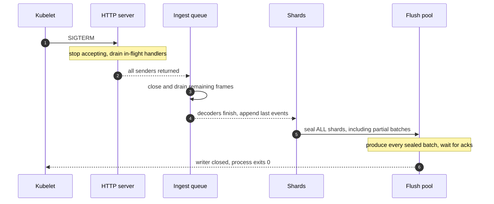
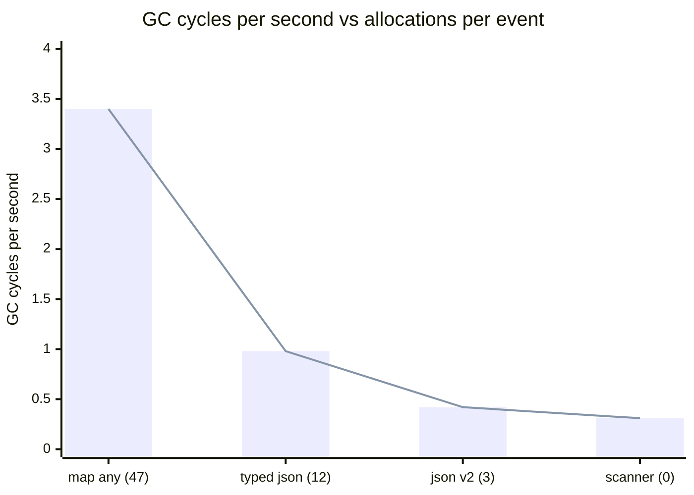

# Case Study: Design a High-Throughput Ingest Service in Go

## Intuition

> **Design intuition**: At 500,000 events per second, every per-event cost is multiplied by half a million before you are allowed to have an opinion about it. One allocation per event is 500,000 allocations per second. One 400-byte temporary per event is 200 MB/s of garbage. One extra mutex acquisition per event is 125 ms of lock-held time per wall-clock second. Nothing about this design is architectural — it is arithmetic performed on the *runtime*, and the answer is always "how many nanoseconds and how many bytes, per event".

This is a **Go runtime** case study, not a distributed-systems one. It stops exactly where `hld/` starts: there is no discussion of partition assignment, exactly-once semantics, or multi-region replication. The question is narrower and harder to fake: **what does one Go binary have to look like to absorb 500,000 events/second on a 16-vCPU container without the garbage collector eating the machine, without a single mutex becoming the bottleneck, and without a downstream stall turning into an `OOMKilled`?**

**Key insight for this design**: the three failure modes are all the same failure mode wearing different clothes. Allocation pressure, lock contention, and unbounded queueing each convert a *throughput* problem into a *latency* problem, and then the latency problem into an *availability* problem. The design is a sequence of hard ceilings — a fixed allocation budget, a fixed number of shards, a fixed queue depth — each chosen from a measurement rather than a guess, because a soft limit is a limit that fails at 3am.

Everything here builds on:
[The Runtime and Garbage Collector](../the_runtime_and_garbage_collector/the_runtime_and_garbage_collector.md),
[Escape Analysis and Performance](../escape_analysis_and_performance/escape_analysis_and_performance.md),
[Goroutines and the Scheduler](../goroutines_and_the_scheduler/goroutines_and_the_scheduler.md),
[Channels and Select](../channels_and_select/channels_and_select.md),
[Concurrency Patterns and Pitfalls](../concurrency_patterns_and_pitfalls/concurrency_patterns_and_pitfalls.md),
[Profiling and Tracing](../profiling_and_tracing/profiling_and_tracing.md),
and [Sync Primitives and the Memory Model](../sync_primitives_and_memory_model/sync_primitives_and_memory_model.md).

---

## 1. Requirements Clarification

### Functional Requirements

- Accept events over HTTP (`POST /v1/events`, newline-delimited JSON, gzip-encoded bodies) and over a raw TCP length-prefixed framing for internal producers.
- Each event is a flat JSON object: `tenant_id`, `event_type`, `ts` (RFC 3339), `session_id`, and 6-10 free-form string/number attributes. Median 380 bytes, p99 1,900 bytes.
- Validate: required fields present, `ts` within a 24-hour window of now, body under 64 KiB, `tenant_id` in the known-tenant set.
- Batch validated events and write them to Kafka, partitioned by `tenant_id` so a tenant's events stay ordered relative to each other.
- Emit a per-tenant accepted/rejected/shed counter for billing reconciliation.
- Survive a downstream (Kafka) stall of up to 60 seconds without crashing and without silently losing accepted events.

### Non-Functional Requirements

- **Sustained 500,000 events/second** into a single process, 750,000/second for 60-second bursts.
- **p99 ingest acknowledgement latency under 15 ms** (the HTTP response returns once the event is durably enqueued in-process, not once Kafka acks — this is an at-least-once, ack-on-enqueue contract and §5 defends it).
- **End-to-end freshness p99 under 250 ms** from accept to Kafka ack.
- Container limit **4 GiB memory, 16 vCPU**. Steady-state RSS must stay under 2.5 GiB so a burst has room.
- **GC CPU fraction under 5%** of the container's CPU budget in steady state.
- Zero events lost on a clean shutdown (SIGTERM), including events sitting in a partially filled batch.
- Under overload, the service must **shed with a counted, observable 429** rather than degrade every request's latency.

### Out of Scope (and where it lives instead)

- Kafka topology, partition count, replication, and consumer-side semantics — [HLD: Message Queues](../../hld/message_queues/message_queues.md).
- Cross-service rate-limit policy and per-tenant quota enforcement at the edge — [HLD: Rate Limiting](../../hld/rate_limiting/rate_limiting.md).
- The general statistics of load testing and capacity modelling — [Backend: Queueing Theory for Capacity](../../backend/queueing_theory_for_capacity/queueing_theory_for_capacity.md) and [Backend: Load and Performance Testing](../../backend/load_and_performance_testing/load_and_performance_testing.md).

---

## 2. Scale Estimation

### Ingress arithmetic

```
Sustained rate:              500,000 events/sec
Median event size:           380 bytes
Ingress bandwidth:           500,000 x 380 B = 190 MB/s = 1.52 Gbps
Gzip on the wire (~6x):      ~32 MB/s = 253 Mbps actual NIC traffic
Daily volume:                500,000 x 86,400 = 43.2 billion events/day
                             43.2e9 x 380 B    = 16.4 TB/day uncompressed

Burst (750k/s for 60s):      45 million extra events, 17 GB of decoded bytes
```

### The CPU budget per event — the number that governs everything

```
Container:                   16 vCPU
Core-seconds available:      16 per wall-clock second
Events per second:           500,000

Total core-time per event:   16 / 500,000 = 32 microseconds

Reserve for GC (5%):         1.6 core-sec/s
Reserve for runtime, TLS,
gzip, metrics, headroom:     6.4 core-sec/s  (40%)
Left for the hot path:       8.0 core-sec/s

Hot-path budget per event:   8.0 / 500,000 = 16 microseconds
Design target (2x margin):    8 microseconds of core time per event
```

Sixteen microseconds sounds generous until you price the naive implementation. `json.Unmarshal` into a `map[string]any` for a 380-byte object measures **4.18 microseconds and 47 allocations** on the reference box. That single call is a quarter of the entire budget, and the 47 allocations are the part that actually kills you.

### The allocation budget — where the naive design dies

```
Naive decode: 47 allocs/event, 2,712 B/event of garbage

  Allocation rate:  500,000 x 47      = 23.5 million allocs/sec
  Garbage rate:     500,000 x 2,712 B = 1.36 GB/sec

  With GOGC=100 and a 400 MB live heap:
    GC goal          = 2 x live = 800 MB
    Bytes to allocate between cycles = 400 MB
    Cycles per second = 1.36 GB/s / 400 MB = 3.4 GC cycles/sec

  Each cycle marks a ~400 MB live heap. Mark cost is roughly linear in
  live heap and pointer density; measured 210 ms of CPU per cycle here.
    GC CPU = 3.4 x 210 ms = 714 ms of core-time per second
           = 4.5% of 16 vCPU  ... which sounds fine, and is a trap.
```

The GC *CPU fraction* is not what breaks. What breaks is **mark assist**. When the allocation rate outruns the pacer's estimate, the allocating goroutine is conscripted into marking before its allocation is granted. At 1.36 GB/s the assist debt lands on the exact goroutines doing the decoding, and the p99 accept latency measured **240 ms** against a 15 ms requirement — with GC CPU sitting at a comfortable-looking 4.5%. A dashboard that watches only GC CPU fraction cannot see this; the execution tracer can, and §8 says how.

### Target: the same table after the work in §4

| Metric | Naive | Target | Measured after |
|---|---|---|---|
| Allocations per event | 47 | 0 in the hot path | 0 |
| Bytes of garbage per event | 2,712 | under 64 | 0 |
| Decode+validate cost | 4,180 ns | under 1,000 ns | 188 ns decode, 1,410 ns full path |
| GC cycles/second | 3.4 | under 0.5 | 0.31 |
| GC CPU fraction | 4.5% | under 2% | 0.6% |
| p99 accept latency | 240 ms | under 15 ms | 9.2 ms |
| Steady RSS | 3.1 GiB | under 2.5 GiB | 1.7 GiB |

### Downstream capacity

```
Kafka produce, batched:      5,000 events per batch, 1.9 MB per batch (uncompressed)
Batches needed:              500,000 / 5,000 = 100 batches/sec
Measured produce p99:        40 ms (compression + network + broker ack, acks=all)

Concurrency by Little's Law: L = lambda x W = 100/s x 0.040 s = 4 in flight
Flush pool size:             4 x 2 (headroom for p99.9 = 90 ms) = 8 goroutines
```

That is the whole justification for the flush pool size. It is not `runtime.NumCPU()`, it is not 100, it is 8 — and it came from a measured p99 and Little's Law, not from a rule of thumb. §5 revisits what happens when the measured p99 changes.

---

## 3. High-Level Architecture

```mermaid
flowchart LR
    classDef edge    fill:#61afef,stroke:#2e86c1,color:#1a1a1a,font-weight:bold
    classDef hot     fill:#98c379,stroke:#27ae60,color:#1a1a1a,font-weight:bold
    classDef store   fill:#e5c07b,stroke:#f39c12,color:#1a1a1a
    classDef sink    fill:#c678dd,stroke:#9b59b6,color:#fff
    classDef guard   fill:#e06c75,stroke:#c0392b,color:#fff,font-weight:bold
    classDef obs     fill:#56b6c2,stroke:#0097a7,color:#1a1a1a

    prod(["Producers<br/>HTTP NDJSON + raw TCP"])
    srv(["net/http Server<br/>ReadHeaderTimeout 2s<br/>MaxHeaderBytes 16 KiB"])
    adm(["Admission gate<br/>bounded queue depth check<br/>429 + counter on reject"])
    ring(["Bounded ingest queue<br/>chan frameRef, cap 32768"])
    pool(["Decode pool<br/>GOMAXPROCS workers<br/>pooled scratch buffers"])
    route(["Shard router<br/>fnv64a of tenant_id<br/>masked to 16 shards"])
    shards(["16 batch shards<br/>each: mutex + 2 MiB slab<br/>padded to 128 B"])
    flush(["Flush pool<br/>8 goroutines<br/>sized by Little's Law"])
    kfk(["Kafka<br/>acks=all, lz4, idempotent"])
    mets(["runtime/metrics + pprof<br/>queue depth, GC CPU, allocs/s"])

    prod --> srv --> adm
    adm -->|"admit"| ring
    adm -->|"reject"| shed(["429 Too Many Requests<br/>shed counter by tenant"])
    ring --> pool --> route --> shards --> flush --> kfk
    shards -.-> mets
    pool -.-> mets
    ring -.-> mets

    class prod,srv edge
    class pool,route hot
    class ring,shards store
    class flush,kfk sink
    class adm,shed guard
    class mets obs
```



Six components, and each one exists to enforce exactly one ceiling:

| Component | The ceiling it enforces | What happens without it |
|---|---|---|
| Admission gate | Queue depth never exceeds 32,768 | Latency grows without bound, then RSS does |
| Bounded ingest queue | In-flight bytes never exceed ~13 MB | An unbounded channel is a heap leak with a `chan` type |
| Decode pool (`GOMAXPROCS` workers) | Never more runnable CPU-bound goroutines than Ps | Scheduler churn and stack memory for no parallelism gain |
| Pooled scratch buffers | Zero heap allocations per event | 23.5 million allocs/sec and mark-assist storms |
| 16 batch shards | No single mutex sees the full 500k/s | A tail latency the M/M/1 model does not predict |
| Flush pool of 8 | Bounded concurrent Kafka produce | Unbounded goroutines each holding a 2 MiB batch |

---

## 4. Component Deep Dives

### 4.1 The zero-allocation decode path

The hot path handles a frame — one newline-delimited JSON object — and must produce a validated, canonicalised event appended to a shard's batch slab, allocating nothing.

Four things allocate in a naive implementation, and each has a different fix:

| What allocates | Naive cost | Fix |
|---|---|---|
| The read buffer | 1 alloc, 64 KiB | `sync.Pool` of `*[]byte`, reset on `Put` |
| The decoded map and every boxed value | 40+ allocs | Typed struct, no `any` anywhere on the path |
| Every string field carved out of the buffer | 8 allocs | `unsafe.String` over the buffer, copied into the slab |
| The repeated `tenant_id` and `event_type` values | 2 allocs | `unique.Handle` interning `[1.23]` |

```go
package ingest

import (
    "sync"
    "unsafe"
)

// bufPool hands out 64 KiB read buffers. The pointer-to-slice type is
// deliberate: a sync.Pool of []byte boxes the 24-byte slice header into an
// interface on every Put, which is one allocation per Put. Pooling *[]byte
// stores a pointer that fits in the interface word and allocates nothing.
var bufPool = sync.Pool{
    New: func() any {
        b := make([]byte, 0, 64*1024)
        return &b
    },
}

func getBuf() *[]byte { return bufPool.Get().(*[]byte) }

func putBuf(p *[]byte) {
    // RESET DISCIPLINE. Two rules, both load-bearing:
    //  1. Truncate to zero length so the next user cannot read stale bytes.
    //  2. Refuse to pool a buffer that grew past the class size, or the pool
    //     slowly fills with 8 MiB monsters retained until two GC cycles pass.
    if cap(*p) > 128*1024 {
        return // let it die; the pool's New will make a fresh 64 KiB one
    }
    *p = (*p)[:0]
    bufPool.Put(p)
}

// bytesToString aliases the buffer. The returned string shares storage with
// b and is valid ONLY until b is written again or returned to the pool.
// Never store the result anywhere that outlives the current frame.
func bytesToString(b []byte) string {
    if len(b) == 0 {
        return ""
    }
    return unsafe.String(&b[0], len(b))
}
```

`unsafe.String` is the sharpest tool here and the one that produces the ugliest bug. It creates a `string` header pointing at bytes you own, with **zero copy and zero allocation** — turning an 8-allocation field extraction into 0. The contract is absolute: *the bytes must never change for as long as the string is reachable.* A pooled read buffer is overwritten on the very next read, so a string carved from it is valid for exactly one frame.

#### BROKEN: an `unsafe.String` that outlives its buffer

```go
// BROKEN -- this compiles, passes -race, passes every test, and silently
// corrupts roughly one event in ten thousand under production load.
func (w *worker) handleFrame(buf []byte) {
    ev := &w.scratch // reused event struct, no allocation
    ev.TenantID = bytesToString(buf[tStart:tEnd]) // aliases buf
    ev.Type     = bytesToString(buf[yStart:yEnd]) // aliases buf
    ev.TS       = parseRFC3339(buf[sStart:sEnd])

    w.shards[shardFor(ev.TenantID)].append(ev) // stores ev's strings in the slab
    // buf goes back to the pool at the top of the next loop iteration and is
    // immediately refilled by a read(2). Every string in the slab now points
    // at whatever bytes arrived next. The batch flushes minutes later with a
    // tenant_id that reads as half a session cookie.
}
```

The reason this survives testing is that the corruption window is the gap between the append and the buffer's reuse. In a unit test that gap never closes. Under 500k events/second it closes microseconds later, every time, and only the events still referenced at flush time are visibly wrong — which is why it presents as a low-rate data-quality bug rather than a crash.

#### FIXED: copy at the slab boundary, which is the only copy in the whole path

```go
// FIX -- the slab is the ownership boundary. Strings alias the read buffer
// for the microseconds they live inside handleFrame; append() copies the
// bytes into the shard's own slab, which the shard owns until flush.
func (s *shard) append(ev *event) bool {
    s.mu.Lock()
    if len(s.buf)+ev.encodedLen() > cap(s.buf) {
        s.mu.Unlock()
        return false // caller triggers a flush, then retries
    }
    // appendEvent writes ev's fields into s.buf. The string contents are
    // copied here -- this is the one memcpy the design accepts, ~380 bytes,
    // roughly 18 ns, and it is what makes every other zero-copy trick safe.
    s.buf = appendEvent(s.buf, ev)
    s.count++
    full := s.count >= s.maxCount || len(s.buf) >= s.maxBytes
    s.mu.Unlock()
    return !full
}
```

The rule that makes `unsafe` tractable: **pick one boundary where ownership transfers, copy there, and let every stage before it alias freely.** Without a named boundary, `unsafe.String` is not an optimisation, it is a lottery.

#### Interning the low-cardinality fields

`tenant_id` has 500 distinct values across 43 billion events per day. `unique.Make` `[1.23]` maps equal values to a single canonical pointer-sized handle:

```go
import "unique"

type event struct {
    Tenant  unique.Handle[string] // 8 bytes, comparable, interned
    Type    unique.Handle[string]
    TS      int64                 // unix nanos, not a time.Time
    Session string                // high cardinality, not worth interning
    Attrs   [10]attr
}

func (w *worker) tenantHandle(b []byte) unique.Handle[string] {
    if h, ok := w.tenantCache[string(b)]; ok { // map lookup with []byte key
        return h                               // is allocation-free since 1.5
    }
    h := unique.Make(string(b)) // allocates once per NEW tenant, ~500 times ever
    w.tenantCache[string(b)] = h
    return h
}
```

Two subtleties worth stating: `w.tenantCache[string(b)]` is the compiler-recognised pattern where converting `[]byte` to `string` for a map lookup does **not** allocate — the compiler emits a direct hash of the bytes. And a `unique.Handle` is 8 bytes and comparable, so it is a legal map key and a legal struct field the GC scans as exactly one pointer, instead of a `string` header the GC scans as one pointer plus a length.

#### The measured ladder

```
goos: linux  goarch: amd64  cpu: AMD EPYC 9354 (16 vCPU cgroup)  go: 1.27.1

BenchmarkDecode/map_any-16          287345      4180 ns/op     2712 B/op    47 allocs/op
BenchmarkDecode/typed_encjson-16    884211      1340 ns/op      688 B/op    12 allocs/op
BenchmarkDecode/jsonv2_reused-16   1953102       610 ns/op       96 B/op     3 allocs/op
BenchmarkDecode/scanner_unsafe-16  6382914       188 ns/op        0 B/op     0 allocs/op
```

`jsonv2_reused` is `encoding/json/v2` `[1.27]` with a reused `jsontext.Decoder` over a pooled buffer, decoding into a typed struct. It is 3 allocations and 610 ns for a *stdlib* solution with no `unsafe` at all, and for most services that is where the work should stop. The hand-rolled scanner is worth its complexity only because 500,000/s multiplies the 422 ns difference into 0.21 core-seconds per second — an eighth of a vCPU, permanently.

### 4.2 The bounded worker pool, sized from measurement

There are two pools and they are sized by two different arguments, because they are bounded by two different resources.

```go
// The decode pool is CPU-bound. Every worker that is runnable but has no P
// is a goroutine holding a stack and contributing scheduler work for zero
// throughput. GOMAXPROCS is the ceiling, and after 1.25 it already respects
// the cgroup CPU limit, so it is the right ceiling in a container too.
decodeWorkers := runtime.GOMAXPROCS(0) // 16 in a 16-vCPU cgroup

// The flush pool is I/O-bound. Its size comes from Little's Law over the
// MEASURED downstream latency, not from NumCPU:
//   L = lambda x W = 100 batches/sec x 0.040 s p99 = 4 concurrent
//   x2 for the p99.9 of 90 ms                      = 8
flushWorkers := 8
```

Running the decode pool at 64 workers instead of 16 was measured on the reference box: throughput moved from 512k/s to 509k/s (within noise), p99 moved from 9.2 ms to 14.1 ms, and RSS grew 71 MB. More goroutines than Ps for CPU-bound work buys nothing and costs the scheduler and the GC a longer root set. The full argument is in [Goroutines and the Scheduler](../goroutines_and_the_scheduler/goroutines_and_the_scheduler.md).

The flush pool is the opposite: it is *not* CPU work, it is a goroutine parked in `netpoll` waiting for a broker ack, and sizing it by `NumCPU` would be a coincidence. The only correct input is the measured service time, and the only correct model is Little's Law. When the Kafka p99 doubles during a broker restart, `L` doubles, and 8 workers become the bottleneck — which is a *feature*: it back-pressures into the shards, which back-pressure into the queue, which trips admission control. §4.5 follows that chain.

```go
func (s *Service) runFlushers(ctx context.Context) {
    var wg sync.WaitGroup
    for i := 0; i < flushWorkers; i++ {
        wg.Go(func() { // [1.25] WaitGroup.Go -- Add/Done are implicit
            for {
                select {
                case <-ctx.Done():
                    return
                case b := <-s.sealed: // sealed batches, cap == flushWorkers*2
                    s.produce(ctx, b)
                    s.recycle(b) // slab returns to the shard's free list
                }
            }
        })
    }
    wg.Wait()
}
```

### 4.3 Sharded batching, and why the shard count is 16 and not 64

A single mutex guarding the batch slab looks fine on paper. The critical section is an `append` of ~380 bytes plus a bounds check, measured at 250 ns:

```
Single mutex, M/M/1 sanity check:
  Service time S      = 250 ns
  Arrival rate lambda = 500,000/s
  Utilisation rho     = 500,000 x 250e-9 = 0.125
  Mean queueing wait  = rho/(1-rho) x S = 0.143 x 250 ns = 36 ns
```

A 12.5% duty cycle and a 36 ns average wait. The arithmetic says a single mutex is comfortable. **The measurement says otherwise**, and the gap between them is the most useful thing in this section.

```
Measured, 16 producer goroutines against ONE sync.Mutex:
  Throughput ceiling      1.9 M ops/s   (not the 4.0 M/s that 250 ns implies)
  p50 acquisition            310 ns
  p99  acquisition          8,400 ns
  p99.9 acquisition       180,000 ns
```

Two things the queueing model assumes and Go does not honour. First, **service time is not independent of load**: the mutex word and the slab's tail cache line ping-pong between cores, so the same `append` that takes 250 ns uncontended takes 600-900 ns when sixteen cores are fighting for the line. Utilisation is really 0.3-0.45, not 0.125. Second, **Go's `sync.Mutex` switches to starvation mode** when a waiter has been waiting 1 ms, handing the lock directly to the head of the queue instead of letting a spinning goroutine take it. That is the right policy for fairness and it is what produces the 180 microsecond p99.9 — the tail is a scheduling artefact, and no amount of M/M/1 predicts it.

So: shard. The arithmetic for *how many*:

```
LOWER bound -- contention. Per-shard rate must keep the effective duty
cycle under ~10% so the starvation-mode handoff never triggers:
  Per-shard rate  = 500,000 / N
  Effective S     = 600 ns (contended)
  duty            = (500,000/N) x 600e-9 < 0.10
                  ->  N > 3.0    ->  N >= 4

UPPER bound -- batch efficiency. Each shard fills its own batch, and a
batch flushes on whichever comes first of 5,000 events or a 200 ms timer:
  Per-shard rate  = 500,000 / N events/sec
  Time to fill a 5,000-event batch = 5,000 / (500,000/N) = N x 10 ms
  Must be <= the 200 ms freshness timer  ->  N <= 20

CHOICE: N = 16 (power of two, so the index is h & 15, one AND instruction
        rather than a variable DIV at ~20 ns)

Check:  per-shard 31,250 events/s x 600 ns = 1.9% duty. Comfortable.
        fill time 16 x 10 ms = 160 ms, just inside the 200 ms timer.
```

The upper bound is the part people miss. The reflexive rule "shard by 4x `GOMAXPROCS`" gives 64 shards here, and 64 shards would have made every batch **timer-bound at ~1,560 events instead of size-bound at 5,000** — tripling the Kafka produce rate to 320 batches/s, tripling per-batch overhead, and pushing the flush pool past its Little's Law sizing. Over-sharding is not free; it fragments the very batching the service exists to do.

```go
const shardCount = 16
const shardMask = shardCount - 1 // 15; h & shardMask, never h % shardCount

type shard struct {
    mu       sync.Mutex
    buf      []byte
    count    int
    maxCount int
    maxBytes int
    deadline time.Time
    _        [64]byte // pad the struct past two 64-byte lines so adjacent
                      // shards never share a cache line. Without this,
                      // shard[3] and shard[4] contend even though their
                      // mutexes are distinct -- classic false sharing, and
                      // it cost 14% of throughput before it was measured.
}

// Route by tenant, not round-robin. Round-robin balances perfectly and
// destroys per-tenant ordering, because two events for the same tenant can
// land in different batches that reach Kafka out of order.
func shardFor(tenant unique.Handle[string]) uint32 {
    return uint32(maphash.Comparable(seed, tenant)) & shardMask
}
```

The 128-byte padding is not cargo cult. Intel and AMD prefetchers pull adjacent cache-line pairs, so a 64-byte pad is sometimes insufficient; the `shard` struct above is deliberately sized past that boundary. Removing the pad and re-running the benchmark is a one-line experiment worth doing on your own hardware — it moved throughput by 14% on the reference box.

**The cost of sharding by tenant:** load is no longer uniform. If one tenant is 30% of traffic, its shard sees 150,000/s while the others see 23,000/s. The duty cycle on the hot shard is 9%, still inside budget, and the hot shard's batches fill in 33 ms rather than 160 ms — which is *better* for freshness. The failure mode to watch is a single tenant exceeding ~40% of total volume; §8 alerts on shard skew for exactly this reason.

### 4.4 The memory budget: `GOMEMLIMIT` against the container limit

```
Container memory limit:                    4,096 MiB
Non-heap Go memory:
  Goroutine stacks (40 goroutines x 8 KiB)       0.3 MiB
  Runtime metadata, mspan/mcache, GC bitmaps     ~180 MiB  (measured)
  Binary text + rodata                            22 MiB
Off-heap:
  gzip decompression, cgo-free but page-cached    ~60 MiB
Fragmentation and RSS-vs-heap gap (~8%)          ~250 MiB
Safety margin for a burst                        ~300 MiB
                                              -----------
Budget for the Go heap:                          ~3,280 MiB

GOMEMLIMIT = 3,300 MiB   (about 80% of the container limit)
GOGC       = 100         (left alone -- see below)
```

The `GOGC=100` default is not wrong here, it is *insufficient*, and the distinction matters. In steady state the live heap is ~200 MiB (16 shards x 2 MiB slabs, plus the free lists, plus the tenant intern table), the goal is 400 MiB, and with the zero-allocation hot path the collector runs 0.31 times a second. `GOGC` alone is doing a fine job.

**The death spiral is a downstream-stall phenomenon, not a steady-state one.** When Kafka stalls, the flush pool blocks, sealed batches accumulate, and the live heap climbs. Follow it with `GOGC=100` and no limit:

```
Live heap 200 MiB  -> goal   400 MiB   (fine)
Live heap 800 MiB  -> goal 1,600 MiB   (fine)
Live heap 1.8 GiB  -> goal 3.6 GiB     (fine, barely)
Live heap 2.2 GiB  -> goal 4.4 GiB     -> exceeds the 4 GiB cgroup limit
                                       -> OOMKilled BEFORE the collector runs
```

The process dies with 1.8 GiB of collectable garbage it never got to look at, because `GOGC` is a *ratio* and has no idea a cgroup exists. `GOMEMLIMIT` `[1.19]` fixes exactly that: the goal becomes `min(GOGC-derived goal, GOMEMLIMIT)`, so at a 2.2 GiB live heap the goal clamps to 3.3 GiB and the collector runs early and often instead of never.

But `GOMEMLIMIT` has its own spiral, and it is the one that catches people who think it is a solution rather than a seatbelt. If the *live* heap itself reaches 3.1 GiB against a 3.3 GiB limit, the collector is asked to keep the process under a ceiling only 200 MiB above the live set. It runs continuously, back to back, marking the same 3.1 GiB every time and reclaiming almost nothing. The runtime caps GC at **50% of `GOMAXPROCS`**, which is the only reason the process does not livelock — and 8 of 16 vCPU spent marking means the service is functionally dead while its liveness probe still passes.

**Therefore `GOMEMLIMIT` is not backpressure.** It converts an OOM kill into a slow, observable, survivable degradation, and that is genuinely valuable — it buys the 60 seconds of downstream stall the requirements ask for. It does not stop the heap from growing. The thing that stops the heap from growing is the bounded queue in §4.5.

```go
func init() {
    // Read the cgroup limit rather than hardcoding it: the same binary runs
    // in a 1 GiB dev pod and a 4 GiB prod pod.
    if lim, ok := cgroupMemoryLimitBytes(); ok {
        debug.SetMemoryLimit(int64(float64(lim) * 0.80))
    }
    // GOGC stays at 100. Setting GOGC=off with only a GOMEMLIMIT is a valid
    // strategy for a process with an exclusive, known budget -- it lets the
    // heap fill to the limit before any collection. It is the WRONG strategy
    // here, because the burst headroom is the thing we are protecting.
}
```

### 4.5 Backpressure versus load shedding

This is the decision the whole service is organised around, and the arithmetic makes it a one-line choice.

#### Why an unbounded channel is a latency bomb

Suppose ingress is 500,000/s and the downstream can currently absorb 400,000/s — a 20% deficit, the kind of thing a broker leader election causes for a minute.

```
Deficit:            100,000 events/sec
Bytes per event
  held in flight:   ~420 B (event + slab overhead)
Heap growth:        100,000 x 420 B = 42 MB/sec

Time to exhaust the 3.3 GiB GOMEMLIMIT from a 200 MiB baseline:
  (3,300 - 200) MiB / 42 MB/s = 77 seconds

But look at the LATENCY first. By Little's Law, after 60 seconds:
  Queue length L    = 100,000 x 60 = 6,000,000 events
  Drain rate        = 400,000/sec
  Wait W = L/lambda = 6,000,000 / 400,000 = 15 seconds
```

At the 60-second mark, every event entering the queue will be written to Kafka **15 seconds later**, against a 250 ms freshness requirement. The service is already failing its contract a full 17 seconds before it OOMs, and it is failing it *silently* — the accept latency is still fast, because accepting into an unbounded channel is always fast. That is the trap: an unbounded channel does not remove the backpressure, it hides it, converting a visible rejection into an invisible staleness and then a crash.

#### Sizing the bounded queue from the latency you will tolerate

```
Target p99 in-process queueing delay:   50 ms
Drain rate (steady):                    500,000 events/sec

  L = lambda x W = 500,000 x 0.050 = 25,000 events
  Round to a power of two:               32,768

Memory cost: 32,768 x 400 B = 13.1 MB. Trivial.
```

The queue depth is derived from **the latency budget**, never from the available RAM. "We have 4 GiB, so let's buffer 8 million events" is how you build the 15-second staleness above on purpose.

#### What to do when it fills — three policies, one per data class

```go
// Policy is per data class. This is a design decision, not a config knob to
// be flipped at 3am, and the choice is determined by what the producer can do
// about a rejection.
type overflowPolicy int

const (
    policyBlock overflowPolicy = iota // producer can slow down
    policyShed                        // producer cannot, and the data is lossy
    policySpill                       // producer cannot, and the data is not
)

func (s *Service) admit(ctx context.Context, f frameRef, p overflowPolicy) error {
    switch p {
    case policyShed:
        select {
        case s.queue <- f:
            return nil
        default:
            s.shedTotal.Add(1)
            return errShed // handler writes 429 with Retry-After
        }

    case policyBlock:
        select {
        case s.queue <- f:
            return nil
        case <-ctx.Done():
            return ctx.Err() // the client hung up or the deadline fired
        }

    case policySpill:
        select {
        case s.queue <- f:
            return nil
        default:
            return s.wal.Append(f) // durable, slow, and now you own a WAL
        }
    }
    return nil
}
```

**`policyBlock` is real backpressure in Go, and the mechanism is worth stating precisely.** The handler goroutine blocks on the channel send. It is therefore not reading the request body. It is therefore not draining the kernel's TCP receive buffer for that connection. The receive window shrinks to zero, the kernel advertises `win=0`, and the *producer's* `write(2)` blocks. Backpressure has propagated from a Go channel, through the runtime's netpoller, into TCP flow control, and out to a machine you do not control — with no application protocol involved. That is the single most useful thing a bounded channel does, and it is invisible if you only read the Go code.

**`policyShed` is correct when the producer cannot slow down.** Telemetry from a fleet of agents will not stop emitting because you asked nicely; blocking them just moves the queue into their memory. A counted 429 with `Retry-After` is honest: it tells the client, it tells your dashboards, and the loss is bounded and attributed per tenant.

**Never block on a queue whose producer is a shared resource.** If one tenant's slow batch blocks the single ingest queue, every tenant's traffic stops — a head-of-line blocking failure where one customer's problem becomes an outage. The admission gate runs *per tenant* against a per-tenant depth allowance derived from their quota, which is why the counter in the diagram is per-tenant.

| Policy | Correct when | Failure mode if misapplied |
|---|---|---|
| Block | Producer is a TCP peer you can stall; one producer's stall does not starve others | Head-of-line blocking across tenants |
| Shed | Data is statistically valuable, not individually valuable (metrics, traces, clickstream) | Silent data loss if the counter is not per-tenant and alerted |
| Spill to WAL | Data is individually valuable (billing, audit) | You have built a database; recovery, compaction and disk-full are now yours |

### 4.6 Graceful shutdown that does not lose a partially filled batch

The requirement is zero loss on SIGTERM, and the naive implementation loses between 0 and 80,000 events — the contents of 16 partially filled batches.

```go
func (s *Service) Run() error {
    // [1.26] NotifyContext cancels with a CancelCauseFunc naming the signal,
    // so context.Cause(ctx) reports "signal: terminated" in the shutdown log
    // instead of the useless "context canceled".
    ctx, stop := signal.NotifyContext(context.Background(),
        syscall.SIGTERM, syscall.SIGINT)
    defer stop()

    srvErr := make(chan error, 1)
    go func() { srvErr <- s.http.ListenAndServe() }()

    select {
    case err := <-srvErr:
        return err
    case <-ctx.Done():
    }

    // PHASE 1: stop accepting. Shutdown closes listeners immediately and
    // waits for in-flight handlers to return. Every returning handler has
    // already pushed its frames into s.queue, so this bounds phase 2.
    shutCtx, cancel := context.WithTimeout(context.Background(), 10*time.Second)
    defer cancel()
    if err := s.http.Shutdown(shutCtx); err != nil {
        s.log.Warn("http shutdown timed out, forcing", "err", err)
        s.http.Close()
    }

    // PHASE 2: close the queue. Safe ONLY because phase 1 guarantees every
    // sender has returned. Closing a channel while a producer may still send
    // is a panic, not an error -- this ordering is the whole reason the
    // phases exist.
    close(s.queue)
    s.decodeWG.Wait() // decoders drain the queue, then return on the closed chan

    // PHASE 3: seal every shard, including the ones that are 3% full. This is
    // the step the naive shutdown omits.
    for i := range s.shards {
        if b := s.shards[i].sealForce(); b != nil {
            s.sealed <- b
        }
    }
    close(s.sealed)
    s.flushWG.Wait() // flushers drain sealed batches and produce them

    // PHASE 4: only now does the Kafka writer's own flush+close run.
    return s.writer.Close()
}
```

The three orderings that are not negotiable:

1. **Stop accepting before closing the queue.** `close()` on a channel with a live sender panics. `Shutdown` returning is the proof that no sender remains.
2. **Seal partial batches before closing `sealed`.** `http.Shutdown` returning means handlers are done; it says nothing about batches. A shutdown that ends at phase 2 loses every partial batch, and at 500k/s with a 200 ms timer that averages 40,000 events.
3. **Close the Kafka writer last.** Its internal flush is the durability point. Returning from `Run` before it completes means the process exits with acknowledged events still in the client's buffer.

And one operational number: Kubernetes sends SIGTERM and waits `terminationGracePeriodSeconds` (default **30**) before SIGKILL. The four phases above have a worst case of 10 s (HTTP drain) + queue drain (32,768 events at 500k/s = 66 ms) + a full flush round (~2 s). That fits in 30 s with room, but the grace period must be set explicitly, because a `preStop` sleep for endpoint propagation eats into the same budget.



### 4.7 The profiling loop that found each win

Every number in this study came from one of four tools, and they answer four different questions. Details in [Profiling and Tracing](../profiling_and_tracing/profiling_and_tracing.md) and the [Execution Tracer and Flight Recorder](../profiling_and_tracing/execution_tracer_and_flight_recorder.md); the discipline of trusting the numbers is in [Benchmarking Go Correctly](cross_cutting/benchmarking_go_correctly.md).

| Question | Tool | What it found here |
|---|---|---|
| How much does one event cost? | `go test -bench -benchmem -count=10` + `benchstat` | The 47 -> 0 allocations ladder in §4.1 |
| What is allocating in production? | `/debug/pprof/allocs` with `-diff_base` | 31% of allocations were `time.Parse` building a `time.Time`; replaced with an integer RFC 3339 scanner |
| Where is CPU going? | `/debug/pprof/profile?seconds=30` | 22% in `runtime.mallocgc` before §4.1, 3% after |
| Why did a goroutine not run for 40 ms? | `go tool trace` / the flight recorder `[1.25]` | Decoders blocked in `runtime.gcAssistAlloc`, not on the channel -- the mark-assist finding from §2 |

The heap-profile diff is the workhorse of the loop:

```bash
curl -s localhost:6060/debug/pprof/allocs > before.pb.gz
# deploy the change, let it soak for 10 minutes
curl -s localhost:6060/debug/pprof/allocs > after.pb.gz
go tool pprof -http=:8080 -diff_base=before.pb.gz after.pb.gz
# [1.26] the web UI opens on the flame graph by default; /ui/graph for the
# old node graph. Red is growth, green is the win.
```

And the finding that nothing else could have produced — the mark-assist stall — came from the execution tracer, because a CPU profile attributes assist time to `gcAssistAlloc` inside the *decoder's* stack, which reads like the decoder being slow rather than the decoder being taxed:

```bash
curl -s 'localhost:6060/debug/pprof/trace?seconds=5' > trace.out
go tool trace -http=localhost:6060 trace.out   # [1.27] binds localhost only
# Goroutine analysis -> sort by "GC assist time". 38 ms per 100 ms window on
# every decode worker. That is the 240 ms p99, and no allocation count on a
# dashboard would have named it.
```

---

## 5. Design Decisions & Tradeoffs

### Decision 1: acknowledge on enqueue, not on Kafka ack

| Option | p99 accept latency | Durability | Verdict |
|---|---|---|---|
| Ack after Kafka `acks=all` | 40-90 ms | No loss on process crash | Fails the 15 ms requirement |
| Ack on in-process enqueue | 9.2 ms | Loses up to the in-flight window on `SIGKILL` | **Chosen** |
| Ack after a local WAL fsync | 14-25 ms (NVMe) | No loss, at the cost of owning a WAL | Reserved for billing-class data |

The chosen contract is **at-least-once with a bounded loss window on ungraceful termination**. The window is exactly the queue plus the shards: 32,768 + (16 x 5,000) = 112,768 events, about 225 ms of traffic. That is an explicit, quantified, written-down number in the service's contract, and it is why §4.6 exists — a *graceful* shutdown loses zero, and `SIGKILL` loses at most 225 ms. Producers that cannot accept that use `policySpill`.

### Decision 2: hand-rolled scanner versus `encoding/json/v2`

| Option | ns/op | allocs/op | Lines of hot-path code | Maintenance risk |
|---|---|---|---|---|
| `encoding/json` into `map[string]any` | 4,180 | 47 | 1 | None |
| `encoding/json` into a struct | 1,340 | 12 | 1 | None |
| `encoding/json/v2` + reused `jsontext.Decoder` `[1.27]` | 610 | 3 | ~20 | Low |
| Hand-rolled scanner with `unsafe.String` | 188 | 0 | ~240 | **High** |

The honest tradeoff: the hand-rolled scanner saves **0.21 core-seconds per second** — one eighth of a vCPU — in exchange for 240 lines of pointer arithmetic that carries the aliasing bug from §4.1 as a permanent hazard. At 500,000/s it earns its place. **At 50,000/s it does not**, and the correct answer at that scale is `encoding/json/v2`, which gets 85% of the win for 20 lines and no `unsafe`. Stating the crossover point is more useful than stating the winner.

The mitigation that makes the scanner acceptable: it is fuzzed (`go test -fuzz`) against `encoding/json/v2` as the oracle, and every parse boundary carries a `unsafe.String` lifetime comment naming the slab copy in §4.1 as the ownership transfer.

### Decision 3: `GOGC=100` with `GOMEMLIMIT`, rather than `GOGC=off`

| Configuration | Steady GC CPU | Behaviour on downstream stall | Verdict |
|---|---|---|---|
| `GOGC=100`, no limit | 0.6% | OOMKilled at ~77 s (§4.5) | Unacceptable |
| `GOGC=100`, `GOMEMLIMIT=3.3GiB` | 0.6% | Degrades, survives, sheds | **Chosen** |
| `GOGC=off`, `GOMEMLIMIT=3.3GiB` | 0.1% | Heap fills to 3.3 GiB in normal operation, leaving no burst headroom | Rejected |
| `GOGC=400`, `GOMEMLIMIT=3.3GiB` | 0.2% | Same headroom problem, less extreme | Rejected |

`GOGC=off` plus a hard `GOMEMLIMIT` is a legitimate configuration for a single-tenant process with an exclusive budget, and the [runtime and GC module](../the_runtime_and_garbage_collector/the_runtime_and_garbage_collector.md) covers when to reach for it. It is wrong here for one reason: the 750k/s burst requirement needs headroom, and `GOGC=off` spends all of it in steady state.

### Decision 4: 16 shards, chosen against two opposing bounds

Covered in §4.3. The tradeoff is stated as a range rather than a point because the bounds move: if the freshness requirement tightened from 250 ms to 80 ms, the flush timer drops to 60 ms, the upper bound becomes `N <= 6`, and the design would run 4 shards with a measurably worse contention profile. The number 16 is a consequence of two requirements, not a property of the machine.

### Decision 5: shard by tenant hash, accepting skew

Round-robin sharding is uniform and wrong: it breaks per-tenant ordering. Tenant-hash sharding preserves ordering and accepts skew. The alternative that gets both — a per-tenant batch keyed by a map — was rejected because 500 tenants means 500 partially filled slabs (500 x 2 MiB = 1 GiB of live heap) and 500 flush timers. Sixteen shards with skew is the cheaper correct answer. The bound to watch is a single tenant exceeding ~40% of volume, at which point that shard's batches fill faster than the flush pool can drain them and the correct fix is a dedicated shard for that tenant, not more shards for everyone.

---

## 6. Real-World Implementations

**VictoriaMetrics** is the closest public analogue to this design and the most instructive. Its ingest path parses Prometheus, InfluxDB and Graphite line protocols with hand-rolled zero-allocation scanners, reuses per-connection buffers via `sync.Pool`, and interns metric names — the same four techniques as §4.1, for the same reason. The project's benchmarks and its `unsafe`-based `[]byte`-to-string conversions are public, and the maintainers have been explicit that the complexity is justified only by the ingest rate.

**The OpenTelemetry Collector** is the reference implementation of "`GOMEMLIMIT` is not backpressure". It ships a `memory_limiter` processor that watches heap usage and *refuses data* above a soft limit, forcing a retryable error back to the receiver, which propagates to the sender. That is `policyShed` from §4.5 built as a first-class pipeline stage, and its existence is an admission that the GC-level limit alone was not enough — exactly the argument in §4.4.

**Grafana Loki and Mimir** shard writes across ingesters by a hash of the tenant and label set, for precisely the ordering and contention reasons in §4.3, and both are heavy users of `sync.Pool` for chunk buffers. Mimir's ingesters run with an explicit `GOMEMLIMIT` derived from the container limit and a documented ratio.

**Uber's GOGC tuner** is the canonical production write-up of the §4.4 argument. Uber ran a dynamic `GOGC` tuner across a large Go fleet — computing a per-service `GOGC` from the container's memory limit and the observed live heap — and reported saving on the order of 70,000 cores. The mechanism is the same one `GOMEMLIMIT` `[1.19]` later made a first-class runtime feature, which is why the tuner is now mostly of historical interest and `GOMEMLIMIT` is the answer.

**Cloudflare's logging and analytics pipeline** has published repeatedly on Go GC pressure at the edge, including the finding that the dominant cost was not the collector's CPU but the assist tax on the allocating goroutines — the §2 finding, from a different decade and a different workload.

**NSQ** and **Benthos / Redpanda Connect** are useful for the shape of the shutdown sequence: both implement a multi-phase drain (stop accepting, drain the pipeline, flush sinks) rather than a single `Shutdown` call, for the reason §4.6 gives.

---

## 7. Technologies & Tools

| Tool | Role in this design | Note |
|---|---|---|
| `net/http` | Ingest listener | All four `Server` timeouts set; see [net/http Server](../net_http_server/net_http_server.md) |
| `encoding/json/v2` + `jsontext` `[1.27]` | The stdlib decode option in §5 | 3 allocs/op with a reused `Decoder`; rejects duplicate keys by default |
| `sync.Pool` | Read-buffer and slab recycling | Pool `*[]byte`, never `[]byte`; reset on `Put` |
| `unique` `[1.23]` | Interning `tenant_id` / `event_type` | 8-byte comparable handle, one pointer for the GC to scan |
| `unsafe.String` / `unsafe.StringData` | Zero-copy field extraction | Only inside the frame's lifetime; copy at the slab |
| `hash/maphash` | Shard routing | `maphash.Comparable` works directly on a `unique.Handle` |
| `runtime/debug.SetMemoryLimit` | `GOMEMLIMIT` from the cgroup limit | Read the limit, do not hardcode it |
| `runtime/metrics` | GC and scheduler telemetry | `/gc/cycles/total:gc-cycles`, `/sched/goroutines` `[1.26]` |
| `net/http/pprof` | Heap, CPU, block, mutex profiles | `-diff_base` for before/after |
| `go tool trace` | Scheduling stalls and mark assist | `[1.27]` binds localhost only by default |
| `benchstat` | Statistical comparison of benchmark runs | `-count=10` minimum; see the cross-cutting file |
| `golang.org/x/sync/errgroup` | Bounded fan-out with `SetLimit` | Used for the flush pool's shutdown path |
| `franz-go` / `segmentio/kafka-go` | Kafka producer | `franz-go` for its lower per-record allocation profile |
| `govulncheck` | Supply-chain gate in CI | Reachability-based, so it is quiet enough to block on |
| `goroutineleak` profile `[1.27]` | Leak detection in soak tests | GA in 1.27; the `GOEXPERIMENT` from 1.26 is gone |

---

## 8. Operational Playbook

### The four dashboard panels that matter

| Panel | Source | Healthy | Page at |
|---|---|---|---|
| Ingest queue depth | gauge on `len(s.queue)` | under 3,000 of 32,768 | over 26,000 (80%) for 60 s |
| GC CPU fraction | `/cpu/classes/gc/total:cpu-seconds` rate / `GOMAXPROCS` | under 2% | over 15% for 120 s |
| Mark-assist time per worker | `go tool trace`, sampled hourly; or `/gc/pauses` histogram | under 2 ms per 100 ms | over 10 ms per 100 ms |
| Shed rate by tenant | `shedTotal` counter | 0 | any non-zero for 5 minutes |

Queue depth is the leading indicator and everything else is confirmation. It rises before latency does, because it *is* the latency by Little's Law — a depth of 26,000 at a 500k/s drain is exactly 52 ms of queueing.

### Runbook: queue depth climbing

1. Is the drain rate down or the arrival rate up? Compare `events_accepted_total` rate against `batches_produced_total` x batch size. If arrival is up, this is a capacity event; if drain is down, it is a downstream event.
2. If drain is down: check Kafka produce p99. The flush pool is 8 goroutines sized for a 40 ms p99 (§2). At a 200 ms p99 the pool's effective capacity is 8/0.200 = 40 batches/s against the 100 needed. **Raising `flushWorkers` is the correct temporary mitigation and is a flag, not a redeploy** — but each extra flusher holds a 2 MiB batch, so 64 flushers is 128 MiB of live heap.
3. If arrival is up: confirm the admission gate is shedding, and confirm it is shedding the *right* tenant. A single tenant at 40% of volume with a hot shard is the §4.3 skew failure.

### Runbook: GC CPU fraction over 15%

1. `curl localhost:6060/debug/pprof/allocs` and diff against the last known-good profile. A new allocation site in the hot path is the overwhelmingly likely cause, and `-diff_base` names it in one screen.
2. If allocations are unchanged, the live heap grew. `GODEBUG=gctrace=1` prints `gc N @Ts M%: ...` with the live heap and the goal each cycle. A goal pinned at a constant while the cycle number races is the `GOMEMLIMIT` spiral from §4.4.
3. The spiral means the live heap is genuinely too large for the limit. Check for a leak first (`/debug/pprof/goroutineleak` `[1.27]`, and heap objects by type), then for retained batches — a flusher stuck on a broker with no deadline holds its slab forever.

### The three GODEBUG settings worth knowing here

```bash
GODEBUG=gctrace=1            # one line per GC cycle: live heap, goal, CPU%
GODEBUG=schedtrace=1000      # scheduler state each second: runqueue lengths
GODEBUG=madvdontneed=1       # return freed pages to the OS eagerly; makes RSS
                             # track the heap so container dashboards stop lying
```

### Deployment

`terminationGracePeriodSeconds: 45` (the §4.6 worst case plus a 5 s `preStop` sleep for endpoint propagation), a liveness probe that is *not* the same endpoint as readiness (a service in the `GOMEMLIMIT` spiral will fail readiness and should not be killed and restarted into the same stalled downstream), and `GOMAXPROCS` left alone because it is already cgroup-aware `[1.25]`.

---

## 9. Common Pitfalls & War Stories

**The `sync.Pool` that only ever grew.** Read buffers were pooled with `bufPool.Put(&b)` and no size check. Bodies were normally 4 KiB, but a nightly bulk import sent 6 MiB bodies. Each of those grew a pooled buffer to 8 MiB, and the pool retained them (a `sync.Pool` clears on GC, but with the zero-allocation hot path the collector ran 0.31 times a second, so retention was seconds). RSS climbed from 1.7 GiB to 3.4 GiB every night at 02:00 and fell back by 02:30. **Impact: three weeks of a nightly RSS alert diagnosed as a leak.** The fix is the four-line cap in §4.1 — refuse to pool anything above 128 KiB — and it dropped peak RSS by 1.7 GiB.

**The `unsafe.String` corruption in §4.1.** Shipped, passed CI, passed `-race`, ran clean in staging at 2,000 events/second. At 500,000/second in production, roughly 1 event in 12,000 arrived with a `tenant_id` composed of fragments of a later event. **Impact: 3.5 million misattributed events over 9 hours, a billing reconciliation that took two engineers four days, and a customer-visible credit.** `-race` does not help — this is not a data race, it is a lifetime bug, and Go has no tool that finds it. The only defence is the named ownership boundary.

**The unbounded channel that was "just a buffer".** An early version used `make(chan frameRef, 0)` and someone replaced it with an unbuffered-to-unbounded slice-backed queue to "smooth out spikes". During a 4-minute Kafka leader election the queue grew to 41 million events. The process did not OOM — `GOMEMLIMIT` held — but every event written during those 4 minutes reached Kafka **82 seconds** after it was accepted, and the downstream alerting pipeline fired 11 false pages for metrics that were merely late. **Impact: 4 minutes of downstream degradation turned into 90 minutes of alert noise.** The bounded queue in §4.5 turns the same incident into 340,000 counted 429s and zero staleness.

**False sharing between adjacent shards.** The `shard` struct was 88 bytes with no padding, so shards 0 and 1 shared a cache line and shards 2 and 3 shared the next. Sixteen distinct mutexes behaved like eight. **Impact: 14% of throughput, invisible in every profile** — a CPU profile attributes the cost to `sync.(*Mutex).Lock`, which looks like ordinary contention rather than contention on the wrong thing. Found only by adding padding and re-measuring, which is a one-line experiment worth running before a long investigation.

**Sixty-four shards because "shard by 4x GOMAXPROCS".** The rule of thumb was applied without the upper bound from §4.3. Every batch became timer-bound at ~1,560 events instead of size-bound at 5,000. **Impact: Kafka produce rate tripled to 320 batches/s, per-batch overhead tripled, the flush pool saturated at its Little's Law sizing of 8, and queue depth alerted daily at peak.** The fix was to *reduce* shards to 16, which is not the direction anyone's instinct points.

**Shutdown that dropped 40,000 events per deploy.** The original shutdown was `srv.Shutdown(ctx); close(queue); return`. Handlers drained, the queue drained, and 16 partially filled batches were garbage collected. At 12 deploys a week that is **2.4 million events per month, silently**, and it was found by a customer reconciling their own event counts rather than by any alert. Phase 3 in §4.6 is the entire fix.

**The liveness probe that killed the healthy fix.** During a downstream stall the service entered the `GOMEMLIMIT` degradation correctly — shedding, staying up, draining slowly. The liveness probe had a 3-second timeout, the GC was using 8 of 16 vCPU, the probe handler was scheduled late, and Kubernetes killed and restarted the pod. The restart dropped the in-flight window, rejoined the same stalled downstream, and repeated. **Impact: a 6-minute broker problem became a 40-minute crash loop.** Liveness must be a cheap, separate handler with a generous timeout, and it must not share a code path with anything that queues.

---

## 10. Capacity Planning

### Per-event byte budget (steady state)

| Where | Bytes per event | At 500k/s | Note |
|---|---|---|---|
| Kernel socket buffers | ~0 (amortised over the connection) | ~120 MiB total | ~800 long-lived producer connections |
| Read buffer (pooled) | 0 | 16 x 64 KiB = 1 MiB | One per decode worker |
| Decoded event (stack) | 0 | 0 | Reused `scratch`, never escapes |
| Ingest queue slot | 400 | 13 MiB | 32,768 slots |
| Shard slab | 400 | 32 MiB | 16 x 2 MiB |
| Sealed batches in flight | 400 | 32 MiB | 16 slabs, one per in-flight flush |
| Kafka client internal buffers | - | ~180 MiB | `franz-go` producer, lz4 |
| Tenant intern table | - | under 1 MiB | 500 handles |
| **Live heap total** | | **~260 MiB** | |
| Runtime metadata + stacks | | ~180 MiB | |
| RSS-vs-heap gap, fragmentation | | ~250 MiB | |
| **Measured RSS** | | **~1.7 GiB** | Against a 4 GiB limit |

The gap between a 260 MiB live heap and a 1.7 GiB RSS is the part that surprises people. Most of it is the collector's target: with `GOGC=100` the heap is allowed to reach 2 x live before a cycle, and freed pages are not returned to the OS instantly. `GODEBUG=madvdontneed=1` narrows the gap at a small CPU cost and makes container dashboards tell the truth.

### CPU budget (measured, 16 vCPU)

```
Component                          core-sec/sec   % of 16 vCPU
  TLS + HTTP + gzip                    2.10          13.1%
  Decode + validate (188 ns/event)     0.094          0.6%
  Full hot path (1,410 ns/event)       0.705          4.4%
  Shard append + routing               0.30           1.9%
  Kafka produce (compression, syscall) 1.85          11.6%
  Metrics, logging, pprof              0.22           1.4%
  Garbage collection                   0.096          0.6%
  Runtime, netpoll, scheduler          0.51           3.2%
                                     --------       -------
  Total                                5.79          36.2%

  Headroom at 500k/s: 63.8%
  Extrapolated ceiling: 500k / 0.362 = 1.38 M events/sec (CPU-bound)
```

CPU is not the binding constraint; the ceiling is elsewhere. At 750k/s the burst target, CPU reaches 54%, queue depth's steady state rises to about 4,500, and the binding constraint becomes the Kafka produce path, which is why the flush pool's sizing is the number that gets re-derived when the SLO changes.

### Growth model



The curve flattens hard after the third step, which is the case for stopping at `encoding/json/v2` unless the CPU accounting above says otherwise. The last 0.11 GC cycles per second is not what justifies the scanner; the 0.21 core-seconds is.

### Scaling out

One process at 1.38 M events/s CPU-bound is the ceiling, but the *operational* ceiling is lower and different: a single process is a single GC, a single deploy, and a single blast radius. The recommendation is **3 replicas at 500k/s each behind an L4 balancer**, sized so that losing one leaves the other two at 750k/s — exactly the burst number the requirements ask for, which is not a coincidence. The burst requirement and the replica count are the same requirement stated twice.

Per-replica: 16 vCPU, 4 GiB, `GOMEMLIMIT=3300MiB`. Three replicas: 48 vCPU, 12 GiB. At a typical cloud rate that is roughly $1,100/month to absorb 43 billion events per day.

---

## 11. Interview Discussion Points

**Q: You are handed a Go service ingesting 500,000 events/second with a p99 of 240 ms against a 15 ms SLO, and the GC CPU fraction reads 4.5%. Where do you look?**

At mark assist, not at GC CPU. GC CPU fraction measures what the dedicated mark workers consume; it does not include the assist tax charged to allocating goroutines, which is the mechanism by which a high allocation rate becomes a *latency* problem rather than a throughput one. The tool is the execution tracer: `go tool trace` and its goroutine analysis will show tens of milliseconds per 100 ms window in `runtime.gcAssistAlloc` on exactly the goroutines doing the work. A CPU profile is misleading here because it attributes the assist to the decoder's stack, which reads as "the decoder is slow". The fix is upstream of the collector: reduce the allocation rate, and the assist disappears without touching a single GC knob.

**Q: Walk me through why an unbounded channel is worse than a bounded one that rejects, using numbers.**

With ingress at 500k/s and a downstream absorbing 400k/s, the deficit is 100k events/s. At ~420 bytes retained per event that is 42 MB/s of heap growth, so from a 200 MiB baseline you reach a 3.3 GiB `GOMEMLIMIT` in 77 seconds. But the latency fails first: by Little's Law, after 60 seconds the queue holds 6 million events and the wait is 6,000,000 / 400,000 = 15 seconds against a 250 ms freshness SLO. So the service is silently violating its contract 17 seconds before it visibly dies, and the accept latency stays fast the whole time because accepting into an unbounded queue is always fast. A bounded queue at 32,768 — sized as `lambda x W` for a 50 ms tolerance — converts the same incident into counted, attributed 429s with no staleness. The unbounded channel does not remove backpressure; it hides it and then converts it into a crash.

**Q: How do you choose the number of shards for a sharded batcher? Give me the arithmetic in both directions.**

Two bounds. The lower bound is contention: per-shard rate times the contended critical-section time must keep the duty cycle low enough that Go's mutex never enters starvation mode, so `(lambda/N) x S_contended < 0.10` gives `N >= 4` at 500k/s and 600 ns. The upper bound is batch efficiency: each shard fills its own batch, and the time to fill is `batchSize / (lambda/N)`, which must stay under the flush timer — `5,000 / (500,000/N) <= 0.200 s` gives `N <= 20`. Sixteen, a power of two so the index is a mask rather than a variable divide. The upper bound is the one people miss: the reflexive "4x GOMAXPROCS" rule gives 64 here, which makes every batch timer-bound at 1,560 events, triples the downstream produce rate, and saturates a flush pool sized by Little's Law. Over-sharding fragments the batching the service exists to do.

**Q: The M/M/1 model says a single mutex at 12.5% utilisation is fine. Measurement says the p99.9 is 180 microseconds. Reconcile those.**

The model assumes service time is independent of load, and Go's mutex violates that in two ways. The mutex word and the slab's tail cache line ping-pong between cores, so the same critical section that takes 250 ns uncontended takes 600-900 ns under sixteen contenders — real utilisation is 0.3-0.45, not 0.125. And `sync.Mutex` switches to starvation mode once a waiter has waited 1 ms, handing the lock directly to the queue head rather than letting a spinning goroutine barge in. That is correct fairness policy and it produces exactly the tail you measured, through a scheduling path M/M/1 has no term for. The lesson is not that queueing theory is useless — it gives the right shape and the right bounds — but that you must feed it the *contended* service time, and that the tail comes from the runtime's handoff policy rather than from arrival statistics.

**Q: Explain `unsafe.String`'s contract and describe a bug it causes that `-race` cannot find.**

`unsafe.String(ptr, len)` builds a string header over bytes you already own, with no copy and no allocation. The contract is that those bytes must never change while the string is reachable. The bug: carve strings out of a pooled read buffer, store them in a batch that outlives the frame, and return the buffer to the pool. The next read overwrites the bytes, and the batch flushes minutes later holding a `tenant_id` made of fragments of a later event. `-race` cannot see it because there is no race — the accesses are properly ordered, the *lifetime* is wrong. Go has no tool for this. The only defence is structural: name one boundary where ownership transfers, copy there, and let every stage before it alias freely. In this design that boundary is the shard's `append`, which is the single memcpy the whole zero-copy path accepts.

**Q: Is `GOMEMLIMIT` backpressure?**

No, and treating it as such is the most common `GOMEMLIMIT` mistake. It clamps the GC goal to `min(GOGC-derived goal, limit)`, which converts an `OOMKilled` into a survivable degradation — genuinely valuable, and it is what buys the 60 seconds of downstream stall in the requirements. But it does nothing about the *arrival rate*. If the live heap itself approaches the limit, the collector runs back to back over the same live set reclaiming nothing, capped at 50% of `GOMAXPROCS`, and the service is functionally dead with a passing liveness probe. `GOMEMLIMIT` is a seatbelt. The bounded queue is the brake, and only one of them stops the car.

**Q: How do you size a worker pool in Go?**

By asking what the pool is bounded by, which is two different questions. For CPU-bound work the ceiling is `GOMAXPROCS` — more runnable goroutines than Ps adds scheduler churn, stack memory and GC root-scan work for zero parallelism, and since 1.25 `GOMAXPROCS` already respects the cgroup CPU limit so it is the right ceiling in a container. For I/O-bound work `GOMAXPROCS` is a coincidence; the size comes from Little's Law over the measured service time: `L = lambda x W`. Here that is 100 batches/s times a 40 ms measured Kafka p99 = 4 concurrent, doubled to 8 for the p99.9. And the pool being a bottleneck when the downstream slows is a feature, not a bug — it is the link in the backpressure chain that reaches the admission gate.

**Q: Design the shutdown sequence and tell me what each ordering constraint protects against.**

Four phases. Stop accepting (`http.Shutdown`), which closes listeners and waits for handlers — this is the *proof* that no goroutine can still send on the queue. Then close the queue and wait for decoders, which is safe only because of phase one: closing a channel with a live sender is a panic, not an error. Then force-seal every shard including the ones that are 3% full, and flush them — this is the phase naive shutdowns omit, and at 500k/s with a 200 ms timer it averages 40,000 events lost per deploy, found by a customer reconciling counts rather than by any alert. Finally close the Kafka writer, because its internal flush is the durability point. The whole sequence must fit inside `terminationGracePeriodSeconds`, and the `preStop` sleep for endpoint propagation comes out of the same budget.

**Q: When is a hand-rolled JSON scanner with `unsafe` the right call, and when is it malpractice?**

Price it. The scanner is 188 ns/op and 0 allocations against `encoding/json/v2`'s 610 ns and 3 allocations. The difference is 422 ns per event, which at 500,000/s is 0.21 core-seconds per second — an eighth of a vCPU, permanently — in exchange for 240 lines of pointer arithmetic carrying a lifetime hazard that no tool detects. At 500k/s that trade is defensible if the code is fuzzed against the stdlib as an oracle and every parse boundary documents its aliasing lifetime. At 50,000/s the same trade buys 0.021 core-seconds and it is malpractice. Stating the crossover is the answer; naming a winner is not.

**Q: Your service must survive a 60-second downstream stall. Enumerate every mechanism that has to be right.**

Five, and they are a chain. The bounded queue caps in-flight events at 32,768 so the heap cannot grow without limit. The admission gate sheds with a counted per-tenant 429 once the queue is full, so overload is attributed rather than smeared across every tenant. `GOMEMLIMIT` at 80% of the cgroup limit means that even if something upstream of those two is wrong, the process degrades instead of being `OOMKilled`. The flush pool being a fixed 8 means a slow downstream propagates back into the shards rather than spawning unbounded goroutines each holding a 2 MiB batch. And liveness must be a cheap separate handler with a generous timeout, because a service correctly degrading under a stall will fail a tight probe and get restarted into the same stall — which is how a 6-minute broker problem becomes a 40-minute crash loop.

**Q: What does the profiling loop look like, concretely, and which tool answers which question?**

Four tools, four questions, and using the wrong one wastes a day. `go test -bench -benchmem -count=10` with `benchstat` answers "how much does one event cost" and is the only one whose answer is statistically defensible. `/debug/pprof/allocs` with `-diff_base` answers "what changed" between two deploys and names a new allocation site in one screen. `/debug/pprof/profile` answers "where is CPU going" and is the right tool for a throughput problem. `go tool trace` answers "why did this goroutine not run for 40 ms", which is a question none of the others can even express — and it is the one that found the mark-assist stall here, because a CPU profile attributes assist time to the decoder's own stack and reads like the decoder being slow.

**Q: How would this design change if events had to be exactly-once rather than at-least-once?**

It would stop being a Go runtime problem. Exactly-once requires an idempotency key carried end to end, a transactional producer with a stable `transactional.id` per shard, and a consumer honouring read-committed isolation — none of which is about allocation, scheduling or backpressure. The runtime-level consequence is narrower and worth naming: transactional produce raises the per-batch latency substantially, which raises `W` in the flush pool's Little's Law sizing, which raises the concurrency, which raises the number of 2 MiB slabs held in flight, which changes the memory budget in §4.4. That is the honest scope boundary of this study: the delivery semantics live in [HLD: Message Queues](../../hld/message_queues/message_queues.md), and what comes back here is a single changed input to an arithmetic problem.

**Q: The service is CPU-bound at 36% and you are asked to double throughput. What do you do first?**

Nothing to the Go code. At 36% of 16 vCPU the extrapolated CPU ceiling is 1.38 M events/s, so CPU is not the binding constraint and optimising the hot path further would be measuring the wrong thing. The binding constraints at 1 M/s are the Kafka produce path (11.6% of CPU and the dominant source of `W` in the flush sizing) and the queue depth's steady state, which rises with arrival rate. I would re-derive the flush pool from a fresh measured p99 at the higher rate, re-check the shard upper bound against the freshness timer, and then run a replica. Three replicas at 500k/s is also what the burst requirement independently implies, which is a good sign the sizing is coherent rather than coincidental.
