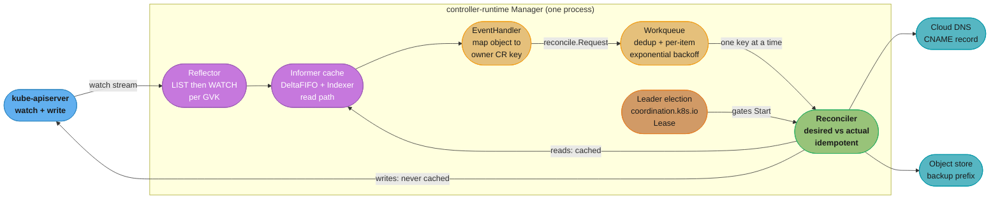
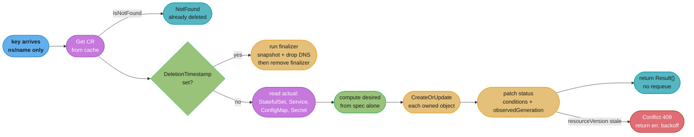
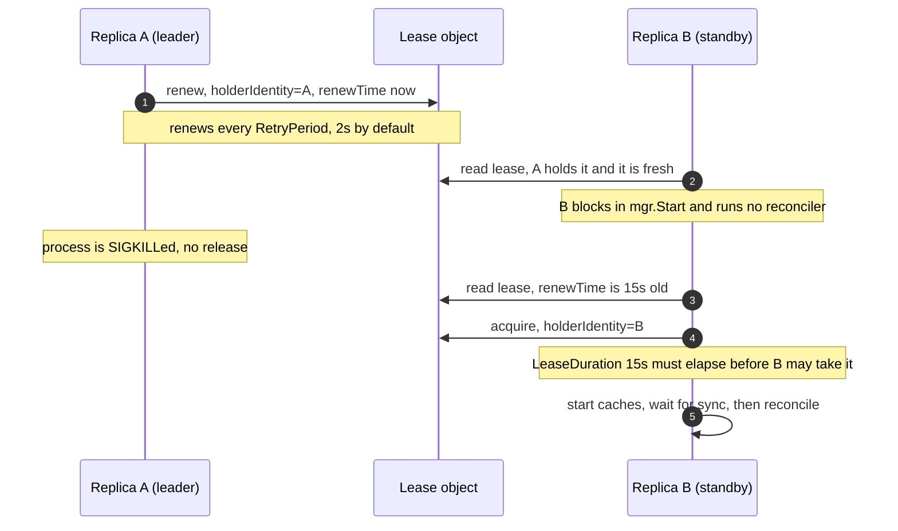
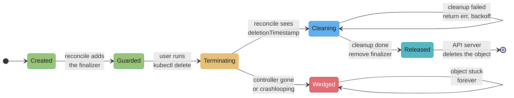

# Case Study: Design a Kubernetes Controller

## Intuition

> **Design intuition**: A Kubernetes controller is not an event processor. It is a **thermostat that has forgotten every reading it ever took**. Each time it wakes it asks one question — "what does the spec say, and what is actually true right now?" — and takes one corrective step. It never asks "what happened?" That single property is what makes a controller survivable: you can drop events, restart the process, lose the watch connection for four minutes, or roll out a new binary mid-reconcile, and the system still converges, because nothing about correctness depended on seeing a particular event.

**Key insight for this design**: every hard bug in a production controller comes from smuggling edge-triggered thinking into a level-triggered loop. "Create the StatefulSet when the CR is created" is edge thinking and it breaks the moment a reconcile runs twice. "Ensure a StatefulSet matching this spec exists" is level thinking and it is correct under every restart, replay, and duplicate. The Go you write is 90% `Get` → compute desired → `CreateOrUpdate`, and the remaining 10% — finalizers, status conditions, requeue semantics, leader election, and the API-server QPS budget — is where the outages live.

**What this case study adds over [kubernetes_operators_and_crds](../../devops/kubernetes_operators_and_crds/kubernetes_operators_and_crds.md)**: that module teaches the operator pattern from the **platform-operator's** viewpoint — what a CRD is, why the operator pattern exists, capability levels, when to reach for an operator instead of a Helm chart. This case study is the **Go engineer writing the binary**: the informer's shared cache and why reads and writes go to different places, the workqueue's deduplication and per-item exponential backoff, `resourceVersion` optimistic-concurrency conflicts, the leader-election lease and its split-brain window, `envtest` versus the fake client, and the arithmetic that decides whether your controller is a good cluster citizen or a cluster-wide outage. Read the devops module first for the *what*; this file is the *how*, in Go, at 8,000 objects.

---

## 1. Requirements Clarification

### The system

We are building `cache-operator`, a controller that manages a `CacheCluster` custom resource. A platform team runs it in a shared multi-tenant cluster; application teams `kubectl apply` a nine-line CR and get a working, backed-up, DNS-addressable Redis-compatible cache.

```yaml
apiVersion: cache.example.com/v1alpha1
kind: CacheCluster
metadata:
  name: checkout-sessions
  namespace: team-checkout
spec:
  version: "7.4"
  replicas: 3
  memoryLimit: 8Gi
  backup:
    schedule: "0 3 * * *"
    retentionDays: 14
  dnsName: checkout-sessions.cache.internal
status:
  observedGeneration: 4
  readyReplicas: 3
  endpoint: checkout-sessions-0.cache.team-checkout.svc
  conditions:
    - type: Ready
      status: "True"
      reason: AllReplicasReady
      observedGeneration: 4
      lastTransitionTime: "2026-09-02T11:04:22Z"
```

### Functional requirements

- Reconcile `CacheCluster` into a `StatefulSet`, a headless `Service`, a `ConfigMap` of Redis config, and a `Secret` holding the generated auth password.
- Manage two **external** resources the Kubernetes garbage collector cannot reach: a cloud DNS `CNAME` record and an S3 backup prefix. These are what force finalizers into the design.
- Surface progress through `status.conditions` (`Ready`, `Progressing`, `BackupHealthy`) using the standard `metav1.Condition` shape, so `kubectl wait --for=condition=Ready` works.
- Support in-place version upgrades (7.2 → 7.4) by rolling the StatefulSet, one pod at a time, and pausing if a pod fails readiness.
- Delete cleanly: on CR deletion, snapshot to S3, remove the DNS record, then release the finalizer.
- Run highly available: 3 replicas of the controller Deployment, exactly one reconciling.

### Non-functional requirements

- **Convergence latency**: p50 under 2 s, p99 under 15 s from `kubectl apply` to the corresponding `StatefulSet` write.
- **API-server budget**: the controller must consume no more than **2% of the API server's request budget** in steady state. Concretely: under 25 write requests/second aggregate, and zero list-all-objects calls outside startup and resync.
- **Memory**: under 800 MiB RSS with all 8,000 `CacheCluster` objects and their owned `StatefulSet`s cached.
- **Blast radius**: a bug in the controller must never delete a user's data. Deletion of an owned resource happens only through owner-reference GC or an explicit finalizer step.
- **Correctness under restart**: kill -9 at any instruction and the next reconcile must converge. No reconcile step may be non-idempotent.

### Explicitly out of scope

- The Redis data path itself (replication, failover election inside the cache) — that is the cache's job, not the controller's.
- Admission webhooks. CRD structural schema plus CEL validation rules cover the validation we need, and a webhook adds a hard dependency on the controller being up for *any* CR write, including deletes.
- Multi-cluster reconciliation. One controller, one cluster.

### Clarifying questions worth asking in the interview

1. **How many objects, and how are they distributed across namespaces?** This decides whether you can get away with a namespace-scoped cache or need a cluster-wide one, and it drives the entire memory budget.
2. **Does the controller manage anything outside the cluster?** If yes, you need finalizers, and finalizers are the single most common way a controller wedges a cluster. If no, owner references do all the cleanup for free and you should not add a finalizer.
3. **How fast must convergence be?** "Within a minute" and "within a second" are different architectures: the second one forbids polling and requires you to watch the owned resources too.

---

## 2. Scale Estimation

### Object counts and cache memory

The informer cache holds decoded Go structs, not JSON. Measure, do not guess — but as a planning number:

```
Cluster:                       5,000 nodes, 180,000 pods, 2,400 namespaces
CacheCluster CRs:              8,000        (avg 3.3 per namespace)
Owned objects (STS/Svc/CM/Secret): 32,000
Objects the controller caches: 40,000

CacheCluster (small spec, 3 conditions):     ~2.5 KB decoded
StatefulSet (full PodSpec, most fields unset
  but still decoded into the struct):        ~14 KB decoded
Service ~1.8 KB, ConfigMap ~1.2 KB, Secret   ~1.0 KB

Per CacheCluster: 2.5 + 14 + 1.8 + 1.2 + 1.0 = ~20.5 KB
x 8,000 CRs                                 = 164 MB of live cache

Add the indexer's own overhead (thread-safe store maps, per-index
key slices): ~35% for a store with two custom indexes  = ~221 MB
Add GC headroom at GOGC=100 (peak ~= 2 x live)          = ~442 MB peak heap
Add goroutine stacks, runtime structures, HTTP buffers  = ~90 MB
                                                          --------
Container limit to request:                               ~700 MiB
GOMEMLIMIT:                                               630 MiB (90%)
```

That arithmetic is the whole reason [`cross_cutting/gc_and_memory_budgets.md`](cross_cutting/gc_and_memory_budgets.md) exists — a controller is a live-heap-dominated process, which is exactly the shape that OOMKills when you size the container from a heap profile taken at startup.

### Request-rate arithmetic

```
Steady state (no user activity):
  Watch connections: 5 (one per watched GVK).  Requests/sec: ~0 --
  a watch is one long-lived connection, not a poll.

Resync (SyncPeriod = 10h, jittered +/-10%):
  40,000 cached objects re-delivered -> 8,000 distinct CR keys after
  workqueue dedup.  Reads: 0 API calls (the cache serves them).
  Writes: ~0 if nothing drifted -- a no-op reconcile writes nothing,
  which is the entire point of level-triggering.

Realistic churn for a platform team of this size:
  CR spec edits 400/day, pod restarts touching a CR 1,200/day,
  node drains cascading ~2,000 owned-object events/day
  = ~3,600 reconcile triggers/day = 0.042/s average

  Peak: a 200-node rolling upgrade drains over 40 minutes, touching
  ~9,600 pods of which ~1,300 belong to CacheClusters. After dedup:
  ~180 distinct CR keys -> 180 reconciles over 2,400 s.
  Writes per reconcile (version upgrade): 1 StatefulSet + 1 status = 2
  Peak write rate: 180 x 2 / 2,400 s = 0.15 writes/s
```

The steady-state numbers are almost embarrassingly small, and **that is the correct result**. A controller that is generating meaningful API-server load in steady state is broken; see §9 for the three ways it happens.

### Cold-start arithmetic (the number that actually hurts)

```
Startup LIST of all 5 watched types (protobuf wire bytes):
  8,000 CRs @ ~1.4 KB = 11.2 MB   |  8,000 StatefulSets @ ~9 KB = 72.0 MB
  8,000 Services @ ~1.1 KB = 8.8  |  8,000 ConfigMaps @ ~0.9 KB =  7.2 MB
  8,000 Secrets  @ ~0.7 KB = 5.6                                 --------
  Total wire bytes on every controller start:                      105 MB

At the informer's default page size of 500 that is 80 paged requests
hitting etcd. etcd serves ~105 MB from page cache in 3-6 s; the API
server spends most of it in protobuf decode.

Startup wall time: 8-14 s to a synced cache, plus 3 replicas racing
for the leader lease.
```

Three replicas each doing a 105 MB list at once is 315 MB of API-server egress at every rollout. On a 5,000-node cluster with 40 controllers behaving this way, rollouts are why the API server's p99 goes to 4 s. `WatchList` streaming (the `WatchListClient` feature gate) exists precisely to turn that one large paged response into an incrementally streamed one that never buffers a full page in the API server; enable it when your cluster version supports it.

---

## 3. High-Level Architecture



The load-bearing asymmetry in that picture: **the reconciler reads from the local cache and writes to the API server.** Reads are free, local, and microseconds. Writes are network calls that must succeed against a version the cache may not have seen yet. Every §9 war story is a consequence of forgetting one half of that sentence.

### The reconcile loop, level-triggered



Notice what is **not** in that flowchart: any branch on *what event woke us up*. The key carries a namespace and a name, nothing else. There is no "created" versus "updated" versus "deleted" — deletion is inferred from `NotFound` or from `DeletionTimestamp`, never from an event type. This is the entire content of "level-triggered", and it is why a controller that misses an event is still correct: the next trigger, from any source including the 10-hour resync, recomputes everything from scratch.

---

## 4. Component Deep Dives

### 4.1 Manager and Reconciler wiring

`controller-runtime`'s `Manager` owns the shared cache, the client, leader election, the metrics and health endpoints, and the lifecycle of every controller you register with it. Wiring one is mostly about the options you *do not* leave at their defaults.

```go
package main

import (
    "os"
    "time"

    cachev1 "example.com/cache-operator/api/v1alpha1"
    appsv1 "k8s.io/api/apps/v1"
    corev1 "k8s.io/api/core/v1"
    "k8s.io/apimachinery/pkg/fields"
    ctrl "sigs.k8s.io/controller-runtime"
    "sigs.k8s.io/controller-runtime/pkg/cache"
    "sigs.k8s.io/controller-runtime/pkg/client"
    "sigs.k8s.io/controller-runtime/pkg/manager"
)

// scheme registers clientgoscheme plus cachev1 in the usual init().

func main() {
    cfg := ctrl.GetConfigOrDie()

    // client-go's rest.Config defaults are QPS 5 / Burst 10. Nothing raises
    // them for you. At 8,000 objects a 5 QPS ceiling turns a mass update into
    // a 30-minute crawl, and the symptom is a controller that looks "slow"
    // with an idle CPU profile.
    cfg.QPS = 50
    cfg.Burst = 100

    mgr, err := ctrl.NewManager(cfg, manager.Options{
        Scheme: scheme,

        // Exactly one replica reconciles. See 4.6.
        LeaderElection:          true,
        LeaderElectionID:        "cache-operator.example.com",
        LeaderElectionNamespace: "cache-system",

        Cache: cache.Options{
            // Full resync every 10h, jittered. This is a safety net for a
            // missed event, not a polling interval. Setting it to 30s is the
            // single most common way to melt an API server.
            SyncPeriod: ptr(10 * time.Hour),

            ByObject: map[client.Object]cache.ByObject{
                // Cache every Secret we own, and no others. Without this the
                // manager caches EVERY Secret in the cluster the moment you
                // call client.Get on one -- 40,000 Secrets, several GB.
                &corev1.Secret{}: {
                    Field: fields.OneTermEqualSelector("type", "cache.example.com/auth"),
                },
                // StatefulSets: only ours, selected by a label we always set.
                &appsv1.StatefulSet{}: {
                    Label: mustParseSelector("app.kubernetes.io/managed-by=cache-operator"),
                },
            },
        },

        // The client reads from the cache by default. Opt specific types out
        // when a stale read is genuinely unacceptable -- see 4.3 and 9.3.
        Client: client.Options{Cache: &client.CacheOptions{
            DisableFor: []client.Object{&corev1.Secret{}},
        }},

        HealthProbeBindAddress: ":8081",
    })
    if err != nil {
        setupLog.Error(err, "unable to build manager")
        os.Exit(1)
    }

    if err := (&CacheClusterReconciler{
        Client:   mgr.GetClient(),
        Scheme:   mgr.GetScheme(),
        Recorder: mgr.GetEventRecorderFor("cache-operator"),
        DNS:      newRoute53Client(),
        Backups:  newS3Client(),
    }).SetupWithManager(mgr); err != nil {
        setupLog.Error(err, "unable to set up CacheCluster controller")
        os.Exit(1)
    }

    // mgr.Start blocks until the context is cancelled. ctrl.SetupSignalHandler
    // returns a context cancelled on SIGTERM, and cancelled-then-exit on a
    // second signal.
    if err := mgr.Start(ctrl.SetupSignalHandler()); err != nil {
        setupLog.Error(err, "manager exited")
        os.Exit(1)
    }
}
```

The `SetupWithManager` half declares what wakes the reconciler:

```go
func (r *CacheClusterReconciler) SetupWithManager(mgr ctrl.Manager) error {
    return ctrl.NewControllerManagedBy(mgr).
        For(&cachev1.CacheCluster{}).
        // Owns() installs a handler that maps an owned object's event to its
        // OWNER's key. A StatefulSet event does not enqueue the StatefulSet --
        // it enqueues the CacheCluster that owns it. This is what makes
        // "someone deleted my StatefulSet" self-heal in under a second.
        Owns(&appsv1.StatefulSet{}).
        Owns(&corev1.Service{}).
        Owns(&corev1.ConfigMap{}).
        WithOptions(controller.Options{
            // Reconciles run in parallel across DISTINCT keys. The workqueue
            // guarantees the same key is never in flight twice, so your
            // reconciler needs no locking of its own.
            MaxConcurrentReconciles: 8,

            // The default: per-item exponential backoff (5ms base, doubling,
            // capped at 1000s) ANDed with a 10 qps / 100 burst global bucket.
            RateLimiter: workqueue.DefaultTypedControllerRateLimiter[reconcile.Request](),
        }).
        Complete(r)
}
```

`MaxConcurrentReconciles: 8` and "no locking of your own" are a package deal, and they are the reason a controller is one of the few Go programs where you genuinely do not need a mutex in the hot path. The workqueue's dedup guarantee — see 4.2 — is doing the mutual exclusion for you, keyed by object. Contrast with the general worker-pool discipline in [concurrency_patterns_and_pitfalls](../concurrency_patterns_and_pitfalls/concurrency_patterns_and_pitfalls.md), where you own that guarantee yourself.

### 4.2 The informer, the shared cache, and the workqueue

Three pieces, and people conflate them constantly.

**The Reflector** runs `LIST` once, then `WATCH` from the returned `resourceVersion`, forever. It never polls. Every event it receives becomes a delta in the **DeltaFIFO**.

**The Indexer** is the actual cache: a thread-safe map from `namespace/name` to the decoded object, plus any secondary indexes you register. It is the *only* thing your reconciler's reads touch.

**The workqueue** sits between the event handlers and the reconciler and provides three properties that together make the whole design work:

| Property | What it does | Why it matters here |
|----------|--------------|---------------------|
| **Deduplication** | Adding key `K` while `K` is already queued is a no-op | 1,300 pod events during a node drain collapse to ~180 reconciles |
| **In-flight exclusion** | `K` cannot be handed to a second worker while a worker holds it; a re-add during processing is remembered and re-queued once after `Done(K)` | Your reconciler needs no per-object lock, at any `MaxConcurrentReconciles` |
| **Per-item rate limiting** | `AddRateLimited(K)` delays by `5ms * 2^failures`, capped at 1000s | One broken CR backs off to a 16-minute retry instead of spinning a core |

That exponential curve, concretely:

| Consecutive failures | Delay | Cumulative wall time |
|---|---|---|
| 1 | 5 ms | 5 ms |
| 10 | 2.56 s | ~5.1 s |
| 15 | 82 s | ~2.7 min |
| 20+ | 1000 s (cap) | capped at ~16.7 min per retry |

**The forgetting rule is the one people miss.** `Forget(K)` resets the failure counter. `controller-runtime` calls it for you on a successful reconcile — but if your reconciler returns `nil` while having quietly failed (swallowing an error into a log line), the counter resets and you lose the backoff entirely. The Go discipline here is exactly the one in [errors_and_panics](../errors_and_panics/errors_and_panics.md): return the error, wrap it with `%w`, and let the caller — here, the controller — decide policy.

### 4.3 Read from the cache, write to the API server

```go
// Reads: served from the informer's Indexer. Microseconds, no network,
// and possibly a few hundred milliseconds stale.
var cc cachev1.CacheCluster
if err := r.Get(ctx, req.NamespacedName, &cc); err != nil {
    // NotFound means the object is gone AND its owned objects are being
    // GC'd by owner reference. There is nothing to do and nothing to retry.
    return ctrl.Result{}, client.IgnoreNotFound(err)
}

// Writes: always straight to the API server. There is no write-through cache.
// The cache will observe this write later, via the watch, like anyone else.
if err := r.Status().Update(ctx, &cc); err != nil {
    return ctrl.Result{}, err
}
```

The staleness is real and bounded by watch latency, typically single-digit milliseconds in a healthy cluster and seconds in a loaded one. Three consequences you design around:

1. **Never read-back-to-verify a write you just made.** The cache has not seen it. A loop of "write, then `Get` and check" spins until the watch catches up, and under load it never does.
2. **Uniqueness checks against the cache are races.** "List all CacheClusters and reject if the DNS name is taken" reads a stale list. Enforce uniqueness with an API-server-side mechanism — a `Lease` or a ConfigMap with a deterministic name whose `Create` fails with `AlreadyExists` — not a cache scan.
3. **Some reads must bypass the cache.** A freshly generated `Secret` you must not re-generate is the canonical one: `DisableFor: []client.Object{&corev1.Secret{}}` sends those `Get`s straight to the API server. You pay a network round trip for correctness. Do this for the narrow set of objects where a stale read causes a *destructive* action, not for everything.

### 4.4 Requeue semantics — the returns and the one that is a bug

`Reconcile` returns `(ctrl.Result, error)`. There are exactly four meaningful combinations.

```go
// 1. Done. Wake me only on the next event or the 10h resync.
return ctrl.Result{}, nil

// 2. Something is in progress and no event will tell me when it finishes --
//    a cloud DNS propagation, an external API's async job. Poll deliberately.
//    RequeueAfter is NOT rate-limited and NOT exponentially backed off.
return ctrl.Result{RequeueAfter: 30 * time.Second}, nil

// 3. Transient failure. Return the error. controller-runtime logs it,
//    increments controller_runtime_reconcile_errors_total, and re-adds the
//    key through the rate limiter -- 5ms, 10ms, 20ms, ... capped at 1000s.
return ctrl.Result{}, fmt.Errorf("updating statefulset: %w", err)

// 4. Permanent failure -- a spec that can never be satisfied (memoryLimit
//    larger than any node). Requeuing burns CPU forever and never converges.
//    Record it in status, emit an Event, and return nil.
meta.SetStatusCondition(&cc.Status.Conditions, metav1.Condition{
    Type: "Ready", Status: metav1.ConditionFalse, Reason: "UnschedulableRequest",
    Message:            "memoryLimit 512Gi exceeds the largest node's allocatable 384Gi",
    ObservedGeneration: cc.Generation,
})
r.Recorder.Event(&cc, corev1.EventTypeWarning, "UnschedulableRequest", "...")
return ctrl.Result{}, r.Status().Update(ctx, &cc)
```

**The bug: returning a non-zero `Result` together with a non-nil error.**

```go
// BROKEN -- the RequeueAfter is silently discarded.
if err := r.dns.Upsert(ctx, record); err != nil {
    return ctrl.Result{RequeueAfter: 30 * time.Second}, err
}
```

`controller-runtime` checks the error first. If `err != nil` it re-queues through the **rate limiter** and ignores the `Result` entirely. The author intended "retry in 30 s"; what they get is "retry in 5 ms, then 10 ms, then 20 ms" — a hot loop against a cloud API that then rate-limits them, which produces more errors, which the author reads as "the cloud API is flaky." Newer `controller-runtime` versions log a warning when both are set, but the warning is easy to miss in a busy log.

```go
// FIX -- pick one. If you want a fixed retry cadence, swallow the error into
// the status and return a bare RequeueAfter.
if err := r.dns.Upsert(ctx, record); err != nil {
    log.Error(err, "dns upsert failed, retrying on a fixed cadence")
    meta.SetStatusCondition(&cc.Status.Conditions, metav1.Condition{
        Type: "Ready", Status: metav1.ConditionFalse,
        Reason: "DNSUpsertFailed", Message: err.Error(),
        ObservedGeneration: cc.Generation,
    })
    if serr := r.Status().Update(ctx, &cc); serr != nil {
        return ctrl.Result{}, serr
    }
    return ctrl.Result{RequeueAfter: 30 * time.Second}, nil
}

// FIX (alternative) -- if exponential backoff IS what you want, return only
// the error and let the rate limiter do its job.
if err := r.dns.Upsert(ctx, record); err != nil {
    return ctrl.Result{}, fmt.Errorf("dns upsert for %s: %w", record.Name, err)
}
```

The second form is right far more often than people think. Exponential backoff on a failing dependency is *correct*; a fixed 30-second poll against a dependency that is down is a thundering herd with extra steps.

### 4.5 Status conditions and `observedGeneration`

`metadata.generation` increments **only when `spec` changes** — status writes do not bump it. That single fact gives you a free, race-proof "have I processed this spec yet?" marker.

```go
func (r *CacheClusterReconciler) updateStatus(
    ctx context.Context, cc *cachev1.CacheCluster, sts *appsv1.StatefulSet,
) error {
    cc.Status.ObservedGeneration = cc.Generation
    cc.Status.ReadyReplicas = sts.Status.ReadyReplicas

    ready := metav1.ConditionFalse
    reason, msg := "Progressing", "waiting for replicas"
    if sts.Status.ReadyReplicas == *cc.Spec.Replicas {
        ready, reason, msg = metav1.ConditionTrue, "AllReplicasReady", ""
    }

    // meta.SetStatusCondition only updates LastTransitionTime when Status
    // actually flips. Hand-rolling this is how you get a status write on
    // every reconcile, which triggers a watch event, which triggers a
    // reconcile -- the hot loop in 9.1.
    meta.SetStatusCondition(&cc.Status.Conditions, metav1.Condition{
        Type:               "Ready",
        Status:             ready,
        Reason:             reason,
        Message:            msg,
        ObservedGeneration: cc.Generation,
    })

    return r.Status().Update(ctx, cc)
}
```

Consumers then have an unambiguous test. `kubectl wait --for=condition=Ready` alone is **not** sufficient during an upgrade: it can pass against a `Ready=True` left over from the previous spec. The correct check is both:

```
status.observedGeneration == metadata.generation
AND conditions[type=Ready].status == "True"
AND conditions[type=Ready].observedGeneration == metadata.generation
```

The `status` subresource must be enabled in the CRD (`subresources: {status: {}}`), which is what makes `r.Status().Update()` a distinct write that cannot clobber `spec` and does not bump `generation`. Without it, a status write and a user's `spec` edit race, and the controller wins — silently reverting the user's change. That has happened to every operator team once.

### 4.6 Leader election

Three replicas, one reconciler. `controller-runtime` implements this on a `coordination.k8s.io/v1` `Lease` object.



The defaults and what each one buys you:

| Option | Default | Meaning |
|--------|---------|---------|
| `LeaseDuration` | 15 s | How stale a lease must be before a challenger may take it |
| `RenewDeadline` | 10 s | How long the leader keeps trying to renew before it gives up and **stops** |
| `RetryPeriod` | 2 s | Renew/acquire attempt interval |

**The split-brain window is real, and it is bounded by design, not eliminated.** The leader must abandon leadership at `RenewDeadline` (10 s), and a challenger may not acquire until `LeaseDuration` (15 s) has elapsed. The 5-second gap is the safety margin. But the old leader is a *process*, and a process that is `SIGSTOP`ped, paused by a 12-second GC pause on a starved node, or partitioned from the API server but not from your cloud provider, can wake up after B has taken over and still be mid-`Reconcile`. It will fail on its next API-server write — the lease check is not on the write path, but `controller-runtime` calls `os.Exit(1)` when renewal fails, which is the actual guard. Until that exit lands, two reconcilers can both call your **external** API.

The consequence: **leader election protects Kubernetes writes well and external side effects poorly.** Any external call your reconciler makes must be idempotent on its own terms — an S3 `PutObject` with a deterministic key, a DNS `UPSERT` rather than `CREATE`, a cloud API call carrying an idempotency token derived from `metadata.uid` plus `spec` hash. Never a "create a new backup job" call with a random ID.

Set `LeaderElectionReleaseOnCancel: true` so a clean SIGTERM releases the lease immediately and failover is sub-second instead of 15 s. That works only if your process actually exits after `mgr.Start` returns — see [context_and_cancellation](../context_and_cancellation/context_and_cancellation.md) for why a stray goroutine holding a non-cancellable operation turns your graceful shutdown into a 15-second outage.

### 4.7 Optimistic concurrency and the `resourceVersion` conflict

Every write carries the `resourceVersion` you read. If the object changed since, the API server returns `409 Conflict`. This is not an error condition to fight; it is the mechanism working.

```go
// BROKEN -- a retry loop that reuses the stale object. Every attempt sends
// the same resourceVersion and gets the same 409. Five attempts, five
// conflicts, ~150ms burned, and the reconcile fails anyway.
for i := 0; i < 5; i++ {
    cc.Status.ReadyReplicas = n
    if err := r.Status().Update(ctx, &cc); err == nil {
        break
    }
    time.Sleep(30 * time.Millisecond)
}
```

```go
// FIX (a) -- re-read inside the retry. RetryOnConflict does exactly this
// with the right backoff, and the closure MUST re-Get.
err := retry.RetryOnConflict(retry.DefaultRetry, func() error {
    var fresh cachev1.CacheCluster
    if err := r.Get(ctx, req.NamespacedName, &fresh); err != nil {
        return err
    }
    fresh.Status.ReadyReplicas = n
    meta.SetStatusCondition(&fresh.Status.Conditions, readyCond)
    return r.Status().Update(ctx, &fresh)
})
```

```go
// FIX (b) -- do not send a resourceVersion at all. A JSON merge patch or a
// server-side apply expresses "these fields, this value" and merges
// server-side, so a concurrent change to OTHER fields does not conflict.
// This is the better answer whenever you own a bounded set of fields.
patch := client.MergeFrom(cc.DeepCopy())
cc.Status.ReadyReplicas = n
meta.SetStatusCondition(&cc.Status.Conditions, readyCond)
return r.Status().Patch(ctx, cc, patch)
```

```go
// FIX (c) -- server-side apply with a named field manager. Two controllers
// may now co-own the same object's status without fighting: each owns the
// fields it sets, and the API server tracks ownership in managedFields.
return r.Status().Patch(ctx, desired, client.Apply,
    client.FieldOwner("cache-operator"),
    client.ForceOwnership)
```

A steady trickle of conflicts on a busy object is normal and healthy. A *storm* of them means two writers are fighting, and the fix is (c), not more retries. Watch `controller_runtime_reconcile_errors_total` alongside the API server's `apiserver_request_total{code="409"}` — a controller responsible for more than a few percent of the cluster's 409s is misbehaving.

### 4.8 Finalizers and the deletion protocol

A finalizer is a string in `metadata.finalizers`. Its only effect: while the list is non-empty, `DELETE` does not remove the object — it sets `metadata.deletionTimestamp` and stops. The object is now in "terminating" and stays there until every finalizer string is removed. **Only your controller can remove yours.**



```go
const finalizer = "cache.example.com/cleanup"

func (r *CacheClusterReconciler) Reconcile(
    ctx context.Context, req ctrl.Request,
) (ctrl.Result, error) {
    var cc cachev1.CacheCluster
    if err := r.Get(ctx, req.NamespacedName, &cc); err != nil {
        return ctrl.Result{}, client.IgnoreNotFound(err)
    }

    if !cc.DeletionTimestamp.IsZero() {
        if !controllerutil.ContainsFinalizer(&cc, finalizer) {
            return ctrl.Result{}, nil // someone else's turn, or already done
        }
        // Cleanup MUST be idempotent -- it will run again on every retry.
        if err := r.snapshotToS3(ctx, &cc); err != nil {
            return ctrl.Result{}, fmt.Errorf("final snapshot: %w", err)
        }
        if err := r.dns.DeleteIfExists(ctx, cc.Spec.DNSName); err != nil {
            return ctrl.Result{}, fmt.Errorf("dns cleanup: %w", err)
        }
        controllerutil.RemoveFinalizer(&cc, finalizer)
        return ctrl.Result{}, r.Update(ctx, &cc)
    }

    // Add the finalizer BEFORE creating any external resource. The other
    // order leaves a window where a delete arriving between the external
    // create and the finalizer write orphans the DNS record forever.
    if !controllerutil.ContainsFinalizer(&cc, finalizer) {
        controllerutil.AddFinalizer(&cc, finalizer)
        if err := r.Update(ctx, &cc); err != nil {
            return ctrl.Result{}, err
        }
        // The Update bumped resourceVersion. Returning here and letting the
        // resulting watch event re-trigger is cheaper and simpler than
        // continuing with a now-stale in-memory copy.
        return ctrl.Result{}, nil
    }

    return r.reconcileNormal(ctx, &cc)
}
```

Two rules that are not negotiable:

1. **`DeleteIfExists`, not `Delete`.** Cleanup runs on every retry. A cleanup that errors on "already gone" wedges the object permanently in `Terminating` — the finalizer is never removed because the step before it never succeeds.
2. **Never add a finalizer you cannot remove.** See 9.2.

### 4.9 Owner references and garbage collection

For everything that lives *inside* the cluster, do not write cleanup code at all. Set an owner reference and let the API server's garbage collector do it.

```go
sts := &appsv1.StatefulSet{
    ObjectMeta: metav1.ObjectMeta{Name: cc.Name, Namespace: cc.Namespace},
}
op, err := controllerutil.CreateOrUpdate(ctx, r.Client, sts, func() error {
    // This mutate function runs on both create and update. It must compute
    // the desired state from cc.Spec ALONE -- never from sts's current
    // contents, or the second reconcile diverges from the first.
    sts.Labels = map[string]string{"app.kubernetes.io/managed-by": "cache-operator"}
    sts.Spec.Replicas = cc.Spec.Replicas
    sts.Spec.ServiceName = cc.Name
    sts.Spec.Selector = &metav1.LabelSelector{MatchLabels: podLabels(cc)}
    sts.Spec.Template = desiredPodTemplate(cc)

    // Sets ownerReferences with controller=true and blockOwnerDeletion=true.
    // Deleting the CacheCluster now cascades to this StatefulSet with no
    // code from us, and no finalizer.
    return controllerutil.SetControllerReference(cc, sts, r.Scheme)
})
```

Rules the GC enforces and people trip over:

- **An owner reference cannot cross namespaces**, and a namespaced object cannot own a cluster-scoped one. Violate either and the GC deletes the dependent *immediately* on the theory that the owner does not exist — a real data-loss path. Separately, **`blockOwnerDeletion: true`** requires `update` on the owner's `finalizers` subresource in RBAC; omit that rule and `SetControllerReference` fails with a confusing 403.
- **Foreground versus background cascade**: `kubectl delete` defaults to background — the owner disappears immediately and dependents are cleaned up asynchronously. `--cascade=foreground` keeps the owner in `Terminating` (via `foregroundDeletion` finalizer) until dependents are gone. If your CR must not report "deleted" before its StatefulSet is really gone, you want foreground.

### 4.10 Watch bookmarks, resync, and relist cost

A watch is a long-lived HTTP stream, and it will break — API server rollouts, load balancer idle timeouts, network blips. When it does, the reflector reconnects **from the last `resourceVersion` it saw**. If that version has been compacted out of etcd, the API server returns `410 Gone` and the reflector must do a **full relist** — 105 MB in our cluster, from every replica, at once.

**Bookmarks** are the mitigation. With `allowWatchBookmarks=true` (the informer sets it), the API server periodically sends a synthetic `BOOKMARK` event carrying only a current `resourceVersion` and no object. It costs a few hundred bytes and it keeps the client's known version fresh even when nothing it watches has changed — so a reconnect resumes instead of relisting. Without bookmarks, a controller watching a rarely-changing type is *guaranteed* to relist after every compaction, which is the worst case: the quietest controllers generate the biggest storms.

**`SyncPeriod`** (default 10 h, jittered ±10%) is different and often confused with it. It does not touch the API server at all: it re-delivers every cached object to the event handlers, which enqueue their keys. It is a safety net against a bug that dropped an event or a reconcile that silently no-oped. Setting it to 30 s does not "make the controller more responsive" — events already do that in milliseconds — it just runs 8,000 reconciles every 30 seconds forever.

---

## 5. Design Decisions & Tradeoffs

| Decision | Chosen | Alternative | Why |
|----------|--------|-------------|-----|
| Trigger model | Level-triggered reconcile | Edge-triggered event handlers | Missed events, restarts, and duplicate deliveries all become non-events. The cost is recomputing desired state every time, which is cheap. |
| Read path | Informer cache | Direct API `Get` per reconcile | 8,000 reconciles/resync x 5 reads = 40,000 API calls vs zero. Accept bounded staleness. |
| Write path | Direct to API server | Write-through cache | There is no such thing as a correct write-through cache here; the API server owns `resourceVersion`. |
| Conflict handling | Server-side apply for status | `RetryOnConflict` everywhere | SSA lets a second controller co-own the object. Retry loops just move the fight later. |
| External cleanup | Finalizer | Best-effort cleanup on delete event | A delete event can be missed. A finalizer cannot — that is its whole purpose. |
| In-cluster cleanup | Owner references | Finalizer per owned object | Zero code, no wedge risk. Reserve finalizers for what GC cannot reach. |
| HA | Leader election, 3 replicas | Single replica | Failover in 15 s (or sub-second with release-on-cancel) vs a pod-scheduling delay. |
| Sharding | None; one leader | Consistent-hash shards across replicas | At 8,000 objects one leader is nowhere near saturated. Revisit past ~100k objects. See §10. |
| Cache scope | Field/label-selected per type | Cache everything | Caching all cluster Secrets is a multi-GB memory bug and an enormous RBAC ask. |
| Reconcile concurrency | `MaxConcurrentReconciles: 8` | 1, or 64 | The workqueue makes distinct keys independent. 8 saturates the external DNS API's rate limit; 64 just queues inside it. |

### The one tradeoff worth arguing about: cache staleness

Reading from the cache means acting on a view that is milliseconds to seconds behind. For a controller this is nearly always right, because level-triggering makes acting on stale data *safe*: you compute a wrong-but-harmless step, a watch event arrives, and you compute the right one. The exception is any action that is **destructive and not idempotent** — deleting a PVC, revoking a credential, terminating a cloud instance. For those, and only those, pay for a live read.

The failure mode when you get this wrong is memorable: the controller reads a stale CR that still has `replicas: 3`, scales the StatefulSet back up, and fights the user who just set it to 1 — for as long as the staleness persists. With a StatefulSet that is a flapping scale event. With a `Delete` it is data loss.

---

## 6. Real-World Implementations

**cert-manager** is the reference implementation of the finalizer-plus-external-resource shape this case study models. It reconciles `Certificate` → `CertificateRequest` → `Order` → `Challenge`, with each level a separate controller watching the level below. That decomposition — many small controllers over one giant reconciler — is the pattern to steal: each has a trivially checkable invariant, and an ACME rate-limit failure backs off only the `Order` controller. It also demonstrates the discipline of §4.6: every ACME interaction is keyed so a duplicate is harmless, because during a lease handover two controllers genuinely can both call Let's Encrypt.

**Flux** (`source-controller`, `kustomize-controller`, `helm-controller`, `notification-controller`) is the clearest example of `observedGeneration` and standard conditions done properly. `kubectl get kustomization` shows `READY`/`STATUS`/`AGE` derived entirely from conditions, and `flux reconcile` works by *annotating* the object with a timestamp — a spec change, so `generation` bumps, so the controller notices, with no side channel and no RPC. That trick is worth copying: **the CR is the only API your controller needs.**

**Argo CD** takes the opposite architectural bet and is instructive for it. Its `application-controller` maintains its own cluster cache across *many* target clusters, so it is not a plain controller-runtime manager — it needs a cache keyed by cluster, and sharding across controller replicas by cluster is a first-class feature (`ARGOCD_CONTROLLER_REPLICAS` plus a shard assignment). If your CR count ever pushes past what one leader can reconcile, Argo CD's sharding is the design to read, not to invent.

**Crossplane** pushes the pattern furthest: its providers reconcile CRs into *cloud* resources, so essentially every managed resource carries a finalizer and every external call must be idempotent under a lease handover. Crossplane's "external name" annotation — recording the cloud provider's ID on the CR the moment the resource is created — is the fix for the hardest version of the split-brain problem: without a stable external identifier written back before anything else, a duplicated reconcile creates a second cloud resource and orphans the first.

**Kubernetes' own controllers** are the ground truth. `kube-controller-manager`'s `deployment_controller.go` and `statefulset_controller.go` are the canonical level-triggered reconcilers, and they predate `controller-runtime` — they wire `client-go`'s `SharedInformerFactory` and `workqueue` by hand. Reading `deployment_controller.go` once is the fastest way to see that `controller-runtime` is a thin ergonomic layer, not magic.

---

## 7. Technologies & Tools

| Tool | Role | Note for the Go engineer |
|------|------|--------------------------|
| `sigs.k8s.io/controller-runtime` | Manager, cache, client, leader election | The layer you write against. Read `pkg/internal/controller/controller.go` once — it is ~300 lines and it demystifies requeue semantics. |
| `k8s.io/client-go` | Informers, workqueue, REST client, discovery | `controller-runtime` wraps it. You still reach for `workqueue` and `retry.RetryOnConflict` directly. |
| **Kubebuilder** | Scaffolding, `PROJECT` file, Makefile | Generates the manager skeleton, CRD manifests, RBAC from `// +kubebuilder:rbac` markers. |
| `envtest` + `setup-envtest` | Real `kube-apiserver` + `etcd` binaries, no kubelet | The only test that exercises real validation, defaulting, and `resourceVersion` semantics. See §8. |
| `sigs.k8s.io/controller-runtime/pkg/client/fake` | In-memory client | Fast, but no defaulting, no validation, no GC. Needs `WithStatusSubresource` or your status writes silently no-op. |
| `pprof` via manager metrics | Heap and goroutine profiles | `manager.Options{PprofBindAddress: ":8082"}`. See [profiling_and_tracing](../profiling_and_tracing/profiling_and_tracing.md). |
| `controller_runtime_*` Prometheus metrics | Free instrumentation | `reconcile_total`, `reconcile_errors_total`, `reconcile_time_seconds`, `max_concurrent_reconciles`, `active_workers`, workqueue depth/latency. Alert on all of them. |
| `govulncheck`, `-trimpath`, distroless base | Supply chain and image | A controller image is ~15 MB static binary on distroless; see [packages_modules_and_tooling](../packages_modules_and_tooling/packages_modules_and_tooling.md). |

---

## 8. Operational Playbook

### Rollout

The controller's Deployment uses `maxSurge: 0, maxUnavailable: 1` — a controller is a singleton by leader election anyway, and surging just makes more replicas race for the lease and each pay the 105 MB list. With `LeaderElectionReleaseOnCancel: true`, a rolling update looks like: old leader gets SIGTERM, releases the lease, new pod acquires in ~1 s, syncs its cache in ~10 s, resumes. Total reconcile gap: ~11 s. Without release-on-cancel it is ~26 s.

### Health probes

```go
// Liveness: is the process alive? Deliberately trivial. A liveness probe
// that checks API-server reachability turns an API-server blip into a
// CrashLoopBackOff of every controller in the cluster, at once.
mgr.AddHealthzCheck("healthz", healthz.Ping)

// Readiness: has the cache synced? A controller with an unsynced cache is
// not merely slow -- it will compute "the StatefulSet does not exist" and
// try to create 8,000 of them.
mgr.AddReadyzCheck("readyz", mgr.GetCache().WaitForCacheSync)
```

### Dashboards and alerts

| Signal | Query shape | Threshold | What it means |
|--------|-------------|-----------|---------------|
| Reconcile error rate | `rate(controller_runtime_reconcile_errors_total[5m])` | > 0.5/s for 10 m | A dependency is down, or a spec cannot be satisfied |
| Workqueue depth | `workqueue_depth{name="cachecluster"}` | > 500 for 15 m | Reconciles are slower than events arrive |
| Queue latency p99 | `workqueue_queue_duration_seconds` | > 30 s | Raise `MaxConcurrentReconciles` or find the slow reconcile |
| Leader identity | `leader_election_master_status` | flaps > 1/h | Renewal failing: GC pauses, CPU throttling, or API-server latency |
| Client-side throttling | log `Waited for .* due to client-side throttling` | any occurrence | Your `cfg.QPS` is too low. Never ignore this line |
| API-server 409s from us | `apiserver_request_total{code="409"}` by user agent | > 5% of our writes | Two writers fighting; move to SSA |
| Objects stuck terminating | `count(kube_customresource_deletion_timestamp)` | > 0 for 30 m | A finalizer is wedged. See 9.2 |

### The runbook entries that matter

**"Everything is stuck in Terminating."** Confirm the controller is running and reconciling (`reconcile_total` increasing). If it is crashlooping, fix that first — the objects unwedge on their own. Only if the controller is *permanently gone* do you remove finalizers by hand, and understand you are choosing to orphan every external resource those objects owned:

```bash
kubectl patch cachecluster checkout-sessions -n team-checkout \
  --type=merge -p '{"metadata":{"finalizers":[]}}'
```

**"The controller is slow but idle."** Grep the logs for `client-side throttling` — `cfg.QPS` defaults to 5.

**"Reconciles are looping."** `rate(reconcile_total[1m])` far exceeds any plausible event rate. Almost always a status write on every pass; see 9.1.

**Emergency stop.** `kubectl scale deploy/cache-operator --replicas=0`. Existing CRs keep running — reconciliation is the only thing that changes anything.

---

## 9. Common Pitfalls & War Stories

### 9.1 The status-write hot loop — 40% of an API server, from one controller

**What happened.** A team added `status.lastReconcileTime = metav1.Now()` "for observability." Every reconcile wrote status. Every status write produced a watch event. Every watch event enqueued the CR. The workqueue deduplicated perfectly and it did not matter — the loop was one key at a time, forever, per object.

**The arithmetic.** 8,000 objects x 1 write each x (reconcile takes ~40 ms) = a sustained **~3,200 writes/second** against etcd, from one controller. The API server's write p99 went from 40 ms to 1.9 s cluster-wide. Every other controller's leader election started failing renewal at `RenewDeadline`, so half the cluster's controllers began flapping leadership. The incident was diagnosed as "etcd is slow."

**The fix.** Never write a timestamp or any always-changing field into status. Write status **only when it differs**:

```go
// BROKEN
cc.Status.LastReconcileTime = metav1.Now()
return r.Status().Update(ctx, &cc)

// FIX
before := cc.Status.DeepCopy()
recomputeStatus(&cc, sts)          // sets only derived, stable fields
if equality.Semantic.DeepEqual(before, &cc.Status) {
    return nil                      // nothing changed -- write nothing
}
return r.Status().Update(ctx, &cc)
```

`meta.SetStatusCondition` already does the right thing for conditions: it only touches `lastTransitionTime` when `status` actually flips. The bug is always a hand-rolled field beside it.

### 9.2 The finalizer that outlived its controller — 4,100 namespaces wedged

**What happened.** A platform team deprecated an internal operator and deleted its Deployment, its CRD, and its RBAC in one PR. 900 CRs still existed with `finalizers: ["platform.example.com/cleanup"]`. Deleting the CRD put the CRD itself into `Terminating` (the API server will not remove a CRD while instances exist). Every namespace containing one of those CRs then failed to terminate, because **namespace deletion blocks on every object in it**. 4,100 namespaces — including 3,200 with no relationship to the operator, caught by a shared `Namespace` deletion in the CI teardown job — sat in `Terminating` for eleven hours.

**Why it is so bad.** A finalizer is a promise that *some process* will do cleanup. Delete the process and the promise can never be kept. Kubernetes has no timeout for this, deliberately: silently dropping a finalizer would mean silently leaking a cloud resource.

**The fix, and the order.** Decommissioning an operator is a three-step sequence and the steps do not commute:

1. Ship a controller version whose reconcile does nothing but remove its own finalizer from every CR.
2. Wait until zero objects carry it: `kubectl get cacheclusters -A -o json | jq '[.items[] | select(.metadata.finalizers)] | length'` returns `0`.
3. *Then* delete the CRD, the Deployment, and the RBAC.

**Prevention.** Alert on `object exists AND deletionTimestamp older than 15 minutes`, per CRD — it fires in minutes, not the next morning. And do not add a finalizer at all when owner references suffice.

### 9.3 The unbounded cache — 6.2 GB RSS and an OOMKill loop

**What happened.** The reconciler called `r.Get(ctx, key, &corev1.Secret{})` to read a database password. `controller-runtime`'s cached client starts an informer for **every type you read**, cluster-wide, on first use. That one line began caching all 41,000 Secrets in the cluster. RSS went from 180 MB to 6.2 GB over four minutes and the pod OOMKilled, restarted, re-listed 41,000 Secrets, and OOMKilled again — while the API server served a 3 GB list to a crashlooping pod every 90 seconds.

**The fix.** Two options, and prefer the first:

```go
// FIX (a) -- scope the cache. Only Secrets we actually own are cached.
Cache: cache.Options{ByObject: map[client.Object]cache.ByObject{
    &corev1.Secret{}: {Field: fields.OneTermEqualSelector("type", "cache.example.com/auth")},
}},

// FIX (b) -- opt the type out of the cache entirely. Every Get is a live
// API call. Correct when reads are rare and freshness matters.
Client: client.Options{Cache: &client.CacheOptions{
    DisableFor: []client.Object{&corev1.Secret{}},
}},
```

**The generalizable lesson.** In a controller, *reading a type is a memory allocation decision*, not just an I/O decision — the opposite of every other Go program you write. Audit every distinct GVK your reconciler touches and decide, explicitly, whether it is cached and with what selector. The memory arithmetic in [`cross_cutting/gc_and_memory_budgets.md`](cross_cutting/gc_and_memory_budgets.md) is only valid once that list is closed.

### 9.4 The non-idempotent reconcile — 340 duplicate backup jobs

**What happened.** The reconciler created a backup `Job` with `GenerateName: "backup-"`, letting the API server append a random suffix. Every reconcile created a new Job. A node drain triggered ~15 reconciles per CR over ten minutes; 23 CRs were affected; 340 Jobs landed, each pulling a 2 GB image and each writing the same S3 prefix. The cluster ran out of pod IPs in that namespace's subnet.

**Why `GenerateName` is the trap.** It is the correct API for a user creating an object interactively and the wrong one for a controller, because it makes "does this already exist?" unanswerable. A controller's create must be **deterministic**:

```go
// BROKEN -- a new Job on every reconcile.
job := &batchv1.Job{ObjectMeta: metav1.ObjectMeta{
    GenerateName: "backup-", Namespace: cc.Namespace,
}}
return r.Create(ctx, job)

// FIX -- a name derived from the spec. The second Create returns
// AlreadyExists, which is the success case, not an error.
name := fmt.Sprintf("backup-%s-%s", cc.Name, specHash(cc.Spec.Backup)[:8])
job := &batchv1.Job{ObjectMeta: metav1.ObjectMeta{Name: name, Namespace: cc.Namespace}}
if err := controllerutil.SetControllerReference(cc, job, r.Scheme); err != nil {
    return err
}
if err := r.Create(ctx, job); err != nil && !apierrors.IsAlreadyExists(err) {
    return fmt.Errorf("create backup job %s: %w", name, err)
}
return nil
```

**The test that catches it.** In every reconciler test, call `Reconcile` **three times** with no intervening changes and assert the cluster state is byte-identical after the second and third. This is a five-line assertion and it would have caught all 340 Jobs.

### 9.5 The blocking reconcile — 8 workers, one dead DNS server

**What happened.** `r.dns.Upsert` used an `http.Client` with no timeout. The cloud DNS endpoint blackholed. All 8 reconcile workers blocked in `read` on a TCP socket with a default OS timeout measured in minutes. Workqueue depth climbed to 6,000. Nothing reconciled for 11 minutes — including the CRs that had nothing to do with DNS.

**The fixes, all three of which are required.**

```go
// 1. Every external client gets a timeout. A zero http.Client.Timeout means
//    "wait forever", and it is the default.
r.dns = &route53.Client{HTTP: &http.Client{Timeout: 10 * time.Second}}

// 2. Propagate the reconcile context so shutdown and requeue actually cancel
//    the call. See context_and_cancellation.
ctx, cancel := context.WithTimeout(ctx, 15*time.Second)
defer cancel()
if err := r.dns.Upsert(ctx, record); err != nil { ... }

// 3. Never block a worker on something long. If a step legitimately takes
//    minutes, model it as state and poll: record "provisioning" in status,
//    return RequeueAfter, and check for completion on the next pass.
```

Point 3 is the structural one: **a reconcile should complete in tens of milliseconds.** Anything longer belongs in the status machine, not in the goroutine. The blocking-call discipline is the same one in [http_clients_and_resilience](../http_clients_and_resilience/http_clients_and_resilience.md); a controller just makes the blast radius shared across every object the controller owns.

---

## 10. Capacity Planning

### The reconcile budget

Start from the only three numbers that matter: object count, reconcile cost, resync period.

```
N   = 8,000       CacheCluster objects
C   = 40 ms       p99 reconcile wall time (cache reads + up to 2 API writes)
W   = 8           MaxConcurrentReconciles
T   = 10 h        SyncPeriod

Reconcile throughput ceiling:
    W / C = 8 / 0.040 s = 200 reconciles/sec

Full-resync drain time (every object, worst case, all needing work):
    N x C / W = 8,000 x 0.040 / 8 = 40 seconds

Full-resync drain when nothing has drifted (the normal case: reads are
cached, no writes issued, C drops to ~1.5 ms):
    8,000 x 0.0015 / 8 = 1.5 seconds
```

40 seconds to converge the entire cluster from cold is comfortable. The number that would worry you is the drain time approaching the *resync period* — at that point resyncs overlap and the queue never empties.

### The API-server budget

The API server's own capacity, and your slice of it, is the constraint that turns a working controller into an incident.

```
API server capacity (3 control-plane nodes, 8 vCPU each, etcd on NVMe):
    Sustained write throughput:   ~1,200 writes/sec cluster-wide
    Sustained read (from cache):  ~9,000 reads/sec
    Our budget at 2%:             24 writes/sec

Our steady-state writes:
    Reconciles/day 3,600 x 1.4 writes avg / 86,400 s = 0.058 writes/sec
    = 0.005% of the write budget.

Our worst realistic burst -- a fleet-wide version bump, every CR edited:
    8,000 CRs x 2 writes (StatefulSet + status) = 16,000 writes
    At W/C = 200 reconciles/sec -> 400 writes/sec for 40 seconds.
    That is 33% of the API server's write capacity for 40 s.  TOO MUCH.
```

That last line is the planning result. A fleet-wide change is exactly the scenario a platform team runs (a CVE patch, a base-image bump), and the naive controller turns it into a control-plane brownout. Three levers, in order of preference:

1. **The `cfg.QPS`/`Burst` ceiling** — set `cfg.QPS = 50, cfg.Burst = 100`. Client-side throttling now caps us at 50 writes/sec, stretching the fleet bump to 16,000 / 50 = **320 seconds**. Slower is correct here.
2. **The workqueue's bucket rate limiter** — 10 qps / 100 burst on *re-queues* only; it does not bound the first attempt, so it is a backoff mechanism, not an admission control. Do not rely on it for this.
3. **`MaxConcurrentReconciles`** — lowering it to 4 halves peak write rate but also halves recovery speed. Use `cfg.QPS` instead; it bounds the thing you actually care about (API-server requests) rather than a proxy.

**The API server's own defense is API Priority and Fairness.** Your controller's requests land in a `FlowSchema`, and a misbehaving controller is throttled with `429` and a `Retry-After` rather than taking the API server down. Give the controller its own `FlowSchema` and `PriorityLevelConfiguration` so it cannot starve `kubelet` or `kube-scheduler` traffic — and so that when it *does* misbehave, the blast radius is itself.

### Memory budget, worked

From §2: ~221 MB live heap at 40,000 cached objects. The full arithmetic — why the container limit is 700 MiB and not 250 MiB, and why `GOMEMLIMIT` goes to 630 MiB — is in [`cross_cutting/gc_and_memory_budgets.md`](cross_cutting/gc_and_memory_budgets.md). The controller-specific parts:

```
Live heap scales linearly with cached objects:
    221 MB / 40,000 objects = ~5.5 KB per cached object

Growth headroom: the platform expects 3x CacheCluster growth in 18 months.
    24,000 CRs -> 120,000 cached objects -> ~663 MB live
    Peak at GOGC=100: ~1.33 GB.  The 700 MiB container will OOMKill
    long before that.

Plan: at 15,000 CRs, either
  (a) raise limits to 2 GiB and GOMEMLIMIT to 1.8 GiB, or
  (b) trim the cache with a TransformFunc that strips managedFields and
      the pod template's unset fields before storing -- typically 30-40%
      off a StatefulSet, and it is the cheapest win available.
```

Option (b) deserves emphasis because it is underused. `cache.Options.DefaultTransform` runs on every object before it enters the Indexer:

```go
DefaultTransform: func(obj any) (any, error) {
    if o, ok := obj.(client.Object); ok {
        o.SetManagedFields(nil)              // often 2-6 KB on an SSA'd object
        o.SetAnnotations(pruneAnnotations(o.GetAnnotations()))
    }
    return obj, nil
},
```

`managedFields` on a StatefulSet written by three different controllers is routinely larger than the spec. Stripping it is free — you never read it — and on this fleet it takes live heap from 221 MB to ~148 MB, a 33% cut for six lines. Confirm the win with a heap profile, not a guess; see [escape_analysis_and_performance](../escape_analysis_and_performance/escape_analysis_and_performance.md) for how to read one.

### When to shard

One leader handles 8,000 objects with 40-second full convergence. The signals that you have outgrown it:

| Signal | Threshold | Response |
|--------|-----------|----------|
| Full-resync drain time | > 25% of `SyncPeriod` | Raise `MaxConcurrentReconciles` first |
| Cold-start cache sync | > 60 s | Shard; enable `WatchList` streaming |

Sharding means each replica watches a **disjoint subset** — a label selector, a namespace range, or a consistent hash of `metadata.uid` — with its own lease. It is a genuine architectural step up (rebalancing, shard-assignment ownership, per-shard caches), which is why Argo CD's implementation is worth reading before writing your own. Below ~100k objects, do not.

---

## 11. Interview Discussion Points

**Q: Explain level-triggered versus edge-triggered, and why Kubernetes controllers are level-triggered.**

Edge-triggered means reacting to *transitions* — "a CR was created, so create a StatefulSet." Level-triggered means reacting to *state* — "the spec says 3 replicas, reality says 2, fix it." Kubernetes controllers are level-triggered because the transport is unreliable in ways you cannot engineer away: watch connections break, the process restarts, events coalesce, `resourceVersion` gets compacted. With edge triggering, any of those permanently loses work. With level triggering, a missed event costs you latency, not correctness — the next trigger, or the 10-hour resync, recomputes everything. The concrete design consequence: the reconcile function receives only a namespace and a name. It cannot know what event woke it and must not try to. The moment you write `if isCreate {` you have reintroduced edge semantics and the bug is a restart away.

**Q: Why does a reconciler have to be idempotent, and what makes one accidentally not?**

Because the same key will be reconciled many times for the same state — deduplication is best-effort compression, not a guarantee of exactly-once, and the resync guarantees repeats regardless. The three classic non-idempotent constructs are: `GenerateName` (a new object each call — use a name derived deterministically from spec), any counter or append (`status.attempts++` diverges), and any external API call without an idempotency key (a "create backup" RPC with a random ID). The check is mechanical: run `Reconcile` three times over unchanged state and assert the world is identical after runs two and three.

**Q: Why do you read from the informer cache but write to the API server? Isn't that inconsistent?**

It is inconsistent, and deliberately so. Reads from cache are local, microsecond-scale, and cost the API server nothing — at 8,000 objects the alternative is 40,000 API calls per resync. Writes cannot be cached because the API server owns `resourceVersion` and is the arbiter of conflicts; a write must go there or it is not a write. The asymmetry is safe precisely because of level-triggering: acting on slightly stale data produces a step that is at worst redundant, and the watch event that arrives moments later triggers the correcting pass. The exception is destructive non-idempotent actions — deleting a PVC, revoking a credential — where you must bypass the cache and take a live read.

**Q: A `RequeueAfter` you set is being ignored. Why?**

You returned it alongside a non-nil error. `controller-runtime` checks the error first: if there is one, it requeues through the rate limiter (5 ms, doubling, capped at 1000 s) and discards the `Result` entirely. So the intended 30-second cadence becomes a millisecond-scale hot loop against whatever failed. Pick one: return the error for exponential backoff, or handle the error into status and return a bare `RequeueAfter` with `nil`.

**Q: Walk me through the finalizer deletion protocol, and the incident it causes.**

A finalizer is a string in `metadata.finalizers`. While it is present, `DELETE` only sets `deletionTimestamp` — the object survives. Your reconcile sees the timestamp, performs external cleanup, removes its finalizer string, and the API server then deletes the object. The order matters on the *add* side too: add the finalizer before creating any external resource, or a delete arriving in between orphans it. The incident is that only your controller can remove your finalizer. Delete the controller with objects still carrying it and those objects are stuck in `Terminating` forever; delete the CRD too and the CRD wedges; and because namespace deletion blocks on every object inside it, whole namespaces wedge. Decommissioning is a strict sequence — ship a finalizer-removing version, confirm zero objects carry it, then delete the CRD and Deployment.

**Q: When do you use a finalizer versus an owner reference?**

Owner references for anything inside the cluster: set `SetControllerReference`, and the API server's garbage collector deletes dependents when the owner goes, with zero code and zero wedge risk. Finalizers only for resources the GC cannot reach — cloud DNS records, S3 objects, an external database, a license seat. If you find yourself adding a finalizer to clean up a StatefulSet you own, you have written code for something free. Also note the GC's hard rules: owner references cannot cross namespaces, and a namespaced object cannot own a cluster-scoped one; violate either and the dependent is deleted immediately.

**Q: How does leader election work, and is there a split-brain window?**

`controller-runtime` uses a `coordination.k8s.io` `Lease`. The leader renews every `RetryPeriod` (2 s); a challenger may take over only after the lease is `LeaseDuration` (15 s) stale; the leader abandons leadership if it cannot renew within `RenewDeadline` (10 s). The 5-second gap between 10 and 15 is the safety margin, and the guard is that the leader calls `os.Exit(1)` on renewal failure. But it is a *process*, so a long GC pause, a `SIGSTOP`, or CPU throttling can leave it mid-reconcile past the handover. Kubernetes writes are protected — the loser fails on `resourceVersion` conflicts and then exits — but **external** calls are not. So every external side effect must be independently idempotent: `UPSERT` not `CREATE`, deterministic S3 keys, provider idempotency tokens.

**Q: You are seeing a storm of `409 Conflict` on status updates. Diagnose it.**

A trickle of conflicts is normal — it means optimistic concurrency is doing its job. A storm means two writers are fighting over the same object. First check whether your own retry loop is reusing a stale object: retrying an `Update` without re-`Get`ting resends the same `resourceVersion` and gets the same 409 every time. If the retry is correct, the second writer is someone else — another controller, or a second replica if leader election is misconfigured. The durable fix is server-side apply with a distinct `client.FieldOwner`: each controller owns the fields it sets, the API server tracks ownership in `managedFields`, and concurrent writes to different fields stop conflicting entirely. More retries never fix a fight; they just move it.

**Q: What are watch bookmarks and why do they matter at scale?**

A `BOOKMARK` is a synthetic watch event carrying only a current `resourceVersion` and no object. It keeps a client's known version fresh even when the objects it watches are quiet. That matters because a broken watch reconnects *from the last version the client saw* — and if etcd has compacted past it, the API server returns `410 Gone` and the client must do a full relist. In our cluster a relist is 105 MB per replica. Without bookmarks, the controllers watching the *least* active resources are the ones guaranteed to relist, because their known version goes stale fastest. It is a counterintuitive and expensive failure mode, and it is why `allowWatchBookmarks` is on by default in informers.

**Q: How do you test a controller, and what does each tier actually catch?**

Three tiers. The **fake client** (`pkg/client/fake`) is an in-memory object store: fast, good for branch coverage in the reconcile logic, but it has no defaulting, no validation, no garbage collection, and it silently drops status writes unless you configure `WithStatusSubresource` — so it proves nothing about API semantics. **`envtest`** runs a real `kube-apiserver` and `etcd` (no kubelet, so no pods actually run): this is where you test CRD schema validation, defaulting, `resourceVersion` conflicts, owner-reference GC, and finalizer behaviour — the things that are actually hard. **`kind`** is the e2e tier where pods really start and readiness is real. Most teams get the ratio wrong by testing everything with the fake client and shipping a controller whose finalizer logic has never met an API server. The one test everybody should have regardless of tier: reconcile three times, assert convergence, as in §9.4.

**Q: Your controller is idle-CPU but reconciles are taking minutes. Where do you look?**

Grep the logs for `Waited for ... due to client-side throttling`. `client-go`'s `rest.Config` defaults to `QPS: 5, Burst: 10`, and nothing raises them for you — at 8,000 objects that ceiling turns a fleet-wide change into a half-hour crawl while the CPU sits at 3%. It looks like slowness with no cause, which is why the log line is the single highest-value string to alert on. Confirm with `workqueue_queue_duration_seconds` (high) against `controller_runtime_reconcile_time_seconds` (also high, because the rate-limiter wait is inside the reconcile).

**Q: How would you keep this controller from taking down the API server during a fleet-wide upgrade?**

Do the arithmetic first: 8,000 CRs x 2 writes at 200 reconciles/sec is 400 writes/sec against an API server that sustains ~1,200 — a third of cluster write capacity for 40 seconds, which browns out everyone else's leader election. The primary lever is the client-side rate limit (`cfg.QPS = 50`), which stretches the same work to ~320 seconds and bounds exactly the resource under contention. Lowering `MaxConcurrentReconciles` also works but throttles a proxy rather than the thing itself, and it slows genuine incident recovery too. Then add a `FlowSchema` and `PriorityLevelConfiguration` so API Priority and Fairness confines your controller to its own bucket: when it does misbehave, it gets `429`s instead of starving `kubelet` and `kube-scheduler`.

**Q: Explain the memory shape of a controller and why it OOMKills in production but not in test.**

A controller is a live-heap-dominated process: the informer cache holds every watched object, decoded, for the entire process lifetime, and it grows linearly with cluster size. In test you have 5 objects; in production, 40,000 at ~5.5 KB each. Worse, `controller-runtime`'s cached client starts an informer for *every type you read* — one `r.Get` on a Secret can begin caching all 41,000 Secrets in the cluster, cluster-wide, on the first call. Two defenses: scope the cache per type with field or label selectors, and install a `TransformFunc` that strips `managedFields` before storage (routinely 30-40% off a StatefulSet, for six lines). Then size the container from live heap, not from a startup profile — the `GOGC` and `GOMEMLIMIT` arithmetic is in [`cross_cutting/gc_and_memory_budgets.md`](cross_cutting/gc_and_memory_budgets.md).

**Q: What is the safest emergency action when a controller is causing an incident?**

Scale it to zero. `kubectl scale deploy/cache-operator --replicas=0` stops all reconciliation and *nothing tears down*, because in a level-triggered system reconciliation is the only thing that changes state — the StatefulSets, Services, and data keep running exactly as they are. This is the pattern's best operational property and it is worth stating in the interview: you can turn a Kubernetes controller off without turning the workload off. The one caveat is objects mid-deletion: anything with your finalizer and a `deletionTimestamp` will sit in `Terminating` until you scale back up, which is a stall, not a loss.
