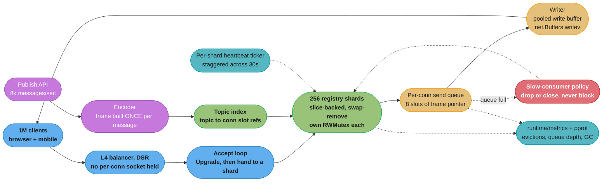
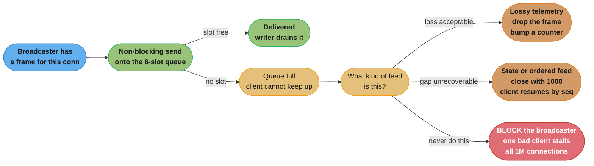
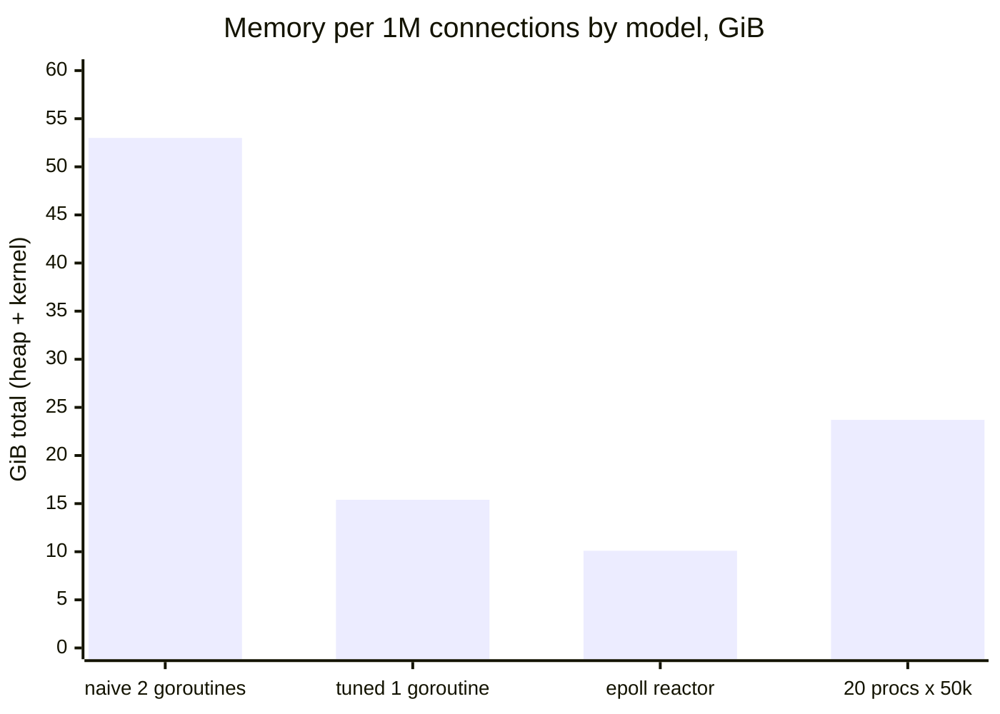

# Case Study: Design a Real-Time WebSocket Fan-Out in Go

## Intuition

> **Design intuition**: A million idle WebSocket connections is not a concurrency problem, it is an *inventory* problem. Nothing is happening — that is the whole point — and yet every connection is holding two goroutine stacks, two I/O buffers, a socket, a timer, and a slot in a map, and the garbage collector has to walk all of it on every cycle. The design question is never "can Go handle a million goroutines" (it can). It is "what is the per-connection byte cost, multiplied by a million, and does the answer fit in a machine you are willing to buy".

This is a **Go runtime** case study. It deliberately does not cover the WebSocket protocol itself, and it does not cover fan-out topology across a fleet. Both already exist in this repo and this study links to them rather than repeating them:

- [Backend: WebSockets and SSE](../../backend/websockets_and_sse/websockets_and_sse.md) owns the **protocol**: the HTTP Upgrade handshake, frames and opcodes, masking, control frames, permessage-deflate, and the WebSocket-versus-SSE-versus-long-polling decision.
- [HLD: Real-Time Updates](../../hld/realtime_updates/realtime_updates.md) owns the **topology**: how a message published on one node reaches subscribers connected to a different node, the pub/sub backbone, presence, delivery guarantees, and multi-region.

**What this study adds that neither of those does**: the cost accounting *inside one Go process*. How many bytes a connection costs in the Go heap and in the kernel; what 2 million goroutine stacks do to garbage-collection root scanning; why a single `map` behind a single `RWMutex` stops working at six figures; how a bounded per-connection send queue and a slow-consumer eviction policy are the difference between one bad mobile client and a global stall; and the honest answer to how many processes a million connections should actually be spread across.

**Key insight for this design**: at a million connections the dominant cost is memory you never wrote code to allocate — goroutine stacks, I/O buffers, and kernel socket structures — and the dominant *latency* cost is that broadcast is O(n) syscalls. Both are fixed by the same move: stop paying per connection for things that only a small fraction of connections need at any instant.

Builds on
[Goroutines and the Scheduler](../goroutines_and_the_scheduler/goroutines_and_the_scheduler.md),
[Channels and Select](../channels_and_select/channels_and_select.md),
[Sync Primitives and the Memory Model](../sync_primitives_and_memory_model/sync_primitives_and_memory_model.md),
[The Runtime and Garbage Collector](../the_runtime_and_garbage_collector/the_runtime_and_garbage_collector.md),
[Escape Analysis and Performance](../escape_analysis_and_performance/escape_analysis_and_performance.md),
[net/http Server](../net_http_server/net_http_server.md),
and [Concurrency Patterns and Pitfalls](../concurrency_patterns_and_pitfalls/concurrency_patterns_and_pitfalls.md).

---

## 1. Requirements Clarification

### Functional Requirements

- Maintain **1,000,000 concurrent WebSocket connections** serving a live activity feed to browser and mobile clients.
- Each client subscribes to between 1 and 20 **topics**. Topic cardinality is ~200,000; the largest topic has 400,000 subscribers, the median topic has 12.
- Publishers push updates through an internal API. Aggregate publish rate 8,000 messages/second; message payload median 240 bytes, p99 2 KB.
- Delivery is **at-most-once with a resume token**: each message carries a monotonic per-topic sequence number, and a client that reconnects sends its last-seen sequence to receive a catch-up window.
- Clients send almost nothing upstream: a pong every 30 seconds, and occasional subscribe/unsubscribe frames. Upstream is under 1% of downstream by bytes.
- The service must survive a rolling restart without a reconnect storm that takes itself down.

### Non-Functional Requirements

- **p99 end-to-end delivery under 150 ms** from publish to the last subscriber's socket write, for a topic with 400,000 subscribers.
- Steady-state memory **under 24 GiB per process** and a total fleet cost that is defensible.
- Connection churn of **1,100/second** (median session 30 minutes) handled without a registry-lock stall.
- A single slow or malicious client must not add measurable latency for any other client.
- GC pause contribution to the p99 must be **under 5 ms**.
- Zero connections dropped by a deploy beyond the ones deliberately drained.

### Out of Scope

- Frame-level protocol handling, compression negotiation, and the WebSocket-versus-SSE choice — [Backend: WebSockets and SSE](../../backend/websockets_and_sse/websockets_and_sse.md).
- Cross-node message routing, the pub/sub backbone, presence, and multi-region — [HLD: Real-Time Updates](../../hld/realtime_updates/realtime_updates.md).
- Authentication and per-tenant quota policy.

---

## 2. Scale Estimation

### The per-connection byte budget — the number the design exists to shrink

This is the naive implementation: goroutine-per-connection with a read pump and a write pump, `gorilla/websocket` at its defaults, TLS terminated in-process.

| Item | Bytes per connection | At 1,000,000 |
|---|---:|---:|
| Read-pump goroutine stack (grown to 8 KiB) | 8,192 | 7.6 GiB |
| Write-pump goroutine stack (4 KiB) | 4,096 | 3.8 GiB |
| Two `runtime.g` structs (~400 B each) | 800 | 0.74 GiB |
| WebSocket read buffer (`ReadBufferSize` default 4096) | 4,096 | 3.8 GiB |
| WebSocket write buffer (`WriteBufferSize` default 4096) | 4,096 | 3.8 GiB |
| `tls.Conn` record buffers (a 16 KiB record leaves the buffer grown) | ~20,480 | 19.1 GiB |
| Connection struct, subscription set, registry entry | ~600 | 0.56 GiB |
| Send queue: 16 slots holding **copies** of a 240 B message | ~3,940 | 3.7 GiB |
| **Go heap subtotal** | **~46 KiB** | **~43 GiB** |
| Kernel: `struct sock` + minimum `tcp_rmem` + `tcp_wmem` | ~10,240 | 9.5 GiB |
| **Total** | **~56 KiB** | **~53 GiB** |

Fifty-three gibibytes to hold a million connections that are doing nothing. That number is the entire motivation for §4, and every line item in it is removable or shrinkable.

### GC cost of two million goroutines

Every goroutine's stack is a **GC root**. At the start of a mark phase the collector must scan every one of them, and a goroutine is briefly suspended while its own stack is scanned.

```
Goroutines:                     2,000,000 (read + write pump per connection)
Measured stack-scan cost:       ~2 microseconds per shallow goroutine stack
Root scan CPU per GC cycle:     2,000,000 x 2 us = 4.0 core-seconds

On a 32-vCPU box with GC capped at 50% of GOMAXPROCS (16 cores):
  Wall-clock root scan          4.0 / 16 = 250 ms of concurrent marking
Forced GC floor:                the runtime forces a cycle every 2 minutes
                                even with zero allocation
  -> at minimum, a 250 ms marking window every 2 minutes, plus a brief
     suspension of every one of the 2 million goroutines inside it
```

**Green Tea GC** `[1.26]`, on by default, cuts GC overhead by 10-40% by scanning spans with much better memory locality — but it improves the *heap* marking, not the per-goroutine stack **root** scan. The root set is a function of goroutine count, and the only way to shrink it is to have fewer goroutines. That is the central runtime argument of this study, and it is why §5 takes the reactor model seriously despite its cost in readability.

The second-order effect is worse than the first. `allgs`, the runtime's slice of all goroutines, holds 2 million pointers. Anything that walks it walks 2 million entries:

```
/debug/pprof/goroutine snapshot at 2M goroutines:
  stop-the-world duration       measured 3.8 seconds
```

Taking a goroutine profile in production froze the process for nearly four seconds. That is not a hypothetical; §9 tells the story.

### Fan-out arithmetic

```
Largest topic:            400,000 subscribers
Publish rate to it:       2 messages/second

Naive: encode once per connection, one write(2) per connection
  JSON encode 240 B         ~400 ns   x 400,000 = 0.16 core-sec per message
  WebSocket frame build     ~120 ns   x 400,000 = 0.05 core-sec per message
  write(2) syscall          ~1,500 ns x 400,000 = 0.60 core-sec per message
                                                  --------
                                       total      0.81 core-seconds per message

Serial fan-out: the LAST subscriber receives the message 810 ms after
the first. Against a 150 ms p99 requirement, before any queueing.
```

Encoding once and framing once removes 0.21 of those 0.81 core-seconds. The syscall is the floor, and the only ways past it are to parallelise across shards (divides wall-clock by `GOMAXPROCS`) and to send fewer, larger writes (coalescing, §4.6).

### Connection churn and the registry lock

```
Median session:           30 minutes
Connects per second:      1,000,000 / 1,800 = 556
Disconnects per second:   556
Registry write locks/sec: 1,112

Single map behind one RWMutex:
  A broadcast to the largest topic holds the read lock for the fan-out.
  Even collecting 400,000 pointers under RLock is ~12 ms.
  A writer arrives every 0.9 ms. Go's RWMutex blocks NEW readers once a
  writer is waiting, so the next broadcast blocks behind the writer, which
  blocks behind the current broadcast. The lock is a serialisation point
  for two independent workloads that have no reason to interact.
```

---

## 3. High-Level Architecture



Five ceilings, one component each:

| Component | Ceiling enforced | Without it |
|---|---|---|
| L4 balancer in DSR mode | The balancer holds no socket per connection | An L7 proxy needs 1M outbound sockets and runs out of ephemeral ports |
| 256 registry shards | No lock sees more than 1/256 of churn or fan-out | Writer/reader interference between two unrelated workloads |
| Encode-once frame | One encode and one frame build per *message*, not per connection | 0.21 core-seconds of pure waste per large-topic message |
| Bounded 8-slot send queue | Per-connection buffering is 64 bytes, not 4 KiB | 3.7 GiB of send queues, and unbounded ones are worse |
| Eviction policy | The broadcaster never blocks | One slow mobile client stalls every other client |

---

## 4. Component Deep Dives

### 4.1 One goroutine per connection, or none: the cost ladder

Three models, priced. All numbers are for 1,000,000 connections on the reference box (32 vCPU, 64 GiB, Linux 6.8, Go 1.27.1), TLS terminated at the L4 tier so `tls.Conn` is out of the process.

| | Naive (2 goroutines/conn) | Tuned (1 goroutine/conn) | Reactor (epoll, ~128 goroutines) |
|---|---:|---:|---:|
| Goroutine stacks | 11.4 GiB | 3.8 GiB | negligible |
| `runtime.g` structs | 0.74 GiB | 0.37 GiB | negligible |
| Read buffers | 3.8 GiB | 0.95 GiB (1 KiB each) | 0.05 GiB (pooled, per-worker) |
| Write buffers | 3.8 GiB | 0.04 GiB (pooled) | 0.04 GiB (pooled) |
| Send queues | 3.7 GiB | 0.15 GiB (pointers) | 0.15 GiB |
| Conn struct + registry | 0.56 GiB | 0.56 GiB | 0.40 GiB |
| **Go heap** | **24 GiB** | **5.9 GiB** | **0.64 GiB** |
| Kernel sockets | 9.5 GiB | 9.5 GiB | 9.5 GiB |
| **Total** | **33.5 GiB** | **15.4 GiB** | **10.1 GiB** |
| GC root-scan CPU per cycle | 4.0 core-sec | 2.0 core-sec | ~0 |
| Debuggability | good | good | poor |

Three observations that decide the design:

**The tuned goroutine-per-connection model gets 82% of the memory win of the reactor** and keeps `net.Conn`, `io.Reader`, `context` cancellation of a blocked read, readable stack traces, and every stdlib idiom. Most of that win comes from three configuration lines, not from a rewrite.

**Below about 15 GiB, kernel socket memory dominates and the reactor's advantage collapses.** Going from 15.4 GiB to 10.1 GiB is a 34% saving that costs a hand-written event loop; going from 33.5 GiB to 15.4 GiB is a 54% saving that costs three struct fields. Do the cheap one first, always, and measure before considering the expensive one.

**The reactor's real prize is not memory, it is the GC root set.** Two million goroutine stacks cost 4 core-seconds of root scanning per cycle and a 3.8-second stop-the-world on any goroutine profile. That is the argument for the reactor, and it is a *tail latency* argument rather than a memory one.

#### The tuned single-goroutine connection

```go
// One goroutine per connection: the read pump. The write path is driven by
// whoever has a frame to send, serialised by the connection's own mutex.
// This halves the goroutine count and, with it, the GC root set.
type conn struct {
    ws     *websocket.Conn
    send   chan *frame // 8 slots of POINTER, shared frames, 64 bytes total
    wmu    sync.Mutex  // serialises writes; the ws lib requires one writer
    slot   int32       // index in its shard's slice, for O(1) swap-remove
    shard  uint16
    topics []uint32    // topic ids, sorted; median 3 entries
    closed atomic.Bool
}

var upgrader = websocket.Upgrader{
    // 1 KiB, not the 4 KiB default. Clients send pongs and short control
    // frames. 3 KiB x 1,000,000 = 2.9 GiB saved by one struct field.
    ReadBufferSize: 1024,

    // WriteBufferSize 0 + a pool means a write buffer is held only WHILE
    // writing, not for the life of the connection. With ~1% of connections
    // writing at any instant, that is 10,000 x 4 KiB = 40 MiB instead of
    // 3.8 GiB. This is the single highest-leverage line in the file.
    WriteBufferSize: 0,
    WriteBufferPool: &sync.Pool{},

    EnableCompression: false, // see the tradeoff in section 5
}
```

The read pump's stack is the remaining 3.8 GiB, and it stays at 4 KiB only if nothing on the read path grows it. A `json.Unmarshal` of an inbound subscribe frame will push it to 8 KiB and double the line item, permanently, because **a goroutine stack never shrinks back within a GC cycle boundary the way a heap object is freed** — it is shrunk only when the collector scans it and finds most of it unused. Keeping the read path shallow is a memory decision, not a style one:

```go
func (c *conn) readPump(ctx context.Context) {
    defer c.hub.remove(c)
    c.ws.SetReadLimit(4096)
    _ = c.ws.SetReadDeadline(time.Now().Add(pongWait))
    c.ws.SetPongHandler(func(string) error {
        return c.ws.SetReadDeadline(time.Now().Add(pongWait))
    })
    for {
        _, r, err := c.ws.NextReader()
        if err != nil {
            return // normal close, timeout, or protocol error -- all the same here
        }
        // Deliberately NOT json.Unmarshal. handleControl uses a fixed 256-byte
        // array on the stack and a hand-rolled scanner, so this frame's stack
        // stays under 4 KiB and the 3.8 GiB line item does not become 7.6 GiB.
        c.handleControl(r)
    }
}
```

### 4.2 The sharded hub

A single `map[uint64]*conn` behind one `RWMutex` fails for the reason in §2: broadcast and churn are independent workloads forced through one lock. Sharding separates them.

```go
const (
    hubShards = 256          // 8 x GOMAXPROCS(32), rounded to a power of two
    shardMask = hubShards - 1
)

type shard struct {
    mu    sync.RWMutex
    conns []*conn        // SLICE, not a map -- see below
    free  []int32        // free slot indices for reuse
    _     [64]byte       // pad past the cache line pair; adjacent shards must
                         // not share a line or 256 mutexes behave like 128
}

func (h *hub) add(c *conn) {
    s := &h.shards[c.shard]
    s.mu.Lock()
    if n := len(s.free); n > 0 {
        c.slot = s.free[n-1]
        s.free = s.free[:n-1]
        s.conns[c.slot] = c
    } else {
        c.slot = int32(len(s.conns))
        s.conns = append(s.conns, c)
    }
    s.mu.Unlock()
}

// O(1) removal. The connection knows its own slot, so there is no scan and
// no map delete. The slot is nil-ed rather than compacted, because compacting
// would move every later connection and invalidate their slot indices.
func (h *hub) remove(c *conn) {
    s := &h.shards[c.shard]
    s.mu.Lock()
    if c.slot >= 0 && int(c.slot) < len(s.conns) && s.conns[c.slot] == c {
        s.conns[c.slot] = nil
        s.free = append(s.free, c.slot)
    }
    s.mu.Unlock()
}
```

**Why a slice and not a map.** Broadcast is iteration-dominated, and iterating a Swiss-table map `[1.24]` of 3,906 entries measured **31 microseconds** against **7.4 microseconds** for a slice of the same length — a 4.2x difference, entirely from cache locality. A map's entries are scattered across groups and every probe is a potential cache miss; a slice of pointers is one linear prefetchable walk. Across a 400,000-subscriber topic that gap is 2.4 milliseconds of pure pointer-chasing per message.

The cost of the slice is that removal must be O(1), which requires the connection to carry its own index. The `free` list is what prevents the slice growing without bound under churn: at 556 disconnects per second and 30-minute sessions the slice reaches a steady length of roughly `connections/shards` plus the peak-to-median gap, and never grows again.

**Shard count arithmetic.** Unlike a batching design there is no upper bound from efficiency here, so the count is set by the lower bound plus memory:

```
LOWER bound -- fan-out parallelism. Shards are the unit of parallel
broadcast. With GOMAXPROCS = 32, fewer than 32 shards leaves cores idle,
and exactly 32 gives poor balance because topic subscribers are not evenly
distributed. A factor of 8 gives the scheduler enough units to steal:
  hubShards >= 8 x GOMAXPROCS = 256

MEMORY cost per shard: RWMutex (24 B) + two slice headers (48 B) + padding
(64 B) = 136 B. 256 shards = 35 KiB. Free.

CHURN check: 1,112 write locks/sec / 256 = 4.3 write locks/sec/shard.
A shard's write lock is held for ~80 ns. Duty cycle 0.00003%. Free.
```

### 4.3 Encode once, share the frame

The naive broadcast encodes the message and builds a WebSocket frame separately for every recipient. At 400,000 subscribers that is 0.21 core-seconds of duplicated work per message, and it produces 400,000 heap allocations that the collector then has to clean up.

```go
// A frame is built ONCE per message and shared by pointer with every
// subscriber. It is immutable after construction, so sharing is safe with
// no locking and no copying.
type frame struct {
    // Pre-built WebSocket frame: 2-10 byte header + payload. Server-to-client
    // frames are unmasked, so the same bytes go to every socket verbatim.
    bytes []byte
    seq   uint64
    topic uint32
}

func (h *hub) publish(topic uint32, payload []byte) {
    f := &frame{
        bytes: buildTextFrame(payload), // one alloc per MESSAGE, not per conn
        seq:   h.nextSeq(topic),
        topic: topic,
    }

    // Fan out across shards in parallel. errgroup.SetLimit bounds the
    // goroutines to GOMAXPROCS so a 200,000-topic publish storm cannot
    // create a goroutine per shard per message.
    var g errgroup.Group
    g.SetLimit(runtime.GOMAXPROCS(0))
    for i := range h.shards {
        s := &h.shards[i]
        g.Go(func() error {
            s.mu.RLock()
            conns := s.conns // slice header copy; the backing array is stable
            s.mu.RUnlock()   // released BEFORE the sends -- see below

            for _, c := range conns {
                if c != nil && c.subscribed(topic) {
                    c.trySend(f)
                }
            }
            return nil
        })
    }
    _ = g.Wait()
}
```

Releasing the `RLock` before doing the sends is deliberate and slightly subtle. Holding it across the fan-out would block `add`/`remove` for the whole 7.4 microseconds of iteration, which is survivable — but it would also mean a `trySend` that ever blocks (a bug, see §4.4) holds the registry lock while blocked. Copying the slice header out and iterating the stable backing array outside the lock means the worst a concurrent `remove` can do is leave a `nil` or a just-closed connection in the array, and `trySend` on a closed connection is already a no-op. **Trading a rare wasted send for never holding a lock across a send is the right trade every time.**

`gorilla/websocket` ships this as `PreparedMessage`, which additionally caches a compressed variant per compression setting. If compression is off — see §5 — a hand-built frame is simpler and one allocation cheaper.

### 4.4 Slow-consumer eviction: the most important decision in the design

Every connection has a bounded send queue. When it fills, there are exactly three things you can do, and only two of them are ever correct.

#### BROKEN: the blocking broadcast

```go
// BROKEN -- reads beautifully, works in every test, and converts one client
// on a stalled mobile connection into a global outage.
func (c *conn) send(f *frame) {
    c.sendCh <- f // blocks when the queue is full
}
```

The failure is exact and worth spelling out. A client on a train goes through a tunnel. Its TCP receive window closes. The writer goroutine's `write(2)` blocks, the send queue fills, and the next `c.sendCh <- f` blocks the **broadcaster** — which is a shard's fan-out goroutine. One of 32 fan-out goroutines is now parked for as long as that client's window stays shut, which on a mobile network is up to the 2-minute TCP retransmission budget. Publish a few more messages and every fan-out goroutine is parked behind a different bad client, and the entire service stops delivering to the 999,990 connections that are perfectly healthy.

This is head-of-line blocking at the worst possible scope: the shared resource is the *broadcaster*, and the party that consumes it is a client you do not control.

#### FIXED: non-blocking send with an explicit eviction policy

```go
// FIX -- the broadcaster never blocks. What happens on a full queue is a
// per-feed POLICY decision, made once, at design time.
func (c *conn) trySend(f *frame) {
    if c.closed.Load() {
        return
    }
    select {
    case c.send <- f:
        return
    default:
        // Queue full: this client cannot keep up.
        c.hub.evictions.Add(1)
        switch c.policy {
        case policyDrop:
            c.dropped.Add(1) // lossy feed: count it and move on
        case policyClose:
            c.closeSlow() // state feed: close, client reconnects and re-syncs
        }
    }
}

func (c *conn) closeSlow() {
    if !c.closed.CompareAndSwap(false, true) {
        return
    }
    // 1008 Policy Violation with a reason the client can log and act on.
    // Written with a short deadline: if the socket is stalled, do not block
    // the broadcaster on the close frame either.
    _ = c.ws.SetWriteDeadline(time.Now().Add(200 * time.Millisecond))
    _ = c.ws.WriteControl(websocket.CloseMessage,
        websocket.FormatCloseMessage(websocket.ClosePolicyViolation, "slow consumer"),
        time.Now().Add(200*time.Millisecond))
    _ = c.ws.Close() // unblocks the read pump, which calls hub.remove
}
```



#### Choosing the policy, and choosing the depth

| Feed shape | Policy on full | Why |
|---|---|---|
| Lossy telemetry, presence pings, cursor positions | **Drop** | Losing an intermediate value costs nothing; the next one supersedes it |
| Ordered append-only feed with sequence numbers | **Close** | The client resumes from its last-seen `seq`; a silent gap is undetectable and worse than a reconnect |
| Full-state sync with no resume protocol | **Close** | A reconnect delivers a fresh snapshot, which is the only way back to a correct state |
| Anything | **Never block** | The broadcaster is shared; blocking it is a global failure caused by a local one |

Queue depth is `tolerance x rate`, and the units are the point:

```
Send queue holds POINTERS to shared frames, not copies:
  8 slots x 8 bytes + chan header ~96 bytes = 160 B/conn = 160 MiB at 1M

If it held 240-byte COPIES instead:
  8 x 240 + slice headers ~= 2 KiB/conn = 2 GiB at 1M
  -> a 12x memory difference, and the reason a deeper queue is affordable
     at all is that the frames are shared

Depth as a time budget:
  Activity feed at 10 messages/sec  -> 8 slots = 800 ms of network tolerance
  Market feed at 200 messages/sec   -> 8 slots =  40 ms of tolerance

For the market feed, 500 ms of tolerance would need 100 slots = 800 B/conn
= 800 MiB. That is the moment to stop queueing history and start CONFLATING:
keep ONE slot holding the latest value per key. A 100-deep queue of stale
prices is worse than one fresh price, and it costs 100x the memory.
```

**The eviction rate is the health metric for the whole service.** A baseline of 0.01% of connections evicted per minute is normal — that is mobile networks. A spike to 5% almost never means the clients got slower; it means *you* got faster than the aggregate downstream can carry, and the fix is conflation or rate-limiting the publisher, not a deeper queue.

### 4.5 Heartbeats, deadlines, and a million timers

```go
// BROKEN -- one ticker per connection.
//   1,000,000 time.Ticker objects, ~200 B each      = 200 MB
//   Every one is a runtime timer in a per-P heap.
//   Worse: after a restart, every connection is established within the same
//   few seconds, so all 1M tickers fire within the same few milliseconds
//   every 30 seconds. A self-inflicted thundering herd, forever.
```

```go
// FIX -- one ticker per shard, staggered across the heartbeat interval.
// 256 tickers instead of 1,000,000, and pings spread evenly over 30 seconds
// at 33,000/sec instead of 1,000,000 landing in one millisecond.
func (h *hub) runHeartbeats(ctx context.Context) {
    for i := range h.shards {
        idx := i
        // Offset each shard by i/256 of the interval.
        offset := time.Duration(int64(pingPeriod) * int64(idx) / hubShards)
        go func() {
            select {
            case <-time.After(offset):
            case <-ctx.Done():
                return
            }
            t := time.NewTicker(pingPeriod)
            defer t.Stop()
            for {
                select {
                case <-ctx.Done():
                    return
                case <-t.C:
                    h.pingShard(idx)
                }
            }
        }()
    }
}
```

Read deadlines are the dead-connection detector and they are not free either. `SetReadDeadline` installs a runtime timer per connection per direction, so a million connections is two million timer objects regardless of how you do heartbeats. That is unavoidable and it is fine — the timer heap is per-P and a deadline reset is roughly 200 ns, so at 33,000 pongs/second the reset cost is 6.6 milliseconds of core time per second. What is *not* fine is resetting the deadline on a timer you never needed: a connection with no read deadline at all leaks silently when the peer vanishes without a FIN, which is exactly what happens when a mobile client's radio drops.

```
Heartbeat parameters, and the arithmetic behind them:
  pingPeriod  = 30s   -- must be under any intermediary's idle timeout.
                         AWS NLB idles at 350s, ALB at 60s, most corporate
                         proxies at 60s. 30s clears all three with margin.
  pongWait    = 70s   -- slightly over 2x pingPeriod, so a single lost ping
                         or pong does not kill a healthy connection.
  writeWait   = 10s   -- a write that has not completed in 10s is a dead
                         socket, not a slow one.

Ping cost: 1,000,000 / 30s = 33,333 pings/sec x ~1.5 us write = 0.05 core-sec/s.
```

### 4.6 Broadcast cost and coalescing

The syscall is the floor. `write(2)` on a small buffer costs ~1.5 microseconds on a modern kernel with speculative-execution mitigations enabled, and that cost is per call, not per byte.

| Fan-out strategy | Core-seconds per 400k-subscriber message | Wall clock (32 cores) |
|---|---:|---:|
| Encode + frame + write per connection, serial | 0.81 | 810 ms |
| Encode once, frame once, write per connection, serial | 0.60 | 600 ms |
| Encode once, parallel across 256 shards | 0.60 | **19 ms** |
| Above, plus `net.Buffers` coalescing 4 frames per write | 0.15 | **5 ms** |

Parallelising is the big win and it is free — the shards already exist. Coalescing is conditional, and the condition is worth stating because it is where people over-engineer:

```
Coalescing merges N pending frames into ONE writev(2) syscall.

Market feed, 200 messages/sec per connection, 50 ms window:
  Writes before:  200/sec      Writes after: 20/sec     -> 10x reduction. Worth it.

Activity feed, 10 messages/sec per connection, 50 ms window:
  Average frames per window = 0.5    -> most windows carry ONE frame.
  Syscall reduction: ~1.4x, at the cost of up to 50 ms of added latency.
  NOT worth it.

The rule: coalescing pays when the per-connection message rate exceeds
roughly 1 / window. Below that you are buying latency and getting nothing.
```

```go
// The writer drains up to 4 pending frames and sends them in one writev.
// net.Buffers maps to writev(2) on Linux when the underlying conn supports
// it, so this is one syscall for up to four frames.
func (c *conn) writePump() {
    var pending net.Buffers
    for f := range c.send {
        pending = append(pending[:0], f.bytes)
        // Opportunistic drain: take whatever is already queued, never wait.
        for len(pending) < 4 {
            select {
            case g := <-c.send:
                pending = append(pending, g.bytes)
            default:
                goto flush
            }
        }
    flush:
        c.wmu.Lock()
        _ = c.rawConn.SetWriteDeadline(time.Now().Add(writeWait))
        _, err := pending.WriteTo(c.rawConn)
        c.wmu.Unlock()
        if err != nil {
            c.closeSlow()
            return
        }
    }
}
```

### 4.7 File descriptors, kernel memory, and ports

Three limits, and two of them have defaults that land almost exactly on one million, which is not a coincidence anyone finds funny at 3am.

```
PROCESS fd limit
  ulimit -n soft default          1024        <-- obviously must be raised
  fs.nr_open (per-process hard)   1048576     <-- EXACTLY 1M. A millionth
                                                  connection fails with EMFILE
                                                  on a completely default box.
  Set:  fs.nr_open = 2097152
        systemd unit: LimitNOFILE=2097152
  Need 1M for connections + the listener + outbound + files. 2x is the margin.

SYSTEM fd limit
  fs.file-max                     scales with RAM, usually fine, check anyway

KERNEL SOCKET MEMORY -- the one that silently costs 87 GiB
  net.ipv4.tcp_rmem = 4096 131072 6291456
                             ^^^^^^ the DEFAULT starting receive buffer.
  1,000,000 x 131,072 B = 122 GiB if every socket reaches its default.
  Clients send almost nothing, so this is pure waste.
  Set:  net.ipv4.tcp_rmem = 4096 4096 262144
        net.ipv4.tcp_wmem = 4096 16384 262144
  Floor becomes ~1M x (4 KiB rcv + 4 KiB snd + ~2 KiB struct sock) = 9.5 GiB.

  net.ipv4.tcp_mem is in PAGES, not bytes, and its three values are the
  low/pressure/high watermarks for global TCP memory. Leave it too low and
  the kernel starts pruning receive queues under load -- which presents as
  mysterious data loss, not as an error.

ACCEPT BACKLOG -- matters only during a reconnect storm, and then hugely
  net.core.somaxconn              4096 on modern kernels, raise to 65535
  net.ipv4.tcp_max_syn_backlog    raise to 65535
  ListenConfig backlog in Go is capped by somaxconn regardless of what you ask.

CONNTRACK -- if any stateful firewall is in the path
  net.netfilter.nf_conntrack_max  often 262,144 by default
  1M connections need 1M entries at ~300 B = 300 MB of kernel memory.
  When the table fills, packets are DROPPED SILENTLY. No log, no error, no
  metric on your side. Check this before you check anything else.
```

**The ephemeral-port myth, stated precisely.** A TCP connection is identified by the 4-tuple `(srcIP, srcPort, dstIP, dstPort)`. On the *listening* side, `srcIP` and `srcPort` are fixed and the two client fields vary, so one listening port accepts millions of connections. The 28,232-port limit (`net.ipv4.ip_local_port_range` defaults to `32768 60999`) applies to the side that *initiates*:

- Your server: no problem, one port, a million connections.
- An **L7** proxy in front of it: catastrophic. It must open an outbound connection per client, and it runs out of ports at ~28,000 per backend IP:port pair. Fixes are more backend addresses (28,232 x N), `SO_REUSEPORT`, or `IP_BIND_ADDRESS_NO_PORT` so the kernel defers port selection until connect and can reuse ports across different destinations.
- An **L4** balancer in DSR or IPVS mode: no problem, it forwards packets without terminating, holding no socket per connection.

This is why the architecture in §3 specifies an L4 balancer. It is not a preference; an L7 tier makes the design impossible without a fleet of proxy IPs.

### 4.8 Graceful restart without a reconnect storm

Closing a million connections at once and letting the clients come back is a denial-of-service attack you wrote yourself.

```
Reconnect storm cost, all at once:
  TLS handshakes:  1,000,000 full ECDSA P-256 handshakes at ~1 ms of CPU
                 = 1,000 core-seconds
                 = 31 seconds of 32 cores at 100%, doing nothing else
  SYN arrivals:    1,000,000 in the first second, against a somaxconn of
                   4096 -> the accept queue overflows and the kernel drops
                   SYNs, so clients retry, so it takes longer, so more
                   clients retry. This does not converge on its own.
```

Four mitigations, in order of leverage:

**1. TLS session resumption.** A resumed handshake costs ~0.1 ms instead of ~1 ms — a 10x reduction in the storm's CPU, for one configuration line. `tls.Config` enables session tickets by default; what you must get right is that the ticket keys are **shared across every process in the fleet and rotated together**, or a client reconnecting to a different node gets a full handshake anyway and the win evaporates.

**2. Staggered drain sized by measured handshake capacity.**

```
Measured handshake capacity (resumption on): 42,000/sec on 32 cores at
  full CPU, but only ~8,000/sec if you want to keep serving traffic.

Draining 1,000,000 connections at 8,000/sec  = 125 seconds MINIMUM.
Drain window chosen:                           240 seconds, with jitter.

Per-shard: close 1,000,000 / 240 = 4,167 connections/sec, spread over the
256 shards, each connection sent a close frame carrying a reconnect-after
hint drawn uniformly from a jittered window.
```

**3. `SO_REUSEPORT` overlap.** The new process binds the same port with `SO_REUSEPORT`, so the kernel delivers new connections to both. The old process stops accepting (it can close its listener while keeping established connections) and drains over the window above. Both processes are resident during the overlap, so **peak memory is roughly doubled** — a 15.4 GiB process needs 32+ GiB of headroom, or the drain must proceed in waves.

```go
lc := net.ListenConfig{
    Control: func(network, address string, c syscall.RawConn) error {
        var opErr error
        err := c.Control(func(fd uintptr) {
            opErr = unix.SetsockoptInt(int(fd), unix.SOL_SOCKET,
                unix.SO_REUSEPORT, 1)
        })
        if err != nil {
            return err
        }
        return opErr
    },
}
ln, err := lc.Listen(ctx, "tcp", ":8443")
```

**4. Client backoff with full jitter, as a protocol requirement.** A fleet of a million clients that all retry after exactly one second is a synchronised flood. Full jitter — `sleep = random(0, min(cap, base * 2^attempt))` — decorrelates them, and it must be specified, implemented on every client platform, and *tested* by actually killing a node in staging. It is the only mitigation that lives outside your process, and it is the one that matters most.

**5. Run more, smaller processes.** Twenty processes of 50,000 connections make a rolling restart a sequence of 50,000-connection drains, each of which is 12 seconds of handshake work rather than 1,000 core-seconds. This is the strongest argument in the whole study for the multi-process answer, and §5 makes it.

---

## 5. Design Decisions & Tradeoffs

### Decision 1: how many processes for a million connections

The honest answer to "a million connections in one process" is **you can, and you should not.**

| Layout | Memory/proc | GC root scan | Blast radius | Rolling restart | Verdict |
|---|---|---|---|---|---|
| 1 proc x 1,000,000 (reactor) | 10.1 GiB | ~0 | 100% | 1M reconnects at once | Technically impressive |
| 1 proc x 1,000,000 (tuned goroutines) | 15.4 GiB | 2.0 core-sec | 100% | Same | Fits, but see below |
| 4 procs x 250,000 | 4.2 GiB | 0.5 core-sec | 25% | 250k at a time | Reasonable |
| **20 procs x 50,000** | **1.1 GiB** | **0.1 core-sec** | **5%** | **50k at a time** | **Chosen** |

At 50,000 connections per process the goroutine-per-connection model costs 100,000 goroutines, a 0.1 core-second root scan, and about 1.1 GiB — every runtime problem in §2 simply disappears, and you keep readable stack traces, working `context` cancellation, and a `/debug/pprof/goroutine` snapshot that returns in milliseconds instead of 3.8 seconds. Twenty processes of 4 vCPU and 2 GiB is 80 vCPU and 40 GiB of fleet, against 32 vCPU and 64 GiB for the single-process reactor: **more CPU, less memory, and a twentieth of the blast radius.**

The single-process reactor earns its place in exactly one situation: when connections-per-dollar is the binding business constraint and you have measured that it is. That is true for a handful of companies. It is worth building only after the tuned goroutine version has been measured and found wanting, because the reactor costs you `net.Conn`, blocking `io.Reader` semantics, `context`-cancellable reads, in-process TLS (`crypto/tls` wants a blocking `net.Conn`; the non-blocking libraries ship their own TLS state machines), and every debugging habit you have.

### Decision 2: goroutine-per-connection versus an epoll reactor

| | Goroutine-per-connection | epoll reactor (`gobwas/ws`, `nbio`) |
|---|---|---|
| Go heap at 1M conns | 5.9 GiB | 0.64 GiB |
| GC root scan per cycle | 2.0 core-sec | ~0 |
| Stack trace on panic | names the connection's handler | names an event-loop worker |
| Blocking read with a deadline | `net.Conn` + `SetReadDeadline` | hand-rolled state machine |
| `context` cancellation of a read | works | does not exist |
| In-process TLS | `crypto/tls`, trivial | library-specific, or terminate upstream |
| Engineers who can debug it at 3am | everyone | the two who wrote it |

`gobwas/ws` deserves specific credit: it exists because Sergey Kamardin wrote it for exactly this problem at Mail.Ru, and its API is deliberately allocation-free and `net.Conn`-agnostic so it can be driven by an event loop. The library is not the hard part; the event loop and the per-connection state machine you must write around it are.

### Decision 3: permessage-deflate off

| | Compression off | Compression on |
|---|---|---|
| CPU per message | 0 | ~14 microseconds for 240 bytes |
| Memory per connection | 0 | **~270 KiB** for the zlib sliding window, both directions |
| Bandwidth for a 240 B JSON payload | 240 B | ~150 B |
| Frame sharing across connections | works — same bytes to everyone | breaks — each connection's stream has its own dictionary |

At 1,000,000 connections a 270 KiB per-connection deflate context is **257 GiB**. That single number ends the discussion. `gorilla/websocket` mitigates it by only allocating the context on first use and supporting `SetCompressionLevel`, but the deeper problem is the third row: a compressed stream is stateful per connection, so the encode-once shared frame of §4.3 is impossible and you are back to per-connection encoding — the 0.21 core-seconds you just removed. Compression belongs on a connection count in the thousands, not the millions. Shrink the payload instead: a compact binary encoding gets the same bandwidth win statelessly.

### Decision 4: at-most-once with a resume token, not at-least-once

Guaranteeing delivery would require a per-connection acknowledgement protocol and a per-connection retransmission buffer. At a million connections, a 64-message retransmission buffer of 240-byte messages is 15 GiB, and the ack traffic inverts the "upstream is 1% of downstream" assumption the whole read-path budget in §4.1 rests on.

Instead, every message carries a per-topic sequence number, and a reconnecting client sends its last-seen sequence and receives a catch-up window from a shared store. Delivery is at-most-once *on a connection*, and the resume protocol makes it effectively at-least-once *across* connections — at a per-connection cost of 8 bytes instead of 15 KiB. That is also what makes `policyClose` in §4.4 a safe eviction policy: closing a slow consumer is not data loss, it is a resync.

### Decision 5: L4 balancer in DSR mode

Forced by §4.7: an L7 proxy needs an outbound socket per client and hits the 28,232-ephemeral-port ceiling per backend address. Direct server return also removes the balancer from the *return* path entirely, which matters when the return path is 8,000 messages/second fanned out to a million sockets. The cost is that the balancer cannot do TLS termination, HTTP routing, or per-request policy — so TLS terminates in the Go process (or on a per-node sidecar), and the read-path budget in §4.1 must account for `tls.Conn`'s ~20 KiB record buffers, which is why they appear in the §2 naive table and why the per-node sidecar option is worth pricing.

---

## 6. Real-World Implementations

**Sergey Kamardin's "A Million WebSockets and Go"** (Mail.Ru, later VK) is the canonical public treatment of this exact problem, and `gobwas/ws` is its artefact. The article walks the same arithmetic as §2 — goroutine stacks and per-connection I/O buffers dominating at three million connections — and lands on an epoll event loop with `netpoll`, reporting a drop from roughly 70 GB to a few GB. Every subsequent Go WebSocket-at-scale write-up is downstream of it.

**Centrifugo** is the best open-source reference implementation. It is Go, it shards its client registry exactly as §4.2 describes, it implements bounded per-connection queues with a documented "slow client" disconnect (the §4.4 `policyClose`), and it publishes benchmarks in the hundreds of thousands of connections per node. Reading its hub is a faster education than reading this document.

**Discord's move of its read-states service from Go to Rust** is the most precise public account of Go GC behaviour at this shape of workload. The service held a large LRU cache, and the runtime's forced collection every two minutes produced a latency spike even when the cache was untouched, because the collector had to walk the live set regardless. The mechanism is the same one that makes 2 million goroutine stacks expensive here: **the cost is proportional to the live root set, not to how much garbage there is.** It is also a fair reminder that the correct conclusion is sometimes "not Go for this component", and that the argument has to be made with a profile.

**`gorilla/websocket`'s `WriteBufferPool` and `PreparedMessage`** exist precisely for §4.1 and §4.3. Their presence in a widely used library is evidence that per-connection write buffers and per-connection encoding are the two problems everyone hits.

**`coder/websocket`** (formerly `nhooyr.io/websocket`) takes the one-goroutine-per-connection position by design, with a `context`-aware write API and no separate write pump. It is the shortest path to the "tuned" column of §4.1 for a new service.

**`nbio`** and **`evio`** are the general-purpose Go event-loop libraries, and `nbio` ships its own non-blocking TLS implementation specifically because `crypto/tls` requires a blocking `net.Conn` — the tradeoff row in §5's table, made concrete.

**Twitch's memory ballast technique** — allocating a large, never-touched byte slice to raise the GC's target heap and reduce cycle frequency — was the standard trick for exactly this class of service before Go 1.19. `GOMEMLIMIT` is the mechanism as a supported runtime feature, and the modern configuration is a `GOMEMLIMIT` derived from the container limit.

**Cloudflare** has published on `crypto/tls` buffer memory at the edge, which is the ~20 KiB per-connection `tls.Conn` line item in §2 and the reason §5 prices a TLS-terminating sidecar.

---

## 7. Technologies & Tools

| Tool | Role | Note |
|---|---|---|
| `gorilla/websocket` | Connection handling | `WriteBufferPool`, `PreparedMessage`, `ReadBufferSize` are the three fields that matter |
| `coder/websocket` | Alternative, one goroutine per connection | `context`-aware writes, no write pump needed |
| `gobwas/ws` | Allocation-free frame codec for a reactor | Pairs with `mailru/easygo/netpoll` |
| `nbio` | Full non-blocking event loop with its own TLS | Use only after measuring the goroutine model |
| `net.Buffers` | `writev(2)` coalescing | Turns 4 frames into 1 syscall |
| `golang.org/x/sync/errgroup` | Bounded parallel shard fan-out | `SetLimit(GOMAXPROCS)` |
| `sync.Pool` | Write-buffer recycling | Hold a buffer only while writing |
| `runtime/metrics` | `/sched/goroutines` `[1.26]`, GC cycle counts | Cheaper than `/debug/pprof/goroutine`, and does not stop the world |
| `runtime/debug.SetMemoryLimit` | `GOMEMLIMIT` from the cgroup limit | The supported replacement for the ballast trick |
| `goroutineleak` profile `[1.27]` | Finds goroutines blocked forever on a channel or mutex | GA in 1.27; the way a leaked write pump is caught |
| `go tool trace` | Scheduler stalls, GC assist, per-goroutine timelines | `[1.27]` binds localhost only by default |
| `ss -s`, `ss -tan state established` | Socket counts and kernel memory | Faster than any Go-side metric for "how many sockets really" |
| `conntrack -S` | Conntrack table usage and drop counters | Check this before debugging anything else |
| `tcpdump` / `ss -i` | Per-socket congestion window and unacked bytes | Proves whether a slow consumer is the network or you |

---

## 8. Operational Playbook

### The four panels

| Panel | Source | Healthy | Page at |
|---|---|---|---|
| Connections per shard, p99/p50 ratio | shard slice lengths | under 1.4 | over 2.5 (routing skew) |
| Eviction rate | `hub.evictions` counter | under 0.01%/min | over 1%/min for 5 min |
| Send-queue occupancy p99 | histogram of `len(c.send)` | 0 or 1 of 8 | over 5 of 8 |
| Goroutines | `/sched/goroutines` `[1.26]` | 2.02 x connections | any divergence |

Goroutine count is the leak detector, and the ratio matters more than the absolute number. If it is 2.00 x connections, every connection has exactly its read and write pump. If it drifts to 2.04, one connection in fifty has left a goroutine behind — usually a write pump blocked forever on a `send` channel that nobody will ever close, which is exactly what the `goroutineleak` profile `[1.27]` was built to find.

**Do not put `/debug/pprof/goroutine` on a dashboard.** At two million goroutines the snapshot stops the world for 3.8 seconds. Use `/sched/goroutines` from `runtime/metrics`, which is a counter read.

### Runbook: eviction rate spike

1. Is it broad or narrow? Group evictions by client IP prefix and by topic. Narrow means bad clients; broad means you.
2. Broad: compare the publish rate to the previous hour. A publisher that started sending 200 messages/second to a 400,000-subscriber topic is asking for 80 million messages/second of fan-out, and no queue depth fixes that. Rate-limit the publisher or conflate.
3. Narrow, one topic: check the fan-out latency for that topic's shards. A single 400,000-subscriber topic concentrated in a few shards is the §4.2 skew case.
4. Narrow, one IP prefix: a mobile carrier or a corporate NAT is having a bad time. Confirm with `ss -i` on a sample socket — a small `cwnd` and large `unacked` proves it is the network, not the process.

### Runbook: connections plateau below target

Almost always a limit rather than a bug, and always check the kernel before the code:

```bash
cat /proc/sys/fs/nr_open                # the 1048576 trap
cat /proc/<pid>/limits | grep 'open files'
ls /proc/<pid>/fd | wc -l               # actual usage
ss -s                                   # total sockets, by state
conntrack -S                            # look for insert_failed and drop
cat /proc/net/sockstat                  # TCP mem in pages vs tcp_mem limits
dmesg | grep -iE 'nf_conntrack|TCP: out of memory|too many'
```

A plateau with no error in the application log and rising client-side timeouts is conntrack, every time. It drops packets without telling anyone.

### Runbook: p99 delivery latency spike with no publish-rate change

1. `go tool trace` for 5 seconds. If fan-out goroutines show long blocking intervals on a channel send, someone reintroduced the blocking broadcast from §4.4.
2. If they show `runtime.gcAssistAlloc`, allocation crept into the fan-out path — a per-connection encode, a `fmt.Sprintf` in a log line inside the loop.
3. If GC cycle duration grew without heap growth, the goroutine count grew: root scanning is proportional to goroutines, so a leaked pump per connection doubles the root scan.

### Deployment

`terminationGracePeriodSeconds: 300` to cover the 240-second staggered drain plus flush; a `preStop` hook that begins the drain rather than sleeping; readiness that fails immediately on SIGTERM so the balancer stops sending new connections; and liveness that is a cheap separate handler with a generous timeout, because a node in the middle of a drain is busy and healthy at the same time.

---

## 9. Common Pitfalls & War Stories

**The blocking broadcast, in production.** A `c.send <- frame` with no `default` shipped after a refactor removed the `select`. A single client on a train in a tunnel held a fan-out goroutine for 94 seconds. Within four minutes all 32 fan-out goroutines were parked behind different stalled mobile clients. **Impact: 11 minutes of total delivery outage for 1,000,000 connections, caused by roughly 40 clients with bad radios.** No alert fired, because connections were up, CPU was near zero, and memory was flat — the service was perfectly healthy and delivering nothing. The detection gap was fixed by alerting on *delivery* rate, not on connection count.

**The goroutine profile that froze the process.** An engineer debugging a suspected leak opened `/debug/pprof/goroutine?debug=2` on a production node with 2 million goroutines. The snapshot stops the world while it walks `allgs` and formats every stack. **Impact: 3.8 seconds of stop-the-world, every health check timed out, the node was removed from the balancer, and its 1,000,000 connections reconnected across the remaining fleet — which then also fell over.** One `curl` took down the service. The fix is procedural (`runtime/metrics` for counts, `debug=1` at most, and never on a node taking traffic) and structural (50,000 connections per process makes the same snapshot take 190 ms).

**`fs.nr_open` defaulting to exactly 1,048,576.** Load tests passed at 900,000 connections. The production target was 1,000,000. Connections began failing with `EMFILE` at 1,048,570 — the listener, the log file, and a few pprof sockets consumed the remainder. **Impact: two days lost to a "Go can't handle a million connections" theory before someone read `/proc/sys/fs/nr_open`.** The default is not a coincidence; it was chosen as a round number long before anyone tried to sit exactly on it.

**Conntrack silently eating 40% of connections.** A stateful firewall sat between the balancer and the nodes with `nf_conntrack_max` at its 262,144 default. Above that, new connections were dropped with no log entry, no ICMP, and no application-side error — clients simply timed out. **Impact: a 4-day investigation that examined the Go code, the balancer, the TLS configuration and the kernel TCP stack before anyone ran `conntrack -S` and saw the `insert_failed` counter at 8.9 million.** Check the drop counters first; they are free to read and they are usually the answer.

**Per-connection tickers producing a self-inflicted herd.** One `time.NewTicker(30 * time.Second)` per connection. After a deploy, all 1,000,000 connections were established within about 3 seconds, so all 1,000,000 tickers fired within the same ~3-second window every 30 seconds thereafter. **Impact: a 3-second CPU spike to 100% every 30 seconds, forever, plus 200 MB of timer objects.** It looked like a periodic GC problem and was chased as one for a week. The staggered per-shard ticker in §4.5 removed both the spike and the 200 MB.

**`WriteBufferSize` left at its default.** A 4 KiB write buffer per connection, held for the life of the connection, for connections that write a 240-byte frame ten times a second. **Impact: 3.8 GiB of resident memory doing nothing**, which pushed a 16 GiB node into swap during a reconnect wave and turned a 40-second drain into a 20-minute one. `WriteBufferPool` reduced it to 40 MiB. It is one struct field.

**Compression enabled "because bandwidth is expensive".** `EnableCompression: true` allocated a zlib context on first use per connection. **Impact: the node OOMed at 61,000 connections instead of the projected 1,000,000**, because 270 KiB per connection is 257 GiB at target scale. The bandwidth saving was 37%; the memory cost was 43x the entire rest of the process.

**A rolling restart that took the fleet down.** Twenty nodes restarted with a 30-second grace period and no drain stagger. Each node dropped 50,000 connections at once; every client retried after exactly 1 second with no jitter. **Impact: a synchronised 1,000,000-connection reconnect wave that overflowed the accept backlog, caused retries, and extended a 90-second rolling deploy into 26 minutes of partial outage.** Full jitter on the client and a 240-second staggered drain reduced the same deploy to a non-event, and the client change was the one that mattered.

---

## 10. Capacity Planning

### Per-connection budget, chosen design (20 procs x 50,000, tuned goroutines, TLS in-process via sidecar)

| Item | Bytes/conn | At 50,000/proc | At 1,000,000 fleet |
|---|---:|---:|---:|
| Read-pump goroutine stack (4 KiB) | 4,096 | 195 MiB | 3.8 GiB |
| Write-pump goroutine stack (4 KiB) | 4,096 | 195 MiB | 3.8 GiB |
| Two `runtime.g` structs | 800 | 38 MiB | 0.74 GiB |
| Read buffer (1 KiB) | 1,024 | 49 MiB | 0.95 GiB |
| Write buffer (pooled, 1% concurrent) | ~41 | 2 MiB | 40 MiB |
| Send queue (8 pointers + chan header) | 160 | 8 MiB | 160 MiB |
| Conn struct, topics slice, registry slot | 600 | 29 MiB | 0.56 GiB |
| **Go heap** | **~10.8 KiB** | **~516 MiB** | **~10.1 GiB** |
| Runtime metadata, stacks free list, GC bitmaps | | ~90 MiB | 1.8 GiB |
| RSS-vs-heap gap | | ~120 MiB | 2.3 GiB |
| **Process RSS** | | **~0.73 GiB** | **14.2 GiB** |
| Kernel sockets (tuned `tcp_rmem`/`tcp_wmem`) | ~10 KiB | 0.48 GiB | 9.5 GiB |

The write pump is kept in this layout even though §4.1 shows it can be removed. At 50,000 connections per process it costs 195 MiB, and it buys a clean `close(c.send)` shutdown path and a single writer per connection with no mutex on the hot path. **At 50,000 connections that is a good trade; at 1,000,000 in one process it is 3.8 GiB and it is not.** The same code makes opposite decisions at the two scales, which is the whole point of writing the budget down.



The chosen layout is *not* the cheapest in total bytes — twenty processes carry twenty copies of the runtime's fixed overhead, and it lands at 23.7 GiB against the reactor's 10.1 GiB. It is chosen anyway, because the 13.6 GiB difference costs about $60/month and the blast-radius difference is 5% against 100%.

### CPU budget per process (4 vCPU, 50,000 connections)

```
Component                                  core-sec/sec   % of 4 vCPU
  TLS record processing (in-process)           0.31          7.8%
  Frame build, encode-once, amortised          0.02          0.5%
  Fan-out iteration (slice walk)               0.09          2.3%
  write(2) syscalls, coalesced 4x              0.31          7.8%
  Heartbeat pings + deadline resets            0.04          1.0%
  Read path (pongs, control frames)            0.03          0.8%
  Garbage collection                           0.11          2.8%
  Runtime, netpoll, scheduler                  0.18          4.5%
                                             --------      -------
  Total                                        1.09         27.3%

  Headroom: 72.7%. CPU is not the binding constraint; memory and
  connection count are, which is why the box is sized 4 vCPU / 2 GiB.
```

### Fleet and cost

```
20 processes x (4 vCPU, 2 GiB)              = 80 vCPU, 40 GiB
Spread across 5 nodes of (16 vCPU, 16 GiB), 4 processes each
Kernel socket memory per node               = 200,000 x 10 KiB = 1.9 GiB
Node memory: 4 x 0.73 GiB + 1.9 GiB + OS    = 5.7 GiB of 16 GiB. Comfortable.

At a typical cloud rate for 5 x (16 vCPU, 16 GiB): ~$1,450/month
Plus the L4 balancer and cross-AZ traffic for 8,000 msg/s x 240 B fan-out.
```

### What breaks first as you grow

| Growth | First thing to break | At roughly |
|---|---|---|
| More connections per process | GC root scan and goroutine-profile STW | 300,000/process |
| More topics | Topic index memory, `subscribed()` linear scan | 2,000,000 topics |
| Larger single topic | Fan-out wall-clock against the 150 ms p99 | 1,500,000 subscribers |
| Higher publish rate | `write(2)` syscall CPU | 40,000 messages/sec fleet-wide |
| Higher per-connection rate | Send-queue depth as a time budget (§4.4) | 25 messages/sec at depth 8 |

Note that none of these is "Go cannot do it". Each is a specific, measured ceiling with a named fix, which is what a capacity plan is supposed to produce.

---

## 11. Interview Discussion Points

**Q: A million connections, one Go process. Walk me through the memory arithmetic and tell me whether it fits.**

Start with what a connection costs before you write any code. Goroutine-per-connection with a read and write pump is two stacks: 2 KiB initial, but a read pump doing any real work grows to 8 KiB, so budget 12 KiB of stacks plus 800 bytes of `g` structs. `gorilla/websocket` defaults add a 4 KiB read buffer and a 4 KiB write buffer. In-process TLS adds roughly 20 KiB of `tls.Conn` record buffers once a 16 KiB record has arrived. A 16-slot send queue holding message *copies* adds 4 KiB. That is about 46 KiB of Go heap, 46 GiB at a million — plus roughly 10 KiB per socket of kernel memory that never appears in your heap profile but very much appears in the cgroup, so 56 KiB and 53 GiB total. It does not fit anything reasonable. The tuned version — 1 KiB read buffer, a pooled write buffer, a send queue of frame *pointers*, and a shallow read path that keeps the stack at 4 KiB — gets to about 15 GiB, and it does that with three struct fields rather than a rewrite.

**Q: Why does goroutine count affect GC pause time even when the heap is small and nothing is allocating?**

Because every goroutine's stack is a GC root, and the collector must scan every root at the start of a mark phase. Two million goroutines at roughly 2 microseconds per shallow stack scan is 4 core-seconds of root scanning per cycle, and each goroutine is briefly suspended while its own stack is scanned. The runtime also forces a collection every two minutes even with zero allocation, so you pay this floor forever. Green Tea GC in 1.26 cuts GC overhead by 10-40%, but it improves span-based heap marking through better memory locality — it does not shrink the root set, because the root set is a function of goroutine count. The only fix is fewer goroutines: one per connection instead of two, or an event loop with a hundred. This is also the mechanism behind the second-order problem, that `/debug/pprof/goroutine` walks all two million and stops the world for nearly four seconds.

**Q: What happens when one client stops reading, and how do you make sure that stays that client's problem?**

Its TCP receive window closes, the writer's `write(2)` blocks, and the send queue fills. If the broadcaster does a plain channel send, it blocks — and the broadcaster is shared, so one client on a train in a tunnel parks a fan-out goroutine for up to the TCP retransmission budget, around 90 seconds. A handful of bad radios park every fan-out goroutine and the service stops delivering to everyone while looking perfectly healthy: connections up, CPU near zero, memory flat. The fix is a `select` with a `default` so the broadcaster never blocks, and an explicit policy on the full branch. Drop for lossy feeds, close with a 1008 for ordered or state feeds — closing is safe there because the client resumes from its last-seen sequence number, so a close is a resync rather than data loss. Never block. And alert on delivery rate rather than connection count, because the blocking failure is invisible to every other signal.

**Q: How deep should the per-connection send queue be?**

Depth is a time budget, not a memory budget: `depth = tolerance x message rate`. At 10 messages per second, 8 slots is 800 milliseconds of network tolerance, which comfortably covers a mobile hiccup. At 200 messages per second, the same 8 slots is 40 milliseconds, which covers nothing. The instinct is then to go to 100 slots, and the arithmetic says stop: 100 slots is 800 bytes per connection, 800 MiB at a million, and it is buying you a queue of *stale* values. Above roughly 25 messages per second per connection the right move is conflation — one slot holding the latest value per key — because a hundred-deep queue of stale prices is strictly worse than one fresh price at a hundredth of the memory. The second half of the answer is that the queue must hold *pointers to shared frames*, not copies. Eight pointers is 160 bytes per connection; eight 240-byte copies is 2 KiB, a 12x difference, and the sharing is what makes any depth affordable.

**Q: Design the connection registry. Why not one map behind one RWMutex?**

Because broadcast and churn are independent workloads that the single lock forces to interact. A broadcast to a 400,000-subscriber topic holds the read lock for the iteration; churn at 30-minute sessions is 1,112 registry writes per second, one every 0.9 milliseconds; and Go's `RWMutex` blocks new readers once a writer is waiting, so broadcasts queue behind churn which queues behind broadcasts. Shard it: 256 shards at 8x `GOMAXPROCS` gives the scheduler enough units for balanced parallel fan-out, costs 136 bytes per shard, and reduces each shard's write-lock duty cycle to about 0.00003%. Two further details matter. Use a *slice* with an O(1) swap-remove rather than a map — iterating 3,906 slice entries measured 7.4 microseconds against 31 for a Swiss-table map, purely from cache locality, and broadcast is iteration-dominated. And pad the shard struct past the cache-line pair, or 256 distinct mutexes will behave like 128 through false sharing.

**Q: You need to broadcast to 400,000 subscribers with a 150 ms p99. What is the cost breakdown and what do you fix?**

Serially, the naive version is 0.81 core-seconds per message: 0.16 encoding once per connection, 0.05 building a frame per connection, and 0.60 in `write(2)` syscalls at roughly 1.5 microseconds each. The last subscriber gets it 810 milliseconds after the first. Fix one is to encode and build the frame once and share it by pointer — server-to-client frames are unmasked, so the same bytes go to everyone — which removes 0.21 core-seconds and 400,000 allocations. Fix two is to fan out in parallel across the 256 shards, which divides the wall clock by `GOMAXPROCS` and takes 600 ms to 19 ms. That already meets the requirement. Fix three, coalescing frames into one `writev` via `net.Buffers`, takes it to 5 ms, but it only pays when the per-connection rate exceeds roughly one over the coalescing window — below that you are buying latency for nothing.

**Q: What are the kernel-level limits, and which ones bite silently?**

Four, and three of them are silent. `fs.nr_open` defaults to exactly 1,048,576, so a million-connection target hits the per-process ceiling with the listener and log files consuming the remainder — this one at least gives you `EMFILE`. `net.ipv4.tcp_rmem`'s middle value is the *default* starting receive buffer, commonly 131,072 bytes, which is 122 GiB at a million sockets for connections that send almost nothing; tune it to 4096 and the kernel floor drops to about 9.5 GiB. `net.netfilter.nf_conntrack_max` is often 262,144, and when the table fills the kernel drops packets with no log, no ICMP, and no application error — clients just time out, and it is the answer roughly every time a connection count plateaus mysteriously. And `net.core.somaxconn` only matters during a reconnect storm, at which point it matters enormously. Check the drop counters before you read any Go code.

**Q: Is the 65,535-connection limit real?**

Not on the server side. A connection is identified by the 4-tuple, and on a listening socket the local IP and port are fixed while both client fields vary, so one port accepts millions of connections from distinct client endpoints. The limit is real for whoever *initiates*: `ip_local_port_range` defaults to 32768-60999, about 28,232 ephemeral ports per destination IP and port pair. That makes an L7 proxy in front of a million-connection service impossible without a fleet of proxy addresses, because it must open an outbound connection per client. It is exactly why this design specifies an L4 balancer in DSR mode, which forwards packets without terminating and holds no socket per connection. The workarounds when you must have an L7 tier are more backend addresses, `SO_REUSEPORT`, or `IP_BIND_ADDRESS_NO_PORT` so the kernel defers port selection to connect time and can reuse a port across different destinations.

**Q: When is an epoll reactor the right answer instead of goroutine-per-connection?**

When connections-per-dollar is the binding business constraint *and* you have measured that the tuned goroutine version does not fit. The numbers here: goroutine-per-connection tuned is 5.9 GiB of Go heap and 2 core-seconds of GC root scanning per cycle at a million; a reactor is 0.64 GiB and effectively zero root scanning. But below about 15 GiB, kernel socket memory dominates and the reactor's total advantage collapses to 34%, while the tuning step got 54% for three struct fields. And you give up `net.Conn`, blocking `io.Reader` semantics, `context`-cancellable reads, `crypto/tls` (the non-blocking libraries ship their own TLS state machines), readable stack traces, and the ability of anyone other than the author to debug it at 3am. The strongest counter-argument is usually not the reactor at all: twenty processes of 50,000 connections make every runtime problem disappear, cost more CPU and less memory, and cut the blast radius from 100% to 5%.

**Q: How do you restart this service without taking it down?**

The problem is the reconnect storm: a million full TLS handshakes at roughly 1 millisecond of CPU each is 1,000 core-seconds, 31 seconds of a 32-core box at 100% doing nothing else, while a million SYNs overflow a 4,096-deep accept queue and cause retries that make it worse. Four mitigations. TLS session resumption drops a handshake from ~1 ms to ~0.1 ms — a 10x reduction for one config line, provided ticket keys are shared and rotated across the whole fleet or a client landing on a different node gets a full handshake anyway. A staggered drain sized by *measured* handshake capacity: at 8,000 per second while still serving traffic, draining a million takes 125 seconds minimum, so the window is 240 seconds with jitter and a reconnect-after hint in the close frame. `SO_REUSEPORT` overlap so the new process accepts while the old one drains, remembering that both are resident and peak memory roughly doubles. And client-side full-jitter backoff, which is the only mitigation outside your process, is a protocol requirement rather than a nicety, and must be tested by actually killing a node. But the structural answer beats all four: twenty processes of 50,000 turn a rolling restart into twenty 12-second drains instead of one 1,000-core-second event.

**Q: Why is permessage-deflate off?**

Three reasons, and the first is arithmetic. A zlib sliding-window context is roughly 270 KiB per connection in both directions, which is 257 GiB at a million — 43x the entire rest of the process. The second is that compression is *stateful per connection*: each stream has its own dictionary, so the encode-once shared frame becomes impossible and you are back to per-connection encoding, giving up the 0.21 core-seconds you just saved. The third is that the win is small for the payloads involved: 37% on a 240-byte JSON message, which a compact binary encoding gets statelessly. Compression on WebSockets is a good idea at connection counts in the thousands and a fatal one at a million.

**Q: The p99 delivery latency doubled with no change in publish rate. How do you diagnose it?**

Reach for the execution tracer, because this is a scheduling question and no other tool can express it. `go tool trace` for five seconds, then look at what the fan-out goroutines are doing. Long blocking intervals on a channel send means someone reintroduced the blocking broadcast — check for a `select` that lost its `default`. Time in `runtime.gcAssistAlloc` means allocation crept into the fan-out path, typically a per-connection encode or a `fmt.Sprintf` in a log line inside the loop, and the heap-profile diff against last week's will name it in one screen. And if GC cycle duration grew while the heap did not, the goroutine count grew: root scanning is proportional to goroutines, so a leaked write pump on some fraction of connections doubles the root scan without touching the heap. That last one is what the `goroutineleak` profile, GA in 1.27, exists to find — it identifies goroutines blocked on concurrency primitives that can never be unblocked, which is precisely a write pump waiting on a channel nobody will close.

**Q: What would you change if delivery had to be guaranteed rather than best-effort?**

It stops being a runtime problem and starts being a protocol problem, and the per-connection cost is what makes the case. Guaranteed delivery needs per-connection acknowledgements and a per-connection retransmission buffer; a 64-message buffer of 240-byte messages is 15 KiB per connection, 15 GiB at a million, and the ack traffic inverts the "upstream is under 1% of downstream" assumption that the entire read-path budget rests on — you would have to re-size read buffers, stacks and the read path around it. The design here gets most of the way for 8 bytes per connection instead of 15 KiB: every message carries a per-topic sequence number, and a reconnecting client sends its last-seen sequence to receive a catch-up window. That is at-most-once on any single connection and effectively at-least-once across connections, and it is also what makes closing a slow consumer a safe eviction policy rather than data loss.
