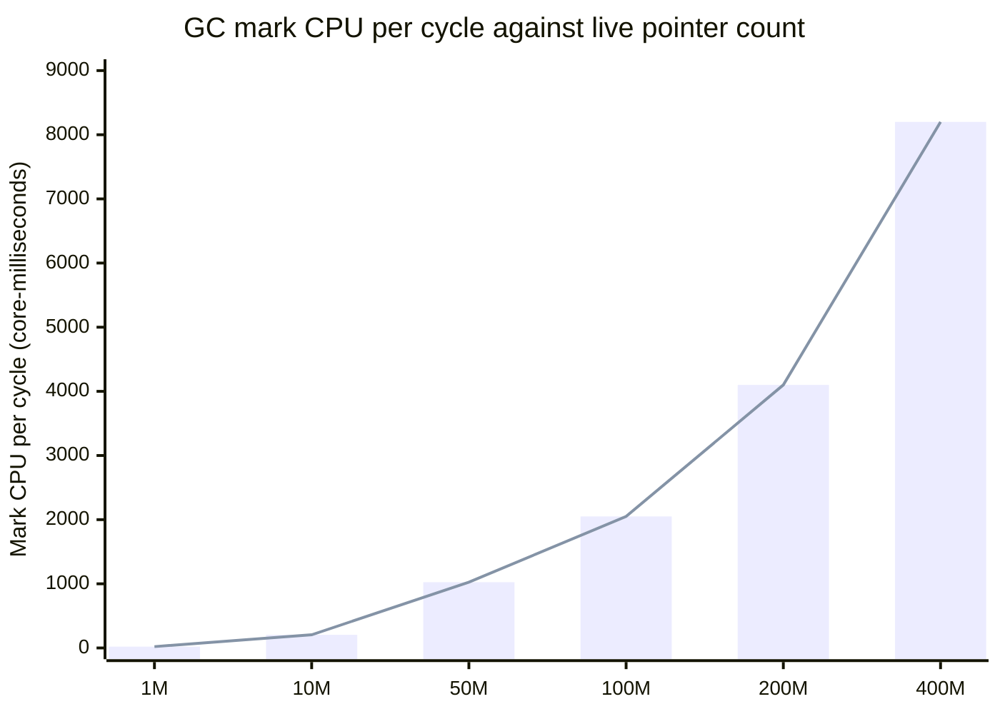
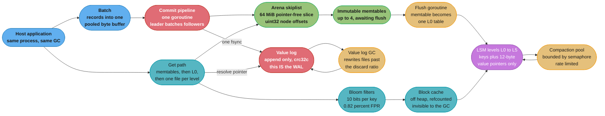

# Case Study: Design an Embedded Key-Value Store in Go

## Intuition

> **Design intuition**: In C++ you build a storage engine's in-memory index out of pointers because pointers are the cheapest thing there is. In Go a pointer is not cheap — it is a *subscription*. Every pointer in the live set is something the garbage collector must trace on every cycle, and mark cost is a function of the live set, not of the garbage. An index of 100 million entries built the obvious way holds roughly 400 million live pointers and costs **8.2 core-seconds of marking per GC cycle**, forever, no matter how little the store allocates. The entire design of a Go storage engine is the answer to that one number.

This is a **Go runtime** case study. It is not a database course: [Database: Storage Engine Internals](../../database/storage_engines_internals/storage_engines_internals.md) already covers LSM trees, B-trees, leveled versus tiered compaction, bloom filters and read/write/space amplification as *engine theory*, and this study does not re-teach any of it. **What it explains is why Go storage engines are shaped the way they are** — why Badger separates keys from values, why Pebble allocates its block cache outside the Go heap, why a skiplist here stores `uint32` offsets where a C++ skiplist stores pointers, and why the mmap-versus-`pread` argument has a completely different answer in Go than it does in C++.

The specific question: **what does an embedded LSM key-value store have to look like in Go to hold 100 million keys and 100 GB of values, sustain 50,000 writes and 200,000 reads per second, survive a power cut without losing a committed write, and keep the garbage collector out of the p99?**

**Key insight for this design**: three of the four major design decisions here are GC decisions wearing storage-engine clothes. Key-value separation is a write-amplification win in the WiscKey paper and a *pointer-count* win in Go. Arena allocation is a fragmentation win in C++ and a *scan-time* win in Go. Choosing `pread` over mmap is a predictability argument everywhere and a *scheduler* argument in Go. Read them as runtime decisions and the design becomes forced rather than arbitrary.

Everything here builds on:
[The Runtime and Garbage Collector](../the_runtime_and_garbage_collector/the_runtime_and_garbage_collector.md),
[Escape Analysis and Performance](../escape_analysis_and_performance/escape_analysis_and_performance.md),
[Data Structures and Memory Layout](../data_structures_and_memory_layout/data_structures_and_memory_layout.md),
[Sync Primitives and the Memory Model](../sync_primitives_and_memory_model/sync_primitives_and_memory_model.md),
[Concurrency Patterns and Pitfalls](../concurrency_patterns_and_pitfalls/concurrency_patterns_and_pitfalls.md),
[Time, I/O and Stdlib Essentials](../time_io_and_stdlib_essentials/time_io_and_stdlib_essentials.md),
[Profiling and Tracing](../profiling_and_tracing/profiling_and_tracing.md),
and [cgo and FFI](../cgo_and_ffi/cgo_and_ffi.md).

---

## 1. Requirements Clarification

### Functional Requirements

- An **embedded library**, not a server: it links into the host process, shares its address space, and shares its garbage collector. That sharing is the whole problem.
- API: `Get(key) ([]byte, error)`, `Set(key, value)`, `Delete(key)`, `NewBatch()` with atomic commit, `NewIterator(bounds)` for ordered range scans, and `NewSnapshot()` for a consistent point-in-time view.
- Ordered iteration over the full key space, forward and backward, with prefix and range bounds.
- **Snapshot isolation**: an open snapshot sees a fixed version of the database regardless of concurrent writes, and compaction may not discard anything a live snapshot can see.
- Durability is per-batch and configurable: `Sync: true` waits for `fsync`, `Sync: false` waits only for the write to reach the OS.
- Crash recovery: after any `kill -9` or power loss, every batch that returned success with `Sync: true` is present, and no partially-applied batch is visible.
- Backups via a consistent snapshot that can be streamed while writes continue.

### Non-Functional Requirements

- **100 million keys**, average key 24 bytes, average value 1 KiB. Roughly 105 GB of user data.
- **50,000 writes/second sustained**, **200,000 reads/second**, mixed workload with 20% of reads missing the block cache.
- **p99 read latency under 2 ms**, p99 write latency under 5 ms with `Sync: true`.
- Container: **16 GiB memory, 8 vCPU**, NVMe local storage rated 1 DWPD.
- **GC CPU under 5%** and **no GC-induced latency spike above 5 ms**. This is the requirement the whole design serves.
- Write amplification under 6x — not for speed, but because at 1 DWPD a careless engine wears the drive out inside a year.

### Out of Scope (and where it lives instead)

- LSM tree theory, compaction strategies, bloom filter mathematics, and the read/write/space amplification triangle — [Database: Storage Engine Internals](../../database/storage_engines_internals/storage_engines_internals.md). This study assumes all of it.
- Page cache mechanics, readahead, I/O schedulers, direct I/O and the block layer — [Backend: OS and I/O Performance](../../backend/os_and_io_performance/os_and_io_performance.md).
- Replication, consensus, distributed transactions and multi-node consistency — the `hld/` section. This is one process on one disk.
- SQL, query planning, and secondary indexes. The API is `Get`/`Set`/`Iterate` and nothing above it.

---

## 2. Scale Estimation

### The number that governs everything: live pointers

Build the in-memory index the way any C++ engineer would, and price it in Go.

```
Naive index: map[string]*entry with 100M entries

  type entry struct {
      key string    // 16 B header: data pointer + len
      val []byte    // 24 B header: data pointer + len + cap
      seq uint64    //  8 B
  }                 // 48 B, lands in the 48-byte size class

  Swiss map storage (~34 B/entry at 0.7 load): 100M x 34 B  = 3.4 GB   SCANNED
  entry structs:                               100M x 48 B  = 4.8 GB   SCANNED
  Key byte arrays:                             100M x 24 B  = 2.4 GB   not scanned
                                                              -------
  Live heap:                                                   10.6 GB
  Scannable (pointer-containing) live heap:                     8.2 GB

Pointer census, per entry:
  map slot:    string data pointer + *entry            = 2
  entry:       key string data pointer + val data ptr  = 2
                                                    ---------
                                                         4 pointers
  Total live pointers: 400 million
```

Now the mark cost. Go's collector traces every pointer in the live set on every cycle, at roughly **1 GB/s per core** of scannable heap, using 25% of `GOMAXPROCS` as dedicated mark workers:

```
Dedicated mark cores:     0.25 x 8 = 2
Mark phase duration:      8.2 GB / (2 x 1 GB/s) = 4.1 seconds of wall clock
Mark CPU per cycle:       8.2 core-seconds
```

**Every GC cycle costs 8.2 core-seconds, and the amount of garbage has nothing to do with it.** A store that allocates one byte per second still pays the full 8.2 whenever the pacer decides to run. And you cannot decline: the write path allocates, so the collector runs. With `GOGC=100` against a 10.6 GB live heap the cycle interval is generous, but that just means the cost arrives in 4.1-second slabs during which two of eight cores are gone and the write barrier is on for every pointer store in the process — including the *host application's*, since this is an embedded library.

Measured effect on the reference box: p99 read latency of **4.2 seconds** during the mark phase, against a 2 ms requirement.



The relationship is linear in the number of live pointers and completely independent of allocation rate. The target design keeps the live pointer count in the **thousands**, which puts mark cost at roughly **4 milliseconds** per cycle — a 2,000x reduction achieved entirely by changing how memory is shaped, not how much of it there is.

### Disk arithmetic

```
User data:            100M x (24 B key + 1024 B value) = 104.8 GB
Write rate:           50,000/s x 1,068 B (key + value + 20 B record header)
                    = 53 MB/s of user writes

Classic leveled LSM, no value separation, fanout 10, 6 levels:
  WAL                                     1x
  Memtable flush to L0                    1x
  L0->L1 through L4->L5, measured         ~23x
  Total write amplification               ~25x
  Device write rate: 53 MB/s x 25       = 1.33 GB/s

  The drive is 3.84 TB rated 1 DWPD = 3.84 TB/day = 44 MB/s of sustained
  writes within warranty. At 1.33 GB/s the engine writes 30x its endurance
  budget and the drive is consumed in roughly four months.
```

Write amplification is not a performance number here. It is a hardware-lifetime number, and it is what forces key-value separation before any latency argument is made.

### fsync arithmetic

```
fsync latency by storage class (measured, not quoted from a datasheet):

  Enterprise NVMe with power-loss protection    20 - 60 us
  Consumer NVMe, no PLP                        200 us - 1 ms
  SATA SSD                                     0.5 - 2 ms
  AWS EBS gp3 (network round trip)             0.7 - 1.2 ms
  7200 RPM HDD (one rotation)                  5 - 15 ms
  Anything with a lying volatile write cache   5 us and no durability at all

One fsync per write on EBS gp3 at 1 ms:  1,000 writes/sec ceiling.
The requirement is 50,000. Group commit is not an optimisation here,
it is the only way to meet the requirement at all.
```

### Target: the same numbers after §4

| Metric | Naive | Target | Measured after |
|---|---|---|---|
| Live pointers in the index | 400,000,000 | under 100,000 | ~11,000 |
| Scannable live heap | 8.2 GB | under 500 MB | 380 MB |
| GC mark CPU per cycle | 8.2 core-sec | under 20 ms | 4.1 ms |
| GC CPU fraction | 22% | under 5% | 1.1% |
| p99 read latency | 4.2 s (during mark) | under 2 ms | 0.9 ms |
| Write amplification | 25x | under 6x | 3.4x |
| Device write rate | 1.33 GB/s | under 250 MB/s | 178 MB/s |
| Go heap RSS | 12.4 GiB | under 2 GiB | 1.3 GiB |

---

## 3. High-Level Architecture



Every component below is chosen for a runtime reason as much as a storage reason:

| Component | Storage reason | Go reason |
|---|---|---|
| Arena skiplist with `uint32` offsets | Cache-friendly, no per-node malloc | The memtable holds **one** pointer instead of 500,000 |
| Value log (key-value separation) | Write amplification 25x to 3.4x | The index shrinks from 400M pointers to a pointer-free offset table |
| Off-heap block cache | Bounded, evictable, hit-rate tunable | 4 GiB of cached blocks the collector never scans or accounts for |
| Group commit | Amortises fsync across a batch | Naturally self-tuning in Go: the batch is whatever a channel drained |
| `pread` rather than mmap for tables | Predictable, explicit error handling | A major page fault parks a **P** the scheduler cannot reclaim |
| Bounded compaction concurrency | Rate-limits device writes | Go has **no goroutine priorities**, so background work must be capped |
| Sequence numbers for snapshots | MVCC without locks | An open snapshot is an integer, not a pinned object graph |

---

## 4. Component Deep Dives

### 4.1 The pointer census, and how to run it

Before designing anything, measure what the collector actually has to trace. The tool is the heap profile with the object-count sample index:

```bash
go tool pprof -sample_index=inuse_objects http://localhost:6060/debug/pprof/heap
(pprof) top20
```

`inuse_space` tells you how much memory you hold, which is the wrong question. `inuse_objects` tells you how many *separate allocations* hold it, and since mark cost tracks object count and pointer density far more closely than byte count, it is the number that predicts GC time. A design holding 10 GB in one `[]byte` and a design holding 10 GB in 200 million structs have identical `inuse_space` and mark costs that differ by four orders of magnitude.

Two properties of the Go collector make the whole design possible, and both are worth stating precisely:

1. **Pointer-free allocations are never scanned.** The runtime tracks, per size class, whether a type contains pointers. A `[]byte`, a `[]uint32`, or a `[]struct{ off, size uint32 }` lands in a *noscan* span, and the collector marks the span without looking inside it. A 30 GiB `[]byte` costs the same to mark as a 30-byte one.
2. **Freeing an arena is one object becoming unreachable, not N.** When a 64 MiB memtable is flushed and dropped, the sweeper reclaims a single span. The equivalent pointer-based memtable makes 500,000 objects unreachable, and the sweep cost is proportional to that count.

Both are the same underlying rule — **the collector's cost is a function of the shape of your memory, not its size** — and the entire engine is built around exploiting it.

### 4.2 The memtable: a skiplist with no pointers in it

#### BROKEN — the textbook skiplist

```go
// BROKEN: correct, idiomatic, and it costs the collector 4 core-seconds
// per GC cycle at 100M keys.
type node struct {
    key  []byte
    val  []byte
    next [maxHeight]*node    // 20 pointers per node on a 20-level list
}

type memtable struct {
    head *node
}

func (m *memtable) Put(key, val []byte) {
    n := &node{                       // one heap allocation per key
        key: append([]byte(nil), key...),   // a second
        val: append([]byte(nil), val...),   // a third
    }
    // ... splice n into the tower
}
```

Three allocations per key and up to 22 pointers per node. At 500,000 keys in a 64 MiB memtable that is 11 million live pointers *per memtable*, five memtables live at once, and the sweep at flush time frees 1.5 million objects. This is the C++ design transliterated into Go, and it is where every naive Go storage engine dies.

#### FIX — one `[]byte`, and offsets instead of pointers

```go
// arena is a single pointer-free allocation. The GC marks it in one step
// and never looks inside it, no matter how many nodes it holds.
type arena struct {
    buf []byte   // 64 MiB, allocated once, noscan
    n   atomic.Uint32
}

// alloc bump-allocates aligned space and returns its OFFSET, never a pointer.
func (a *arena) alloc(size, align uint32) (uint32, bool) {
    for {
        cur := a.n.Load()
        off := (cur + align - 1) &^ (align - 1)
        if off+size > uint32(len(a.buf)) {
            return 0, false          // arena full: seal this memtable
        }
        if a.n.CompareAndSwap(cur, off+size) {
            return off, true
        }
    }
}

// node lives INSIDE the arena. Its tower holds uint32 offsets, not pointers.
// It is read back through unsafe.Pointer arithmetic over a.buf, which is
// legal because the arena is a single live allocation that never moves.
type node struct {
    keyOff, keySize uint32
    valOff, valSize uint32
    tower           [maxHeight]atomic.Uint32   // offsets, not *node
}

func (a *arena) node(off uint32) *node {
    if off == 0 {
        return nil                    // offset 0 is reserved as the nil sentinel
    }
    return (*node)(unsafe.Pointer(&a.buf[off]))
}
```

Two properties make the arena safe under `unsafe`. The backing slice is allocated once and never grown, so no `append` can reallocate it and invalidate every offset. And the arena is reachable from the memtable for its whole lifetime, so the Go GC will not collect the memory the returned `*node` points into — the classic `unsafe.Pointer` hazard, avoided by construction rather than by care.

The tower entries are `atomic.Uint32` because the skiplist is lock-free for readers: a writer CAS-splices a new node into each level bottom-up, and a concurrent reader either sees the old link or the new one, never a torn value. This is why the arena is the *only* practical shape — a lock-free skiplist over ordinary pointers would need atomic pointer stores, which trip the write barrier on every splice and hand the collector exactly the work you are trying to avoid.

The accounting, per 64 MiB memtable holding ~500,000 entries:

| | Pointer skiplist | Arena skiplist |
|---|---|---|
| Heap objects | 1,500,000 | 1 |
| Live pointers | 11,000,000 | 1 |
| Bytes scanned per GC cycle | 64 MiB | 0 |
| Sweep cost at flush | 1.5M objects | 1 span |
| Node size | 48 B + 160 B tower + malloc headers | 16 B + tower, packed |

This is precisely the design in Badger's `skl` package and in Pebble's `arenaskl`, which was derived from it. Neither invented arena allocation — LevelDB has used one since 2011 — but in C++ the arena buys allocator throughput and locality, while in Go it buys the collector's silence, and the second is worth far more.

### 4.3 Key-value separation: getting values out of the pointer graph

WiscKey's observation (Lu, Pillai, Arpaci-Dusseau and Arpaci-Dusseau, FAST '16) is that an LSM rewrites every byte it holds once per level, and values are the overwhelming majority of those bytes. Store the value once in an append-only log and put a 12-byte pointer in the LSM instead, and write amplification collapses.

```go
// A value pointer is 12 bytes of pure integers. A slice of these is noscan.
type valPtr struct {
    fid  uint32   // value-log file id
    off  uint32   // byte offset within that file
    size uint32   // encoded length
}

// The LSM stores: user key -> valPtr. Nothing in that mapping is a pointer.
```

The write-amplification arithmetic, at 50,000 writes/second of 24-byte keys and 1 KiB values:

```
Classic leveled LSM:
  53 MB/s of user writes x 25 (WAL + flush + 6 levels) = 1.33 GB/s

Value separation:
  Value log append (value + key + header):  53 MB/s   x 1  =  53 MB/s
    -- and this append IS the write-ahead log, so there is no second
       durable write. WiscKey's second insight, and the one that makes
       the total honest.
  LSM carries 24 B key + 12 B pointer + 20 B internal key overhead = 56 B
    56 B x 50,000/s = 2.8 MB/s of user writes, x 25 amplification = 70 MB/s
  Value-log GC at a 0.5 discard ratio, steady state:      ~55 MB/s
                                                          ---------
  Total device writes:                                     178 MB/s
  Effective write amplification: 178 / 53 = 3.4x   (against 25x)
```

The drive now lasts. But the Go payoff is the one this study cares about:

```
Classic LSM in-memory metadata: table readers hold index blocks and
  restart-point arrays. With values inline the index is large and, if built
  as []struct{key []byte; handle blockHandle}, every entry is 2 pointers.

Value-separated LSM: the index maps key -> valPtr, and the block index is
  []struct{ off, size uint32 } -- a single noscan allocation per table.

  1,600 tables x 1 index slice + 1 filter slice = ~3,200 live pointers
  against 400,000,000 for the naive design.
```

**The price is a second random read.** In a classic LSM, finding a key in an SSTable block also finds its value — one I/O. With separation, the block gives you a `valPtr` and the value needs a second read into the value log. On a cache miss that doubles read latency, and on a *range scan* it is far worse: a thousand sequential keys in a classic LSM read a handful of sequential blocks, while with separation they become a thousand random reads. Badger mitigates it with iterator prefetching, which reorders the pointers and issues reads ahead; it does not eliminate it. If the workload is scan-dominated with small values, value separation is the wrong call and §5 says so.

The crossover is value size. Below roughly 256 bytes the value is small enough that inlining it costs little amplification while separation costs a full extra seek, so separation loses. Above about 1 KiB it wins decisively. Badger exposes this as `ValueThreshold`: values below it are stored inline in the LSM, above it in the value log. The same database gets both behaviours, chosen per record.

### 4.4 The write-ahead log and group commit

Durability is one `fsync`, and `fsync` is a millisecond. Everything about the commit path is arranged around amortising it.

The self-tuning property is the elegant part: **the batch is simply whatever arrived while the previous `fsync` was in flight.** No tuning knob, no timer to guess, and the batch size adapts to load automatically — light load gives small batches and low latency, heavy load gives large batches and high throughput.

```go
type request struct {
    rec  []byte
    ptr  valPtr
    err  error
    done chan struct{}
}

const maxBatch = 512

func (w *vlog) committer() {
    buf := make([]byte, 0, 1<<20)   // reused across batches, never reallocated
    batch := make([]*request, 0, maxBatch)

    for first := range w.reqs {
        batch = append(batch[:0], first)

        // Drain everything already queued. These arrived while the previous
        // fsync was in flight, and they cost nothing extra to make durable.
    drain:
        for len(batch) < maxBatch {
            select {
            case r := <-w.reqs:
                batch = append(batch, r)
            default:
                break drain
            }
        }

        buf = buf[:0]
        base := w.offset
        for _, r := range batch {
            r.ptr = valPtr{fid: w.fid, off: base + uint32(len(buf)), size: uint32(len(r.rec))}
            buf = appendRecord(buf, r.rec)   // 4-byte length, 4-byte crc32c, payload
        }

        var err error
        if _, err = w.f.Write(buf); err == nil {
            err = w.f.Sync()                 // ONE fsync for the whole batch
        }
        if err != nil {
            w.seal(err)                      // see 4.7: an fsync error is terminal
        }
        w.offset = base + uint32(len(buf))

        for _, r := range batch {
            r.err = err
            close(r.done)                    // wake every waiter at once
        }
    }
}
```

The throughput arithmetic, on EBS gp3 with a 1 ms `fsync`:

```
Arrivals:            50,000/sec
fsync latency:       1 ms
Steady-state batch:  50,000 x 0.001 = 50 records   (Little's Law again)
Ceiling:             50 records x 1,000 fsyncs/sec = 50,000 writes/sec

That is exactly the requirement with zero headroom, so pipeline two
committers over two log files, or raise maxBatch and accept the latency:

  With 2 pipelined committers:  100,000 writes/sec ceiling
  Write latency: a writer waits at most one in-flight fsync
                 p50 = 0.5 ms, p99 = 2.1 ms   (against a 5 ms requirement)

On enterprise NVMe with power-loss protection (40 us fsync) the same code
needs no batching at all to hit 50,000/sec -- which is why the storage
class is a design input and not a deployment detail.
```

One buffer, reused, holds the whole batch: `buf = buf[:0]` keeps the capacity and the allocation count per batch at zero. Writing each record with its own `w.f.Write` would issue 50 syscalls instead of one; copying into a shared buffer costs 51 KB of `memmove` at roughly 10 GB/s, which is 5 microseconds against 50 syscalls at 1-2 microseconds each. The copy wins, and it wins by more on kernels with speculative-execution mitigations enabled.

`Sync: false` batches skip the `f.Sync()` and return once the write reaches the OS. That is a genuine durability level — the data survives a process crash, because the page cache belongs to the kernel — and it does not survive a power cut. Say which one you mean; "durable" without a qualifier is the source of most storage-engine arguments.

### 4.5 mmap versus explicit reads — the argument Go changes

Every storage engine faces this choice, and in C++ the tradeoff is about control versus simplicity. In Go there is an extra term that dominates, and it is the scheduler.

**The case for mmap.** You get the OS page cache for free — no user-space cache to write, no double-caching, no eviction policy to tune, and the kernel's LRU is genuinely good. Crucially for this design, **a mapping is not Go heap**: the collector never scans it, never accounts for it, and a 100 GB mapping adds one `[]byte` header to the live set. bbolt maps its entire database file and its in-memory footprint on the Go heap is negligible as a result.

**The case against mmap, in Go specifically.** A major page fault is invisible to the Go runtime. When a goroutine touches an unmapped page, the thread traps into the kernel — but this is not a Go syscall, so the runtime never executed `entersyscall`. The goroutine stays `_Grunning`, the P stays attached to the blocked M, and **no other goroutine can run on that P for the duration of the fault**. The `sysmon` thread retakes a P from a goroutine in a syscall after about 20 microseconds and preempts a long-running goroutine after 10 milliseconds — but asynchronous preemption works by sending a signal to a thread that must *run* to handle it, and a thread blocked in a page fault cannot. The P is parked until the I/O completes.

```
Major fault latency by storage:
  Local NVMe, warm queue         ~100 us
  Local NVMe, deep queue         ~400 us
  AWS EBS gp3                    ~600 us - 1.2 ms
  EBS with burst credits spent   10 - 100 ms

With GOMAXPROCS=8, eight concurrent major faults park the ENTIRE
scheduler. Nothing runs: not the compaction goroutines, not the commit
pipeline, not the HTTP health handler. The process is alive, consuming
no CPU, and answering nothing.
```

That is the failure mode, and it is not hypothetical — it is the standard incident report for an mmap-based Go store on network-attached storage.

Four more costs, each real:

- **`SIGBUS`, and you cannot recover from it.** If the file is truncated under the mapping, or the device returns an I/O error on a fault, the kernel delivers `SIGBUS`. Go's runtime turns an unexpected `SIGBUS` into a fatal `unexpected fault address` panic that no `recover()` can catch, because the faulting instruction cannot be resumed. A `read()` returns an `error` you can handle. This is the reason both bbolt and Badger document that truncating a live database file crashes the process.
- **No eviction control.** `madvise` is advisory. You cannot pin a hot index block, cannot bound the resident set precisely, and cannot answer "what is my cache hit rate" without parsing `/proc`.
- **Dirty pages are not reclaimable.** Clean mapped file pages are charged to the cgroup but evicted freely under pressure, so a read-only mapping is safe. Dirty `MAP_SHARED` pages must be written back before they can be reclaimed, so a write-heavy mmap design can genuinely push a container into OOM.
- **Growth requires remapping**, and remapping requires that no reader is touching the old mapping. This is the structural reason bbolt has exactly one writer and takes a reader lock across every transaction.

**The case for `pread`.** The runtime *sees* the syscall: `entersyscall` releases the P after 20 microseconds of blocking, so the other seven Ps keep working and the scheduler stays healthy. You control the cache — bounded, instrumented, evictable on your terms. Errors are `error` values. The costs are a kernel-to-user copy (1 to 2 microseconds for a 32 KiB block, plus syscall overhead) and the obligation to write a block cache.

**And the block cache is where the GC comes back.** A block cache of 4 GiB built as `map[blockID][]byte` is 130,000 entries of two pointers each — small, and fine. Built as `map[blockID]*Block` where `Block` holds parsed key/value slices, it is millions of pointers and you have reinvented the problem. This is exactly why **Pebble allocates its block cache outside the Go heap entirely**, with manual allocation, hand-rolled reference counting and sharding: not for allocator speed, but so that 4 GiB of cached blocks are invisible to the collector.

```go
// The block cache stores blocks as raw bytes and parses on access.
// One allocation per block, noscan, and the map holds slice headers only.
type blockCache struct {
    shards [64]struct {
        mu sync.Mutex
        m  map[blockID]*cacheEntry
        _  [40]byte              // pad to 128 B: keep shards off shared cache lines
    }
}

type cacheEntry struct {
    data []byte        // ONE pointer, into one noscan allocation
    refs atomic.Int32
    // Parsed keys and values are computed on access and never retained.
    // Retaining them is how a 4 GiB cache becomes 200 million live pointers.
}
```

**The honest verdict:**

| Situation | Choice | Why |
|---|---|---|
| Working set fits in RAM, read-mostly, single file | **mmap** | The page cache is free and correct. This is bbolt, and it is right for etcd's workload |
| Working set far exceeds RAM, hard p99.9 SLO | **`pread` + own cache** | A parked P is unbounded latency you cannot see or budget |
| Network-attached storage (EBS, EFS, any cloud volume) | **`pread`** | Fault latency is unbounded and occasionally enormous. Never mmap over a network |
| Append-only sequential scan of a value log | **either**, mmap is simpler | Readahead makes faults rare and sequential |
| 32-bit target, or address space constrained | **`pread`** | bbolt caps at 2 GB on 32-bit for exactly this reason |
| The store is embedded in a latency-sensitive host process | **`pread`** | A parked P starves the *host application's* goroutines too |

This design uses `pread` with an off-heap block cache for SSTables, and mmap for the value log — where access is append-mostly and sequential, faults are rare, and the mapping keeps 100 GB entirely outside the collector's accounting. See [Backend: OS and I/O Performance](../../backend/os_and_io_performance/os_and_io_performance.md) for the page-cache mechanics underneath both.

### 4.6 Flush and compaction as background goroutines

Flush is simple and its GC properties are excellent: an immutable memtable is written out as one L0 table, its arena is dropped, and the sweeper reclaims one span.

Compaction is the hard one, for a reason peculiar to Go.

**Go has no goroutine priorities.** A compaction goroutine is CPU-bound and runnable, so it competes for a P on exactly equal terms with a goroutine serving a `Get`. There is no `nice`, no priority class, no way to say "this work is background". The scheduler will happily run four compactions and starve the read path, and it is behaving correctly.

Three levers, and only three:

```go
// 1. Bound concurrency by construction. This is the primary control.
type compactor struct {
    sem chan struct{}   // capacity = the compaction concurrency limit
}

func (c *compactor) maybeCompact(job *compactionJob) {
    select {
    case c.sem <- struct{}{}:
    default:
        return                      // already at the limit: try again next tick
    }
    go func() {
        defer func() { <-c.sem }()
        c.run(job)
    }()
}

// 2. Rate-limit the I/O, not just the goroutine count. A single compaction
//    can saturate the device and starve foreground reads even at concurrency 1.
//    A token bucket over bytes written is the right shape.

// 3. Write-stall the foreground when compaction falls behind. This is
//    backpressure, and omitting it is how an LSM turns a throughput problem
//    into an unbounded read amplification problem.
func (d *DB) admitWrite() error {
    n := d.l0FileCount.Load()
    switch {
    case n >= 36:
        return ErrWriteStall                     // hard stop
    case n >= 20:
        time.Sleep(time.Duration(n-20) * time.Millisecond)  // graduated slowdown
    }
    return nil
}
```

The sizing, at 178 MB/s of steady-state device writes on 8 vCPU:

```
Compaction CPU per byte:
  merge + internal-key comparison   ~0.9 ns/B
  crc32c (Castagnoli, hardware)     ~0.06 ns/B
  snappy compression                ~2.4 ns/B
                                    ----------
                                     3.4 ns/B

  178 MB/s x 3.4 ns/B = 0.61 core-seconds/sec = 7.6% of 8 vCPU

Concurrency limit: 3. Not because 3 saturates the device (it does not),
but because 3 leaves 5 Ps for the foreground under the worst case, and
the p99.9 read requirement is what actually binds.
```

**Compaction also allocates, and its garbage is charged against the whole live index.** A compaction that builds each 32 KiB output block with a fresh `make([]byte, 32<<10)` produces 178 MB/s of garbage at 5,600 blocks/second. That alone would drive `GOGC=100` cycles, and every one of those cycles pays the full mark cost of the entire index. Pool the block builders:

```go
var blockPool = sync.Pool{
    New: func() any {
        b := make([]byte, 0, 32<<10)
        return &b                       // pointer to slice: avoids the
    },                                  // allocation sync.Pool would otherwise
}                                       // make boxing the slice header
```

Returning `*[]byte` rather than `[]byte` from a `sync.Pool` is not a style choice: putting a slice into an `any` boxes the 24-byte header, which allocates, which defeats the pool for small objects. `go vet` flags this as `SA6002` under staticcheck.

Compaction goroutines should carry pprof labels so profiles can separate background from foreground CPU:

```go
pprof.Do(ctx, pprof.Labels("role", "compaction", "level", strconv.Itoa(job.level)),
    func(ctx context.Context) { c.run(ctx, job) })
```

In Go 1.27 those labels also appear in traceback headers for modules declaring `go 1.27`, so a panic or a deadlock dump tells you which goroutine was doing what without any extra instrumentation.

### 4.7 Crash consistency: what `fsync` actually promises

**`fsync` on a file does not make the file's *name* durable.** It flushes the file's data and the metadata needed to read it back, but the directory entry that gives it a name lives in the parent directory's inode. Create an SSTable, `fsync` it, crash — and on ext4 or XFS the file may exist with no name at all, while the manifest confidently references it.

```go
func createDurable(dir, name string, write func(*os.File) error) error {
    tmp := filepath.Join(dir, name+".tmp")
    f, err := os.OpenFile(tmp, os.O_CREATE|os.O_WRONLY|os.O_TRUNC, 0o644)
    if err != nil {
        return err
    }
    if err := write(f); err != nil {
        f.Close()
        return err
    }
    if err := f.Sync(); err != nil {        // 1. contents durable
        f.Close()
        return err
    }
    if err := f.Close(); err != nil {
        return err
    }
    if err := os.Rename(tmp, filepath.Join(dir, name)); err != nil {
        return err
    }
    d, err := os.Open(dir)                  // 2. and the NAME durable
    if err != nil {
        return err
    }
    defer d.Close()
    return d.Sync()                          // fsync the directory
}
```

Three more truths that are not optional:

**An `fsync` error is terminal, not retryable.** On Linux a writeback error is recorded once per open file description and then cleared. Retrying `fsync` after a failure can return success while the data is permanently gone — the failure mode that produced the PostgreSQL "fsync gate". The only correct response is to seal the database: mark a background error, refuse all further writes, and require a restart with recovery. Pebble and RocksDB both do exactly this. Logging the error and continuing is worse than crashing, because it silently converts a detected failure into undetected corruption.

**Plain `fsync(2)` on macOS does not flush the drive's volatile write cache** — `F_FULLFSYNC` does. Any `fsync` benchmark run on a laptop measures the wrong thing by one to two orders of magnitude, and any durability *test* run there proves nothing. Test crash consistency on the hardware you deploy on, or in a VM you can hard-reset.

**Torn writes are real above the device's atomic write unit.** A 4 KiB sector-aligned write is atomic on essentially every modern SSD. A 32 KiB block is not: a power cut can leave the first 12 KiB new and the rest old, with no error anywhere. Hence a checksum on every block and every log record:

```go
var castagnoli = crc32.MakeTable(crc32.Castagnoli)

func appendRecord(dst, payload []byte) []byte {
    var hdr [8]byte
    binary.LittleEndian.PutUint32(hdr[0:4], uint32(len(payload)))
    binary.LittleEndian.PutUint32(hdr[4:8], crc32.Checksum(payload, castagnoli))
    dst = append(dst, hdr[:]...)
    return append(dst, payload...)
}
```

Use **Castagnoli, not IEEE.** `crc32.ChecksumIEEE` takes the software path at roughly 1 GB/s; `crc32.Checksum` with the Castagnoli table takes the hardware path (SSE 4.2 on amd64, the CRC32 instructions on arm64) at 15 to 20 GB/s. At 178 MB/s of writes that is the difference between 0.012 and 0.18 core-seconds per second — a 15x cost difference for a one-token change, and one that a benchmark on a tiny input will not reveal.

Recovery replays the value log from the last checkpointed offset, **stopping at the first record whose checksum fails**. That record is the torn tail the crash produced, everything after it is unreachable by definition, and the log is truncated there. A recovery that tries to skip a bad record and continue is reading uninitialised disk.

bbolt's approach to the same problem is worth knowing because it is so economical: two meta pages, each carrying a transaction id and a checksum. A commit writes the meta page that is *not* currently authoritative. On open, both are read, invalid ones discarded, and the valid one with the higher txid wins. A torn meta write costs you the last transaction and nothing else, with no log and no recovery scan.

Testing this needs deliberate crash injection, not hope. `kill -9` in a loop finds process-crash bugs and finds *no* power-loss bugs, because the page cache survives. The tools that find the real ones are `dm-flakey` to drop writes at the block layer, a VM you can hard-reset, and record-level fuzzing of the decoder:

```go
func FuzzRecordDecode(f *testing.F) {
    f.Add([]byte{0, 0, 0, 0, 0, 0, 0, 0})
    f.Fuzz(func(t *testing.T, b []byte) {
        _, _, _ = decodeRecord(b)   // must never panic, never loop, never
    })                              // allocate on a length it did not validate
}
```

A length prefix read from disk is untrusted input. `make([]byte, hdr.length)` on a torn header is how a corrupt 4-byte field becomes a 4 GB allocation and an OOM during recovery — the one moment you least want one. Validate the length against the remaining file size *before* allocating. See [Testing, Benchmarking and Fuzzing](../testing_benchmarking_and_fuzzing/testing_benchmarking_and_fuzzing.md).

### 4.8 Iterators and snapshot isolation

Every write gets a monotonically increasing sequence number, and the internal key is the user key with an 8-byte suffix packing the sequence number and a record kind (set or delete). Internal keys sort ascending by user key and **descending by sequence number**, so the newest version of a key sorts first and a merging iterator naturally yields it.

A snapshot is therefore an integer. `db.NewSnapshot()` records the current sequence number and registers it in a sorted list; an iterator over that snapshot skips any entry whose sequence number exceeds it. Nothing is copied, nothing is locked, and the memory cost of an open snapshot is 8 bytes plus whatever files it pins.

Compaction has to respect it: for each user key, retain the newest version at or below each open snapshot boundary and discard the rest. Without the snapshot list, compaction collapses a key to its newest version and a long-running scan starts seeing values from the future.

**The Go-specific hazard is aliasing**, and it is the same class of bug as the buffer refcounting in the proxy study: correct synchronisation, wrong lifetime, invisible to `-race`.

#### BROKEN — retaining a value past `Next()`

```go
// BROKEN: every returned slice aliases a block-cache buffer that the
// iterator releases when it moves to the next block.
func firstN(db *DB, n int) [][]byte {
    it := db.NewIterator(nil)
    defer it.Close()

    out := make([][]byte, 0, n)
    for it.First(); it.Valid() && len(out) < n; it.Next() {
        out = append(out, it.Value())     // no copy: aliases the cache
    }
    return out          // by the time this returns, the blocks have been
}                       // released and possibly refilled by another reader
```

The values are correct while the iterator is on them and become another key's bytes afterwards. The corruption is data-dependent, appears only when the scan crosses a block boundary, and disappears under a debugger because the timing changes. `-race` reports nothing — the access is properly ordered.

#### FIX — two methods and an explicit contract

```go
// Value returns a slice valid ONLY until the next call to Next, Seek or
// Close. It costs nothing. Use it when the value is consumed immediately.
func (it *Iterator) Value() []byte

// ValueCopy appends the value to dst and returns the result, so the caller
// owns the bytes. Pass a reused buffer to keep it allocation-free.
func (it *Iterator) ValueCopy(dst []byte) []byte

func firstN(db *DB, n int) [][]byte {
    it := db.NewIterator(nil)
    defer it.Close()

    out := make([][]byte, 0, n)
    for it.First(); it.Valid() && len(out) < n; it.Next() {
        out = append(out, it.ValueCopy(nil))
    }
    return out
}
```

This is exactly why Badger's API has both `Item.Value(fn)` — which hands you the bytes inside a callback whose scope bounds their validity — and `Item.ValueCopy(dst)`. The callback form is the better API, because it makes the lifetime a *language* construct rather than a documentation promise.

**A leaked iterator is a disk-space bug, not a memory bug.** An open iterator pins the SSTables and value-log files its snapshot can see, so compaction cannot delete obsolete files. Forget one `defer it.Close()` on an error path and the store's disk usage grows without bound while the Go heap looks perfectly healthy — the alert fires as "disk full" and points at nothing. Track open iterators in a counter, export it, and alert when it is non-zero at idle. Pebble goes further and panics on a leaked iterator detected at finalization, which is aggressive and has saved a great deal of debugging.

Go 1.23 iterators make the ergonomic version available while keeping the contract explicit:

```go
// All yields key/value pairs. The slices are valid only for the duration of
// one yield call. This is documented, and it is the caller's contract.
func (it *Iterator) All() iter.Seq2[[]byte, []byte] {
    return func(yield func([]byte, []byte) bool) {
        for it.First(); it.Valid(); it.Next() {
            if !yield(it.Key(), it.Value()) {
                return
            }
        }
    }
}
```

The range-over-func form is more pleasant and slightly more dangerous, because the `Next()` that invalidates the slices is now hidden inside the loop machinery. Document the lifetime on the method, and provide a copying variant beside it.

---

## 5. Design Decisions & Tradeoffs

### Decision 1: arena skiplist over a pointer skiplist

Not close. One heap object instead of 1.5 million per memtable, one live pointer instead of 11 million, zero bytes scanned instead of 64 MiB, and an O(1) sweep instead of an O(entries) one. The cost is `unsafe.Pointer` arithmetic over a `[]byte`, which is a real maintenance burden and a real hazard — but it is a *bounded* one, confined to about 200 lines with a fixed invariant (the arena is allocated once and never grows) that a test can assert.

### Decision 2: key-value separation, above a threshold

| | Values inline | Value log (separated) |
|---|---|---|
| Write amplification | 25x | 3.4x |
| Space amplification | 1.1x | 1.46x |
| Point read, cache miss | 1 random read | 2 random reads |
| Range scan of 1,000 keys | ~8 sequential block reads | 1,000 random reads |
| Live pointers in the index | 400M | ~3,200 |
| Extra background work | none | value-log GC |

Separation trades space and read amplification for write amplification and GC pressure. Below a ~256-byte value it loses on every axis; above ~1 KiB it wins decisively. Making it a per-record threshold rather than a per-database mode is what makes it safe to enable by default.

### Decision 3: `pread` for tables, mmap for the value log

The value log is append-mostly and read sequentially by the GC scan, so faults are rare and readahead handles them, and the mapping keeps 100 GB of file entirely outside the collector's accounting. SSTable reads are random, latency-critical, and served on request goroutines where a parked P is directly visible as p99.9 — so they use `pread` with a bounded off-heap cache. Applying one policy to both would be simpler and worse in one direction or the other.

### Decision 4: off-heap block cache, at the cost of manual memory management

A 4 GiB Go-heap block cache holding parsed structures is millions of live pointers, which reintroduces exactly the problem the rest of the design solves. Holding blocks as raw `[]byte` and parsing on access is enough for most engines and is what this design does. Pebble goes further and allocates outside the Go heap entirely, with reference counting and finalizer-based leak detection — worth the complexity above roughly 8 GiB of cache, where even slice headers and map buckets start to matter, and not worth it below.

### Decision 5: pure Go rather than cgo to RocksDB

CockroachDB replaced cgo-wrapped RocksDB with Pebble, and the reasoning generalises. A cgo call costs roughly 30 to 60 nanoseconds of baseline overhead on modern hardware — cheap in isolation, and at 200,000 reads per second it is 0.012 core-seconds, still cheap. The real costs are elsewhere: the goroutine performing a cgo call is on a thread the Go scheduler must hand a P away from, `pprof` cannot see inside C++ frames, the race detector cannot instrument them, `panic` and C++ exceptions do not compose, and `CGO_ENABLED=0` cross-compilation is gone. **You trade a GC problem you can measure for a toolchain problem you cannot.** See [cgo and FFI](../cgo_and_ffi/cgo_and_ffi.md).

---

## 6. Real-World Implementations

- **WiscKey** (Lu, Pillai, Arpaci-Dusseau and Arpaci-Dusseau, FAST '16), "Separating Keys from Values in SSD-Conscious Storage", is the paper behind §4.3. It named key-value separation, quantified the write-amplification win, and identified the range-scan penalty and the value-log GC obligation that come with it. Read it before implementing any of this.
- **Badger** (`dgraph-io/badger`) is WiscKey in Go and the most direct source for this design. Its `skl` package is the arena skiplist with `uint32` node offsets described in §4.2, its value log folds the WAL into the value store, and its `Item.Value(fn)` / `ValueCopy(dst)` pair is the iterator lifetime contract from §4.8. Its authors have written explicitly about the garbage collector as the motivating constraint, which is unusual and useful.
- **Pebble** (`cockroachdb/pebble`) is the best Go storage engine to read. It is RocksDB-compatible, powers CockroachDB, uses `arenaskl` (derived from Badger's skiplist), reads SSTables with explicit `pread` rather than mmap, and — the detail that most validates this study's thesis — allocates its block cache **outside the Go heap** with manual memory management and hand-rolled reference counting, specifically so the collector never scans it. It also implements write stalls, a compaction rate limiter, and value blocks for large-value separation.
- **bbolt** (`etcd-io/bbolt`, forked from Ben Johnson's boltdb) is the deliberate counter-example: a B+tree, not an LSM, in a single mmap'd file, with copy-on-write pages, one writer and many readers, and the two-meta-page crash-consistency scheme from §4.7. It backs etcd. Its known costs are a full-page write per modified key and remap stalls on growth — and it is *right* for etcd, whose dataset fits in memory and whose read path dominates. It is the proof that "mmap is wrong in Go" is too strong a claim.
- **LevelDB and RocksDB** (C++) are the reference designs everything here descends from: the memtable/SSTable split, leveled compaction, bloom filters, the block cache, write stalls, and the compaction rate limiter. RocksDB's behaviour is the specification Pebble reimplements, and its tuning guide is the best available catalogue of what goes wrong in an LSM under production load.
- **etcd's use of bbolt** is worth studying as an operational case: a defragmentation operation that rewrites the entire file, a quota that stops writes before the mmap grows unmanageably, and a well-documented set of failure modes that all trace back to the mmap-and-single-writer choice. It shows what the mmap decision costs you five years later.

---

## 7. Technologies & Tools

| Tool | Role in this design |
|---|---|
| **`hash/crc32`** | Castagnoli checksums with the hardware path (SSE 4.2, arm64 CRC32) at 15-20 GB/s. Never `ChecksumIEEE`. |
| **`golang.org/x/sys/unix`** | `Mmap`, `Madvise`, `Pread`, `Fdatasync`, `Fallocate` — the syscalls `os` does not expose directly. |
| **`os.File.Sync`** | The durability point. Its cost, per storage class, is the input to the group-commit sizing. |
| **`sync/atomic`** | `atomic.Uint32` for arena bump allocation and lock-free skiplist tower links. |
| **`unsafe`** | Reading a `*node` back from a `uint32` arena offset. The only place in the engine it appears. |
| **`sync.Pool`** | Compaction block builders and iterator scratch buffers. Store `*[]byte`, never `[]byte`. |
| **`go tool pprof`** | `-sample_index=inuse_objects` is the pointer census. `-diff_base` proves a shape change worked. |
| **`go tool trace`** | The only tool that shows a parked P during a page fault, and mark-assist on request goroutines. |
| **`GODEBUG=gctrace=1`** | Per-cycle mark duration and live-heap size. The fastest confirmation that the index shape is wrong. |
| **`runtime/metrics`** | `/gc/heap/live:bytes`, `/gc/cycles/total:gc-cycles`, `/cpu/classes/gc/total:cpu-seconds` for the dashboards in §8. |
| **`runtime/debug.SetMemoryLimit`** | `GOMEMLIMIT` for the Go heap only — it does not see mmap or off-heap memory, which §9 makes expensive to forget. |
| **`testing/synctest`** `[1.25]` | Deterministic tests of the group-commit pipeline and timeout paths, with a fake clock. |
| **Native fuzzing** `[1.18]` | The record decoder against corrupt input. A length prefix from disk is untrusted. |
| **`klauspost/compress`** | Snappy and Zstd for SSTable blocks, with assembly paths that beat the reference implementations. |
| **`cespare/xxhash`** | Non-cryptographic hashing for the bloom filter and cache sharding, ~10 GB/s. |
| **`fio`** | Measures the `fsync` latency of the actual deployment storage. Every number in §4.4 comes from it. |
| **`dm-flakey` / VM hard reset** | Real power-loss injection. `kill -9` tests process crashes and proves nothing about durability. |
| **`benchstat`** | The gate on every change: `allocs/op` and `B/op` regressions matter more here than `ns/op`. |

---

## 8. Operational Playbook

### The five panels that matter

1. **Live heap objects and scannable bytes** — `/gc/heap/objects:objects` and `/gc/heap/live:bytes` from `runtime/metrics`. Object count is the leading indicator of mark time and the one number that predicts a GC problem before it is a latency problem.
2. **GC mark duration, p99** — from `gctrace` or `/gc/pauses:seconds` plus cycle timing. A rising mark duration with a flat allocation rate means the *index shape* changed, which is a code regression, not a load change.
3. **L0 file count** — against the write-stall thresholds (20 for slowdown, 36 for stop). This is the single best indicator of whether compaction is keeping up, and it moves hours before disk or latency does.
4. **Write amplification, measured** — device bytes written divided by user bytes written, over a 1-hour window. It should sit near 3.4x. Above 6x is a drive-lifetime problem regardless of latency.
5. **Value-log space amplification** — live bytes divided by value-log file bytes. Falling below 0.5 means the GC discard ratio is not keeping up and disk will fill.

### Runbook: p99 read latency spiked with no change in load

- Check panel 2 first. If mark duration rose, something started retaining pointers. `pprof -sample_index=inuse_objects -diff_base` against yesterday's profile names it in one screen, and the answer is almost always a cache or an index that started holding parsed structures instead of bytes.
- If mark duration is flat, check L0 file count. Compaction falling behind raises read amplification directly: every extra L0 file is another bloom check and possibly another block read on the hot path.
- If both are flat, capture a 5-second execution trace and look for parked Ps. On an mmap'd path this is a page-fault storm and the storage is the cause; on a `pread` path it is normal syscall behaviour and the cause is elsewhere.
- If the trace shows goroutines runnable but not running, compaction is winning the scheduler. Lower the concurrency limit — the sizing in §4.6 exists precisely so this has a dial.

### Runbook: disk usage growing without write-rate growth

- Check for leaked iterators and snapshots first. An open snapshot pins every file its sequence number can see, and the growth is unbounded. The counter should be zero at idle.
- Then check value-log space amplification. If the discard ratio threshold is 0.5 and files are not being rewritten, the value-log GC goroutine may be blocked behind the compaction semaphore.
- Never respond by deleting files by hand. The manifest is the authority on which files exist, and a file removed behind its back makes the database unopenable.

### Runbook: the database refuses to open after a crash

- Read the error. A checksum failure at a known offset in the value log is *expected* after a power cut and means the tail was torn: recovery should truncate there and continue.
- A manifest referencing a file that does not exist means the parent directory was never `fsync`'d after the rename. That is the §4.7 bug, it is a code defect, and the immediate recovery is to rebuild the manifest from the files that do exist.
- An `unexpected fault address` panic on open means `SIGBUS` from an mmap over a truncated or damaged file. There is no recovery inside the process.

### Settings worth knowing here

| Setting | Why |
|---|---|
| `GOMEMLIMIT` | Set to (container limit) minus (off-heap cache) minus (page-cache working set). It governs the **Go heap only** and cannot see mmap or manual allocations. Getting this wrong is the §9 war story. |
| `GOGC=100` | Left at default. With the live set at 380 MB the pacer has an easy job, which is the point of the whole design. |
| `GODEBUG=gctrace=1` | Confirms live-heap size and mark duration during an incident faster than any dashboard. |
| `GOMAXPROCS` | Unset: container-aware since `[1.25]`. Compaction concurrency is a separate dial and should not be derived from it blindly. |
| `GOEXPERIMENT=nogreenteagc` | Only to bisect a suspected regression. Green Tea is on by default since `[1.26]` and reduced GC overhead 10-40% here. |

---

## 9. Common Pitfalls & War Stories

**The obvious index.** The first version used `map[string]*entry` and ran beautifully in testing with 2 million keys — 8 million live pointers, 41 ms of mark per cycle, invisible. Production loaded 100 million. Mark time went to 4.1 seconds of wall clock with two of eight cores gone for the duration, and p99 read latency went from 300 microseconds to 4.2 seconds. **Cost: eleven days of "the disk must be slow" before anyone looked at `gctrace`, and a rewrite of the memtable.** The lesson is that GC problems scale super-linearly with dataset size and a test dataset two orders of magnitude too small will not show them at all.

**`GOMEMLIMIT` set to the container limit.** The container was 16 GiB, so `GOMEMLIMIT` was set to 14 GiB — reasonable-looking, and it ignored the 4 GiB off-heap block cache and the value-log mapping entirely. `GOMEMLIMIT` governs the Go heap and nothing else, so the runtime cheerfully let the heap grow toward 14 GiB while the cgroup counted heap plus cache plus dirty mapped pages. **Cost: `OOMKilled` twice a day for three weeks, with the Go heap sitting at 30% of its limit on every dashboard, which is exactly the shape that makes an OOM look like a kernel bug.** The rule: `GOMEMLIMIT` = container limit − off-heap − page-cache working set − margin.

**`crc32.ChecksumIEEE`.** One token, and it selects the software path at ~1 GB/s instead of the hardware path at 15-20 GB/s. Compaction throughput capped at 340 MB/s instead of 1.9 GB/s, compaction fell behind the write rate, L0 file count climbed past the stall threshold, and the write path began sleeping. **Cost: sustained write throughput collapsed from 50,000/second to 11,000/second under a load test, and the CPU profile blamed "compaction" without naming the checksum, because it was inlined.** Found with `benchstat` on a checksum microbenchmark sized to a real block.

**A page-fault storm on EBS.** The store mapped its SSTables. A snapshot restore reset the volume's burst credits, and page faults that normally took 600 microseconds began taking 40 milliseconds. Eight concurrent faults parked all eight Ps: the process consumed no CPU, served no requests, and failed its liveness probe. Kubernetes restarted it into a cold page cache, which made the next round of faults worse. **Cost: a 6-minute storage event became a 52-minute crash loop.** Moving the table read path to `pread` fixed it structurally; no amount of tuning would have.

**A leaked iterator on an error path.** One `return` before `it.Close()`, on a branch taken roughly once per 40,000 requests. The snapshot pinned obsolete files and compaction could not delete them. **Cost: disk grew from 150 GB to 1.9 TB over eleven days, the alert fired as "disk full", and the first four hours of the incident were spent looking for a write-rate change that had not happened.** An exported open-iterator gauge, alerting when non-zero at idle, turns this into a same-day finding.

**A swallowed `fsync` error.** The commit path logged the error and retried. The retry returned success — Linux reports a writeback error once per file description and then clears it — so the engine continued, believing the data was durable. **Cost: after the node was power-cycled, 40 seconds of acknowledged writes were gone, with no error in any log after the first one, and the data loss was discovered by a downstream reconciliation four days later.** An `fsync` error must seal the database.

---

## 10. Capacity Planning

### Memory budget, 16 GiB container

```
Go heap (the part the collector scans and GOMEMLIMIT governs):
  Active memtable arena           1 x  64 MiB = 64 MiB   (noscan, 1 object)
  Immutable memtables             4 x  64 MiB = 256 MiB  (noscan, 4 objects)
  Table metadata, 1,600 tables    1,600 x 40 KiB = 64 MiB
  Bloom filters, 10 bits/key      100M x 10 bits = 125 MiB (noscan)
  Manifest, version set, iterators, request structs  = 45 MiB
  ---------------------------------------------------------
  Live heap                                            554 MiB
  Scannable portion (metadata and structs only)        380 MiB
  GOGC=100 headroom (2x live)                        1,108 MiB
  Go heap RSS                                          1.3 GiB

Outside the Go heap (invisible to GOMEMLIMIT):
  Block cache, off-heap, refcounted                    4.0 GiB
  Value-log mmap, page-cache resident working set      6.0 GiB (evictable)
  Runtime, stacks, allocator metadata                  0.4 GiB

GOMEMLIMIT = 16 GiB - 4.0 (cache) - 6.0 (page cache) - 1.0 (margin) = 5 GiB
  The Go heap at 1.3 GiB sits comfortably under it, and the limit exists
  to catch a leak rather than to shape steady state.

Total RSS: ~11.7 GiB, of which 6 GiB is clean, evictable page cache.
```

The line to watch is bloom filters: 10 bits per key is 125 MiB at 100 million keys and 1.25 GiB at a billion. Bloom sizing is a capacity decision at scale, not a constant.

### Write and space amplification

```
User write rate:      50,000/s x 1,068 B                         =  53 MB/s

Device writes:
  Value log append (this is also the WAL)                        =  53 MB/s
  LSM: 56 B internal record x 50,000/s x 25 amplification        =  70 MB/s
  Value-log GC rewrite, steady state at 0.5 discard ratio        =  55 MB/s
                                                                   ---------
  Total                                                            178 MB/s
  Write amplification: 178 / 53                                  = 3.4x

Drive endurance check:
  3.84 TB NVMe at 1 DWPD = 3.84 TB/day = 44 MB/s within warranty
  178 MB/s is 4.0x the endurance budget -> the drive lasts ~15 months.
  Against the naive 1.33 GB/s (25x amplification) it lasted 4 months.
  If 15 months is not enough, the levers are a larger memtable (fewer
  flushes), a higher discard ratio (more space, less rewriting), or
  tiered rather than leveled compaction below L3.

Space amplification:
  User data                                                        104.8 GB
  LSM (keys + pointers, 100M x 56 B, x1.1 for leveled overhead)      6.2 GB
  Value log live values                                            104.8 GB
  Value log garbage held until the 0.5 discard ratio triggers        42.2 GB
                                                                   --------
  On-disk total                                                    153.2 GB
  Space amplification: 153.2 / 104.8                             = 1.46x
```

### Read latency budget

```
Get(key), measured:
  Active memtable skiplist probe                             250 ns
  Up to 4 immutable memtables                                1.0 us
  L0 bloom checks (up to 4 overlapping files, 60 ns each)     240 ns
  L1-L5 bloom checks (1 file per level, non-overlapping)      300 ns
  Bloom FPR 0.82% per check, ~10 checks -> 7.9% chance of at
    least one false positive causing a wasted block read

  Block cache hit (95% of index block reads)                  800 ns
  Block cache miss -> pread 32 KiB from NVMe                   90 us
  Value pointer resolve -> second read into the value log      90 us
                                                             --------
  p50  (both cached)                                          2.4 us
  p90  (value log read only)                                   95 us
  p99  (index miss + value read)                              190 us
  p99.9 (queued behind compaction I/O)                        1.8 ms

  Against a 2 ms p99 requirement, the binding term at p99.9 is
  compaction I/O contention -- which is what the rate limiter in §4.6
  exists to bound, and why the concurrency limit is 3 and not 6.
```

### Growth model

| Dataset | Keys | What binds first |
|---|---|---|
| 100 GB | 100M | nothing: 1.3 GiB heap, 3.4x write amplification, 190 us p99 |
| 500 GB | 500M | bloom filters at 625 MiB, and 8,000 tables of metadata at 320 MiB. Still fine |
| 2 TB | 2B | Go heap approaches 4 GiB on metadata alone. Move bloom filters and the table index off-heap or into partitioned filters loaded on demand |
| 10 TB | 10B | Single-process metadata no longer fits. This is where an embedded store stops being the right answer and the problem becomes a sharding problem, which is `hld/` territory |

The scaling property worth naming: **everything that grows with key count is metadata the collector may have to scan, and everything that grows with byte count is not.** A 10x increase in value size costs disk and nothing else. A 10x increase in key count costs bloom filters, table indexes, and — if any of it is built out of pointers — mark time. That asymmetry is the thesis of this study restated as a capacity model.

---

## 11. Interview Discussion Points

**Q: Why does an in-memory index of 100 million entries behave so differently in Go than in C++?**

Because mark cost is a function of the live set, not of the garbage, and pointers are what get marked. A `map[string]*entry` with 100 million entries holds roughly four pointers per entry — the key's string data pointer and the `*entry` in the map slot, plus the key and value pointers inside the struct — so 400 million live pointers across about 8.2 GB of scannable heap. Go's collector traces at roughly 1 GB/s per core using 25% of `GOMAXPROCS` as dedicated workers, so on 8 vCPU that is 8.2 core-seconds and 4.1 seconds of wall clock **every cycle**, regardless of whether the store allocated one byte or one gigabyte since the last one. In C++ that index costs a malloc per entry and nothing afterwards. In Go it is a permanent subscription, and the only cure is to stop having pointers: arena-backed structures with integer offsets, values on disk behind an integer pointer, and caches holding bytes rather than parsed objects.

**Q: How does an arena skiplist avoid pointers, and why is that safe under `unsafe`?**

The arena is a single `[]byte` — 64 MiB, allocated once — and every node lives inside it. Node tower links are `atomic.Uint32` byte offsets into that slice rather than `*node`, and a node is read back with `(*node)(unsafe.Pointer(&a.buf[off]))`. The collector sees exactly one allocation with no pointers in it, puts it in a noscan span, and never looks inside no matter how many nodes it holds. Two invariants make the `unsafe` safe: the backing slice is allocated at full size and never grown, so no `append` can reallocate it and invalidate every offset at once; and the arena stays reachable from the memtable for the whole lifetime of every derived `*node`, so the collector cannot reclaim the memory those pointers point into. The offsets also have to be atomic because the skiplist is lock-free for readers — and using ordinary pointers there would mean atomic pointer stores, which fire the write barrier on every splice and hand the collector exactly the work you were avoiding.

**Q: Give me the write-amplification case for key-value separation, and then the case against it.**

At 50,000 writes/second of 1 KiB values, an ordinary leveled LSM rewrites every byte roughly 25 times across the WAL, the flush, and six levels — 53 MB/s of user writes becoming 1.33 GB/s of device writes. On a 3.84 TB drive rated 1 DWPD, whose endurance budget is 44 MB/s, that consumes the drive in about four months. Separation writes the value once to an append-only log, puts a 12-byte pointer in the LSM, and folds the WAL into that same log: 53 MB/s for values, 70 MB/s for the amplified 56-byte keyed records, and about 55 MB/s of value-log GC, for 178 MB/s total and 3.4x amplification. The case against is read amplification and space. A point read on a cache miss now needs two random reads instead of one, and a range scan of a thousand sequential keys becomes a thousand random reads into the value log instead of a handful of sequential block reads. Space amplification rises from about 1.1x to 1.46x because the log holds garbage until the discard ratio triggers a rewrite. The resolution is a per-record threshold rather than a per-database mode: inline below roughly 256 bytes, separate above roughly 1 KiB.

**Q: mmap or explicit reads, and what makes the answer different in Go?**

The Go-specific term is the scheduler, and it dominates. A major page fault is invisible to the runtime — it is not a Go syscall, so `entersyscall` never ran, the goroutine stays `_Grunning`, and the P stays attached to the blocked M. `sysmon` retakes a P from a syscall after about 20 microseconds and preempts a long-running goroutine after 10 milliseconds, but asynchronous preemption works by signalling a thread that has to *run* to handle it, and a thread blocked in a page fault cannot. So the P is parked for the entire fault: 100 microseconds on warm NVMe, 600 microseconds to a millisecond on EBS, tens of milliseconds on a volume whose burst credits are spent. With `GOMAXPROCS=8`, eight concurrent faults park the whole scheduler and the process serves nothing while consuming no CPU. Add `SIGBUS` on truncation, which Go turns into an unrecoverable fatal panic, and no eviction control. What mmap buys is real — the page cache for free and 100 GB of file entirely outside the collector's accounting — so the right answer is per-path: `pread` with a bounded off-heap cache for random, latency-critical SSTable reads, mmap for the append-mostly value log. And never mmap over network-attached storage.

**Q: You choose `pread`, so now you need a block cache. How do you keep it from recreating the GC problem?**

By storing bytes, not objects. A 4 GiB cache as `map[blockID][]byte` is around 130,000 entries of a couple of pointers each — trivial. The same 4 GiB as `map[blockID]*Block` where `Block` holds parsed key and value slices is millions of live pointers and you are back where you started. Cache the raw block and parse on access; the parse is a few hundred nanoseconds against a 90-microsecond read you just avoided. Above roughly 8 GiB of cache even slice headers and map buckets start to matter, and that is the point at which Pebble's approach becomes worth its complexity: allocate the cache memory outside the Go heap entirely with manual allocation, hand-rolled reference counting and sharding, so the collector neither scans it nor counts it. That is not premature optimisation, it is the same reasoning as the arena applied one layer up.

**Q: Design the group-commit path and tell me why it needs no tuning knob.**

One committer goroutine reads a request from a channel, then drains everything else already queued with a non-blocking `select` in a loop, copies all the records into one reused buffer, issues one `Write` and one `fsync`, and closes every waiter's done channel. The elegance is that the batch is *definitionally* whatever arrived while the previous `fsync` was in flight, so batch size equals arrival rate times `fsync` latency by Little's Law and adapts on its own — light load gives small batches and low latency, heavy load gives large batches and high throughput, and there is no timer to guess. On EBS gp3 with a 1 ms `fsync` and 50,000 arrivals per second the steady batch is 50 records and the ceiling is exactly 50,000/second, so you pipeline two committers over two log files for headroom. On enterprise NVMe with a 40-microsecond `fsync` the same code needs no batching at all, which is why the storage class is a design input rather than a deployment detail. One reused buffer keeps allocations per batch at zero, and the 51 KB copy at 10 GB/s costs 5 microseconds against 50 individual syscalls.

**Q: What does `fsync` actually guarantee, and name three things people get wrong?**

It guarantees the file's data and the metadata needed to read it back are on stable storage — nothing more. Three failures follow directly. First, it does not make the file's *name* durable: the directory entry lives in the parent inode, so after creating an SSTable, `fsync`ing it and crashing, the file can exist with no name while the manifest references it. You must `fsync` the parent directory after the rename. Second, an `fsync` error is terminal, not retryable: Linux records a writeback error once per open file description and then clears it, so retrying can return success while the data is permanently gone — the PostgreSQL fsync gate. The only correct response is to seal the database and refuse further writes. Third, on macOS plain `fsync(2)` does not flush the drive's volatile write cache — `F_FULLFSYNC` does — so any durability benchmark or test run on a laptop is measuring the wrong thing by one to two orders of magnitude.

**Q: What is a torn write and what does it cost you to defend against?**

A write larger than the device's atomic unit can be partially applied by a power cut: a 32 KiB block can land with the first 12 KiB new and the rest old, with no error reported anywhere. A 4 KiB sector-aligned write is atomic on essentially every modern SSD, so the exposure is exactly the blocks and log records above that size. The defence is a checksum on every block and every record, verified on read, and it is nearly free — Castagnoli CRC32 with `crc32.MakeTable(crc32.Castagnoli)` takes the hardware path at 15 to 20 GB/s, so at 178 MB/s of writes it costs 0.012 core-seconds per second. The trap is `crc32.ChecksumIEEE`, which takes the software path at about 1 GB/s: a 15x cost difference from one token, invisible in a microbenchmark on a small input, and it shows up as compaction falling behind and the write path stalling. Recovery replays the log and stops at the first record whose checksum fails, because that is the torn tail and everything past it is unreachable by definition.

**Q: How do snapshots work, and what is the Go-specific way they go wrong?**

Every write gets a monotonically increasing sequence number, and the internal key is the user key plus an 8-byte suffix packing that sequence number and a record kind. Internal keys sort ascending by user key and descending by sequence number, so the newest version sorts first. A snapshot is therefore just an integer: record the current sequence number, register it in a sorted list, and an iterator skips anything above it. Compaction consults that list and retains the newest version at or below each open snapshot boundary. The Go-specific failure is not the MVCC, it is lifetime: an iterator's `Value()` returns a slice aliasing a block-cache buffer that is released on the next `Next()`, so retaining it past the loop iteration silently hands you another key's bytes later. `-race` reports nothing, because the accesses are properly ordered and only the *lifetime* is wrong — the same class of bug as buffer refcounting in a proxy. The fix is an explicit contract: a zero-copy `Value()` documented as valid only until the next advance, plus a `ValueCopy(dst)`, and better still Badger's callback form where the lifetime is a language construct rather than a documentation promise.

**Q: Compaction competes with foreground reads. What are your actual options in Go?**

Three, and the constraint that shapes them is that **Go has no goroutine priorities.** A compaction goroutine is CPU-bound and runnable and competes for a P on exactly equal terms with a goroutine serving a `Get`; there is no `nice`, no priority class, no scheduler hint. So you bound the work by construction. First, cap concurrency with a semaphore — three here, chosen not because three saturates the device but because it leaves five Ps for the foreground under the worst case, and it is the p99.9 read requirement that binds. Second, rate-limit the *bytes*, because a single compaction at concurrency one can still saturate the device and starve reads. Third, write-stall the foreground when L0 grows past a threshold: a graduated sleep at 20 files and a hard stop at 36, which is backpressure and is what stops a throughput problem becoming an unbounded read-amplification problem. Also pool the block builders — 178 MB/s of compaction output allocated fresh is 178 MB/s of garbage, and every cycle it triggers pays the full mark cost of the entire index.

**Q: `GOMEMLIMIT` is set to the container limit and the process is `OOMKilled` with the heap at 30%. Explain.**

`GOMEMLIMIT` governs the **Go heap** and only the Go heap. It does not see mmap'd files, it does not see memory allocated outside the runtime, and it does not see the page cache the kernel charges to the cgroup on your behalf. A storage engine holds three large things the limit is blind to: an off-heap block cache, a value-log mapping, and dirty mapped pages that cannot be reclaimed until writeback completes. Set the limit to the container size and the runtime will let the heap grow toward it while the cgroup counts everything together, so the kernel kills you with every Go dashboard looking healthy — which is exactly the shape that makes an OOM look like a kernel problem. The correct sizing is container limit minus off-heap allocations minus the page-cache working set minus a margin. Here that is 16 GiB minus 4 for the cache, minus 6 for page cache, minus 1 for margin, giving 5 GiB against a live heap of 554 MiB — a limit that exists to catch a leak, not to shape steady state.

**Q: Why write this in Go at all rather than wrapping RocksDB with cgo?**

Because you trade a problem you can measure for one you cannot. The per-call cost is not the issue: a cgo call is roughly 30 to 60 nanoseconds of baseline overhead on modern hardware, and at 200,000 reads per second that is 0.012 core-seconds — genuinely cheap. What you lose is the toolchain. `pprof` cannot see inside C++ frames, so a CPU profile of your hottest path is a single opaque symbol. The race detector cannot instrument them. `panic` and C++ exceptions do not compose, so a fault inside RocksDB is a process abort with no Go stack. `CGO_ENABLED=0` static cross-compilation is gone, which changes your build and deployment story entirely. And the goroutine making the call occupies a thread the scheduler has to hand a P away from. CockroachDB replaced cgo-wrapped RocksDB with Pebble for essentially these reasons, and Pebble is the best available evidence that a pure-Go engine is competitive — provided you accept that the collector is the design constraint and shape memory accordingly, which is what this entire study is about.
