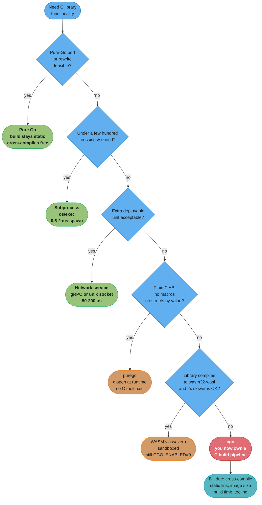
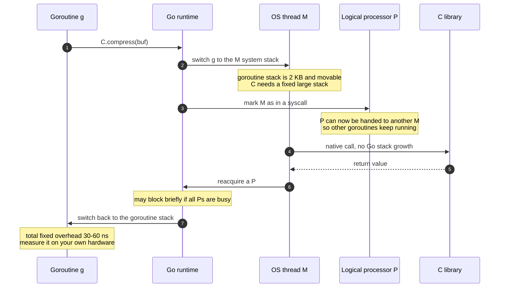
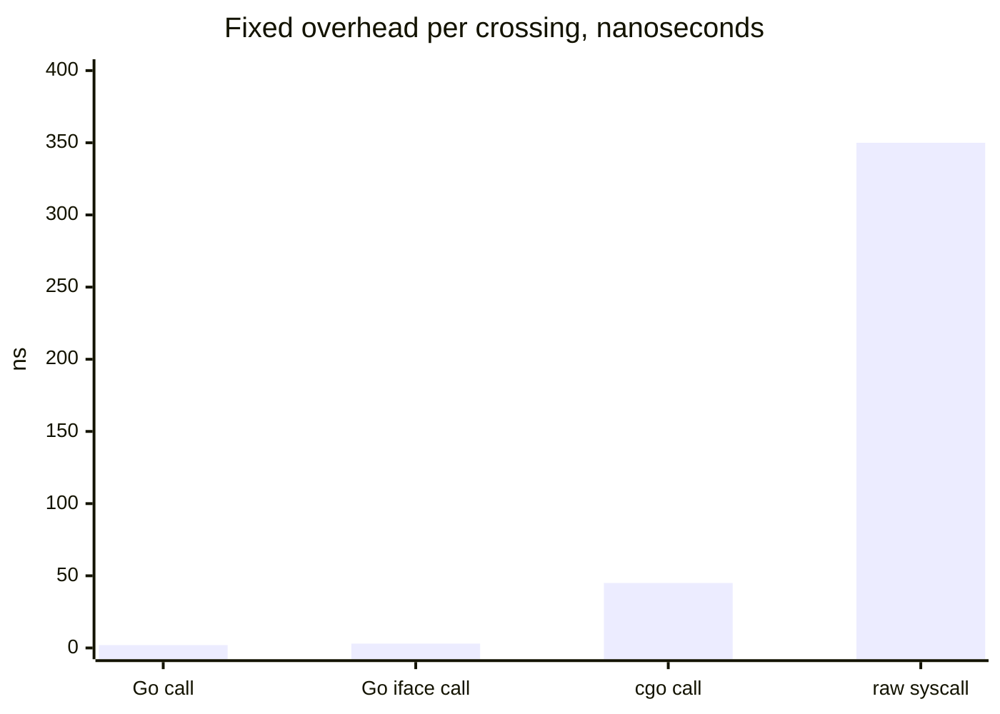

# cgo and FFI

## 1. Concept Overview

cgo is the mechanism that lets a Go program call C, and lets C call back into Go. It is
not a foreign-function interface in the sense that Python's `ctypes` or Java's Panama FFI
are. Those load a shared library at runtime and marshal arguments across a boundary. cgo
does something structurally larger: at build time it generates C and Go glue source,
invokes a real C compiler and linker, and produces a single binary in which **two runtimes
share one process** — the Go runtime with its 2 KB growable goroutine stacks, its
preemption, its garbage collector and its scheduler, and the C runtime with fixed OS-thread
stacks, `malloc`/`free` and no idea that any of that exists.

Everything that makes cgo hard follows from that one sentence. A call is not a jump; it is
a transition between two execution environments, which costs roughly **30–60 ns of pure
overhead on modern hardware** against **1–2 ns for an ordinary Go call** — a 20–50× ratio,
and one that got about **30% cheaper in Go `[1.26]`**, so any number you remember from a
blog post is stale. The garbage collector may move a goroutine stack at any moment, so
there are hard rules about which pointers may cross the boundary and for how long.
`go vet`, the race detector, the escape analyser and `go doc` all stop at `import "C"`.
And the moment cgo enters a module, `GOOS=linux GOARCH=arm64 go build` stops being
sufficient to produce a Linux ARM binary, because you now need a C cross-toolchain too.

This is therefore not a syntax module. cgo is a decision a tech lead makes once for a whole
team, and the honest default answer is **no**. This module gives you the mechanics well
enough to make that call with numbers, the ladder of alternatives you are obliged to
exhaust first, and the narrow set of cases — a mature C library with no Go equivalent —
where the answer is genuinely yes.

---

## 2. Intuition

> **One-line analogy**: A Go call is walking between two rooms in your house. A cgo call is
> clearing customs. The paperwork is fast and the queue is short, but you would never cross
> the border once per grocery item.

**Mental model**: picture two office buildings connected by a single skybridge. The Go
building has thousands of tiny desks (goroutines on 2 KB stacks) that the facilities team
reshuffles constantly. The C building has a few hundred large fixed offices and a
management that will fire anyone who moves furniture. To visit C, a Go worker must first
step off their movable desk onto a fixed one at the bridge entrance (the M's system stack),
hand their building pass to a colleague so the Go building keeps running without them (the
P is released), then cross. A pointer to a Go desk handed over at the bridge is only valid
while the visitor stands there — the facilities team may move that desk the second they
turn around.

**Why it matters**: nearly every cgo production incident is one of three shapes, and all
three are visible in that image. A team crosses the bridge once per row instead of once per
batch and loses 400 ms on a 10-million-row scan. A C library stores a Go pointer for later
and reads freed or relocated memory weeks after the code shipped. Or the build works
perfectly on the developer's Mac and cannot produce a Linux container image at all, three
days before a release.

**Key insight**: cgo's cost is not the nanoseconds. Those are measurable and often
acceptable. The cost is that **cgo converts a Go project into a C project that happens to
have Go in it** — cross-compilation, static linking, container base image, build time,
tooling and debuggability all revert to C-project defaults. You pay that bill once and
forever, on every machine, for every developer, on every CI run. Price the bill, not the
call.

---

## 3. Core Principles

1. **cgo is a runtime bridge, not an FFI.** There is no dynamic symbol lookup at the call
   site and no marshalling layer you can swap out. The C compiler runs during your build,
   and its output is linked into your binary.

2. **Every boundary crossing has a fixed floor.** The overhead is per-call and independent
   of argument size, which is exactly why batching wins so decisively: the same work moved
   from 10,000,000 calls to 1,000 calls removes essentially all of it.

3. **Go memory is not stable memory.** The GC can move a goroutine stack and, in principle,
   reclaim any object it believes unreachable. C sees neither event. So a Go pointer may
   cross the boundary only for the duration of one call, and C may never retain it.

4. **The memory you passed must not itself contain Go pointers.** The rule is not just
   about the pointer you hand over — the object it points at must be pointer-free Go
   memory, or the checker rejects it at runtime.

5. **`CGO_ENABLED=0` is the default posture; enabling it is an argument you must win.**
   A pure-Go binary cross-compiles to 40+ platform pairs from one machine, links statically,
   and drops into a `scratch` image. Every one of those properties is a build-system
   feature, not a nicety.

6. **Exhaust the ladder before crossing.** Pure Go, subprocess, network service, `purego`,
   WASM — in that order. Each rung above cgo keeps the build properties above intact.

7. **A cgo boundary is a public API you now own.** Argument ownership, error translation
   and lifetime rules have to be documented and enforced in one small package, not
   scattered across the codebase.

8. **You cannot A/B test this decision.** Removing cgo from a shipped project is a rewrite,
   not a refactor. Decide before the first `import "C"` lands on `main`.

---

## 4. Types / Architectures / Strategies

### 4.1 The ladder of alternatives, in the order you must consider them

| Rung | Approach | Keeps `CGO_ENABLED=0`? | Cost per boundary crossing | Give it up when |
|------|----------|------------------------|----------------------------|-----------------|
| 1 | **Pure Go** — rewrite, or use an existing pure-Go port | Yes | 1–2 ns (it is a Go call) | The library is 250,000 lines of numerically delicate C nobody will re-derive |
| 2 | **Subprocess** — `os/exec`, pipe or file handoff | Yes | 0.5–2 ms process spawn, then pipe bandwidth | You need more than a few hundred crossings per second, or in-memory data structures |
| 3 | **Network service** — the C code behind gRPC or a Unix socket | Yes | 50–200 µs over loopback | Latency budget is tight or an extra deployable unit is unacceptable |
| 4 | **`purego`** — `dlopen`/`dlsym` plus assembly trampolines | Often yes | 20–50 ns, comparable to cgo | You need C macros, structs by value, or callbacks with complex ABI |
| 5 | **WASM** — the C library compiled to `wasm32-wasi`, run in-process by `wazero` | Yes | 100–500 ns plus 1.5–3× slower execution inside the sandbox | Raw throughput matters, or the library needs real syscalls, threads or a GPU |
| 6 | **cgo** | No | 30–60 ns | — this is the bottom rung |

Rungs 2 and 3 look crude and are underrated. A team that shells out to `ffmpeg` once per
video ships a `scratch` image and a 6-second build; the team that binds libavcodec through
cgo ships a 380 MB image and spends a sprint on cross-compilation.

### 4.2 The three link modes cgo produces

| Mode | Flag | Output | Used for |
|------|------|--------|----------|
| Internal linking | default when possible | Go's own linker resolves everything | Simple cgo with no external `.so` requirements |
| External linking | automatic when C objects demand it, or `-ldflags '-linkmode external'` | The system linker (`ld`, `lld`) does final link | Anything with real C libraries; required for `-static` |
| Dynamic | default on glibc | Binary needs `libc.so.6`, `libsqlite3.so.0`, … at runtime | Standard Linux distro deployment |

### 4.3 The two directions of the boundary

| Direction | Entry point | Build mode | Notes |
|-----------|-------------|------------|-------|
| Go calls C | `C.foo()` after `import "C"` | normal `go build` | The common case |
| C calls Go | `//export Foo` on a Go function | `-buildmode=c-archive` (static `.a` + `.h`) or `-buildmode=c-shared` (`.so`/`.dylib`/`.dll` + `.h`) | The C side must initialise the Go runtime; the first call from a fresh C thread is markedly more expensive |

### 4.4 Memory ownership strategies

| Strategy | API | Lifetime | Use when |
|----------|-----|----------|----------|
| Copy into C memory | `C.CString`, `C.CBytes` | Until you `C.free` | C keeps the data after the call returns |
| Copy into Go memory | `C.GoString`, `C.GoStringN`, `C.GoBytes` | GC-managed | You are reading a result out of C |
| Borrow Go memory for one call | `&b[0]` on a `[]byte` of a pointer-free element type | The duration of the call only | Passing a buffer to a `read`/`write`-shaped C function |
| Pin Go memory | `runtime.Pinner` | Until `Pinner.Unpin` | C must hold the pointer across several calls but you refuse to copy |
| Zero-copy view of C memory | `unsafe.Slice`, `unsafe.String` | Entirely on you | Reading a large C-owned buffer without a copy |

---

## 5. Architecture Diagrams

### The decision ladder — where an honest team stops


Read it as a stopping rule, not a flow. Each rung you clear preserves `CGO_ENABLED=0`, and
every property in the red box below the last rung is lost together, not one at a time.

### What one cgo call actually does


Steps 2, 4 and 8 are the cost, and none of them scale with argument size. That is the whole
argument for batching.

### Cost per boundary crossing, same machine


The cgo bar is drawn at 45 ns as a mid-range figure for post-`[1.26]` amd64. Yours will
differ by hardware, compiler flags and argument count — benchmark it before you plan around
it.

### Who owns which byte

```
                Go heap / goroutine stacks          C heap (malloc arena)
              +-----------------------------+   +-----------------------------+
              |  GC-managed                 |   |  You manage                 |
              |  addresses may MOVE         |   |  addresses are STABLE       |
              +-----------------------------+   +-----------------------------+
                            |                                  ^
   pass &b[0] for ONE call  |                                  |  C.CString / C.CBytes
   (b must hold no Go ptrs) |                                  |  -> you MUST C.free
                            v                                  |
              +-------------------------------------------------------------+
              |                    the cgo boundary                          |
              +-------------------------------------------------------------+
                            ^                                  |
   C.GoString / C.GoBytes   |                                  |  unsafe.Slice / unsafe.String
   copies INTO Go memory    |                                  |  zero-copy VIEW, lifetime on you
                            |                                  v
              +-----------------------------+   +-----------------------------+
              |  safe, GC-managed result    |   |  dangling if C frees it     |
              +-----------------------------+   +-----------------------------+

Legal:   Go ptr -> C, for the duration of the call, pointing at pointer-free Go memory.
Illegal: C retaining that pointer after return, or Go storing a Go pointer into C memory.
Escape hatch: runtime.Pinner, when copying is genuinely too expensive to accept.
```
Every cgo memory bug in this module's §10 is one arrow used in the wrong direction.

---

## 6. How It Works — Detailed Mechanics

### 6.1 The preamble and what `import "C"` generates

`import "C"` is not a package import. It is a directive to the `cgo` tool, and the comment
immediately above it — with no blank line between them — is compiled as C:

```go
package codec

/*
#cgo pkg-config: libbrotlienc
#cgo CFLAGS: -O2
#cgo linux LDFLAGS: -lbrotlienc -lm
#include <brotli/encode.h>
#include <stdlib.h>

static size_t max_out(size_t n) { return BrotliEncoderMaxCompressedSize(n); }
*/
import "C"

import (
    "errors"
    "unsafe"
)
```

Four things about that block are load-bearing:

- **The blank line rule.** One blank line between the comment and `import "C"` turns the
  whole preamble into an ordinary doc comment, and the build fails with undefined `C.`
  symbols that look nothing like the real cause.
- **`#cgo` directives** set `CFLAGS`, `CPPFLAGS`, `CXXFLAGS`, `LDFLAGS` and `pkg-config`,
  optionally constrained by GOOS/GOARCH/build-tag prefixes (`#cgo linux,amd64 LDFLAGS:`).
- **Macros are invisible to Go.** `C.BROTLI_MAX_QUALITY` works for a simple `#define` of a
  constant, but anything function-like must be wrapped in a `static` C function in the
  preamble — that is what `max_out` above exists for.
- **A file containing `//export` may not define C functions in its preamble**, only declare
  them, because that preamble is emitted into two generated files and the definitions would
  be duplicated. Split declarations and definitions across files.

Running `go build -work` and inspecting the work directory (or `go tool cgo file.go`) shows
what is produced: `_cgo_gotypes.go` with the Go-side stubs, `file.cgo1.go` with your Go code
rewritten so `C.foo` becomes `_Cfunc_foo`, and `file.cgo2.c` with the C-side wrappers. As of
`[1.27]` the `cgo` tool accepts `@file` response files alongside `compile`, `link`, `asm`,
`cover` and `pack`, which matters only when a build system generates argument lists long
enough to hit the platform's command-line limit.

### 6.2 The call path, in the runtime's terms

A generated stub for `C.compress` compiles to roughly `runtime.cgocall(_cgo_compress, &args)`.
`runtime.cgocall` does four things:

1. Switches from the goroutine's stack to the M's **g0 system stack**. A goroutine stack
   starts at 2 KB and grows by *copying* to a larger allocation; C code holds raw pointers
   into its own frames and cannot survive a stack move, so C never runs on a goroutine
   stack.
2. Calls `entersyscall`, which puts the M's **P** into the `_Psyscall` state. The P stays
   attached — nothing is handed off yet, which is why a 45 ns call returns straight into
   its own P. Only if the call is still running when `sysmon` next sweeps, after roughly
   20 µs, does the P get retaken and given to another M so goroutines keep running.
3. Makes the native call.
4. Calls `exitsyscall`, which tries to reacquire a P. If every P is busy, the returning
   goroutine is queued and the thread parks — this is where the tail of the latency
   distribution lives on a saturated machine.

The consequence people miss: **a goroutine inside C is not preemptible.** Asynchronous
preemption `[1.14]` works by delivering a signal that unwinds a Go frame; there is no Go
frame to unwind. A C call that runs for 200 ms holds its M for 200 ms, and `sysmon` will
spin up a replacement thread after roughly 20 µs of blocking.

### 6.3 The pointer-passing rules, exactly

Four rules, from the cgo documentation, in the order teams break them:

1. **Go may pass a pointer to Go memory into C, but only for the duration of that call.**
   The C function must not keep it.
2. **The Go memory pointed to must not itself contain any Go pointers.** `*C.char` into a
   `[]byte` is fine. A `*Node` whose struct has a `Next *Node` field is not.
3. **Go code may not store a Go pointer into C memory.** Not in a struct field C allocated,
   not in a C global.
4. **A Go function called from C (`//export`) may not return a Go pointer**, under the same
   restrictions.

`cgocheck` enforces what it can at runtime. `GODEBUG=cgocheck=1` is the default and performs
cheap write-barrier-based checks; `GODEBUG=cgocheck=0` disables them; the thorough,
substantially slower variant is enabled with `GOEXPERIMENT=cgocheck2` at build time. It
catches rule 3 reliably and rule 2 on the way in. It cannot catch rule 1 — nothing in the
process knows that C squirrelled your pointer into a static — which is why rule 1 causes
the bugs that survive to production.

```go
// Legal: the slice is []byte, holds no Go pointers, and C reads it only during the call.
func Compress(dst, src []byte) (int, error) {
    if len(src) == 0 {
        return 0, nil
    }
    outLen := C.size_t(len(dst))
    ok := C.BrotliEncoderCompress(
        C.int(5), C.int(22), C.BROTLI_MODE_GENERIC,
        C.size_t(len(src)), (*C.uint8_t)(unsafe.Pointer(&src[0])),
        &outLen, (*C.uint8_t)(unsafe.Pointer(&dst[0])),
    )
    if ok != 1 {
        return 0, errors.New("brotli: compression failed")
    }
    return int(outLen), nil
}
```

Note `len(src) == 0` guarded first: `&src[0]` on an empty slice panics with an index-out-of-
range, and it is the single most common cgo crash in a code review.

### 6.4 Strings, bytes and who frees what

```go
// Go -> C, C keeps it past the call: copy into C memory, and you own the free.
cs := C.CString("/var/lib/app/data.db")   // C.malloc under the hood
defer C.free(unsafe.Pointer(cs))          // omit this and you have a leak, not a GC problem
C.sqlite3_open(cs, &db)

// C -> Go: copies into GC-managed memory. Safe to keep forever.
msg := C.GoString(C.sqlite3_errmsg(db))
raw := C.GoBytes(unsafe.Pointer(buf), C.int(n))

// C -> Go, zero copy. Nothing is copied and nothing is owned; the view dies with the C buffer.
view := unsafe.Slice((*byte)(unsafe.Pointer(buf)), n)
text := unsafe.String((*byte)(unsafe.Pointer(cs)), n)
```

`C.CString` allocates with `malloc`, so it is invisible to the Go GC and to `pprof`'s heap
profile. A leaked `C.CString` shows up as RSS growth with a flat Go heap — the signature
that sends teams hunting for a goroutine leak for two days. Every `C.CString` needs a
`defer C.free` on the next line, with no exceptions, and a lint rule if your team is large.

`defer` inside a loop is the trap that follows: the frees all run at function exit, so a
loop over 100,000 rows holds 100,000 C allocations live. Free explicitly inside the loop.

### 6.5 `runtime.Pinner` — when C must hold a Go pointer

Copying is the default answer. `runtime.Pinner` is the answer when the buffer is large
enough that copying it is the bottleneck:

```go
var pinner runtime.Pinner
defer pinner.Unpin()

pinner.Pin(&frame[0])   // this object will not be moved or collected until Unpin
h := C.decoder_attach(unsafe.Pointer(&frame[0]), C.size_t(len(frame)))
// ... several C calls may now use h, all still holding the same Go pointer ...
C.decoder_finish(h)
```

Pinning relaxes rule 1 (C may retain the pointer for the pin's lifetime) and rule 2 for
pointers to other pinned objects. It does **not** make the object immune to the write
barrier, and holding pins across a long-lived structure fragments the heap. Pin narrowly,
unpin with `defer`, and treat a pin that outlives a single function as a design smell.

### 6.6 Calling Go from C

```go
package main

/*
#include <stdlib.h>
extern int go_score(char* text);
*/
import "C"
import "unsafe"

//export go_score
func go_score(text *C.char) C.int {
    return C.int(len(C.GoString(text)))
}

func main() {}   // required, and empty, for c-archive and c-shared
```

```bash
go build -buildmode=c-archive -o libscore.a ./cmd/score   # static .a + libscore.h
go build -buildmode=c-shared  -o libscore.so ./cmd/score  # shared object + header
```

Two hard facts about this direction. First, the Go runtime must be initialised before the
first call; `c-shared` does it in a library constructor, `c-archive` on first entry. Second,
when a C thread the Go runtime has never seen calls in, `runtime.cgocallback` must create an
M for it (`needm`), which is roughly an order of magnitude more expensive than a warm
callback. A C thread pool that creates and destroys threads around Go callbacks pays that
cost every time; pin the C threads instead.

---

## 7. Real-World Examples

| Project | What it binds | Why cgo won | What it costs users |
|---------|---------------|-------------|---------------------|
| `mattn/go-sqlite3` | The SQLite amalgamation, ~250,000 lines of C | SQLite's correctness is the product; nobody re-derives it | `CGO_ENABLED=1`, C toolchain, 30–90 s cold builds, no free cross-compile |
| `modernc.org/sqlite` | The same SQLite, transpiled C→Go | Removes cgo entirely | Roughly 2–3× slower on write-heavy workloads, larger binary |
| `h2non/bimg`, `davidbyttow/govips` | libvips image pipeline | 4–8× faster and far lower memory than Go image decoders on large JPEGs | Runtime `.so` dependency, ~200 MB base image |
| `go-gl/gl`, `veandco/go-sdl2` | OpenGL, SDL | The OS graphics API *is* a C ABI; there is no alternative | Desktop-only, platform-specific build matrix |
| `confluentinc/confluent-kafka-go` | librdkafka | Exactly matches the reference C client's protocol behaviour | cgo; `segmentio/kafka-go` is the pure-Go alternative teams pick to avoid it |
| `NVIDIA/go-nvml`, CUDA bindings | The NVIDIA driver API | Vendor ships a C SDK and nothing else | See `../../cuda/cuda_toolkit_and_compilation/cuda_toolkit_and_compilation.md` for the toolchain that comes with it |
| Kubernetes, Prometheus, Terraform, etcd | nothing | Deliberate: all ship `CGO_ENABLED=0` static binaries | Nothing — this is the point |

The last row is the one to notice. The four largest Go infrastructure projects in existence
have every excuse to use cgo and refuse to, because a single static binary that runs
anywhere is a product feature.

---

## 8. Tradeoffs

### 8.1 `CGO_ENABLED=0` versus `CGO_ENABLED=1`

| Property | `CGO_ENABLED=0` | `CGO_ENABLED=1` |
|----------|-----------------|-----------------|
| Cross-compile | `GOOS`/`GOARCH` alone, ~40 target pairs from one laptop | Needs a C cross-toolchain per target |
| Static linking | Always static | Hard; glibc NSS makes fully static glibc unsafe |
| Container base | `scratch` or distroless static, ~2 MB + binary | `debian:bookworm-slim` ~74 MB, or Alpine + musl |
| Typical image | ~12–20 MB total | ~90–400 MB depending on the C dependency tree |
| Cold build of a mid-size service | 2–6 s | 30–120 s if a large C library is compiled |
| `-race` | Unavailable (the race detector itself requires cgo) | Available, but blind to races inside C |
| CPU profile | Full Go stacks | C time collapses into cgo frames unless you also run `perf` |
| `go vet`, staticcheck, escape analysis | Full coverage | Stops at the boundary |
| Panic traceback | Full | Degraded across the boundary; a C segfault kills the process with no Go stack |
| DNS resolver | Pure Go always | System resolver where the platform requires it |
| `os/user` lookups | `/etc/passwd` parsing only | `getpwuid`, so LDAP/SSSD/NIS users resolve |

### 8.2 Chatty versus batched C API — the arithmetic

Assume 45 ns of fixed cgo overhead and 10,000,000 elements to process.

| Design | Crossings | Pure overhead | Verdict |
|--------|-----------|---------------|---------|
| One call per element | 10,000,000 | 450 ms | Catastrophic — overhead alone exceeds most latency budgets |
| One call per 1,000-element batch | 10,000 | 0.45 ms | Fine |
| One call per 10,000-element batch | 1,000 | 0.045 ms | Indistinguishable from zero |

The fix is never "make the cgo call faster". It is to move the loop into C and cross once.

### 8.3 Alternatives compared on what actually matters

| Approach | Build stays pure Go | Crash isolation | Per-crossing cost | Toolchain burden |
|----------|--------------------|-----------------|-------------------|------------------|
| Pure Go port | Yes | Full (it is Go) | 1–2 ns | None |
| Subprocess | Yes | Full — a segfault kills the child | 0.5–2 ms spawn | None |
| Network service | Yes | Full — separate process or pod | 50–200 µs loopback | Deployment, not build |
| `purego` | Usually | None — same address space | 20–50 ns | None at build; `.so` at runtime |
| WASM / `wazero` | Yes | Full — sandboxed, memory-isolated | 100–500 ns + 1.5–3× slower body | Compile the C to `wasm32-wasi` once |
| cgo | No | None — a C segfault kills your process | 30–60 ns | Permanent |

Crash isolation is the column teams forget. A null dereference inside a C library takes the
whole Go process down with `SIGSEGV` and no usable stack; the same library behind a
subprocess or `wazero` gives you an error value.

---

## 9. When to Use / When NOT to Use

### Use cgo when

- **The library is the product's correctness boundary and has no Go equivalent** — SQLite,
  OpenSSL where FIPS validation is required, a codec whose bit-exactness is contractual.
- **The OS API is a C ABI and nothing else exists** — OpenGL, Vulkan, SDL, CoreAudio, a
  vendor hardware SDK, CUDA driver APIs.
- **The performance gap is order-of-magnitude and measured** — libvips against a pure-Go
  decoder on 4000×3000 JPEGs, BLAS against hand-written Go loops.
- **You already ship a fat container image** for other reasons, so the base-image and
  static-linking costs are already sunk.
- **Your deployment target is fixed and singular** — one OS, one architecture, built on a
  machine identical to production.

### Do NOT use cgo when

- **A pure-Go implementation exists and is merely slower.** Benchmark first;
  `modernc.org/sqlite` at 2–3× slower is a fine trade for a static binary in most services.
- **The call would be in a hot loop, per element.** Either batch it or do not do it.
- **You ship a CLI tool.** Users expect one downloadable binary per platform, and cgo turns
  a `goreleaser` matrix into a cross-toolchain project.
- **You want a `scratch` or distroless-static image.** These are mutually exclusive with a
  dynamically linked glibc binary.
- **You need `-race` on the code path in question** and the interesting concurrency is on
  the C side, where the detector is blind anyway.
- **The C library is small.** A 300-line C hashing routine is 400 lines of Go. Write it.
- **You cannot name the person who will debug the segfault at 3am.** cgo failures land
  outside the Go debugger, and the on-call rotation must include someone who can read a
  `gdb` backtrace.

---

## 10. Common Pitfalls

### 10.1 The per-element call in a loop — 450 ms of pure overhead

A telemetry service enriched every incoming metric name through a C string-interning
library. At 500,000 metrics/second the service could not keep up on 8 cores and the CPU
profile showed 68% of time in `runtime.cgocall` and `runtime.exitsyscall` — not in the C
library at all.

```go
// BROKEN: one boundary crossing per element. 10M elements = ~450 ms of pure overhead,
// before the C library does a single byte of useful work.
func InternAll(names []string) []uint32 {
    out := make([]uint32, len(names))
    for i, n := range names {
        cs := C.CString(n)
        out[i] = uint32(C.intern(cs))
        C.free(unsafe.Pointer(cs))
    }
    return out
}

// FIX: one crossing for the whole batch. Build a packed NUL-separated buffer in Go memory,
// hand it over once, let C loop internally. 10M elements = one crossing, ~45 ns overhead.
func InternAll(names []string) []uint32 {
    var buf []byte
    for _, n := range names {
        buf = append(buf, n...)
        buf = append(buf, 0)
    }
    out := make([]uint32, len(names))
    if len(names) == 0 {
        return out
    }
    C.intern_batch(
        (*C.char)(unsafe.Pointer(&buf[0])), C.size_t(len(buf)),
        (*C.uint32_t)(unsafe.Pointer(&out[0])), C.size_t(len(out)),
    )
    return out
}
```

`buf` and `out` are both pointer-free Go slices used only for the duration of the call, so
both are legal under the pointer rules. Measured impact: p99 enrichment latency fell from
41 ms to 0.9 ms and the service dropped from 8 cores to 2.

### 10.2 `defer C.free` inside a loop — 3.2 GB of C heap, invisible to pprof

An ingest worker processed a 100,000-row file per job. Each row built a `C.CString` and
deferred the free. Deferred calls run at *function* exit, so all 100,000 C allocations
stayed live for the whole job. RSS climbed to 3.2 GB while `runtime.MemStats.HeapAlloc`
sat at 180 MB and the Go heap profile showed nothing — the memory was `malloc`'d and the Go
GC has no visibility into it. The pod was `OOMKilled` on a 4 GiB limit roughly every 40
minutes. Free explicitly inside the loop, or hoist a single reusable C buffer outside it.

### 10.3 C retained a Go pointer — a corruption bug that took eleven days

An image service passed `&pixels[0]` to a C decoder that stored the pointer in its context
struct for a later `finish()` call. It worked in tests and in staging. Under production
load the GC grew the goroutine stack between the two calls, the stack was copied to a new
address, and `finish()` wrote decoded rows into freed memory. The symptom was a 0.02%
rate of corrupted thumbnails and one unreproducible crash per day, with no Go stack. Rule 1
is unenforceable at runtime — `cgocheck` cannot see into C. The fix was `runtime.Pinner`
around the buffer for the span of both calls, and a comment on the boundary function stating
the lifetime contract in one sentence.

### 10.4 `&s[0]` on an empty slice — a panic on the empty-input path

```go
// BROKEN: index out of range whenever src is empty, which happens on the very first
// zero-length payload production sends you.
C.process((*C.uint8_t)(unsafe.Pointer(&src[0])), C.size_t(len(src)))

// FIX: guard, and pass nil for the empty case if the C API accepts it.
if len(src) == 0 {
    return nil
}
C.process((*C.uint8_t)(unsafe.Pointer(&src[0])), C.size_t(len(src)))
```

### 10.5 Thread explosion from long-blocking C calls

A service called a synchronous C library that took 50–400 ms per call and issued a few
hundred concurrent calls. Every blocked cgo call pins one OS thread. Thread count climbed
past 1,800; each thread costs 8 MB of virtual address space for its stack plus kernel
scheduling overhead, and context-switch time became the top profile entry. The runtime's
`SetMaxThreads` ceiling is 10,000 and a program that hits it panics with
`thread exhaustion`. The fix is a semaphore in front of the boundary — cap concurrent cgo
calls at roughly `GOMAXPROCS × 2` and queue the rest, which turned a 1,800-thread process
into a 32-thread one with better throughput.

### 10.6 The build that only works on the author's laptop

A team added `mattn/go-sqlite3` on macOS. CI ran on `ubuntu-latest` and built fine. The
release job cross-compiled to `linux/arm64` for Graviton nodes and failed with
`gcc: error: unrecognized command-line option '-arch'`, because `GOARCH=arm64` with
`CGO_ENABLED=1` needs `CC=aarch64-linux-gnu-gcc`, not the host compiler. Three days before
release the choice was: install cross-toolchains in CI, adopt `zig cc` as the cross
compiler, or switch to `modernc.org/sqlite`. They switched. The general lesson: the day cgo
lands, add a `GOOS`/`GOARCH` matrix build to CI immediately, so the failure is a red PR and
not a release blocker.

### 10.7 DNS behaviour changed when the build went static

A service moved from a `debian-slim` image to `CGO_ENABLED=0` on distroless static. Nothing
in the code changed. In-cluster name resolution started failing for a legacy hostname served
by an `nsswitch.conf` module the pure-Go resolver does not implement. The cgo resolver had
been consulting the system's NSS chain; the pure-Go one reads `/etc/resolv.conf` and
`/etc/hosts` and does its own DNS. This is a *feature* — it is why static binaries resolve
identically everywhere — but it is a behaviour change nobody announces. Test resolution
explicitly when flipping `CGO_ENABLED`, and use `GODEBUG=netdns=2` to log which resolver a
binary actually chose.

---

## 11. Technologies & Tools

| Tool | What it is for |
|------|----------------|
| `go tool cgo` | Emits the generated glue (`_cgo_gotypes.go`, `*.cgo1.go`, `*.cgo2.c`) so you can read what the boundary compiles to. Accepts `@file` response files `[1.27]` |
| `go build -work` | Keeps the temporary work directory so you can inspect generated sources and the exact C compiler invocations |
| `pkg-config` | Resolves `CFLAGS`/`LDFLAGS` for a system library via `#cgo pkg-config:` |
| `zig cc` | A drop-in cross-compiling C compiler shipped as one download; `CC="zig cc -target aarch64-linux-musl"` makes cgo cross-compilation tractable without per-target toolchains |
| `musl-gcc` / Alpine | The practical route to a genuinely static cgo binary, since fully static glibc is unsupported |
| `github.com/ebitengine/purego` | Calls into a shared library via `dlopen`/`dlsym` with no C compiler at build time |
| `github.com/tetratelabs/wazero` | A pure-Go WebAssembly runtime; runs a C library compiled to `wasm32-wasi` in-process with `CGO_ENABLED=0` intact |
| `modernc.org/sqlite`, `modernc.org/libc` | Machine-translated C-to-Go libraries; the existence proof that "there is no pure-Go option" is often false |
| `gdb`, `lldb`, `delve` | `delve` handles the Go side; a C segfault needs a native debugger and a core dump |
| `perf`, `valgrind`, ASan/UBSan | The only way to profile or memory-check the C half; Go's own tools stop at the boundary |
| `GODEBUG=cgocheck=1`, `GOEXPERIMENT=cgocheck2` | The default cheap pointer check, and the thorough expensive one for CI |
| `GODEBUG=netdns=2` | Logs which DNS resolver the binary selected — the fastest way to diagnose §10.7 |
| `govulncheck` | Scans Go dependencies only; C dependencies need OS package scanning, which is extra CI you now own |

---

## 12. Interview Questions with Answers

**Q: Why is calling a C function from Go far more expensive than calling another Go function?**
**Short:** Because the runtime must move the goroutine onto the M's g0 system stack and mark its P as in a syscall, a fixed 30-60 ns of setup per call.

An ordinary Go call is a jump plus a stack-bounds check, around 1–2 ns. A cgo call switches
from the goroutine's 2 KB movable stack to the M's fixed g0 system stack, because C holds
raw pointers into its frames and cannot survive the GC copying a stack. It then marks the M
its P as being in a syscall, and reverses both on the way back. Note that the P is not handed
away at that point — it stays attached, and only `sysmon` retakes it if the call outlives
roughly 20 µs, so a short call never costs the scheduler a P at all. That overhead is fixed and independent of argument size — a call passing
one integer costs the same as one passing a megabyte pointer. Go `[1.26]` cut the baseline
by about 30%, so quote a range and benchmark on the hardware you actually deploy to rather
than trusting any single published figure.

**Q: What are the cgo pointer-passing rules, and which one causes production bugs?**
**Short:** Four rules govern the boundary, and the one C may never break — retaining a Go pointer after the call returns — is unenforceable.

Go may pass a pointer to Go memory into C only for the duration of that call; the memory it
points at must contain no Go pointers itself; Go may not store a Go pointer into C memory;
and an exported Go function may not return a Go pointer. `cgocheck` catches the third
reliably and the second on the way in, but nothing in the process can observe C stashing
your pointer in a static struct. That is why rule one produces the bugs that reach
production: the GC later moves the goroutine stack or reclaims the object, and C writes into
memory that now belongs to something else. Copy with `C.CBytes`, or pin with
`runtime.Pinner` when copying is genuinely the bottleneck.

**Q: What breaks in your build pipeline the day cgo lands in the module?**
**Short:** Cross-compilation, static linking, scratch images, race detection and every static-analysis tool all stop working at once.

`GOOS=linux GOARCH=arm64 go build` no longer suffices because you now need a matching C
cross-toolchain; static linking against glibc becomes unsupported, so a `scratch` or
distroless-static image is off the table and the base image jumps from about 2 MB to 74 MB
or more; cold builds go from a few seconds to 30–120 s when a large C library compiles;
`go vet`, staticcheck and escape analysis see nothing past `import "C"`; CPU profiles
collapse C time into a cgo frame; and a segfault inside C kills the process with no Go
stack. None of these degrade gradually — they are lost together, on the first commit.

**Q: Why does setting `CGO_ENABLED=0` change how your program resolves hostnames?**
**Short:** It forces the pure-Go DNS resolver instead of the platform's C resolver, which reads different configuration sources.

The `net` package ships two resolvers. The cgo one calls the system's `getaddrinfo` and
therefore honours the whole NSS chain — LDAP, SSSD, mDNS modules configured in
`nsswitch.conf`. The pure-Go one reads `/etc/resolv.conf` and `/etc/hosts` and speaks DNS
itself, which is what makes a static binary resolve identically on every host. Flipping to
`CGO_ENABLED=0` silently drops any name that only an NSS module could resolve, and the same
switch changes `os/user`, which then parses `/etc/passwd` instead of calling `getpwuid` and
stops seeing directory-managed accounts. Force either resolver explicitly with the `netgo`
or `netcgo` build tag, and diagnose which one a binary chose with `GODEBUG=netdns=2`.

**Q: How do you pass a Go string to C, and who is responsible for freeing it?**
**Short:** `C.CString` copies it into malloc'd C memory and you must call `C.free` yourself — the Go garbage collector never touches it.

`C.CString(s)` allocates with `malloc` and copies, so the result is stable C memory that
survives the call. Because it lives outside the Go heap, a leak shows up as growing RSS with
a completely flat Go heap profile, which is the signature that sends teams hunting a
goroutine leak for days. Pair every `C.CString` with `defer C.free(unsafe.Pointer(cs))` on
the very next line — but never inside a loop, since deferred calls run at function exit and
a 100,000-iteration loop would hold every allocation live. Coming back the other way,
`C.GoString` and `C.GoBytes` copy into GC-managed Go memory and are safe to keep
indefinitely.

**Q: Why does a chatty C API destroy throughput when a batched one is fine?**
**Short:** The overhead is per crossing and not per byte, so ten million small calls waste 450 ms that one batched call would not.

At roughly 45 ns per crossing, processing 10,000,000 elements one call at a time burns about
450 ms in pure boundary machinery before the C library does any useful work — and in a real
profile that appears as `runtime.cgocall` and `runtime.exitsyscall` dominating, with the C
function barely visible. Batching 1,000 elements per call reduces the same overhead to
0.45 ms, and 10,000 per call to 45 µs. The correct fix is always to move the loop into C and
cross once, packing inputs into a single pointer-free Go slice; making the individual call
cheaper is not available to you.

**Q: What happens to a goroutine's stack while it is executing C code?**
**Short:** It is left behind — the runtime switches to the thread's fixed g0 system stack because C cannot survive a stack copy.

Goroutine stacks start at 2 KB and grow by allocating a larger region and copying the old
one, rewriting pointers as it goes. C frames hold raw addresses into their own stack and no
runtime can rewrite them, so C never runs on a goroutine stack. `runtime.cgocall` switches
to the M's g0 stack, which is a normal large OS thread stack, for the duration. A direct
consequence is that a goroutine inside C is not preemptible: asynchronous preemption works
by unwinding a Go frame, and there is no Go frame to unwind, so a 200 ms C call holds its
thread for the full 200 ms.

**Q: How can a cgo-heavy service end up with thousands of operating-system threads?**
**Short:** Every blocked cgo call pins one thread, so N concurrent long C calls force the runtime to create N threads.

When a cgo call is still running roughly 20 µs later, `sysmon` retakes the P — it was left
attached at `entersyscall`, not detached — and hands it to another M so goroutines keep running — which means spawning or waking another thread. With
a few hundred concurrent calls each taking 50–400 ms, thread count climbs into the
thousands, every thread costs several megabytes of virtual address space plus kernel
scheduling overhead, and context switching becomes the top profile entry. The runtime panics
with a thread-exhaustion message at the 10,000 default ceiling. Put a counting semaphore in
front of the boundary sized near `GOMAXPROCS × 2` and queue the rest.

**Q: What does `cgocheck` verify, and what can it never catch?**
**Short:** It detects Go pointers being written into C memory and pointer-bearing Go memory crossing the boundary, but not C retaining a pointer.

`GODEBUG=cgocheck=1` is on by default and uses cheap write-barrier-based checks;
`GODEBUG=cgocheck=0` turns them off, and `GOEXPERIMENT=cgocheck2` enables a much more
thorough and much slower variant worth running in CI. It reliably catches storing a Go
pointer into C-allocated memory, and passing Go memory that itself contains Go pointers.
What it structurally cannot see is C code copying the pointer you legitimately passed into a
static or a context struct, because that happens entirely inside C. That gap is why the
lifetime contract of every boundary function has to be written down in a comment and
enforced by review.

**Q: How does C call into Go, and what do `c-archive` and `c-shared` produce?**
**Short:** Mark the function `//export Name` and build with a C build mode that emits a header plus a static archive or a shared object.

`-buildmode=c-archive` produces a `.a` and a generated `.h` for static linking into a C
program; `-buildmode=c-shared` produces a `.so`, `.dylib` or `.dll` plus the same header.
The Go side needs a `package main` with an empty `func main()`, and a file containing
`//export` may only *declare* C functions in its preamble, never define them, because that
preamble is emitted into two generated files. The performance trap is on the C side: when a
thread the Go runtime has never seen calls in, the runtime must create an M for it, which
costs roughly an order of magnitude more than a warm callback. A C thread pool that
recreates threads around callbacks pays that on every call.

**Q: What do you lose from the race detector and the profiler once cgo is in the build?**
**Short:** The detector sees no races inside C, the CPU profile collapses C time into a single frame, and a C crash produces no Go stack.

`-race` itself requires `CGO_ENABLED=1`, so it is available — but it instruments Go memory
accesses only, and a data race entirely inside the C library is invisible to it. CPU
profiles attribute time spent in C to the cgo entry frames rather than to real C symbols
unless you separately run a native profiler such as `perf`. Panics and fatal errors that
originate in C arrive as a raw `SIGSEGV` with no Go traceback, so you need a core dump and
`gdb` or `lldb` to make progress. Budget for a native-tooling skill on the team before you
merge the boundary, not after the first outage.

**Q: Which alternatives should you exhaust before reaching for cgo?**
**Short:** Pure Go, then a subprocess, then a network service, then purego, then WASM — every rung above cgo keeps a static cross-compilable build.

Start by checking for an existing pure-Go port, including machine-translated ones like
`modernc.org/sqlite`; a 2–3× slowdown is often a good trade for a 15 MB static image.
Shelling out with `os/exec` costs 0.5–2 ms per spawn and gives you full crash isolation,
which suits anything under a few hundred invocations per second. A network service moves the
C code behind gRPC or a Unix socket at 50–200 µs per call. `purego` reaches a shared library
through `dlopen` with no C compiler at build time, and `wazero` runs the library compiled to
`wasm32-wasi` in-process, sandboxed, at 1.5–3× native speed. Only after all five fail is cgo
the answer.

**Q: How do you cross-compile a program that uses cgo?**
**Short:** Set `CC` to a cross-compiler for the target triple, because `GOOS` and `GOARCH` alone only steer the Go compiler.

With `CGO_ENABLED=0`, `GOOS=linux GOARCH=arm64 go build` produces a working binary from any
host. With cgo enabled, that command hands your C sources to the host compiler and fails on
the first target-specific flag. You need a matching toolchain — `CC=aarch64-linux-gnu-gcc`
plus its sysroot and every C dependency built for the target — or a compiler that bundles
its own, which is what makes `CC="zig cc -target aarch64-linux-musl"` the pragmatic answer
for most teams. Add a `GOOS`/`GOARCH` matrix build to CI the same day the boundary lands, so
the failure surfaces as a red pull request instead of a release blocker.

**Q: Why is a fully statically linked glibc binary with cgo a bad idea?**
**Short:** glibc's name-service switch loads resolver modules with dlopen at runtime, which a static binary cannot do reliably.

NSS is a plugin architecture: `getaddrinfo` and `getpwnam` `dlopen` modules named in
`nsswitch.conf`. Statically linking glibc bakes in stubs that either fail or silently load a
mismatched shared object from the host, so hostname and user lookups behave unpredictably —
and glibc's own maintainers do not support the configuration. The two supported routes are
to link against musl instead, typically by building on Alpine or with `musl-gcc`, or to keep
dynamic linking and accept a `debian-slim` or distroless-base image around 74 MB. If neither
is acceptable, that is a strong signal to go back up the ladder to a pure-Go dependency.

**Q: What is `purego` and when is it a better fit than cgo?**
**Short:** It calls into a shared library through dlopen and assembly trampolines, so you get FFI without a C compiler in the build.

`purego` registers a Go function variable against a symbol looked up at runtime, which means
no `import "C"`, no C toolchain in CI, and on the supported platforms a build that keeps
`CGO_ENABLED=0` with everything that implies for cross-compilation and image size. Per-call
cost is broadly comparable to cgo. What you give up is the C preprocessor: macros, inline
functions, structs passed by value and anything requiring header knowledge have to be
hand-modelled, and there is zero compile-time checking that your Go signature matches the
real symbol, so a mismatch is a crash rather than a build error. It fits a stable, plain-C
ABI such as a vendor `.so` with a dozen flat functions.

**Q: What does the comment above `import "C"` actually do?**
**Short:** It is compiled as real C source by the cgo tool, and a single blank line between it and the import silently disables it.

The preamble is where you put `#include` directives, `#cgo` build flags such as `CFLAGS`,
`LDFLAGS` and `pkg-config`, and small `static` helper functions. Those helpers exist because
Go cannot reach a function-like C macro at all — the standard workaround is to wrap the
macro in a `static` function the preamble defines. `#cgo` lines accept GOOS, GOARCH and
build-tag prefixes so flags can differ per platform. The blank-line rule is the classic
first-day failure: with one empty line in between, the block becomes an ordinary doc comment
and the build fails with undefined `C.` symbols that give no hint of the real cause.

**Q: When is cgo genuinely the right decision rather than a shortcut?**
**Short:** When the C library is the correctness boundary of your product, has no Go equivalent, and you already ship a fat image.

The clearest cases are a mature library whose behaviour is contractual — SQLite, a
bit-exact codec, a FIPS-validated crypto module — an operating-system API that exists only
as a C ABI such as OpenGL or CoreAudio, a vendor hardware SDK where nothing else is
published, or an order-of-magnitude measured performance gap like libvips against a pure-Go
image decoder. Those cases share a shape: reimplementing is not merely expensive, it is a
correctness risk. If your deployment target is also singular and you already ship a
Debian-based image, the incremental cost is close to zero and the decision is easy. If any
of those conditions is missing, go back up the ladder.

**Q: How do you design the boundary so it is reviewable rather than scattered?**
**Short:** Confine every `import "C"` to one small internal package that exposes only ordinary Go types to the rest of the codebase.

One package should own the preamble, the argument conversion, the `C.free` calls, the error
translation from C return codes to Go `error` values, and any `runtime.Pinner` usage. Its
exported API takes and returns `[]byte`, `string` and `error` — never a `C.` type, which
cannot cross package boundaries anyway. That gives you exactly one file to review for
lifetime rules, one place to add a concurrency semaphore, one place to add batching, and a
seam where a future migration to `purego`, WASM or a pure-Go port swaps the implementation
without touching a single caller. Document the ownership contract for every argument in a
one-line comment above each exported function.

---

## 13. Best Practices

- **Default to `CGO_ENABLED=0` and set it explicitly in every build command.** Relying on
  the implicit default means a machine with a C toolchain and one without produce different
  binaries from the same source.
- **Put the whole boundary in one `internal/` package** whose exported API uses only Go
  types. See
  [Idiomatic API and Package Design](../idiomatic_api_and_package_design/idiomatic_api_and_package_design.md)
  for why `internal/` is the right home for a seam you intend to replace.
- **Batch every crossing.** If the natural C API is per-element, write a `static` batching
  wrapper in the preamble rather than looping in Go.
- **Pair `C.CString` with `defer C.free` on the next line**, and never inside a loop.
- **Guard `&s[0]` with a length check** on every slice you pass.
- **Prefer copying to pinning; prefer pinning to hoping.** `runtime.Pinner` is the only
  supported way for C to legally hold a Go pointer across calls.
- **Cap concurrency at the boundary** with a semaphore near `GOMAXPROCS × 2`, since each
  blocked call pins an OS thread.
- **Add a `GOOS`/`GOARCH` matrix build to CI in the same pull request** that introduces cgo.
- **Run `GOEXPERIMENT=cgocheck2` in a nightly CI job**, not in production — it is thorough
  and slow.
- **Translate C error codes into Go `error` values at the boundary** and never leak a
  `C.int` status past it; the contract rules are in
  [Errors and Panics](../errors_and_panics/errors_and_panics.md).
- **Write the lifetime contract as a comment** above every exported boundary function: who
  allocates, who frees, and how long C may hold each pointer.
- **Keep a documented exit plan.** Name the pure-Go, `purego` or WASM alternative you would
  migrate to, and re-check annually whether it has become viable.
- **Pin C dependency versions and scan them.** `govulncheck` covers Go modules only; the C
  side needs OS package scanning in the image pipeline, which is CI work you now own.

---

## 14. Case Study

### Removing cgo from an image-thumbnailing service

**Context.** A media platform runs a Go service that generates three thumbnail sizes for
every uploaded image. Steady state is 1,200 images/second across 40 pods, each pod limited
to 4 CPU and 4 GiB. The original implementation bound **libvips** through cgo because
libvips was measured at 6× faster than `image/jpeg` on 4000×3000 source photos, which was
a real and correct finding.

Eighteen months later the service had three chronic problems, none of them about
nanoseconds.

**Problem one — the per-pixel-row boundary.** The first version streamed rows across the
boundary so the Go side could apply a watermark between decode and encode.

```go
// BROKEN: one cgo crossing per image row. A 3000-row image costs 3000 crossings,
// about 135 us of pure boundary overhead per image before any work happens.
// At 1200 images/s that is 162 ms of CPU per second burned on customs paperwork.
func thumbnail(src *C.VipsImage, rows int) []byte {
    var out bytes.Buffer
    for y := 0; y < rows; y++ {
        row := C.vips_region_fetch_row(src, C.int(y))   // crossing 1
        buf := C.GoBytes(unsafe.Pointer(row), C.int(rowLen))
        applyWatermark(buf, y)
        C.vips_region_write_row(dst, C.int(y), (*C.uint8_t)(unsafe.Pointer(&buf[0])))  // crossing 2
    }
    return out.Bytes()
}

// FIX: move the loop into C. The watermark becomes a libvips composite operation
// configured once, and the whole pipeline is a single crossing per image.
// 3000 crossings -> 1 crossing. Boundary overhead per image: ~135 us -> ~45 ns.
func thumbnail(src *C.VipsImage, wm *C.VipsImage, w, h int) ([]byte, error) {
    var out unsafe.Pointer // cgo maps the C out-param void** to *unsafe.Pointer
    var n C.size_t
    if rc := C.vips_pipeline_thumbnail(src, wm, C.int(w), C.int(h), &out, &n); rc != 0 {
        return nil, fmt.Errorf("vips: %s", C.GoString(C.vips_error_buffer()))
    }
    defer C.free(out)
    return C.GoBytes(out, C.int(n)), nil
}
```

CPU per pod fell from 3.7 cores to 2.1 immediately, and `runtime.cgocall` dropped from 31%
of the profile to under 0.1%. This fix alone paid for itself, and it required no
architectural change — worth doing before considering anything below.

**Problem two — the image and the build.** The container was `debian:bookworm-slim` plus
libvips and its transitive dependencies: 412 MB, against roughly 18 MB for a distroless
static Go image. Rolling all 40 pods took 4 minutes rather than 25 seconds, and the CI build
took 6 minutes cold because libvips headers and the cgo compilation step defeated the Go
build cache. Two `CVE`s a quarter arrived from the C dependency tree, none of them from Go
code, each requiring a base-image bump and a full redeploy.

**Problem three — the crashes.** Roughly one pod per day died with `SIGSEGV` inside libvips
on a malformed upload, taking every in-flight request with it, and produced no Go stack. The
on-call runbook step was "restart and move on", because reading the core dump required
`gdb` skills one person on the team had.

**The decision.** The team scored the ladder against measured numbers rather than
preference:

| Option | p50 latency | Image size | Crash isolation | Build time | Verdict |
|--------|-------------|------------|-----------------|------------|---------|
| cgo + libvips, batched | 38 ms | 412 MB | None | 6 min | Fastest, and the status quo |
| Pure Go decoders | 210 ms | 18 MB | Full | 40 s | 5.5× slower — fails the SLO |
| libvips as a sidecar over a Unix socket | 41 ms | 18 MB Go + 400 MB sidecar | Full | 40 s Go side | +3 ms, isolates crashes, two images to maintain |
| libvips compiled to `wasm32-wasi` under `wazero` | 96 ms | 22 MB | Full, sandboxed | 45 s | 2.5× slower, single static binary |
| `vipsd` as a separate deployment | 44 ms | 18 MB | Full | 40 s | Adds a network hop and a scaling problem |

**What shipped.** The sidecar. The Go service became `CGO_ENABLED=0`, an 18 MB distroless
static image with a 40-second build; libvips moved into a sidecar container in the same pod,
reached over a Unix domain socket at about 90 µs per request. Latency went from 38 ms to
41 ms, which the 150 ms SLO absorbed without discussion.

**Results after one quarter.** Rollout time fell from 4 minutes to 25 seconds for the Go
container. A malformed upload now kills the sidecar and returns a `502` for one request
instead of dropping every in-flight request in the pod; the daily crash stopped being an
incident. CVE patching moved to the sidecar image alone, decoupled from application
releases. The team kept the batching fix from problem one inside the sidecar, where it still
applies.

**What they would tell another team.** Fix the chatty boundary first, because it is cheap
and it is usually the whole performance story. Then price cgo honestly: the 3 ms the sidecar
cost was trivially affordable, and the 394 MB of image, six minutes of build time, daily
segfault and quarterly CVE churn were what they had actually been paying for it. Nobody had
ever put those four numbers on the same page before.

**Related reading**: the boundary-package discipline in
[Packages, Modules and Tooling](../packages_modules_and_tooling/packages_modules_and_tooling.md),
the thread and P mechanics in
[Goroutines and the Scheduler](../goroutines_and_the_scheduler/goroutines_and_the_scheduler.md),
the escape and allocation costs of the copies in
[Escape Analysis and Performance](../escape_analysis_and_performance/escape_analysis_and_performance.md),
and the CUDA toolchain that arrives with any GPU binding in
[CUDA Toolkit and Compilation](../../cuda/cuda_toolkit_and_compilation/cuda_toolkit_and_compilation.md).
