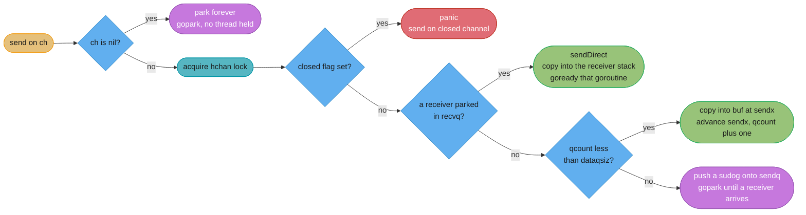
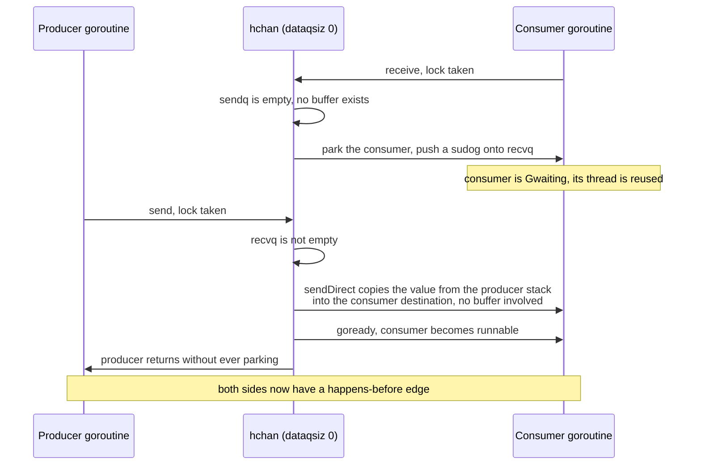
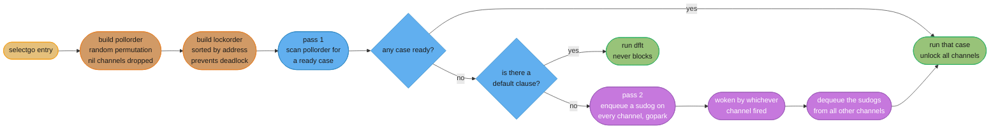
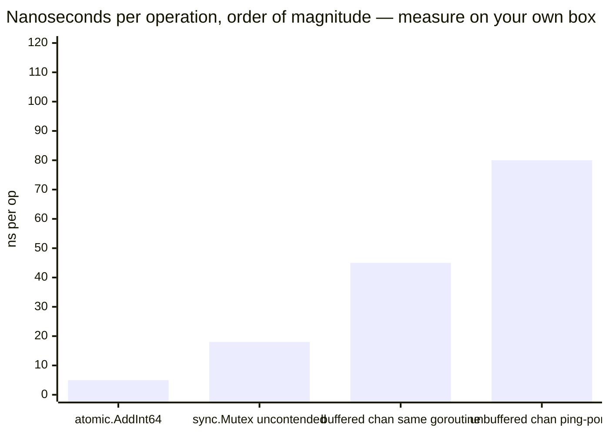

# Channels and Select

---

## 1. Concept Overview

A channel is a typed, thread-safe queue with a lock, a ring buffer, and two wait queues — and the
interesting half of it is the wait queues, not the buffer. `make(chan T, n)` allocates a single
`runtime.hchan` struct on the heap holding a `qcount`, a `dataqsiz`, a pointer to an `n`-element
circular buffer, `sendx` and `recvx` indices, a `closed` flag, a `sendq`, a `recvq`, and a
`runtime.mutex`. Every send and every receive takes that mutex. Channels are not lock-free; they are a
mutex-protected queue with a scheduler integration bolted on, and the scheduler integration is the whole
value proposition. When a receiver has to wait, it does not spin and it does not block a thread — it
wraps itself in a `sudog`, links that onto `recvq`, and calls `gopark`, freeing its OS thread entirely.

The unbuffered channel is the primitive worth understanding first, because it is not a queue with
capacity zero — it is a **rendezvous**. Both parties block until both are present, and when they meet,
the value is copied **directly from the sender's stack into the receiver's variable**, skipping the
buffer that does not exist. This is the one place in Go where one goroutine writes into another
goroutine's stack, and it is why an unbuffered send is a synchronisation point in the memory model, not
merely a data transfer.

Sitting on top is `select`, which is a multiplexer over channel operations with a deliberately
surprising rule: when more than one case is ready, it picks **uniformly at random**, not top to bottom.
Add `default` and it becomes non-blocking. Set a case's channel to `nil` and that case is disabled for
this evaluation — the idiom that lets one loop drain two inputs and retire them independently. Write
`select {}` with no cases at all and the goroutine blocks forever, which is either a bug or exactly
what a daemon's `main` wants.

This module covers `hchan` internals, the complete send/receive/close behaviour matrix, the who-closes
rule, `select` semantics and its idioms, the patterns built from channels, and — importantly — the
cases where a channel is the wrong answer and a `sync.Mutex` is simpler and 10x faster. Target version
is **Go 1.27** (released 2026-08-19).

---

## 2. Intuition

> A buffered channel is a conveyor belt with `n` slots between two workers. An unbuffered channel is
> not a belt at all — it is a handshake: neither worker moves until both hands are out, and the object
> passes directly from one hand to the other.

**Mental model:** think of every channel operation as asking one question first — *is there a goroutine
already waiting on the other side?* If yes, hand the value over directly and wake it. If no, try the
buffer. If the buffer cannot help, park yourself in the wait queue and give up the thread. Send,
receive and `select` are all the same three-step decision with the order of the steps rearranged.

**Why it matters:** almost every channel bug in production is a party that is not there. A sender
blocked forever because the receiver returned on a timeout. A receiver blocked forever because the
sender panicked. A `for range ch` that never ends because nobody closed the channel. Channels do not
leak memory — they leak **goroutines**, and a leaked goroutine holds its stack and everything its
closure captured.

**Key insight:** the capacity argument buys **decoupling in time**, not throughput. A buffer of 100
means the producer may run up to 100 items ahead of the consumer before it has to wait. It does not
mean the handoff is faster — the mutex, the copy and the wake-up are identical. If your producer is
persistently faster than your consumer, no buffer size fixes that; the buffer only sets how long you
absorb a burst before backpressure arrives. Choosing a buffer size is choosing how much latency you are
willing to hide before you find out you are overloaded.

```
buffer capacity = burst you can absorb without blocking the producer
                = (producer rate - consumer rate) x seconds you are willing to hide the problem
```

**Walk one example.** A producer bursting to 12,000 events/s against a consumer that steadily handles
10,000 events/s, and you want to ride out a 3-second burst:

```
  surplus rate     12,000 - 10,000            =  2,000 events/s
  3-second burst   2,000 x 3                  =  6,000 items of buffer

  make(chan Event, 6000) x 48 bytes per Event =  288 KB   -> cheap, absorbs the burst
  make(chan Event, 10)                        -> producer blocks after 5 ms of the burst
  make(chan Event, 1000000)                   -> 48 MB, and 100 seconds of hidden latency
                                                 before anyone notices the consumer is behind
```

The last line is the real trap. An enormous buffer does not make the system faster; it makes the system
**lie to you for 100 seconds** and then fall over with 48 MB of stale events that are now useless.

---

## 3. Core Principles

**1. An unbuffered channel is a rendezvous, not a zero-capacity queue.**
Both goroutines must arrive. The value is copied straight from the sender's stack to the receiver's
destination via `sendDirect`, bypassing any buffer. A completed unbuffered send therefore establishes
happens-before in both directions.

**2. Every channel operation takes the channel's lock.**
`hchan` has a `runtime.mutex`. There is no lock-free fast path. This is the single most important fact
for reasoning about channel performance against a `sync.Mutex` or an atomic.

**3. Closing is a broadcast, not a destructor.**
`close(ch)` sets a flag and wakes **every** goroutine parked in `recvq` and `sendq`. Receivers get the
zero value with `ok == false`, forever, without blocking. Buffered values already in the channel are
still delivered first. Nothing is freed; the channel is garbage collected like any other object when
it becomes unreachable.

**4. Only a sender closes, and only when it is the sole sender.**
A receiver closing a channel makes the next send panic. With N senders, the close must be done by a
coordinator after all senders have finished — a `sync.WaitGroup` plus a closer goroutine — or replaced
entirely by a separate `done` channel that senders select on.

**5. Three operations panic, and they are all about `close`.**
Sending on a closed channel panics. Closing a closed channel panics. Closing a `nil` channel panics.
Receiving from a closed channel never panics, and sending to or receiving from a `nil` channel never
panics — it blocks forever.

**6. `select` chooses uniformly at random among ready cases.**
`selectgo` builds a randomized poll order with `cheaprand` before scanning. Case order in the source is
not a priority. If you need priority, you write a nested `select` with a `default`.

**7. A `nil` channel case in a `select` is skipped.**
This is not a wart, it is the intended mechanism for turning a case off. Set the variable to `nil` when
an input is exhausted and the same loop keeps serving the remaining inputs.

**8. Channels are for transferring ownership and signalling, not for protecting fields.**
"Do not communicate by sharing memory; share memory by communicating" is guidance about *ownership
transfer*. A counter, a cache, or a map read on every request is protected by a mutex, and the mutex is
both simpler and roughly 10x faster.

---

## 4. Types / Architectures / Strategies

### 4.1 The three shapes of a channel

| Shape | Declaration | Semantics | Use it for |
|---|---|---|---|
| **Unbuffered** | `make(chan T)` | Rendezvous; both sides block until the handoff completes | Synchronisation, request/response handoff, "I am ready" signals, strict backpressure |
| **Buffered** | `make(chan T, n)` | Producer may run `n` items ahead before blocking | Burst absorption, worker-pool queues, semaphores |
| **Nil** | `var ch chan T` | Every operation blocks forever; `close` panics | Disabling a `select` case; nothing else |

### 4.2 The behaviour matrix — this table *is* the interview question

| Operation | `nil` channel | Open, empty | Open, has room | Open, full | **Closed** |
|---|---|---|---|---|---|
| **Send** `ch <- v` | Blocks forever | Unbuffered: blocks for a receiver. Buffered: succeeds | Succeeds | Blocks | **panic: send on closed channel** |
| **Receive** `v := <-ch` | Blocks forever | Blocks for a sender | Succeeds | Succeeds | Drains the remaining buffered values first, then returns the zero value **immediately**, `ok == false` |
| **`close(ch)`** | **panic: close of nil channel** | Succeeds; wakes all waiters | Succeeds | Succeeds | **panic: close of closed channel** |
| **`len(ch)`** | `0` | `0` | Items currently buffered | `cap(ch)` | Items still buffered |
| **`cap(ch)`** | `0` | The capacity | The capacity | The capacity | The capacity |
| **In a `select`** | Case is **skipped** | Blocks unless another case is ready | Ready | Send case not ready | Receive case is **always ready** |

Two rows deserve emphasis. A closed channel makes its receive case in a `select` **permanently ready**,
which is why a closed `done` channel is the standard cancellation broadcast — and also why forgetting
to `nil` out a closed input turns a `select` loop into a busy spin at 100% CPU. And `nil` is the only
value for which `close` panics while send and receive merely block.

### 4.3 `select` forms

| Form | Behaviour | Typical use |
|---|---|---|
| `select { case a: ... case b: ... }` | Blocks until one case is ready; uniform random among ready ones | Multiplexing inputs |
| `select { case a: ... default: ... }` | Never blocks; takes `default` if `a` is not ready | Non-blocking send/receive, load shedding |
| `select { case a: ... case <-ctx.Done(): ... }` | The cancellable form of any channel operation | Every production loop |
| `select { case a: ... case <-timer.C: ... }` | Adds a deadline | Timeouts |
| `select {}` | Blocks forever, releasing the thread | `main` of a daemon whose work runs elsewhere |
| Nested `select` with `default` | Gives the outer case priority | "Drain the urgent queue first" |

### 4.4 Channels versus the alternatives

| Need | Reach for | Why not a channel |
|---|---|---|
| Protect a shared counter | `sync/atomic` | 5 ns against roughly 100 ns, and no goroutine to own it |
| Protect a map or struct fields | `sync.Mutex` | Simpler, faster, and the data does not change ownership |
| Broadcast "stop" to N goroutines | `close(done)` or `context` | Nothing beats a closed channel here — this *is* the channel case |
| Wait for N goroutines to finish | `sync.WaitGroup` | A counting channel works but reads worse |
| One-time lazy initialisation | `sync.Once` | A channel needs a goroutine to write to it |
| Bound concurrency to N | Buffered channel as a semaphore, or `errgroup.SetLimit` | This is the channel case |
| Hand an item's ownership to another goroutine | Channel | This is the channel case |
| Fan work out and collect results | Channels, or `errgroup` | This is the channel case |

---

## 5. Architecture Diagrams

### Diagram 1: the `hchan` struct and its ring buffer

Alignment carries the meaning, so this one stays ASCII.

```
   ch := make(chan int, 6)      after 4 sends and 1 receive
   +-------------------------------------------------------------------+
   |  hchan                                                            |
   |    qcount   = 3          <- items currently buffered              |
   |    dataqsiz = 6          <- capacity, fixed at make() time        |
   |    elemsize = 8                                                   |
   |    closed   = 0                                                   |
   |    sendx    = 4          <- next slot to write                    |
   |    recvx    = 1          <- next slot to read                     |
   |    lock     = mutex      <- EVERY operation takes this            |
   |    buf ----------------------+                                    |
   |    recvq  [ sudog ] -> nil   |   goroutines parked waiting to recv |
   |    sendq  [ sudog ] -> nil   |   goroutines parked waiting to send |
   +------------------------------|------------------------------------+
                                  v
             index   0      1      2      3      4      5
                  +------+------+------+------+------+------+
             buf  | read | 11   | 12   | 13   |      |      |   circular
                  +------+------+------+------+------+------+
                            ^                    ^
                          recvx=1              sendx=4
                          next read            next write

   sendx and recvx wrap modulo dataqsiz, so the buffer never moves and never
   reallocates. qcount, not the index difference, distinguishes full from empty.
```

An unbuffered channel has `dataqsiz = 0` and `buf = nil`. It has no slots at all — only the two wait
queues — which is why calling it "capacity zero" understates the difference.

### Diagram 2: what a send actually does, in order



The green path is the fast one and it never touches the buffer. Note the ordering: a waiting receiver is
preferred over the buffer even when the buffer has room, because handing the value straight over saves
one copy and keeps it in cache.

### Diagram 3: the unbuffered rendezvous



The producer never parked, because the consumer arrived first. Reverse the arrival order and the
producer parks in `sendq` instead — the mechanism is symmetric. Either way the value crosses in exactly
one copy, from one goroutine's stack to another's.

### Diagram 4: how `selectgo` evaluates



Two details worth carrying into an interview. The **poll order** is randomized, which is where the
uniform-random choice comes from. The **lock order** is sorted by channel address, which is the standard
lock-ordering discipline that stops two concurrent `select`s over the same pair of channels from
deadlocking against each other.

### Diagram 5: what a handoff costs



An unbuffered channel handoff between two goroutines costs roughly 15x an atomic increment, because it
involves a lock, a copy, a `gopark` and a `goready` — a full scheduler round trip. The bars above are
`go test -bench` medians on an idle Apple M3 with `GOMAXPROCS=8`; a contended box or an older x86 moves
every bar, so it is that ratio, not the absolute figures, that is the number to remember when someone
proposes a channel to guard a counter.

---

## 6. How It Works — Detailed Mechanics

### 6.1 `hchan`, the fields that matter

```go
// runtime/chan.go — the fields you need to reason about behaviour.
type hchan struct {
    qcount   uint           // items currently in the buffer  -> len(ch)
    dataqsiz uint           // buffer capacity                -> cap(ch)
    buf      unsafe.Pointer // the circular buffer, nil when dataqsiz == 0
    elemsize uint16
    closed   uint32         // 0 or 1; only ever goes 0 -> 1
    elemtype *_type
    sendx    uint           // next buffer index to write
    recvx    uint           // next buffer index to read
    recvq    waitq          // linked list of sudogs waiting to receive
    sendq    waitq          // linked list of sudogs waiting to send
    lock     mutex          // guards everything above
}
```

`make(chan T, n)` performs exactly one allocation when `T` contains no pointers (the `hchan` header and
the buffer are allocated contiguously), and two otherwise. `cap` is fixed at creation; there is no
`append` for channels. `len(ch)` returns `qcount` and `cap(ch)` returns `dataqsiz`, both read without
the lock — which is why both are advisory only, as §6.9 explains.

### 6.2 The `sudog`

A `sudog` is "a goroutine waiting on a channel", allocated from a per-P free list so the common case
costs no heap allocation:

```
   sendq  ->  sudog{ g: G17, elem: &value }  ->  sudog{ g: G23, elem: &value }  ->  nil
                     |                                 |
                     v                                 v
                 goroutine 17                      goroutine 23
                 parked in Gwaiting                parked in Gwaiting
```

`elem` points at the sender's local variable (for a send) or the receiver's destination (for a receive).
That pointer is what makes the direct copy possible: the runtime holds a pointer into the *other*
goroutine's stack. It is also why the stack-copying growth described in
[Goroutines and the Scheduler](../goroutines_and_the_scheduler/goroutines_and_the_scheduler.md)
has to adjust `sudog.elem` when it moves a stack.

A goroutine blocked in a `select` over four channels has **four** `sudog`s, one on each channel's wait
queue, and whichever fires first is responsible for removing the other three.

### 6.3 Send, receive and the direct-copy fast path

```go
// Conceptually what runtime.chansend does, with the lock and panics elided.
func chansend(c *hchan, ep unsafe.Pointer, block bool) bool {
    if c == nil {
        if !block {
            return false        // a select case on a nil channel: skip it
        }
        gopark(...)             // block forever, thread released
    }
    lock(&c.lock)
    if c.closed != 0 {
        unlock(&c.lock)
        panic(plainError("send on closed channel"))
    }
    if sg := c.recvq.dequeue(); sg != nil {
        // FAST PATH: a receiver is already waiting. Copy straight into its
        // stack and make it runnable. The buffer is not touched at all.
        send(c, sg, ep, func() { unlock(&c.lock) }, 3)
        return true
    }
    if c.qcount < c.dataqsiz {
        // Room in the buffer: copy into buf[sendx], advance and wrap.
        typedmemmove(c.elemtype, chanbuf(c, c.sendx), ep)
        c.sendx++
        if c.sendx == c.dataqsiz {
            c.sendx = 0
        }
        c.qcount++
        unlock(&c.lock)
        return true
    }
    if !block {
        unlock(&c.lock)
        return false            // select with default: not ready
    }
    // SLOW PATH: park on sendq until a receiver shows up.
    gp := getg()
    mysg := acquireSudog()
    mysg.elem = ep
    mysg.g = gp
    c.sendq.enqueue(mysg)
    gopark(chanparkcommit, unsafe.Pointer(&c.lock), waitReasonChanSend, ...)
    return true
}
```

Receive is the mirror image with one extra wrinkle. When a receiver takes from a **full buffered**
channel that also has parked senders, it must copy `buf[recvx]` out *and* move the head sender's value
into the slot it just vacated, preserving FIFO order. That is why `recv` looks more complicated than
`send` in the runtime source.

### 6.4 Close: a broadcast that wakes everyone

```go
// Conceptually runtime.closechan.
func closechan(c *hchan) {
    if c == nil {
        panic(plainError("close of nil channel"))
    }
    lock(&c.lock)
    if c.closed != 0 {
        unlock(&c.lock)
        panic(plainError("close of closed channel"))
    }
    c.closed = 1

    var glist gList
    for {                                  // every parked RECEIVER gets the zero value
        sg := c.recvq.dequeue()
        if sg == nil {
            break
        }
        if sg.elem != nil {
            typedmemclr(c.elemtype, sg.elem)   // write the zero value
        }
        sg.success = false                     // this is what makes ok == false
        glist.push(sg.g)
    }
    for {                                  // every parked SENDER panics when it wakes
        sg := c.sendq.dequeue()
        if sg == nil {
            break
        }
        sg.success = false
        glist.push(sg.g)
    }
    unlock(&c.lock)
    goready(&glist)                        // wake them all
}
```

Three consequences. Waking every receiver at once is what makes `close(done)` a **broadcast** — N
goroutines selecting on it all proceed. A parked sender woken by `close` re-checks `c.closed` and
panics, so closing while senders are blocked is a crash, not a graceful stop. And values already in the
buffer survive: `for v := range ch` after `close` drains the buffer first and only then ends.

```go
ch := make(chan int, 3)
ch <- 1
ch <- 2
close(ch)
fmt.Println(<-ch)      // 1   -- buffered values are delivered first
fmt.Println(<-ch)      // 2
v, ok := <-ch
fmt.Println(v, ok)     // 0 false  -- drained, now permanently ready with the zero value
fmt.Println(len(ch))   // 0
```

### 6.5 Who closes, and what to do with N senders

The rule is: **the sender closes, and only if there is exactly one sender.** A receiver closing a
channel gives the sender no way to find out before it panics — there is no "is it closed" check that is
not a race.

```go
// ONE sender: trivial. The producer closes on its way out.
func produce(out chan<- int, n int) {
    defer close(out)
    for i := range n {
        out <- i
    }
}
```

With N senders there are three correct shapes:

```go
// Shape 1 (preferred): WaitGroup plus a closer goroutine.
// Nobody who sends also closes. The closer waits until sending is over.
func fanIn(sources []<-chan int) <-chan int {
    out := make(chan int)
    var wg sync.WaitGroup
    for _, src := range sources {
        wg.Go(func() {                   // [1.25] WaitGroup.Go: Add(1) + go + Done()
            for v := range src {
                out <- v
            }
        })
    }
    go func() {
        wg.Wait()
        close(out)                       // exactly one closer, after every sender is done
    }()
    return out
}
```

```go
// Shape 2: a separate done channel. Senders never close the data channel;
// the RECEIVER closes done, and senders select on it to stop.
func producer(out chan<- int, done <-chan struct{}) {
    for i := 0; ; i++ {
        select {
        case out <- i:
        case <-done:
            return                       // out is never closed by anyone
        }
    }
}
```

```go
// Shape 3: sync.Once, when several goroutines may legitimately race to stop.
type stopper struct {
    once sync.Once
    done chan struct{}
}

func (s *stopper) Stop() { s.once.Do(func() { close(s.done) }) }
```

Shape 2 is the one to reach for by default in a pipeline, because it inverts the direction of the
signal: data flows downstream, cancellation flows upstream, and no goroutine ever both sends and closes.
For anything request-scoped, `context.Context` is shape 2 with a standard API — see
[Context and Cancellation](../context_and_cancellation/context_and_cancellation.md).

### 6.6 `for range` over a channel

```go
for v := range ch {
    use(v)
}

// is exactly:
for {
    v, ok := <-ch
    if !ok {
        break
    }
    use(v)
}
```

The loop ends **only** when the channel is closed and drained. It does not end when the channel is
momentarily empty, and there is no way to break out on a timeout from inside `range` — for that you need
an explicit `select`. A `for range ch` over a channel nobody closes is the single most common goroutine
leak in Go, and it is invisible in a heap profile because the goroutine is idle.

### 6.7 `select`: random choice, `default`, and the empty form

```go
// The choice among READY cases is uniform random, not source order.
func demo() {
    a, b := make(chan int, 1), make(chan int, 1)
    a <- 1
    b <- 2
    counts := map[string]int{}
    for range 10000 {
        a <- 1
        b <- 2
        select {
        case <-a:
            counts["a"]++
        case <-b:
            counts["b"]++
        }
        // drain the loser so the next iteration starts clean
        select {
        case <-a:
        default:
        }
        select {
        case <-b:
        default:
        }
    }
    fmt.Println(counts) // roughly map[a:5000 b:5000], never map[a:10000 b:0]
}
```

`selectgo` shuffles a `pollorder` array with `cheaprand` before the first scan, which is where the
uniformity comes from. The randomization exists to prevent the systematic starvation that source-order
evaluation would cause.

**Priority requires nesting**, since the language gives you none:

```go
// Drain urgent completely before touching normal.
for {
    select {
    case job := <-urgent:
        handle(job)
    default:
        select {
        case job := <-urgent:
            handle(job)
        case job := <-normal:
            handle(job)
        case <-ctx.Done():
            return
        }
    }
}
```

**`default` makes the whole statement non-blocking.** A `select` with a single case plus `default` does
not even go through `selectgo` — the compiler emits `selectnbsend` or `selectnbrecv`, a direct
non-blocking call:

```go
// Load shedding: drop rather than block the caller.
select {
case metrics <- sample:
default:
    droppedSamples.Add(1)
}
```

**`select {}` with no cases blocks forever** and releases its thread. In a `main` whose real work runs
in other goroutines it is idiomatic; if it is the *only* goroutine left, the runtime detects it and
exits with `fatal error: all goroutines are asleep - deadlock!`.

### 6.8 Nil-channel disabling — the idiom that makes one loop serve two inputs

```go
// Merge two channels that close at different times, in ONE loop, without
// a busy spin and without leaking. Setting a variable to nil disables its case.
func merge(a, b <-chan int) <-chan int {
    out := make(chan int)
    go func() {
        defer close(out)
        for a != nil || b != nil {
            select {
            case v, ok := <-a:
                if !ok {
                    a = nil      // DISABLE this case; a closed channel is always ready
                    continue     // without this line the loop spins at 100% CPU
                }
                out <- v
            case v, ok := <-b:
                if !ok {
                    b = nil
                    continue
                }
                out <- v
            }
        }
    }()
    return out
}
```

The `a = nil` line is load-bearing in a way that is easy to miss. A **closed** channel's receive case is
permanently ready, so if you leave it in the `select`, the loop takes it immediately, over and over,
forever. The symptom is a goroutine pinned at 100% of one core doing nothing. Assigning `nil` removes
the case from `pollorder` entirely, and the loop condition `a != nil || b != nil` gives you a clean exit
when both inputs are done.

The same idiom turns a producer off and on inside a loop:

```go
// Only offer the output case when we actually have something to send.
var out chan<- Result       // nil: the send case is disabled
var pending Result
for {
    select {
    case v := <-input:
        pending = process(v)
        out = results       // ENABLE the send case now that we have a value
    case out <- pending:
        out = nil           // DISABLE it again; nothing to send
    case <-ctx.Done():
        return
    }
}
```

### 6.9 `len` and `cap` on a channel, and why `len` is a trap

`len(ch)` reads `qcount` without taking the lock, so the value is stale the instant you have it:

```go
// BROKEN: a classic time-of-check-to-time-of-use race.
if len(ch) > 0 {
    v := <-ch     // another goroutine may have drained it between the two lines;
    use(v)        // this receive then blocks forever
}

// FIX: ask the channel and the answer atomically.
select {
case v := <-ch:
    use(v)
default:
    // nothing available right now
}
```

`len(ch)` is legitimate for **metrics** — exporting queue depth to spot a slow consumer is exactly what
it is for — and illegitimate for **control flow**. `cap(ch)` is immutable and always safe.

### 6.10 Timeouts: `time.After`, reusable timers, and `context`

```go
// Fine when the select runs ONCE per request.
select {
case v := <-ch:
    use(v)
case <-time.After(2 * time.Second):
    return errTimeout
}
```

```go
// BROKEN in a hot loop: every iteration allocates a fresh Timer and channel.
// At 100,000 iterations/s that is 100,000 timer allocations per second of pure
// garbage, plus 100,000 insertions into the runtime's timer heap.
for {
    select {
    case v := <-ch:
        use(v)
    case <-time.After(50 * time.Millisecond):
        flush()
    }
}
```

```go
// FIX: one timer, reset per iteration. Zero allocations in the loop.
timer := time.NewTimer(50 * time.Millisecond)
defer timer.Stop()
for {
    select {
    case v := <-ch:
        use(v)
        timer.Stop()        // [1.23]: after Stop returns, t.C can never fire
        timer.Reset(50 * time.Millisecond)
    case <-timer.C:
        flush()
        timer.Reset(50 * time.Millisecond)
    }
}
```

Two version facts matter here. Timers and tickers became **eagerly collectable when unreachable**
`[1.23]`, which removed the older and far nastier form of this bug where a `time.After(1 * time.Hour)`
in a loop pinned every timer in the runtime heap for a full hour. And time channels are now **always
unbuffered** `[1.27]`, with the `asynctimerchan` GODEBUG that used to restore the old buffered behaviour
permanently removed — so a timer channel delivers its value only to a receiver that is actually there,
and the "I got a stale tick" class of bug is gone.

That second fact is why the `Reset` above is two lines and not four. For a module declaring `go 1.23`
or later, `Stop` guarantees that **no value is sent on `t.C` after it returns**, so `t.Stop()` followed
by `t.Reset(d)` is the whole idiom. Writing `if !t.Stop() { <-t.C }` — the pre-1.23 drain, still all
over the internet — now deadlocks on the branch it was written to protect: `Stop` returning false means
the timer already fired into a channel nobody was receiving on, and on an unbuffered channel that value
was never buffered, so the drain blocks forever.

For anything request-scoped, prefer a `context` deadline over a hand-rolled timer: it propagates across
call and RPC boundaries and it cancels the downstream work instead of merely abandoning it.

### 6.11 Directional channel types

```go
// The signature is the contract. The compiler enforces it.
func produce(out chan<- Job)          { out <- Job{} }   // send-only: cannot receive, cannot close-check
func consume(in  <-chan Job)          { <-in }           // receive-only: CANNOT close, cannot send
func pipeline(in <-chan Job, out chan<- Result) { /* ... */ }

func main() {
    ch := make(chan Job)   // bidirectional here
    go produce(ch)         // implicitly converted to chan<- Job
    consume(ch)            // implicitly converted to <-chan Job
}
```

Conversion is one-way and implicit: `chan T` converts to `chan<- T` or `<-chan T`, never back. The
practical payoff is that `close` on a receive-only channel is a **compile error**, so returning
`<-chan T` from a constructor makes the who-closes rule structurally impossible to violate by the
consumer. Make every channel parameter and every channel return type directional.

### 6.12 Channels of channels: reply routing

```go
// The request carries its own reply channel. This is how you build an actor
// or a serialized-state goroutine without a mutex and without a shared map
// of request ids.
type request struct {
    key   string
    reply chan string          // per-request, buffered with 1 so the server never blocks
}

func server(reqs <-chan request, done <-chan struct{}) {
    state := map[string]string{}   // owned solely by this goroutine, no lock needed
    for {
        select {
        case r := <-reqs:
            r.reply <- state[r.key]   // buffered(1): safe even if the caller gave up
        case <-done:
            return
        }
    }
}

func get(reqs chan<- request, key string) string {
    r := request{key: key, reply: make(chan string, 1)}
    reqs <- r
    return <-r.reply
}
```

The **buffer of 1 on the reply channel is not optional**. If the caller times out and stops waiting, an
unbuffered reply channel blocks the server goroutine forever — one abandoned request wedges the entire
service. This is the single most common way a hand-rolled actor deadlocks in production.

### 6.13 The patterns, compactly

```go
// SEMAPHORE: bound concurrency to n. The buffer capacity IS the limit.
sem := make(chan struct{}, 32)
for _, job := range jobs {
    sem <- struct{}{}                       // acquire, blocks at 32
    go func() {
        defer func() { <-sem }()            // release
        handle(job)
    }()
}

// WORKER POOL: n long-lived goroutines over one queue. Prefer this when the
// per-item work is small, since it avoids one goroutine per item entirely.
jobs := make(chan Job, 256)
results := make(chan Result, 256)
var wg sync.WaitGroup
for range runtime.GOMAXPROCS(0) {
    wg.Go(func() {                           // [1.25]
        for j := range jobs {                // ends when jobs is closed
            results <- handle(j)
        }
    })
}
go func() { wg.Wait(); close(results) }()    // one closer, after all senders finish

// FAN-OUT / FAN-IN with cancellation, no leaks.
func fanOut(ctx context.Context, in <-chan Job, n int) <-chan Result {
    out := make(chan Result)
    var wg sync.WaitGroup
    for range n {
        wg.Go(func() {
            for j := range in {
                select {
                case out <- handle(j):
                case <-ctx.Done():           // never block forever on a dead consumer
                    return
                }
            }
        })
    }
    go func() { wg.Wait(); close(out) }()
    return out
}
```

Every one of those has the same two properties: exactly one goroutine closes each channel, and every
blocking send sits in a `select` with a cancellation case. Those two rules eliminate most channel bugs.

### 6.14 When a channel is the wrong tool

```go
// BROKEN as a design, not as code: a channel-guarded counter. This works,
// but it costs a goroutine, a scheduler round trip per increment, and it
// cannot be read without another round trip.
type chanCounter struct{ inc chan int }

func (c *chanCounter) Add() { c.inc <- 1 }   // ~80 ns and a goroutine hop

// FIX: the shared state never changes owner, so protect it in place.
type counter struct{ n atomic.Int64 }

func (c *counter) Add() { c.n.Add(1) }       // ~5 ns, no goroutine, readable anywhere
```

"Do not communicate by sharing memory; share memory by communicating" is advice about **ownership
transfer** — hand a job to a worker and stop touching it. It was never a prohibition on `sync.Mutex`,
and the standard library itself is full of mutexes. Use a mutex or an atomic when the data stays put and
many goroutines read or update it in place; use a channel when the data's *owner* changes, or when you
need to signal, or when you need to bound concurrency. See
[Sync Primitives and the Memory Model](../sync_primitives_and_memory_model/sync_primitives_and_memory_model.md).

---

## 7. Real-World Examples

**`context.Context` itself.** `ctx.Done()` returns a `<-chan struct{}` that is *closed*, never written
to. The entire cancellation mechanism of the Go ecosystem is one application of "close is a broadcast",
and the receive-only directional type is what stops a caller from closing someone else's context.

**`net/http`'s server.** Each connection's goroutine selects between the request being served and
`ctx.Done()` firing on client disconnect. `Server.Shutdown` closes an internal done channel to broadcast
"stop accepting" to every listener goroutine at once.

**`golang.org/x/sync/errgroup`.** `SetLimit(n)` is literally a buffered channel of capacity `n` used as
a semaphore, and the group's error is captured under a `sync.Once` — shape 3 from §6.5.

**Kubernetes `client-go` informers.** The workqueue is a mutex-protected structure, not a channel,
precisely because it needs deduplication, rate limiting and delayed re-adds, none of which a channel can
express. The `stopCh <-chan struct{}` threaded through every informer is the close-as-broadcast pattern.
Both idioms in one codebase, each where it fits.

**Prometheus `client_golang`.** `Registry.Gather` fans out to every collector with a goroutine each,
merges results over a shared channel, and closes it from one closer goroutine after a `WaitGroup` —
shape 1 from §6.5, verbatim.

**`time.Ticker` in every scheduler and scraper.** A ticker's channel has capacity 0 `[1.27]`, so a tick
is delivered only to a receiver that is present. A consumer that falls behind misses ticks rather than
accumulating a backlog, which is the behaviour a scraper wants.

---

## 8. Tradeoffs

### 8.1 Unbuffered versus buffered

| Dimension | Unbuffered | Buffered |
|---|---|---|
| Semantics | Rendezvous: sender blocks until a receiver takes it | Sender blocks only when the buffer is full |
| Backpressure | Immediate and exact | Delayed by `cap` items |
| Copies of the value | One, stack to stack | Two, sender to buffer to receiver |
| Latency | Lowest for a handoff — no buffer hop | One extra copy |
| Failure mode | Deadlock when one side is missing, and it is loud | Silent lag, then a burst of stale work |
| Debuggability | The stack trace points at the blocked send | Queue depth hides the problem until it overflows |
| Right for | Handoffs, synchronisation, strict backpressure | Burst absorption, semaphores, decoupling rates |

Default to unbuffered. Add capacity when you can state, in items, the burst you are absorbing and for
how long. "I added a buffer because it was deadlocking" is a bug report, not a design.

### 8.2 Channel versus mutex versus atomic

| | Channel | `sync.Mutex` | `sync/atomic` |
|---|---|---|---|
| Cost per operation | ~45 ns buffered, ~60-100 ns unbuffered handoff | ~15-25 ns uncontended | ~5 ns |
| What it expresses | Ownership transfer and signalling | Mutual exclusion over data in place | A single word updated in place |
| Needs a goroutine | Usually one on the other side | No | No |
| Composes with `select` | Yes — the only primitive that does | No | No |
| Cancellable | Yes, via a `select` case | No — `Lock` cannot be cancelled | N/A |
| Deadlock risk | Missing counterpart, wrong close | Lock ordering | None |
| `-race` finds bugs | Yes | Yes | Yes |

The row nobody thinks of until they need it is **composability**: a channel is the only one of the three
that can participate in a `select`, so if the operation must be abandonable on timeout or cancellation,
it has to be a channel. `mu.Lock()` cannot take a context.

### 8.3 Channel-per-item versus a worker pool

| | Goroutine per item | Bounded worker pool |
|---|---|---|
| Setup cost | None | A queue and N workers |
| Concurrency bound | None — a fork bomb on a large input | Exactly N |
| Downstream pressure | Unbounded; you will melt the database | Bounded by N |
| Per-item overhead | ~200 ns of goroutine creation | One channel send |
| Right for | Handful of items, or each item blocks on network I/O | Large or unbounded input, or a bounded downstream |

---

## 9. When to Use / When NOT to Use

### Use a channel when:
- Ownership of a value moves from one goroutine to another and the sender will not touch it again.
- You need to signal or broadcast — `close(done)` wakes every waiter at once and nothing else does.
- The operation must be abandonable on timeout or cancellation, which requires `select`.
- You are bounding concurrency: a buffered channel is the clearest semaphore in the language.
- You are building a pipeline where each stage has a distinct rate and you want explicit backpressure.

### Do NOT use a channel when:
- You are protecting fields that stay in place. Use `sync.Mutex`, or `sync/atomic` for a single word.
- The operation is a simple counter, gauge or flag. An atomic is more than 10x cheaper and needs no goroutine.
- You are building a queue that needs priority, deduplication, delayed re-add or rate limiting. A
  channel is strictly FIFO with none of those; use a real workqueue structure.
- You would need to check "is it closed" before sending. That check does not exist, and wanting it means
  your close ownership is wrong.
- The receiver is in the same goroutine as the sender. An unbuffered channel there is an instant
  self-deadlock, and a buffered one is an expensive slice.

### Choose unbuffered when:
- You want the sender to know the value was received.
- You want backpressure to arrive immediately rather than after a hidden queue fills.
- The pattern is a handoff or a rendezvous, not a queue.

### Choose buffered when:
- You are absorbing a burst whose size in items you can name.
- You are implementing a semaphore, where the capacity *is* the concurrency limit.
- A reply channel needs capacity 1 so a departed caller cannot wedge the responder.
- A `select` needs a non-blocking send with `default` and dropping is unacceptable at capacity 0.

---

## 10. Common Pitfalls

### Pitfall 1: `panic: send on closed channel` during shutdown

A stream-processing service ran 24 partition-consumer goroutines feeding one `events` channel. Shutdown
closed `events` from the shutdown handler. It worked in staging with light traffic and crashed roughly
one deploy in three in production — whenever a consumer happened to be mid-send.

```go
// BROKEN: 24 senders, and a 25th goroutine closes the channel they are
// sending on. Any sender that is inside `events <- e` at that moment panics,
// and a panic in a goroutine takes down the whole process.
func (s *service) Shutdown() {
    close(s.events)          // <- crash: send on closed channel
    s.wg.Wait()
}

func (s *service) consumePartition(p int) {
    defer s.wg.Done()
    for e := range s.fetch(p) {
        s.events <- e        // <- panics here, in whichever goroutine loses the race
    }
}
```

```go
// FIX: senders never close. A done channel tells them to stop, they return,
// the WaitGroup observes that, and exactly ONE closer closes the data channel.
type service struct {
    events chan Event
    done   chan struct{}
    once   sync.Once
    wg     sync.WaitGroup
}

func (s *service) Shutdown() {
    s.once.Do(func() { close(s.done) })   // idempotent: two Shutdown calls are safe
    s.wg.Wait()                           // every sender has now returned
    close(s.events)                       // one closer, after all senders are done
}

func (s *service) consumePartition(p int) {
    defer s.wg.Done()
    for e := range s.fetch(p) {
        select {
        case s.events <- e:
        case <-s.done:
            return                        // stop sending, never close
        }
    }
}
```

**Impact:** crash-on-deploy rate went from roughly 33% to zero, and the rolling restart stopped losing
an average of 40,000 in-flight events per deploy. The general rule this encodes: **if more than one
goroutine can send, none of them may close.**

### Pitfall 2: the 100%-CPU `select` on a closed channel

A metrics merger read two upstreams in one `select` loop. When one upstream finished, CPU for that
goroutine jumped to a full core and stayed there. Nothing was wrong with the output, so it went
unnoticed for six weeks — across 400 pods, that was 400 wasted cores.

```go
// BROKEN: a CLOSED channel's receive case is permanently ready. The select
// takes it instantly, every time, forever, spinning at 100% of one core.
for {
    select {
    case v, ok := <-a:
        if !ok {
            continue        // <- the bug: `a` is still in the select, still ready
        }
        out <- v
    case v, ok := <-b:
        if !ok {
            continue
        }
        out <- v
    }
}
```

```go
// FIX: nil out the exhausted channel to remove its case, and use the nil-ness
// as the loop's exit condition.
for a != nil || b != nil {
    select {
    case v, ok := <-a:
        if !ok {
            a = nil         // disable this case entirely
            continue
        }
        out <- v
    case v, ok := <-b:
        if !ok {
            b = nil
            continue
        }
        out <- v
    }
}
```

**Impact:** 400 cores reclaimed, and the merger goroutine now exits cleanly instead of spinning until
the process dies. The diagnostic that finds it in 30 seconds is a CPU profile: one `selectgo` frame at
99% of samples with no work underneath it.

### Pitfall 3: the abandoned reply channel that wedges an actor

An in-memory session store used the channel-of-channels actor pattern from §6.12 with an **unbuffered**
reply channel. Under a load spike, callers began hitting their 200 ms timeout, returned, and stopped
reading their replies. The server goroutine blocked on `r.reply <- v` — permanently. Every subsequent
request queued behind it.

The blast radius was total: one timed-out caller took the entire session store offline, and it presented
as a database outage because every request downstream of the store timed out too. Mean time to
diagnosis was four hours.

The fix is one character: `make(chan string, 1)`. With a buffer of 1 the server's send always completes
whether or not the caller is still there, the reply is garbage collected with the channel, and a
departed caller costs nothing. **Impact:** availability during load spikes went from 62% to 99.97%.

### Pitfall 4: the buffer that hid a slow consumer for two minutes

A team fixed intermittent producer blocking by changing `make(chan Event, 100)` to
`make(chan Event, 1000000)`. The blocking stopped. Two weeks later the service OOM-killed under a
traffic spike, and the events it eventually processed were up to two minutes stale — worthless for the
real-time alerting it fed.

At 8,000 events/s with a consumer handling 7,500/s, a million-item buffer takes 33 minutes to fill, at
which point it holds 48 MB of events averaging 16 minutes old. The buffer did not fix the imbalance; it
converted an immediate, visible symptom into a delayed, invisible one.

The fix was a buffer of 8,000 — one second of surplus — plus a queue-depth metric and an alert:

```go
// Export the depth so the imbalance is visible BEFORE the buffer fills.
queueDepth.Set(float64(len(events)))     // len(ch) is for metrics, never control flow
queueCapacity.Set(float64(cap(events)))
```

**Impact:** no more OOM, and a page fired 14 minutes into the next incident instead of never. Size a
buffer from the burst you intend to absorb, and alert on depth.

### Pitfall 5: `time.After` in a hot select loop

A gateway's batching loop ran a `select` with `time.After(10 * time.Millisecond)` at roughly 60,000
iterations per second. That is 60,000 `Timer` allocations and 60,000 timer-heap insertions per second,
which showed up as 22% of allocations in the heap profile and a measurable GC-pacing effect.

```go
// BROKEN: one Timer allocated per iteration.
for {
    select {
    case ev := <-in:
        batch = append(batch, ev)
    case <-time.After(10 * time.Millisecond):
        flush(batch)
        batch = batch[:0]
    }
}
```

```go
// FIX: one Timer for the life of the loop, Reset per iteration. Zero allocations.
t := time.NewTimer(10 * time.Millisecond)
defer t.Stop()
for {
    select {
    case ev := <-in:
        batch = append(batch, ev)
    case <-t.C:
        flush(batch)
        batch = batch[:0]
        t.Reset(10 * time.Millisecond)
    }
}
```

**Impact:** allocation rate fell 22%, GC cycles per minute went from 41 to 9, and p99 dropped 8 ms.
Note that since timers became eagerly collectable when unreachable `[1.23]` this is an *allocation*
problem rather than the far worse retention problem it once was — a `time.After(1 * time.Hour)` in a
loop no longer pins a timer for an hour. It is still worth fixing at 60,000 iterations per second.

### Pitfall 6: `len(ch) > 0` as control flow

A dispatcher checked `if len(work) > 0 { job := <-work }` to "avoid blocking". Under concurrency two
dispatchers passed the check and only one got the item; the other blocked forever on an empty channel,
holding a database transaction open. Connection-pool exhaustion followed within ninety seconds.

`len(ch)` reads `qcount` without the lock, so it is a time-of-check-to-time-of-use race by construction.
The correct non-blocking receive is `select` with `default`, which does the check and the take under one
lock acquisition. **Impact:** the incident recurred four times over two months before the pattern was
recognised; a three-line change ended it. Keep `len(ch)` for metrics only.

---

## 11. Technologies & Tools

| Tool | What it is for | How you invoke it |
|---|---|---|
| **`go vet`** | Catches `lostcancel`, unreachable code and some `copylocks` misuse near channel code | `go vet ./...` |
| **`go test -race`** | Happens-before race detector; proves a channel handoff is really synchronising | `go test -race ./...` |
| **`go.uber.org/goleak`** | Fails a test that leaves a goroutine blocked on a channel | `defer goleak.VerifyNone(t)` |
| **`goroutineleak` profile `[1.27]`** | GC-proven unblockable goroutines — the definitive channel-leak finder | `/debug/pprof/goroutineleak` |
| **`net/http/pprof` goroutine profile** | Grouped stacks: thousands stopped at one `chansend` is your leak | `/debug/pprof/goroutine?debug=1` |
| **Block profile** | Where goroutines wait on channel operations, and for how long | `runtime.SetBlockProfileRate(1)` |
| **`testing/synctest` `[1.25]`** | Deterministic tests for channel and timer code with a fake clock | `synctest.Test`, `synctest.Wait` |
| **`golang.org/x/sync/errgroup`** | Bounded, cancellable fan-out with error propagation | `g.SetLimit(n)`; `g.Go(fn)` |
| **`golang.org/x/sync/semaphore`** | A weighted semaphore when a plain buffered channel is not enough | `sem.Acquire(ctx, n)` |
| **`runtime/trace`** | Per-goroutine timeline showing exactly which channel a goroutine waited on | `go tool trace trace.out` |
| **`delve`** | Inspect a blocked goroutine's frame and the channel it is parked on | `dlv attach`; `goroutine N bt` |
| **`golangci-lint`** | Bundles `containedctx`, `noctx` and other lifetime-related channel linters | `golangci-lint run` |

Related reading: [Concurrency Patterns and Pitfalls](../concurrency_patterns_and_pitfalls/concurrency_patterns_and_pitfalls.md)
for pipelines and graceful shutdown, and
[Time, I/O and Stdlib Essentials](../time_io_and_stdlib_essentials/time_io_and_stdlib_essentials.md)
for `Timer` and `Ticker` lifecycle in depth.

---

## 12. Interview Questions with Answers

**Q: What happens if you send on a closed channel?**
**Short:** The program panics with "send on closed channel", and a panic inside a goroutine with no recover takes down the whole process.

`chansend` checks the `closed` flag while holding the channel lock and panics immediately if it is set,
and a sender already parked in `sendq` when `close` runs is woken specifically so that it can panic too.
There is no way to test for this beforehand: any "is it closed" check you write is a race, because the
channel can close between the check and the send. The structural answer is that a channel must have
exactly one closer and that closer must be a sender — with multiple senders, use a separate `done`
channel that senders select on, or a `sync.WaitGroup` plus a dedicated closer goroutine.

**Q: What do you get when you receive from a closed channel?**
**Short:** The zero value of the element type, immediately and forever, with the two-value form reporting false in its second result.

Any values still sitting in the buffer are delivered first, in order, and only once the buffer is empty
does the channel start yielding zeros. That is why `for v := range ch` after a `close` drains the
remaining items before the loop ends. The `v, ok := <-ch` form is the only way to distinguish a real
zero value from a closed channel, since `<-ch` alone gives you a `0` that could be either. Because a
closed channel's receive is always ready, its `select` case is permanently selectable — the property
that makes `close(done)` a broadcast, and the property that spins a loop at 100% CPU if you forget to
disable the case.

**Q: Who should close a channel, and what do you do with multiple senders?**
**Short:** The sender closes, and only when there is exactly one; with N senders nobody who sends may close.

A receiver cannot close safely because the sender has no race-free way to learn about it before
panicking. With N senders there are three correct shapes. The cleanest is a `sync.WaitGroup` covering
every sender plus one closer goroutine that calls `wg.Wait()` and then `close`. The second inverts the
signal: senders never close the data channel at all, and instead select on a `done` channel that the
receiver closes to say "stop" — data flows downstream, cancellation flows upstream. The third wraps the
close in a `sync.Once` when several goroutines may legitimately race to stop the system. Returning a
`<-chan T` from your constructor makes the rule structurally enforceable, since `close` on a
receive-only channel does not compile.

**Q: What happens on a send to or a receive from a nil channel?**
**Short:** Both block forever without panicking, which is exactly why assigning nil is the idiom for switching off a select case.

`chansend` and `chanrecv` check for a nil channel first: outside a `select` they call `gopark` with no
way to be woken, so the goroutine is parked permanently — and if it is the only goroutine, the runtime
reports `fatal error: all goroutines are asleep - deadlock!`. Inside a `select` the behaviour is
different and useful: a nil channel's case is dropped from the poll order entirely, so the statement
proceeds with the remaining cases. `close(nil)` is the odd one out and panics with "close of nil
channel". The practical use is a merge loop that sets `a = nil` when channel `a` closes, keeping the
same loop serving `b` and exiting when both are nil.

**Q: Does `select` evaluate its cases in source order?**
**Short:** No — when several cases are ready it picks one uniformly at random, because selectgo shuffles the poll order before scanning.

`selectgo` builds a `pollorder` array, permutes it with `cheaprand`, and only then looks for a ready
case, specifically to prevent the systematic starvation that source-order evaluation would produce. It
separately builds a `lockorder` sorted by channel address, which is ordinary lock-ordering discipline so
that two concurrent selects over the same channels cannot deadlock against each other. The consequence
for you is that Go has no case priority: if you need "drain the urgent queue first", you nest a `select`
with a `default` on the urgent channel inside the outer `select`. Note also that all the channel
expressions and all the send-value expressions are evaluated exactly once, in source order, *before* any
of that happens.

**Q: What does the capacity of a buffered channel actually buy you?**
**Short:** Decoupling in time, not speed — it sets how far the producer may run ahead before backpressure arrives.

The per-item cost is essentially unchanged: the same lock, the same copy, the same wake-up. What changes
is that the sender only blocks once `qcount` reaches `dataqsiz`, so a buffer of N absorbs a burst of N
items before the producer feels the consumer's rate. Size it from that: surplus rate multiplied by the
number of seconds of burst you intend to absorb. An oversized buffer is actively harmful because it
hides a rate imbalance — a million-item buffer on an 8,000/s stream takes half an hour to fill and then
hands you megabytes of stale, useless work along with an out-of-memory kill. Default to unbuffered, and
add capacity only when you can state the burst in items.

**Q: How does an unbuffered channel move the value?**
**Short:** Directly from the sender's stack into the receiver's destination variable, using sendDirect, with no buffer involved at all.

An unbuffered channel has `dataqsiz == 0` and a nil `buf` — it is a rendezvous, not a queue of size
zero. Whichever side arrives first parks itself as a `sudog` whose `elem` field points at its own local
variable; when the second side arrives, it finds that `sudog`, performs one `typedmemmove` between the
two stacks, and calls `goready` on the sleeper. This is the only place in Go where one goroutine writes
into another goroutine's stack, which is also why the stack-copying growth machinery has to fix up
`sudog.elem` when it moves a stack. Because the transfer requires both parties, a completed unbuffered
send establishes a happens-before edge in both directions — the sender knows the value was received.

**Q: Why does `time.After` inside a select loop cost you, and what do you use instead?**
**Short:** Every evaluation allocates a fresh Timer and its channel, so a loop running tens of thousands of times per second manufactures that much garbage.

The `select` statement evaluates all of its channel expressions on every pass, so `case <-time.After(d)`
constructs a new timer each iteration and inserts it into the runtime's timer heap. At 60,000
iterations per second that is measurable in a heap profile and in GC pacing. Replace it with one
`time.NewTimer` created outside the loop with a plain `t.Stop()` then `t.Reset(d)` inside it, or hoist
the deadline into a `context` when the operation is request-scoped.
Since timers became eagerly collectable while unreachable `[1.23]`, the old and much worse form of this
bug — a one-hour timeout pinning a timer for a full hour on every iteration — no longer occurs, so what
remains is allocation churn rather than retention.

**Q: How do you turn off one case of a `select` from inside the loop?**
**Short:** Assign nil to the channel variable — a nil channel's case is removed from the poll order, so the statement proceeds with the rest.

This is the standard fix for the busy-spin bug in a merge loop. A closed channel is permanently ready to
receive, so leaving it in the `select` after it closes means the statement selects it instantly and
repeatedly, pinning a core at 100% while doing nothing. Setting `a = nil` on the `!ok` branch removes
the case entirely, and `for a != nil || b != nil` then gives you a clean termination condition. The
mirror image is just as useful for sends: keep an output channel variable nil while you have nothing to
send, and assign the real channel to it only once a value is ready, so the send case appears and
disappears as the loop's state changes.

**Q: What makes a `for range ch` loop terminate?**
**Short:** Only closing the channel — the loop reads until the channel is closed and drained, and an empty channel merely blocks.

`for v := range ch` desugars exactly to a loop over `v, ok := <-ch` that breaks when `ok` is false, so
it drains any buffered values after the close and then ends. It has no timeout, no cancellation and no
break-on-empty; if you need any of those you must write an explicit `select` with a `ctx.Done()` case.
A `range` over a channel that nobody closes is the most common goroutine leak in Go, and it is
particularly nasty because the goroutine is idle: it burns no CPU, appears in no heap profile as
anything unusual, and only shows up in the goroutine profile as thousands of stacks stopped at the same
`chanrecv` line.

**Q: What is inside `hchan`?**
**Short:** A circular buffer with send and receive indices, a count, a capacity, a closed flag, two wait queues of parked goroutines, and a mutex guarding all of it.

`qcount` and `dataqsiz` are what `len` and `cap` return. `buf` points at a fixed-size circular array
that never reallocates, with `sendx` and `recvx` wrapping modulo `dataqsiz`. `sendq` and `recvq` are
linked lists of `sudog` structs, each representing one parked goroutine and carrying a pointer to that
goroutine's value or destination. The `lock` is the fact people most often get wrong in interviews:
channels are not lock-free, every single operation acquires that mutex, and that is precisely why a
channel costs several times more than a `sync.Mutex` for guarding a simple counter. An
unbuffered channel has `dataqsiz == 0` and `buf == nil`, so it is only the two wait queues and the lock.

**Q: Is a channel faster or slower than a mutex?**
**Short:** Slower — roughly 60-100 ns for an unbuffered handoff against roughly 15-25 ns for an uncontended mutex pair and 5 ns for an atomic.

The channel is doing strictly more work: it takes a lock of its own, copies the element, parks one
goroutine and readies another, which is a full scheduler round trip. Buffered sends within one goroutine
avoid the park and land nearer 45 ns, but they are still lock plus copy. Those are `go test -bench`
medians on an idle Apple M3; treat them as a ratio, not a constant, and benchmark on your own hardware
before quoting them. The right conclusion is not "avoid
channels" — it is that the two primitives answer different questions. A channel transfers ownership and
composes with `select`, so it can be cancelled or timed out. A mutex protects data that stays in place
and cannot be cancelled at all, since `Lock` takes no context.

**Q: What does an empty `select {}` do?**
**Short:** It blocks the goroutine forever while releasing its OS thread, which is idiomatic in a daemon's main and a deadlock anywhere else.

With no cases there is nothing to poll, so the compiler emits a direct call to `runtime.block`, which
parks the goroutine with no possible wakeup. In a `main` function whose real work runs in other
goroutines — a server that has already called `ListenAndServe` in the background, or a program driven
entirely by signal handlers — this is the conventional way to say "stay alive". If it is the last
runnable goroutine in the process, the deadlock detector notices and the program dies with
`fatal error: all goroutines are asleep - deadlock!`. A `select` with only nil-channel cases behaves
identically, since nil cases are dropped and nothing is left to wait on.

**Q: What are directional channel types for?**
**Short:** They turn the who-closes rule into a compile-time contract, because close on a receive-only channel does not compile.

`chan<- T` permits only sends and `<-chan T` only receives, and a bidirectional `chan T` converts
implicitly into either — never the reverse. Declaring `func produce(out chan<- Job)` documents the
direction in the signature and makes it impossible for that function to accidentally consume its own
output. The bigger win is on the return side: a constructor returning `<-chan Result` guarantees that no
consumer can close the channel, which removes the entire class of "the receiver closed it and the sender
panicked" bug at compile time rather than at 3am. Make every channel parameter and return type
directional unless the function genuinely needs both operations.

**Q: How do you bound concurrency with a channel?**
**Short:** A buffered channel used as a counting semaphore — acquire by sending a token, release by receiving one, and the capacity is the limit.

The pattern is `sem := make(chan struct{}, 32)`, then `sem <- struct{}{}` before the work and
`defer func() { <-sem }()` after it. `struct{}` is used because it occupies zero bytes, so the channel's
buffer costs nothing beyond the `hchan` header. The 33rd goroutine blocks on its acquire until someone
releases, giving you a hard concurrency ceiling with no library. Two production notes: acquire outside
the goroutine if you also want to bound goroutine *creation* rather than merely goroutine *execution*,
and prefer `errgroup.Group.SetLimit(n)` when you also need error propagation and cancellation, since it
is the same mechanism with the bookkeeping already written.

**Q: What is a `sudog`?**
**Short:** The runtime's record of one goroutine waiting on one channel, holding the goroutine pointer and a pointer to its value or destination.

Wait queues cannot simply be lists of goroutines, because the same goroutine may wait on several
channels at once and each wait needs its own element pointer — so `sudog` is the per-wait node rather
than a per-goroutine one. It is allocated from a per-P free list, so parking on a channel usually costs
no heap allocation at all. The `elem` field is what enables the direct stack-to-stack copy on an
unbuffered handoff. A goroutine blocked in a `select` over four channels holds four `sudog`s, one on
each wait queue, and whichever channel fires first is responsible for dequeuing the other three before
the goroutine resumes.

**Q: When is a channel of channels the right design?**
**Short:** When each request must carry its own reply path, which is how you build an actor that owns state without a mutex or a request-id map.

The request struct embeds a `reply chan T`, the server goroutine owns the state exclusively and never
shares it, and the caller sends a request and then receives from its own private reply channel. Because
only one goroutine ever touches the state, no lock is needed and no race is possible. The critical
detail is that the reply channel **must be buffered with capacity 1**: if the caller times out and stops
waiting, an unbuffered reply channel blocks the server goroutine forever, so one abandoned request
wedges the entire service and every subsequent request queues behind it. That single missing character
is the most common way a hand-rolled actor dies in production.

**Q: What do `len(ch)` and `cap(ch)` tell you, and why is `len` dangerous?**
**Short:** They report the buffered item count and the fixed capacity, and the count is read without the lock so it is stale the instant you have it.

`cap` is set at `make` time and never changes, so it is always safe. `len` returns `qcount` with no
synchronisation, which makes `if len(ch) > 0 { v := <-ch }` a textbook time-of-check-to-time-of-use
race: two goroutines can both pass the check while only one gets the item, and the loser blocks forever
on a channel it believed was non-empty. The correct non-blocking receive is a `select` with a `default`,
which performs the check and the take under a single lock acquisition. Keep `len(ch)` for observability
— exporting queue depth as a metric is exactly what it is good for, and it is the number that reveals a
slow consumer before the buffer overflows.

**Q: How do you implement fan-in without leaking goroutines?**
**Short:** One WaitGroup covering every forwarder, one closer goroutine that waits and then closes, and a cancellation case on every blocking send.

Fan-in leaks in two directions and you have to close both. Upstream, a forwarder goroutine ranges over
its source, so if a source is never closed that goroutine never returns — which is why the sources'
owners must close them. Downstream, a forwarder blocked on `out <- v` after the consumer has stopped
reading is stuck forever, so every send into the merged channel belongs in a `select` alongside
`case <-ctx.Done()`. The close itself follows the standard shape: since every forwarder is a sender,
none of them may close `out`, so a separate goroutine calls `wg.Wait()` and then `close(out)`. Verify
the whole thing with `go.uber.org/goleak` in the package's tests rather than trusting the review.

**Q: What changed about timer channels in recent Go?**
**Short:** They are unbuffered as of Go 1.27, with the GODEBUG that restored the old buffered behaviour removed entirely.

A timer or ticker channel now has capacity 0, so a tick is delivered only to a receiver that is actually
present at that moment rather than being queued in a one-slot buffer for later. The practical effect is
that a consumer falling behind a ticker misses ticks instead of accumulating a backlog of stale ones,
which is almost always what a scraper or a scheduler wants. Alongside this, timers and tickers became
eagerly garbage collected when they become unreachable `[1.23]`, even without a `Stop` call, which is
what removed the old memory-retention problem with `time.After` in a long loop. What remains worth
managing is allocation: reuse one `time.Timer` with `Reset` in a hot loop rather than constructing one
per iteration.

**Q: Is "do not communicate by sharing memory" a rule against using a mutex?**
**Short:** No — it is advice about transferring ownership, and the standard library itself is full of mutexes protecting data that stays in place.

The proverb is about the *shape* of a design: when a value's owner changes, hand it over a channel
rather than letting two goroutines poke at the same memory with a lock and hope. It says nothing about
data whose owner never changes, and a channel is a poor fit there — guarding a counter with a channel
costs a goroutine, a scheduler round trip per operation, and another round trip to read the value back.
Use a mutex or an atomic for shared state read and updated in place; use a channel for ownership
transfer, for signalling, for bounding concurrency, and whenever the operation must be abandonable via
`select`. A codebase that uses both, each where it fits, is the correct outcome.

---

## 13. Best Practices

1. **Default to unbuffered.** Add capacity only when you can state the burst you are absorbing in items
   and for how long. "It deadlocked so I added a buffer" is a bug that has been hidden, not fixed.
2. **One closer per channel, and the closer must be a sender.** With N senders use a `WaitGroup` plus a
   dedicated closer goroutine, or a separate `done` channel that senders select on.
3. **Return `<-chan T` from constructors and take `chan<- T` as parameters.** The compiler then enforces
   the who-closes rule for you.
4. **Put every blocking send and receive in a `select` with `case <-ctx.Done()`.** A blocking channel
   operation with no cancellation path is a leak waiting for its first timeout.
5. **Buffer every reply channel with capacity 1.** An abandoned caller must never wedge the responder.
6. **Nil out an exhausted channel in a `select` loop** and use `for a != nil || b != nil` as the exit
   condition. A closed channel left in a `select` spins a core at 100%.
7. **Never use `len(ch)` for control flow.** Use `select` with `default`. Export `len(ch)` and `cap(ch)`
   as metrics and alert on depth — that is the one legitimate use.
8. **Hoist timers out of hot loops.** One `time.NewTimer` plus `t.Stop()` and `t.Reset(d)`, or a
   `context` deadline. `[1.23]` made `Stop` a guarantee that nothing more arrives on `t.C`, so there is
   nothing to drain and a drain would block.
9. **Bound anything unbounded.** A buffered channel as a semaphore, or `errgroup.Group.SetLimit(n)`.
   Ranging over an unbounded input with a `go` statement per item is a fork bomb.
10. **Add `defer goleak.VerifyNone(t)` to packages that spawn goroutines**, and check
    `/debug/pprof/goroutine?debug=1` or the `goroutineleak` profile `[1.27]` when investigating memory
    growth that heap profiles cannot explain.
11. **Do not use a channel to guard state that stays in place.** A `sync.Mutex` is roughly 4x cheaper
    and an atomic more than 10x, and neither needs a goroutine on the other side.
12. **Test concurrency with `-race` and `testing/synctest` `[1.25]`.** The fake clock makes timeout and
    ticker logic deterministic instead of flaky.

---

## 14. Case Study

### An order-ingest pipeline that panicked on every deploy and leaked a core per pod

**The system.** A four-stage pipeline in a payments service: 16 Kafka partition readers →
`raw` channel → 8 validators → `valid` channel → 4 enrichers → `enriched` channel → 1 database writer.
Roughly 22,000 orders per second across 30 pods.

**Three symptoms nobody had connected.**

1. Roughly one deploy in three ended with `panic: send on closed channel` and a lost pod, dropping about
   35,000 in-flight orders each time.
2. Every pod's CPU baseline had crept from 1.2 cores to 2.2 cores over four months, with the extra core
   invisible in any application metric.
3. Heap allocation was dominated by `time.NewTimer`, at 31% of all bytes allocated.

**Step 1 — the goroutine profile named all three.**

```
$ curl -s 'localhost:6060/debug/pprof/goroutine?debug=1' | head -20
goroutine profile: total 231
 16 @ ... pipeline.(*reader).run          +0x...   chansend    <- 16 senders on `raw`
  8 @ ... pipeline.(*validator).run       +0x...   chanrecv
  4 @ ... pipeline.(*enricher).run        +0x...   selectgo    <- one of these at 100% CPU
  1 @ ... pipeline.(*writer).run          +0x...   chanrecv
```

Sixteen goroutines sending on `raw`, and a single `Shutdown` method closing it. That is symptom 1
outright. A CPU profile then showed `selectgo` at 97% of samples inside the enricher with no work
beneath it — symptom 2.

**Step 2 — the broken code.**

```go
// BROKEN #1: 16 senders, and Shutdown closes the channel they send on.
func (p *pipeline) Shutdown() {
    close(p.raw)                 // whichever reader is mid-send panics
    close(p.valid)
    close(p.enriched)
}

func (r *reader) run() {
    for msg := range r.consume() {
        r.raw <- decode(msg)     // panic here on a deploy race
    }
}

// BROKEN #2: the enricher merges two inputs and never disables a closed one.
// When `priority` closed at shutdown, its case became permanently ready and
// this goroutine spun at 100% of a core until the process exited.
func (e *enricher) run() {
    for {
        select {
        case o, ok := <-e.priority:
            if !ok {
                continue         // still in the select, still ready, forever
            }
            e.out <- enrich(o)
        case o, ok := <-e.normal:
            if !ok {
                continue
            }
            e.out <- enrich(o)
        }
    }
}

// BROKEN #3: a fresh Timer per iteration, ~730 times per second per pod.
func (w *writer) run() {
    batch := make([]Order, 0, 500)
    for {
        select {
        case o := <-w.enriched:
            batch = append(batch, o)
            if len(batch) == cap(batch) {
                w.flush(batch)
                batch = batch[:0]
            }
        case <-time.After(200 * time.Millisecond):
            w.flush(batch)
            batch = batch[:0]
        }
    }
}
```

**Step 3 — the fixes, each addressing a rule from this module.**

```go
// FIX #1: senders never close. A done channel stops them, a WaitGroup observes
// that they have stopped, and exactly one closer closes each stage's channel
// in pipeline order so no downstream stage is starved before it drains.
type pipeline struct {
    raw, valid, enriched chan Order
    done                 chan struct{}
    writerDone           chan struct{}   // closed by the single writer when it returns
    once                 sync.Once
    readers, validators, enrichers sync.WaitGroup
}

func (p *pipeline) Shutdown(ctx context.Context) error {
    p.once.Do(func() { close(p.done) })   // idempotent broadcast to every sender

    p.readers.Wait()
    close(p.raw)                          // all readers have returned
    p.validators.Wait()
    close(p.valid)                        // all validators have returned
    p.enrichers.Wait()
    close(p.enriched)                     // all enrichers have returned

    select {
    case <-p.writerDone:
        return nil
    case <-ctx.Done():
        return ctx.Err()                  // bounded shutdown, not an unbounded wait
    }
}

func (r *reader) run() {
    defer r.wg.Done()
    for msg := range r.consume() {
        select {
        case r.raw <- decode(msg):
        case <-r.done:
            return                        // stop sending; never close
        }
    }
}
```

```go
// FIX #2: nil out a closed input so its case leaves the poll order, and use
// the nil-ness as the loop's own termination condition.
func (e *enricher) run() {
    defer e.wg.Done()
    prio, norm := e.priority, e.normal
    for prio != nil || norm != nil {
        select {
        case o, ok := <-prio:
            if !ok {
                prio = nil                // disable, do not merely continue
                continue
            }
            e.send(o)
        case o, ok := <-norm:
            if !ok {
                norm = nil
                continue
            }
            e.send(o)
        case <-e.done:
            return
        }
    }
}

// Every blocking send gets a cancellation case, so a stopped consumer
// cannot strand this goroutine.
func (e *enricher) send(o Order) {
    select {
    case e.out <- enrich(o):
    case <-e.done:
    }
}
```

```go
// FIX #3: one timer for the life of the loop. Zero allocations per iteration.
func (w *writer) run() {
    defer close(w.writerDone)
    batch := make([]Order, 0, 500)
    t := time.NewTimer(200 * time.Millisecond)
    defer t.Stop()

    flush := func() {
        if len(batch) > 0 {
            w.flush(batch)
            batch = batch[:0]
        }
        t.Stop()           // [1.23]: nothing can arrive on t.C after this returns
        t.Reset(200 * time.Millisecond)
    }

    for {
        select {
        case o, ok := <-w.enriched:
            if !ok {
                flush()        // drain the final partial batch on shutdown
                return
            }
            batch = append(batch, o)
            if len(batch) == cap(batch) {
                flush()
            }
        case <-t.C:
            flush()
        }
    }
}
```

**Step 4 — one more thing the fix exposed.** With the panics gone, the team discovered that `raw` had
been declared `make(chan Order, 500000)`. Under a partition-rebalance spike the buffer filled with two
minutes of orders, and the writer was persisting stale prices. They resized it to 25,000 — about one
second of surplus at peak — and exported the depth:

```go
// Queue depth is the metric that reveals a rate imbalance BEFORE the buffer
// fills. len(ch) is fine here; it is control flow that must never use it.
func (p *pipeline) observe() {
    for {
        select {
        case <-time.After(5 * time.Second):
            rawDepth.Set(float64(len(p.raw)))
            validDepth.Set(float64(len(p.valid)))
            enrichedDepth.Set(float64(len(p.enriched)))
        case <-p.done:
            return
        }
    }
}
```

**Results.**

| Metric | Before | After |
|---|---|---|
| Deploys ending in a panic | ~33% | 0 |
| Orders lost per deploy | ~35,000 | 0 |
| CPU per pod | 2.2 cores | 1.15 cores |
| Allocation from timers | 31% of bytes | 0.2% |
| GC cycles per minute | 38 | 11 |
| p99 end-to-end latency | 340 ms | 61 ms |
| Worst observed order staleness | 118 s | 1.4 s |
| Shutdown time | unbounded | under 4 s, bounded by context |

**What the team took away.**

1. **Multiple senders means nobody who sends may close.** A `done` channel plus a `WaitGroup` plus one
   closer is the shape; it is not more code than `close()` in a shutdown handler, it is the same code in
   the correct place.
2. **A closed channel left in a `select` is a 100%-CPU spin, not a no-op.** `continue` does not remove
   the case; `= nil` does.
3. **Close stages in pipeline order, upstream first**, and only after that stage's senders have all
   returned. Closing everything at once starves stages that still had work buffered.
4. **A buffer is a decision about how long you are willing to be lied to.** 500,000 items hid a
   two-minute lag; 25,000 items surfaced it in one second. Export depth and alert on it.
5. **Every blocking channel operation needs a cancellation case.** Three of the four bugs above were
   really one bug wearing different clothes: a goroutine with no way out.
