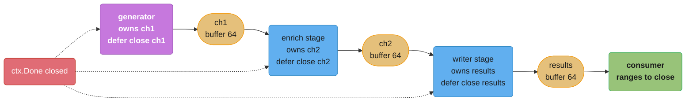
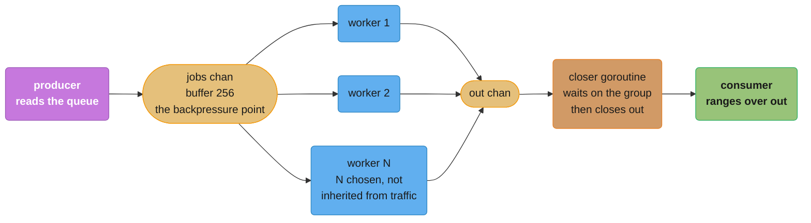
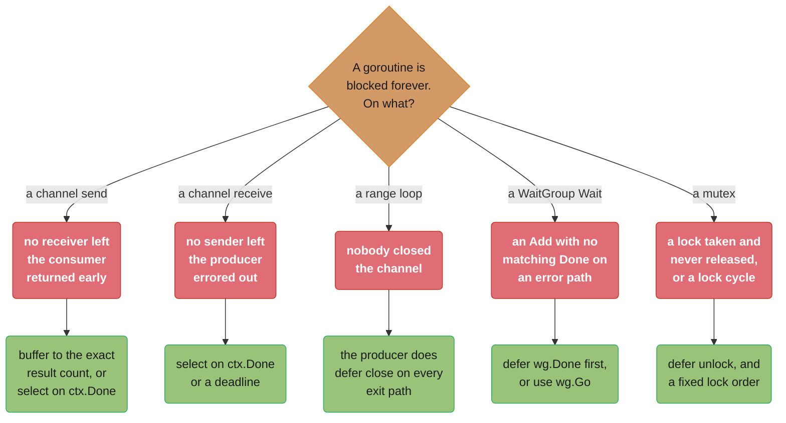
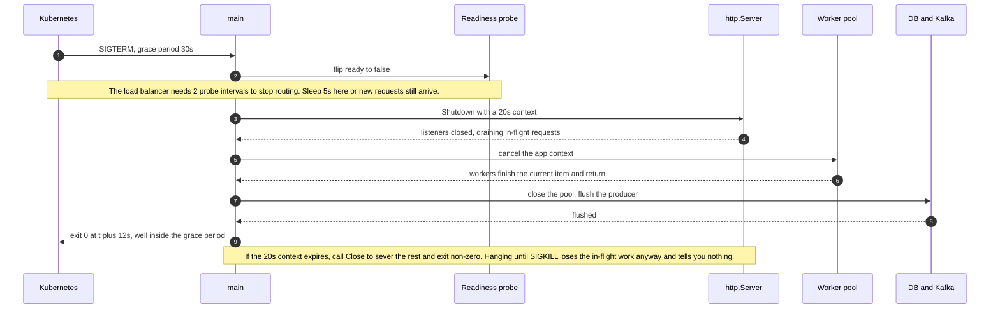
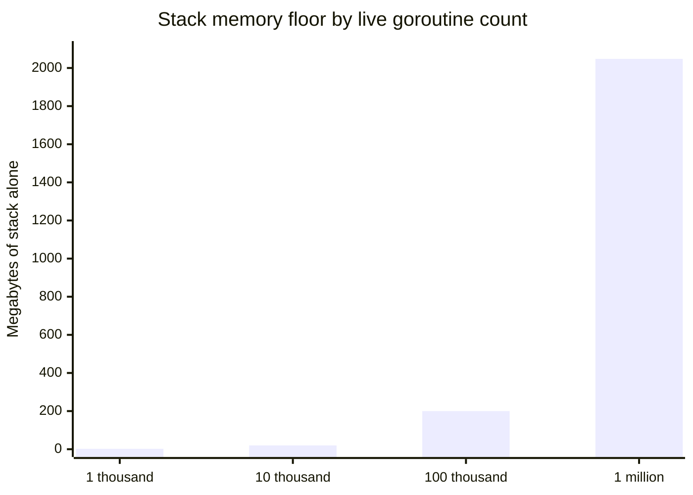

# Concurrency Patterns and Pitfalls

## 1. Concept Overview

Goroutines, channels, `select`, mutexes and contexts are primitives. This module is about
what you build out of them and how those buildings fall down.

The primitives are famously cheap — a goroutine starts with a 2 KB stack and the `go`
keyword is three characters — and that cheapness is exactly the problem. Nothing in the
language bounds how many you create, nothing warns you that one will never exit, and nothing
ties a goroutine's lifetime to the function that started it. A `go` statement is a **fork with
no join**: the parent returns, the child keeps running, and the compiler is entirely happy.
Java's structured concurrency gives you a scope that cannot be left until its children finish;
Go gives you a keyword and a promise to be careful.

So the patterns in this module all encode the same discipline in different shapes. A
**pipeline** makes ownership explicit — one stage, one output channel, one closer. A **bounded
worker pool** makes concurrency a number you chose rather than a number your traffic chose.
**`errgroup`** makes "wait for all of them, cancel the rest on the first failure" a three-line
idiom instead of forty lines of `WaitGroup`, mutex and error slice. **Graceful shutdown** makes
process exit an ordered sequence rather than a race. Every one of them exists to answer one
question, and the question is the module's thesis:

> **Never start a goroutine without knowing how it stops.**

The pitfalls half is the same list from the other side. A goroutine leak is a goroutine whose
stopping condition you did not write; an unbounded fan-out is a pool whose size you did not
choose; a lost `defer cancel()` is a shutdown signal that never arrives. None of them produce
a compile error, a panic, or a failing test. They produce a graph that climbs.

---

## 2. Intuition

> **One-line analogy**: a `go` statement is handing someone a task and walking away without
> exchanging phone numbers. Everything in this module is about exchanging phone numbers first.

**Mental model**: think of concurrency as a **factory floor, not a crowd**. A crowd is what you
get from `go handle(item)` inside a `for` loop over a queue — everyone arrives at once,
everyone competes for the same doors, and nobody knows when to leave. A factory floor has a
fixed number of stations (the pool), a conveyor between them (the channel), a foreman who can
call "stop" (the context), and a closing procedure (shutdown). Both process the same work. Only
one of them survives a Monday.

**Why it matters**: the two most common Go production incidents are not data races — `-race`
catches most of those in CI. They are **the leak** (goroutine count climbs for six days, then
OOM) and **the stampede** (a burst of traffic spawns 200,000 goroutines, each opening a
database connection, and the database falls over, taking every other service with it). Both
come from the same root: concurrency that nothing bounds and nothing terminates.

**Key insight**: a channel is not just a queue, it is a **contract about ownership**. Whoever
creates a channel closes it, and closing is how a producer says "there will be no more." Almost
every channel bug in Go is a violation of that one sentence — two goroutines closing, a
consumer closing, or nobody closing at all. Get ownership right and the shutdown plumbing
writes itself; get it wrong and you will be reading a goroutine profile at 3am.

---

## 3. Core Principles

- **Never start a goroutine without knowing how it stops.** Write the exit path in the same
  commit as the `go` statement.
- **Concurrency is a number you choose.** Unbounded `go` per unit of work is not a design, it
  is the absence of one.
- **The sender closes, exactly once.** A receiver never closes; a send on a closed channel
  panics.
- **Every stage owns its output channel** — it creates it, writes to it, and closes it on the
  way out with a `defer`.
- **Every blocking operation gets a way out.** A `select` with `ctx.Done()`, a deadline, or a
  buffered channel large enough that the send cannot block.
- **Bound the work, not just the goroutines.** A pool of 8 workers each holding 200 MB is still
  an OOM.
- **A panic crosses no goroutine boundary.** Every long-lived `go` statement needs its own
  deferred recover.
- **Shutdown is ordered, not simultaneous.** Stop accepting, drain, close dependencies in
  reverse dependency order, then exit.
- **A deadline on shutdown is mandatory.** Draining forever is the same as hanging.
- **Measure the goroutine count.** It is the cheapest leak detector in existence and it is one
  line of instrumentation.

---

## 4. Types / Architectures / Strategies

### 4.1 The five structural patterns

| Pattern | Shape | Bounds concurrency? | Use when |
|---------|-------|---------------------|----------|
| **Pipeline** | stages linked by channels, each closing its own output | by channel buffer, indirectly | the work is a sequence of transforms over a stream |
| **Bounded worker pool** | N goroutines ranging over one shared input channel | yes, by N | many independent items, and you must cap parallelism |
| **Fan-out / fan-in** | one producer to N workers, N results merged into one channel | by N | per-item work varies wildly in cost |
| **`errgroup`** | N goroutines, first error cancels the rest, `Wait` joins | yes, with `SetLimit` | a fixed set of parallel sub-tasks that must all succeed |
| **Semaphore** | a weighted counter guarding an arbitrary code region | yes, by weight | the limit is a *resource* (memory, connections) not a goroutine count |

### 4.2 Choosing between the concurrency limiters

| | Buffered channel as a semaphore | `errgroup.SetLimit` | `x/sync/semaphore` | Worker pool |
|---|---|---|---|---|
| Bounds in-flight work | yes | yes | yes | yes |
| Bounds goroutine count | no — one per item still | yes | no — one per item still | yes |
| Cancellable while waiting | no, the send blocks | yes, `Go` respects the group ctx | yes, `Acquire(ctx, n)` takes a context | yes |
| Weighted (one task takes 4 units) | no | no | **yes** | no |
| Collects errors | no | yes, the first one | no | you write it |
| Cost per item | one channel op | one goroutine + one slot | one goroutine + a mutex | zero — goroutines are reused |

The distinction that catches people: a buffered channel of capacity 10 and
`semaphore.NewWeighted(10)` both let 10 things run at once, but you still spawned one goroutine
per item and 100,000 of them are sitting blocked on the acquire. A **worker pool** is the only
row that bounds goroutines *and* reuses them.

### 4.3 The `errgroup` API surface

```go
g, ctx := errgroup.WithContext(parent) // ctx is cancelled on the first error, or when Wait returns
g.SetLimit(16)                         // at most 16 concurrent; Go BLOCKS for a free slot
                                       // must be called before any Go; SetLimit(-1) is unlimited

g.Go(func() error { ... })             // blocks if the limit is reached
ok := g.TryGo(func() error { ... })    // starts only if a slot is free right now, else false

err := g.Wait()                        // waits for all, returns the FIRST non-nil error
```

Three behaviours worth stating explicitly:

- **`Wait` returns one error, not all of them.** If you need every failure, collect them into a
  slice under a mutex (or a per-index array) and return `nil` from each `Go` func, or use
  `errors.Join` on your own collection.
- **`WithContext` cancels on the first error *and* when `Wait` returns.** That second half
  matters: `ctx` is dead after `Wait`, so never reuse it for follow-up work.
- **`errgroup` does not recover panics.** A panic in a `Go` func crosses no goroutine boundary
  and terminates the process, exactly like a bare `go` statement. This is a deliberate upstream
  decision, not an omission: a recovered panic would have to be turned into an error, which
  would let a corrupted-state bug be handled as an ordinary failure. Add your own deferred
  recover inside the func if you want a panic converted at that boundary.

### 4.4 The goroutine-leak taxonomy

| Leak | Shape | Fix |
|------|-------|-----|
| **Blocked send, no receiver** | `ch <- v` on an unbuffered channel whose consumer returned early | buffer the channel to the exact result count, or `select` with `ctx.Done()` |
| **Blocked receive, no sender** | `v := <-ch` where the producer errored out before sending | `select` with `ctx.Done()` or a timeout |
| **`range` over a never-closed channel** | `for v := range ch` and nobody closes `ch` | the producer closes with `defer close(ch)` on every exit path |
| **Dropped `cancel`** | `ctx, _ := context.WithCancel(...)` — children never released | `defer cancel()`, and `go vet`'s `lostcancel` in CI |
| **`WaitGroup` never reaching zero** | an `Add` with no matching `Done` on an error path | `defer wg.Done()` as the first line, or `wg.Go` `[1.25]` |
| **Ticker/timer never stopped** | `time.NewTicker` with no `defer t.Stop()` | always `defer t.Stop()` |

Every one of these has the same signature in production: `runtime.NumGoroutine()` climbing on a
straight line across deploys, flat memory per goroutine, and no error in any log.

### 4.5 What `[1.22]` changed about loop variables

```go
// In a module declaring go 1.21 or earlier, i and v are ONE variable reused by
// every iteration, so all three goroutines observe whatever the loop left behind.
for i, v := range []string{"a", "b", "c"} {
    go func() { fmt.Println(i, v) }() // pre-1.22: often "2 c" three times
}

// In a module declaring go 1.22 or later, i and v are FRESH per iteration and
// this prints all three pairs, in some order.
```

The semantics are chosen by the `go` directive in `go.mod`, per module, not by the toolchain
version. So a Go 1.27 compiler building a module that says `go 1.21` still uses the old
sharing. This is a genuine improvement you will still meet the old form of, in vendored code,
in an unmigrated internal module, and in every code sample written before 2024 — including the
one someone is about to paste into your review. The old workaround, `v := v` at the top of the
body, remains harmless and is what `go fix` removes.

---

## 5. Architecture Diagrams

### The pipeline, with its shutdown wiring



Solid arrows are data, dotted arrows are the shutdown signal. Every stage selects on
`ctx.Done()` in **both** its receive and its send, which is what stops the upstream stage from
blocking forever when the consumer quits early. Without the dotted edges this picture is a leak
with extra steps.

### Fan-out over a bounded pool, and fan-in



Four workers all read from **one** `jobs` channel — that is the whole fan-out mechanism, no
dispatcher required. The `jobs` buffer of 256 is where backpressure lives: when it fills, the
producer blocks, and blocking the producer is how you tell the queue to slow down instead of
allocating your way to an OOM.

### The leak taxonomy as a decision tree



### Graceful shutdown, in order



### What a goroutine costs before it does anything



The 2 KB initial stack is the floor, not the cost. Add the runtime's own `g` structure, whatever
each goroutine captured in its closure, and the buffers a typical request handler allocates —
in a real ingest service the measured figure was 27 KB per in-flight goroutine, which turns a
million into 27 GB.

---

## 6. How It Works — Detailed Mechanics

### 6.1 A pipeline stage that can actually be shut down

The naive stage is four lines and leaks:

```go
// LEAKS: if the consumer stops reading, this goroutine blocks on the send forever.
func square(in <-chan int) <-chan int {
    out := make(chan int)
    go func() {
        defer close(out)
        for v := range in {
            out <- v * v
        }
    }()
    return out
}
```

The correct stage selects on `ctx.Done()` in the **send** as well as the receive:

```go
func square(ctx context.Context, in <-chan int) <-chan int {
    out := make(chan int, 64) // a buffer absorbs jitter; it does not fix the leak
    go func() {
        defer close(out) // this stage owns out, so this stage closes it
        for {
            select {
            case v, ok := <-in:
                if !ok {
                    return // upstream is finished
                }
                select {
                case out <- v * v:
                case <-ctx.Done():
                    return // downstream quit early; do not block forever
                }
            case <-ctx.Done():
                return
            }
        }
    }()
    return out
}
```

The nested `select` on the send is the part people omit, and it is the part that matters. The
outer one only covers waiting for *input*; a stage can be blocked just as permanently trying to
hand its output to a consumer that has gone away.

Driving it:

```go
func run(ctx context.Context, nums []int) (int, error) {
    ctx, cancel := context.WithCancel(ctx)
    defer cancel() // cancelling on ANY return path is what unblocks every stage

    total := 0
    for v := range square(ctx, generate(ctx, nums)) {
        if v > 1_000_000 {
            return 0, errTooLarge // early return: defer cancel drains the pipeline
        }
        total += v
    }
    return total, ctx.Err()
}
```

`defer cancel()` at the top of the consumer is the pipeline's entire shutdown mechanism. Remove
it and the early `return` leaks two goroutines per call.

### 6.2 A bounded worker pool

```go
func Process(ctx context.Context, items []Item, workers int) error {
    jobs := make(chan Item, workers*4) // buffer keeps workers fed across a slow producer
    g, gctx := errgroup.WithContext(ctx)

    // Producer: one goroutine, owns jobs, closes it.
    g.Go(func() error {
        defer close(jobs)
        for _, it := range items {
            select {
            case jobs <- it:
            case <-gctx.Done():
                return gctx.Err()
            }
        }
        return nil
    })

    // Workers: a FIXED number, each ranging over the shared channel.
    for w := 0; w < workers; w++ {
        g.Go(func() error {
            for it := range jobs { // exits when jobs is closed AND drained
                if err := handle(gctx, it); err != nil {
                    return fmt.Errorf("item %s: %w", it.ID, err) // cancels gctx
                }
            }
            return nil
        })
    }
    return g.Wait()
}
```

The shape to memorise: **the producer closes, the workers `range`**. `range` over a channel ends
when the channel is closed and drained, so the workers need no termination logic of their own.
A worker returning an error cancels `gctx`, the producer's `select` sees it, and everything
unwinds without a single extra channel.

### 6.3 Sizing the pool

| Workload | Starting point | Why |
|----------|---------------|-----|
| CPU-bound (compression, hashing, image resize) | `runtime.GOMAXPROCS(0)` | More goroutines than cores just adds context switches. `GOMAXPROCS` is container-aware since `[1.25]`, so it reflects the CPU limit, not the node |
| I/O-bound with a downstream limit | the downstream's capacity | 20 workers against a 10-connection database pool means 10 are always blocked. Size to the pool, not the CPU |
| I/O-bound with a rate limit | `rate × p99 latency` | 200 requests/second at 150 ms p99 needs 30 in flight (Little's Law). More just queues |
| Mixed | measure | Benchmark at 1, 2, 4, 8, 16 and plot throughput; the knee is real and is rarely where you guessed |

Little's Law — `concurrency = throughput × latency` — is the only formula you need here, and it
is the one that shows a "more workers" change is usually a no-op: if the downstream is the
constraint, adding workers moves the queue, not the throughput.

### 6.4 `errgroup` versus a hand-rolled `WaitGroup`

```go
// The hand-rolled version: 18 lines, a mutex, and no cancellation.
var (
    wg   sync.WaitGroup
    mu   sync.Mutex
    errs []error
)
for _, u := range urls {
    wg.Add(1)
    go func() {
        defer wg.Done()
        if err := fetch(ctx, u); err != nil {
            mu.Lock()
            errs = append(errs, err)
            mu.Unlock()
        }
    }()
}
wg.Wait()
if len(errs) > 0 { return errors.Join(errs...) }

// The errgroup version: 6 lines, bounded, and the first error stops the rest.
g, gctx := errgroup.WithContext(ctx)
g.SetLimit(16)
for _, u := range urls {
    g.Go(func() error { return fetch(gctx, u) })
}
return g.Wait()
```

When you genuinely want *every* error rather than the first, `sync.WaitGroup` with `wg.Go`
`[1.25]` plus an indexed result slice is cleaner than either:

```go
var wg sync.WaitGroup
errs := make([]error, len(urls)) // index per goroutine: no mutex needed
for i, u := range urls {
    wg.Go(func() { errs[i] = fetch(ctx, u) }) // wg.Go does Add(1) and defer Done() for you
}
wg.Wait()
return errors.Join(errs...) // Join drops nils and returns nil if all are nil
```

`wg.Go` removes the two classic `WaitGroup` bugs at once: an `Add` that never got a matching
`Done` on an error path, and an `Add(1)` written *inside* the goroutine where `Wait` can race
past it.

### 6.5 Weighted limits with `x/sync/semaphore`

A worker count is the wrong bound when the resource is memory. Decoding one 40 MB image and one
400 KB thumbnail should not count the same:

```go
const budgetMB = 512
sem := semaphore.NewWeighted(budgetMB)

for _, img := range images {
    weight := int64(img.EstimatedMB()) // 40 for the large one, 1 for the small
    if err := sem.Acquire(ctx, weight); err != nil {
        return err // ctx cancelled while waiting -- Acquire respects it
    }
    g.Go(func() error {
        defer sem.Release(weight)
        return decode(ctx, img)
    })
}
```

`Acquire` blocks until the weight is available **or the context ends**, which is the whole
reason to prefer it over a buffered channel: a channel send has no cancellation. `TryAcquire`
is the non-blocking form, for a shed-load path. Releasing a different weight than you acquired
corrupts the counter permanently, so keep the `defer` adjacent to the `Acquire`.

### 6.6 Rate limiting outbound calls

```go
// 100 requests/second sustained, bursting to 20.
lim := rate.NewLimiter(rate.Limit(100), 20)

for _, req := range reqs {
    if err := lim.Wait(ctx); err != nil { // blocks for a token, honours cancellation
        return err
    }
    g.Go(func() error { return send(ctx, req) })
}
```

`rate.Limiter` is a token bucket: `Wait(ctx)` blocks for one token, `Allow()` is the
non-blocking "shed if empty" form, and `Reserve()` tells you how long you *would* wait so you
can decide. A `time.Ticker` gives you none of that — no burst, no cancellation, and a tick that
is silently dropped if you are not ready to receive it, since the ticker channel is unbuffered
`[1.27]` and a tick reaches only a receiver that is already waiting. Use a `Ticker` for a periodic housekeeping job; use
`rate.Limiter` for anything shaping request flow. Broader strategy is in
[Rate Limiting in Depth](../../backend/rate_limiting_in_depth/rate_limiting_in_depth.md).

### 6.7 The or-channel: broadcasting to an unknown number of waiters

```go
done := make(chan struct{})
// ... many goroutines each doing: select { case <-done: return; case ... }
close(done) // every one of them wakes, immediately, with no bookkeeping
```

A closed channel makes every pending and future receive succeed forever, so `close` is Go's
broadcast. This *is* the mechanism `context.Done()` wraps, and the reason to reach for a raw
`done` channel today is narrow: a lifetime that is not request-scoped and carries no deadline
or values, such as a `Close()` method on a long-lived struct. If the signal crosses an API
boundary, use a context — every library already understands it.

Merging several such signals is the "or-channel":

```go
// Returns a channel closed as soon as ANY input channel is closed.
func or(chans ...<-chan struct{}) <-chan struct{} {
    out := make(chan struct{})
    var once sync.Once
    for _, c := range chans {
        go func() {
            <-c
            once.Do(func() { close(out) }) // sync.Once is what makes the double close safe
        }()
    }
    return out
}
```

Note the cost that is usually left unsaid: this spawns one goroutine per input, and every one
of them except the winner is **still blocked** on its channel afterwards. It is a leak unless
the inputs are all eventually closed. `context.AfterFunc` or an `errgroup` is the better answer
in almost every real case.

### 6.8 Graceful shutdown, in order

```go
func main() {
    // 1. Turn signals into ordinary cancellation. The cause names the signal [1.26].
    ctx, stop := signal.NotifyContext(context.Background(), os.Interrupt, syscall.SIGTERM)
    defer stop() // restores default handling, so a SECOND Ctrl-C kills a wedged process

    app := newApp()
    srv := &http.Server{Addr: ":8080", Handler: app.Routes()}

    g, gctx := errgroup.WithContext(ctx)
    g.Go(func() error {
        if err := srv.ListenAndServe(); !errors.Is(err, http.ErrServerClosed) {
            return err // a real bind failure, not the shutdown path
        }
        return nil
    })
    g.Go(func() error { return app.Workers.Run(gctx) })

    <-gctx.Done()
    log.Info("shutting down", "cause", context.Cause(gctx))

    // 2. Fail readiness FIRST and wait out the load balancer. Skipping this is
    //    why "graceful" deploys still drop requests: the LB is still routing.
    app.Ready.Store(false)
    time.Sleep(5 * time.Second) // two probe intervals

    // 3. Drain under a deadline strictly inside the Kubernetes grace period (30s).
    shutCtx, cancel := context.WithTimeout(context.Background(), 20*time.Second)
    defer cancel()

    if err := srv.Shutdown(shutCtx); err != nil {
        log.Error("drain deadline expired, severing connections", "err", err)
        srv.Close()          // 4. force-close the stragglers rather than hanging
        defer os.Exit(1)     // exit non-zero so the deploy is visibly unclean
    }

    // 5. Workers next: the HTTP layer is already quiet, so nothing new is enqueued.
    stop()                        // unregister the signal handler
    if err := g.Wait(); err != nil && !errors.Is(err, context.Canceled) {
        log.Error("worker shutdown", "err", err)
    }

    // 6. Dependencies last, in REVERSE dependency order.
    app.Kafka.Flush(shutCtx)
    app.DB.Close()
    app.Tracer.Shutdown(shutCtx)
}
```

The ordering is the content. Draining the server before failing readiness drops requests the
load balancer sends during the drain. Closing the database before the workers finish makes every
in-flight job fail. Flushing traces first loses the spans for the shutdown itself.

### 6.9 Testing it deterministically

```go
func TestWorkerRespectsShutdown(t *testing.T) {
    defer goleak.VerifyNone(t) // fails if the test leaves a goroutine behind

    synctest.Test(t, func(t *testing.T) { // [1.25]: fake clock, zero real time
        ctx, cancel := context.WithCancel(context.Background())
        w := NewWorker(2)
        done := make(chan error, 1)
        go func() { done <- w.Run(ctx) }()

        synctest.Wait()        // let every goroutine in the bubble reach a blocked state
        cancel()
        synctest.Wait()

        if err := <-done; !errors.Is(err, context.Canceled) {
            t.Fatalf("want context.Canceled, got %v", err)
        }
    })
}
```

Inside a `synctest` bubble the clock only advances when **every** goroutine in the bubble is
durably blocked, so a test of a 30-second drain deadline runs in microseconds and is
deterministic under CI load rather than flaky. `synctest.Wait` blocks until the rest of the
bubble is idle, which is how you assert on an intermediate state, and `synctest.Sleep` `[1.27]`
advances the fake clock and then settles. Pair it with `goleak` and the two together catch the
majority of shutdown bugs before review.

---

## 7. Real-World Examples

**Kubernetes `client-go` workqueue.** The controller pattern is a bounded worker pool over a
rate-limited, deduplicating queue: `queue.Get()` blocks, returns an item and a `shutdown` bool,
and the worker loop exits when that bool flips. Deduplication means a resource updated 40 times
while a worker was busy is reconciled once, which is why controllers survive a resync storm.

**`net/http` server.** Every accepted connection gets its own goroutine, so the server *is* an
unbounded fan-out by design — the bound comes from `Server.MaxHeaderBytes`, the four timeouts,
and whatever limiter you put in the handler chain. `Shutdown` is the drain: it closes listeners,
waits for idle connections, and returns when active requests finish or the passed context ends.

**`errgroup` in the Go module proxy and in `cmd/go`.** The standard toolchain uses `errgroup`
with `SetLimit` for parallel module downloads, which is the canonical example of a fixed set of
independent sub-tasks where the first hard failure should stop the rest.

**Prometheus scrape pool.** One goroutine per target, each with a ticker at the scrape interval
and a context whose timeout is the scrape timeout, all torn down and recreated on config reload.
The reload path is the interesting part: it is a full stop-and-restart of the pool rather than
an in-place mutation, precisely because mutating a live set of goroutines is where the bugs are.

**Kafka consumers (`segmentio/kafka-go`, `IBM/sarama`).** A consumer group session is a context
that is cancelled on rebalance, and every handler is expected to return promptly when it fires.
A handler that ignores the context is the classic cause of a rebalance storm: the group waits,
times out, rebalances again, and throughput collapses to zero.

**Cross-section**: the lifetime signal itself is
[Context and Cancellation](../context_and_cancellation/context_and_cancellation.md); the
comparison to a language that enforces the join is
[Structured Concurrency and Loom](../../java/structured_concurrency_and_loom/structured_concurrency_and_loom.md).

---

## 8. Tradeoffs

### Pipeline vs worker pool

| | Pipeline | Worker pool |
|---|---------|-------------|
| Best for | a sequence of transforms over a stream | many independent items |
| Parallelism | one goroutine per stage unless you fan out within a stage | N, chosen |
| Backpressure | natural — a full buffer blocks the stage above | via the input channel's buffer |
| Ordering | preserved through a single-goroutine stage | lost, unless you re-sequence by index |
| Shutdown complexity | high — every stage needs a `ctx` check on send *and* receive | low — the producer closes, workers `range` |
| Failure handling | you build it | `errgroup` gives it to you |

### Buffer size, and what each choice costs

| Buffer | Behaviour | Failure mode |
|--------|-----------|--------------|
| `0` (unbuffered) | Synchronous handoff; sender blocks until a receiver is ready | Maximum blocking, but the strongest backpressure and the easiest to reason about |
| Small (`8`–`256`) | Absorbs jitter; the producer blocks when the consumer falls behind | The right default. The block *is* the backpressure |
| Large (`100_000`) | Hides a throughput mismatch | Memory grows to the buffer, latency grows with queue depth, and a crash loses everything buffered |
| `len(items)` | Never blocks | Fine for a known-small result set. For a stream it is an unbounded queue with extra steps |

### Concurrency limiters, by what they actually bound

| Mechanism | Bounds goroutines | Bounds resources | Cancellable wait | Weighted |
|-----------|------------------|------------------|------------------|----------|
| Worker pool | yes | indirectly | yes | no |
| `errgroup.SetLimit` | yes | indirectly | yes | no |
| `x/sync/semaphore` | no | **yes** | yes | **yes** |
| Buffered channel as a token bucket | no | yes | no | no |
| `rate.Limiter` | no | rate, not concurrency | yes | no |

### Go's structured concurrency, compared

| | Go | Java virtual threads |
|---|---|---|
| Enforced join | none — `go` is fork with no join | `StructuredTaskScope` cannot be exited until children finish |
| Cancellation | cooperative via `context`, advisory | cooperative via interrupt, and the scope cancels children |
| Error aggregation | `errgroup.Wait` returns the first | join policies: all-succeed, any-succeed |
| Escape hatch | any `go` statement, anywhere | a virtual thread started outside a scope |
| Leak detection | `goroutineleak` profile `[1.27]`, `goleak` in tests | thread dumps, scope-bounded by construction |

`errgroup` is Go's closest analogue and it is a **convention, not a constraint**: nothing stops a
function inside a `g.Go` from starting a bare goroutine that outlives the whole group. That is
the honest gap, and it is why the goroutine profile is a first-class production tool in Go in a
way that thread dumps are not in a structured-concurrency language.

---

## 9. When to Use / When NOT to Use

**Use a bounded worker pool when:**

- The item count is large or unbounded and the per-item cost is roughly uniform.
- A downstream resource — a database pool, an API rate limit, a GPU — is the real constraint.
- You need a stable memory profile more than you need the last 10% of throughput.

**Use `errgroup` when:**

- The task set is **fixed and known** — four backends, twelve shards, one file per input.
- All of them must succeed, and the first failure makes the rest pointless.
- Add `SetLimit` the moment the set can grow with input size.

**Use a pipeline when:**

- The work is genuinely a sequence of transforms and each stage has a different cost.
- Ordering matters and you want it for free from single-goroutine stages.

**Do NOT reach for concurrency when:**

- The work is **already fast**. A `sync.Mutex` plus channel handoff around a 200 ns function is
  slower than the sequential loop, sometimes by an order of magnitude.
- The bottleneck is **not the thing you are parallelising**. Ten goroutines against one
  connection is one connection with nine spectators.
- The result must be **ordered and the stages are cheap**. Re-sequencing costs more than it saves.
- You cannot say **how it stops**. If the exit path is not obvious, the goroutine is a leak that
  has not happened yet.

**Do NOT use an unbuffered channel when** the producer must not block on a slow consumer and
dropping is acceptable — that is a buffered channel plus a `select` with `default` to shed, and
shedding deliberately beats blocking accidentally.

---

## 10. Common Pitfalls

### Pitfall 1 — unbounded fan-out took the database with it

A webhook receiver spawned one goroutine per event, each opening a database transaction. It ran
for fourteen months at 40 events/second.

```go
// BROKEN
for msg := range consumer.Messages() {
    go func() {                       // nothing bounds this
        tx, _ := db.Begin()           // ...and each one wants a connection
        defer tx.Commit()
        process(tx, msg)
    }()
}

// FIX
g, gctx := errgroup.WithContext(ctx)
g.SetLimit(32)                        // 32 workers against a 50-connection pool
for msg := range consumer.Messages() {
    g.Go(func() error {
        tx, err := db.BeginTx(gctx, nil)
        if err != nil {
            return err
        }
        defer tx.Rollback()           // no-op after a successful Commit
        if err := process(gctx, tx, msg); err != nil {
            return err
        }
        return tx.Commit()
    })
}
return g.Wait()
```

**Quantified impact**: a partner's retry storm delivered 190,000 events in 90 seconds. The
service created 190,000 goroutines — roughly 5.1 GB of stack and closure state measured at 27 KB
each — and 190,000 pending `db.Begin()` calls against a pool of 50. Postgres hit
`max_connections`, which took down **six other services** sharing the instance. Total impact was
41 minutes across the estate for a bug in one. The `SetLimit(32)` line converts an outage into
backpressure: the producer simply slows to what the database can absorb.

### Pitfall 2 — `time.After` in a hot select loop

```go
// BROKEN: allocates a Timer and a channel EVERY iteration.
for {
    select {
    case msg := <-ch:
        handle(msg)
    case <-time.After(1 * time.Minute): // a fresh 1-minute timer, per message
        reportIdle()
    }
}

// FIX: one timer, reset in place.
idle := time.NewTimer(1 * time.Minute)
defer idle.Stop()
for {
    select {
    case msg := <-ch:
        handle(msg)
        idle.Stop()  // [1.23]: after Stop returns, nothing more can arrive on idle.C
        idle.Reset(1 * time.Minute)
    case <-idle.C:
        reportIdle()
        idle.Reset(1 * time.Minute)
    }
}
```

**Quantified impact**: this ran at 14,000 messages/second under a module declaring `go 1.21`,
where an unreferenced timer stayed in the runtime's timer heap until it fired. At 14,000
timers/second with a 60-second duration, 840,000 dead timers were live at steady state; RSS grew
1.9 GB in eleven minutes and GC scan time went from 4 ms to 61 ms per cycle. Since `[1.23]` an
unreferenced timer is collected immediately for modules declaring `go 1.23` or later, so the
*accumulation* is gone — but the per-iteration `Timer` and channel allocation is not, and a
14,000/second allocation you do not need is still a profile entry. The old `Stop`-then-drain dance
is also gone: `[1.23]` made `Stop` guarantee that no value is sent on the channel after it returns, so
`Stop` plus `Reset` is the whole idiom, and the `if !t.Stop() { <-t.C }` still circulating on the
internet now deadlocks — an unbuffered time channel `[1.27]` buffered nothing for the drain to take.

### Pitfall 3 — the range over a channel nobody closed

```go
// BROKEN
results := make(chan Result)
for _, w := range work {
    go func() { results <- compute(w) }()
}
for r := range results { // never ends: nobody closes results
    collect(r)
}

// FIX
results := make(chan Result, len(work)) // buffered so no sender can block
var wg sync.WaitGroup
for _, w := range work {
    wg.Go(func() { results <- compute(w) }) // [1.25]: Add and Done handled for you
}
go func() {
    wg.Wait()
    close(results) // ONE closer, and it runs only after every sender is done
}()
for r := range results {
    collect(r)
}
```

**Quantified impact**: the broken form deadlocks the calling goroutine forever, and in a request
handler that means one leaked goroutine plus one held HTTP connection **per request**. On a
service at 900 requests/second the goroutine count went from 4,000 to 1.6 million in half an
hour before the pod was OOMKilled, and every request that hit the path returned nothing at all —
the client saw a hung connection, not an error. The runtime's own deadlock detector never fires
here, because it only triggers when *every* goroutine is asleep, and a busy server always has
others running.

### Pitfall 4 — the loop-variable capture in an unmigrated module

```go
// BROKEN in a module whose go.mod says "go 1.21" or earlier
for _, shard := range shards {
    go func() {
        backup(shard) // all N goroutines see whatever the loop left behind
    }()
}

// FIX (works in every version, and is what go fix removes on migration)
for _, shard := range shards {
    shard := shard
    go func() { backup(shard) }()
}
```

**Quantified impact**: a nightly job backed up 24 shards. Because every goroutine read the same
variable, roughly 21 of 24 goroutines backed up the **last** shard and three shards were never
touched at all, producing 24 files with 21 identical names overwriting each other. It ran
undetected for five weeks — the job exited 0, the file count looked right — and was found during
a restore drill, when three shards had no recoverable backup. `[1.22]` gives each iteration a
fresh variable and eliminates the bug, but the semantics are selected by the `go` directive in
`go.mod` per module, so an unmigrated internal module, a vendored dependency, or a pre-2024 code
sample still behaves the old way.

### Pitfall 5 — `WaitGroup.Add` inside the goroutine

```go
// BROKEN: Wait can run before any Add executes.
var wg sync.WaitGroup
for _, t := range tasks {
    go func() {
        wg.Add(1)      // races with Wait below
        defer wg.Done()
        run(t)
    }()
}
wg.Wait()              // may see a counter of 0 and return immediately

// FIX
var wg sync.WaitGroup
for _, t := range tasks {
    wg.Go(func() { run(t) }) // [1.25]: Add(1) before the goroutine starts, Done deferred
}
wg.Wait()
```

**Quantified impact**: an export job wrote a manifest after `wg.Wait()` returned. Under light
load the scheduler happened to run the `Add` calls first and everything worked for eight months;
under a 3x load test `Wait` returned with a counter of 0 and the manifest was written listing
zero of the 400 files that were still being uploaded. Downstream consumers processed an empty
export for 90 minutes. `-race` does flag this one — it was never run on that job in CI.

### Pitfall 6 — the shutdown that never finished

```go
// BROKEN: no deadline, so a single stuck request blocks exit until SIGKILL.
<-ctx.Done()
srv.Shutdown(context.Background()) // waits forever for in-flight requests
os.Exit(0)

// FIX
<-ctx.Done()
shutCtx, cancel := context.WithTimeout(context.Background(), 20*time.Second)
defer cancel()
if err := srv.Shutdown(shutCtx); err != nil {
    log.Error("drain incomplete, severing", "err", err, "inflight", srv.InFlight())
    srv.Close()
    os.Exit(1)
}
```

**Quantified impact**: one handler held a long-polling connection open for up to 15 minutes.
Every rolling deploy therefore waited the full Kubernetes `terminationGracePeriodSeconds` of 30
seconds, then took a SIGKILL — which severed *all* in-flight requests, including the ones that
had 200 ms left. A 40-pod rollout went from 4 minutes to 22, and each pod dropped an average of
34 requests at the SIGKILL. The deadline plus explicit `Close` did not make shutdown faster; it
made the loss **bounded, logged, and attributable**, which is the difference between an incident
and a graph.

---

## 11. Technologies & Tools

| Tool | What it does for concurrency patterns |
|------|--------------------------------------|
| `golang.org/x/sync/errgroup` | First-error collection with context cancellation, `SetLimit` for bounded concurrency, `TryGo` for a shed path |
| `golang.org/x/sync/semaphore` | Weighted counting semaphore whose `Acquire` respects a context — the right bound when the resource is memory |
| `golang.org/x/time/rate` | Token-bucket limiter: `Wait` blocks on a context, `Allow` sheds, `Reserve` reports the delay |
| `golang.org/x/sync/singleflight` | Collapses concurrent identical requests into one call — the standard cache-stampede fix |
| `go.uber.org/goleak` | Fails a test that leaves a goroutine behind; `VerifyTestMain(m)` covers a whole package |
| `goroutineleak` profile `[1.27]` | GA: finds goroutines blocked on a primitive that can never be unblocked, via `runtime/pprof` and `/debug/pprof/goroutineleak` |
| `net/http/pprof` goroutine profile | `?debug=2` prints every goroutine's stack — the 3am tool for finding what they are all blocked on |
| `runtime/metrics` `[1.26]` | `/sched/goroutines`, `/sched/goroutines-created:goroutines` — export both; a rising first with a flat rate is a leak |
| `go test -race` | Catches unsynchronised access on the interleavings it actually observes; run it in CI on every package |
| `testing/synctest` `[1.25]` | A fake clock and deterministic scheduling inside a bubble; `synctest.Sleep` `[1.27]` advances and settles |
| `go vet` `lostcancel` | Flags the discarded `CancelFunc` behind an entire class of leaks; runs by default under `go test` |
| `golangci-lint` `noctx` / `contextcheck` | Flags calls made without a context, and a context created from `Background` where one was available |
| `sourcegraph/conc` | An opinionated wrapper adding panic propagation and typed result pools over the same primitives |
| `runtime/trace` | Shows *why* a goroutine did not run — scheduler latency, syscall block, GC assist — which pprof cannot |

---

## 12. Interview Questions with Answers

**Q: Why is spawning one goroutine per unit of work an outage pattern?**
**Short:** Nothing bounds it, so a traffic burst converts directly into memory and downstream connections until something upstream of you falls over.

A goroutine starts at 2 KB of stack, so a million of them is at least 2 GB before any of them
allocates — and in a real handler holding a request, a buffer and a closure, the measured figure
is closer to 27 KB each. Worse than the memory is what each one *wants*: if every goroutine
opens a database transaction, 190,000 of them queue against a pool of 50 and exhaust
`max_connections` on a shared instance, taking down services that share it. The fix is one line
— `g.SetLimit(32)` on an errgroup, or a fixed worker pool — and it converts an unbounded spike
into backpressure, which is what you wanted the queue to do anyway.

**Q: What are the ways a goroutine leaks, and what do they all look like in production?**
**Short:** Five shapes — a blocked send, a blocked receive, a range over an unclosed channel, a dropped cancel func, and a WaitGroup that never reaches zero.

A send blocks forever when the consumer returned early and nothing is left to receive; a receive
blocks forever when the producer errored out before sending; a `range` never ends when nobody
closes the channel; a discarded `CancelFunc` leaves children attached to a long-lived parent;
and an `Add` with no matching `Done` on an error path leaves `Wait` blocked. All five present
identically: `runtime.NumGoroutine()` climbing on a straight line across deploys, memory
tracking it, and not one error in any log. The goroutine profile at `?debug=2` tells you exactly
which line they are all parked on, and the `goroutineleak` profile `[1.27]` names the ones that
provably can never be unblocked.

**Q: Who closes a channel, and what happens if you get it wrong?**
**Short:** The sender closes, exactly once, because a send on a closed channel panics and only the producer knows there is nothing left to come.

Closing is a producer's statement that no more values will arrive; a receiver has no way to know
that and closing from the receive side leaves the sender panicking on its next send. With
multiple producers, none of them may close — instead a `sync.WaitGroup` counts them and a single
extra goroutine does `wg.Wait()` then `close(ch)`, which is the fan-in shape. A double close
panics with "close of closed channel", and a close of a nil channel panics too. Receiving from a
closed channel is always fine and always immediate, returning the zero value, which is what the
comma-ok form `v, ok := <-ch` exists to distinguish.

**Q: What does errgroup.WithContext do when one goroutine returns an error?**
**Short:** It cancels the group's derived context so every sibling watching it can unwind, and Wait then returns that first error and only that one.

`g, ctx := errgroup.WithContext(parent)` gives you a context the group owns. The first `Go` func
to return non-nil triggers the cancel; siblings see `ctx.Done()` and are expected to return
promptly, which they will only do if they were actually passing that ctx into their I/O calls.
`Wait` blocks until every goroutine has returned — cancellation does not kill them — and returns
the first error recorded. Two consequences: you get one error, not all of them, so collect them
yourself if you need the set; and the ctx is also cancelled when `Wait` returns, so it must never
be reused for follow-up work.

**Q: Does errgroup recover a panic in one of its goroutines?**
**Short:** No — a panic crosses no goroutine boundary, so it terminates the whole process exactly as it would from a bare go statement.

This is a deliberate upstream decision rather than an omission. Recovering would mean turning the
panic into an error, which lets a genuine corrupted-state bug be handled as an ordinary failure
and retried — precisely the wrong outcome for the class of thing panics represent. If you want a
panic converted at that boundary you add your own deferred recover inside the func you pass to
`Go`, logging the value and `debug.Stack()` before returning an error. Some third-party wrappers
such as `sourcegraph/conc` do this by default, which is the main practical reason to reach for
one. The details of the recover boundary are in
[Errors and Panics](../errors_and_panics/errors_and_panics.md).

**Q: What does SetLimit give you that a buffered channel used as a semaphore does not?**
**Short:** It makes the group itself the bound, blocking Go until a slot frees, so there is no separate acquire and release to forget.

With a channel semaphore you still spawn one goroutine per item — 100,000 of them sitting blocked
on a send — so you have bounded the *work* but not the goroutines. `SetLimit(n)` blocks the `Go`
call itself, so at most `n` goroutines exist at any moment and the caller's loop is what applies
backpressure. It also removes the acquire/release pairing, which is the bug a channel semaphore
invites: an early `return` on an error path that skips the release, permanently shrinking the
limit. `SetLimit` must be called before any `Go`, and `TryGo` is the non-blocking variant when
you would rather shed than wait.

**Q: Is the loop-variable capture bug still real in Go?**
**Short:** Not for a module whose go.mod declares 1.22 or later, where each iteration gets a fresh variable, but it is alive in every older module you inherit.

Before `[1.22]` the `for` loop's variables were declared once and reused, so
`for _, v := range s { go func(){ use(v) }() }` had every goroutine reading the same memory —
usually observing the final element, non-deterministically. From `[1.22]` each iteration
declares fresh variables and the code does what it looks like it does. The trap is that the
semantics are chosen by the `go` directive in `go.mod` **per module**, not by the toolchain, so
a Go 1.27 compiler building a module that says `go 1.21` still uses the old sharing. You will
meet it in vendored dependencies, unmigrated internal modules, and every code sample written
before 2024. The `v := v` shadow line is harmless everywhere and is what `go fix` strips on
migration.

**Q: How do you find a goroutine leak in a running service?**
**Short:** Export the count and watch it trend, then read the goroutine profile to see the exact line every one of them is parked on.

`runtime.NumGoroutine()` as a gauge, or `/sched/goroutines` from `runtime/metrics` `[1.26]`, is
the cheapest possible detector: a leak is a straight line up that never comes back down after
traffic drops. To identify it, fetch `/debug/pprof/goroutine?debug=2`, which prints every
goroutine's full stack, and look for the thousands sharing one frame — that frame is the blocked
operation. Since `[1.27]` the `goroutineleak` profile is GA at `/debug/pprof/goroutineleak` and
does better: it reports goroutines blocked on a concurrency primitive that can **never** be
unblocked, so it distinguishes a genuine leak from a large but healthy pool of waiters. In tests,
`go.uber.org/goleak` fails the build for the same condition.

**Q: How do you choose the size of a worker pool?**
**Short:** From the constraint, not from taste — GOMAXPROCS for CPU-bound work, and the downstream's own capacity for anything doing I/O.

For CPU-bound work more goroutines than cores just adds context switches, so `GOMAXPROCS(0)` is
the ceiling, and it is container-aware since `[1.25]` so it reflects the CPU limit rather than
the node's core count. For I/O-bound work the pool should match whatever is actually scarce: 20
workers against a 10-connection database pool means 10 are permanently blocked doing nothing. If
a rate limit is the constraint, Little's Law gives it directly — 200 requests/second at 150 ms
p99 needs 30 in flight, and the 31st worker only makes the queue longer. When in doubt,
benchmark at 1, 2, 4, 8 and 16 and plot throughput; the knee is real and it is rarely where you
guessed.

**Q: What is the shutdown problem in a pipeline, and how do you solve it?**
**Short:** A downstream stage that quits early leaves the stage above it blocked on a send forever, so every stage needs an escape on its send as well as its receive.

The classic stage is `for v := range in { out <- v*v }`, and it leaks the moment the consumer
stops reading: the send has no way out. The fix is a nested `select` — the outer one waits for
input or `ctx.Done()`, and the inner one wraps the send in `select { case out <- v: case
<-ctx.Done(): return }`. The consumer then owns the whole teardown with a single
`defer cancel()`, so any early return, error, or panic unwinding drains the entire pipeline.
Buffering the channel does not fix this; it only changes how many items fit before the block
happens.

**Q: Was `time.After` in a select loop a leak, and is it still?**
**Short:** It kept a timer alive until it fired, which before Go 1.23 accumulated one per iteration, and it still allocates a timer and a channel every time round.

Under a module declaring `go 1.21` or earlier, an unreferenced timer stayed in the runtime's
timer heap until its duration elapsed, so a loop running 14,000 times a second with a 60-second
`time.After` held 840,000 dead timers at steady state — measured at 1.9 GB of RSS growth in
eleven minutes, with GC scan time rising from 4 ms to 61 ms. Since `[1.23]` an unreferenced timer
becomes collectable immediately for modules on that language version, so the accumulation is
gone. The allocation is not: one `Timer` plus one channel per iteration is still a real profile
entry at high rates. The durable form is one `time.NewTimer` outside the loop with a plain `Stop`
then `Reset` — `[1.23]` made `Stop` a guarantee that nothing more arrives on the channel, so the old
`if !t.Stop() { <-t.C }` drain is not merely redundant, it blocks forever.

**Q: How do you implement fan-in, and who closes the merged channel?**
**Short:** Every producer writes to one shared output channel, and a single extra goroutine waits on a WaitGroup for all of them before closing it.

None of the producers may close the shared channel, because the first one to finish would make
every remaining send panic. The standard shape is: `wg.Add(1)` (or `wg.Go` `[1.25]`) per
producer, each writing to `out` and returning; then one goroutine doing `wg.Wait(); close(out)`;
then the consumer doing `for v := range out`. The consumer's `range` ends exactly when the last
producer has finished and the buffer is drained, with no counting on the consumer side. If the
consumer may quit early, every producer's send needs the `select` with `ctx.Done()` escape, or
the merger goroutine waits forever on producers that are themselves blocked.

**Q: What is the correct order of operations in a graceful shutdown?**
**Short:** Fail readiness first and wait out the load balancer, then drain in-flight work under a deadline, then close dependencies in reverse order, then exit.

Failing readiness before draining is the step people skip, and it is why "graceful" deploys still
drop requests: the load balancer needs two probe intervals to stop routing, so a 5-second sleep
after flipping the flag is not padding, it is the point. Then `srv.Shutdown(shutCtx)` closes
listeners and waits for active requests; then cancel the worker context, since the HTTP layer is
already quiet and nothing new is being enqueued; then flush Kafka, close the database pool, and
shut down the tracer last so the shutdown's own spans are recorded. The whole sequence must fit
inside the platform's grace period — 30 seconds by default in Kubernetes — which is why the drain
deadline is 20 and not 30.

**Q: What does http.Server.Shutdown actually do, and how does it differ from Close?**
**Short:** Shutdown closes the listeners and waits for in-flight requests to finish, while Close severs every connection immediately including active ones.

`Shutdown` stops accepting, closes idle keep-alive connections, and then blocks until every
active request handler has returned or the context you passed expires — returning
`context.DeadlineExceeded` in the second case. `ListenAndServe` returns `http.ErrServerClosed` at
that moment, which is why the serving goroutine must check for it rather than treating it as a
failure. `Close` is the hammer: it closes all connections at once, active or not. The production
pattern uses both — `Shutdown` with a deadline, and `Close` in the error branch — because hanging
until the platform sends SIGKILL loses the in-flight work anyway and tells you nothing about
what was lost.

**Q: What do you do when the shutdown deadline expires?**
**Short:** Sever the remaining connections with Close, log what was still in flight, and exit non-zero so the deploy is visibly unclean.

The alternative — waiting indefinitely — ends in a SIGKILL from the platform, which drops *every*
in-flight request including the ones that had 200 ms left, and produces no record of what was
lost. A deliberate `Close` plus a log line naming the outstanding count makes the loss bounded,
attributable, and alertable. Exit non-zero because a shutdown that could not drain is a real
signal: it usually means a handler with no timeout, a long-poll endpoint that ignores its
context, or a worker that does not check cancellation. Treating it as success is how that
handler stays broken for a year.

**Q: Does Go have structured concurrency?**
**Short:** Not in the language — errgroup is the closest convention, and nothing prevents a bare go statement from outliving the function that started it.

Java's `StructuredTaskScope` makes the join mandatory: the scope cannot be exited until every
child finishes, so a task's lifetime is bounded by a lexical block the compiler enforces. Go's
`go` keyword is a fork with no join at all. `errgroup` recreates the discipline by convention —
`Wait` is the join, `WithContext` is the cancellation — but it is opt-in, and a function called
from inside a `g.Go` can start its own bare goroutine that outlives the entire group with nothing
to stop it. That gap is why the goroutine profile is a first-class production tool in Go, and why
the rule "never start a goroutine without knowing how it stops" has to be carried by discipline
and review rather than by the type system. See
[Structured Concurrency and Loom](../../java/structured_concurrency_and_loom/structured_concurrency_and_loom.md).

**Q: When is x/sync/semaphore the right choice over a worker pool?**
**Short:** When the scarce thing is a resource rather than a slot — weighted acquisition lets one heavy task take several units where a pool counts everything as one.

A pool of 8 workers assumes every item costs about the same. If one job decodes a 40 MB image and
the next a 400 KB thumbnail, 8 concurrent large ones is an OOM and 8 concurrent small ones wastes
the machine. `semaphore.NewWeighted(512)` against a 512 MB budget, with each task acquiring its
estimated size, bounds the thing you actually care about. `Acquire(ctx, n)` also respects a
context, so a waiter gives up when the request is cancelled — something a buffered-channel
semaphore cannot do, since a channel send has no cancellation. The cost is that you still spawn
one goroutine per item, so pair it with a pool or an errgroup limit if goroutine count also
matters.

**Q: How do you rate limit outbound calls correctly?**
**Short:** A token bucket from x/time/rate whose Wait blocks on a context, rather than a Ticker, which has no burst and no cancellation.

`rate.NewLimiter(rate.Limit(100), 20)` allows 100 per second sustained with a burst of 20 —
`Wait(ctx)` blocks for a token and returns an error if the context ends first, `Allow()` is the
non-blocking shed path, and `Reserve()` reports how long you would wait so you can decide. A
`time.Ticker` fails on all three counts: no burst, no cancellation, and its channel holds only
an unbuffered channel `[1.27]` so ticks are silently dropped when you are not ready to receive. Use a `Ticker`
for periodic housekeeping — a metrics flush, a cache sweep — and a limiter for anything shaping
request flow. The distributed version of the same problem is in
[Rate Limiting in Depth](../../backend/rate_limiting_in_depth/rate_limiting_in_depth.md).

**Q: How do you test concurrent code without flakiness?**
**Short:** Run it inside a synctest bubble `[1.25]`, where time is fake and the clock only advances once every goroutine in the bubble is blocked.

`synctest.Test(t, fn)` gives deterministic scheduling and a synthetic clock, so a test of a 30-second
drain deadline completes in microseconds and produces the same result on a loaded CI machine as
on a laptop — which removes the `time.Sleep(100 * time.Millisecond)` that makes most concurrency
tests flaky. `synctest.Wait` blocks until the rest of the bubble is idle, which is how you assert
on an intermediate state, and `synctest.Sleep` `[1.27]` advances the fake clock then settles.
Layer `go.uber.org/goleak` on top with `VerifyTestMain(m)` so a test also fails when it leaves a
goroutine behind, and run everything under `-race`. The three together catch most concurrency
defects before review.

**Q: What is the done-channel idiom and when should you still use it?**
**Short:** A channel closed to broadcast to any number of receivers at once, which is exactly the mechanism context.Done wraps, and it is now the narrow case.

Closing a channel makes every pending and future receive on it succeed immediately, so one
`close(done)` wakes an unknown number of `select` statements with no bookkeeping. That is the
whole trick, and `context.Context` is a standardised wrapper around it that adds a deadline, a
cause, a value chain, and — critically — a type every library already accepts. Use a raw `done`
channel only for a lifetime that is not request-scoped and needs none of that: a `Close()` method
on a long-lived struct, or an internal signal that never crosses an API boundary. The moment the
signal has to travel through a function you did not write, it should be a context.

**Q: What is the one rule that would have prevented most of these bugs?**
**Short:** Never start a goroutine without knowing how it stops — write the exit path in the same commit as the go statement.

Every pitfall in this module is an instance of it. The unbounded fan-out has no stopping
condition on how many start; the blocked send has no stopping condition on the sender; the
missing `defer cancel()` removes the stopping signal; the shutdown with no deadline never stops
at all. The practical form is a review question: for this `go` statement, name the condition
under which the goroutine returns, and name who causes that condition. If the answer is "when the
work is done" with no mention of cancellation, failure, or the consumer disappearing, it is a
leak that has not happened yet. Making the exit path explicit is also what makes `goleak` in
tests pass, which is why that one dependency finds so much.

---

## 13. Best Practices

- **Bound every fan-out.** `g.SetLimit(n)` or a fixed worker pool. A `go` inside a loop over
  input is the review flag.
- **The producer closes; the consumers `range`.** One closer, chosen deliberately, with
  `defer close(ch)` on every exit path.
- **Give every send an escape**, not just every receive. The nested `select` on the send is what
  makes a pipeline shut down.
- **`defer cancel()` in the consumer** is the pipeline's teardown. It covers the early return,
  the error, and panic unwinding in one line.
- **Use `errgroup` for a fixed task set**, a worker pool for a stream, and `x/sync/semaphore`
  when the bound is a resource rather than a slot.
- **Prefer `wg.Go` `[1.25]` to `Add`/`Done`.** It removes the misplaced-`Add` race and the
  missing-`Done` leak at the same time.
- **One `time.NewTimer` outside the loop**, not `time.After` inside it, in anything running more
  than a few hundred times a second.
- **Recover in every long-lived `go` statement**, through one shared helper that logs the value
  and `debug.Stack()` and increments a counter — `errgroup` will not do it for you.
- **Export the goroutine count and alert on the trend.** One gauge finds leaks weeks before they
  page you.
- **Shut down in order**: readiness off, sleep two probe intervals, drain with a deadline,
  cancel workers, close dependencies in reverse, exit non-zero if the deadline blew.
- **Keep the shutdown deadline strictly inside the platform grace period** — 20 seconds against
  Kubernetes' default 30.
- **Run `-race` in CI on every package**, `goleak.VerifyTestMain` in every package that starts
  goroutines, and `lostcancel` as an error.
- **Do not parallelise until you have measured.** Concurrency around a 200 ns function is
  reliably slower than the loop it replaced.

---

## 14. Case Study

### Rebuilding an enrichment worker that leaked, stampeded, and never shut down

**Context.** An event-enrichment service reads from a Kafka topic, calls a third-party
geolocation API for each event, writes the enriched record to Postgres, and publishes to a
downstream topic. Sustained load is 8,000 events/second across 12 pods. The geolocation vendor
allows 400 requests/second per customer — a fleet-wide ceiling, not a per-pod one — with a hard
429 above it. The Postgres pool is 40 connections per pod. Source IPs repeat heavily: 97% of events
carry an address already seen in the last hour, which is the fact the fixed version leans on. The
first implementation had every defect in this module.

**The failing version.**

```go
// BROKEN: five defects in twenty-five lines.
func (s *Service) Run() {
    for msg := range s.consumer.Messages() {
        go func() {                                    // 1. unbounded fan-out
            geo, err := s.geo.Lookup(msg.IP)           // 2. no rate limit, no context
            if err != nil {
                log.Printf("lookup: %v", err)
                return                                  // 3. message silently dropped
            }
            results := make(chan error)                 // 4. unbuffered, two senders,
            go func() { results <- s.db.Insert(geo) }() //    one receiver: one leaks
            go func() { results <- s.producer.Send(geo) }()
            if err := <-results; err != nil {
                log.Printf("write: %v", err)
            }
        }()
    }
    // 5. no shutdown path at all: SIGTERM kills the process mid-write
}
```

Four incidents, in the order they arrived:

1. **The vendor rate limit turned into a self-inflicted outage.** With no cache and no limiter, 8,000
   events/second produced 8,000 lookups/second against a 400/second fleet-wide allowance. The vendor
   returned 429 for 95% of calls, the code logged and dropped each one, and **enrichment
   coverage fell to 4.8%** while the service reported healthy. It ran that way for nine days
   before a downstream analytics team noticed the null rate.

2. **A goroutine leak of exactly one per event.** `results` was unbuffered with two senders and
   one receiver, so the second write goroutine blocked on its send forever. At 8,000 events/second
   that is 8,000 permanently blocked goroutines per second per pod. Goroutine count went from
   3,000 to 1.4 million in three minutes and the pod was OOMKilled on a 4 GB limit. The pods
   crash-looped every 3–4 minutes for the entire first day.

3. **Postgres connection exhaustion.** Every surviving goroutine wanted a connection from a pool
   of 40. Pool wait time went from 0.4 ms to 11 seconds at p99, and because there was no context
   on the insert, nothing timed out — the waits simply accumulated.

4. **Every deploy lost data.** With no shutdown path, SIGTERM killed the process mid-write.
   A 12-pod rolling deploy dropped an average of **2,100 events** with no record of which ones,
   because the Kafka offsets had already been committed by the consumer's own ticker.

**The fixed version.**

```go
// FIX: bounded, rate-limited, leak-free, and shut down in order.
type Service struct {
    consumer *kafka.Reader
    geo      GeoClient
    db       *sql.DB
    producer *kafka.Writer
    geoCache *lru.Cache[string, Geo] // 97% hit rate: only misses reach the vendor
    limiter  *rate.Limiter // 30/s per pod x 12 pods = 360/s, under the 400/s fleet cap
    ready    atomic.Bool
    log      *slog.Logger
}

const (
    workers       = 24               // Little's Law: 667 events/s per pod x 35 ms p99 = 24
    queueDepth    = 256              // the backpressure point
    perEventBudget = 900 * time.Millisecond
    drainBudget   = 20 * time.Second // strictly inside the 30s Kubernetes grace period
)

func (s *Service) Run(ctx context.Context) error {
    jobs := make(chan kafka.Message, queueDepth)
    g, gctx := errgroup.WithContext(ctx)

    // Producer: owns jobs, closes it, and blocks when the queue is full.
    // That block IS the backpressure -- Kafka simply stops being read.
    g.Go(func() error {
        defer close(jobs)
        for {
            msg, err := s.consumer.FetchMessage(gctx)
            if err != nil {
                if errors.Is(err, context.Canceled) {
                    return nil // shutting down, not a failure
                }
                return fmt.Errorf("fetch: %w", err)
            }
            select {
            case jobs <- msg:
            case <-gctx.Done():
                return nil
            }
        }
    })

    // A FIXED number of workers, each ranging over the shared channel.
    for w := 0; w < workers; w++ {
        g.Go(func() error {
            for msg := range jobs { // ends when jobs is closed AND drained
                if err := s.handle(gctx, msg); err != nil {
                    // A single bad event must not cancel the group. Only an
                    // unrecoverable error returns non-nil here.
                    if errors.Is(err, errFatal) {
                        return err
                    }
                    s.log.Error("event failed", "offset", msg.Offset, "err", err)
                    eventFailures.Inc()
                }
            }
            return nil
        })
    }

    s.ready.Store(true)
    return g.Wait()
}

func (s *Service) handle(ctx context.Context, msg kafka.Message) (err error) {
    // errgroup does NOT recover panics, and a panic here would kill all 24 workers
    // and the process with them. One deferred recover per unit of work.
    defer func() {
        if v := recover(); v != nil {
            s.log.Error("panic in handler", "value", v, "stack", string(debug.Stack()))
            panics.Inc()
            err = fmt.Errorf("panic: %v", v)
        }
    }()

    ctx, cancel := context.WithTimeout(ctx, perEventBudget)
    defer cancel()

    // The cache is what makes the vendor's ceiling reachable at all: 8,000 events/s
    // fleet-wide, 3% of them a miss, is 240 lookups/s against a 400/s allowance.
    geo, ok := s.geoCache.Get(msg.IP)
    if !ok {
        // Rate limit BEFORE the call, honouring cancellation while waiting.
        if err := s.limiter.Wait(ctx); err != nil {
            return fmt.Errorf("rate limit wait: %w", err)
        }
        geo, err = s.geo.Lookup(ctx, msg.IP)
        if err != nil {
            return fmt.Errorf("lookup %s: %w", msg.IP, err)
        }
        s.geoCache.Add(msg.IP, geo)
    }

    // Two writes in parallel. errgroup owns both goroutines and Wait collects
    // both results, so there is no result channel an early return could abandon.
    wg, wgctx := errgroup.WithContext(ctx)
    wg.Go(func() error { return s.db.InsertContext(wgctx, geo) })
    wg.Go(func() error { return s.producer.WriteMessages(wgctx, toMsg(geo)) })
    if err := wg.Wait(); err != nil {
        return err // offset NOT committed: Kafka will redeliver
    }
    return s.consumer.CommitMessages(ctx, msg) // commit only after both writes land
}

func main() {
    ctx, stop := signal.NotifyContext(context.Background(), os.Interrupt, syscall.SIGTERM)
    defer stop()

    svc := newService()
    srv := &http.Server{Addr: ":8080", Handler: svc.HealthRoutes()}
    go srv.ListenAndServe()

    runErr := make(chan error, 1)
    go func() { runErr <- svc.Run(ctx) }()

    // runErr carries exactly one value. Receive it exactly once.
    exited := false
    select {
    case err := <-runErr:
        exited = true // the loop died on its own; there is nothing left to drain
        log.Error("worker loop exited", "err", err)
    case <-ctx.Done():
        log.Info("signal received", "cause", context.Cause(ctx)) // names SIGTERM [1.26]
    }

    // Ordered shutdown.
    svc.ready.Store(false)
    time.Sleep(5 * time.Second) // two readiness probe intervals

    shutCtx, cancel := context.WithTimeout(context.Background(), drainBudget)
    defer cancel()

    if !exited {
        // ctx is already cancelled, so Run is unwinding. Give it the drain budget
        // and NOT one second more -- an unbounded wait here is the bug this whole
        // section exists to prevent.
        select {
        case err := <-runErr:
            if err != nil && !errors.Is(err, context.Canceled) {
                log.Error("drain", "err", err)
            }
        case <-shutCtx.Done():
            log.Error("drain budget exceeded, severing", "budget", drainBudget)
        }
    }
    srv.Shutdown(shutCtx)
    svc.producer.Close()
    svc.db.Close()
}
```

**What each change bought.**

| Change | Measured effect |
|--------|-----------------|
| Per-pod IP cache in front of a `rate.Limiter` at 30/s, burst 10 | Vendor calls fell from 8,000/s fleet-wide to 240/s, under the 400/s cap with room to spare. 429 responses went from 95% of calls to 0 and enrichment coverage from 4.8% to 99.97% |
| 24 fixed workers instead of one goroutine per event | Steady-state goroutine count went from unbounded to 27. RSS flattened at 340 MB against a 4 GB limit |
| `errgroup` for the two parallel writes instead of a shared result channel | The one-goroutine-per-event leak disappeared entirely. `goleak.VerifyTestMain` now passes and guards it |
| `queueDepth` of 256 with a blocking producer | Kafka consumer lag became the backpressure signal instead of pod memory. Lag peaked at 40,000 during a vendor slowdown and drained in 6 minutes with no restarts |
| Per-event context budget of 900 ms | Postgres pool wait p99 went from 11 s to 1.2 ms, because a stuck write now fails and releases instead of queueing |
| Commit after both writes | Deploy-time event loss went from ~2,100 per rollout to 0; redelivery replaced loss, and the insert was already idempotent on event id |
| Deferred recover per unit of work | Three panics from a malformed IP field over the next quarter cost three failed events instead of three fleet-wide crash loops |
| Ordered shutdown with a 20 s budget | Rolling deploys went from 22 minutes with data loss to 4 minutes clean |

**The residual risk, named.** `workers = 24` is derived from the per-pod event rate and a
measured 35 ms p99, and the 400/s vendor ceiling is only reachable because 97% of lookups hit the
cache. If write latency doubles, 24 workers can no longer sustain 667 events/second and
the queue backs up; if traffic shifts toward first-seen IPs, lookups climb back toward the cap — the service degrades correctly (lag rises, nothing crashes) but it does not
adapt. The next iteration sizes the pool from observed latency rather than a constant. That is a
refinement of a system that already survives; the numbers above are what bounding, rate limiting,
and ordered shutdown bought before any tuning at all.

**The transferable lesson.** Every one of the five original defects was a missing bound or a
missing exit: no bound on goroutines, no bound on request rate, no bound on the result channel,
no exit for the second writer, no exit for the process. The fixes added no cleverness — a
limiter, a worker count, a buffer size, a context, and an ordered shutdown. That is the whole
discipline, and it is why the rule is stated as a question you ask of every `go` statement rather
than as a pattern you copy.
