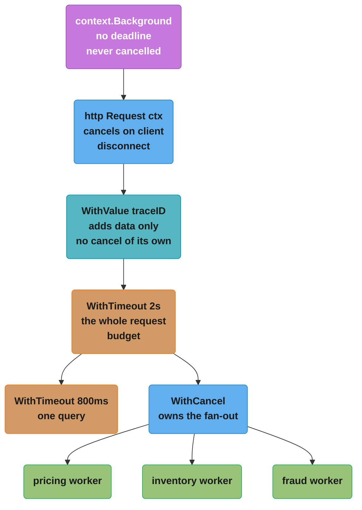
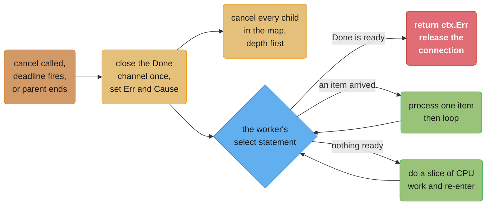
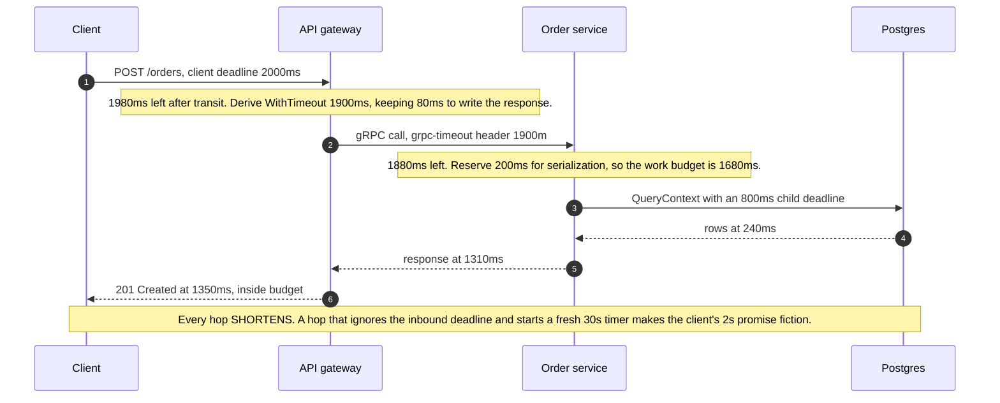

# Context and Cancellation

## 1. Concept Overview

`context.Context` is a four-method interface — `Deadline()`, `Done()`, `Err()`, `Value()` —
and every value satisfying it is **immutable**. You never mutate a context; you derive a new
one. `context.WithTimeout(parent, 2*time.Second)` does not change `parent`, it returns a
*child* that points at `parent` and adds one fact of its own. The result of a program's worth
of derivations is a **tree**, rooted at `context.Background()`, where every request-scoped
lifetime in the process is a subtree.

The tree has exactly one direction. Cancelling a node closes its `Done()` channel and then
cancels every descendant, depth first. It never touches an ancestor. That single property is
what makes the type useful: a handler can hand its context to twelve helpers, cancel once,
and know that all twelve subtrees collapse — while the server that spawned the handler keeps
serving.

The second property is the one people get wrong. **Cancellation is advisory.** Closing a
channel does not stop a goroutine, unwind a stack, or interrupt a syscall. It publishes a
fact. A goroutine that never selects on `ctx.Done()` runs to completion no matter how many
times you call `cancel()`, and a `for` loop with no cancellation check is exactly as
uninterruptible as it was before you plumbed a context through it. Go has no thread
interrupt, no `Thread.stop()`, and no equivalent of Java's interrupt flag being checked
inside blocking library calls unless the library was written to check it.

This module covers the tree and its invariants, all six derivation functions, how
cancellation is delivered through a closed channel, why `defer cancel()` is not a style
preference, how a deadline survives — or fails to survive — an RPC hop, the narrow legitimate
use of `context.Value` and the wide illegitimate one, and the standard-library integrations
(`net/http`, `database/sql`, `os/signal`) where a context is already doing work for you.

---

## 2. Intuition

> **One-line analogy**: a context is a **fire drill announcement**, not a fire. It travels
> instantly to every room below yours, and every person in those rooms is expected to look up
> and decide to leave. Anyone wearing headphones keeps working.

**Mental model**: picture an org chart drawn downward from a CEO who never resigns
(`Background()`). Each `With*` call hires a direct report and hands them a *narrower* mandate
— a shorter clock, a reason, a note in their pocket. When a manager is dismissed, everyone
below them is dismissed too, in one sweep. Nobody can dismiss their own manager, and nobody
can extend their mandate past their manager's.

**Why it matters**: the resource a distributed service runs out of first is rarely CPU — it
is **in-flight work nobody is waiting for**. A client hangs up after 2 seconds; without
propagation, the database query it started keeps a connection busy for 30. At 500 requests
per second that is 15,000 abandoned queries occupying a pool of 50 connections, and the
service falls over serving nothing. Context is the mechanism that turns "the caller left"
into "stop paying for this", end to end.

**Key insight**: a context carries **two unrelated things** and the confusion between them
causes most of the misuse. The `Done`/`Err`/`Deadline` half is a *control signal* — it is
about lifetime and it is the reason the type exists. The `Value` half is a *side channel* for
data that must cross an API boundary it does not belong in. The first is essential
infrastructure; the second is a documented compromise with rules, and it is the half people
reach for first.

---

## 3. Core Principles

- **A context is immutable; derivation builds a tree.** Every `With*` returns a child. The
  parent is unchanged and unaware of the child's values.
- **Cancellation flows down only.** A child's cancel tears down its own subtree; every
  ancestor keeps running.
- **A derived deadline can only shorten.** `WithTimeout(parent, 1*time.Hour)` under a parent
  expiring in 3 seconds gives you 3 seconds.
- **Cancellation is advisory.** The goroutine must check. `select` on `ctx.Done()` or pass
  the context to a function that does.
- **Every cancel func must be called.** `defer cancel()` on the line after the derivation,
  every time, including when the timeout will fire anyway.
- **`ctx` is the first parameter, named `ctx`, of type `context.Context`.** Never a struct
  field, never after the other arguments, never a variadic option.
- **Never pass a nil context.** Pass `context.TODO()` if you genuinely have nothing.
- **`Value` is for request-scoped data that crosses an API boundary** — a trace span, a
  request id, an authenticated principal. Not parameters. Not dependencies. Not config.
- **Value keys are an unexported type in your package.** A `string` key is a collision
  waiting for a second library.
- **The creator owns the cancel func.** A function that receives a context never cancels it.

---

## 4. Types / Architectures / Strategies

### 4.1 The two roots

| Root | What it is | When to use |
|------|-----------|-------------|
| `context.Background()` | The empty root: no deadline, no values, `Done()` returns nil forever | `main`, an incoming request at the outermost frame, a test, a long-lived background loop |
| `context.TODO()` | Behaviourally identical to `Background()` | A **marker** meaning "this call site should receive a context from its caller, and the plumbing is not done yet" |

They are indistinguishable at runtime and the difference is entirely for humans and for
static analysis: `grep -rn 'context.TODO()'` is a to-do list. A `TODO` that has been in the
tree for two years is a function whose cancellation never worked and nobody noticed.

### 4.2 The six derivation functions

| Function | Returns | Adds | Cancels when |
|----------|---------|------|-------------|
| `WithCancel(parent)` | `(ctx, CancelFunc)` | a cancel switch | you call `cancel()`, or the parent ends |
| `WithTimeout(parent, d)` | `(ctx, CancelFunc)` | a deadline of `now+d` | `d` elapses, you call `cancel()`, or the parent ends |
| `WithDeadline(parent, t)` | `(ctx, CancelFunc)` | an absolute deadline `t` | `t` passes, you call `cancel()`, or the parent ends |
| `WithCancelCause(parent)` | `(ctx, CancelCauseFunc)` | a cancel switch that records a reason | `cancel(err)`, or the parent ends |
| `WithValue(parent, k, v)` | `ctx` | one key/value pair | never on its own — it inherits the parent's cancellation exactly |
| `WithoutCancel(parent)` | `ctx` | keeps the values, **drops** the cancellation and deadline | never |

`WithTimeout(parent, d)` is precisely `WithDeadline(parent, time.Now().Add(d))`. Use
`WithTimeout` for "this operation gets 800 ms" and `WithDeadline` when the deadline came from
somewhere else — an RPC header, a job record, a scheduled cutoff.

`WithoutCancel` is the escape hatch for the one legitimate case where a child must outlive
its parent: writing an audit record or flushing a metric *after* the request context is
already cancelled. It keeps the trace id, drops the dead clock. Give it its own timeout
immediately, or you have created work with no bound at all.

### 4.3 Cause: recovering *why*

`ctx.Err()` has exactly two non-nil values, `context.Canceled` and
`context.DeadlineExceeded`, and neither tells you anything about intent. `context.Cause(ctx)`
returns the richer reason if one was recorded, and falls back to `ctx.Err()` otherwise.

```go
var errShedLoad = errors.New("shedding load: queue over 90% full")

ctx, cancel := context.WithCancelCause(parent)
defer cancel(nil) // nil cause == plain context.Canceled

if q.Depth() > q.Cap()*9/10 {
    cancel(errShedLoad)
}

// downstream, in a completely different package:
<-ctx.Done()
ctx.Err()             // context.Canceled -- useless for triage
context.Cause(ctx)    // errShedLoad     -- the actual reason
errors.Is(context.Cause(ctx), errShedLoad) // true
```

`WithDeadlineCause` and `WithTimeoutCause` do the same for the expiry path: the cause is
reported when the clock fires, so a timeout can say *which* budget ran out rather than the
undifferentiated `context.DeadlineExceeded` you get from ten different places.

### 4.4 `AfterFunc`: running code on cancellation

`context.AfterFunc(ctx, f)` registers `f` to run **in its own goroutine** as soon as `ctx` is
done, and returns a `stop func() bool` that unregisters it. It is the adapter for any API
that has no `Done()` support of its own:

```go
// Make a net.Conn read respect a context that the net package cannot see.
stop := context.AfterFunc(ctx, func() {
    conn.SetReadDeadline(time.Now()) // unblocks the pending Read immediately
})
defer stop()
n, err := conn.Read(buf)
```

Three facts that matter: `f` runs in a fresh goroutine, so it must be safe to call
concurrently with whatever else is happening; if `ctx` is *already* done, `f` is scheduled
immediately; and `stop()` returns `false` if `f` has already started, so it is not a
cancellation of `f`, only an unregistration.

### 4.5 The three shapes of a cancellation check

| Shape | Code | Use when |
|-------|------|----------|
| Blocking wait | `select { case <-ctx.Done(): ...; case v := <-ch: ... }` | the goroutine is waiting on something anyway |
| Poll at the top of a loop | `if err := ctx.Err(); err != nil { return err }` | a CPU-bound loop with no channel operation |
| Pass it down | `db.QueryContext(ctx, ...)` | the library already checks — do not add your own |

The third is the one to prefer. If every function you call takes a context, the only places
you write an explicit check are loops you own.

---

## 5. Architecture Diagrams

### The tree, and what a cancel sweeps



Cancelling `fan` kills the three workers and nothing else. Cancelling `api` kills `db` **and**
`fan` and its three workers. Cancelling any of the workers kills only that worker. There is
no upward edge anywhere in this picture — that absence is the whole design.

### How a cancellation is actually delivered



A closed channel makes **every** pending and future receive succeed immediately, which is why
a broadcast to an unknown number of waiters needs no bookkeeping. The worker in the bottom
branch is the failure mode: if it never re-enters the `select`, the closed channel changes
nothing at all.

### A deadline crossing four hops



### The `Value` lookup is a walk, not a map

```
ctx.Value(userKey) starting from the deepest node:

  [WithTimeout    ] --Value--> delegates to parent, holds no data
  [WithValue reqID] --Value--> key != userKey, delegate
  [WithValue trace] --Value--> key != userKey, delegate
  [WithValue user ] --Value--> MATCH, return the principal
  [WithCancel     ]
  [Background     ] --Value--> nil, walk ends

Six pointer hops and six interface comparisons for one lookup. Attach hot values
NEAR the root of the request subtree, and read them once into a local variable
instead of calling Value inside a loop.
```

---

## 6. How It Works — Detailed Mechanics

### 6.1 The concrete types behind the interface

The `context` package ships four implementations and you never name any of them:

| Type | Produced by | Fields that matter |
|------|-------------|--------------------|
| `backgroundCtx` / `todoCtx` | `Background()`, `TODO()` | none — every method returns a zero value |
| `cancelCtx` | `WithCancel`, `WithCancelCause` | `mu sync.Mutex`, a lazily created `done` channel, `children map[canceler]struct{}`, `err`, `cause` |
| `timerCtx` | `WithTimeout`, `WithDeadline` | embeds `cancelCtx`, plus `timer *time.Timer` and `deadline time.Time` |
| `valueCtx` | `WithValue` | embeds the parent `Context`, plus `key any` and `val any` |

A `valueCtx` has **no** cancellation machinery of its own. Its `Done()` is the parent's
`Done()`, forwarded by embedding. That is why `WithValue` returns one value and not a pair —
there is nothing to cancel.

### 6.2 What `Done()` returns, and why it is receive-only

```go
type Context interface {
    Deadline() (deadline time.Time, ok bool)
    Done() <-chan struct{}
    Err() error
    Value(key any) any
}
```

The channel is `<-chan struct{}` — **receive-only, of the zero-width type**. Both choices are
deliberate. Receive-only means a caller cannot close it, so the only code that can trigger a
cancellation is the code holding the `CancelFunc`. `struct{}` occupies zero bytes because no
value is ever sent: the signal *is* the close.

For `Background()` and `TODO()`, `Done()` returns **nil**. A receive on a nil channel blocks
forever, which is exactly right — a `select` on a never-cancellable context simply never
takes that branch. It is not a bug and needs no special case.

For a `cancelCtx`, the channel is created lazily on the first `Done()` call and cached, so a
context nobody waits on costs no channel at all.

### 6.3 What `cancel()` does, in order

```
cancel(removeFromParent, err, cause):
  1. lock c.mu
  2. if c.err != nil -> already cancelled, unlock and return   (idempotent)
  3. c.err = err                    (Canceled or DeadlineExceeded)
     c.cause = cause                (the rich reason, or err)
  4. close(c.done)                  (or store a closed channel if none was made)
  5. for child := range c.children  -> child.cancel(false, err, cause)
     c.children = nil               (depth-first, holding the parent's lock)
  6. unlock
  7. if removeFromParent -> detach this node from its parent's children map
  8. if this is a timerCtx -> c.timer.Stop(); c.timer = nil
```

Three consequences worth memorising. **It is idempotent**: calling `cancel()` ten times is
free and safe, which is why `defer cancel()` next to an already-fired timeout costs nothing.
**The first cause wins**: a subsequent `cancel(otherErr)` after the deadline fired does not
overwrite `DeadlineExceeded`. And **children are cancelled while the parent's lock is held**,
so the whole subtree transitions to cancelled before any external observer can see a
half-cancelled tree.

### 6.4 How a child attaches to its parent — and the goroutine you did not ask for

When you derive a cancellable child, the package walks up looking for the nearest ancestor
that is a `*cancelCtx` it recognises, and adds the child to that ancestor's `children` map.
That map entry is the leak: **until the child is cancelled, the parent holds a reference to
it**, and everything the child references, for as long as the parent lives.

If the parent is a **custom** `Context` implementation — your own type, or a wrapper from a
framework — the package cannot reach inside it. It falls back to spawning a goroutine:

```go
go func() {
    select {
    case <-parent.Done():
        child.cancel(false, parent.Err(), Cause(parent))
    case <-child.Done():
    }
}()
```

One goroutine per derivation, alive until one side finishes. This is the concrete cost of
writing your own `Context` type instead of deriving from the standard ones, and it is why
"implement `context.Context` on our request object" is a bad idea at any request rate.

### 6.5 The deadline is a minimum, computed at derivation time

```go
func WithDeadline(parent Context, d time.Time) (Context, CancelFunc) {
    // If the parent already expires sooner, the child adds nothing: return a
    // plain cancelCtx that will die with the parent.
    if cur, ok := parent.Deadline(); ok && cur.Before(d) {
        return WithCancel(parent)
    }
    // otherwise arm a timer for time.Until(d)
}
```

So `WithTimeout(ctx, 1*time.Hour)` under a context with 3 seconds left gives you 3 seconds,
silently and correctly. `ctx.Deadline()` on the result reports the parent's time, not yours —
which is how you check what budget you actually got:

```go
if dl, ok := ctx.Deadline(); ok {
    remaining := time.Until(dl)
    if remaining < 50*time.Millisecond {
        // Not enough budget left to be worth starting. Fail fast rather than
        // burning a connection on work that will be abandoned.
        return fmt.Errorf("insufficient budget: %v left: %w", remaining, context.DeadlineExceeded)
    }
}
```

That check is the cheapest reliability win in a fan-out service. Starting a 200 ms call with
30 ms of budget left costs a connection, a query, and a guaranteed error.

### 6.6 A worker that actually respects cancellation

```go
func (w *Worker) Run(ctx context.Context) error {
    tick := time.NewTicker(5 * time.Second)
    defer tick.Stop()

    for {
        select {
        case <-ctx.Done():
            return ctx.Err() // Canceled or DeadlineExceeded, for the caller to branch on
        case job := <-w.in:
            if err := w.handle(ctx, job); err != nil {
                if errors.Is(err, context.Canceled) {
                    return err // shutting down, not a failure worth alerting on
                }
                w.log.Error("job failed", "id", job.ID, "err", err)
            }
        case <-tick.C:
            w.reportDepth()
        }
    }
}

// A CPU-bound loop has no channel to select on, so it polls instead.
func checksum(ctx context.Context, blocks [][]byte) ([]byte, error) {
    h := sha256.New()
    for i, b := range blocks {
        if i%1024 == 0 { // one mutex-guarded Err() every 1024 blocks, not every block
            if err := ctx.Err(); err != nil {
                return nil, err
            }
        }
        h.Write(b)
    }
    return h.Sum(nil), nil
}
```

`ctx.Err()` takes the context's mutex, so checking it a million times per second in a tight
loop is measurable. Every 1024 iterations bounds the abandonment latency to microseconds
while making the check free.

### 6.7 The correct key type for `Value`

```go
package auth

// unexported, so no other package can construct a value of this type at all
type ctxKey struct{}

func NewContext(ctx context.Context, p *Principal) context.Context {
    return context.WithValue(ctx, ctxKey{}, p)
}

// Typed accessor: callers never touch the key, never type-assert, and get a
// comma-ok they cannot forget.
func FromContext(ctx context.Context) (*Principal, bool) {
    p, ok := ctx.Value(ctxKey{}).(*Principal)
    return p, ok
}
```

`ctxKey struct{}` is preferred over `type ctxKey string` plus a constant: the empty struct
allocates nothing, and *no* other package can name the type, so a collision is not merely
unlikely, it is impossible. Exporting `NewContext`/`FromContext` and keeping the key private
is the standard-library pattern and it survives refactors that a raw `ctx.Value("user")` does
not.

---

## 7. Real-World Examples

**`net/http` server.** `r.Context()` is derived from the server's base context and is
cancelled when the client disconnects, when the handler returns, or when
`Server.Shutdown` closes the connection. Passing it into every downstream call is what makes
a hung-up browser stop costing you database time. `r.WithContext(ctx)` returns a shallow copy
of the request with a new context — the only way to attach one, since `Request.ctx` is
unexported.

**`net/http` client.** `http.NewRequestWithContext(ctx, ...)` attaches the deadline to the
whole round trip including connection setup, TLS handshake, and reading the body. It is
strictly better than `http.Client.Timeout`, which cannot be shortened per call and cannot be
cancelled early. A cancelled request returns an error wrapping `context.Canceled`, and the
underlying connection is closed rather than returned to the idle pool.

**`database/sql`.** Every method has a `Context` variant, and the deadline covers *both*
waiting for a free connection from the pool and the query itself. On expiry the package asks
the driver to cancel the in-flight statement; drivers that cannot (the Postgres wire protocol
can, via a separate cancel request; some others cannot) get the connection closed instead of
returned, which is why a storm of timeouts also shows up as connection churn.

**gRPC.** A deadline on the client context is serialized into the `grpc-timeout` header, and
the server rebuilds a context from it. A cancelled client context sends an RST_STREAM, and
the server handler's context is cancelled — genuine end-to-end propagation with no work from
you. `status.FromContextError(ctx.Err())` maps `Canceled` to `codes.Canceled` and
`DeadlineExceeded` to `codes.DeadlineExceeded`.

**`os/signal.NotifyContext`.** `signal.NotifyContext(context.Background(), os.Interrupt,
syscall.SIGTERM)` returns a context cancelled on the first matching signal, so shutdown
becomes ordinary cancellation instead of a bespoke channel. Since `[1.26]` it cancels with a
**cause naming the signal received**, so `context.Cause(ctx)` distinguishes a Ctrl-C from a
Kubernetes SIGTERM without a second handler.

**OpenTelemetry.** `trace.SpanFromContext(ctx)` and `tracer.Start(ctx, name)` are the
canonical legitimate use of `Value`: the active span is request-scoped, it must cross every
API boundary in the process, and threading it as an explicit parameter through every
signature is precisely the coupling the compromise exists to avoid.

**Cross-section**: the arithmetic of how much budget each hop may take is
[Latency Budgets and SLO Math](../../backend/latency_budgets_and_slo_math/latency_budgets_and_slo_math.md);
the error values that come back out of a cancelled tree are
[Errors and Panics](../errors_and_panics/errors_and_panics.md).

---

## 8. Tradeoffs

### Context deadline vs a client-level timeout

| | `context.WithTimeout` per call | `http.Client{Timeout: d}` |
|---|---|---|
| Granularity | per call site | per client, process-wide |
| Shortenable by a caller's budget | yes, automatically | no |
| Cancellable early | yes | no |
| Covers connection setup | yes | yes |
| Distinguishes "caller left" from "too slow" | yes, via `ctx.Err()` | no, one error either way |
| Verdict | **default** | a last-resort backstop, set generously |

### `context.Value` vs an explicit parameter vs a struct field

| | `context.Value` | Explicit parameter | Struct field on the service |
|---|---|---|---|
| Type safety | none — `any` plus an assertion | full | full |
| Discoverability | invisible in the signature | in the signature | in the constructor |
| Lookup cost | linear walk up the tree | zero | zero |
| Survives a middleware boundary you do not own | yes | no | n/a |
| Right for | trace span, request id, principal | everything the callee needs to do its job | dependencies: DB, logger, clock |

### Where to put the deadline

| Strategy | Latency behaviour | Failure mode |
|----------|-------------------|--------------|
| One deadline at the edge, inherited everywhere | Simple, and the total is bounded | A slow first hop leaves nothing for the rest, so the last call fails with 4 ms of budget |
| Per-hop budgets derived from the remaining time | Each stage gets a fair share, and can fail fast | More code, and the split has to be maintained as the call graph changes |
| Fresh timeout per hop, ignoring the parent | Every hop looks healthy in isolation | The client's promise is fiction; abandoned work accumulates until the pool is gone |

### Cancellation propagation cost

| Tree shape | Cost of one root cancel |
|-----------|------------------------|
| 1 root, 50 children, depth 2 | 50 map iterations + 50 channel closes, single-digit microseconds |
| Depth 200 chain of `WithValue` | Cancellation is O(1) — `valueCtx` has no children map — but every `Value()` read is 200 hops |
| Parent is a custom `Context` type | One extra goroutine **per derivation**, alive until either side ends |

---

## 9. When to Use / When NOT to Use

**Use a context when:**

- The work is **request-scoped** — it exists because a caller asked, and stops mattering when
  the caller leaves.
- You are crossing a **process boundary**: any RPC, HTTP call, or database query gets one.
- You need a **deadline** rather than a timeout constant, because the budget came from
  upstream.
- You are writing a **library** that performs I/O. Take a `ctx` as the first parameter even if
  today's implementation ignores it; adding it later is a breaking change to every caller.
- You are running a **long-lived loop** in a service that must shut down cleanly.

**Do NOT use a context when:**

- The value is a **dependency** — a database handle, a logger, a clock, a feature-flag client.
  That is constructor injection wearing a disguise.
- The value is an **optional parameter**. `ctx.Value("limit")` is a function argument that the
  compiler can no longer check and a reader can no longer see.
- The work must **complete regardless** — a compensating write, an audit record, a metric
  flush. Derive with `WithoutCancel` and give it its own timeout.
- The lifetime is **not request-scoped**. A cache warmer that runs for the life of the process
  gets `Background()` plus its own shutdown channel or a signal context, not a request's ctx.
- You are tempted to **store it in a struct**. The narrow exception is a type whose *entire
  lifetime is that one operation* — a `stream` object created per RPC — and even then the
  field is documented and the type is never reused.

---

## 10. Common Pitfalls

### Pitfall 1 — the missing `defer cancel()` that ate 6 GB

A fan-out endpoint derived a per-attempt context inside a retry loop and never cancelled it,
because "the timeout fires anyway".

```go
// BROKEN
for attempt := 0; attempt < 3; attempt++ {
    attemptCtx, _ := context.WithTimeout(ctx, 3*time.Second) // cancel func discarded
    if resp, err = call(attemptCtx); err == nil {
        break
    }
}

// FIX
for attempt := 0; attempt < 3; attempt++ {
    attemptCtx, cancel := context.WithTimeout(ctx, 3*time.Second)
    resp, err = call(attemptCtx)
    cancel() // not deferred -- this is a loop; a defer here fires only at function exit
    if err == nil {
        break
    }
}
```

**Quantified impact**: at 1,100 requests/second each holding up to 3 uncancelled `timerCtx`
nodes for a full 3 seconds, the parent context's `children` map held roughly 10,000 live
entries at steady state, each pinning a timer and the closure graph behind it. RSS climbed
from 900 MB to 6.4 GB over 40 minutes and the pod was `OOMKilled` on a 7 GB limit, twice an
hour, for nine days. `go vet`'s `lostcancel` analyzer — which runs by default under `go test`
— had been reporting it the entire time in output nobody read in CI.

Note the second half of the fix: **`defer cancel()` inside a loop body is itself a bug**,
because deferred calls run at *function* exit, not iteration exit. In a loop, call `cancel()`
explicitly, or move the body into its own function.

### Pitfall 2 — the downstream service that reset the budget

A checkout service promised clients a 2-second p99. The inventory service it called created
its own context with a fresh 30-second timeout, ignoring the inbound deadline.

```go
// BROKEN -- inside the inventory service's handler
func (h *Handler) Reserve(w http.ResponseWriter, r *http.Request) {
    ctx, cancel := context.WithTimeout(context.Background(), 30*time.Second)
    defer cancel()
    h.svc.Reserve(ctx, ...) // r.Context() thrown away; client hang-up is invisible

// FIX
func (h *Handler) Reserve(w http.ResponseWriter, r *http.Request) {
    ctx, cancel := context.WithTimeout(r.Context(), 30*time.Second) // a ceiling, not a reset
    defer cancel()
    h.svc.Reserve(ctx, ...)
}
```

Deriving from `r.Context()` makes the 30 seconds a **ceiling** rather than a replacement: if
the caller's remaining budget is 1.8 seconds, `WithDeadline`'s "parent expires sooner" branch
means the handler simply gets 1.8 seconds.

**Quantified impact**: during a 4-minute upstream latency spike, the checkout service timed
out at 2 seconds and retried, while inventory kept every abandoned request running for the
full 30. In-flight requests in inventory went from 60 to 4,400, its Postgres pool of 50
connections was fully occupied by queries for requests nobody was reading, and the incident
extended from 4 minutes to 51. The one-line fix removed a class of incident, not one instance
of it.

### Pitfall 3 — the context stored in a struct

A generated API client cached the first request's context on the client object.

```go
// BROKEN
type Client struct {
    http *http.Client
    ctx  context.Context // the FIRST caller's context, forever
}

func (c *Client) Do(req *Request) (*Response, error) {
    return c.send(c.ctx, req)
}

// FIX
type Client struct {
    http *http.Client
}

func (c *Client) Do(ctx context.Context, req *Request) (*Response, error) {
    return c.send(ctx, req)
}
```

**Quantified impact**: the client was constructed once at startup from the first inbound
request's context. Two seconds later that request finished and its context was cancelled —
and every subsequent call through the shared client returned `context.Canceled` immediately.
The service returned 500 on 100% of traffic 2 seconds after its first request, in a canary
that ran for 11 minutes before rollback. This is why "`ctx` is the first parameter, never a
field" is a rule and not a preference.

### Pitfall 4 — `context.Value` used as a parameter bag

An internal framework passed the tenant's shard id and page size through the context so
handlers would not need to change signatures.

```go
// BROKEN
ctx = context.WithValue(ctx, "shard", tenant.Shard)
ctx = context.WithValue(ctx, "pageSize", 50)
...
shard := ctx.Value("shard").(int) // panics when a code path forgot to set it

// FIX
type Query struct {
    Shard    int
    PageSize int
}
func (s *Store) List(ctx context.Context, q Query) ([]Row, error)
```

**Quantified impact**: a new async job path called the same store function without going
through the HTTP middleware that set the keys. The type assertion panicked, and because it
was inside a bare `go func()` it took the process down — 14 pods crash-looping for 22
minutes. Two independent defects compound here: the untyped assertion, and the string keys
`"shard"` and `"pageSize"`, which a vendored library could have collided with silently.
Anything the callee *needs to do its job* is a parameter, and the compiler will tell you when
you forget one.

### Pitfall 5 — waiting on a context that cannot be cancelled

```go
// BROKEN -- looks defensive, blocks forever
func waitReady(ctx context.Context, ch <-chan struct{}) error {
    select {
    case <-ch:
        return nil
    case <-ctx.Done():
        return ctx.Err()
    }
}
// called as waitReady(context.Background(), ch) -- Done() is nil, so that branch
// is dead and this is an unconditional block

// FIX
ctx, cancel := context.WithTimeout(context.Background(), 30*time.Second)
defer cancel()
if err := waitReady(ctx, ch); err != nil { ... }
```

**Quantified impact**: a service's readiness probe passed `Background()` into this helper. A
dependency never signalled ready, the goroutine blocked forever, and the health endpoint
reported healthy the whole time because it checked a different flag. The deployment sat at
0% traffic served but 100% "ready" for 38 minutes before anyone looked at the goroutine
profile. A nil `Done()` channel is not an error and produces no warning — it is a `select`
branch that can never be taken.

### Pitfall 6 — cancelling a caller's context from inside a library

```go
// BROKEN -- a library function that "cleans up" its caller
func (p *Pool) Drain(ctx context.Context, cancel context.CancelFunc) {
    p.wait()
    cancel() // tears down the caller's whole subtree, including work Drain knows nothing about
}

// FIX
func (p *Pool) Drain(ctx context.Context) error {
    p.wait()
    return ctx.Err() // report, do not act
}
```

**Quantified impact**: the pool's `Drain` was called from a request handler that had derived
one context for three parallel operations. Draining the pool cancelled the other two mid
flight, producing partially written orders at a rate of about 40 per hour until it was found
three weeks later. The rule is ownership: **the function that created a cancellable context
holds its cancel func and nobody else does.** Passing a `CancelFunc` as a parameter is almost
always a design error.

---

## 11. Technologies & Tools

| Tool | What it does for context and cancellation |
|------|-------------------------------------------|
| `go vet` `lostcancel` | Flags a `CancelFunc` that is discarded or not called on all paths; runs by default under `go test` |
| `golangci-lint` `contextcheck` | Flags a function that creates `context.Background()` when a context was available from its caller — the reset-the-budget bug |
| `golangci-lint` `containedctx` | Flags a `context.Context` stored as a struct field |
| `golangci-lint` `noctx` | Flags an HTTP request or SQL call made without a context variant |
| `golangci-lint` `contextkey` / `staticcheck SA1029` | Flags a basic type used as a `context.Value` key |
| `net/http` | `Request.Context()` cancels on client disconnect; `NewRequestWithContext` for the client side |
| `database/sql` | `QueryContext`/`ExecContext`/`BeginTx` bound both pool wait and query execution |
| `google.golang.org/grpc` | Serializes the deadline into `grpc-timeout` and rebuilds it server side; `status.FromContextError` maps `ctx.Err()` to a code |
| `os/signal.NotifyContext` | A context cancelled on SIGINT/SIGTERM, with a cause naming the signal `[1.26]` |
| `golang.org/x/sync/errgroup` | `WithContext` cancels the group's context on the first error, so siblings unwind |
| `go.opentelemetry.io/otel` | Carries the active span in the context — the canonical legitimate `Value` use |
| `testing/synctest` `[1.25]` | A fake clock inside a bubble, so deadline behaviour is tested without real sleeps; `synctest.Sleep` `[1.27]` |
| `go.uber.org/goleak` | Fails a test that leaves a goroutine behind — the usual symptom of a missing cancellation check |

---

## 12. Interview Questions with Answers

**Q: Does cancelling a context stop the goroutines that hold it?**
**Short:** No — cancellation is advisory, and a goroutine keeps running until it chooses to look at the Done channel itself.

This is the single most common misconception about the type. `cancel()` closes a channel and
sets an error field; it does not unwind a stack, interrupt a syscall, or preempt a loop. Go
has no thread-kill primitive at all, so a `for` loop with no `select` on `ctx.Done()` and no
call into a context-aware library runs to completion regardless. The practical consequence is
that plumbing a context through a call graph buys you nothing until every leaf either selects
on `Done()`, polls `Err()`, or delegates to something that does. When a service "ignores its
timeouts", the cause is almost always a leaf function that took a `ctx` parameter and never
read it.

**Q: What actually breaks if you forget to call the cancel function from WithTimeout?**
**Short:** The child node stays registered in its parent's children map, pinning the child and its timer until the deadline fires or the parent ends.

Deriving a cancellable child adds it to the nearest cancellable ancestor's `children` map, and
the only thing that removes it is cancellation. Under a long-lived parent — a server base
context, or a request handling a slow fan-out — the map grows with every uncancelled
derivation, holding a `timerCtx`, an armed `time.Timer`, and the closure graph each one
references. It is a textbook slow leak: nothing fails, RSS climbs, and the pod is OOMKilled
hours later. `go vet`'s `lostcancel` analyzer catches the discarded return value and runs
automatically under `go test`, so the fix is usually reading CI output rather than writing
code. Inside a loop, call it explicitly — a `defer` there fires at function exit, not
iteration exit.

**Q: What is the difference between Canceled and DeadlineExceeded, and why does a caller care?**
**Short:** One means somebody called cancel, the other means the clock ran out — and only the second is usually worth a retry.

`ctx.Err()` returns `context.Canceled` when a `CancelFunc` fired or a parent was cancelled,
and `context.DeadlineExceeded` when a deadline passed. The distinction drives real decisions:
a `Canceled` almost always means the client hung up or a sibling in an errgroup already
failed, so retrying is wasted work and alerting on it is noise; a `DeadlineExceeded` means the
downstream was too slow and may deserve a retry, a circuit-breaker tick, or a latency alert.
`DeadlineExceeded` additionally satisfies `net.Error` with `Timeout() == true`, which is how
generic retry middleware recognises it. Both are matched with `errors.Is`, never `==`, because
they arrive wrapped by whatever layer surfaced them.

**Q: Why must ctx be the first parameter and never a struct field?**
**Short:** A per-operation lifetime cannot live in a value that outlives the operation, so storing it silently shares one dead clock across every future call.

A context describes one call's deadline, cancellation and request-scoped data. A struct field
is initialised once and read many times, so the second caller inherits the first caller's
budget — and once that first context is cancelled, every subsequent operation fails
immediately with `context.Canceled`. The parameter position is a separate, weaker convention:
first, named `ctx`, typed `context.Context`, so it is greppable and so tooling like
`contextcheck` and `noctx` can reason about call sites. The narrow exception is a type whose
entire lifetime *is* one operation — a per-RPC stream object — and even there the field is
documented and the value is never reused.

**Q: What belongs in context.Value, and what does not?**
**Short:** Only request-scoped data that must cross an API boundary you do not control — a trace span, a request id, an authenticated principal.

The test is two-part: is it scoped to this request, *and* does it need to traverse a signature
you cannot change? An OpenTelemetry span passes both — it is per request, and threading it
explicitly through every intermediate function is precisely the coupling that would make it
unusable. A page size, a shard id, or a feature flag fails the second half: those are
arguments, and putting them in the context replaces a compile-time error with a runtime type
assertion. A database handle or a logger fails the first half: they live for the process and
belong in a constructor. The cost of getting it wrong is a call path that skips the middleware
and panics on the assertion, usually in a background goroutine where the panic is fatal.

**Q: Why does a context value key need an unexported type?**
**Short:** Keys are compared by interface equality, so a plain string key from your package matches an identical string set by any other package.

`ctx.Value(k)` walks the tree comparing `k` against each node's stored key using interface
equality, which for a `string` means the text matches. Two independent libraries both using
`"user"` will read each other's values, and the failure is a type assertion panic or, worse, a
silently wrong principal. The fix is a type only your package can name: `type ctxKey struct{}`
and `ctx.Value(ctxKey{})`. The empty struct allocates nothing, and because the type is
unexported no other package can even construct the key. Wrap it in exported `NewContext` and
`FromContext` helpers so callers never touch the key or write the assertion themselves.
`staticcheck` SA1029 flags the basic-type version.

**Q: How is cancellation physically delivered to a waiting goroutine?**
**Short:** By closing the receive-only channel that Done returns, which makes every pending and future receive on it succeed at once.

A closed channel is Go's broadcast primitive: receives on it never block again and return the
element type's zero value forever. That is why the signal needs no bookkeeping about how many
waiters exist — one `close` reaches an unknown number of `select` statements. The channel is
`<-chan struct{}`: receive-only so no consumer can trigger a cancellation it does not own, and
zero-width because no value is ever transmitted, the close *is* the message. For
`context.Background()` the method returns nil, and a receive on a nil channel blocks forever,
so a `select` on a non-cancellable context simply never takes that branch — correct behaviour
with no special case.

**Q: What do WithCancelCause and context.Cause give you over WithCancel?**
**Short:** They record why a subtree was torn down, so triage can tell a load-shed from a client hang-up when Err reports only the generic value.

`WithCancelCause` returns a `CancelCauseFunc` taking an `error`. `context.Cause(ctx)` returns
that error if one was recorded and falls back to `ctx.Err()` otherwise, so it is always safe
to call. `ctx.Err()` deliberately keeps returning the plain `Canceled`, preserving every
existing comparison. The cause is set once by whichever cancellation happened first and later
calls do not overwrite it, so the reason you read is the reason it died.
`WithDeadlineCause` and `WithTimeoutCause` do the same on the expiry path, letting a service
distinguish which of five nested budgets ran out instead of reporting one undifferentiated
`DeadlineExceeded`. Match the result with `errors.Is`, since the cause propagates through
wrapping like any other error value.

**Q: How does a deadline travel across an RPC boundary?**
**Short:** gRPC serializes the remaining time into the grpc-timeout header and the server rebuilds a context from it, while plain HTTP has no standard header and needs your own.

On the gRPC client side the transport computes `time.Until(deadline)` at send time and writes
it as `grpc-timeout: 1900m`; the server calls `WithTimeout` with that value, so the callee's
budget is the caller's *remaining* budget minus transit. Cancellation propagates too: a
cancelled client context sends RST_STREAM and the server handler's context is cancelled. HTTP
has no equivalent — you either send your own header and derive from it, or every hop invents
its own timeout and the end-to-end budget is imaginary. Whichever transport, every hop must
also reserve time for its own response, so the derived child is always strictly shorter than
what arrived.

**Q: A downstream service starts a fresh 30-second timeout on each request. What is wrong with that?**
**Short:** The caller's shorter budget stops meaning anything, so abandoned work keeps running and fills the connection pool with requests nobody is reading.

Deriving from `context.Background()` inside a handler discards both the inbound deadline and
the client-disconnect signal. In steady state nothing looks wrong. During a latency spike the
caller times out at 2 seconds and retries while the callee keeps every abandoned request alive
for 30, so in-flight work multiplies by roughly fifteen and the database pool is fully
occupied by queries whose results will be discarded. A 4-minute upstream blip becomes a
50-minute outage. The fix is to derive from `r.Context()` — the 30 seconds then acts as a
ceiling, and `WithDeadline`'s "parent expires sooner" branch quietly hands you the caller's
1.8 seconds instead. `contextcheck` finds these mechanically.

**Q: What is the difference between context.Background and context.TODO?**
**Short:** Nothing at runtime — both are empty, never-cancelled roots, and TODO is a searchable marker meaning the plumbing is unfinished.

Both return an empty context with no deadline, no values, and a nil `Done()` channel. The
distinction is entirely documentary: `Background()` is a deliberate root at `main`, at the
outermost frame of an inbound request, or in a test, while `TODO()` says "this call site
should be receiving a context from its caller and I have not wired it yet". Because the
difference is only a name, `grep -rn 'context.TODO()'` is a genuine work list, and a `TODO`
that has survived two years is a code path whose cancellation has never worked. Never pass
`nil` in place of either — the standard library will panic rather than guess.

**Q: If you cancel a child context, what happens to the parent?**
**Short:** Nothing — cancellation flows strictly downward, so a child's cancel tears down its own subtree and leaves every ancestor running.

The tree has parent-to-child edges only. `cancel()` on a node closes that node's `Done()`
channel, sets its `Err` and `Cause`, then walks its `children` map cancelling each recursively
while holding its own lock, and finally detaches itself from its parent. There is no upward
edge to follow. This asymmetry is what makes the type composable: a handler can derive a
short-lived context for one of five parallel calls, cancel it on a partial failure, and the
other four keep going. The corollary is that a library which cancels a context it merely
received is committing action at a distance — it kills sibling work it knows nothing about.

**Q: What is context.AfterFunc for?**
**Short:** It runs a callback in a fresh goroutine as soon as a context ends, which is the adapter for any blocking API that has no Done support.

`stop := context.AfterFunc(ctx, f)` registers `f`; it runs once, in its own goroutine, when
`ctx` is done — immediately if `ctx` is already done. The returned `stop` unregisters it and
reports `false` if `f` has already started, so it is an unregistration and not a cancellation
of `f`. The typical use is bridging a legacy or C-shaped API into the context world: set a
`net.Conn` read deadline to `time.Now()` to unblock a pending `Read`, close a third-party
handle, or signal a callback-based client. Because `f` runs concurrently with whatever else is
in flight, it must be safe against that, and it must be short — it is not a place to do
cleanup that can itself block.

**Q: How expensive is a context.Value lookup?**
**Short:** Each read walks the parent chain one node at a time doing an interface comparison per node, so cost is linear in how deep the value sits.

There is no map. A `valueCtx` holds exactly one key and one value plus its parent, and its
`Value` method compares its own key and otherwise delegates upward, terminating at the root
with nil. A request that accumulates a trace id, a request id, a principal, a tenant and a
locale is five nodes deep before any timeouts are layered on, and every lookup from the leaf
pays all five hops. It is nanoseconds, not microseconds — but it is nanoseconds *inside* a
loop that runs a million times, which is a real profile entry. Read the value once into a
local at the top of the function, and attach frequently-read values near the root of the
request subtree rather than at the deepest frame.

**Q: What happens to a handler's context when the HTTP client disconnects?**
**Short:** Request.Context is cancelled the moment the connection drops, so any downstream call that respects it stops immediately.

The `net/http` server derives each request's context from the server's base context and
cancels it when the client closes the connection, when the handler returns, or when
`Server.Shutdown` closes that connection. Passing `r.Context()` into every database query and
outbound call is what converts a hung-up browser into released connections rather than 30
seconds of wasted work. Two consequences bite people: a handler that spawns a goroutine
outliving the response must **not** use `r.Context()`, since it is cancelled as soon as the
handler returns — derive with `context.WithoutCancel` and give the goroutine its own timeout;
and to attach a context to a request you build a shallow copy with `r.WithContext(ctx)`,
because the field itself is unexported.

**Q: What does a context deadline do inside database/sql?**
**Short:** It bounds both the wait for a free pooled connection and the query execution, and on expiry the package asks the driver to cancel the in-flight statement.

`QueryContext`, `ExecContext` and `BeginTx` start the clock before the pool is even consulted,
which matters because pool starvation, not slow SQL, is the usual cause of a timeout under
load. When the deadline fires the package attempts driver-level cancellation — the Postgres
wire protocol supports this via a separate cancel request, and `pgx` implements it — so the
server actually stops working rather than finishing a query nobody will read. A driver that
cannot cancel gets its connection **closed** instead of returned to the pool, which is why a
timeout storm shows up as connection churn and a spike in new-connection latency alongside the
errors. Deeper pooling behaviour is in
[Connection Pool Management](../../database/connection_pool_management/connection_pool_management.md).

**Q: What happens if you derive a longer timeout than the parent's remaining budget?**
**Short:** The longer value is ignored — `WithDeadline` sees the parent expires sooner and returns a plain cancellable child instead of arming a timer.

Deadlines compose by minimum, and the check happens once at derivation time:
`WithTimeout(ctx, 1*time.Hour)` under a context with 3 seconds left produces a context that
dies in 3 seconds, and `ctx.Deadline()` on it reports the parent's time. This is what makes a
generous per-hop ceiling safe — you write 30 seconds as an upper bound and automatically get
the caller's 1.8 seconds when that is what arrived. Because the check is done at derivation
and not continuously, the reliable way to know your real budget is to call `ctx.Deadline()`
and measure `time.Until` yourself, then refuse to start work that clearly cannot finish.

**Q: What does os/signal.NotifyContext give you over a signal channel?**
**Short:** It turns SIGINT and SIGTERM into ordinary cancellation, carrying a cause that names the exact signal received `[1.26]`.

`ctx, stop := signal.NotifyContext(context.Background(), os.Interrupt, syscall.SIGTERM)`
returns a context cancelled on the first matching signal plus a `stop` func that unregisters
the handler — `defer stop()` restores default signal behaviour, so a second Ctrl-C kills a
process wedged in shutdown. The value is uniformity: every long-lived loop in the program
already selects on a `Done()` channel, so shutdown needs no second mechanism. Since `[1.26]`
the cancellation carries a cause naming the signal, so `context.Cause(ctx)` distinguishes an
operator's Ctrl-C from a Kubernetes SIGTERM without a parallel handler. Sequencing the actual
drain is in
[Concurrency Patterns and Pitfalls](../concurrency_patterns_and_pitfalls/concurrency_patterns_and_pitfalls.md).

**Q: Should a function ever cancel a context it received as a parameter?**
**Short:** No — the code that created a cancellable context owns its cancel func, and a callee cancelling its caller's tree kills sibling work it cannot see.

Ownership follows creation. `WithCancel` returns the context *and* the cancel func together
precisely so that the pair stays in one function, usually as `defer cancel()` on the following
line. A `CancelFunc` passed as a parameter is nearly always a design error: the callee has no
idea what else hangs off that node, so cancelling it produces partially completed multi-step
operations that are extremely hard to attribute later. If a callee needs to signal that
everything should stop, it returns an error and lets the owner decide — which is exactly the
contract `errgroup.WithContext` implements, owning the cancel itself and firing it on the
first returned error.

**Q: How do you test deadline-dependent code without real sleeps?**
**Short:** Run it inside a `testing/synctest` bubble `[1.25]`, where the clock is fake and only advances once every goroutine in the bubble is blocked.

`synctest.Test(t, fn)` runs `fn` in a bubble with a synthetic clock starting at a fixed
instant. When every goroutine inside is durably blocked — on a channel, a mutex, or a timer —
the fake clock jumps forward to the next timer, so a test of a 30-second deadline finishes in
microseconds and is deterministic rather than flaky under CI load. `synctest.Wait` blocks
until the rest of the bubble is idle, which is how you assert on an intermediate state, and
`synctest.Sleep` `[1.27]` advances the bubble's clock by a duration and then waits for it to
settle. Pair it with `go.uber.org/goleak` so a test also fails when a cancellation path leaves
a goroutine behind.

---

## 13. Best Practices

- **`defer cancel()` on the line immediately after the derivation.** Every time, including
  when a timeout will fire on its own. Inside a loop, call it explicitly instead — `defer`
  runs at function exit.
- **Derive, never reset.** A handler's context comes from `r.Context()`. `Background()` inside
  a request path is almost always the reset-the-budget bug.
- **Take `ctx context.Context` as the first parameter** of every function that performs I/O,
  even if today's body ignores it. Adding it later breaks every caller.
- **Never store a context in a struct**, and never pass a `CancelFunc` into a function that
  did not create it.
- **Check the remaining budget before starting an expensive call.** `ctx.Deadline()` plus
  `time.Until` — 30 ms of budget is not worth a connection.
- **Poll `ctx.Err()` every N iterations, not every iteration**, in a CPU-bound loop. Every
  1024 is a good default: microsecond abandonment latency, immeasurable cost.
- **Use `WithCancelCause` wherever more than one thing can cancel a subtree**, and read it back
  with `context.Cause`, so triage has the reason rather than the category.
- **Confine `Value` to a trace span, a request id, and a principal**, behind exported
  `NewContext`/`FromContext` helpers over an unexported `struct{}` key type.
- **Use `WithoutCancel` plus a fresh timeout** for work that must finish after the request
  ends — an audit write, a metric flush — and never a bare `Background()`.
- **Distinguish `Canceled` from `DeadlineExceeded` in metrics and retries.** Alerting on
  `Canceled` is alerting on clients hanging up.
- **Turn on `lostcancel`, `contextcheck`, `containedctx` and `noctx`** and treat them as
  errors. Four of the six pitfalls above are mechanically detectable.
- **Test cancellation, not just the happy path.** A test that cancels mid-operation and
  asserts on `ctx.Err()` is the only thing that proves the plumbing works.

---

## 14. Case Study

### Giving a search fan-out a real end-to-end budget

**Context.** A product search endpoint serves 3,200 requests/second across 18 pods. Each
request fans out to four backends — an Elasticsearch cluster, a pricing service, an inventory
service, and a personalization model server — merges the results, and returns. The product
requirement is a hard 400 ms p99 at the edge. The first implementation met it in staging and
fell over on the first traffic spike in production.

**The failing version.**

```go
// BROKEN: four separate defects in twenty lines.
func (h *SearchHandler) ServeHTTP(w http.ResponseWriter, r *http.Request) {
    ctx := context.Background()               // 1. the client's deadline is discarded

    var (
        mu      sync.Mutex
        results Results
        wg      sync.WaitGroup
    )
    for _, b := range h.backends {
        wg.Add(1)
        go func(b Backend) {                  // 2. no cancellation between siblings
            defer wg.Done()
            cctx, _ := context.WithTimeout(ctx, 5*time.Second) // 3. cancel discarded
            part, err := b.Query(cctx, r.URL.Query().Get("q"))
            if err != nil {
                log.Printf("%s: %v", b.Name(), err)
                return
            }
            mu.Lock()
            results.Merge(part)
            mu.Unlock()
        }(b)
    }
    wg.Wait()                                 // 4. waits for the SLOWEST backend, always
    json.NewEncoder(w).Encode(results)
}
```

Four incidents, in the order they arrived:

1. **The personalization model server degraded to 4.2 seconds p99** during a model rollout.
   Because `wg.Wait()` waits for everyone, edge p99 went from 380 ms to 4,400 ms even though
   three of four backends were healthy. The load balancer's own 2-second timeout fired first,
   so clients saw 504s while the pods reported 200s — the two graphs disagreed for 25 minutes
   before anyone reconciled them.

2. **Clients that gave up kept costing money.** With `context.Background()` at the top,
   nothing knew the connection had closed. Every abandoned request continued to hold four
   outbound connections for up to 5 seconds. In-flight requests per pod went from 190 to
   3,100, and the outbound HTTP transport's connection pool was fully saturated.

3. **RSS sat 340 MB above baseline and never came back down between spikes.** The discarded
   cancel funcs from `context.WithTimeout(ctx, 5*time.Second)` left one `timerCtx` per backend
   per request attached to the parent for the full 5 seconds. At 178 requests/second per pod —
   3,200 across 18 — that is roughly 3,600 live nodes per pod at steady state, each with an
   armed timer, and each pinning the query string and whatever partial results had merged.
   Under the degradation in incident 1 the same arithmetic reached 12,400 nodes per pod.

4. **One failing backend cost the full 5 seconds anyway.** When Elasticsearch returned an
   error in 12 ms, the other three kept running to their own timeouts. Nothing told them the
   response would be degraded regardless.

**The fixed version.**

```go
// FIX: derive from the request, budget explicitly, cancel siblings, always release.
const (
    edgeBudget   = 400 * time.Millisecond
    responseCost = 40 * time.Millisecond // JSON encode + write, measured at p99
)

func (h *SearchHandler) ServeHTTP(w http.ResponseWriter, r *http.Request) {
    // 1. Inherit the client's lifetime AND its deadline. The 400ms is a ceiling:
    //    if an upstream gateway already imposed 250ms, WithTimeout keeps 250ms.
    ctx, cancel := context.WithTimeout(r.Context(), edgeBudget)
    defer cancel()

    // 2. Split the remaining budget, reserving the measured cost of responding.
    backendBudget := time.Until(deadlineOf(ctx)) - responseCost
    if backendBudget < 50*time.Millisecond {
        http.Error(w, "insufficient budget", http.StatusGatewayTimeout)
        insufficientBudget.Inc()
        return
    }

    // 3. errgroup.WithContext owns its own cancel: the first hard error cancels
    //    every sibling, and Wait returns only after all of them have unwound.
    g, gctx := errgroup.WithContext(ctx)
    parts := make([]Partial, len(h.backends))

    for i, b := range h.backends {
        g.Go(func() error {
            bctx, bcancel := context.WithTimeout(gctx, backendBudget)
            defer bcancel() // 4. released on every path, including panic unwinding

            part, err := b.Query(bctx, r.URL.Query().Get("q"))
            switch {
            case err == nil:
                parts[i] = part // index-per-goroutine: no mutex needed
                return nil
            case b.Required():
                return fmt.Errorf("%s: %w", b.Name(), err) // cancels the siblings
            default:
                // Optional backend: degrade, do not fail. A cancelled optional
                // backend is expected once a required one has already failed.
                if !errors.Is(err, context.Canceled) {
                    h.log.Warn("optional backend failed", "backend", b.Name(), "err", err)
                }
                degraded.WithLabelValues(b.Name()).Inc()
                return nil
            }
        })
    }

    if err := g.Wait(); err != nil {
        switch {
        case errors.Is(err, context.DeadlineExceeded):
            http.Error(w, "search timed out", http.StatusGatewayTimeout)
        case errors.Is(err, context.Canceled):
            // The client hung up. Nothing to write, and nothing to alert on.
            clientAborted.Inc()
        default:
            http.Error(w, "search failed", http.StatusBadGateway)
        }
        return
    }

    // 5. The audit write must survive the request's cancellation, so it detaches
    //    from the deadline while KEEPING the trace id for correlation.
    auditCtx, auditCancel := context.WithTimeout(context.WithoutCancel(ctx), 2*time.Second)
    go func() {
        defer auditCancel()
        h.audit.Record(auditCtx, r.URL.Query().Get("q"), len(parts))
    }()

    json.NewEncoder(w).Encode(merge(parts))
}

func deadlineOf(ctx context.Context) time.Time {
    if dl, ok := ctx.Deadline(); ok {
        return dl
    }
    return time.Now().Add(edgeBudget) // defensive: should not happen on this path
}
```

**What each change bought.**

| Change | Measured effect |
|--------|-----------------|
| Derive from `r.Context()` | Client hang-ups released four outbound connections within 1 ms instead of 5 s. In-flight requests per pod dropped from a peak of 3,100 to 210 |
| Budget minus a measured response cost | The 40 ms reservation removed a class of "backends succeeded, write timed out" errors, previously 0.3% of requests during spikes |
| `errgroup.WithContext` | A required-backend failure at 12 ms cancelled the other three at 13 ms instead of 5,000 ms. Wasted backend work fell by 97% on the error path |
| `defer bcancel()` on every path | RSS growth of 340 MB/hour went to zero. Steady-state `timerCtx` count fell from ~64,000 to under 400 |
| Optional-vs-required classification | Model-server degradation stopped affecting edge latency at all: p99 stayed at 391 ms while that backend sat at 4.2 s |
| `WithoutCancel` for the audit write | Audit completeness went from 88% (records lost whenever the request finished first) to 100%, with the trace id preserved |

**The residual risk, named.** `backendBudget` is a single number shared by four backends with
very different latency profiles. A p99 of 40 ms for pricing and 180 ms for the model server
means pricing is given four times the budget it can use. The next iteration derives each
backend's budget from its own observed p99 rather than an even split — but that is a
refinement of a system that already works, and the numbers above are what the six lines of
context discipline bought before any tuning at all.

**The transferable lesson.** Every one of the four original defects was a *missing* line
rather than a wrong one: no derivation from the request, no cancel call, no sibling
cancellation, no budget check. Context bugs are almost always omissions, which is exactly why
they survive code review and why `lostcancel` and `contextcheck` in CI catch more of them than
people do.
