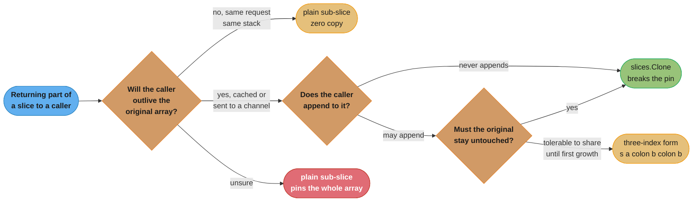
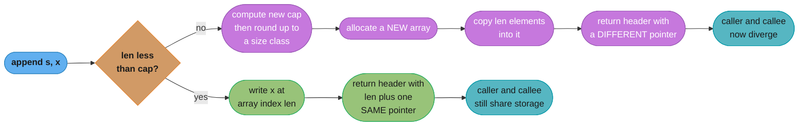
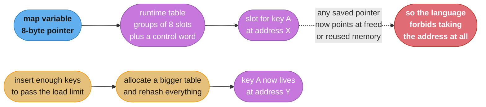
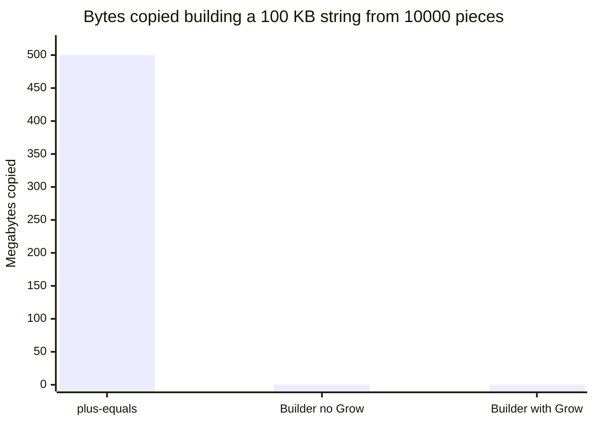

# Data Structures & Memory Layout

---

## 1. Concept Overview

Go's built-in composite types — slice, map, string, struct, array — look like the collections of any
other language and behave like none of them. Each one is a small, fully specified memory layout that
the language copies by value, and every well-known Go bug in production code follows from a mismatch
between what the programmer thinks is being copied and what actually is.

A **slice** is a three-word struct: a pointer to a backing array, a length, and a capacity. Passing a
slice to a function copies those 24 bytes and nothing else, which is why writing `s[0] = 1` inside the
function is visible to the caller and `s = append(s, 1)` may not be. A **string** is a two-word struct —
a pointer and a length — over immutable bytes, so `len(s)` counts bytes rather than characters and `s[i]`
yields a `byte`. A **map** is a single pointer to a runtime hash table that reallocates as it grows,
which is why map elements are not addressable and why iteration order is deliberately randomized. A
**struct** is a flat sequence of fields with alignment padding inserted between them, so the order in
which you declare three fields decides whether the struct occupies 16 bytes or 24.

None of this is exotic. All of it is invisible from the type declaration, which is precisely what makes
it the section where the highest-impact production bugs live: a slice-aliasing corruption produces wrong
data rather than a crash, and a sub-slice that pins a 64 MB backing array produces a memory graph that
looks perfectly healthy right up to the `OOMKilled`. Target version is **Go 1.27** (released 2026-08-19).

---

## 2. Intuition

> A slice is a *sticky note* saying "start here, this many items, room for this many" — you can hand out
> copies of the note freely, and every copy points at the same warehouse shelf.

**Mental model:** Separate the **handle** from the **storage** for every type in this module. The handle
is what gets copied when you assign or pass; the storage is what the handle points at. A slice handle is
24 bytes over a shared array. A string handle is 16 bytes over shared immutable bytes. A map handle is
8 bytes over a table the runtime can move under you. An array has *no* handle — the array **is** the
storage, so copying it copies every element.

**Why it matters:** The entire class of "why did my other slice change?" and "why did my heap not shrink
after I took the first 10 elements?" bugs is one question — who else holds a handle to this storage, and
how long will they hold it? A `[]byte` returned from a 64 MB read buffer keeps all 64 MB alive as long as
anything references it, no matter how few bytes it spans.

**Key insight:** Go copies handles, never storage. Every surprise in this module is that sentence read
in the direction you did not expect: `append` looks like mutation but produces a new handle; sub-slicing
looks like extraction but shares storage; a map value looks like a variable but has no stable address;
and reordering three struct fields changes nothing about semantics and 33% about memory.

---

## 3. Core Principles

**1. The slice header is a value; the backing array is shared.**
`type slice struct { ptr unsafe.Pointer; len int; cap int }` — 24 bytes on a 64-bit platform,
`unsafe.Sizeof([]int(nil)) == 24`. Assignment and argument passing copy the header. Two headers can
point at the same array, and a write through one is visible through the other.

**2. `append` returns a slice and you must use the return value.**
When `len < cap`, `append` writes in place and returns a header with a larger `len`. When `len == cap`,
it allocates a **new** array, copies, and returns a header pointing somewhere else. Both cases return a
header; only the second changes the pointer. This is why `append(s, x)` without assignment is a bug the
compiler will not catch when the result is discarded through a helper.

**3. Sub-slicing shares storage and pins all of it.**
`s[2:5]` produces a new header into the same array. The garbage collector frees a backing array only
when *no* slice header points into it, so a 3-element sub-slice of a 64 MB array retains 64 MB.

**4. A map is a pointer to a runtime structure that moves its contents.**
Since **Go 1.24** the implementation is a Swiss table: slots are grouped 8 at a time under a 64-bit
control word holding a 7-bit hash fragment per slot, probed with word-parallel bit operations. Growth
reallocates and rehashes. Because entries move, **map elements have no stable address**, so `&m[k]` and
`m[k].field = v` do not compile.

**5. A map never shrinks.**
`delete` clears a slot and decrements the count; it does not return memory. A map that peaked at 10
million entries and now holds 12 keeps the bucket memory of 10 million until it is garbage as a whole.
The fix is to build a fresh map and drop the old one.

**6. Strings are immutable byte sequences, not character sequences.**
`len(s)` is a byte count. `s[i]` is a `byte`. `range` over a string decodes UTF-8 and yields
`(byteOffset, rune)`. Converting between `string` and `[]byte` copies, because otherwise mutating the
slice would mutate a string.

**7. Struct size is field order times alignment rules.**
Each field is placed at an offset that is a multiple of its alignment, padding is inserted to get there,
and the whole struct is padded up to a multiple of its own alignment. Declaring fields largest-to-smallest
is the mechanical way to minimise both.

---

## 4. Types / Architectures / Strategies



Every slice bug in Section 10 is a wrong answer to one of these three questions. The three-index form
`s[a:b:b]` caps the result so the first `append` reallocates instead of overwriting the parent's data —
it prevents *corruption*, not the memory *pin*, which only a copy breaks.

### Strategy 1: pre-size with `make` when the count is known

`make([]T, 0, n)` allocates once. Appending `n` elements to a nil slice instead reallocates
repeatedly — doubling while the slice is small, then growing by a factor that decays from about 1.5x
toward 1.25x above 256 elements — so the copying adds up to several times `n`. For
`n = 1,000,000` `[]int` that is the difference between one allocation and about **40**, and between
zero copies and **over 4,000,000** elements copied.

### Strategy 2: `copy` or `slices.Clone` at ownership boundaries

Anywhere a slice crosses from "borrowed for this call" to "kept beyond this call" — a cache write, a
channel send, a struct field assignment — clone it. `slices.Clone(s)` allocates exactly `len(s)`
capacity and returns `nil` for a `nil` input.

### Strategy 3: the full slice expression `s[a:b:c]` when handing out a window

Set `c == b` so the returned slice has `cap == len`. The consumer's first `append` is then forced to
allocate, and it can never write into the elements after `b` that the parent still owns.

### Strategy 4: map of pointers when values are large or need mutation

`map[K]*V` stores 8-byte pointers, so a rehash moves pointers rather than whole structs, and
`m[k].Field = x` works because you are dereferencing, not addressing a map slot. The cost is one
allocation per value and worse cache locality on iteration.

### Strategy 5: `strings.Builder` for any concatenation loop

`+=` on strings is O(n²) in bytes copied because each step allocates a new string and copies both
operands. `strings.Builder` appends into a growing `[]byte` and hands out the result with a single
zero-copy conversion at `String()`.

### Strategy 6: order struct fields largest-to-smallest

Pointers and 8-byte scalars first, then 4-byte, then 2-byte, then `bool` and `byte`. It costs nothing
and is checked automatically by the `fieldalignment` analyzer.

### Strategy 7: `unique.Make` for high-duplication values `[1.23]`

`unique.Make[string](s)` returns a comparable `unique.Handle[string]` that deduplicates identical values
process-wide. For a metrics pipeline holding 40 million label strings drawn from 900 distinct values,
that collapses the string storage to 900 copies plus 40 million 8-byte handles.

---

## 5. Architecture Diagrams

### Diagram 1: the slice header (ASCII — alignment carries the meaning)

```
s := make([]int, 3, 6)

  slice header "s" - 24 bytes, copied BY VALUE     backing array - 6 x 8 = 48 bytes
  +-----------------------------+                  +----+----+----+----+----+----+
  | ptr   0xc000018120          |----------------->| 10 | 20 | 30 |  0 |  0 |  0 |
  +-----------------------------+                  +----+----+----+----+----+----+
  | len   3                     |                    ^              ^         ^
  +-----------------------------+                    |              |         |
  | cap   6                     |                  s[0]        s[3] panics    append
  +-----------------------------+                              (len ends)     lands here

  t := s[1:2]   ->  a SECOND header, same array:  ptr = &array[1], len = 1, cap = 5
                    t[0] = 99  writes array[1]  ->  s[1] is now 99 as well
```

Copying `s` copies only the left-hand box. Both `s` and `t` address the same 48 bytes, which is why an
element write through one is immediately visible through the other, and why the array stays alive as
long as either header exists.

### Diagram 2: struct field order decides the size (ASCII — byte offsets must line up)

```
type Bad struct {              type Good struct {
    flag  bool   // 1 byte         id    int64  // 8 bytes
    id    int64  // 8 bytes        count int32  // 4 bytes
    count int32  // 4 bytes        flag  bool   // 1 byte
}                              }

one character = one byte,  # = padding the compiler inserts

byte:  0   4   8   12  16  20  24
       |...|...|...|...|...|...|
Bad    f#######iiiiiiiicccc####          unsafe.Sizeof(Bad{})  = 24
Good   iiiiiiiiccccf###                  unsafe.Sizeof(Good{}) = 16

f = flag (bool, align 1)   i = id (int64, align 8)   c = count (int32, align 4)
```

`id` needs an 8-byte-aligned offset, so declaring `flag` first forces 7 bytes of padding, and the struct
is then rounded up to a multiple of its own 8-byte alignment, adding 4 more. Reordering removes both:
33% smaller with an identical field set. At 1,000,000 live instances that is 24 MB versus 16 MB, and one
fewer 64-byte cache line touched per 2.6 objects scanned.

### Diagram 3: what `append` does at the capacity boundary



The two branches are indistinguishable from the call site, which is the entire difficulty: identical
code either mutates the caller's array or silently stops doing so, depending on a capacity the caller
never sees.

### Diagram 4: map growth and why elements are not addressable



Go could have made `&m[k]` legal and pinned the table, but that would forbid growth. It chose growth,
so `m[k].field = v` is a compile error and the workarounds are read-modify-write of the whole value or
`map[K]*V`.

---

## 6. How It Works — Detailed Mechanics

### 6.1 The slice header, measured

```go
package main

import (
    "fmt"
    "unsafe"
)

func main() {
    var s []int
    fmt.Println(unsafe.Sizeof(s))        // 24 on 64-bit: ptr + len + cap
    fmt.Println(unsafe.Sizeof("hello"))  // 16: ptr + len, strings have no cap
    fmt.Println(unsafe.Sizeof(map[int]int(nil))) // 8: just a pointer
    fmt.Println(unsafe.Sizeof([3]int{}))         // 24: an ARRAY is its elements
    fmt.Println(s == nil, len(s), cap(s))        // true 0 0
}
```

An array is the storage itself, so `[3]int` occupies 24 bytes and `[1000]int` occupies 8,000 and copies
all of them on assignment. A slice of any length occupies 24 bytes of header.

### 6.2 `append` growth: the post-1.18 ramp

Before Go 1.18 the rule was a hard switch: double the capacity below 1,024 elements, then grow by 1.25x
above it. That produced a visible discontinuity in allocation behaviour at exactly 1,024. Since 1.18 the
threshold moved to **256 elements** and the large-slice formula became a smooth ramp that starts near
1.5x and decays toward 1.25x as the slice gets bigger:

```go
// runtime/slice.go, nextslicecap — the shape of the rule, not the literal source
newcap := oldCap
doublecap := newcap + newcap
if newLen > doublecap {
    return newLen // a single huge append jumps straight to what was asked for
}
const threshold = 256
if oldCap < threshold {
    return doublecap // small slices still double
}
for {
    // +0.25x plus a constant nudge: ~1.5x at 256, approaching 1.25x as newcap grows
    newcap += (newcap + 3*threshold) / 4
    if newcap >= newLen {
        return newcap
    }
}
```

The runtime then rounds the byte size up to a **size class** (`runtime.roundupsize`), so the capacity you
observe is usually larger than the formula's output. Appending one element at a time to a nil `[]int`
produces this capacity sequence:

| `len` after append | 1 | 2 | 3 | 4 | 5 | 8 | 9 | 16 | 17 |
|---|---|---|---|---|---|---|---|---|---|
| `cap` | 1 | 2 | 4 | 4 | 8 | 8 | 16 | 16 | 32 |

Growing a slice to 1,000,000 `int` elements one at a time therefore costs about **40 allocations** and
copies **over 4,000,000** elements in total — roughly 4x the final length, not 2x, because the growth
factor decays toward 1.25x rather than staying at 2x. `make([]int, 0, 1_000_000)` costs one allocation
and zero copies.

### 6.3 Aliasing and the three-index slice expression

```go
s := []int{0, 1, 2, 3, 4, 5}
a := s[1:3]      // len 2, cap 5  -- a can grow into s[3], s[4], s[5]
b := s[1:3:3]    // len 2, cap 2  -- full slice expression, capped

fmt.Println(len(a), cap(a)) // 2 5
fmt.Println(len(b), cap(b)) // 2 2

a = append(a, 99) // len < cap, so this WRITES s[3]
fmt.Println(s)    // [0 1 2 99 4 5]  -- s was silently modified

b = append(b, 99) // len == cap, so this ALLOCATES a new array
fmt.Println(s)    // unchanged by this line
```

`s[low:high:max]` sets `len = high - low` and `cap = max - low`, and requires
`low <= high <= max <= cap(s)`. It is the only way to hand out a window that cannot write past its own
end. It does **not** work on strings.

### 6.4 The sub-slice memory pin

```go
// readFirstLine reads a 64 MB file and returns the first line.
func readFirstLine(path string) ([]byte, error) {
    data, err := os.ReadFile(path) // 64 MB backing array
    if err != nil {
        return nil, err
    }
    i := bytes.IndexByte(data, '\n')
    return data[:i], nil // 40-byte slice, 64 MB array still reachable
}
```

The returned header points into the 64 MB array, so the collector cannot free any of it. Storing 200
such "40-byte" results in a cache holds 12.8 GB. The fix is one function call:

```go
    return slices.Clone(data[:i]), nil // 40-byte array, the 64 MB becomes garbage
```

`bytes.Clone` is the `[]byte`-specific equivalent, and `strings.Clone` does the same for a string cut
from a large buffer.

### 6.5 `nil` slice versus empty slice

```go
var a []int        // nil slice:   ptr = nil, len 0, cap 0
b := []int{}       // empty slice: ptr = a non-nil zero-size address, len 0, cap 0

fmt.Println(a == nil, b == nil) // true false
fmt.Println(len(a), len(b))     // 0 0
a = append(a, 1)                // works fine, append allocates
for range a {}                  // ranging a nil slice is legal, zero iterations

type Resp struct{ Items []int `json:"items"` }
j1, _ := json.Marshal(Resp{Items: a[:0:0]}) // {"items":null}
j2, _ := json.Marshal(Resp{Items: b})       // {"items":[]}
```

Everything except `== nil` and JSON marshalling treats them identically. The JSON difference is what
breaks clients: a JavaScript consumer doing `resp.items.map(...)` throws on `null` and succeeds on `[]`.
Return `[]T{}` from any handler whose contract is "a possibly empty list", or set the `omitempty` tag so
the field disappears rather than becoming `null`.

### 6.6 Map internals and the Swiss-table implementation `[1.24]`

Historically a Go map was an array of **buckets**, each bucket holding 8 key/value pairs plus 8 one-byte
`tophash` fragments and a pointer to an overflow bucket. Lookups hashed the key, chose a bucket, compared
the 8 tophash bytes one at a time, and walked the overflow chain on a miss. Load factor 6.5 triggered a
doubling, performed incrementally as later operations evacuated old buckets.

Since **Go 1.24** the built-in map is a **Swiss table**. Slots are organised into groups of 8 under a
single 64-bit **control word** holding a 7-bit hash fragment plus a state bit per slot. One word-wide
bitwise operation tests all 8 slots at once, so a probe examines a whole group per step instead of one
slot at a time, and open addressing with group-level probing replaces the overflow chain. Large maps are
split into a directory of independently growable tables, which bounds the latency of any single growth.
The Go 1.24 release notes credit this change together with the new small-object allocator and the new
runtime-internal mutex for a **2–3% average CPU reduction** across a representative benchmark suite.

What did **not** change: iteration order is still randomized, elements are still not addressable, and a
map still never shrinks.

```go
// Iteration order is randomized per range statement, on purpose.
m := map[int]string{1: "a", 2: "b", 3: "c"}
for k := range m { fmt.Print(k, " ") } // 2 1 3
for k := range m { fmt.Print(k, " ") } // 1 3 2  -- different in the same process

// For deterministic output, sort the keys.
keys := slices.Sorted(maps.Keys(m)) // [1 2 3]
```

The randomization is a deliberate defence against code that accidentally depends on order. It picks a
random starting group and a random offset within it for every `range` statement.

### 6.7 Map elements are not addressable

```go
type Counter struct{ N int }

m := map[string]Counter{"a": {}}
// m["a"].N++                 // compile error: cannot assign to struct field m["a"].N in map
// p := &m["a"]               // compile error: invalid operation, cannot take address

// Option 1: read, modify, write back the whole value.
c := m["a"]
c.N++
m["a"] = c

// Option 2: store pointers.
p := map[string]*Counter{"a": {}}
p["a"].N++ // legal: this dereferences a pointer, it does not address a map slot
```

The reason is Principle 4: a growth rehashes and moves every entry, so an address into the table would
dangle. Note that `m[k]++` on a `map[string]int` **is** legal — the compiler rewrites it as a read,
an add, and a write, which needs no address.

### 6.8 A map never returns memory

```go
m := make(map[int]int)
for i := 0; i < 10_000_000; i++ {
    m[i] = i
}
for i := 0; i < 10_000_000; i++ {
    delete(m, i)
}
fmt.Println(len(m)) // 0 -- but the table is still sized for 10 million entries
```

`delete` marks the slot free and decrements the count. The table is never rebuilt smaller. For a cache
or a request-scoped index that peaks large and then drains, the only way to reclaim the memory is to
replace the map: `m = make(map[int]int)` and let the old one become garbage. If the map must stay live
while shrinking, copy the surviving entries into a fresh, pre-sized map and swap.

### 6.9 Strings, bytes, and runes

```go
s := "héllo" // 'é' is 2 bytes in UTF-8

fmt.Println(len(s))                    // 6 bytes, not 5 characters
fmt.Println(utf8.RuneCountInString(s))  // 5
fmt.Println(s[1])                       // 195 -- the first byte of 'é', a byte not a rune
fmt.Println(string(s[1]))               // "Ã"  -- an invalid decode of half a rune

for i, r := range s {
    fmt.Printf("%d:%c ", i, r) // 0:h 1:é 3:l 4:l 5:o  -- byte offsets, decoded runes
}

r := []rune(s)      // 5 runes, allocates 5 x 4 = 20 bytes
fmt.Println(len(r)) // 5
fmt.Println(string(r[1])) // "é"
```

`range` over a string decodes UTF-8 and yields `(byteOffset, rune)`; the index therefore jumps by 2 at
the multi-byte character. Invalid UTF-8 yields `utf8.RuneError` (U+FFFD) with a width of 1. Indexing
gives a `byte`, which is why `s[1]` prints 195 and slicing a string mid-rune produces garbage.

### 6.10 The `[]byte` to `string` conversion allocation

Both directions copy, because a string must be immutable and a `[]byte` must be mutable:

```go
b := []byte("hello")
s := string(b) // allocates 5 bytes and copies
b[0] = 'H'
fmt.Println(s) // "hello" -- unaffected, as required
```

The compiler elides the allocation in four cases where it can prove the converted value neither escapes
nor outlives the source:

```go
_ = m[string(b)]                 // 1. map lookup key
_ = string(b) == "expected"      // 2. comparison against a string
for _, r := range string(b) {}   // 3. range over the conversion
switch string(b) { case "ok": }  // 4. switch on the conversion
```

For genuinely hot paths where you can guarantee the bytes are never mutated afterwards,
`unsafe.String(&b[0], len(b))` and `unsafe.Slice(unsafe.StringData(s), len(s))` do it with zero copies.
That guarantee is on you; break it and you have mutated a string, which the runtime and the compiler
both assume is impossible. See [Reflection & Unsafe](../reflection_and_unsafe/reflection_and_unsafe.md).

### 6.11 `strings.Builder` versus `+=`

```go
// O(n^2) in bytes copied: each += allocates a new string and copies both operands.
func slow(parts []string) string {
    out := ""
    for _, p := range parts {
        out += p
    }
    return out
}

// O(n) amortized: appends into one growing byte slice, one final zero-copy conversion.
func fast(parts []string) string {
    var b strings.Builder
    b.Grow(len(parts) * 10) // optional: one allocation if the estimate holds
    for _, p := range parts {
        b.WriteString(p)
    }
    return b.String()
}
```

With 10,000 parts of 10 bytes each, `slow` performs **10,000 allocations** and copies about
**500 MB** in total, because step *i* copies the *i*-length prefix again. `fast` performs about **23**
allocations without `Grow` — copying about 380 KB along the way — and exactly **1** with it, copying
100 KB once. `b.String()` is zero-copy: it
converts the builder's internal `[]byte` to a string without copying, which is legal only because
`Builder` refuses to be copied after first use — enforced at run time by its own `copyCheck`, which
panics with `strings: illegal use of non-zero Builder copied by value` the first time you write
through the copy. Note that `go vet`'s `copylocks` does **not** catch this: it fires only on types that contain a
`sync.Locker`, and `strings.Builder` contains none.

### 6.12 Alignment, padding, and `fieldalignment`

```go
type Bad struct {
    flag  bool  // offset 0,  1 byte + 7 padding
    id    int64 // offset 8,  8 bytes
    count int32 // offset 16, 4 bytes + 4 tail padding
}                // unsafe.Sizeof = 24, unsafe.Alignof = 8

type Good struct {
    id    int64 // offset 0
    count int32 // offset 8
    flag  bool  // offset 12, + 3 tail padding
}                // unsafe.Sizeof = 16

fmt.Println(unsafe.Offsetof(Bad{}.id))   // 8
fmt.Println(unsafe.Offsetof(Good{}.flag)) // 12
```

Run the analyzer rather than doing this by hand:

```bash
go run golang.org/x/tools/go/analysis/passes/fieldalignment/cmd/fieldalignment@latest ./...
# add -fix to rewrite the declarations in place
```

`golangci-lint` exposes the same check as `govet`'s `fieldalignment`. It is off by default because on a
struct with 3 live instances the saving is 24 bytes and the readability cost of a non-logical field
order is real. Turn it on for types you allocate by the million.

### 6.13 `unique` for high-duplication values `[1.23]`

```go
import "unique"

type Label struct {
    Key   unique.Handle[string]
    Value unique.Handle[string]
}

func makeLabel(k, v string) Label {
    return Label{Key: unique.Make(k), Value: unique.Make(v)} // 8 bytes each
}
```

`unique.Make[T]` returns a `Handle[T]` that is comparable with `==` in constant time regardless of the
underlying value's size, and identical values anywhere in the process share one canonical copy. Handles
become collectable once no handle to that value remains. For 40,000,000 metric labels drawn from 900
distinct strings, the strings themselves shrink from 40,000,000 copies to 900, and equality comparison
becomes a pointer compare instead of a byte-wise `memequal`.

---

## 7. Real-World Examples

**`bytes.Buffer` and `strings.Builder`:** both wrap a `[]byte` and rely on append's amortized growth.
`Builder` adds one thing `Buffer` cannot: a no-copy `String()`, achieved by refusing to be copied so the
runtime can prove the backing array is never observed as mutable.

**`net/http` request bodies:** `httputil.DumpRequest` and every body-reading helper copy the bytes out
rather than sub-slicing the connection's read buffer, precisely to avoid the pin in Section 6.4. A
handler that keeps `r.Body`'s bytes past the handler's return without copying keeps the connection
buffer alive.

**Prometheus client_golang:** metric label sets are the canonical high-duplication string workload — a
few hundred distinct label values across tens of millions of samples. Interning them, by hand before
`unique` existed and increasingly with it, is a standard memory win in Go metrics pipelines.

**Kubernetes API machinery:** `DeepCopy` methods are code-generated for every API type precisely because
Go's assignment copies handles, not storage. A shallow copy of a `PodSpec` shares every slice and map
inside it, so the informer cache would hand out objects any consumer could corrupt.

**etcd and BoltDB:** BoltDB returns values as `[]byte` views directly into an mmap'd page, explicitly
documented as valid only for the life of the transaction. Any caller keeping the slice longer must copy
it — the same pin problem, made an API contract instead of a hidden hazard.

**Go's own `sort` and `slices` packages:** `slices.Clone`, `slices.Grow`, and `slices.Delete` exist
because these operations were repeatedly hand-written wrong. `slices.Delete` zeroes the tail elements it
shifts away, which a naive `append(s[:i], s[i+1:]...)` does not — leaving pointers in the freed tail that
keep whole objects alive.

---

## 8. Tradeoffs

| Decision | Option A | Option B | When A wins | When B wins |
|---|---|---|---|---|
| Return a window | sub-slice `s[a:b]` | `slices.Clone(s[a:b])` | Caller does not outlive the parent | Caller caches, forwards, or the parent is large |
| Cap the window | `s[a:b]` | `s[a:b:b]` | Consumer never appends | Consumer may append and the tail is yours |
| Map value type | `map[K]V` | `map[K]*V` | Small values, no in-place mutation, iteration-heavy | Values over ~64 bytes, in-place field updates |
| Empty list | `var s []T` | `s := []T{}` | Internal use, `nil` is meaningful | JSON responses, where `null` breaks clients |
| Text storage | `string` | `[]byte` | Immutable, map key, comparison, sharing | Built incrementally, mutated in place, I/O |
| Concatenation | `+=` | `strings.Builder` | 2 or 3 fixed pieces | Any loop |
| Fixed-size data | `[N]T` array | `[]T` slice | Size known at compile time, value semantics wanted, no allocation | Size varies, or copying would be expensive |
| Field order | logical grouping | largest-to-smallest | Few instances, readability first | Millions of instances, or a hot scan |



The `+=` loop copies half a gigabyte to produce 100 KB of output, because step *i* re-copies the entire
`i`-length prefix. `Builder` copies each byte roughly twice without `Grow` and exactly once with it.

---

## 9. When to Use / When NOT to Use

### Use a plain sub-slice when:
- The result is consumed within the same call stack and discarded
- The parent array is small and short-lived
- You are iterating a window and never retaining it

### Use `slices.Clone` / `bytes.Clone` / `strings.Clone` when:
- The result outlives the parent: stored in a cache, sent on a channel, assigned to a struct field
- The parent is large relative to the window — anything over a few kilobytes
- The result crosses an API boundary you do not control

### Use the three-index form `s[a:b:b]` when:
- Handing a window to code that may `append`, where the elements after `b` are still yours
- Implementing a ring buffer or an arena where regions must not bleed into each other

### Use `map[K]*V` when:
- Values exceed roughly 64 bytes, so rehashing moves 8 bytes instead of the whole struct
- You need `m[k].Field = x` without a read-modify-write
- Values are shared with something outside the map

### Do NOT use `map[K]*V` when:
- Values are small — you have added one allocation and one pointer chase per entry, and wrecked
  iteration locality
- The map is scanned frequently, since every value is now a separate heap object for the GC to trace

### Do NOT sub-slice without cloning when:
- The parent came from `os.ReadFile`, `io.ReadAll`, or an mmap — those arrays are megabytes
- The result is going into any structure with a lifetime you cannot see

### Do NOT reorder struct fields for alignment when:
- The type has a handful of instances — you traded readability for 8 bytes
- The field order is part of a documented wire or file layout

---

## 10. Common Pitfalls

### Pitfall 1: two slices sharing a backing array, one corrupting the other

An order-matching service kept a per-symbol ring of the last 64 trades and handed out "recent trades"
windows to a websocket fanout. Under load the fanout began emitting trades belonging to other symbols —
about **1 in 900** messages, enough to fail reconciliation but not enough to look like a crash.

```go
// BROKEN — the returned window can append into the parent's live elements
type Ring struct {
    buf []Trade // len 64, cap 64
    n   int
}

func (r *Ring) Recent(k int) []Trade {
    return r.buf[r.n-k : r.n] // len k, cap 64-(r.n-k): room to grow into live data
}

func fanout(r *Ring) {
    w := r.Recent(4)
    w = append(w, Trade{Sym: "SPY"}) // len < cap, so this OVERWRITES r.buf[r.n]
    send(w)
}
```

```go
// FIX — cap the window so any append must allocate
func (r *Ring) Recent(k int) []Trade {
    return r.buf[r.n-k : r.n : r.n] // cap == len
}
```

With `cap == len`, the consumer's `append` allocates a fresh array and the ring is untouchable. Cost of
the fix: three characters. Cost of the bug: 11 days of intermittent reconciliation breaks and a
full-day incident review. If the consumer must also be prevented from *reading* future writes, return
`slices.Clone(r.buf[r.n-k : r.n])` instead.

### Pitfall 2: a 40-byte result pinning a 64 MB array

A document-indexing service cached the title of every processed file. RSS climbed to **11.4 GB** while
`len(cache)` was 180 and the heap profile attributed almost all of it to `os.ReadFile`.

```go
// BROKEN — the title slice keeps the whole file's array reachable
func title(path string) ([]byte, error) {
    data, err := os.ReadFile(path) // up to 64 MB
    if err != nil {
        return nil, err
    }
    i := bytes.IndexByte(data, '\n')
    return data[:i], nil
}
```

```go
// FIX — copy out the bytes you actually need
func title(path string) ([]byte, error) {
    data, err := os.ReadFile(path)
    if err != nil {
        return nil, err
    }
    i := bytes.IndexByte(data, '\n')
    return bytes.Clone(data[:i]), nil
}
```

RSS after the fix: **62 MB**. The diagnostic that found it was `go tool pprof -inuse_space` showing
`os.ReadFile` retaining far more than any live `[]byte` length could explain — that gap between "bytes I
can name" and "bytes retained" is the signature of this bug.

### Pitfall 3: `append` inside a function that the caller cannot see

```go
// BROKEN — the caller's slice is unchanged when append reallocates
func addTag(tags []string, t string) {
    tags = append(tags, t) // local header only
}

func main() {
    tags := make([]string, 0, 2)
    addTag(tags, "a")
    addTag(tags, "b")
    fmt.Println(len(tags)) // 0 -- and the elements ARE in the array, invisibly
}
```

```go
// FIX — return the slice, which is why every append-like stdlib function does
func addTag(tags []string, t string) []string {
    return append(tags, t)
}
```

The nastiest part is that with `cap == 2` the elements really are written into the caller's array; only
`len` is wrong, so `tags[:2]` would show them. Passing `*[]string` also works but is unidiomatic —
return the slice.

### Pitfall 4: a hot map that never gives memory back

A session store held one entry per active WebSocket connection. After a nightly disconnect storm the
map held **340 entries** and the process still held **2.1 GB** of map memory from a daytime peak of 8.4
million sessions.

```go
// BROKEN — delete does not shrink the table
func (s *Store) Reap(now time.Time) {
    for k, v := range s.m {
        if v.Expiry.Before(now) {
            delete(s.m, k)
        }
    }
}
```

```go
// FIX — rebuild when the map is mostly empty
func (s *Store) Reap(now time.Time) {
    live := make(map[string]*Session, len(s.m)/4+16)
    for k, v := range s.m {
        if v.Expiry.After(now) {
            live[k] = v
        }
    }
    // Rebuild only when it pays: the old table is at least 4x the live set.
    if len(live)*4 < len(s.m) {
        s.m = live
        return
    }
    for k, v := range s.m {
        if v.Expiry.Before(now) {
            delete(s.m, k)
        }
    }
}
```

Steady-state RSS after the change: **190 MB**. Note the guard — rebuilding on every reap is worse than
the leak when the map is genuinely full, because it doubles peak memory during the copy.

### Pitfall 5: indexing a string and getting half a character

```go
// BROKEN — truncates mid-rune and emits invalid UTF-8
func preview(s string, n int) string {
    if len(s) <= n {
        return s
    }
    return s[:n] + "..." // len is BYTES, so this can cut 'é' in half
}
```

```go
// FIX — count runes, not bytes
func preview(s string, n int) string {
    if utf8.RuneCountInString(s) <= n {
        return s
    }
    i, count := 0, 0
    for i = range s { // range yields BYTE offsets of rune boundaries
        if count == n {
            break
        }
        count++
    }
    return s[:i] + "..."
}
```

A product-search API truncated titles to 60 bytes and returned invalid UTF-8 for **every** Japanese,
Korean, and emoji-containing title — roughly 12% of the catalogue. The client's JSON parser accepted the
bytes and the browser rendered a replacement character, so it shipped and survived two releases.

### Pitfall 6: reordering a struct that describes a wire format

```go
// BROKEN — "optimizing" a layout that binary.Read fills field by field
type Header struct {
    Magic   uint32
    Flags   uint8
    Version uint16 // fieldalignment says: move me up
    Length  uint32
}
```

Running `fieldalignment -fix` on this reorders the fields and silently changes what `binary.Read` parses
from the network. The fix is to exempt the type — add `//nolint:fieldalignment` and a comment saying the
order is the protocol — not to accept the rewrite. Alignment analysis knows about memory and nothing
about your file format.

---

## 11. Technologies & Tools

| Tool | What it does | Why it matters here |
|---|---|---|
| `go tool pprof` | Heap, allocation, and CPU profiles | `-inuse_space` finds the sub-slice pin; `-alloc_objects` finds the missing `make` capacity |
| `fieldalignment` | `x/tools` analyzer for struct padding | Reports and with `-fix` rewrites field order; also available inside `golangci-lint` as `govet`'s `fieldalignment` |
| `go build -gcflags=-m` | Escape-analysis output | Shows which slices and conversions escape to the heap and which stay on the stack |
| `benchstat` | Compares benchmark runs with p-values | The only honest way to claim a layout change helped |
| `go test -bench . -benchmem` | Allocations and bytes per operation | `allocs/op` is the number the `strings.Builder` and pre-sizing changes move |
| `unsafe.Sizeof` / `Alignof` / `Offsetof` | Compile-time layout constants | Assert layout in a test so a future field insertion fails loudly |
| `go vet` `copylocks` | Flags copying a value containing a `sync.Locker` | Catches a `sync.Mutex` or a struct embedding one copied by a value receiver; it does NOT see `strings.Builder`, which self-polices at run time |
| `slices` / `maps` packages | `Clone`, `Grow`, `Delete`, `Sorted`, `Keys` | Correct implementations of the operations most often hand-written wrong |
| `unique` `[1.23]` | Process-wide value interning | Collapses high-duplication strings to one canonical copy with pointer-speed equality |
| `-race` | Data-race detector | A shared backing array mutated from two goroutines is a race even though both slices are "separate" |

---

## 12. Interview Questions with Answers

**Q: Why does appending to a slice inside a function sometimes not affect the caller?**
**Short:** Because the function receives a copy of the 24-byte header, so a reallocating append points that copy at a brand-new array.

A slice argument is passed by value: the callee gets its own `{ptr, len, cap}` triple over the same
backing array. Writing `s[0] = x` reaches the shared array and is visible. `append` behaves in two
different ways: when `len < cap` it writes into the shared array and the caller can see the *element*
but not the larger `len`, and when `len == cap` it allocates a new array so the callee and caller
diverge completely. Both cases are invisible from the call site, which is why every append-like function
in Go returns the slice — `func addTag(t []string, s string) []string` — and why discarding that return
value is a bug the compiler cannot catch.

**Q: What is in a slice header and how large is it?**
**Short:** Three machine words — a pointer to the backing array, a length, and a capacity — so 24 bytes on any 64-bit platform.

`unsafe.Sizeof([]int(nil))` returns 24 regardless of element type or element count, because the header
never contains elements. Compare the neighbours: a string header is 16 bytes (pointer plus length, no
capacity, because a string cannot grow); an interface value is 16 bytes (type pointer plus data
pointer); a map or channel variable is 8 bytes, a single pointer to a runtime structure. An array is the
odd one out — it has no header at all, so `[1000]int` is 8,000 bytes and copies all of them on
assignment.

**Q: How much does `append` grow a slice by?**
**Short:** Small slices roughly double, and above 256 elements the factor ramps smoothly down from about 1.5x toward 1.25x.

The old rule — double below 1,024 elements, then 1.25x — was replaced in Go 1.18. The threshold is
now **256** elements, and above it the runtime applies `newcap += (newcap + 3*256) / 4` repeatedly, which
starts near 1.5x and decays toward 1.25x as the slice grows, removing the sharp discontinuity the old
rule had. The result is then rounded up to a memory size class, so the capacity you observe is often
larger than the formula alone predicts. The decaying factor costs more copying than the old doubling
did: growing to 1,000,000 `int` elements one at a time takes about 40 allocations and copies over
4,000,000 elements, roughly 4x the final length. `make([]T, 0, n)` costs one allocation and zero
copies whenever `n` is known.

**Q: What does the three-index slice expression `s[a:b:c]` do?**
**Short:** It sets the result's length to `b-a` and its capacity to `c-a`, so the window cannot append into elements it does not own.

The full slice expression is the only way to hand out a view whose `cap` is smaller than the remaining
parent array. With `c == b` the result has `cap == len`, so the consumer's very first `append` is forced
to allocate a new array instead of writing into the parent's live elements. Constraints are
`a <= b <= c <= cap(s)`, and it is not available on strings. Use it wherever you return a window into a
buffer you still own — a ring buffer, an arena, a parser's scratch area. It prevents *corruption*, not
the memory *pin*: the returned header still references the parent array, so only a copy frees it.

**Q: How can a small slice keep a large amount of memory alive?**
**Short:** A sub-slice points into the parent's backing array, and the collector frees that array only when no header references any part of it.

Garbage collection is per-allocation, not per-byte. `data, _ := os.ReadFile(path)` allocates one array
of, say, 64 MB, and `return data[:40]` returns a header pointing into it. Forty bytes are reachable
through the API and 64 MB are reachable through the pointer, so nothing is freed. Cache 200 such results
and the process holds 12.8 GB. The signature in a heap profile is `-inuse_space` attributing memory to
the reading function while no live object's length can account for it. Fix it with `bytes.Clone`,
`slices.Clone`, or `strings.Clone` at the moment the window escapes the parent's lifetime.

**Q: What is the difference between a `nil` slice and an empty slice?**
**Short:** Only two behaviours differ — comparison against nil, and JSON, where a nil slice marshals to null and an empty one to an empty array.

`var a []int` has a nil pointer; `b := []int{}` has a non-nil pointer to a zero-size allocation. Both
report `len` and `cap` of 0, both can be ranged over, both can be appended to, and both are safe to pass
anywhere. `a == nil` is true and `b == nil` is false. The consequential difference is `encoding/json`:
`a` marshals to `null` and `b` marshals to `[]`, so a JavaScript client calling `.map()` on the field
throws for one and succeeds for the other. Return `[]T{}` from any endpoint whose contract is "a
possibly empty list", or use `omitempty` so the field disappears entirely.

**Q: Why can't you write `m[k].Field = v` on a map of structs?**
**Short:** Map entries have no stable address because growth rehashes and relocates them, so the language forbids addressing a map element at all.

Assigning to a field requires the address of the containing value, and a map slot's address is valid
only until the next insertion triggers a growth, which allocates a new table and moves every entry. Go
resolves this by making map elements non-addressable: both `&m[k]` and `m[k].Field = v` are compile
errors. Two workarounds: read the whole value into a local, modify it, and write it back
(`c := m[k]; c.N++; m[k] = c`), or store `map[K]*V`, where `m[k].N++` is legal because it dereferences a
pointer rather than addressing a slot. Note that `m[k]++` on a `map[K]int` compiles fine — the compiler
rewrites it as read, add, write, which needs no address.

**Q: Why is Go's map iteration order random?**
**Short:** The runtime picks a random starting position for every range statement, deliberately, so that code cannot come to depend on an accidental order.

Hash tables have no meaningful order, but a naive implementation would still produce a *stable* one
within a process, and programs would grow to depend on it — then break when the map grew, the hash seed
changed, or the implementation was rewritten. Go removes the temptation by randomizing the start group
and the offset within it on every `range`, so two consecutive iterations of the same unchanged map give
different orders. When you need determinism, collect and sort: `keys := slices.Sorted(maps.Keys(m))`.
This also explains why map iteration cannot be relied on in tests or in any output a human compares.

**Q: Does deleting entries from a map return memory to the runtime?**
**Short:** No — delete clears a slot and decrements the count, but the table itself is never rebuilt smaller.

A Go map only ever grows. A map that peaked at 10,000,000 entries and now holds 12 still holds the
table sized for 10 million, and neither the runtime nor the collector will shrink it while the map is
reachable. The only remedy is to build a replacement: allocate a new map sized for the live set, copy
the surviving entries in, and assign over the old one so it becomes garbage as a whole. Guard the
rebuild behind a ratio such as "live entries are under a quarter of the table", because copying an
almost-full map doubles peak memory for the duration of the copy and is worse than the problem.

**Q: What changed about Go maps in 1.24?**
**Short:** The built-in map was reimplemented as a Swiss table, replacing bucket chains with groups of eight slots probed through one control word.

The old design was an array of buckets, each holding 8 key/value pairs, 8 one-byte hash fragments, and
an overflow pointer, with lookups walking the fragments one at a time and chasing overflow chains. The
Swiss table stores a 7-bit hash fragment plus a state bit per slot inside a single 64-bit control word
covering 8 slots, so one bitwise operation tests all 8 at once, and open addressing across groups
replaces overflow chaining. Large maps are split into a directory of independently growable tables,
bounding the cost of any one growth. The Go 1.24 release notes credit this change together with the new
small-object allocator and runtime mutex for a 2–3% average CPU reduction. Nothing observable changed:
iteration is still randomized, elements are still not addressable, and the map still never shrinks.

**Q: What does `len()` return for a string?**
**Short:** The number of bytes, not characters, because a Go string is a byte sequence that happens to hold UTF-8 by convention.

`len("héllo")` is 6, because `é` occupies two bytes in UTF-8, while the string has five characters.
Indexing follows the same rule: `s[1]` yields the `byte` 195, the first half of `é`, and printing
`string(s[1])` shows a mojibake character. To count characters use `utf8.RuneCountInString(s)`; to slice
safely, work from the byte offsets that `range` gives you or convert to `[]rune` and index that. Nothing
in the language requires a string to be valid UTF-8 — it is a byte slice with immutability and a
convention, which is why `utf8.ValidString` exists.

**Q: What does ranging over a string yield?**
**Short:** Pairs of byte offset and decoded rune, so the index jumps by more than one across multi-byte characters.

`for i, r := range "héllo"` produces `(0,'h') (1,'é') (3,'l') (4,'l') (5,'o')` — the index goes 0, 1, 3
because `é` occupies bytes 1 and 2. That property makes `range` the correct way to find rune boundaries
for safe truncation: the `i` values are exactly the offsets you may cut at. Invalid UTF-8 yields
`utf8.RuneError` (U+FFFD) with a width of one byte, so the loop always terminates rather than
misaligning. Contrast this with indexing, `s[i]`, which never decodes and always yields a single byte.

**Q: Does converting between `[]byte` and `string` allocate?**
**Short:** Yes in general, because immutability requires a copy, though the compiler elides it in four provable cases.

`string(b)` and `[]byte(s)` each allocate and copy, since sharing the storage would let a mutation of the
byte slice change a string, which the runtime treats as impossible. The compiler removes the allocation
when it can prove the result neither escapes nor outlives the source: as a map lookup key `m[string(b)]`,
in a comparison `string(b) == "x"`, in a `switch string(b)`, and when ranging `for _, r := range
string(b)`. For a hot path outside those cases, `unsafe.String` and `unsafe.Slice` convert with zero
copies, and the obligation not to mutate the bytes afterwards moves entirely onto you.

**Q: Why is `+=` in a string loop a performance problem?**
**Short:** Strings are immutable, so each concatenation allocates a fresh string and re-copies everything accumulated so far, making the loop quadratic.

Building 100 KB from 10,000 pieces of 10 bytes performs 10,000 allocations and copies roughly 500 MB,
because step *i* copies the whole *i*-length prefix again. `strings.Builder` appends into one growing
`[]byte` through the same amortized growth — about 23 allocations and 380 KB copied — and its `String()` method
converts without a copy, which it can do safely only because the type refuses to be copied after first
use. Calling `b.Grow(n)` with an estimate reduces it to a single allocation. `bytes.Buffer` is the
equivalent when you need to read back or write to an `io.Writer`.

**Q: How does struct field order change memory usage?**
**Short:** Each field must sit at an offset that is a multiple of its alignment, so a badly ordered struct pays for padding between and after its fields.

`struct{ flag bool; id int64; count int32 }` occupies 24 bytes: `flag` at offset 0, seven padding bytes
so `id` lands on an 8-byte boundary, `id` at 8, `count` at 16, then four tail bytes so the whole struct
is a multiple of its own 8-byte alignment. Reordering to `int64, int32, bool` gives offsets 0, 8, 12
and a size of 16 — the same fields, 33% less memory. At 1,000,000 live instances that is 24 MB against
16 MB, plus fewer cache lines touched on every scan and less for the collector to walk. Detect it
mechanically with the `fieldalignment` analyzer rather than by eye.

**Q: How do you find struct padding waste automatically?**
**Short:** Run the fieldalignment analyzer from x/tools, which reports oversized structs and with -fix rewrites the declarations.

`go run golang.org/x/tools/go/analysis/passes/fieldalignment/cmd/fieldalignment@latest ./...` prints
each struct whose fields could be reordered smaller and the size it would become; `-fix` applies the
reordering. `golangci-lint` exposes the same check as `govet`'s `fieldalignment`, off by default. Two
cautions before you enable it repo-wide: on a type with a handful of instances the saving is bytes and
the cost is a field order nobody grouped logically, and on a type describing a wire or file layout the
rewrite silently changes what `binary.Read` parses. Exempt those types explicitly and comment why.

**Q: What is the difference between an array and a slice in Go?**
**Short:** An array's length is part of its type and it holds its elements directly, while a slice is a small header referencing a separate backing array.

`[3]int` and `[4]int` are different types that cannot be assigned to one another, and assigning an array
copies every element — `[1000]int` copies 8,000 bytes. A slice is 24 bytes regardless of length, and
copying it shares the storage. Arrays are useful when the size is a compile-time constant and value
semantics are wanted: a fixed key, a small buffer that should stay on the stack, or an element type
inside a struct where an extra allocation is unwelcome. Everything else is a slice. Note the connection:
`s := arr[:]` produces a slice whose backing array is `arr`, so writes through the slice change the
array.

**Q: When should a map hold pointers instead of struct values?**
**Short:** When values are large enough that rehashing them is expensive, or when callers need to mutate a field without a read-modify-write.

`map[K]V` stores values inline, so a growth copies every value into the new table and `m[k].Field = x`
is a compile error. Switching to `map[K]*V` makes each entry an 8-byte pointer, so a rehash moves
pointers, and `m[k].Field = x` compiles because it dereferences. The crossover on size is roughly 64
bytes, one cache line. Below it, pointers cost you an allocation per entry, a pointer chase per lookup,
scattered iteration locality, and one more object per entry for the collector to trace — so a
`map[string]int` should never become `map[string]*int`.

**Q: How do you safely copy a slice, and what does `copy` return?**
**Short:** Use slices.Clone for a fresh slice, or copy into a pre-made destination — copy moves the minimum of the two lengths and returns that count.

`copy(dst, src)` transfers `min(len(dst), len(src))` elements and returns that number, so copying into a
zero-length destination silently does nothing — a common bug when `dst := make([]T, 0, n)` is used
instead of `make([]T, n)`. It handles overlapping slices correctly and has a special form
`copy(b []byte, s string)`. `slices.Clone(s)` is the one-liner: it allocates exactly `len(s)` capacity,
copies, and returns `nil` for a `nil` input, preserving nil-ness. Note that both perform a shallow copy —
if the element type contains a slice, map, or pointer, the clone shares that inner storage.

**Q: What problem does the `unique` package solve?**
**Short:** It interns values process-wide so identical ones share a single canonical copy, and returns a small handle that compares in constant time.

`unique.Make[T](v)` returns a `unique.Handle[T]`, an 8-byte comparable value; two handles are `==` if
and only if the underlying values were equal, and that comparison is a pointer test regardless of how
large the value is. Added in Go 1.23, it targets workloads with a small distinct set repeated many
times — metric labels, tag keys, enum-like strings parsed from a wire format. Forty million labels
drawn from 900 distinct strings collapse to 900 stored strings plus 8 bytes each. Handles become
collectable when the last handle to a value is dropped, so unlike a hand-rolled `map[string]string`
intern table it does not leak.

**Q: Two goroutines hold slices over the same backing array. Is that a data race?**
**Short:** Yes — the race detector reports on memory addresses, not on slice identity, so overlapping writes race even though the headers are separate variables.

Two independently-declared slices that happen to alias the same array are, at the memory level, two
names for the same bytes. A write through one and a read or write through the other with no
happens-before relationship is a data race exactly as if they shared a variable, and `-race` will report
it with the two goroutine stacks. This is easy to create accidentally: `a, b := s[:n], s[n:]` looks like
a clean partition and is one, but `a = append(a, x)` when `cap(a) > n` writes into `b`'s first element.
Partition with the three-index form (`s[:n:n]`) so each half's capacity stops at its own boundary, and
run the race detector in CI.

---

## 13. Best Practices

1. **Pre-size with `make([]T, 0, n)` whenever `n` is known or estimable.** One allocation instead of
   dozens, and no copying at all instead of several times `n` elements.
2. **Always assign the result of `append`.** `s = append(s, x)`, and return the slice from any function
   that appends to a parameter.
3. **Clone at every ownership boundary.** Cache writes, channel sends, struct field assignments, and any
   return value that outlives the parent buffer get `slices.Clone` / `bytes.Clone` / `strings.Clone`.
4. **Use the three-index form when handing out a window** into a buffer you still own: `s[a:b:b]`.
5. **Return `[]T{}`, not a nil slice, from anything that marshals to JSON as a list** — or tag the field
   `omitempty` so it disappears instead of becoming `null`.
6. **Never take the address of a map element**, and reach for `map[K]*V` only when values exceed roughly
   64 bytes or need in-place field mutation.
7. **Rebuild a map that has drained**, behind a ratio guard so you do not double peak memory on a full one.
8. **Sort keys before iterating a map** whenever the output is compared, logged in order, or hashed.
9. **Use `strings.Builder` for every concatenation loop**, with `Grow` when you can estimate the size.
10. **Treat `len(s)` on a string as a byte count.** Truncate at the byte offsets `range` gives you, or
    use `utf8.RuneCountInString`.
11. **Order struct fields largest-to-smallest for types you allocate by the million**, verify with
    `fieldalignment`, and exempt anything describing a wire or file layout.
12. **Assert layout in a test** for structs whose size matters:
    `if unsafe.Sizeof(Entry{}) != 16 { t.Fatal(...) }` fails loudly when someone inserts a field.
13. **Measure with `-benchmem` and compare with `benchstat`.** `allocs/op` is the number every technique
    in this module moves.
14. **Run `-race` in CI.** A shared backing array is the least obvious way to build a race.

---

## 14. Case Study

### Cutting a log-ingestion service from 14 GB to 1.9 GB without changing its behaviour

A log pipeline ingested roughly 220,000 lines per second across 40 pods. Each pod was limited to 16 GB,
and pods were `OOMKilled` between 6 and 20 times a day during traffic peaks. The heap profile was flat
and uninformative: `runtime.mallocgc` at the top, `os.ReadFile` and `encoding/json` beneath it, no
single obvious offender. Every finding below came from this module's material.

**Finding 1 — every parsed record pinned its whole 4 MB input batch.**

```go
// BROKEN — 12 short fields, each pinning the entire batch buffer
type Record struct {
    Service []byte
    Level   []byte
    Message []byte
    // ... 9 more
}

func parseBatch(buf []byte) []Record { // buf is 4 MB from the reader
    var out []Record
    for _, line := range bytes.Split(buf, []byte("\n")) {
        out = append(out, Record{
            Service: fieldAt(line, 0), // sub-slice of buf
            Level:   fieldAt(line, 1), // sub-slice of buf
            Message: fieldAt(line, 2), // sub-slice of buf
        })
    }
    return out // 30,000 Records, all holding the 4 MB array alive
}
```

```go
// FIX — intern the low-cardinality fields, clone the rest
type Record struct {
    Service unique.Handle[string] // 8 bytes, ~40 distinct values
    Level   unique.Handle[string] // 8 bytes, 5 distinct values
    Message string                // cloned, genuinely unique per record
    // ...
}

func parseBatch(buf []byte) []Record {
    lines := bytes.Split(buf, []byte("\n"))
    out := make([]Record, 0, len(lines)) // pre-sized: 1 allocation, not ~15
    for _, line := range lines {
        out = append(out, Record{
            Service: unique.Make(string(fieldAt(line, 0))),
            Level:   unique.Make(string(fieldAt(line, 1))),
            Message: string(fieldAt(line, 2)), // conversion copies: the pin is broken
        })
    }
    return out // buf becomes garbage as soon as parseBatch returns
}
```

Each in-flight batch had been retaining 4 MB; with 64 batches in the pipeline that was 256 MB of *live*
buffers against about 9 MB of data anyone could name. Interning `Service` and `Level` — 45 distinct
strings across 220,000 records per second — removed 20 million short string allocations per minute.

**Finding 2 — the dedup map never shrank.**

A `map[string]time.Time` of seen message hashes grew to 8,400,000 entries during a peak and was reaped
down to about 30,000 afterwards. `len()` reported 30,000; the table still held 8.4 million slots, about
**2.1 GB**. Replacing the reap loop with a rebuild guarded by "live is under a quarter of the table"
brought steady-state to 190 MB and left peak behaviour unchanged.

**Finding 3 — the `Record` struct was 33% padding.**

`fieldalignment` reported `Record` at 144 bytes, reorderable to 112. At 30,000 records per batch and 64
in-flight batches that is 1.92 million live records, so 32 bytes each is **61 MB**, plus roughly 30% fewer
cache lines touched by the JSON encoder's field walk.

**Finding 4 — an aliasing bug that had been shipping wrong data.**

```go
// BROKEN — the emitted window can append into the next record's bytes
func (b *Batcher) Flush() [][]byte {
    out := b.pending[:b.n] // cap is the full 4096-entry buffer
    b.n = 0
    return out             // the consumer appends a sentinel to this
}
```

```go
// FIX — cap the window at its own length
func (b *Batcher) Flush() [][]byte {
    out := b.pending[:b.n:b.n]
    b.n = 0
    return out
}
```

The downstream consumer appended a trailing sentinel entry to the returned slice. Because `cap` extended
across the whole 4,096-entry buffer, that write landed on `b.pending[b.n]` — the slot the next batch
would fill — so approximately **1 in 4,096** records was replaced by a sentinel. The corruption rate was
0.024%, below the alerting threshold and above the data team's tolerance, and it had been present for
seven months.

**Results after all four changes:**

| Metric | Before | After |
|---|---|---|
| Steady-state RSS per pod | 14.0 GB | 1.9 GB |
| `OOMKilled` per day | 6–20 | 0 |
| Allocations per second | 41,000,000 | 6,300,000 |
| GC cycles per minute | 340 | 52 |
| p99 batch parse latency | 41 ms | 12 ms |
| Corrupted records | 1 in 4,096 | 0 |
| Pods needed for the same throughput | 40 | 22 |

Not one line of business logic changed. Every fix was a layout or ownership decision: clone at the
boundary, intern the duplicates, cap the window, pre-size the slice, reorder the fields, rebuild the
map. That is the argument for treating memory layout as a first-class part of writing Go rather than as
a tuning exercise reserved for after the incident.

**Related reading:**
[Escape Analysis & Performance](../escape_analysis_and_performance/escape_analysis_and_performance.md)
for where these allocations land and how to see it,
[The Runtime & Garbage Collector](../the_runtime_and_garbage_collector/the_runtime_and_garbage_collector.md)
for why 340 GC cycles per minute cost what they did, and
[Go Fundamentals & Idioms](../go_fundamentals_and_idioms/go_fundamentals_and_idioms.md) for the value
semantics every bug above depends on.
