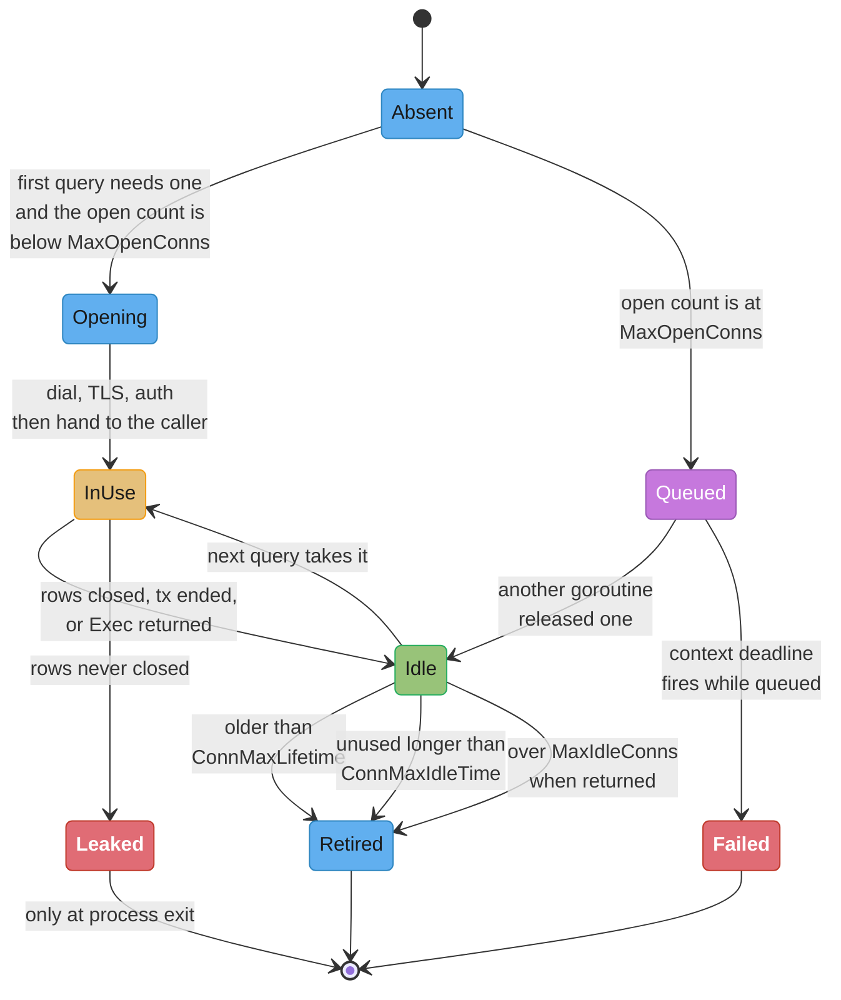
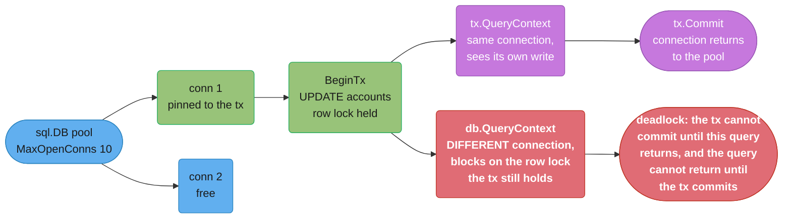

# database/sql and Data Access

## 1. Concept Overview

The single most useful sentence about `database/sql` is that **it is a connection pool with
a query API bolted on, not a database driver.** The package contains no wire protocol, no
SQL parser, and no knowledge of Postgres, MySQL, or SQLite. What it contains is a pool of
`driver.Conn` values, a set of limits on that pool, and the bookkeeping that hands a
connection to a query and takes it back afterwards. `*sql.DB` is not a connection. It is
the pool object, safe for concurrent use by any number of goroutines, and meant to be
created once at process start and shared.

Nearly every production incident in Go data access follows from not knowing that. `sql.Open`
does not connect, so it cannot fail on a database that is down. `SetMaxOpenConns` is
**unlimited by default**, so a Go service under load will open connections until the
database refuses them — and Postgres refusing connections takes down every other client on
that box, not just yours. `SetMaxIdleConns` defaults to **2**, so a service doing 500
queries per second with a 20-connection working set closes and reopens connections
continuously, paying a TCP handshake and a TLS handshake and an authentication round trip
for each. An `*sql.Rows` you forget to close holds its connection out of the pool until the
process exits. An `*sql.Tx` pins one connection for its whole lifetime, so running a query
on `db` instead of `tx` inside a transaction can deadlock against a pool you sized for the
happy path.

None of these produce a compile error, and most of them produce no error at runtime either
— they produce latency, and then, at some traffic level you have not reached yet, an
outage. That is why this module treats configuration as the primary content and the query
API as secondary.

The pool as a *concept* — the sizing arithmetic, PgBouncer's pooling modes, what happens on
the database side when the count is wrong — belongs to
[Connection Pooling Deep Dive](../../backend/connection_pooling_deep_dive/connection_pooling_deep_dive.md)
and [Connection Pool Management](../../database/connection_pool_management/connection_pool_management.md).
This module is Go's implementation of it: the four setters, the `Stats` you watch, the
resource-ownership rules the API forces on you, and the ecosystem — `pgx`, `sqlc`, `sqlx`,
GORM — you choose between on top.

---

## 2. Intuition

> **One-line analogy**: `*sql.DB` is a car-hire desk, not a car. `sql.Open` gets you a
> membership card; `Ping` is the first time anyone checks whether there are cars in the lot.
> Every `Query` borrows a car and every `rows.Close()` returns it — and a car you never
> return is a car the next customer waits for forever.

**Mental model**: hold three objects distinct in your head and most of the API becomes
obvious. `*sql.DB` is the pool: shared, concurrent, long-lived, never closed until shutdown.
`*sql.Conn` and `*sql.Tx` are **one borrowed connection each**: not concurrency-safe,
short-lived, and the pool cannot reclaim them until you release them. `*sql.Rows` is a
**cursor holding a borrowed connection open** while you iterate — which is why it has a
`Close` method and why forgetting it is the single most expensive omission in Go data
access.

**Why it matters**: the difference between a service that survives a traffic spike and one
that takes the database down with it is four lines of configuration written at startup.
Nothing in the type system prompts you to write them, and the defaults are wrong for every
production workload — unlimited connections and 2 idle ones is a combination that behaves
beautifully in a test and pathologically at 3,000 requests per second.

**Key insight**: `database/sql` gives you resource ownership without a destructor. Go has no
RAII, `Rows` is not garbage-collected back into the pool in any timely way, and a
`defer rows.Close()` you did not write is a leak the compiler will never mention. Every
API in the package that returns something with a `Close` method is handing you a borrowed
connection, and the discipline is mechanical: acquire, defer the release, then use.

---

## 3. Core Principles

- **`*sql.DB` is a pool, not a connection.** Create one per database, at startup, and share
  it across every goroutine.
- **`sql.Open` is lazy.** It validates the DSN's syntax and registers nothing else. `Ping`
  or `PingContext` is the first real connection.
- **The defaults are wrong.** `MaxOpenConns` is unlimited; `MaxIdleConns` is 2; there is no
  lifetime and no idle timeout. Set all four explicitly.
- **Every borrowed connection has exactly one release point.** `rows.Close()`,
  `tx.Commit()`/`tx.Rollback()`, `conn.Close()`, `stmt.Close()`.
- **`rows.Err()` is not optional.** The iteration loop ends on error exactly as it ends on
  exhaustion, and only `Err()` tells you which happened.
- **A `*sql.Tx` is pinned to one connection.** Any query inside the transaction that goes
  through `db` runs on a different connection and does not see the transaction's writes.
- **Pass a `context.Context` to everything.** `QueryContext`, `ExecContext`, `BeginTx`,
  `PingContext` — a query without one cannot be cancelled when the client disconnects.
- **Never build SQL with string concatenation.** Placeholders are the only defence, and
  they cannot parameterize an identifier.
- **`db.Stats()` is your saturation signal.** `WaitCount` and `WaitDuration` rising means
  goroutines are queuing for a connection.

---

## 4. Types / Architectures / Strategies

### The object model

| Type | What it is | Concurrency-safe | Released by |
|------|-----------|------------------|-------------|
| `*sql.DB` | The pool | Yes | `Close()` at shutdown only |
| `*sql.Conn` | One reserved connection | No | `Close()` |
| `*sql.Tx` | One connection inside a transaction | No | `Commit()` or `Rollback()` |
| `*sql.Rows` | A cursor holding a connection | No | `Close()`, or full iteration |
| `*sql.Row` | A one-row cursor | No | `Scan()` — it closes itself |
| `*sql.Stmt` | A prepared statement, per connection | Yes | `Close()` |

### The four pool settings

| Setter | Default | What it controls | What to set it to |
|--------|---------|-----------------|-------------------|
| `SetMaxOpenConns(n)` | **0 = unlimited** | Ceiling on total connections (in use plus idle) | The database's capacity divided by the number of instances — see the linked pooling modules |
| `SetMaxIdleConns(n)` | **2** | How many idle connections the pool keeps | Equal to `MaxOpenConns` for a steady workload |
| `SetConnMaxLifetime(d)` | 0 = forever | Maximum age before a connection is retired | 5 minutes behind a load balancer or failover endpoint; shorter than any upstream idle timeout |
| `SetConnMaxIdleTime(d)` | 0 = never | How long an idle connection may sit unused | 1–2 minutes, so a burst's connections are released after it passes |

### Query API, by shape of result

| Call | Returns | Use for |
|------|---------|---------|
| `ExecContext` | `sql.Result` (`RowsAffected`, `LastInsertId`) | INSERT / UPDATE / DELETE / DDL |
| `QueryRowContext` | `*sql.Row` | Exactly one row; `Scan` returns `sql.ErrNoRows` if none |
| `QueryContext` | `*sql.Rows` | Zero or more rows; you own `Close` and must check `Err` |
| `BeginTx` | `*sql.Tx` | A multi-statement unit of work with an isolation level |
| `Conn` | `*sql.Conn` | Session-scoped state — advisory locks, `SET LOCAL`, `LISTEN` |

### The library landscape

| Layer | Examples | What you get | What you give up |
|-------|----------|-------------|-----------------|
| Driver on `database/sql` | `pgx/v5/stdlib`, `go-sql-driver/mysql` | Pool, portability, every tool that speaks `*sql.DB` | Postgres-native types and `COPY` performance |
| Driver, native interface | `pgx/v5` `pgxpool` | `COPY FROM`, batched pipelining, native `jsonb` and array types, `LISTEN`/`NOTIFY` | `database/sql`'s pool and everything built on `*sql.DB` |
| Scanning helper | `sqlx`, `scany` | `StructScan`, `Get`, `Select`, named parameters | Nothing — it wraps `*sql.DB` |
| Query compiler | `sqlc` | Generated, type-checked Go from your `.sql` files, verified against the real schema | Dynamic query construction |
| Query builder | `squirrel`, `goqu` | Composable dynamic SQL | Compile-time verification of the SQL |
| ORM | `GORM`, `ent` | Associations, migrations, hooks | Predictable SQL, and usually your N+1 budget |

---

## 5. Architecture Diagrams

### The life of a pooled connection



The `Leaked` state is the one with no way back. Nothing reclaims that connection: not the
garbage collector, not a timeout, not `ConnMaxLifetime` — which only applies to a
connection that made it back to the pool. Enough of them and every subsequent query blocks
in `Queued` until its context expires.

### Where a query spends its time when the pool is too small

```
  MaxOpenConns = 10, arrival rate 400 queries/s, query service time 20 ms

  Concurrency the workload wants:  400/s x 0.020 s = 8 connections busy on average.
  Pool of 10 -> fine on average, saturated on any burst above 1.25x.

  A burst to 900/s wants 900 x 0.020 = 18 busy connections. The pool has 10.

  goroutine timeline for one request during the burst:

    |<---------- 41 ms observed latency ----------->|
    |<-- 21 ms waiting for a connection -->|<-20 ms->|
     ^                                      ^        ^
     request starts                         got one  query returns
     db.Stats().WaitCount += 1
     db.Stats().WaitDuration += 21ms

  The database sees a 20 ms query. The client sees 41 ms. Nothing in a slow-query log
  or an APM span that starts at "query sent" can see the other 21 ms. db.Stats() is
  the only place that half of the latency is visible.
```

### `db` versus `tx` inside a transaction



---

## 6. How It Works — Detailed Mechanics

### Registration and the blank import

A driver registers itself in an `init()` function, which is why you import it for its side
effect alone:

```go
import (
    "database/sql"

    _ "github.com/jackc/pgx/v5/stdlib"   // registers the "pgx" driver name
)

db, err := sql.Open("pgx", os.Getenv("DATABASE_URL"))
```

Inside the driver, that `init()` calls `sql.Register("pgx", &Driver{})`, adding the name to
a package-level map. Two consequences: registering the same name twice panics, so two
libraries that both vendor a driver under the same name break at startup; and a misspelled
driver name is the one error `sql.Open` *does* return, because it is the only thing
`Open` checks besides DSN parsing.

### `sql.Open` does not connect

```go
db, err := sql.Open("pgx", "postgres://user:pw@db.internal:5432/app")
// err is nil even if db.internal does not resolve, is firewalled, or is powered off.
// No socket has been opened. No credential has been checked.

ctx, cancel := context.WithTimeout(context.Background(), 5*time.Second)
defer cancel()
if err := db.PingContext(ctx); err != nil {
    return fmt.Errorf("database unreachable: %w", err)   // this is where it fails
}
```

The practical rule for a service: `Open` at startup, then `PingContext` with a timeout, and
fail the process if the ping fails. Do not let a service report itself healthy while every
request is about to discover the database is gone. Equally, do not put an unbounded `Ping`
in a readiness probe that runs every second — it opens a connection each time it finds the
pool empty.

### Configuring the pool

```go
func newDB(ctx context.Context, dsn string) (*sql.DB, error) {
    db, err := sql.Open("pgx", dsn)
    if err != nil {
        return nil, fmt.Errorf("open: %w", err)
    }

    // Ceiling. The default is UNLIMITED -- this is the line that stops a Go
    // service from opening 4,000 connections and taking the database offline.
    db.SetMaxOpenConns(25)

    // Idle floor. The default is 2, so a service running 25 concurrent queries
    // would close 23 connections the moment the burst ends and reopen them on
    // the next one. Match it to MaxOpenConns for a steady workload.
    db.SetMaxIdleConns(25)

    // Rotate connections so a load balancer or a failover promotes cleanly, and
    // so a connection never outlives the server-side idle timeout in front of it.
    db.SetConnMaxLifetime(5 * time.Minute)

    // Release capacity after a burst instead of holding 25 sockets forever.
    db.SetConnMaxIdleTime(90 * time.Second)

    pingCtx, cancel := context.WithTimeout(ctx, 5*time.Second)
    defer cancel()
    if err := db.PingContext(pingCtx); err != nil {
        db.Close()
        return nil, fmt.Errorf("ping: %w", err)
    }
    return db, nil
}
```

`MaxIdleConns` is silently clamped to `MaxOpenConns`: setting idle to 50 with open at 25
gives you 25. Setting `MaxIdleConns(0)` disables idle retention entirely, which turns every
query into a fresh connection and is almost never what anyone wants.

The number 25 is not a recommendation. Total connections against the database are
`instances x MaxOpenConns`, and the ceiling that has to accommodate it is the server's
`max_connections` minus what everything else needs. The sizing arithmetic — the
`(core_count x 2) + effective_spindle_count` rule and the Little's Law demand side — is
worked in full in
[Connection Pooling Deep Dive](../../backend/connection_pooling_deep_dive/connection_pooling_deep_dive.md);
do not re-derive it, and do not pick a number without knowing your instance count.

### Why `SetConnMaxLifetime` is not optional

A connection with no lifetime lives until it errors. Three things then go wrong:

1. **Failover does not take.** You promote a replica behind an endpoint like an RDS writer
   DNS name. Existing connections stay bolted to the old host until they break; new ones go
   to the new one. With no lifetime, a service can sit half-connected to a demoted primary
   for hours.
2. **A load balancer never rebalances.** Connections are established once at ramp-up, so a
   node added to the pool afterwards receives nothing.
3. **Something upstream kills the socket first.** Postgres `idle_in_transaction_session_timeout`,
   PgBouncer `server_idle_timeout`, an AWS NLB's 350-second idle timeout, or a stateful
   firewall will close a connection the pool still believes is good. The next query on it
   fails with a driver-level error rather than being retried.

Setting the lifetime **shorter than the shortest upstream timeout** makes the pool the one
that closes the connection, on its own terms, between queries rather than during one.

### `rows.Close()` and `rows.Err()` — the two lines everyone forgets

```go
// BROKEN: two defects. The connection leaks on the early return, and a mid-iteration
// error is indistinguishable from a clean end of results.
func listBad(ctx context.Context, db *sql.DB, id int64) ([]Item, error) {
    rows, err := db.QueryContext(ctx, `SELECT id, name FROM items WHERE owner = $1`, id)
    if err != nil {
        return nil, err
    }
    var out []Item
    for rows.Next() {
        var it Item
        if err := rows.Scan(&it.ID, &it.Name); err != nil {
            return nil, err          // rows is never closed: connection lost forever
        }
        if it.Name == "" {
            break                     // early break: rows is never closed either
        }
        out = append(out, it)
    }
    return out, nil                   // a network error mid-scan looks like "no more rows"
}
```

```go
// FIX: defer the close immediately, and check Err after the loop.
func listGood(ctx context.Context, db *sql.DB, id int64) ([]Item, error) {
    rows, err := db.QueryContext(ctx, `SELECT id, name FROM items WHERE owner = $1`, id)
    if err != nil {
        return nil, fmt.Errorf("query items: %w", err)
    }
    defer rows.Close()               // idempotent; safe even after full iteration

    out := make([]Item, 0, 16)       // non-nil: marshals to [] not null
    for rows.Next() {
        var it Item
        if err := rows.Scan(&it.ID, &it.Name); err != nil {
            return nil, fmt.Errorf("scan item: %w", err)
        }
        out = append(out, it)
    }
    if err := rows.Err(); err != nil {          // THE line people omit
        return nil, fmt.Errorf("iterate items: %w", err)
    }
    return out, nil
}
```

The mechanics: `rows.Next()` returns `false` both when the result set is exhausted **and**
when an error occurred — a dropped connection, a context cancellation, a decode failure. In
the exhausted case the connection is released automatically. In the error case it is
released too, but you have silently returned a truncated result set as if it were complete.
`rows.Err()` is the only distinguishing signal, and a truncated list that looks successful
is worse than an error: it gets written back.

`rows.Close()` is idempotent and safe to call after full iteration, which is why the
unconditional `defer` immediately after the error check is the only shape to use. Do not
put the `defer` before the `if err != nil`; `rows` is nil there.

### `QueryRow` and `ErrNoRows`

```go
func findUser(ctx context.Context, db *sql.DB, email string) (*User, error) {
    var u User
    err := db.QueryRowContext(ctx,
        `SELECT id, email, created_at FROM users WHERE email = $1`, email,
    ).Scan(&u.ID, &u.Email, &u.CreatedAt)

    switch {
    case errors.Is(err, sql.ErrNoRows):
        return nil, ErrUserNotFound          // your domain's sentinel, not the driver's
    case err != nil:
        return nil, fmt.Errorf("find user: %w", err)
    }
    return &u, nil
}
```

`QueryRow` defers every error — including the query error — to `Scan`, so there is exactly
one place to check. It closes its own rows, so there is no `Close` to forget. Translating
`sql.ErrNoRows` into a domain sentinel at the repository boundary matters because
`sql.ErrNoRows` leaking to an HTTP handler is how "not found" becomes a 500.

### Nullable columns

```go
type Row struct {
    ID       int64
    Nickname sql.NullString   // .String and .Valid
    Score    sql.NullInt64
    Seen     sql.NullTime
}

err := db.QueryRowContext(ctx, `SELECT id, nickname, score, seen FROM p WHERE id=$1`, id).
    Scan(&r.ID, &r.Nickname, &r.Score, &r.Seen)

if r.Nickname.Valid {
    use(r.Nickname.String)
}
```

`sql.Null[T]` is the generic form and covers types the concrete `sql.NullXxx` set does not.
The alternative is a pointer field — `*string` scans a NULL as nil — which is more
ergonomic in JSON output and less explicit at the scan site. Pick one per codebase.

Scanning a NULL into a non-nullable `string` or `int64` fails with
`converting NULL to string is unsupported`, which is a runtime error on a code path that
only triggers when a row happens to have a NULL. Two defences: `COALESCE` in the SQL, or a
`NOT NULL` constraint so the case cannot arise.

`[1.27]` adds two things here. `sql.ConvertAssign` exports the package's own conversion
routine, so a custom `Scanner` can delegate to exactly the same coercion rules
`database/sql` applies internally instead of reimplementing them and drifting. And
`driver.RowsColumnScanner` lets a driver take over scanning for a specific column, which is
how a driver exposes a native type — a Postgres array, a `jsonb`, a range — into a Go value
without the generic conversion path flattening it to `[]byte` first. `pgx/v5/stdlib` v5.11.0
(2026-09-07) implements it, so on Go 1.27 PostgreSQL arrays and ranges scan straight into Go
values through `*sql.DB`, which used to need `pgx`'s native interface or a wrapper type.

### Transactions

```go
func transfer(ctx context.Context, db *sql.DB, from, to int64, cents int64) (err error) {
    tx, err := db.BeginTx(ctx, &sql.TxOptions{Isolation: sql.LevelReadCommitted})
    if err != nil {
        return fmt.Errorf("begin: %w", err)
    }
    // Safe unconditionally: Rollback after a successful Commit returns
    // sql.ErrTxDone and changes nothing. This is the guard for every early
    // return and every panic between here and the Commit.
    defer func() {
        if rbErr := tx.Rollback(); rbErr != nil && !errors.Is(rbErr, sql.ErrTxDone) {
            err = errors.Join(err, fmt.Errorf("rollback: %w", rbErr))
        }
    }()

    // Every statement goes through tx, never db.
    var balance int64
    if err := tx.QueryRowContext(ctx,
        `SELECT balance FROM accounts WHERE id = $1 FOR UPDATE`, from,
    ).Scan(&balance); err != nil {
        return fmt.Errorf("lock source: %w", err)
    }
    if balance < cents {
        return ErrInsufficientFunds
    }
    if _, err := tx.ExecContext(ctx,
        `UPDATE accounts SET balance = balance - $1 WHERE id = $2`, cents, from,
    ); err != nil {
        return fmt.Errorf("debit: %w", err)
    }
    if _, err := tx.ExecContext(ctx,
        `UPDATE accounts SET balance = balance + $1 WHERE id = $2`, cents, to,
    ); err != nil {
        return fmt.Errorf("credit: %w", err)
    }
    if err := tx.Commit(); err != nil {
        return fmt.Errorf("commit: %w", err)
    }
    return nil
}
```

Three mechanics worth naming:

- **The transaction pins one connection** from `BeginTx` until `Commit` or `Rollback`. That
  connection is out of the pool for the whole duration, so a long transaction is a pool
  slot you are not using for anything else.
- **`BeginTx` respects the context.** If the context is cancelled before `Commit`, the
  package rolls the transaction back and returns the connection.
- **A named return value** is what lets the deferred rollback contribute to the error. With
  `func transfer(...) error` (unnamed), the deferred closure has nothing to assign to and a
  rollback failure is invisible.

The deadlock the `db`-instead-of-`tx` mistake produces is worth the walk: the transaction
holds a row lock on `accounts`; the stray `db.QueryContext` takes a *different* connection
from the pool and blocks waiting for that lock; the transaction cannot commit because the
goroutine is blocked on the query. With `MaxOpenConns` small enough, other requests then
queue behind both. Nothing recovers this except the query's context deadline — which is
one more reason every call takes a context.

### Prepared statements and PgBouncer

```go
stmt, err := db.PrepareContext(ctx, `SELECT id, name FROM items WHERE owner = $1`)
if err != nil {
    return err
}
defer stmt.Close()

for _, owner := range owners {
    rows, err := stmt.QueryContext(ctx, owner)
    // ...
}
```

`*sql.Stmt` is prepared **on one specific connection**. When you use it and the pool hands
you a different connection, `database/sql` transparently re-prepares it there and caches
that too. So a `Stmt` used across a 25-connection pool eventually holds 25 server-side
prepared statements. That is fine against Postgres directly, and broken through **PgBouncer
in `transaction` pooling mode**, where a client connection is bound to a server connection
only for the duration of one transaction: the `PREPARE` lands on one server connection and
the `EXECUTE` arrives on another, which has never heard of it.

Three ways out, in order of preference:

1. **Stop using explicit `Stmt` objects.** `db.QueryContext(ctx, sql, args...)` against
   Postgres sends an extended-protocol message per call — you get parameter binding and
   injection safety without a persistent server-side statement.
2. **Disable statement caching in the driver.** `pgx` exposes this through the DSN or
   `pgx.ConnConfig`; set the query exec mode so it does not rely on cached prepared
   statements.
3. **Use `session` pooling mode** in PgBouncer, which keeps the binding for the whole
   client connection. That sacrifices the connection multiplexing you deployed PgBouncer
   for, so it is a fallback, not a fix.

The [Connection Pool Management](../../database/connection_pool_management/connection_pool_management.md)
module covers what each PgBouncer mode gives up.

### SQL injection, and the identifier problem

```go
// BROKEN: this is the one unforgivable bug in data access.
q := fmt.Sprintf("SELECT * FROM users WHERE email = '%s'", email)
rows, _ := db.QueryContext(ctx, q)
// email = "x' OR '1'='1" returns every row.
// email = "x'; DROP TABLE users; --" does what it says on some drivers.
```

```go
// FIX: a placeholder. The value never becomes SQL text -- it is sent as a
// separate protocol field the parser never sees.
rows, err := db.QueryContext(ctx,
    `SELECT id, email FROM users WHERE email = $1`, email)
```

Placeholder syntax is driver-specific: `$1, $2` for Postgres, `?` for MySQL and SQLite,
`:name` for Oracle. `sqlx.Rebind` converts between them if you must be portable.

**You cannot parameterize an identifier.** A table name, column name, or `ORDER BY`
direction is part of the query's structure, not its data, so `ORDER BY $1` either errors or
sorts by a constant. The only safe pattern is an allowlist mapping user input to a literal
you wrote:

```go
var sortColumns = map[string]string{
    "created": "created_at",
    "name":    "display_name",
    "score":   "score",
}

func listSorted(ctx context.Context, db *sql.DB, sortKey, dir string) (*sql.Rows, error) {
    col, ok := sortColumns[sortKey]
    if !ok {
        return nil, fmt.Errorf("unknown sort key %q", sortKey)
    }
    order := "ASC"
    if strings.EqualFold(dir, "desc") {
        order = "DESC"
    }
    // col and order are values YOU wrote, selected by user input -- never user input.
    q := fmt.Sprintf(`SELECT id, name FROM items ORDER BY %s %s LIMIT $1`, col, order)
    return db.QueryContext(ctx, q, 100)
}
```

### The `IN` clause problem

`db.Query("... WHERE id IN (?)", ids)` does not work: a placeholder is one value, and a
slice is not one value. Three correct approaches:

```go
// 1. Postgres: pass an array and use = ANY. One placeholder, any length,
//    and the query text is identical every time so the plan cache works.
rows, err := db.QueryContext(ctx,
    `SELECT id, name FROM items WHERE id = ANY($1)`, pq.Array(ids))
// with pgx/stdlib the driver handles []int64 natively:
//   db.QueryContext(ctx, `... WHERE id = ANY($1)`, ids)
```

```go
// 2. Portable: build exactly len(ids) placeholders. Never interpolate the VALUES.
func expandIn(ids []int64) (string, []any) {
    ph := make([]string, len(ids))
    args := make([]any, len(ids))
    for i, id := range ids {
        ph[i] = fmt.Sprintf("$%d", i+1)   // "?" for MySQL
        args[i] = id
    }
    return "(" + strings.Join(ph, ",") + ")", args
}

frag, args := expandIn(ids)
rows, err := db.QueryContext(ctx, `SELECT id, name FROM items WHERE id IN `+frag, args...)
```

```go
// 3. sqlx does the same thing for you, then rebinds to the driver's placeholder style.
q, args, err := sqlx.In(`SELECT id, name FROM items WHERE id IN (?)`, ids)
if err != nil {
    return nil, err
}
rows, err := db.QueryContext(ctx, db.Rebind(q), args...)
```

Approach 2 generates a different query string for every distinct slice length, which
fragments the database's plan cache — 200 lengths means 200 cached plans. Postgres users
should prefer `= ANY($1)` for exactly that reason. And bound the length either way: 10,000
placeholders is a query the parser will spend real time on, and most drivers cap parameters
at 65,535.

### Watching the pool

```go
func poolMetrics(db *sql.DB, m *Metrics) {
    t := time.NewTicker(10 * time.Second)
    defer t.Stop()
    for range t.C {
        s := db.Stats()
        m.Open.Set(float64(s.OpenConnections))
        m.InUse.Set(float64(s.InUse))
        m.Idle.Set(float64(s.Idle))
        m.WaitCount.Set(float64(s.WaitCount))          // cumulative
        m.WaitSeconds.Set(s.WaitDuration.Seconds())    // cumulative
        m.ClosedMaxIdle.Set(float64(s.MaxIdleClosed))
        m.ClosedMaxLifetime.Set(float64(s.MaxLifetimeClosed))
    }
}
```

How to read them:

| Field | What a rising value means |
|-------|--------------------------|
| `WaitCount` | Goroutines are queuing for a connection: `MaxOpenConns` is the bottleneck |
| `WaitDuration` | Time spent queued. Divide the delta by the `WaitCount` delta for the mean wait |
| `InUse` pinned at `MaxOpenConns` | Saturated. Either queries got slower or load rose |
| `MaxIdleClosed` climbing fast | `MaxIdleConns` is too low: you are churning connections |
| `MaxLifetimeClosed` | Normal rotation; alarming only if it exceeds your query rate |

`WaitDuration` is the number that makes pool saturation visible at all. An APM span that
starts when the query is sent measures 20 ms while the user experiences 41 ms, and the
missing 21 ms exists only here.

### Attributing query time with pprof labels

```go
func (r *Repo) ListOrders(ctx context.Context, customer int64) ([]Order, error) {
    var out []Order
    var err error
    pprof.Do(ctx, pprof.Labels("query", "list_orders", "table", "orders"),
        func(ctx context.Context) {
            out, err = r.list(ctx, customer)
        })
    return out, err
}
```

Labels propagate through the context to every goroutine started inside the closure, and
`go tool pprof -tagfocus=query=list_orders` then filters a CPU or block profile to just
that query. A **block profile** with these labels is the one that answers "which query is
sitting in the pool queue" — the wait is off-CPU, so a CPU profile shows nothing at all.
See [Profiling and Tracing](../profiling_and_tracing/profiling_and_tracing.md) for enabling
the block profile and reading the output.

---

## 7. Real-World Examples

- **Prometheus's remote-write and PostgreSQL adapters** size their pools explicitly at
  startup rather than relying on defaults, because a scrape burst against an unlimited pool
  is exactly the shape that exhausts `max_connections`.
- **Grafana** ships `database/sql` with SQLite, MySQL, and Postgres behind one interface and
  exposes pool statistics as its own metrics — `grafana_database_conn_*` is `db.Stats()`
  re-exported, which is the pattern every service should copy.
- **Vault** uses `database/sql` for its storage backends and for dynamic database
  credentials; its dynamic-secrets engine specifically sets short connection lifetimes so
  rotated credentials take effect without a restart.
- **CockroachDB and Vitess** both document `SetConnMaxLifetime` as required rather than
  optional, because their gateways move and a pinned connection defeats the rebalancing the
  cluster is doing.
- **`sqlc`** is used by companies that want generated code without an ORM: you write the
  `.sql`, it introspects the real schema and emits typed Go, and a column rename that
  breaks a query fails the build instead of a request.
- **Amazon RDS Proxy and PgBouncer** exist because `instances x MaxOpenConns` grows with
  your autoscaler and `max_connections` does not, which is the arithmetic worked in
  [Connection Pool Management](../../database/connection_pool_management/connection_pool_management.md).

---

## 8. Tradeoffs

### Access layer

| Layer | Compile-time safety | Runtime overhead | Dynamic queries | Learning cost |
|-------|--------------------|------------------|-----------------|---------------|
| Raw `database/sql` | None — SQL is a string, `Scan` args are `any` | Lowest | Trivial | Lowest |
| `sqlx` | None, but struct tags catch column mismatches at runtime | Reflection per scan | Trivial | One afternoon |
| `sqlc` | Full — the SQL is checked against your schema at generate time | Same as raw | Not supported; write a builder alongside | One day |
| `squirrel` | None on the SQL itself | Small | Its whole purpose | Half a day |
| `GORM` | Little — associations resolve at runtime | Reflection, hooks, and an easy N+1 | Its whole purpose | Weeks, and it never stops surprising you |
| `ent` | Strong — generated typed builders | Moderate | Supported through the generated API | Days; a schema DSL to learn |

### `database/sql` versus `pgx` native

| Concern | `pgx/v5/stdlib` on `database/sql` | `pgxpool` native |
|---------|----------------------------------|-----------------|
| Pool | `database/sql`'s, with the four setters | `pgxpool`'s own, with health checks and `BeforeAcquire` hooks |
| Bulk load | Multi-row `INSERT` | `CopyFrom`, an order of magnitude faster for large loads |
| Round trips | One per statement | `Batch` pipelines many into one |
| Postgres types | Coerced through `driver.Value` | Native arrays, `jsonb`, ranges, composite types, `numeric` |
| `LISTEN` / `NOTIFY` | Awkward — needs a reserved `*sql.Conn` | First-class |
| Ecosystem | Every tool that takes a `*sql.DB` | Only what speaks `pgx` |

The honest rule: start on `database/sql` with the `pgx` driver. Move to `pgxpool` when a
specific need — `CopyFrom` throughput, batching, or a Postgres type you keep hand-rolling
— shows up in a profile or a bug report. Both can coexist in one process against the same
database.

### Pool settings

| Setting | Too low | Too high |
|---------|---------|----------|
| `MaxOpenConns` | `WaitCount` climbs, latency doubles under burst | Database context-switches and locks; one service starves every other client |
| `MaxIdleConns` | Constant reconnection: TCP plus TLS plus auth per query | Sockets held idle against a server-side connection budget |
| `ConnMaxLifetime` | Reconnection churn; a 10-second lifetime is a self-inflicted outage | Failover does not take; load balancers never rebalance; upstream idle timeouts kill sockets first |
| `ConnMaxIdleTime` | Bursts pay full connection cost every time | Post-burst capacity is never released |

---

## 9. When to Use / When NOT to Use

**Use `database/sql` directly when:**

- You want one pooling and configuration model across Postgres, MySQL, and SQLite.
- Your queries are known at compile time and moderate in number.
- You want every observability, tracing, and testing tool in the ecosystem to work, since
  nearly all of them take a `*sql.DB`.

**Add `sqlx` when:**

- The `rows.Scan(&a, &b, &c, ...)` argument lists have grown long enough that a column
  reorder is a plausible bug. `StructScan` and `Select` remove that class entirely for the
  price of struct tags.

**Add `sqlc` when:**

- The schema changes and you want a **build failure**, not a 500 at 3am. It reads your
  migrations, type-checks every query against the real schema, and generates the Go.
- The team writes SQL fluently and wants to keep writing it.

**Go native `pgx` when:**

- You need `CopyFrom` for bulk ingest, request pipelining with `Batch`, `LISTEN`/`NOTIFY`,
  or Postgres types that `driver.Value` flattens.

**Do NOT use an ORM when:**

- You cannot predict the SQL a call will emit. In Go this matters more than in Ruby or
  Java, because the language's whole ethos is that the expensive thing should be visible.
- Your workload is read-heavy with hand-tuned queries: the ORM's value is write-side
  association management, and you are paying for it on every read.
- The team is learning both Go and the database at once. An ORM lets an N+1 ship without
  anyone noticing until it is in production at scale.

**Do NOT hold a transaction open across:**

- An HTTP call, a queue publish, or any user interaction. Each one pins a pool connection
  and a set of row locks for the duration of something you do not control.

---

## 10. Common Pitfalls

### The unclosed `rows` that leaked 25 connections in 90 seconds

An orders service had one handler with an early `return` inside a `rows.Next()` loop, on a
validation branch that fired for roughly 1 in 400 rows. Each hit permanently removed one
connection from a 25-connection pool. At 180 requests/second the pool was empty in
90 seconds, every subsequent query blocked in the pool queue until its 3-second context
deadline, and the service returned 504 for everything — including endpoints that never
touched that table. It looked exactly like a database outage, and the database was idle.

```go
// BROKEN
rows, err := db.QueryContext(ctx, q, id)
if err != nil {
    return nil, err
}
for rows.Next() {
    var it Item
    rows.Scan(&it.ID, &it.SKU)
    if !valid(it.SKU) {
        return nil, ErrBadSKU        // rows leaks: the connection never returns
    }
    out = append(out, it)
}
return out, nil                      // and rows.Err() is never consulted
```

```go
// FIX
rows, err := db.QueryContext(ctx, q, id)
if err != nil {
    return nil, fmt.Errorf("query items: %w", err)
}
defer rows.Close()                   // unconditional, immediately after the error check

for rows.Next() {
    var it Item
    if err := rows.Scan(&it.ID, &it.SKU); err != nil {
        return nil, fmt.Errorf("scan: %w", err)
    }
    if !valid(it.SKU) {
        return nil, ErrBadSKU        // now safe: the defer releases the connection
    }
    out = append(out, it)
}
if err := rows.Err(); err != nil {
    return nil, fmt.Errorf("iterate: %w", err)
}
```

The detection that would have caught it in minutes: `db.Stats().InUse` pinned at
`MaxOpenConns` while the database reports near-zero active queries. That combination means
exactly one thing. `golangci-lint`'s `rowserrcheck` and `sqlclosecheck` catch both defects
statically and cost nothing to enable.

### The unlimited pool that took down a shared Postgres

A team deployed a Go API without calling `SetMaxOpenConns` at all. It worked for eight
months at 40 requests/second. A marketing campaign took it to 1,900/second, HPA scaled the
deployment from 4 pods to 60, and each pod opened as many connections as it had concurrent
requests. Peak was above 3,000 connections against a `max_connections` of 500. Postgres
started refusing connections, which took out the two other services sharing that instance —
including the one that ran the payment ledger. Recovery took 35 minutes because the API
pods immediately re-established connections on restart.

```go
// BROKEN: the default MaxOpenConns is 0, which means UNLIMITED.
db, _ := sql.Open("pgx", dsn)
return db
```

```go
// FIX: an explicit ceiling that accounts for the replica count.
// budget = (max_connections - reserved) / max_replicas
//        = (500 - 100) / 60 = 6 connections per pod
db.SetMaxOpenConns(6)
db.SetMaxIdleConns(6)
db.SetConnMaxLifetime(5 * time.Minute)
db.SetConnMaxIdleTime(90 * time.Second)
```

The structural lesson is that `MaxOpenConns` alone is not a safe knob once an autoscaler
controls the replica count — the total is `replicas x MaxOpenConns` and the autoscaler owns
one of the factors. That is the argument for a shared pooler, worked in
[Connection Pool Management](../../database/connection_pool_management/connection_pool_management.md).

### `MaxIdleConns` left at 2, costing 8 ms on every request

A search service ran a 50-connection pool and never touched `SetMaxIdleConns`. The default
of 2 meant that after each burst the pool closed 48 connections, and the next burst
reopened them: TCP handshake, TLS handshake, and Postgres authentication, roughly 8 ms
against a database in the same AZ. p50 latency was 11 ms and p99 was 34 ms for a query the
database executed in 1.2 ms. `db.Stats().MaxIdleClosed` was incrementing 4,000 times a
minute, which is the tell. Setting `SetMaxIdleConns(50)` to match `MaxOpenConns` took p99 to
6 ms with no other change.

### `defer tx.Rollback()` written as if it were an error

A reviewer flagged `defer tx.Rollback()` as a bug on the grounds that it rolls back a
committed transaction. It does not — `Rollback` on a finished transaction returns
`sql.ErrTxDone` and touches nothing. The team "fixed" it by removing the defer and calling
`Rollback` only on explicit error branches. Two months later a `panic` in the middle of a
transaction left it open, the connection stayed pinned, and the row locks it held blocked
every other writer to that table for the four minutes it took to notice. The correct shape
is the unconditional defer, ignoring or joining `sql.ErrTxDone`, as in §6.

### Prepared statements against PgBouncer in transaction mode

A service was migrated behind PgBouncer to cut its connection count. It began returning
`prepared statement "lrupsc_1_0" does not exist` on roughly 30% of requests, seemingly at
random. The randomness was the pool: whichever `PREPARE` happened to land on the same
server connection as its `EXECUTE` succeeded. Since PgBouncer was deployed specifically to
multiplex, `session` mode was not an option. The fix was to drop the explicit `*sql.Stmt`
objects and use `db.QueryContext` with inline arguments, plus disabling the driver's
statement cache — 40 lines deleted, zero errors after.

### A transaction that queried through `db` and deadlocked the pool

An inventory service ran `BeginTx`, took `FOR UPDATE` locks on a batch of SKUs, and then
called a helper that took `*sql.DB` rather than an interface the `*sql.Tx` satisfied. The
helper's query blocked on the locks the outer transaction still held. With
`MaxOpenConns(10)`, ten concurrent requests produced ten transactions each blocked on their
own second query — a total pool deadlock that only broke when the 30-second context
deadlines fired. Nothing in the database's lock view looked unusual; the waiting sessions
were all Go's.

The fix is structural: define a narrow interface both types satisfy, and pass it everywhere,
so a helper cannot accidentally reach the pool.

```go
// Both *sql.DB and *sql.Tx satisfy this. Repository methods take it; only the
// transaction boundary function ever sees the concrete *sql.DB.
type Querier interface {
    ExecContext(ctx context.Context, q string, args ...any) (sql.Result, error)
    QueryContext(ctx context.Context, q string, args ...any) (*sql.Rows, error)
    QueryRowContext(ctx context.Context, q string, args ...any) *sql.Row
}
```

### The `fmt.Sprintf` query that got a company on the news

A reporting endpoint accepted a filter string and interpolated it into a `WHERE` clause,
reasoning that only internal analysts could reach it. An SSRF in an unrelated service made
the endpoint reachable from outside, and the injected `UNION SELECT` read the users table.
There is no risk assessment that makes string-built SQL acceptable — placeholders cost
nothing, and the two cases that genuinely need structure (identifiers and `IN` lists) both
have safe patterns in §6. Enable `golangci-lint`'s `gosec` G201/G202 rules and treat every
hit as a blocker.

### A `pgx` upgrade that changed what the connection string meant

`pgx` v5.11.0 parses connection strings exactly as libpq does, and three behaviours moved
with it. In a URI, `+` in a query value is now a literal plus, so
`?application_name=billing+worker` names the client `billing+worker`, not `billing worker`;
encode a space as `%20`. In a keyword/value string a backslash escapes the next character and
is dropped, so `sslcert=C:\path\to\cert` is read as `C:pathtocert` and the TLS setup fails
at startup; write `sslcert=C:\\path\\to\\cert`. And `timestamptz` values
scanned from the text format now come back in `time.Local`, or in the codec's `ScanLocation`
when set, so a container whose `TZ` differs from the one CI ran in returns different
`Location`s for the same row. Set `ScanLocation` to `time.UTC` to pin it, and re-test every
DSN from config before taking the upgrade. v5.10.0 (2026-06-03) also added `require_auth`, which
lets the client refuse authentication methods it did not ask for, for example
`require_auth=scram-sha-256` to reject a server that falls back to cleartext password.

---

## 11. Technologies & Tools

| Tool | What it does for Go data access |
|------|--------------------------------|
| `database/sql` | The pool, the query API, `Null*` types, `ConvertAssign` `[1.27]` |
| `database/sql/driver` | The driver contract; `RowsColumnScanner` `[1.27]` lets a driver own a column's scan |
| `github.com/jackc/pgx/v5` v5.11.0 | The Postgres driver; `stdlib` sub-package for `database/sql` (implements `RowsColumnScanner` `[1.27]`), `pgxpool` for native; libpq-exact DSN parsing |
| `github.com/go-sql-driver/mysql` | The MySQL driver; needs `parseTime=true` and `loc` in the DSN |
| `modernc.org/sqlite` | Pure-Go SQLite — no cgo, so `CGO_ENABLED=0` static builds keep working |
| `github.com/jmoiron/sqlx` | `StructScan`, `Get`, `Select`, `In`, `Rebind` over an unmodified `*sql.DB` |
| `sqlc` | Generates typed Go from `.sql` files, type-checked against your real schema |
| `github.com/georgysavva/scany` | Struct scanning that works with both `database/sql` and `pgx` native |
| `gorm.io/gorm` | Full ORM: associations, hooks, auto-migration. Watch for N+1 and unpredictable SQL |
| `entgo.io/ent` | Schema-as-code with generated typed query builders; the strongest-typed option |
| `github.com/Masterminds/squirrel` | Composable SQL builder for genuinely dynamic queries |
| `golang-migrate/migrate` | Versioned up/down migrations as SQL files; CLI and library |
| `pressly/goose` | Migrations as SQL or Go functions, with embedded-FS support |
| `rowserrcheck`, `sqlclosecheck`, `gosec` (in `golangci-lint`) | Catch a missing `rows.Err()`, a missing `Close`, and a built-string query statically |
| `github.com/DATA-DOG/go-sqlmock` | Driver-level mocking for `database/sql`; asserts on the exact SQL issued |
| `testcontainers-go` | A real Postgres in a container per test suite; the honest alternative to mocking |
| `github.com/XSAM/otelsql` | OpenTelemetry spans and pool metrics for any `database/sql` driver |
| PgBouncer / RDS Proxy | Shared server-side pooling when `replicas x MaxOpenConns` outgrows `max_connections` |
| `runtime/pprof` labels | Attribute CPU and block time to a named query; the only way to see pool queue time on-profile |

---

## 12. Interview Questions with Answers

**Q: Why does `sql.Open` succeed against a database that is completely down?**
**Short:** It only validates the DSN and looks up the registered driver — no socket is opened, so nothing about the server's state can be observed.

The package is lazy by design: `*sql.DB` is a pool object, and a pool with zero connections
is a perfectly valid pool. The first real connection is established when the first query
needs one, or when you call `Ping`. The consequence for a service is a startup sequence
that reports healthy while every request is about to fail, so the correct pattern is `Open`
followed immediately by `PingContext` with a timeout, failing the process if the ping
fails. The one error `Open` does return is an unknown driver name, because the driver map
lookup is the only thing it actually performs besides DSN parsing.

**Q: What happens if you forget to call `rows.Close()`?**
**Short:** The connection that result set is using never returns to the pool, and nothing in the runtime ever reclaims it — not the garbage collector, not a timeout.

An `*sql.Rows` holds a borrowed connection for as long as it is open. Full iteration to
exhaustion closes it implicitly, which is why the bug hides: the happy path works. An early
`break` or an early `return` inside the loop does not, so a validation branch that fires
rarely bleeds one connection per occurrence. With `MaxOpenConns(25)` and a branch hit once
in 400 rows at 180 requests per second, the pool is empty in about 90 seconds and every
query in the process then blocks until its context deadline. The diagnostic signature is
`db.Stats().InUse` pinned at the maximum while the database reports almost no active
queries. Always `defer rows.Close()` on the line after the error check, and enable
`sqlclosecheck` in `golangci-lint`.

**Q: Why must you check `rows.Err()` after iterating?**
**Short:** `rows.Next()` returns false both on normal exhaustion and on error, so without `Err()` a truncated result set is indistinguishable from a complete one.

If the connection drops, the context is cancelled, or a value fails to decode mid-iteration,
`Next` stops returning true exactly as it would at the end of the data. Your loop exits,
your function returns whatever it accumulated, and the caller writes a partial list back to
the database or renders it to a user as complete. This is worse than an error because it is
silent and it propagates. `rows.Err()` returns the first error that ended the iteration, or
nil if the set was genuinely exhausted, and it is a two-line check.
`rowserrcheck` in `golangci-lint` enforces it repo-wide.

**Q: What is the default value of `SetMaxOpenConns` and why is that dangerous?**
**Short:** The default is 0, which means unlimited — a Go service under load will open connections until the database itself starts refusing them.

Nothing in `database/sql` throttles connection creation, so concurrency in your service
translates one-for-one into connections against the database. A 60-pod deployment with 50
concurrent requests each will attempt 3,000 connections; a Postgres `max_connections` of
500 refuses the rest, and because the refusal is at the server, every other client on that
instance is affected too. The number to set is your database's connection budget divided by
your **maximum** replica count, not your current one, since an autoscaler owns that factor.
Once `replicas x MaxOpenConns` cannot be bounded, the answer is a shared pooler such as
PgBouncer or RDS Proxy rather than a smaller per-pod number.

**Q: `MaxIdleConns` defaults to 2. What does leaving it there cost?**
**Short:** Constant reconnection — every connection above the second is closed when it returns to the pool and reopened on the next query, paying TCP, TLS, and authentication each time.

A service running 50 concurrent queries keeps 2 connections after each burst and discards
48. The next burst re-establishes them, which against a same-AZ Postgres with TLS is on the
order of 8 ms of pure setup added to those requests. The symptom is a p99 several times the
database's own query time with no slow queries anywhere, and the confirming metric is
`db.Stats().MaxIdleClosed` incrementing thousands of times a minute. For a steady workload
set `MaxIdleConns` equal to `MaxOpenConns` and let `SetConnMaxIdleTime` release capacity
after a burst instead. Note that `MaxIdleConns` is silently clamped to `MaxOpenConns`, so
setting it higher does nothing.

**Q: Why set `SetConnMaxLifetime` if the connections are healthy?**
**Short:** Because a connection that never rotates never learns about a failover, never rebalances across a load balancer, and eventually gets killed by an upstream idle timeout mid-query.

Promote a replica behind a DNS endpoint and the existing connections stay bolted to the
demoted host until they break on their own, so a service can sit half-connected for hours.
Add a node to a load-balanced pool and connections established at ramp-up never move to it.
And anything between you and the database — PgBouncer's `server_idle_timeout`, an NLB's
350-second idle timeout, a stateful firewall — will close a socket the pool still believes
is good, turning the next query into an error instead of a retry. Set the lifetime shorter
than the shortest of those upstream timeouts, commonly 5 minutes, so the pool is the party
that closes the connection, between queries rather than during one.

**Q: Which `db.Stats()` fields tell you the pool is the bottleneck?**
**Short:** `WaitCount` and `WaitDuration` — they are the only place the time a goroutine spends queuing for a connection is recorded anywhere.

Both are cumulative counters, so you watch their rate of change: divide the `WaitDuration`
delta by the `WaitCount` delta over a scrape interval and you get the mean queue wait. This
matters because no query-side instrumentation can see it. An APM span that starts when the
statement is sent measures the database's 20 ms while the user experiences 41 ms, and the
missing 21 ms was spent waiting for a connection. `InUse` pinned at `MaxOpenConns` confirms
saturation; `MaxIdleClosed` climbing points at `MaxIdleConns` instead. Export all of them
as gauges from a ticker, or use `otelsql`, which does it for you.

**Q: Why does a `*sql.Tx` pin a connection, and what goes wrong because of it?**
**Short:** A transaction is server-side session state, so every statement in it must reach the same connection — which means a query issued through `db` inside a transaction runs somewhere else entirely.

`BeginTx` takes one connection out of the pool and holds it until `Commit` or `Rollback`.
Any statement you send through `tx` goes there; any statement you send through `db` takes a
different connection, does not see the transaction's uncommitted writes, and — if the
transaction holds row locks — blocks waiting for them. Since the goroutine is blocked on
that query, the transaction can never commit and release the locks, so it is a genuine
deadlock broken only by the context deadline. With a small `MaxOpenConns`, a handful of
concurrent requests in this shape deadlocks the entire pool. The structural fix is a narrow
`Querier` interface satisfied by both `*sql.DB` and `*sql.Tx`, so a helper physically
cannot reach the pool.

**Q: Is `defer tx.Rollback()` a bug when the transaction commits successfully?**
**Short:** No — rolling back a finished transaction returns `sql.ErrTxDone` and changes nothing, which is exactly why the unconditional defer is the correct pattern.

The defer is what protects you on every early return and every panic between `BeginTx` and
`Commit`, and those are the paths where a forgotten rollback pins a connection and holds
row locks until something notices. The refined shape uses a named return value and a
deferred closure that ignores `sql.ErrTxDone` while joining any other rollback error onto
the returned one, so a genuine rollback failure is not swallowed. Removing the defer in
favour of explicit rollbacks on each error branch is a common "fix" that reintroduces
exactly the bug the pattern exists to prevent.

**Q: Why do prepared statements break behind PgBouncer in transaction pooling mode?**
**Short:** Transaction mode rebinds the client to a different server connection per transaction, so the EXECUTE arrives on a connection that never received the PREPARE.

A `*sql.Stmt` is prepared on one specific connection; when the pool hands the statement a
different connection, `database/sql` transparently re-prepares it there. Against Postgres
directly that is invisible. Through PgBouncer in `transaction` mode, the server-side
connection changes underneath you, and you get
`prepared statement "..." does not exist` on some fraction of calls — the fraction being
however often the two land on the same backend by chance. The preferred fix is to stop
using explicit `Stmt` objects: `db.QueryContext(ctx, sql, args...)` still uses the extended
protocol and still binds parameters safely. Second is disabling the driver's statement
cache through the DSN or config. Falling back to `session` pooling mode works but discards
the multiplexing PgBouncer was deployed for.

**Q: How do you write `WHERE id IN (...)` with a variable-length slice?**
**Short:** Against Postgres, pass the slice as an array and use `= ANY($1)`; portably, generate exactly as many placeholders as elements and expand the arguments.

A placeholder binds one value, so `IN (?)` with a slice fails — and interpolating the
values into the string is the injection bug you were avoiding. `= ANY($1)` is strictly
better where it is available because the query text is identical for every slice length, so
the database's plan cache holds one plan instead of one per length. The portable approach
builds `($1,$2,$3)` and passes `args...`, and `sqlx.In` plus `db.Rebind` does that for you
across placeholder styles. Bound the length either way: most drivers cap parameters at
65,535, and a query with 10,000 placeholders costs real parse time.

**Q: Why can't you use a placeholder for a table or column name?**
**Short:** Placeholders bind data values, and an identifier is part of the query's structure — the server parses the statement before the parameters are ever bound.

`ORDER BY $1` either errors or sorts every row by the same constant string, because the
planner needed to know the column at parse time. The only safe pattern is an allowlist: a
map from the user's input token to a column name **you** wrote as a literal in your source,
with an error on any key not in the map. The same applies to sort direction — map to the
literals `ASC` and `DESC` rather than passing the string through. Anything that reaches
`fmt.Sprintf` into a query must be a value you authored, selected by user input, never user
input itself.

**Q: What is `sql.ErrNoRows` and where should it be handled?**
**Short:** It is the sentinel `QueryRow.Scan` returns when the query matched nothing, and it should be translated into a domain error at the repository boundary.

`QueryRow` defers every error, including the query error, to `Scan`, so there is exactly one
place to check and no `Close` to forget. Compare with `errors.Is(err, sql.ErrNoRows)` rather
than `==`, since the error may be wrapped. Translate it immediately into your own sentinel
— `ErrUserNotFound` — because a driver-level error leaking into an HTTP handler is how "no
such user" becomes a 500 instead of a 404. Note that `QueryContext` never returns
`ErrNoRows`: an empty result set there is simply a `Next()` that returns false on the first
call.

**Q: What do the `Context` variants of the query methods actually buy you?**
**Short:** Cancellation — the context aborts the query at the server and returns the connection to the pool the moment the caller gives up.

Without a context, a query runs to completion no matter what happened to the client. A user
who navigated away, a gateway that already timed out at 5 seconds, a shutdown in progress:
all of them leave a connection pinned and a database doing work nobody will read. The
context also bounds the wait for a connection, so a saturated pool produces a deadline error
instead of an unbounded block. `QueryContext`, `ExecContext`, `QueryRowContext`, `BeginTx`,
and `PingContext` are the whole set; the non-context forms exist only for compatibility and
have no place in new application code. Deadline propagation across service boundaries is
covered in [Context and Cancellation](../context_and_cancellation/context_and_cancellation.md).

**Q: How do you scan a column that can be NULL?**
**Short:** Use `sql.Null[T]` or one of the concrete `sql.NullString`-style types, or a pointer field — scanning NULL into a plain string or int64 is a runtime error.

The `Null` types carry a `Valid` boolean alongside the value, so you check `Valid` before
reading. A pointer field (`*string`) is the alternative: NULL scans as nil, which serialises
more naturally to JSON but hides the check. The failure mode if you use neither is
`converting NULL to string is unsupported` on a code path that only triggers when a row
happens to have a NULL, so it survives testing and appears in production. Two structural
defences beat both: a `NOT NULL` constraint so the case cannot arise, or `COALESCE` in the
query so the database supplies the default.

**Q: What do `sql.ConvertAssign` and `driver.RowsColumnScanner` `[1.27]` add?**
**Short:** `ConvertAssign` exports the package's own value-coercion routine so custom Scanners reuse it, and `RowsColumnScanner` lets a driver take over scanning for one specific column.

Before `ConvertAssign` was exported, a type implementing `sql.Scanner` had to reimplement
the conversion rules `database/sql` applies internally — int-to-int64 widening, `[]byte` to
string, time handling — and every reimplementation drifted from the real behaviour in some
edge case. Delegating to `ConvertAssign` makes a custom scanner behave exactly like a
built-in one. `RowsColumnScanner` works the other way: a driver that knows a column is a
Postgres array or a `jsonb` can populate the destination itself instead of handing over
`[]byte` for the generic path to flatten. Together they close the gap where a native
database type had to round-trip through `driver.Value`.

**Q: When do you leave `database/sql` for `pgx`'s native interface?**
**Short:** When you need `CopyFrom` bulk loading, request pipelining with `Batch`, `LISTEN`/`NOTIFY`, or Postgres types that `driver.Value` flattens.

`database/sql` normalises every driver to a small set of `driver.Value` types, which is what
makes one pool and one API work across Postgres, MySQL, and SQLite — and also what costs
you native arrays, `jsonb`, ranges, composite types, and exact `numeric`. `pgxpool` gives
those back plus `CopyFrom`, which is an order of magnitude faster than multi-row `INSERT`
for a large load, and `Batch`, which pipelines many statements into one round trip. What
you give up is every tool that takes a `*sql.DB` — `sqlmock`, `otelsql`, most migration
libraries' library mode. The pragmatic answer is to start on `pgx/v5/stdlib` behind
`database/sql` and move the one hot path that needs native features; both can run against
the same database in one process.

**Q: `sqlc`, `sqlx`, or GORM — what is the honest case for each?**
**Short:** `sqlc` generates type-checked Go from your SQL, `sqlx` only fixes scanning ergonomics, and GORM buys write-side association management at the cost of predictable SQL.

`sqlc` reads your migrations and your `.sql` files, verifies every query against the real
schema at generate time, and emits typed functions — so a column rename becomes a build
failure rather than a 3am 500. Its limit is that it cannot express a query whose shape is
decided at runtime, so pair it with a builder for those. `sqlx` is a thin wrapper that adds
`StructScan`, `Select`, and named parameters over an unmodified `*sql.DB`; it removes the
long `Scan` argument lists where a column reorder is a silent bug, and it takes nothing away.
GORM's real value is associations, hooks, and auto-migration on write-heavy models. The
argument against it in Go is cultural as much as technical: the language's ethos is that
expensive operations should be visible in the code, and an ORM's whole purpose is to hide
them — which is how an N+1 ships without anyone reading a query.

**Q: How do you run schema migrations safely against a service that is already deployed?**
**Short:** Expand and contract — deploy an additive schema change first, then the code that uses it, then a separate later release that removes the old shape.

Any migration that renames or drops in one step is a window where the running code and the
schema disagree, and during a rolling deploy both versions are live simultaneously. Expand:
add the new nullable column, backfill it in batches, and have the new code write both.
Contract: only after every instance runs the new code, and after you are confident you will
not roll back, drop the old column in a later release. `golang-migrate` and `goose` both
version migrations as ordered files with a tracking table; run them as a separate job
before the deployment, never in `init()` of the service, because every replica racing the
same migration is its own outage. The full discipline is in
[Database Migrations](../../backend/database_migrations/database_migrations.md).

**Q: How do you find out which query is responsible for a latency spike?**
**Short:** Wrap each query in `pprof.Do` with a label naming it, then take a block profile — the pool wait is off-CPU, so a CPU profile shows nothing at all.

`pprof.Do(ctx, pprof.Labels("query", "list_orders"), fn)` attaches labels that propagate
through the context to every goroutine started inside, and
`go tool pprof -tagfocus=query=list_orders` filters any profile to that query. The block
profile is the important one here: time spent queuing for a connection or waiting on a
lock is a goroutine that is not running, so it is invisible to CPU sampling. Combine that
with `db.Stats()` gauges — if `WaitDuration` is climbing, the answer is pool sizing, not
query tuning — and with `otelsql` spans, which give you the per-statement view. Enabling
the block profile and reading it is covered in
[Profiling and Tracing](../profiling_and_tracing/profiling_and_tracing.md).

---

## 13. Best Practices

- **Set all four pool knobs explicitly at startup.** `MaxOpenConns`, `MaxIdleConns`,
  `ConnMaxLifetime`, `ConnMaxIdleTime`. The defaults are wrong for every production
  workload and there is no warning when you leave them.
- **Size `MaxOpenConns` against your maximum replica count**, not your current one. The
  total is `replicas x MaxOpenConns` and an autoscaler owns one factor.
- **`defer rows.Close()` on the line after the error check**, always, and check
  `rows.Err()` after every loop. Enable `sqlclosecheck` and `rowserrcheck`.
- **Use the `Context` variants everywhere.** A query that cannot be cancelled outlives the
  request that wanted it.
- **`defer tx.Rollback()` unconditionally**, with a named return so a real rollback failure
  joins the returned error and `sql.ErrTxDone` is ignored.
- **Pass a `Querier` interface, not `*sql.DB`, to repository methods**, so a helper cannot
  reach the pool from inside a transaction.
- **Keep transactions short and free of network calls.** Every HTTP request inside a
  transaction pins a connection and holds locks for a duration you do not control.
- **Placeholders for values, an allowlist for identifiers.** There is no third option and
  no risk assessment that changes this.
- **Prefer `= ANY($1)` to generated placeholder lists** on Postgres, so the plan cache holds
  one plan instead of one per slice length.
- **Export `db.Stats()` as metrics and alert on `WaitDuration`.** It is the only place pool
  queue time exists.
- **Run migrations as a separate job**, never from the service's `init()`, and follow
  expand/contract.
- **Translate `sql.ErrNoRows` at the repository boundary** into a domain sentinel, so it
  never reaches an HTTP handler as a 500.
- **Test against a real database** with `testcontainers-go`. `sqlmock` verifies the SQL you
  meant to send; only a real engine verifies it is valid.

---

## 14. Case Study

### An orders API that returned 504 on every endpoint while the database sat idle

**Context.** An order-management service runs on Kubernetes, 4 to 60 pods under HPA, in
front of a shared Postgres 16 instance with `max_connections = 500`. Two other services use
the same instance, one of which is the payment ledger. Steady traffic is 180 requests/second
across roughly 30 endpoints. Every request context carries a 3-second deadline set by the
gateway.

**The version that shipped.**

```go
// BROKEN: five defects. Any one of them is survivable; together they are an outage.
func newDB(dsn string) *sql.DB {
    db, err := sql.Open("pgx", dsn)
    if err != nil {
        log.Fatal(err)
    }
    return db                       // 1. no pool configuration AT ALL
}                                   //    MaxOpenConns unlimited, MaxIdleConns 2,
                                    //    no lifetime, no idle timeout

func (r *Repo) ItemsForOrder(orderID int64) ([]Item, error) {
    rows, err := r.db.Query(        // 2. no context: uncancellable
        "SELECT id, sku, qty FROM items WHERE order_id = " +
            strconv.FormatInt(orderID, 10))   // 3. string-built SQL
    if err != nil {
        return nil, err
    }
    var out []Item                  // 4. nil slice: serialises as null
    for rows.Next() {
        var it Item
        rows.Scan(&it.ID, &it.SKU, &it.Qty)
        if it.Qty < 0 {
            return nil, ErrCorruptRow   // 5. rows LEAKS here -- no defer Close
        }
        out = append(out, it)
    }
    return out, nil                 // and rows.Err() is never checked
}
```

**Incident one — the leak.** `ErrCorruptRow` fired for about 1 in 400 rows after a bad
partner import. Each occurrence permanently removed one connection. Because
`MaxOpenConns` was unlimited, the pool did not run dry — it grew. Within 11 minutes the
service held 2,900 connections against `max_connections = 500`; Postgres began refusing new
ones, and the **payment ledger**, sharing the instance, could not connect either. Two
services down, 35 minutes to recover because restarted pods immediately re-established
connections.

**Incident two — the fix that made it worse.** The first response was
`db.SetMaxOpenConns(25)`. That protected Postgres and converted the leak into a different
outage: with the ceiling in place, 25 leaked connections emptied the pool in about 90
seconds, and every query in the process then blocked until its 3-second deadline. Every
endpoint returned 504, including the ones that never touched `items`. The database's
`pg_stat_activity` showed almost no active queries, which sent the on-call engineer looking
at the database for 20 minutes.

**The redesign.**

```go
package store

// Querier is satisfied by both *sql.DB and *sql.Tx, so a repository method
// physically cannot reach the pool from inside a transaction.
type Querier interface {
    ExecContext(ctx context.Context, q string, args ...any) (sql.Result, error)
    QueryContext(ctx context.Context, q string, args ...any) (*sql.Rows, error)
    QueryRowContext(ctx context.Context, q string, args ...any) *sql.Row
}

// FIX 1: every pool knob set, sized against the MAXIMUM replica count.
//   budget  = (max_connections 500 - 100 reserved for the other two services) = 400
//   per pod = 400 / 60 max replicas = 6
func Open(ctx context.Context, dsn string) (*sql.DB, error) {
    db, err := sql.Open("pgx", dsn)
    if err != nil {
        return nil, fmt.Errorf("open: %w", err)
    }
    db.SetMaxOpenConns(6)
    db.SetMaxIdleConns(6)              // match, so a burst does not churn sockets
    db.SetConnMaxLifetime(5 * time.Minute)   // shorter than the NLB's 350s idle timeout
    db.SetConnMaxIdleTime(90 * time.Second)

    pingCtx, cancel := context.WithTimeout(ctx, 5*time.Second)
    defer cancel()
    if err := db.PingContext(pingCtx); err != nil {  // FIX 2: Open is lazy; Ping is not
        db.Close()
        return nil, fmt.Errorf("ping: %w", err)
    }
    return db, nil
}

func (r *Repo) ItemsForOrder(ctx context.Context, q Querier, orderID int64) ([]Item, error) {
    // FIX 3: a placeholder, so the value is never parsed as SQL.
    rows, err := q.QueryContext(ctx,
        `SELECT id, sku, qty FROM items WHERE order_id = $1`, orderID)
    if err != nil {
        return nil, fmt.Errorf("query items for order %d: %w", orderID, err)
    }
    // FIX 4: unconditional, immediately after the error check. Idempotent, so it is
    // safe after full iteration too. This is the line whose absence caused the outage.
    defer rows.Close()

    out := make([]Item, 0, 16)     // FIX 5: non-nil, so JSON is [] and not null
    for rows.Next() {
        var it Item
        if err := rows.Scan(&it.ID, &it.SKU, &it.Qty); err != nil {
            return nil, fmt.Errorf("scan item: %w", err)
        }
        if it.Qty < 0 {
            return nil, fmt.Errorf("order %d item %d: %w", orderID, it.ID, ErrCorruptRow)
        }
        out = append(out, it)
    }
    // FIX 6: distinguishes "no more rows" from "the connection died mid-read".
    if err := rows.Err(); err != nil {
        return nil, fmt.Errorf("iterate items for order %d: %w", orderID, err)
    }
    return out, nil
}
```

**The transaction boundary**, written once, with the interface passed down:

```go
func (r *Repo) InTx(ctx context.Context, fn func(Querier) error) (err error) {
    tx, err := r.db.BeginTx(ctx, &sql.TxOptions{Isolation: sql.LevelReadCommitted})
    if err != nil {
        return fmt.Errorf("begin: %w", err)
    }
    defer func() {
        if rbErr := tx.Rollback(); rbErr != nil && !errors.Is(rbErr, sql.ErrTxDone) {
            err = errors.Join(err, fmt.Errorf("rollback: %w", rbErr))
        }
    }()
    if err := fn(tx); err != nil {      // fn receives tx, so it CANNOT touch the pool
        return err
    }
    if err := tx.Commit(); err != nil {
        return fmt.Errorf("commit: %w", err)
    }
    return nil
}
```

**The observability that would have found it in two minutes**, added in the same change:

```go
func ExportPoolStats(ctx context.Context, db *sql.DB, m *Metrics) {
    t := time.NewTicker(10 * time.Second)
    defer t.Stop()
    for {
        select {
        case <-ctx.Done():
            return
        case <-t.C:
            s := db.Stats()
            m.Open.Set(float64(s.OpenConnections))
            m.InUse.Set(float64(s.InUse))
            m.Idle.Set(float64(s.Idle))
            m.WaitCount.Set(float64(s.WaitCount))
            m.WaitSeconds.Set(s.WaitDuration.Seconds())
            m.MaxIdleClosed.Set(float64(s.MaxIdleClosed))
        }
    }
}
```

The alert that names the failure directly: `InUse == MaxOpenConns` sustained for 60 seconds
**while** the database reports fewer than 2 active queries from this service. That
conjunction has exactly one cause — leaked `Rows` — and it is the pair of signals nobody
had.

**Static analysis added to CI**, because the two defects that caused both incidents are
mechanically detectable:

```
golangci-lint: enable sqlclosecheck, rowserrcheck, gosec (G201, G202)
```

**Results after the change.**

| Metric | Before | After |
|--------|--------|-------|
| Peak connections against Postgres | 2,900 (of 500 allowed) | 360 at 60 pods |
| Leaked connections per hour | ~160 | 0 |
| Requests/second before pool saturation | 180 | 1,400 measured, no saturation |
| p99 on `GET /orders/{id}` | 3,004 ms (deadline) | 24 ms |
| Blast radius of an items-table bug | Every endpoint, plus the payment ledger | The one endpoint |
| Mean time to identify the cause | 20 minutes of looking at the database | The `InUse` alert fires in 60 seconds |

**The transferable lesson.** Four of the six fixes are configuration and one is a `defer`.
None required a library, a rewrite, or a new dependency — they required knowing that
`*sql.DB` is a pool. The reason the incident took 20 minutes to diagnose is that all the
instrumentation pointed at the database, and the database was healthy: the queue was inside
the Go process, in a data structure the standard library exposes through exactly one method
nobody was calling.
