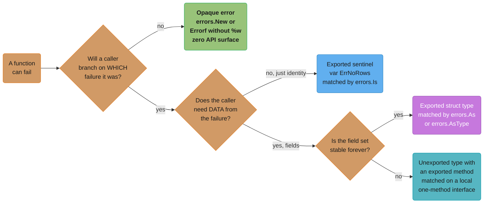
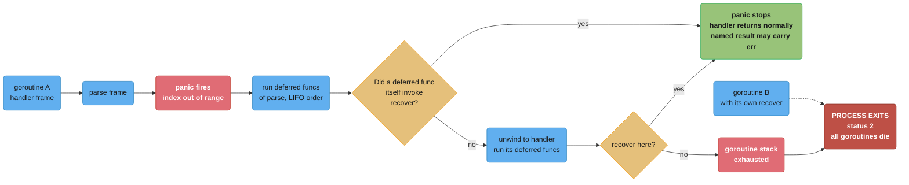

# Errors and Panics

## 1. Concept Overview

Go has no exceptions. `error` is an ordinary interface with one method, `Error() string`,
and a failure is an ordinary return value you can compare, store in a struct, put in a
slice, pass to a channel, or ignore. Everything the language provides for failure handling
is built on that one idea: `errors.New` makes a value, `fmt.Errorf` with `%w` makes a value
that contains another value, `errors.Join` makes a value containing several, and
`errors.Is` / `errors.As` / `errors.AsType` `[1.26]` walk the resulting tree looking for
something specific.

The consequence is that control flow stays visible. There is no invisible non-local jump
from a callee to a distant handler, no stack unwinding you did not write, and no
"unexpected checked exception" recompile cascade. The cost is `if err != nil` appearing
several times per function — a genuine ergonomic tax the language has repeatedly declined
to remove, and the thing a Go interview will ask you to defend.

Alongside errors, Go has `panic` and `recover`, and the single most important fact about
them is that they are **not** an exception system. A panic is for a bug — a nil map write,
an index out of range, a broken invariant — and it terminates the entire process unless
recovered **in the same goroutine**, by a function that was deferred. A `recover()` in
`main` does nothing at all for a panic in a worker goroutine, and that misconception is the
most expensive one in the language: it turns a single unhandled edge case into a total
outage.

This module covers the error value model, sentinel and typed errors, the `%w` wrap tree
and its traversal functions, where to add context and where not to, what your error
contract promises callers across a package boundary, the exact mechanics of panic and
recover, which runtime failures are unrecoverable, how `net/http` and `errgroup` behave,
and how to get structured error fields into `log/slog`.

---

## 2. Intuition

> **One-line analogy**: A Java exception is a fire alarm — it evacuates the building and
> somebody upstairs decides what to do. A Go error is a note handed back with the work:
> "here's your result, and here's what went wrong." Nobody leaves the room.

**Mental model**: think of a returned error as a **parcel with shipping labels stuck on the
outside**. `errors.New` is the original parcel. Each `fmt.Errorf("...: %w", err)` sticks
another label on the front without opening it. `errors.Is` and `errors.As` peel the labels
off one at a time looking for a specific parcel underneath, and `errors.Join` is a crate
holding several parcels at once, so the peeling becomes a tree walk rather than a single
chain. Wrapping is additive and non-destructive; the original is always still in there.

Panic is a different object entirely: it is the **building's fire suppression system**. It
runs the deferred functions on the way out, and if nobody in that goroutine catches it, the
whole process is gone.

**Why it matters**: the difference between an error and a panic is the difference between
"this request failed" and "this program is wrong". Getting it backwards produces the two
classic failure modes: a library that panics on a bad input string, taking down a caller
that would happily have retried; and a service that swallows every panic in a blanket
recover, hiding memory corruption behind a 500.

**Key insight**: `if err != nil` is not boilerplate to be eliminated — it is the place a
decision gets made. Every one of those blocks is a chance to add context, translate,
retry, or give up, and the reason the compiler forces you to look at it is that the
alternative is a caller who never knew there was a decision to make.

---

## 3. Core Principles

- **Errors are values.** `type error interface{ Error() string }` — nothing more.
- **Failures are returned, not thrown.** The signature tells you what can fail; nothing
  jumps over your frame.
- **Wrap to add context, never to hide.** `%w` keeps the original reachable;
  `%v` destroys it.
- **Inspect by behaviour, not by type.** `errors.Is` for identity, `errors.As` for
  extraction — both walk the wrap tree; a type switch on `err` does not.
- **Wrap at boundaries, not at every level.** Each layer that adds nothing produces a
  message segment nobody reads.
- **Panic means a bug, never an expected condition.** Bad user input is an error; a nil
  receiver your own code guaranteed non-nil is a panic.
- **Recover is per-goroutine and per-defer.** It works only when called directly by a
  function deferred in the panicking goroutine.
- **The error contract is part of your API.** Once callers can `errors.Is` your sentinel or
  `errors.As` your struct, changing it is a breaking change.
- **Error strings are lowercase and unpunctuated** — they get concatenated into someone
  else's sentence.

---

## 4. Types / Architectures / Strategies

### 4.1 The four ways to represent a failure

| Strategy | Shape | Caller inspects with | Coupling cost |
|----------|-------|----------------------|---------------|
| **Opaque** | `errors.New("...")` / `fmt.Errorf` with no `%w` | nothing — log it and move on | none; strongest encapsulation |
| **Sentinel** | `var ErrNotFound = errors.New("not found")` | `errors.Is(err, ErrNotFound)` | the variable is public API forever |
| **Typed** | `type ValidationError struct{ Field string }` | `errors.As` / `errors.AsType` | the struct *and its fields* are public API |
| **Behavioural** | an unexported type satisfying `interface{ Temporary() bool }` | `errors.As` on a locally declared interface | lowest — callers depend on a capability, not a name |

Default to opaque. Promote to sentinel or typed only when a caller demonstrably needs to
branch on the failure, because both are irreversible API commitments.

### 4.2 The standard sentinels you will meet

| Sentinel | Package | What it means |
|----------|---------|---------------|
| `io.EOF` | `io` | a clean end of input — not an error condition, a terminator |
| `io.ErrUnexpectedEOF` | `io` | input ended mid-record; this one *is* a failure |
| `sql.ErrNoRows` | `database/sql` | `QueryRow(...).Scan(...)` matched nothing |
| `os.ErrNotExist` | `os` | test with `errors.Is`, never by string matching |
| `context.Canceled` | `context` | the caller went away |
| `context.DeadlineExceeded` | `context` | the deadline fired; also satisfies `net.Error.Timeout()` |

`io.EOF` is the cautionary tale: because it is compared with `==` in decades of code, `io`
can never wrap it, and every reader implementation must return it bare.

### 4.3 The two `Unwrap` contracts

| Method | Produced by | Traversal |
|--------|-------------|-----------|
| `Unwrap() error` | `fmt.Errorf` with one `%w` | a chain — a single parent per node |
| `Unwrap() []error` | `errors.Join`, `fmt.Errorf` with two or more `%w` | a tree — depth-first, left to right |

Neither method is called `Unwrap` by accident: `errors.Is`, `errors.As` and
`errors.AsType` all look for exactly these two signatures. A type implementing neither is
a leaf.

### 4.4 What actually panics

| Trigger | Runtime message | Recoverable |
|---------|-----------------|-------------|
| Write to a nil map | `assignment to entry in nil map` | yes |
| Nil pointer dereference | `runtime error: invalid memory address or nil pointer dereference` | yes |
| Slice/array index out of range | `runtime error: index out of range [5] with length 3` | yes |
| Slice expression out of bounds | `runtime error: slice bounds out of range [:9] with capacity 4` | yes |
| Integer divide by zero | `runtime error: integer divide by zero` | yes |
| Type assertion without comma-ok | `interface conversion: interface {} is string, not int` | yes |
| Close an already-closed channel | `close of closed channel` | yes |
| Close a nil channel | `close of nil channel` | yes |
| Send on a closed channel | `send on closed channel` | yes |
| Explicit `panic(v)` | whatever `v` formats as | yes |
| Concurrent map read and write | `fatal error: concurrent map writes` | **no** |
| Stack exhaustion | `fatal error: stack overflow` (default limit 1 GB on 64-bit) | **no** |
| All goroutines blocked | `fatal error: all goroutines are asleep - deadlock!` | **no** |
| Out of memory | `fatal error: runtime: out of memory` | **no** |

The last four are `runtime.throw`, not `panic`. They print and exit immediately; no
deferred function runs and `recover` is never consulted.

---

## 5. Architecture Diagrams

### The wrap chain, laid out

```
err := fmt.Errorf("load config: %w",
          fmt.Errorf("open %s: %w", path, os.ErrNotExist))

  Error() string  ->  "load config: open /etc/app.yaml: file does not exist"
                       \__________/ \_________________/ \_________________/
                        layer 2      layer 1             leaf

  Unwrap chain (what errors.Is walks):

     [*fmt.wrapError "load config: ..."]
              | Unwrap() error
              v
     [*fmt.wrapError "open /etc/app.yaml: ..."]
              | Unwrap() error
              v
     [os.ErrNotExist]           <- errors.Is(err, os.ErrNotExist) == true here
              | Unwrap() error
              v
             nil                <- walk ends

Each layer prefixes text and keeps a pointer. Nothing is copied, nothing is lost.
```

### `errors.Join` turns the chain into a tree

```
errs := errors.Join(errKafka, fmt.Errorf("prometheus: %w", errNet), nil)

                    [*errors.joinError]
                    Unwrap() []error
                     /            \
              [errKafka]     [*fmt.wrapError "prometheus: ..."]
                                       | Unwrap() error
                                       v
                                   [errNet]

errors.Is / errors.As do a DEPTH-FIRST, LEFT-TO-RIGHT walk of this tree.
Join drops nil arguments, and returns nil if EVERY argument is nil.
Error() joins the non-nil children's messages with "\n" -- one per line.
```

### Choosing an error representation


Each step to the right adds a permanent commitment to your callers. Take only the steps a
real caller has asked for.

### Panic propagation and the recover boundary


The dotted edge is the fact that costs services their uptime: goroutine B's recover has no
relationship with goroutine A's panic. Recovery is strictly per-goroutine.

### Where recover works and where it silently does not

```mermaid
flowchart LR
    classDef ok  fill:#98c379,stroke:#27ae60,color:#1a1a1a,font-weight:bold
    classDef bad fill:#e06c75,stroke:#c0392b,color:#fff,font-weight:bold
    classDef ctx fill:#56b6c2,stroke:#0097a7,color:#1a1a1a

    root("recover&#40;&#41; is called...") --> a("directly inside a<br/>deferred closure<br/>of the panicking goroutine")
    root --> b("in a helper called<br/>BY the deferred closure")
    root --> c("in a plain, non-deferred<br/>function on the stack")
    root --> d("in a deferred closure<br/>of a DIFFERENT goroutine")

    a --> aOK("stops the panic<br/>returns the panic value")
    b --> bNo("returns nil<br/>panic keeps unwinding")
    c --> cNo("returns nil<br/>always")
    d --> dNo("returns nil<br/>process still dies")

    class root ctx
    class a,aOK ok
    class b,c,d,bNo,cNo,dNo bad
```


Only the first arm works. `recover` reads a flag the runtime sets on exactly one frame:
the deferred call currently running as part of the panic.

---

## 6. How It Works — Detailed Mechanics

### 6.1 The interface, and what implementing it costs

```go
type error interface {
    Error() string
}
```

Anything with that method is an error, including your own struct:

```go
type RateLimitError struct {
    Limit      int
    RetryAfter time.Duration
}

func (e *RateLimitError) Error() string {
    return fmt.Sprintf("rate limit %d exceeded, retry after %s", e.Limit, e.RetryAfter)
}
```

Use a **pointer receiver** for a struct error unless the type is a tiny comparable value.
Two reasons: a value receiver puts the struct's method in the method set of both `T` and
`*T`, so `errors.As(&target)` with either form matches and readers get confused about which
is canonical; and returning a value type means two structurally identical errors compare
equal, which is almost never intended. The mechanics of receivers and interface
satisfaction are in
[Interfaces, Methods and Embedding](../interfaces_methods_and_embedding/interfaces_methods_and_embedding.md)
— and so is the typed-nil trap, which is the single biggest hazard of a concrete error
type.

### 6.2 Wrapping with `%w`

```go
cfg, err := os.ReadFile(path)
if err != nil {
    return nil, fmt.Errorf("load config %s: %w", path, err)
}
```

`%w` is the only verb that preserves the operand. `fmt.Errorf` detects it, returns a
`*fmt.wrapError` holding both the formatted message and the original error, and exposes
`Unwrap() error`. `%v` formats the error's text into the string and throws the value away —
`errors.Is` on the result can never match.

Two or more `%w` verbs in one call produce `Unwrap() []error` instead, giving the same tree
shape as `errors.Join`:

```go
return fmt.Errorf("shutdown: db %w, cache %w", dbErr, cacheErr)
```

### 6.3 Traversal: `Is`, `As`, `AsType`

```go
// Identity: is this specific value anywhere in the tree?
if errors.Is(err, sql.ErrNoRows) {
    return nil, nil // "not found" is not an error for this endpoint
}

// Extraction with a pointer target (pre-generics form, still everywhere):
var rl *RateLimitError
if errors.As(err, &rl) {
    w.Header().Set("Retry-After", strconv.Itoa(int(rl.RetryAfter.Seconds())))
}

// Extraction, generic form [1.26]:
if rl, ok := errors.AsType[*RateLimitError](err); ok {
    w.Header().Set("Retry-After", strconv.Itoa(int(rl.RetryAfter.Seconds())))
}
```

`errors.AsType[E error](err error) (E, bool)` `[1.26]` does what `errors.As` does without
the out-parameter dance: the type is written where it belongs, the result is a value, and
the `As` panic modes — passing a nil target, or a target that is not a pointer to a type
implementing `error` — become compile-time impossibilities.

Both walk the tree depth-first, left to right, and both consult an optional
`Is(error) bool` / `As(any) bool` method on each node, which is how `os.ErrNotExist`
matches a `*os.PathError` and how `context.DeadlineExceeded` matches a `net.Error` timeout.

### 6.4 `errors.Join`

```go
func closeAll(cs []io.Closer) error {
    var errs []error
    for _, c := range cs {
        errs = append(errs, c.Close()) // nils are fine, Join drops them
    }
    return errors.Join(errs...) // nil if every Close succeeded
}
```

Three properties worth memorizing: nil arguments are discarded; if **every** argument is
nil the result is nil, so `errors.Join(nil, nil)` is a clean success; and `Error()` renders
the children one per line separated by `\n`, which is why a joined error printed into a
single log line looks broken and should be logged with a structured handler instead.

### 6.5 Where to wrap, and where not to

```go
// BROKEN: every layer adds a segment, and the message is 5 clauses of nothing.
// "handle request: process order: save order: insert row: exec: open /tmp/x: no such file"
func (s *Store) insert(o Order) error {
    if err := s.exec(q, o.ID); err != nil {
        return fmt.Errorf("insert row: %w", err)
    }
    return nil
}

// FIX: pass through inside a package, wrap once at the package boundary
// with information the caller does not already have.
func (s *Store) insert(o Order) error {
    return s.exec(q, o.ID) // same package, same context: nothing to add
}

func (s *Store) SaveOrder(ctx context.Context, o Order) error {
    if err := s.insert(o); err != nil {
        return fmt.Errorf("save order %s: %w", o.ID, err) // adds the ID: real information
    }
    return nil
}
```

The rule of thumb: **wrap when you can name something the callee could not know** — an
identifier, a filename, a retry attempt, the operation in your domain's vocabulary. If your
prefix restates the function you just called, drop it. A useful chain is two to four
segments; past that the message becomes a stack trace written badly.

Never wrap inside a loop body that runs per item unless the index or key goes into the
message. And never wrap a sentinel a caller compares by `==` — wrap it with `%w` so
`errors.Is` still works, and check that your dependency's docs actually promise `Is`
support.

### 6.6 The error contract across a package boundary

Everything a caller can successfully test for is API:

```go
package store

// Documented, therefore promised:
//   - ErrNotFound is returned when no row matches; test with errors.Is.
//   - *ConflictError is returned on a unique-violation; test with errors.As.
// Anything else is opaque and may change.
var ErrNotFound = errors.New("store: not found")

type ConflictError struct{ Column string }
```

Three commitments follow, and each is a semver-major change to break:

1. **The sentinel variable itself.** Renaming or unexporting it breaks callers.
2. **The struct's exported fields.** Removing `Column` breaks anyone reading it.
3. **The fact that it appears in the tree at all.** If a refactor stops wrapping the
   driver's error, `errors.Is(err, ErrNotFound)` silently starts returning false.

The defence against (3) is a test that asserts the contract, not the message:

```go
func TestGetMissingReturnsErrNotFound(t *testing.T) {
    _, err := s.Get(ctx, "nope")
    if !errors.Is(err, store.ErrNotFound) {
        t.Fatalf("want ErrNotFound in the tree, got %v", err)
    }
}
```

Never assert on `err.Error()` text. Message strings are the one part of an error that is
explicitly not a contract, and a wrap added three layers down will break the test without
breaking anything real.

### 6.7 Panic and recover mechanics

`panic(v)` stops normal execution of the current function, runs its deferred calls in LIFO
order, then does the same for its caller, and so on up the goroutine's stack. If it reaches
the top, the runtime prints the panic value plus a stack trace for every goroutine and
exits with **status 2**.

`recover()` returns the panic value and stops the unwinding — but only when it is called
**directly by a function that was deferred**, in the goroutine that is panicking:

```go
func safeHandle(msg Message) (err error) {
    defer func() {
        if r := recover(); r != nil {
            err = fmt.Errorf("handler panicked: %v", r)
        }
    }()
    return handle(msg)
}
```

Two details this snippet depends on. The result must be a **named return** — a deferred
function can assign to `err` only if it has a name, and this is the sole way to convert a
panic into an error. And `recover()` must be written inline in the deferred closure; the
runtime marks exactly one frame as "currently running as part of the panic", so moving the
call into a helper the closure invokes makes it return nil and the panic continues.

Capture the stack while you still have it — after `recover` returns, the panicking stack is
gone:

```go
defer func() {
    if r := recover(); r != nil {
        slog.Error("panic", "value", r, "stack", string(debug.Stack()))
        err = fmt.Errorf("panic: %v", r)
    }
}()
```

`panic(nil)` is not a way to sneak a nil past `recover`: since `[1.21]` the runtime
substitutes a `*runtime.PanicNilError`, so `recover()` returns a non-nil value and the
`if r := recover(); r != nil` idiom works. `GODEBUG=panicnil=1` restores the pre-1.21
behaviour for a legacy program that depended on it.

### 6.8 The goroutine rule

```go
// BROKEN: a panic here kills the entire process. The recover in main is irrelevant.
func (s *Server) handle(w http.ResponseWriter, r *http.Request) {
    go func() {
        s.audit(r.Context(), r.URL.Path) // panics on a nil map write
    }()
    w.WriteHeader(http.StatusAccepted)
}

// FIX: every goroutine you start owns its own recover boundary.
func (s *Server) handle(w http.ResponseWriter, r *http.Request) {
    go func() {
        defer func() {
            if v := recover(); v != nil {
                s.log.Error("audit panic", "value", v, "stack", string(debug.Stack()))
                panicsTotal.Inc()
            }
        }()
        s.audit(context.WithoutCancel(r.Context()), r.URL.Path)
    }()
    w.WriteHeader(http.StatusAccepted)
}
```

The reason `net/http` looks like it protects you is that it wraps the **handler** call —
`conn.serve` defers a recover that logs `http: panic serving <addr>` with a stack and
closes that one connection. That covers panics on the handler's own goroutine and nothing
else. A goroutine the handler starts is outside it, as is a panic in a background worker, a
`time.AfterFunc` callback, or a consumer loop. Panicking with `http.ErrAbortHandler` is the
one value the server treats specially: it aborts the response without logging, which is how
`httputil.ReverseProxy` signals a deliberate abort.

### 6.9 Errors in concurrent code

```go
g, ctx := errgroup.WithContext(ctx)
g.SetLimit(16) // at most 16 in flight

for _, u := range urls {
    g.Go(func() error {
        return fetch(ctx, u) // first non-nil error cancels ctx for everyone
    })
}
if err := g.Wait(); err != nil {
    return fmt.Errorf("fetch batch: %w", err)
}
```

`Wait` returns the **first** non-nil error, not all of them, and `WithContext` cancels the
derived context with that error as the cancellation cause. When you need every failure,
collect into a slice under a mutex and `errors.Join` them yourself.

**`errgroup` deliberately does not recover panics.** The source carries the reasoning:
propagating a panic to `Wait` would delay it arbitrarily, reduce a real panic stack to a
value that crash monitoring cannot see, and risk a deadlock that hides it entirely. So a
panic inside `g.Go` behaves exactly like a panic in any bare goroutine — the process dies.
If you want per-task containment, wrap the function yourself.

### 6.10 Structured error logging with `log/slog`

```go
func logFailure(ctx context.Context, l *slog.Logger, err error) {
    attrs := []any{slog.Any("err", err)}

    if rl, ok := errors.AsType[*RateLimitError](err); ok { // [1.26]
        attrs = append(attrs, slog.Int("limit", rl.Limit),
            slog.Duration("retry_after", rl.RetryAfter))
    }
    if errors.Is(err, context.DeadlineExceeded) {
        attrs = append(attrs, slog.Bool("timeout", true))
    }
    l.ErrorContext(ctx, "request failed", attrs...)
}
```

`slog.Any("err", err)` calls `Error()` for the message, so the joined-error `\n` problem
returns unless you flatten. The cleaner route is to implement `slog.LogValuer` on your error
type so it renders as a group of fields rather than a string:

```go
func (e *RateLimitError) LogValue() slog.Value {
    return slog.GroupValue(slog.Int("limit", e.Limit),
        slog.Duration("retry_after", e.RetryAfter))
}
```

---

## 7. Real-World Examples

**`os.Open` and the `*PathError` layer.** A failed open returns `*fs.PathError{Op, Path,
Err}`, wrapping a raw `syscall.Errno`. `errors.Is(err, os.ErrNotExist)` works because
`syscall.Errno` implements `Is`, mapping `ENOENT` onto the portable sentinel — so the same
check compiles and passes on Linux, macOS and Windows without touching an errno number.
That is the behavioural-error pattern in the standard library.

**`database/sql` and `sql.ErrNoRows`.** `QueryRow(...).Scan(...)` returns the sentinel when
nothing matched, which almost every repository layer translates into its own domain
`ErrNotFound` with `%w`. Skipping the `%w` is the most common data-access bug in Go code
review: the HTTP layer's `errors.Is(err, store.ErrNotFound)` returns false and a missing
record becomes a 500 instead of a 404.

**`net/http` server panic recovery.** `conn.serve` defers a recover, logs
`http: panic serving 10.0.4.7:52344: runtime error: index out of range [3] with length 2`
plus the stack, and closes that connection. One request dies, the process survives, and the
other 4,000 in-flight connections are untouched. It is the canonical example of a
legitimate blanket recover: at a request boundary, where the blast radius is exactly one
unit of work.

**`context.Canceled` in a gRPC gateway.** A client hanging up cancels the request context,
and every downstream call returns an error wrapping `context.Canceled`. Treating those as
service errors makes an error-rate SLO track client behaviour rather than server health;
the standard fix is to classify with `errors.Is(err, context.Canceled)` before incrementing
the failure counter. `os/signal.NotifyContext` `[1.26]` cancels with a
`CancelCauseFunc` naming the signal, so `context.Cause(ctx)` distinguishes a SIGTERM
shutdown from a client disconnect in the same check.

**Kubernetes `apierrors`.** `k8s.io/apimachinery/pkg/api/errors` exposes predicates —
`apierrors.IsNotFound(err)`, `IsConflict(err)`, `IsAlreadyExists(err)` — rather than
exported sentinels. Controllers depend on the predicate function, so the concrete error
types stayed free to change across API versions. It is the behavioural strategy taken to
its logical end.

---

## 8. Tradeoffs

### Error values vs exceptions

| Axis | Go error values | Java checked exceptions | Python exceptions |
|------|-----------------|-------------------------|-------------------|
| Visible in the signature | Yes, as a return type | Yes, via `throws` | No |
| Can be silently ignored | Yes — `_ = f()` (caught by `errcheck`) | No for checked, yes for unchecked | Yes, by a bare `except` |
| Cost of the failure path | a value return, a few nanoseconds | stack capture: microseconds unless disabled | similar to Java |
| Adding a new failure mode | source-compatible — callers keep compiling | recompile cascade up the `throws` chain | invisible until it fires |
| Stack trace by default | No — you build a message chain | Yes, automatic | Yes, automatic |
| Verbosity | high at call sites | low at call sites, high in signatures | lowest |
| Where the decision lives | at every call, deliberately | far away in a `catch` | far away, often nowhere |

Go trades brevity for locality. The block you type after every call is the tax; knowing
exactly which line can fail, and being unable to accidentally skip a decision, is what it
buys.

### Sentinel vs typed vs behavioural

| Axis | Sentinel | Typed struct | Behavioural interface |
|------|----------|--------------|-----------------------|
| Caller writes | `errors.Is(err, ErrX)` | `errors.AsType[*T](err)` | `errors.As(err, &iface)` |
| Carries data | no | yes | via methods only |
| API surface committed | one variable | the type and every exported field | one method name |
| Survives a refactor | only while you keep wrapping it | same | best — reimplement the method anywhere |
| Best for | a single well-known outcome (`ErrNoRows`) | failures with structure (field, limit, retry-after) | cross-package capabilities (`Timeout()`) |

### Panic/recover vs returning an error

| Axis | Return an error | Panic and recover |
|------|-----------------|-------------------|
| Cost | a couple of nanoseconds | stack unwinding, roughly a microsecond — three orders of magnitude |
| Visible in the signature | yes | no |
| Crosses a goroutine | n/a — it is a value | **never** — it kills the process instead |
| Right for | anything a caller could reasonably expect | programmer error, and unwinding a deep recursive parser |
| Wrong for | never | bad input, missing files, network failure, anything a retry could fix |

The one place the standard library uses panic internally for control flow is a deep
recursive parser (`encoding/json` historically did this), where it panics with a private
type and recovers at the package boundary, converting to an error. That is legitimate
because the panic never escapes the package.

---

## 9. When to Use / When NOT to Use

**Return an error when:**
- The failure is something a caller could plausibly anticipate: network, disk, parse,
  timeout, not-found, permission, validation.
- The caller can do something about it — retry, fall back, translate to a status code,
  report to a user.
- You are in library code. A library's caller decides how fatal a failure is, not the
  library.

**Panic when:**
- An invariant your own package guarantees has been violated — a state machine reached an
  impossible state, a lookup table is missing an entry the compiler should have prevented.
- A package-level initializer cannot produce a usable package:
  `regexp.MustCompile`, `template.Must`, `sql.Register` with a duplicate name. The `Must`
  prefix is the naming convention that warns the caller.
- You are converting an unrecoverable programmer error into a loud, immediate, traceable
  crash rather than a corrupted result.

**Recover when:**
- You own a **boundary around one unit of work** whose failure must not take the process
  down: an HTTP request, a queue message, a gRPC call, one plugin invocation.
- You are starting a goroutine. Every `go` statement in long-lived code needs its own
  recover or a helper that supplies one.
- You are converting a deliberate internal panic back into an error at your package's edge.

**Do NOT recover when:**
- You would swallow it. A recover that logs nothing and increments no counter converts a
  crash-loop into silent wrong behaviour, which is strictly worse.
- The failure indicates memory corruption or a broken invariant that makes continuing
  unsafe. Some panics *should* end the process.
- You are tempted to put one in every function "for safety". The cost is not runtime, it is
  that the panic no longer tells you where the bug is.

---

## 10. Common Pitfalls

### Pitfall 1 — a background goroutine panicked and crash-looped the fleet

An order service spawned a goroutine per request to push an audit record into a
`map[string]int` counter that a config reload had left nil. The team had a `recover` in
`main` and believed it covered them.

```go
// BROKEN
go func() {
    s.counters[key]++ // panic: assignment to entry in nil map
}()

// FIX
go func() {
    defer func() {
        if v := recover(); v != nil {
            s.log.Error("audit goroutine panic", "value", v, "stack", string(debug.Stack()))
            goroutinePanics.Inc()
        }
    }()
    s.mu.Lock()
    defer s.mu.Unlock()
    s.counters[key]++
}()
```

**Quantified impact**: all 24 pods entered `CrashLoopBackOff` within 70 seconds of the
config change, a 19-minute full outage, and roughly 31,000 dropped orders. The
misconception was one sentence wide: a panic in *any* goroutine terminates the process, and
`main`'s recover has no reach into it. The durable fix was a `safego(fn func())` helper
plus a lint rule banning bare `go func()` in the service packages.

### Pitfall 2 — `%v` instead of `%w` broke every `errors.Is` above it

A repository wrapped `sql.ErrNoRows` with `fmt.Errorf("get user %s: %v", id, err)`. The
HTTP layer's `errors.Is(err, store.ErrNotFound)` returned false, so a missing user produced
a 500.

```go
// BROKEN
return fmt.Errorf("get user %s: %v", id, err) // the value is destroyed, only text remains

// FIX
return fmt.Errorf("get user %s: %w", id, err)
```

**Quantified impact**: 2.1% of all requests returned 500 for six weeks. The error budget
burned before anyone connected the alert to the "not found" path, because the log line read
correctly — the message text was identical either way. `go vet` does not catch this;
`golangci-lint`'s `errorlint` does, and a contract test asserting `errors.Is` would have
failed on the first commit.

### Pitfall 3 — `recover()` moved into a helper and stopped working

Someone factored the duplicated recover blocks into a shared function:

```go
// BROKEN
func handlePanic() {
    if r := recover(); r != nil { // recover() called by handlePanic, not deferred itself
        log.Println("recovered", r)
    }
}

func work() {
    defer handlePanic() // ...this actually WORKS: handlePanic IS the deferred function
    // ...
}

// BROKEN for real:
func work() {
    defer func() {
        handlePanic() // recover() is now one frame too deep -> returns nil, panic continues
    }()
}
```

The distinction is exact: `recover` must be called by the function that was deferred.
`defer handlePanic()` is fine. `defer func(){ handlePanic() }()` is not, and the two look
identical in review.

```go
// FIX: pass the work in, so the deferred closure is the one calling recover.
func safely(name string, fn func()) {
    defer func() {
        if r := recover(); r != nil {
            slog.Error("recovered", "site", name, "value", r, "stack", string(debug.Stack()))
        }
    }()
    fn()
}
```

**Quantified impact**: the refactor shipped on a Friday and the first panic on Monday took
down 8 pods for 4 minutes. The unit test for `handlePanic` passed, because it called
`handlePanic` from a `defer` — exactly the form the production code no longer used.

### Pitfall 4 — a deferred `Close` dropped a write error

```go
// BROKEN: the file is closed, but a failed flush at close time is discarded.
func writeReport(path string, r Report) error {
    f, err := os.Create(path)
    if err != nil {
        return err
    }
    defer f.Close() // returns an error nobody reads
    return json.NewEncoder(f).Encode(r)
}

// FIX: a named return lets the deferred close report its own failure.
func writeReport(path string, r Report) (err error) {
    f, err := os.Create(path)
    if err != nil {
        return err
    }
    defer func() {
        if cerr := f.Close(); cerr != nil && err == nil {
            err = fmt.Errorf("close %s: %w", path, cerr)
        }
    }()
    return json.NewEncoder(f).Encode(r)
}
```

**Quantified impact**: a disk that hit its quota mid-write produced 47 truncated report
files over 3 days that every consumer read as valid-but-short JSON. `defer f.Close()` is
correct for a file opened read-only; for anything written to, the close error is the write
error. `errcheck` flags the bare form.

### Pitfall 5 — a blanket recover turned crashes into silent corruption

A team added `defer recover()` to their worker loop after a noisy incident. It compiled, it
stopped the crashes, and it stopped the diagnostics: each panicking message was silently
dropped mid-transaction with rows already written.

**Quantified impact**: 4 months of accumulating partial writes, discovered by a
reconciliation job finding 12,800 orders with line items but no totals. Two rules came out
of it: a recover always logs the value **and** `debug.Stack()`, and it always increments a
metric so a rising panic rate is visible on a dashboard even when nothing crashes. A bare
`defer recover()` with no body is also a no-op the compiler accepts — `recover` is only
special when its result is used.

### Pitfall 6 — a library panicked on user input

An internal config package used `regexp.MustCompile` on a pattern read from a YAML file.
A typo in a customer's config panicked inside `init`, so the binary died before `main`
ran — no logging configured, no error message beyond a runtime stack.

**Quantified impact**: 40 minutes of a "the pod won't start and prints nothing useful"
investigation, repeated three times before someone read the stack carefully. `Must*` is for
values fixed at compile time — a hard-coded pattern in a `var` block. Anything derived from
input uses `regexp.Compile` and returns the error. A panic in `init` is the worst place to
be wrong, because none of your observability exists yet.

---

## 11. Technologies & Tools

| Tool | What it does for errors and panics |
|------|-----------------------------------|
| `errcheck` (in `golangci-lint`) | Flags every ignored error return, including `defer f.Close()` on a writable file |
| `errorlint` (in `golangci-lint`) | Flags `%v` where `%w` was meant, and `==` comparisons that should be `errors.Is` |
| `wrapcheck` | Flags an error returned across a package boundary without being wrapped |
| `go vet` | The `printf` analyzer catches a `%w` used outside `fmt.Errorf`; runs by default under `go test` |
| `nilerr` / `nilnil` | Catches `return nil` after a non-nil error check, and `(nil, nil)` returns |
| `log/slog` `[1.21]` | Structured error logging; `slog.LogValuer` renders an error as fields, `NewMultiHandler` `[1.26]` fans out |
| `debug.Stack()` | The only way to keep the panic stack — the runtime discards it once `recover` returns |
| `runtime/debug.SetPanicOnFault` | Turns an unexpected fault on a mapped address into a recoverable panic; for `mmap` code only |
| `goroutineleak` profile `[1.27]` | GA; finds goroutines permanently blocked on a primitive — the leak that a swallowed panic often leaves behind |
| Sentry / Rollbar Go SDKs | Wrap a recover to ship the panic value plus stack; use their `RecoverWithContext` at a request boundary |
| `golang.org/x/sync/errgroup` | First-error collection with context cancellation and `SetLimit`; does not recover panics by design |

---

## 12. Interview Questions with Answers

**Q: If a goroutine panics, can a `recover()` in `main` keep the process alive?**
**Short:** No — an unrecovered panic in any goroutine terminates the whole process with exit status 2.

Panics unwind only the stack of the goroutine that raised them. `main`'s deferred functions
are on a different stack, so its `recover` is never consulted and the runtime prints every
goroutine's trace and exits. This is the most expensive misconception in Go, because one
unhandled edge case in a background worker takes down every in-flight request on the same
process. The rule that follows is mechanical: every `go` statement in long-lived code needs
its own deferred recover, usually through a shared helper that takes the function as an
argument and logs the value plus `debug.Stack()`. `net/http` looks like an exception only
because it wraps the handler call itself, not anything the handler spawns.

**Q: Why does `recover()` return nil when a deferred closure calls it through a helper function?**
**Short:** It only works when invoked directly by the function that was deferred, because the runtime marks exactly one frame as panicking.

`defer handlePanic()` works — `handlePanic` is the deferred function. `defer func(){ handlePanic() }()`
does not: the deferred function is the closure, `handlePanic` is one frame deeper, and
`recover` returns nil while the panic keeps unwinding. The two forms are one character
apart in a diff and behave completely differently, which is how the bug survives review.
The safe shape is to invert it: write a helper that takes the work as a `func()`, defers
its own inline recover closure, and then calls the work. `recover` outside any deferred
context returns nil unconditionally, and a bare `defer recover()` whose result is unused is
a compiler-accepted no-op.

**Q: What does `%w` do that `%v` does not?**
**Short:** It keeps a pointer to the original value so the result is inspectable, where `%v` only copies its text.

`fmt.Errorf` recognises `%w`, returns a `*fmt.wrapError` carrying both the message and the
operand, and exposes `Unwrap() error`. That is what lets `errors.Is` and `errors.As` walk
back to the original. `%v` formats the error's `Error()` string into the message and
discards the value, so the log line reads identically while every predicate above you
starts returning false — a silent, text-invisible break. Two or more `%w` verbs in one call
produce `Unwrap() []error`, giving a tree instead of a chain. `golangci-lint`'s `errorlint`
is the only automated defence, since `go vet` accepts both.

**Q: When should you add context to an error, and when should you just return it?**
**Short:** Wrap only when you can name something the callee could not know, and pass through everywhere else.

Useful context is an identifier, a path, an attempt number, or the operation in your
domain's vocabulary — `"save order abc-123: %w"`. Useless context restates the function you
just called, which is how you end up with "handle request: process order: save order:
insert row: exec: open /tmp/x: no such file". Inside a package, pass the error through; wrap
once at the exported boundary where a caller crosses into your vocabulary. A good chain is
two to four segments. Watch loops especially: a wrap inside a per-item body must carry the
key or index, or it adds length without information.

**Q: What is the difference between `errors.Is` and `errors.As`?**
**Short:** One asks whether a specific value is somewhere in the tree, the other pulls out a value of a specific type.

`errors.Is(err, target)` compares for equality against every node, consulting an optional
`Is(error) bool` method — use it for sentinels like `sql.ErrNoRows` or
`context.DeadlineExceeded`. `errors.As(err, &target)` finds the first node assignable to
the target's pointed-to type and assigns it — use it when you need the failure's fields,
like a retry-after duration. Both traverse `Unwrap() error` and `Unwrap() []error`
depth-first, left to right, which is exactly what a plain `==` or a type switch cannot do.
`errors.As` panics if the target is nil or is not a pointer to a type implementing `error`.

**Q: What is `errors.AsType` and why was it added?**
**Short:** It is the generic form added in Go 1.26, returning the extracted error and a boolean instead of writing through a pointer.

The signature is `func AsType[E error](err error) (E, bool)`, so the call reads
`rl, ok := errors.AsType[*RateLimitError](err)`. Semantically it does what `errors.As`
does — the same tree walk, the same optional `As(any) bool` hook — but the type is written
where a reader expects it, no out-parameter variable has to be declared first, and the two
runtime panics `errors.As` can raise for a bad target become compile-time impossibilities.
`errors.As` remains, is not going anywhere, and is what you will still see in most existing
code; reach for `AsType` in new code on a supported toolchain.

**Q: What are the two `Unwrap` contracts and who implements them?**
**Short:** A single-parent `Unwrap() error` produces a chain, while `Unwrap() []error` produces a tree walked depth-first.

`fmt.Errorf` with one `%w` returns a type with `Unwrap() error`. `errors.Join`, and
`fmt.Errorf` with two or more `%w` verbs, return a type with `Unwrap() []error`. The
`errors` package looks for exactly these two method signatures and nothing else — a type
with neither is a leaf, and a type with a differently-named method is invisible to
traversal. Implementing one on your own error type is how you make it transparent to
`errors.Is`. Implement `Unwrap` only when you genuinely contain another error; a struct
that merely mentions one in its message should not.

**Q: What does `errors.Join` return when all of its arguments are nil?**
**Short:** Nil — it discards nil arguments, so a loop that joins every step's result yields a clean success when nothing failed.

That property is what makes the accumulate-and-join pattern work without a length check:
append every `Close()` or every worker's result into a slice and return
`errors.Join(errs...)`. Non-nil children are reachable by `errors.Is` and `errors.As`,
which walk the tree depth-first from left to right. The one operational gotcha is
`Error()`: it renders the children separated by `\n`, so a joined error dropped into a
single-line log format looks truncated or mangled. Log it through a structured handler, or
flatten it yourself before formatting.

**Q: What is a sentinel error, and what does exporting one cost you?**
**Short:** It is a package-level error variable callers match by identity, and exporting it makes both the variable and its presence permanent API.

`var ErrNotFound = errors.New("store: not found")` lets a caller write
`errors.Is(err, store.ErrNotFound)`. Three things become contract: the variable's name, the
promise that it appears in the tree for that condition, and the requirement that every
internal refactor keeps wrapping it with `%w`. The third breaks silently — the message text
is unchanged, so only a contract test catches it. Prefer opaque errors until a caller
demonstrably needs to branch, and consider an exported predicate function instead
(`store.IsNotFound(err)`), which keeps the concrete representation free to change.

**Q: When is it acceptable for a library to panic?**
**Short:** Only for programmer error that no caller input could cause, never for an expected runtime condition.

Legitimate cases: a violated invariant your own package guarantees, an impossible state in
a state machine, and the `Must*` constructors — `regexp.MustCompile`, `template.Must` —
whose name is the warning that they are for compile-time-fixed values in a `var` block. A
bad file path, a malformed request body, an unreachable host and a parse failure are all
errors, because the caller can retry, fall back, or report them. The failure mode of
getting this wrong is severe: a library panic takes down the caller's whole process, and a
library author never knows how fatal a condition is for someone else's program.

**Q: Which runtime failures cannot be recovered?**
**Short:** Concurrent map access, stack overflow, deadlock detection and out-of-memory are fatal errors that bypass defer and recover entirely.

They come from `runtime.throw`, not `panic`: the runtime prints `fatal error: ...` with
every goroutine's stack and exits immediately, so no deferred function runs. Concurrent map
writes is the one people meet — it is deliberately unrecoverable because the map may already
be structurally corrupt and continuing would produce silently wrong data. Stack overflow
hits the 1 GB default goroutine stack limit on 64-bit, usually from unbounded recursion.
Everything else in the panic table — nil map write, nil dereference, index out of range,
closing a closed channel, a failed type assertion — is an ordinary panic and *is*
recoverable.

**Q: What panics does the `net/http` server recover, and which does it miss?**
**Short:** It recovers a panic on the handler's own goroutine, logs it with a stack, and closes that one connection — nothing more.

`conn.serve` defers a recover around the handler call, so one bad request kills one
connection while the other in-flight requests continue. That is a textbook boundary
recover: a single unit of work, a logged stack, a bounded blast radius. What it does not
cover is anything off that goroutine — a `go func()` the handler starts, a background
worker, a `time.AfterFunc` callback, a message-consumer loop. Panicking with
`http.ErrAbortHandler` is treated specially: the response is aborted without a log line,
which is how `httputil.ReverseProxy` signals a deliberate abort.

**Q: What happens when a goroutine started by `errgroup.Group.Go` panics?**
**Short:** The process dies, exactly as it would for a bare goroutine — errgroup deliberately does not recover.

The package documents the reasoning in source: turning a panic into a value returned by
`Wait` would delay it arbitrarily, hide the real panic stack from crash monitoring, and
risk a deadlock in which `Wait` is never reached and the panic disappears entirely. So
errgroup handles *errors*, not panics. `Wait` returns the first non-nil error and
`WithContext` cancels the derived context with that error as the cause; every other failure
is discarded, so collect them yourself and `errors.Join` when you need all of them. If you
want per-task containment, wrap the closure you hand to `Go` in your own recover.

**Q: Is `if err != nil` really worth the verbosity?**
**Short:** It buys locality — every failure decision is visible at the line that can fail, and none can be skipped by accident.

What it costs is real: three lines per call, and functions where error plumbing outweighs
logic. What it buys is that you always know which call can fail, the failure path is
ordinary code you can read and step through, and there is no invisible jump to a distant
handler. Go has twice declined to shorten it — the 2018 `check`/`handle` draft and the 2019
`try` builtin proposal were both rejected, largely because they moved the decision away from
the call site. In practice the tax shrinks with better structure: return early, wrap only at
boundaries, and hoist repeated sequences behind a helper that returns one error.

**Q: How do Go errors compare with Java checked exceptions?**
**Short:** Both make failure visible in the signature, but Go's is a value you must handle inline while Java's unwinds to a distant catch.

Checked exceptions solve the same problem — a caller cannot ignore a declared failure — and
pay for it with a recompile cascade when a method adds one, plus the well-worn escape
hatches of wrapping everything in `RuntimeException` or catching `Exception`. Go pays
instead in call-site verbosity, and gets no free stack trace: you build context yourself
with `%w`, which is why a Go error message reads like a path rather than a stack. Python
sits at the other extreme, with nothing in the signature at all and failure discovered at
runtime. The honest summary is that Go optimizes for the reader of the call site and Java
for the writer of the happy path.

**Q: How do you get structured fields out of an error into your logs?**
**Short:** Extract the typed error with `errors.As` or `errors.AsType`, then attach its fields as explicit log attributes.

`slog.Any("err", err)` gives you the flattened message and nothing else, so the retry-after
or the offending field stays buried in a string that no dashboard can query. Pull it out
first — `rl, ok := errors.AsType[*RateLimitError](err)` `[1.26]` — and append
`slog.Int("limit", rl.Limit)` alongside. The reusable version is implementing
`slog.LogValuer` on the error type so it renders as a `slog.GroupValue` of fields wherever
it is logged. This also sidesteps the joined-error problem, where `Error()` emits newlines
that break a single-line log format.

**Q: What happens if a package's `init` function panics?**
**Short:** The process dies before `main` runs, with no logging configured and only a raw runtime stack to go on.

`init` functions run after package-level variables are initialized and before `main`, so a
panic there means your logger, your metrics, your signal handlers and your error reporter
do not exist yet. The output is a bare stack trace to stderr and exit status 2, which in a
container reads as "the pod will not start and prints nothing useful". The usual cause is a
`Must*` call on something derived from input — a regex or template from a config file
rather than a hard-coded literal. Keep `init` for constants that cannot fail, and do
anything that can fail inside `main`, after logging is up, where you can return an error.

**Q: What does `panic(nil)` do?**
**Short:** Since Go 1.21 the runtime substitutes a `*runtime.PanicNilError`, so `recover()` returns a non-nil value and the standard idiom works.

Before that, `panic(nil)` produced a recover that returned nil, indistinguishable from "no
panic occurred", so `if r := recover(); r != nil` silently let the panic be swallowed while
execution resumed in a state nobody planned for. The replacement value makes it visible.
`GODEBUG=panicnil=1` restores the old behaviour for a program that depended on it, but
depending on it was always a bug. The practical takeaway is that the
`if r := recover(); r != nil` guard is now correct for every panic value, including the
degenerate one.

**Q: How expensive is panic and recover compared with returning an error?**
**Short:** Roughly three orders of magnitude — an error return is a couple of nanoseconds, a panic-recover round trip is around a microsecond.

The panic path walks frames, runs each frame's deferred calls and consults the runtime's
panic state, none of which an ordinary return does. The `defer` itself is cheap — open-coded
defers since Go 1.14 make a simple deferred call about a nanosecond — so a recover boundary
you never hit costs almost nothing. That is why a per-request or per-message recover is
fine and panic-as-control-flow is not. Measure your own numbers with `go test -bench=.
-benchmem` before making a design argument from them; the ratio is stable, the absolute
figures are not.

**Q: How do you return an error from a deferred function?**
**Short:** Give the result a name — a deferred closure can assign to a named return but cannot touch an anonymous one.

`func f() (err error)` lets `defer func(){ ... err = ... }()` set the returned value after
the body has already returned. It is the only mechanism for converting a recovered panic
into an error, and the correct way to surface a `Close` failure. The pattern preserves the
original error when there is one: `if cerr := f.Close(); cerr != nil && err == nil { err = cerr }`,
or wrap both with `errors.Join`. Two cautions: a deferred closure assigning unconditionally
will clobber a real error, and a named return does not change evaluation order — the
deferred function still runs after the return value is set.

**Q: Why are Go error strings lowercase and unpunctuated?**
**Short:** Because they get concatenated into a larger sentence by every layer that wraps them, and a capital or a period lands mid-message.

`fmt.Errorf("load config: %w", err)` produces "load config: open /etc/app.yaml: no such
file or directory". A capitalized, period-terminated leaf would render as "load config:
Open /etc/app.yaml: No such file." — awkward at every level above it. The exception is a
proper noun or an initialism that is capitalized anyway. The related convention is that
error text is explicitly **not** part of your API contract: tests must assert with
`errors.Is` or `errors.As`, never on `err.Error()`, because a wrap added anywhere below
will change the string without changing the meaning.

**Q: When should you handle the error from a deferred `Close`?**
**Short:** Always for anything you wrote to, because a buffered write can only fail at close time — never for a read-only handle.

`defer f.Close()` on a file opened read-only discards nothing that matters. On a writable
file, `Close` is where a buffer flush and a quota or disk-full failure surface, so
discarding it means shipping truncated output that every consumer accepts as complete. The
fix is a named return plus a deferred closure that assigns the close error only when the
body succeeded. The same applies to a `*sql.Tx` rollback, a gzip writer and an HTTP
response body — though for `resp.Body` the failure to close at all is the more common bug,
because it leaks a connection out of the pool.

---

## 13. Best Practices

- **Handle or return, never both.** Logging an error and returning it produces the same
  failure in five log lines from five layers. Log at the top, return everywhere else.
- **Wrap with `%w` at package boundaries only**, with information the callee could not
  have. Pass through inside a package.
- **Test the contract, not the string.** `errors.Is` / `errors.As` in tests;
  `err.Error() == "..."` never.
- **Default to opaque errors.** Export a sentinel or a struct type only when a caller has
  a demonstrated need to branch, and document it as API when you do.
- **Prefer a predicate function to an exported sentinel** when the representation may
  change: `store.IsNotFound(err)` keeps the internals free.
- **Give every `go` statement a recover** in long-lived code, through one shared helper
  that logs the value and `debug.Stack()` and increments a metric.
- **Recover at a unit-of-work boundary** — request, message, job — and nowhere else.
- **Never recover silently.** A recover with no log, no stack and no counter is worse than
  the crash it replaced.
- **Use a named return plus a deferred closure** to surface `Close` errors on anything
  writable, and to convert a deliberate internal panic into an error at your package edge.
- **Reserve `Must*` for compile-time-fixed values.** Anything derived from input gets the
  error-returning form.
- **Run `errcheck` and `errorlint` in CI.** The first catches ignored errors, the second
  catches `%v` where `%w` was meant — the two highest-yield error lints.
- **Keep error strings lowercase and unpunctuated**, and do not prefix them with the
  package name when `%w` already supplies context.

---

## 14. Case Study

### An error taxonomy for a payment-webhook consumer

**Context.** A Go service consumes payment provider webhooks from an SQS queue, validates
each event, writes it to Postgres, and publishes a domain event to Kafka. Peak load is
2,400 messages/second across 12 pods, each running 32 worker goroutines. Delivery is
at-least-once, so retries are expected and idempotency is mandatory. The first version
treated every failure identically, and that is where it went wrong.

**The failing version.**

```go
// BROKEN: three separate defects in twelve lines.
func (c *Consumer) run(ctx context.Context) {
    for msg := range c.in {
        go func() {                              // 1. bare goroutine, no recover
            ev, err := parse(msg.Body)
            if err != nil {
                log.Printf("parse failed: %v", err)
                return                            // 2. message is dropped, never retried
            }
            if err := c.store.Save(ctx, ev); err != nil {
                log.Printf("save failed: %v", err) // 3. every failure treated as retryable
                msg.Nack()
                return
            }
            msg.Ack()
        }()
    }
}
```

Three incidents, in the order they hit production:

1. **A malformed payload from a provider test event** hit a slice index in `parse` and
   panicked. There was no recover on the worker goroutine, so all 12 pods died within
   90 seconds as the poison message was redelivered. Downtime: 22 minutes.
2. **A duplicate-key violation** from at-least-once delivery was nacked as a failure. The
   same message was redelivered indefinitely, and by the time anyone looked, one message
   had been retried 41,000 times, consuming 30% of the pool's Postgres connections.
3. **A parse failure silently acked** — the `return` without a nack meant the message was
   dropped after visibility timeout with no dead-letter record. 1,900 real payment events
   were lost over 3 weeks with no trace.

**The redesign — classify first, then decide.**

```go
package consume

// Sentinels the dispatcher branches on. Documented, therefore API.
var (
    ErrPermanent = errors.New("permanent failure, do not retry")
    ErrRetryable = errors.New("transient failure, retry")
)

// A typed error carrying the data the dispatcher needs.
type ValidationError struct {
    Field  string
    Reason string
}

func (e *ValidationError) Error() string {
    return fmt.Sprintf("invalid %s: %s", e.Field, e.Reason)
}

// Joining a sentinel onto a typed error keeps BOTH matchable.
func (e *ValidationError) Unwrap() error { return ErrPermanent }
```

The classifier is one function, and it is the only place that knows the provider's error
vocabulary:

```go
func classify(err error) (retryable bool) {
    switch {
    case err == nil:
        return false
    case errors.Is(err, ErrPermanent):
        return false
    case errors.Is(err, context.Canceled):
        return false // we are shutting down, not failing
    case errors.Is(err, context.DeadlineExceeded):
        return true
    case isUniqueViolation(err): // pgconn.PgError code 23505
        return false // idempotent replay, already stored
    default:
        return true // unknown failures get the benefit of the doubt, once
    }
}
```

**The worker boundary — one recover per unit of work.**

```go
// FIX: every goroutine owns a recover, and a panic becomes a permanent failure
// so the poison message goes to the DLQ instead of killing the fleet.
func (c *Consumer) handle(ctx context.Context, msg Message) (err error) {
    defer func() {
        if r := recover(); r != nil {
            c.log.ErrorContext(ctx, "handler panic",
                slog.Any("value", r),
                slog.String("msg_id", msg.ID),
                slog.String("stack", string(debug.Stack())))
            panicsTotal.Inc()
            err = fmt.Errorf("%w: panic: %v", ErrPermanent, r)
        }
    }()

    ev, err := parse(msg.Body)
    if err != nil {
        return fmt.Errorf("parse %s: %w", msg.ID, err) // parse returns *ValidationError
    }
    if err := c.store.Save(ctx, ev); err != nil {
        return fmt.Errorf("save %s: %w", ev.ID, err)
    }
    if err := c.publish(ctx, ev); err != nil {
        return fmt.Errorf("publish %s: %w", ev.ID, err)
    }
    return nil
}
```

**The dispatcher — the only place that decides ack, nack or dead-letter.**

```go
func (c *Consumer) dispatch(ctx context.Context, msg Message) {
    err := c.handle(ctx, msg)
    switch {
    case err == nil:
        msg.Ack()
        processed.Inc()

    case classify(err):
        msg.Nack() // redelivered with the queue's backoff
        retried.Inc()
        c.log.WarnContext(ctx, "retryable failure", slog.Any("err", err),
            slog.String("msg_id", msg.ID))

    default:
        // Permanent: dead-letter with the structured reason attached.
        attrs := []any{slog.Any("err", err), slog.String("msg_id", msg.ID)}
        if ve, ok := errors.AsType[*ValidationError](err); ok { // [1.26]
            attrs = append(attrs, slog.String("field", ve.Field),
                slog.String("reason", ve.Reason))
        }
        c.log.ErrorContext(ctx, "permanent failure, dead-lettering", attrs...)
        c.dlq.Send(ctx, msg, err.Error())
        msg.Ack() // acked so it stops being redelivered — the DLQ owns it now
        deadLettered.Inc()
    }
}
```

**Concurrent shutdown, with the first error winning.**

```go
func (c *Consumer) Run(ctx context.Context) error {
    g, ctx := errgroup.WithContext(ctx)
    g.SetLimit(32)

    for msg := range c.in {
        g.Go(func() error {
            c.dispatch(ctx, msg) // dispatch never returns an error: it decides locally
            return nil
        })
    }
    // Only infrastructure failures — a closed SQS client, a dead Kafka producer —
    // reach Wait and stop the consumer.
    if err := g.Wait(); err != nil {
        return fmt.Errorf("consumer stopped: %w", err)
    }
    return nil
}
```

Note the deliberate split: per-message failures never reach `errgroup`, because a single bad
webhook must not cancel the group's context and stop the other 31 workers. `errgroup`'s
first-error-cancels semantics are right for a fan-out where any failure invalidates the
whole batch, and wrong for an independent-work loop. And because `errgroup` does not recover
panics, the recover inside `handle` is what keeps a panicking message from ending the
process.

**Results.**

| Metric | Before | After |
|--------|--------|-------|
| Pod restarts from a poison message | 12 pods, 22-minute outage | 0 — message dead-lettered in 40 ms |
| Retries of a duplicate-key event | 41,000 | 0 — classified permanent, acked |
| Postgres connections held by retries | 30% of the pool | under 2% |
| Silently dropped events | 1,900 over 3 weeks | 0 — every permanent failure lands in the DLQ |
| Mean time to diagnose a failure | ~40 minutes of log grepping | one `field` / `reason` query in the log backend |
| Places that decide ack vs nack | 4 (scattered `return`s) | 1 (`dispatch`) |

**What generalizes.** The classification lives in one function, so adding a provider's new
error code is a one-line change rather than a hunt. Sentinels carry the retry decision,
typed errors carry the data the operator needs, and `%w` keeps both reachable from the top
of a four-layer chain. The recover sits at the unit-of-work boundary and converts a panic
into a permanent failure rather than swallowing it — logged with a stack, counted in a
metric, and routed to the DLQ. The related material is in
[Concurrency Patterns and Pitfalls](../concurrency_patterns_and_pitfalls/concurrency_patterns_and_pitfalls.md)
for the worker-pool shape, and
[Fault Tolerance Patterns](../../backend/fault_tolerance_patterns/fault_tolerance_patterns.md)
for the retry and dead-letter policies this taxonomy feeds.
