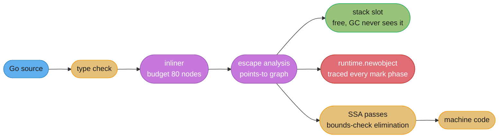
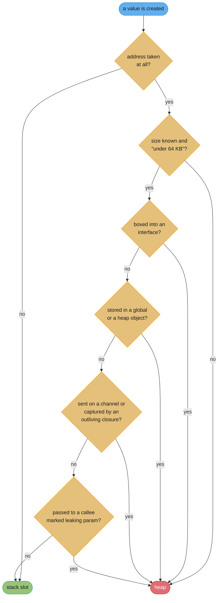
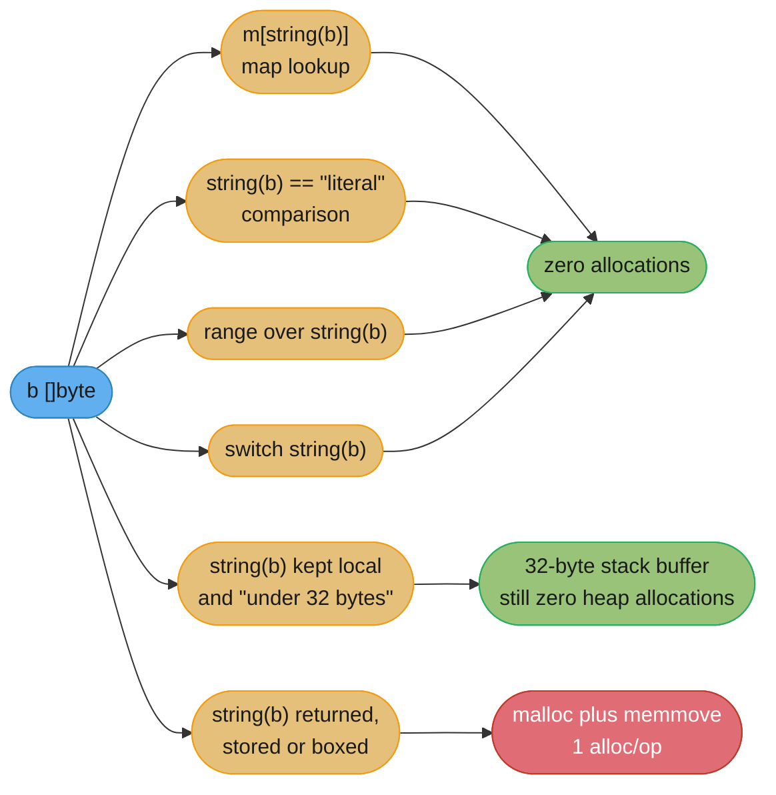

# Escape Analysis and Performance

---

## 1. Concept Overview

**Escape analysis is a compile-time proof.** For every value your program creates, the Go compiler
tries to prove that no reference to it survives the function frame that created it. When the proof
succeeds, the value lives in a stack slot: allocation is a register add, deallocation is the frame
pop, and the garbage collector never learns the value existed. When the proof fails, the compiler
rewrites the value into a `runtime.newobject` call and the collector inherits it forever.

That single sentence is the whole subject, and everything else in this module is a consequence of it.
The compiler is not guessing about performance and it is not applying a heuristic — it is running a
points-to analysis and taking the conservative branch whenever the analysis cannot conclude. So the
practical skill is not "avoid the heap"; it is **reading the compiler's proof and understanding which
line of your code destroyed it**.

The tool for that is `go build -gcflags='-m'`, and it is the only diagnostic in this module that costs
nothing to run.

This module owns *not allocating*.
[The Runtime and Garbage Collector](../the_runtime_and_garbage_collector/the_runtime_and_garbage_collector.md)
owns what happens to the allocations you could not remove — the pacer, `GOGC`, `GOMEMLIMIT`, size
classes and the mark phase. The two are the same lever seen from opposite ends: an allocation removed
here is mark work, sweep work and RSS that the collector never has to price.

Target version is **Go 1.27** (released 2026-08-19). Two releases changed the arithmetic underneath
this module: `[1.26]` extended stack allocation to slice backing stores in more situations, and
`[1.27]` made small heap allocations themselves substantially cheaper.

---

## 2. Intuition

> A stack frame is a hotel room with checkout at noon. The compiler will let a value stay in the room
> as long as it can prove that nobody outside the hotel is holding a key. Hand a key to a stranger —
> store the address in a global, mail it down a channel, wrap it in an interface — and the value has
> to move into an apartment instead, with a lease the garbage collector has to keep paying.

**Mental model:** think of escape analysis as a **key-tracking problem, not a lifetime problem**. The
compiler does not simulate execution and it does not know how long anything lives. It follows
*addresses* through assignments, calls, returns and captures, and asks one question: can this address
reach a place I cannot see the end of? That is why the answer sometimes seems pessimistic — a single
assignment into an `any` on a path that never runs still forces the allocation, because the analysis
is over the program text, not over the execution.

**Why it matters:** allocation is the dominant tunable cost in most Go services. A heap allocation is
not just the ~25 ns of `mallocgc`; it is a pointer the collector will trace on every future mark
phase, a byte count that pushes the next GC cycle closer, and a cache line the CPU will miss on. Cut
allocations per request from 35 to 3 and you usually get lower p50, lower p99, lower RSS and lower CPU
in a single change — a rare thing in performance work, where those four normally trade against each
other.

**Key insight:** the intuition C and C++ programmers bring is exactly backwards here. **Returning a
pointer to a local does not force a heap allocation in Go.** `func f() *T { t := T{}; return &t }` is
idiomatic, safe, and frequently stack-allocated after the call is inlined. Meanwhile `fmt.Println(i)`
on a plain `int` — which looks like it allocates nothing at all — is a heap allocation on paper. Stop
predicting; read `-m`.

---

## 3. Core Principles

**1. The proof is conservative and asymmetric.** If the compiler can prove non-escape, you get the
stack. If it cannot decide, you get the heap. There is no third outcome, and "cannot decide" includes
every case where an address flows into a function the compiler has not analysed — an indirect call, a
method on an interface it could not devirtualize, an assembly routine.

**2. Escape analysis runs *after* inlining, and that ordering is the single biggest lever you have.**
An un-inlined call is an opaque boundary: the compiler summarises the callee as "this parameter leaks"
or "this parameter does not escape" and works with that summary. An inlined call has no boundary at
all — the callee's body is analysed inside the caller's frame, and its locals become the caller's
stack slots.

**3. It is a per-value decision, not a per-line or per-type decision.** Two allocations on the same
source line can go different ways. A struct can be stack-allocated at one call site and heap-allocated
at another. `-m` reports one line per *value*, which is why its output looks noisy.

**4. Size is a hard cut-off that lifetime cannot override.** An implicit allocation larger than
**64 KB**, or a declared local larger than **10 MB**, goes to the heap even when the compiler can
prove it dies with the frame. Goroutine stacks start at **2 KB** and grow by copying; they are not
allowed to grow without bound to accommodate a giant local.

**5. Interfaces box.** Converting a non-pointer value to an interface needs somewhere addressable to
put the value, because an interface is a `(type, value-pointer)` pair. That "somewhere" is the heap
unless the compiler can keep the boxed copy in the frame. See
[Interfaces, Methods and Embedding](../interfaces_methods_and_embedding/interfaces_methods_and_embedding.md)
for the `itab` layout this follows from.

**6. Every rule in this module has a counter-example, so the rule is: measure.** Preallocation
sometimes loses. `sync.Pool` frequently loses. Removing an interface sometimes loses because it
removed an inlining opportunity elsewhere. `-benchmem` and `benchstat` are not a formality here; they
are the only part of the method that is actually reliable.

**7. Optimize the allocation *count* before the allocation *size*.** 35 allocations of 40 bytes hurt a
Go service far more than one allocation of 1400 bytes: mark work tracks pointers to trace, and the
per-call overhead is paid 35 times.

---

## 4. Types / Architectures / Strategies

### The escape triggers, ranked by how often they are the answer

| Trigger | Why the proof fails | Typical fix |
|---------|--------------------|-------------|
| Assignment into an interface (`any`, `error`, `io.Writer`, a `...any` parameter) | The interface holds a pointer, so the value needs an address the compiler cannot bound | Concrete types on the hot path; `strconv` over `fmt` |
| Capture by a closure that outlives the frame (`go func`, a returned closure, a stored callback) | The closure object outlives the frame, so its captures must too | Pass by argument; keep the closure local |
| Store into a package-level variable | Lifetime is the process | Return the value instead of stashing it |
| Store into an already-heap object (a field of a `*T`, a map value, a slice element) | Reachable from the heap by definition | Store a value, not a pointer, when the type is small |
| Send on a channel | The receiver is another goroutine's frame | Send small values, not pointers, for pointer-free types |
| Address of something whose size is not a compile-time constant | No stack slot can be sized for it | Bound the size, or accept the heap |
| Over the size cut-off (64 KB implicit / 10 MB declared) | Stack frames are not arbitrarily large | Chunk the work, or accept the heap |
| Passed to an un-analysable callee (indirect call, assembly, cgo) | No summary available, so assume the worst | Devirtualize; PGO can do this for you at hot sites |

### The four phrases `-gcflags='-m'` prints, and what each one means

| Phrase | Subject | Meaning |
|--------|---------|---------|
| `moved to heap: x` | A **declared variable** | The variable `x` was going to be a stack slot; the compiler relocated it to the heap |
| `... escapes to heap` | An **expression or argument** | The value produced here was allocated with `runtime.newobject` |
| `... does not escape` | A **parameter or expression** | Proof succeeded: this can stay in the frame |
| `can inline f with cost N` | A **function** | `f` costs `N` of the 80-node budget and will be inlined at its call sites |

Three more you will see constantly: `leaking param: p` (the parameter's address reaches the return
value or a global — the callee's summary that makes the *caller's* value escape), `leaking param
content: p` (the *pointed-to* data leaks, not the pointer), and `inlining call to f` (this is where the
inline actually happened).

### The optimization ladder, cheapest first

| Rung | Move | Typical win |
|------|------|-------------|
| 1 | Read `-m` and delete the one interface conversion in the hot loop | 1–3 allocs/op |
| 2 | Replace `fmt.Sprintf` with `strconv` / `append` on the hot path | 2 allocs/op, 40–60 ns/op |
| 3 | Preallocate slices and `strings.Builder` with a known capacity | 15–20 allocs/op on a 10k build |
| 4 | Elide `[]byte`↔`string` conversions the compiler already knows how to skip | 1 alloc/op per conversion |
| 5 | Restructure so the value stays in the caller's frame (return a value, not a pointer) | 1 alloc/op, plus mark work |
| 6 | Enable PGO from a production profile | 2–7% CPU, whole program |
| 7 | Hoist bounds checks out of a tight decode loop | 5–20% on that loop only |
| 8 | `sync.Pool` for what is genuinely left | Large buffers only; often a net loss otherwise |
| 9 | `unsafe.String` / `unsafe.Slice` | 1 alloc/op, and a real correctness risk |

Rung 9 is last for a reason. Everything above it is provably safe; that one trades a memory-safety
guarantee for an allocation.

---

## 5. Architecture Diagrams

### Where escape analysis sits in the compiler



Read left to right and the reason inlining matters falls out: by the time escape analysis runs, an
inlined callee has no frame boundary of its own, so its locals compete for the caller's stack slots
instead of being summarised as "leaking" across a call.

### The decision the compiler actually makes



Note what is **not** on this chart: "is a pointer to it returned". Returning `&local` is not a trigger
on its own — the returned pointer is analysed at the *call site*, and if the caller drops it into its
own frame the value stays on the stack.

### The `[]byte` to `string` conversions the compiler already elides



Five of the six shapes cost nothing. Only the last one — a string that outlives the expression — pays.

### Allocations per request, before and after one afternoon of `-m` reading

```mermaid
xychart-beta
    title "Allocations per ingest request, before and after"
    x-axis ["json decode", "log line", "key build", "response", "total"]
    y-axis "allocs/op" 0 --> 40
    bar [14, 9, 6, 6, 35]
    bar [4, 0, 0, 1, 5]
```



These are the numbers from the case study in §14: 35 allocations per request down to 5, which moved GC
CPU from 22% to 6% without touching `GOGC`.

---

## 6. How It Works — Detailed Mechanics

### Reading `-m` on a worked example

```go
package main

import "fmt"

type point struct{ x, y int }

func newPoint(x, y int) *point {
    p := point{x, y}
    return &p                 // C intuition says heap. Go says: it depends on the caller.
}

func sum(p *point) int { return p.x + p.y }   // reads only; stores the pointer nowhere

var sink *point

func stash(p *point) { sink = p }

func main() {
    p := newPoint(1, 2)
    fmt.Println(sum(p))
    stash(p)
}
```

```bash
go build -gcflags='-m' ./...
```

```
./main.go:7:6:   can inline newPoint with cost 12 as: func(int, int) *point { p := point{...}; return &p }
./main.go:12:6:  can inline sum with cost 10 as: func(*point) int { return p.x + p.y }
./main.go:12:10: p does not escape
./main.go:18:6:  can inline stash with cost 8 as: func(*point) { sink = p }
./main.go:18:13: leaking param: p
./main.go:21:17: inlining call to newPoint
./main.go:22:16: inlining call to sum
./main.go:23:7:  inlining call to stash
./main.go:8:2:   moved to heap: p
./main.go:22:14: ... argument does not escape
./main.go:22:17: sum(p) escapes to heap
```

Six facts in eleven lines. `p does not escape` (line 12) is `sum`'s **summary** — it reads through
the pointer and never stores it, so a stack address is safe to pass. `leaking param: p` (line 18) is
`stash`'s summary and it is the villain: `stash` writes the pointer into a global. `moved to heap: p`
(line 8) is the consequence, reported against the *declaration*; delete the `stash(p)` call and the
line disappears, because `newPoint` and `sum` both inline into `main` and the whole `point` becomes two
words in `main`'s frame. `... argument does not escape` is the `[]any` slice `fmt.Println` builds, and
its header stays in the frame. `sum(p) escapes to heap` is the **`int` result being boxed** into
`any` — the allocation nobody expects, covered next. And not one line is about `return &p`: returning
the address of a local is analysed at the call site, exactly as principle 3 says.

`-m -m` (equivalently `-m=2`) prints the flow that produced each verdict:

```
./main.go:8:2: p escapes to heap:
./main.go:8:2:   flow: {heap} = &p:
./main.go:8:2:     from &p (address-of) at ./main.go:9:9
./main.go:8:2:     from sink = p (assign) at ./main.go:18:22
```

That four-line chain is the whole point of `-m -m`: it names the exact assignment that broke the
proof, which is almost never the line you were looking at.

Two flags people get wrong:

```bash
go build -gcflags='-m' ./...          # only the packages named on the command line
go build -gcflags='all=-m' ./...      # every package including dependencies (very noisy)
go build -gcflags='-m=2' ./pkg/ingest # reason chains, one package
```

### Interface boxing

An interface value is two words: a pointer to type information and a pointer to the data. A concrete
`int` is one word of data with no address, so converting it to `any` requires the runtime to *put it
somewhere*:

```go
var x any
i := 42
x = i          // runtime.convT64(uint64(i)) -> a heap pointer (usually)
```

The runtime helpers are `convT64`, `convTstring`, `convTslice`, `convT32`, `convT16` and the generic
`convT`. Two escape hatches make the story less bad than it looks:

- **`convT64` returns a pointer into `runtime.staticuint64s` for values below 256.** Boxing the
  integer `7` allocates nothing at runtime even though `-m` reports it as escaping. Boxing `1000`
  allocates 8 bytes. This is why a microbenchmark of `fmt.Println(1)` shows fewer allocations than one
  of `fmt.Println(1000)`, and it catches people out constantly.
- **Pointer-shaped values are not boxed at all.** A `*T`, a `map`, a `chan`, a `func` or a
  single-pointer struct goes straight into the data word. `err` values are cheap for exactly this
  reason: `errors.New` returns a pointer.

The measurable cost, on an amd64 box, Go 1.27, `-benchmem`:

```
BenchmarkSprintfInt-8      19_384_128      61.4 ns/op      16 B/op      2 allocs/op
BenchmarkStrconvItoa-8    271_449_218       4.4 ns/op       8 B/op      1 allocs/op
BenchmarkAppendInt-8      580_213_446       2.1 ns/op       0 B/op      0 allocs/op
```

`strconv.AppendInt(buf[:0], n, 10)` into a reused buffer is 29x faster than `fmt.Sprintf("%d", n)`
and allocates nothing. That gap is why a hot log line can cost more than the work it describes: four
`%v` arguments in a per-row log statement is four boxes, one `[]any`, one formatted string and one
write — roughly 8 allocations to describe a row lookup that allocated 2.

### `[]byte` and `string` conversions

A `string` header is (pointer, length) and immutable by language rule; a `[]byte` header is
(pointer, length, capacity) and mutable. A conversion must therefore copy — except where the compiler
can prove the copy is unobservable:

```go
n := counts[string(b)]                        // 1. map lookup: elided, 0 allocs
if string(b) == "application/json" { ... }    // 2. comparison: elided
for i, r := range string(b) { ... }           // 3. range: elided, decodes in place
switch string(b) { case "GET", "HEAD": }      // 4. switch: elided

// 5. Non-escaping and at most 32 bytes: no HEAP allocation. runtime.slicebytetostring
//    takes a *[32]byte temporary, and the compiler points it at a stack slot.
if strings.HasPrefix(string(b), "Bearer ") { ... }

h.keys = append(h.keys, string(b))            // 6. outlives the expression: 1 alloc + memmove
```

Note that **map assignment is not elided, only lookup**: `counts[string(b)]++` allocates, because the
key must be retained if it is new. That asymmetry is a real and frequently-missed gotcha.

The deliberate escape hatch, when the copy is genuinely the bottleneck:

```go
import "unsafe"

// Zero-copy view of a byte slice as a string. The string aliases b's memory.
func unsafeString(b []byte) string {
    return unsafe.String(unsafe.SliceData(b), len(b))
}

// Zero-copy view of a string as a byte slice. The result MUST NOT be written.
func unsafeBytes(s string) []byte {
    return unsafe.Slice(unsafe.StringData(s), len(s))
}
```

The contract you are signing: **the byte slice must never be written again for as long as the string
is reachable**, and the byte slice from `unsafeBytes` must never be written at all — a string literal
lives in read-only memory and writing it segfaults. The safe use is a read-only view whose lifetime is
strictly inside one function; the dangerous use is anything that stores the result. §10 has the
incident.

### Stack allocation of slice backing stores `[1.26]`

Before Go 1.26, `make([]T, n)` with a non-constant `n` always allocated on the heap, because a stack
slot has to be sized at compile time. `[1.26]` extends stack allocation to more of these: the compiler
reserves a bounded stack slot, tests the requested length against it, and falls back to
`runtime.makeslice` only when the length does not fit.

```go
// Go 1.25: 1 alloc/op regardless of what n turns out to be.
// Go 1.26+: 0 allocs/op for the common small n, because the buffer never escapes.
func checksum(r io.Reader, n int) (uint32, error) {
    buf := make([]byte, n)
    if _, err := io.ReadFull(r, buf); err != nil {
        return 0, err
    }
    return crc32.ChecksumIEEE(buf), nil
}
```

Two flags matter when you are attributing a change to this:

```bash
go build -gcflags=all=-d=variablemakehash=n ./...   # turn the optimization off entirely
bisect -compile=variablemake go build ./...         # golang.org/x/tools/cmd/bisect: narrow it
                                                    # down to the call sites that changed
```

If a benchmark improved between 1.25 and 1.26 and you cannot explain why, build both ways and compare.
It does not help when the slice escapes — the escape rules above still apply first.

### Size-specialized allocation `[1.27]`

When the allocation cannot be removed, `[1.27]` makes it cheaper. The runtime now generates a
dedicated allocation routine per size class instead of running one general `mallocgc`, making
allocations **under 80 bytes up to 30% faster**, worth about **1% overall** in allocation-heavy
programs, at a cost of roughly **60 KB** of binary size.

```bash
GOEXPERIMENT=nosizespecializedmalloc go test -bench=. -benchmem ./...
```

Run that against the default build to attribute a regression or confirm a win on your own workload.
The practical consequence for this module is a warning: it **narrows the gap** between stack and heap
for small objects, so a `sync.Pool` or an `unsafe` trick that barely paid for itself on Go 1.25 may
now be a net loss. Re-measure the marginal ones.

### The inlining budget

The inliner walks the function body and assigns a cost. The body must come in at or under
**80 nodes**. Most AST nodes cost 1; the number that dominates everything is that **a call to a
function that is not itself inlined costs 57**. That is the entire reason "one call per small
function" is the shape of inlinable Go: two un-inlined calls is 114, already over budget.

```
./codec.go:41:6: can inline decodeHeader with cost 63 as: ...
./codec.go:88:6: cannot inline decodeBody: function too complex: cost 214 exceeds budget 80
./codec.go:130:6: cannot inline safeDecode: call to recover
```

`//go:noinline` forces the other direction, and its legitimate uses are narrow: pinning a benchmark's
shape, and keeping a cold error path out of a hot function's budget so the hot part stays inlinable.

```go
//go:noinline
func (d *Decoder) failSlow(err error) error {   // cold; keep its 90 nodes out of the caller
    return fmt.Errorf("decode %s at offset %d: %w", d.name, d.off, err)
}
```

PGO raises the budget to **2000** at call sites the profile says are hot, which is why PGO's wins show
up as *escape analysis* wins as often as as inlining wins — see below.

To measure what inlining is worth, turn it off rather than guessing: `-gcflags='-l'` disables it,
`-gcflags='-l -l'` more aggressively.

### Bounds-check elimination

Every `a[i]` compiles to a comparison and a conditional branch unless the SSA prover can show the
index is in range. The prover is good; it is not psychic.

```bash
go build -gcflags='-d=ssa/check_bce/debug=1' ./pkg/codec
```

```
./codec.go:52:12: Found IsInBounds
./codec.go:53:12: Found IsInBounds
./codec.go:54:12: Found IsInBounds
./codec.go:55:12: Found IsInBounds
```

Each line is a check that survived. The idioms that remove them:

```go
// BOUNDS CHECKED: four separate checks, one per index.
func beU32slow(b []byte) uint32 {
    return uint32(b[0])<<24 | uint32(b[1])<<16 | uint32(b[2])<<8 | uint32(b[3])
}

// HOISTED: one check. b[3] proves len(b) >= 4, and the prover carries that
// fact to every later index. This is the idiom encoding/binary itself uses.
func beU32(b []byte) uint32 {
    _ = b[3]
    return uint32(b[0])<<24 | uint32(b[1])<<16 | uint32(b[2])<<8 | uint32(b[3])
}

// RESLICED: same effect, and reads better when the length is exact.
func beU32r(b []byte) uint32 {
    b = b[:4]
    return uint32(b[0])<<24 | uint32(b[1])<<16 | uint32(b[2])<<8 | uint32(b[3])
}

// Ranging over a slice gives the prover the bound for free; an index loop with a
// separately-computed limit does not.
```

```
BenchmarkBEU32Slow```

```
BenchmarkBEU32Slow-8    446_290_112     2.68 ns/op     0 B/op    0 allocs/op
BenchmarkBEU32-8        612_884_037     1.96 ns/op     0 B/op    0 allocs/op
```

27% on this function, and roughly 6% on the decoder that calls it a million times per second. Bounds
checks are the *last* thing to optimize, not the first — the win is real but it is small, and it is
confined to loops that are already allocation-free.

### PGO `[1.21]`

Profile-guided optimization feeds a real CPU profile back into the compiler. The workflow:

```bash
# 1. Collect from production, not from a benchmark. 30s is plenty; take several.
curl -o cpu1.pprof 'http://prod-1:6060/debug/pprof/profile?seconds=30'
curl -o cpu2.pprof 'http://prod-2:6060/debug/pprof/profile?seconds=30'

# 2. Merge them so one unrepresentative host cannot dominate.
go tool pprof -proto cpu1.pprof cpu2.pprof > default.pgo

# 3. Put default.pgo in the main package directory. go build finds it with no flags.
git add cmd/ingest/default.pgo

# 4. Verify it was actually applied.
go build -gcflags='-m' ./cmd/ingest 2>&1 | grep 'hot'
```

What it does, in order of how much it is worth. **First**, it raises the inlining budget to 2000 at
hot call sites; more inlining means more escape analysis across former call boundaries, which is why a
PGO build often shows *fewer allocations*, not just better layout. **Second**, it devirtualizes hot
interface calls: a call whose profile shows one dominant concrete type becomes a type check plus a
direct call (with the interface call as fallback), and that direct call can then be inlined.
**Third**, it lays out basic blocks so the hot path falls through.

Reported gain is **2–7% CPU for typical programs**, up to **14%** for some. Two operational rules:
`default.pgo` must be committed for reproducible builds, and it must be **refreshed on a schedule** —
a weekly CI job that pulls a merged profile and opens a PR is the pattern that works. A stale profile
degrades gracefully rather than pessimizing (matching is by function identity, so drifted code simply
stops being marked hot), but the value decays. `-pgo=off` builds without it, for A/B.

### `sync.Pool` and the reset discipline

For allocations you genuinely cannot remove — a per-request 32 KB scratch buffer, a `gzip.Writer` —
`sync.Pool` amortises them across requests.

```go
var bufPool = sync.Pool{
    New: func() any { return new(bytes.Buffer) },   // New returns any: it must return a pointer
}

func handle(w http.ResponseWriter, r *http.Request) {
    buf := bufPool.Get().(*bytes.Buffer)
    buf.Reset()                                     // reset on GET, not on PUT: safer default
    defer func() {
        if buf.Cap() <= 64<<10 {                    // never pool a jumbo buffer
            bufPool.Put(buf)
        }
    }()
    render(buf, r)
    w.Write(buf.Bytes())
}
```

Four rules, each of which has caused an incident somewhere. **Reset on `Get`, not only on `Put`** —
a panic between the two skips a `Put`-side reset. **Cap-bound what you put back**; `net/http` itself
refuses to pool buffers over 64 KB, and without that one 40 MB upload permanently parks 40 MB per pool
shard. **Never retain a reference into pooled memory**: `w.Write(buf.Bytes())` is fine because `Write`
copies, but handing `buf.Bytes()` to an async writer is a use-after-free the race detector cannot see.
And **the pool is emptied by GC** — since Go 1.13 a victim cache lets an object survive one cycle and
drops it on the second, so a pool is a throughput optimization, never a cache.

`sync.Pool` is `Get`/`Put` on a per-P private slot plus a shared queue, which is why it is nearly
lock-free; see
[Sync Primitives and the Memory Model](../sync_primitives_and_memory_model/sync_primitives_and_memory_model.md).

### Preallocation arithmetic

`append` grows a slice by doubling while capacity is under 256 elements, then by roughly 1.25x
(`newcap += (newcap + 3*256) / 4`), with each result rounded up to a size class. Growing a `[]int`
from `nil` to 10,000 elements therefore reallocates about **19 times**, and each reallocation copies
everything so far — a total of roughly **283 KB of memmove traffic** to produce an 80 KB slice.

```go
// BROKEN-ish: correct, but 19 allocations and 283 KB copied.
func ids(rows []Row) []int64 {
    var out []int64
    for _, r := range rows {
        out = append(out, r.ID)
    }
    return out
}

// FIX: one allocation, zero copies. len(rows) is known.
func ids(rows []Row) []int64 {
    out := make([]int64, 0, len(rows))     // note: 0 length, len(rows) capacity
    for _, r := range rows {
        out = append(out, r.ID)
    }
    return out
}
```

```
BenchmarkIDsGrow-8      24_132    49_600 ns/op   357_616 B/op   19 allocs/op
BenchmarkIDsPrealloc-8  68_450    17_200 ns/op    81_920 B/op    1 allocs/op
```

2.9x faster, 4.4x less memory touched. `strings.Builder.Grow(n)` does the same for string building:
one allocation for the whole result instead of a growth ladder.

Note the trap in the fix above: `make([]int64, 0, n)` has **length 0**. Writing `make([]int64, n)` and
then appending gives you `2n` elements with `n` zeros at the front — see §10.

### False sharing, in one paragraph

Two goroutines writing to different variables that share one 64-byte cache line will ping that line
between cores on every write, costing an order of magnitude more than the same writes to separate
lines. In Go it shows up in per-shard counter arrays and in struct fields written by different
goroutines; the fix is padding the shard to a cache line, `[]struct{ n atomic.Int64; _ [56]byte }`.
The coherence story — MESI, line ownership, the cost of a remote invalidation — belongs to
[Computer Architecture and Memory Hierarchy](../../cs_fundamentals/computer_architecture_and_memory_hierarchy/computer_architecture_and_memory_hierarchy.md).
What matters here is that `-benchmem` shows **zero** allocation change while wall time doubles, so
false sharing is invisible to every tool in this module except the benchmark itself.

### SIMD without assembly `[1.27]`, experimental

Before Go 1.26 the only way to use vector instructions from Go was a hand-written `.s` file,
which the compiler cannot inline and escape analysis treats as an un-analysable callee. Building
with `GOEXPERIMENT=simd` enables two packages. `simd/archsimd` gives fixed-width,
architecture-specific types (`Int8x16`, `Int8x32`, `Int8x64` on amd64) for 128-bit vectors on
amd64, arm64 Neon and wasm, and 256- and 512-bit vectors on amd64 CPUs that have them. The
portable `simd` package gives width-agnostic types (`Int8s`, `Float32s`, with comparisons
returning `Mask8s`). The compiler emits copies of every function that touches them, suffixed
`@simd0` (emulation), `@simd128`, `@simd256` or `@simd512`, and a wrapper picks one from the
SIMD level detected at program start. `GODEBUG=simd=0|128|256|512` forces a level, which is
how you benchmark the emulated path against the vector path on one machine. Neither API is
stable, so keep it behind a build tag with a scalar fallback and compare with
`benchstat` like any other change in this module.

---

## 7. Real-World Examples

**The standard library's own `encoding/binary`.** `binary.BigEndian.Uint32` opens with `_ = b[3]` — the
exact hoisting idiom above — with a comment saying "bounds check hint to compiler". The stdlib is the
best available corpus of these techniques applied honestly.

**`net/http`'s buffer pools.** The server keeps `sync.Pool`s of 2 KB and 4 KB `bufio.Reader`/`Writer`
pairs and refuses to pool anything larger, which is where the 64 KB cap-bound rule in §6 comes from.
It also demonstrates the `Get`-side reset: `newBufioReader` calls `br.Reset(r)` on acquisition.

**Prometheus client instrumentation.** `prometheus.Labels{...}` in a hot path builds a map per
observation and boxes every value. Services that switched to `WithLabelValues` on a cached
`*prometheus.CounterVec` — which takes `...string`, not a map — routinely cut 4–6 allocations per
request out of the instrumentation alone, on code that was never the "real" work.

**CockroachDB and every database written in Go.** Their hot decode paths are `[]byte`-native end to
end, converting to `string` only at the API boundary. That is the general shape of the technique: do
not sprinkle `unsafe.String` through a codebase, restructure so the conversion happens once.

---

## 8. Tradeoffs

### Stack versus heap, honestly

| Property | Stack slot | Heap allocation |
|----------|-----------|-----------------|
| Allocation cost | Zero — part of the frame | ~25 ns for a small object; up to 30% cheaper under 80 bytes `[1.27]` |
| Deallocation cost | Zero — frame pop | Mark plus sweep, paid on every future cycle while live |
| GC impact | None; never traced | One more pointer to trace, forever |
| Cache behaviour | Hot; the frame is in L1 | Cold; likely a miss on first touch |
| Size limit | 64 KB implicit / 10 MB declared | Limited by `GOMEMLIMIT` and the machine |
| Lifetime | Exactly the frame | Until unreachable |
| Sharing across goroutines | Impossible | The only option |

### The optimizations, weighed

| Technique | Buys | Costs | Verdict |
|-----------|------|-------|---------|
| Delete an interface conversion | 1–2 allocs/op, plus devirtualization | API rigidity; concrete types leak into signatures | Do it on the hot path only |
| `strconv` over `fmt` | 40–60 ns/op and 2 allocs/op per value | Verbosity; no format string | Always, in loops |
| Preallocate with a known `n` | 15–20 allocs on a 10k build | Nothing, when `n` is genuinely known | Always |
| Preallocate with a guessed `n` | Sometimes nothing | Over-allocation that outlives the request | Measure; a wrong guess is worse than growth |
| `[]byte`-native hot path | 1 alloc per conversion removed | Every helper takes `[]byte`; readability drops | Codecs and parsers only |
| `unsafe.String` / `unsafe.Slice` | 1 alloc plus a memmove | Memory safety; `-race` cannot see the bug | Last resort, one function wide |
| `sync.Pool` | Amortises large buffers | Reset bugs, jumbo retention, GC still empties it | Buffers over ~4 KB with steady traffic |
| PGO | 2–7% CPU whole-program | A profile in the repo, a refresh job, longer builds | Almost always worth it |
| Bounds-check hints | 5–27% on that function | Cryptic `_ = b[3]` lines | Hot decode loops only |
| Cache-line padding | Removes a coherence storm | 56 wasted bytes per shard | Per-P counters and sharded state |

---

## 9. When to Use / When NOT to Use

**Reach for `-gcflags='-m'` when:**
- A heap profile (`-alloc_objects`) names a call site and you want to know *why* it allocates. `-m`
  answers "why"; pprof answers "where". See
  [Profiling and Tracing](../profiling_and_tracing/profiling_and_tracing.md).
- `gctrace` shows GC above 10% of wall time and the live heap is small — that combination means churn,
  not a leak, and churn is this module's problem.
- You are writing a codec, a serializer, or anything on a per-message path at over 10k/s.

**Do NOT optimize allocations when:**
- The service spends its time in I/O. A handler that waits 40 ms on Postgres does not care about 35
  allocations. Profile first.
- You have not run the benchmark yet. Every rule here has a counter-example.
- The code is a startup path, a config loader, or an admin endpoint. Allocation optimization makes
  code harder to read; spend that cost where it returns.

**Use `sync.Pool`** when the object is over roughly 4 KB, the allocation rate is high and steady, and
the object has a clean reset — and only after measuring the version without it, because at low RPS the
pool is emptied by GC before it is reused. **Do NOT** use it when objects vary wildly in size (the
jumbo-retention bug), when you actually need a cache, or when the object holds a reference a later
user could observe.

**Use `unsafe.String` / `unsafe.Slice` when:**
- The conversion is measurably hot, the source buffer is provably immutable for the string's whole
  lifetime, and the whole lifetime fits in one function you can read at once.

**Do NOT use them when:**
- The buffer comes from a `bufio.Reader`, a `sync.Pool`, or anything that reuses storage. This is the
  incident in §10.
- The result is stored in a map, a struct field, or anything that outlives the call.

**Enable PGO when:** the service is CPU-bound and you can collect a representative production profile.
**Skip it when:** you cannot commit to refreshing the profile — a `default.pgo` from two years ago is
not harmful, but the CI job that pretends to maintain it is a lie.

---

## 10. Common Pitfalls

### Pitfall 1: the debug log line that cost more than the query

An order-history API logged one line per row inside the result loop:

```go
// BROKEN: 4 boxed arguments, a []any, a formatted string and a write, per row.
for rows.Next() {
    var o Order
    rows.Scan(&o.ID, &o.UserID, &o.Cents, &o.State)
    log.Printf("row order=%d user=%d cents=%d state=%s", o.ID, o.UserID, o.Cents, o.State)
    out = append(out, o)
}
```

```
BenchmarkRowsWithLog-8      41_209    28_900 ns/op   14_112 B/op   208 allocs/op
```

208 allocations to return 25 rows, of which **154** — about 6 per row — came from that one statement,
with 2 per row from the scan and the rest from growing `out`. The log line was left over from a debugging session eleven months earlier and was writing to a
file nobody read.

```go
// FIX: structured logging, level-gated, and outside the loop. slog evaluates
// its arguments lazily only when the level is enabled.
if logger.Enabled(ctx, slog.LevelDebug) {
    logger.DebugContext(ctx, "orders fetched", "count", len(out), "user", userID)
}
```

```
BenchmarkRowsNoLog-8       268_144     4_460 ns/op    2_688 B/op    54 allocs/op
```

**Impact:** 6.5x faster per query, 154 allocations per request removed. Across 9,000 req/s this took
GC CPU from 19% to 7% and p99 from 210 ms to 96 ms — from deleting a log statement. Check every
`log.Printf` inside a loop before you optimize anything cleverer.

### Pitfall 2: `unsafe.String` over a reused `bufio` buffer

A log-ingest service parsed newline-delimited records and used the zero-copy conversion for the map
key, because the heap profile said `string(b)` was 12% of allocations.

```go
// BROKEN: key aliases the reader's internal buffer, which bufio refills.
for {
    line, err := br.ReadSlice('\n')          // ReadSlice returns a view INTO bufio's buffer
    if err != nil { break }
    key := unsafe.String(unsafe.SliceData(line), len(line))
    counts[key]++                            // the map now holds a pointer into a buffer
                                             // bufio will overwrite on the next Fill
}
```

The map keys mutated underneath the map. Counters merged into whichever key happened to occupy that
memory, hash buckets pointed at data whose hash had changed, and lookups for keys that were present
returned zero. It produced **wrong numbers, not a crash** — no panic, no `-race` report (there is no
data race; there is one goroutine), nothing in any dashboard.

```go
// FIX: counters behind a pointer, so the hot path is a map LOOKUP -- the only
// form the compiler elides -- followed by an increment through the pointer.
// Only a genuinely new key materialises a string.
counts := map[string]*int64{}
for {
    line, err := br.ReadSlice('\n')
    if err != nil { break }
    if c, ok := counts[string(line)]; ok {   // elided: zero allocations on the hot path
        *c++
        continue
    }
    n := int64(1)
    counts[string(line)] = &n                // allocates, once per distinct key
}
```

The shape matters. `counts[string(line)]++` would **not** have fixed it: an increment is a map
*assignment*, it lowers to `mapassign`, and `mapassign` has to be able to retain the key, so the
conversion is materialised on every single line. Only the pure lookup — `v, ok := m[string(b)]` — is
elided, because there the string provably dies inside the expression.

**Impact:** six weeks of subtly wrong billing aggregates, found only when a customer's invoice did not
match their own logs. The `unsafe` version's advantage over the pointer-valued map is a single
pointer dereference per line, which is inside the noise of the I/O it sits behind. That is the entire
value of the `unsafe` version, weighed against six weeks of wrong numbers.

### Pitfall 3: `make([]T, n)` followed by `append`

```go
// BROKEN: length n, not capacity n. The result has 2n elements,
// the first n of which are zero values.
out := make([]Order, len(rows))
for _, r := range rows {
    out = append(out, convert(r))
}
```

The bug ships silently because the data is *there*, just preceded by `n` zeros, and JSON encodes it
without complaint. A partner integration consumed 500 empty order objects per page for two weeks. The
fix is one character: `make([]Order, 0, len(rows))`. Add a lint rule (`makezero` in `golangci-lint`)
and never think about it again.

### Pitfall 4: the `sync.Pool` that grew to 40 MB per shard

An image service pooled `*bytes.Buffer` for encoded output. Typical output was 80 KB; one customer
uploaded a 42 MB TIFF.

```go
// BROKEN: whatever capacity a buffer reached, the pool keeps forever.
defer bufPool.Put(buf)
```

`sync.Pool` keeps one private object per P plus a shared queue, so a `GOMAXPROCS=16` process parked up
to 16 buffers of 42 MB. RSS went from 400 MB to 1.1 GB and stayed there, because the victim cache
means an object survives a full GC cycle and gets re-promoted on any use.

```go
// FIX: refuse to pool anything unusually large. net/http uses exactly this shape.
defer func() {
    if buf.Cap() <= 256<<10 {
        buf.Reset()
        bufPool.Put(buf)
    }
}()
```

**Impact:** steady-state RSS back to 430 MB, and the pod stopped being `OOMKilled` twice a week. Note
that the incident happened *because* the pool worked — the buffer was reused, which is what kept it
alive.

### Pitfall 5: optimizing the line `-m` was not talking about

An engineer saw `./cache.go:88:19: leaking param: key` and spent a day restructuring the cache API to
stop the key escaping. Allocations did not move. `-m -m` on the same line showed the flow went into
`sync.Map.Store`, whose parameter genuinely must leak because the map outlives the call — the escape
was correct and unavoidable. The real 14 allocations per operation were two lines below, in a
`fmt.Sprintf` building a composite key.

**The rule:** `-m` reports every value in the function, and most of the report is fine. Start from the
heap profile's top entries (`go tool pprof -alloc_objects`), then use `-m -m` to explain *those*
lines. Reading `-m` top-to-bottom and fixing what looks wrong is a day you do not get back.

### Pitfall 6: the interface-typed struct field that heaped an entire request

```go
// BROKEN: Payload is any, so every request body escapes, and so does
// everything reachable from it.
type Request struct {
    ID      string
    Payload any        // "so handlers can put whatever they need here"
}
```

Six of the eleven handlers stored a `*Order`, four stored a `*Invoice`, one stored a `map[string]any`.
Because the field was `any`, nothing assigned to it could ever stay in a frame, and `-m` showed 22
escapes tracing back to that one field. Replacing it with a small sealed interface (`Payload
interface{ Kind() string }`) did not help — the boxing is the same. Replacing it with a
generic `Request[T any]` removed the box entirely for the six hottest handlers.

**Impact:** 11 allocations per request removed, 4% CPU. Worth recording because the fix was a type
change, not a code change: `any` in a struct field on a hot path is an allocation you have designed in.

---

## 11. Technologies & Tools

| Tool | What it answers |
|------|-----------------|
| `go build -gcflags='-m'` | Which values escape, which functions inline. Zero setup, first thing to run |
| `go build -gcflags='-m=2'` | The assignment chain that caused a specific escape |
| `go build -gcflags='all=-m'` | Same, including dependencies — for when the escape is in a library |
| `go build -gcflags='-d=ssa/check_bce/debug=1'` | Every bounds check that survived, with file and line |
| `go build -gcflags='-l'` | Inlining off, to measure what inlining was worth |
| `go build -gcflags=all=-d=variablemakehash=n` | Turn off `[1.26]` slice-backing-store stack allocation to A/B it |
| `GOEXPERIMENT=nosizespecializedmalloc` | Turn off `[1.27]` size-specialized allocation to A/B it |
| `go test -bench=. -benchmem` | ns/op, B/op and allocs/op — the three numbers this module lives on |
| `golang.org/x/perf/cmd/benchstat` | Whether the difference between two benchmark runs is real |
| `go tool pprof -alloc_objects` | Which call sites allocate most *often* — usually more useful than `-alloc_space` |
| `go tool pprof -http=:8080` | Flame graph by default `[1.26]`; the allocation flame graph is where to start |
| `go build -pgo=off` | Build without the committed profile, to measure PGO's contribution |
| `golangci-lint` (`makezero`, `prealloc`, `perfsprint`) | Catches `make([]T, n)`-plus-append, missing preallocation, and `fmt` where `strconv` belongs |
| `go tool compile -S` | The generated assembly, when `-m` and the benchmark disagree |
| `GOEXPERIMENT=simd` (`simd`, `simd/archsimd`) `[1.27]` | Experimental vector types from Go code instead of hand-written assembly; `GODEBUG=simd=0\|128\|256\|512` picks the vector width at run time |
| `benchdiff` / `perflock` | Reduces machine noise so `benchstat` p-values mean something |

---

## 12. Interview Questions with Answers

**Q: Does returning a pointer to a local variable force a heap allocation in Go?**
**Short:** No — the address is analysed at the call site, and the value stays in a frame whenever the compiler can prove nothing outlives it.

This is the C intuition that breaks first. `func f() *T { t := T{}; return &t }` is safe and idiomatic
because the compiler heap-allocates only when it must; if `f` is inlined into a caller that drops the
pointer into its own frame, `t` becomes stack slots in that caller. What actually forces the move is
what the *caller* does with the pointer — store it in a global, box it, send it on a channel. Prove it
to yourself with `-gcflags='-m'`: the `moved to heap` line appears and disappears as you change the
call site, not the callee.

**Q: Why does `fmt.Println(x)` allocate even when x is a plain int?**
**Short:** An interface value needs a pointer to its data, so a non-pointer value has to be copied somewhere addressable before it can be stored in an `any`.

`Println` takes `...any`, so the `int` is converted to an interface via `runtime.convT64`, and `fmt`'s
internals leak the parameter content into the reflection path, which is why the box cannot stay in the
frame. There is one large exception worth knowing: `convT64` returns a pointer into
`runtime.staticuint64s` for values below 256, so boxing `7` allocates nothing at runtime even though
`-m` reports an escape. On a hot path use `strconv.AppendInt` into a reused buffer — 2.1 ns/op and 0
allocs/op against 61.4 ns/op and 2 allocs/op for `fmt.Sprintf("%d", n)`.

**Q: How do you read `go build -gcflags='-m'`, and what do its main phrases mean?**
**Short:** It prints one verdict per value with a file and line: moved to heap, escapes to heap, does not escape, leaking param, and can inline.

`moved to heap: x` names a *declared variable* the compiler relocated; `... escapes to heap` names an
*expression or argument* it had to allocate; `... does not escape` is a successful proof; `leaking
param: p` is a callee's summary saying the parameter's address reaches a return value or a global, and
it is usually the real cause of an escape reported elsewhere. `-m=2` adds the assignment chain that
produced each verdict, which names the exact line that broke the proof. Use `-m` on the package you
are working on and `all=-m` only when you suspect a dependency.

**Q: What is the difference between `moved to heap` and `escapes to heap`?**
**Short:** The first names a declared variable relocated off its frame; the second names an anonymous expression the compiler had to allocate.

They are the same underlying decision reported against different syntax. You see `moved to heap: buf`
when a `var buf [64]byte` or a `p := point{}` cannot stay in the frame, and the line number points at
the declaration. You see `escapes to heap` for things with no name — a composite literal passed
directly to a function, a value being boxed into an interface, the result of a `make` whose slice
outlives the call. Fixing either one means finding the flow that consumed the address, which is what
`-m=2` prints.

**Q: Does converting a `[]byte` to a `string` always allocate?**
**Short:** No — map lookup, comparison, switch and range over the conversion are elided entirely, and a non-escaping result of at most 32 bytes uses a stack buffer.

`counts[string(b)]`, `string(b) == "literal"`, `switch string(b)` and `for _, r := range string(b)`
all compile to zero-allocation forms because the converted string provably does not outlive the
expression. Beyond those, `runtime.slicebytetostring` takes a `*[32]byte` temporary that the compiler
can point at a stack slot when the result does not escape. The asymmetry that catches people:
lookup is elided but every *write* is not — `counts[string(b)] = 1` and `counts[string(b)]++`
both lower to `mapassign`, which must be able to retain the key, so both copy.

**Q: When is `unsafe.String` safe, and what goes wrong when it is not?**
**Short:** Only when the underlying bytes are never written again for the string's whole lifetime, because the result aliases that memory and Go assumes strings never change.

The classic failure is building it over a `bufio.Reader`'s internal buffer or a pooled scratch slice:
the string is stored as a map key, the buffer refills, and the key mutates underneath the hash table.
That produces silently wrong results with no panic and no `-race` report — there is no data race,
only a broken immutability assumption. The reverse direction, `unsafe.Slice(unsafe.StringData(s),
len(s))`, must never be written at all, since string literals live in read-only pages. Keep any such
conversion inside one function you can read in a single screen, or use the elided forms above instead.

**Q: Why does inlining matter so much to escape analysis?**
**Short:** Escape analysis runs after inlining, so an inlined body is analysed inside the caller's frame instead of being summarised across an opaque call boundary.

Without inlining, the compiler can only reason about a callee through its summary — `leaking param` or
`does not escape` — and must assume the conservative case whenever the summary is imprecise. Inline
the same callee and its locals become candidates for the caller's stack slots, its returned pointer
becomes an ordinary local address, and the whole chain often collapses to zero allocations. This is
also why PGO's inlining wins frequently show up as reduced `allocs/op` rather than only as better code
layout. Measure it by building with `-gcflags='-l'` and watching allocations reappear.

**Q: What is the compiler's inlining budget and what typically blows it?**
**Short:** A function body must cost 80 nodes or fewer, and one call to a function that is not itself inlined costs 57 of them.

Most AST nodes cost 1, so the 57-per-call figure dominates everything: two un-inlined calls is 114 and
already over. `-m` tells you directly with `cannot inline f: function too complex: cost 214 exceeds
budget 80`, and names hard disqualifiers such as `call to recover` separately. The practical technique
is to split a hot function so the hot part fits and push the cold error-formatting path behind a
`//go:noinline` helper. PGO raises the budget to 2000 at call sites the profile marks hot, which is
why it can inline things you cannot get inlined by hand.

**Q: What does PGO actually optimize, and what improvement should a team expect?**
**Short:** It raises the inline budget at hot call sites, devirtualizes hot interface calls into guarded direct calls, and improves block layout, typically worth 2 to 7 percent CPU.

Devirtualization is the part people underestimate: a call through an interface whose profile shows one
dominant concrete type becomes a type check plus a direct call, and that direct call can then be
inlined, which then lets escape analysis see through it. So a PGO build often shows fewer allocations
per operation as well as less CPU. Reported gains are 2–7% for typical programs and up to 14% for
some; Go's own compiler ships a `default.pgo` and got roughly 6%. It is close to free, so the question
is not whether to enable it but whether you will keep the profile fresh.

**Q: How do you set up PGO and stop the profile from going stale?**
**Short:** Merge several production CPU profiles into a file named default.pgo beside the main package, commit it, and refresh it on a schedule from real traffic.

`go build` picks up `default.pgo` automatically with no flags, so the whole setup is `go tool pprof
-proto cpu1.pprof cpu2.pprof > cmd/svc/default.pgo` plus a `git add`. Merge across several hosts so
one unrepresentative instance cannot dominate, and collect from production rather than from a
benchmark — a benchmark profile teaches the compiler to optimize the benchmark. Staleness degrades
gracefully because matching is by function identity, so drifted code just stops being marked hot, but
the value decays; a weekly CI job that pulls a fresh merged profile and opens a pull request is the
pattern that survives. Keep `-pgo=off` in your toolbox to measure what it is currently worth.

**Q: Do closures always force their captured variables onto the heap?**
**Short:** No — a closure that neither outlives its frame nor is stored anywhere keeps its captures in stack slots.

The compiler distinguishes a closure it can bound from one it cannot. The comparison closure passed to
`slices.SortFunc(s, cmpFn)` stays in the caller's frame, because it provably dies before
`slices.SortFunc` returns. `sort.Slice` is the instructive counter-example: the closure itself is
still stack-bound, but the function's first parameter is `any`, so the slice header is boxed and
handed to `reflectlite.Swapper` — it never reports zero `allocs/op` however tight your closure is,
which is one more reason the generic `slices` functions are the modern idiom. The moment the closure
is started with `go`, returned from the function, stored
in a struct field or registered as a callback, its lifetime is unbounded and every capture moves with
it. The reliable workaround when a `go func` is unavoidable is to pass what it needs as arguments
rather than capturing, since arguments are copied and the copies can be analysed independently.

**Q: What forces a value onto the heap no matter how local it looks?**
**Short:** Boxing into an interface, storing into a global or a heap object, sending on a channel, capture by an escaping closure, or exceeding the stack size limits.

Those are the triggers in rough order of how often they turn out to be the answer in production code,
with the interface conversion far in front. Two more subtle ones round out the list: taking the
address of something whose size is not a compile-time constant, and passing a pointer to a function
the compiler cannot analyse — an indirect call, assembly, or cgo — where it must assume the worst.
Every one of them is visible in `-m=2`'s flow chain, which is why guessing is never necessary here.

**Q: Is there a size past which a local variable is heap-allocated regardless of lifetime?**
**Short:** Yes — implicit allocations over 64 KB and explicitly declared locals over 10 MB go to the heap even with a provably bounded lifetime.

Stack frames cannot be arbitrarily large; a goroutine starts at a 2 KB stack and grows by copying, so
a multi-megabyte local would force repeated stack growth on every call. The limits apply to different
things: 64 KB covers composite literals, `new(T)` and `make` with a constant size, while the 10 MB
figure covers variables you declared by name. The practical consequence is that a `var buf
[128]byte` scratch buffer is free and a `var buf [1<<20]byte` one is not, so chunk large work rather
than reserving a giant frame.

**Q: What changed for slice allocation in Go 1.26?**
**Short:** The compiler now keeps the backing store of variable-length makes on the stack in more situations, removing an allocation that used to be unconditional.

Before 1.26, `make([]T, n)` with a non-constant `n` always went to the heap, because a stack slot must
be sized at compile time. Now the compiler reserves a bounded stack slot, checks the requested length
against it, and falls back to `runtime.makeslice` only when it does not fit — so a per-call scratch
buffer that does not escape can drop from 1 alloc/op to 0. It does not override the escape rules: a
slice that is returned, stored or boxed still heaps. Attribute a change to it with
`-gcflags=all=-d=variablemakehash=n` to turn it off, and `bisect -compile=variablemake go build ./...`
(from `golang.org/x/tools/cmd/bisect`) to narrow it to the call sites that changed.

**Q: How do you find and remove a surviving bounds check?**
**Short:** Build with `-d=ssa/check_bce/debug=1` to list every check that remains, then hand the prover a fact such as a leading index of the highest element.

The output is one `Found IsInBounds` line per surviving check, with file and line, so you can see
exactly which of four indexed reads is still costing a compare and a branch. The two idioms that
remove them are `_ = b[3]` before a run of indexed reads — which is what `encoding/binary` itself uses
— and reslicing to the exact length, `b = b[:4]`. Ranging over a slice gives the prover the bound for
free, whereas an index loop with a separately-computed limit does not. Expect 5–27% on the function
and well under 5% on the service: this is the last thing to optimize, not the first.

**Q: When is `sync.Pool` worth it, and what is the reset discipline?**
**Short:** Use it for large, similarly sized buffers under steady high traffic, resetting on acquisition and refusing to pool anything unusually large.

Reset on `Get` rather than only on `Put`, because a panic between the two skips a `Put`-side reset and
hands the next caller dirty state. Cap-bound what goes back — `net/http` refuses to pool buffers over
64 KB — or one 42 MB upload parks 42 MB per P forever, since the victim cache re-promotes anything
that is used. Never retain a reference into pooled memory after `Put`; that is a use-after-free the
race detector cannot see. And remember GC empties the pool, so it is a throughput amortiser, never a
cache: at low request rates it is reliably a net loss.

**Q: What does repeated `append` cost compared with one preallocation?**
**Short:** Growing a slice to 10,000 elements reallocates about 19 times and memmoves roughly 283 KB, against a single 80 KB allocation when the capacity is given up front.

`append` doubles capacity below 256 elements and then grows by roughly 1.25x, rounding each result to
a size class, and every reallocation copies everything accumulated so far. Measured, that is 49.6
µs/op and 19 allocs/op versus 17.2 µs/op and 1 alloc/op — 2.9x. The same reasoning applies to
`strings.Builder.Grow`. The trap in the fix is the length argument: `make([]T, 0, n)` is right and
`make([]T, n)` followed by `append` silently produces 2n elements with n zeros in front, which the
`makezero` linter catches.

**Q: `-m` says a call site does not escape, but the heap profile still shows it. Which is lying?**
**Short:** Neither — the report is per-value, so a non-escaping parameter can sit on the same line as a different allocation, and a profile attributes the callee's own heap work to the caller.

`does not escape` on a parameter is a statement about that pointer, not about everything the function
does with it: a callee marked `does not escape` can still allocate its own return value on every call.
Profiles aggregate by call stack, so an allocation inside a library shows up at your call site with no
indication that the library is where it happened. The reliable order is heap profile first with
`-alloc_objects` to find the top sites, then `-m=2` on exactly those lines to read the flow chain.
Reading `-m` top to bottom and fixing what looks wrong is a day spent on values that were already free.

**Q: Is stack allocation always faster than heap allocation?**
**Short:** Usually but not universally — Go 1.27 made small heap allocations up to 30% faster, so marginal rewrites that barely paid off on older releases can now be a net loss.

Size-specialized allocation routines `[1.27]` generate a dedicated path per size class, worth up to
30% for allocations under 80 bytes and about 1% overall in allocation-heavy programs, at roughly 60 KB
of extra binary. That narrows the gap the `unsafe` tricks and marginal pools were exploiting. It does
not narrow the *other* costs of the heap — a heap object is still traced on every mark phase, still
likely to be a cache miss, and still counted against the next GC trigger — so the stack still wins on
a hot path. The lesson is procedural: re-run the benchmark on the current toolchain with
`GOEXPERIMENT=nosizespecializedmalloc` as the control rather than trusting a result from two releases
ago.

**Q: How do you prove a performance change actually worked?**
**Short:** Run both revisions with -benchmem and -count=10 on a quiet machine and compare with benchstat, reading the p-value rather than the medians.

A single `go test -bench` run on a laptop routinely varies by 10% between invocations, so a 6%
"improvement" from one run before and one run after is noise. `go test -bench=Decode -benchmem
-count=10 > new.txt` on each revision, then `benchstat old.txt new.txt`, gives you the delta with a
significance figure and a `~` when there is no detectable difference. Report all three columns —
ns/op, B/op and allocs/op — because an optimization that removes allocations while adding wall time is
a real and common outcome. See
[Benchmarking Methodology](../../backend/benchmarking_methodology/benchmarking_methodology.md) for the
statistics and
[Profiling and Tracing](../profiling_and_tracing/profiling_and_tracing.md) for turning a regression
into a heap profile.

---

## 13. Best Practices

1. **Start from the heap profile, not from `-m`.** `go tool pprof -alloc_objects` names the ten call
   sites worth reading; `-m=2` explains those ten. The reverse order wastes a day.
2. **Optimize allocation count before allocation size.** Mark work tracks pointers to trace, and the
   per-call overhead is paid once per allocation regardless of how small it is.
3. **Ban `fmt` from measured hot paths.** `strconv.AppendInt`, `strconv.Itoa` and
   `append(buf, s...)` cover almost every case, at 2–5 ns/op against 60.
4. **Preallocate whenever the length is genuinely known**, and never guess. `make([]T, 0, len(src))`
   is free; `make([]T, 0, 1024)` on a slice that usually holds 3 elements is a pessimisation you have
   to carry forever.
5. **Keep interfaces at the boundary and concrete types inside.** An `any` field on a hot struct is
   an allocation designed into the type, and no amount of call-site tuning removes it.
6. **Use the elided `[]byte`-to-`string` forms** — map lookup, comparison, switch, range — before
   reaching for anything from `unsafe`.
7. **Reset pooled objects on `Get`, and cap-bound what you `Put`.** Both rules exist because of real
   incidents, and `net/http` follows both.
8. **Commit `default.pgo` and refresh it on a schedule.** PGO is 2–7% for the cost of a CI job; the
   only failure mode is a job that pretends to refresh the profile and does not.
9. **Put a `//go:noinline` on cold error-formatting helpers** so the hot function stays inside the
   80-node budget.
10. **Add `makezero`, `prealloc` and `perfsprint` to `golangci-lint`.** Three of this module's pitfalls
    are lintable and one of them ships wrong data.
11. **Benchmark the distribution you actually serve.** Small integers, empty strings and nil slices
    are special-cased in the runtime; a benchmark built from them measures the special case.
12. **Report `ns/op`, `B/op` and `allocs/op` together, with `benchstat` and `-count=10`.** Any change
    presented with only one of the three is unfinished.
13. **Re-measure marginal optimizations after every toolchain bump.** `[1.26]`'s slice stack allocation
    and `[1.27]`'s size-specialized allocation both moved the break-even point.
14. **Leave the code readable when the win is under 1%.** The `_ = b[3]` line belongs in a codec, not
    in a request handler.

---

## 14. Case Study

### A metrics ingest endpoint at 45,000 requests per second

**The service.** A single Go binary behind an ALB accepting batched metric points as JSON, validating
them, and writing to a downstream time-series store. Six replicas, each a 4-CPU / 2 GiB pod, Go 1.27.

**The symptom.** GC CPU sat at **22% of wall time** according to `GODEBUG=gctrace=1`, p99 was
**310 ms** against a 150 ms SLO, and the team's first instinct — raising `GOGC` to 300 — made p99
worse, not better, because the peak heap grew and each cycle got longer. The live heap was only
180 MiB, which is the tell: high GC CPU with a small live heap is **churn**, and churn is an escape
analysis problem, not a tuning problem. (The tuning half of that diagnosis lives in
[The Runtime and Garbage Collector](../the_runtime_and_garbage_collector/the_runtime_and_garbage_collector.md).)

**The measurement.** A 30-second allocation profile from one replica:

```bash
curl -o alloc.pprof 'http://ingest-3:6060/debug/pprof/allocs?seconds=30'
go tool pprof -alloc_objects -top alloc.pprof | head -12
```

```
      flat  flat%   sum%        cum   cum%
  41213056 32.1%  32.1%   41213056 32.1%  main.(*handler).logPoint
  22518912 17.5%  49.6%   58097664 45.2%  main.(*handler).seriesKey
  18874368 14.7%  64.3%  128974848 100%   main.(*handler).ServeHTTP
  15728640 12.2%  76.5%   15728640 12.2%  encoding/json.(*decodeState).literalStore
   9437184  7.3%  83.8%    9437184  7.3%  main.validate
```

The bench, before anything changed:

```
BenchmarkIngestRequest-8      42_118     28_400 ns/op     19_744 B/op     35 allocs/op
```

**35 allocations per request** to parse a 12-point batch. Reading `-m=2` on the four named functions
took under an hour.

#### Fix 1 — the per-point log line

```go
// BROKEN: 9 allocations per REQUEST, from a debug line nobody read.
// Two boxes plus a []any plus the formatted string, per point, per request.
func (h *handler) logPoint(p Point) {
    log.Printf("point series=%s value=%f ts=%d", p.Series, p.Value, p.TS)
}
```

```
BenchmarkLogPoint-8         6_204_118      191 ns/op      208 B/op      9 allocs/op
```

```go
// FIX: level-gated structured logging, at request granularity, not per point.
func (h *handler) logBatch(ctx context.Context, n int, src string) {
    if !h.log.Enabled(ctx, slog.LevelDebug) {
        return                                     // arguments never evaluated
    }
    h.log.DebugContext(ctx, "batch accepted", "points", n, "source", src)
}
```

```
BenchmarkLogBatch-8       871_244_016      1.4 ns/op        0 B/op      0 allocs/op
```

At `LevelInfo` in production the `Enabled` check short-circuits before any argument is built, so the
cost is one atomic load. **9 allocations per request removed.**

#### Fix 2 — the series key

```go
// BROKEN: Sprintf boxes three values, builds a []any, and allocates the result,
// then the map assignment retains a copy of the key. 6 allocs/op.
func (h *handler) seriesKey(p Point) string {
    return fmt.Sprintf("%s|%s|%d", p.Namespace, p.Metric, p.ShardID)
}
```

```
BenchmarkSeriesKeySprintf-8   14_204_119     84.2 ns/op     96 B/op     6 allocs/op
```

```go
// FIX: build the key into a per-CALL scratch array -- not a handler field, which
// every concurrent request would race on -- then use the elided map-lookup form
// so the hot path (an existing series) never materialises a string at all.
func (h *handler) seriesID(p Point) (int32, bool) {
    var scratch [128]byte                          // stays in the frame: it does not escape
    b := append(scratch[:0], p.Namespace...)
    b = append(b, '|')
    b = append(b, p.Metric...)
    b = append(b, '|')
    b = strconv.AppendInt(b, int64(p.ShardID), 10)

    if id, ok := h.series[string(b)]; ok {         // elided: zero allocations
        return id, true
    }
    return 0, false                                // caller takes the slow, allocating path
}
```

```
BenchmarkSeriesIDScratch-8   68_991_244     17.1 ns/op      0 B/op      0 allocs/op
```

4.9x faster and **6 allocations per request removed**. The insert path still allocates one string per
*new* series, which happens roughly once per 40,000 lookups.

#### Fix 3 — the decode buffers

`-m` on `ServeHTTP` showed `make([]Point, 0)` growing by `append` inside the decode loop, plus a
`bytes.Buffer` per request that was read once and discarded.

```go
// FIX 3a: the batch size is in the request header. Preallocate exactly.
pts := make([]Point, 0, hdr.Count)          // was: var pts []Point

// FIX 3b: decode straight from the body. No intermediate buffer, and the
// decoder's own scratch no longer escapes now that the buffer is gone.
dec := json.NewDecoder(io.LimitReader(r.Body, maxBody))
```

That removed 5 growth reallocations and 8 buffer allocations, and — because the intermediate buffer
was what made the decoder's scratch slice escape — `[1.26]`'s slice stack allocation then kept two
more per-call buffers in the frame. **15 allocations per request removed**, two of them for free.

#### Fix 4 — PGO

With the code changes in, a merged 30-second profile from three replicas was committed as
`cmd/ingest/default.pgo`. The compiler devirtualized the `Encoder` interface call in the write path
(one dominant concrete type) and inlined the validator, which the 80-node budget had been refusing.

```
                     │   nopgo.txt   │             pgo.txt              │
                     │    sec/op     │   sec/op     vs base             │
IngestRequest-8         4.310µ ± 2%   4.056µ ± 1%   -5.89% (p=0.000 n=10)
```

#### Result

```
                     │  before.txt   │             after.txt            │
                     │    sec/op     │   sec/op     vs base             │
IngestRequest-8        28.40µ ± 3%    4.06µ ± 1%   -85.7% (p=0.000 n=10)

                     │  before.txt   │             after.txt            │
                     │     B/op      │    B/op      vs base             │
IngestRequest-8       19.28Ki ± 0%   1.84Ki ± 0%   -90.5% (p=0.000 n=10)

                     │  before.txt   │             after.txt            │
                     │   allocs/op   │  allocs/op   vs base             │
IngestRequest-8         35.00 ± 0%     5.00 ± 0%   -85.7% (p=0.000 n=10)
```

| Metric | Before | After |
|--------|--------|-------|
| Allocations per request | 35 | 5 |
| Bytes per request | 19,744 | 1,884 |
| GC share of wall time | 22% | 6% |
| GC cycles per second | 14 | 3 |
| p99 latency | 310 ms | 88 ms |
| Replicas needed for peak | 6 | 3 |
| `GOGC` | 100 (after a failed experiment at 300) | 100 |

**The load-bearing observations.** First, the largest single win was **deleting a debug log line** —
9 of the 30 allocations removed, from code that produced no value at all. Look there before you look
anywhere clever. Second, `GOGC` was never the answer and the initial tuning attempt made things
worse; high GC CPU with a *small* live heap always means churn. Third, one fix cascaded: removing the
intermediate buffer let `[1.26]`'s slice stack allocation apply to two other buffers, which no one had
targeted. Fourth, PGO's 5.9% arrived after the code work, on a build where the hot path was already
tight — it is a multiplier on clean code, not a substitute for it.

**What the team made permanent.**

| Change | Why |
|--------|-----|
| `allocs/op` is a tracked metric in the benchmark suite, with a CI threshold | An allocation regression is invisible in latency until it is 20 of them |
| `golangci-lint` with `perfsprint`, `prealloc`, `makezero` | Three of this module's failure modes are lintable |
| No `fmt.Sprintf` or `log.Printf` inside a per-item loop, enforced in review | The single biggest win here, and the easiest to reintroduce |
| Weekly CI job refreshing `default.pgo` from merged production profiles | A committed profile that nobody updates decays quietly |
| Every benchmark reported as `benchstat` output with `-count=10` | Single-run comparisons on a laptop are noise |

**Related reading:**
[The Runtime and Garbage Collector](../the_runtime_and_garbage_collector/the_runtime_and_garbage_collector.md)
for what the allocations you cannot remove cost you,
[Data Structures and Memory Layout](../data_structures_and_memory_layout/data_structures_and_memory_layout.md)
for the slice header and struct padding this module assumes,
[Profiling and Tracing](../profiling_and_tracing/profiling_and_tracing.md) for collecting the heap
profile that starts the whole process, and
[Benchmarking Methodology](../../backend/benchmarking_methodology/benchmarking_methodology.md) for the
statistics behind `benchstat`.
