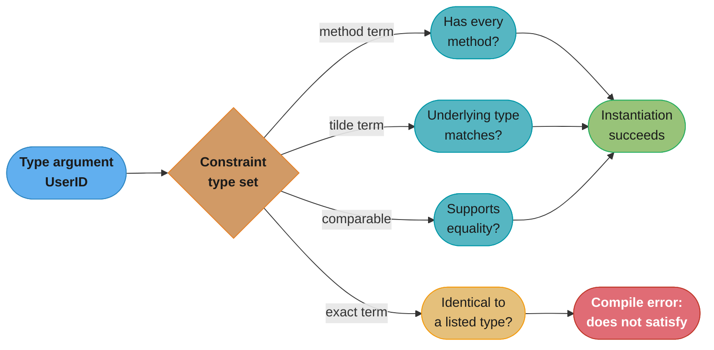
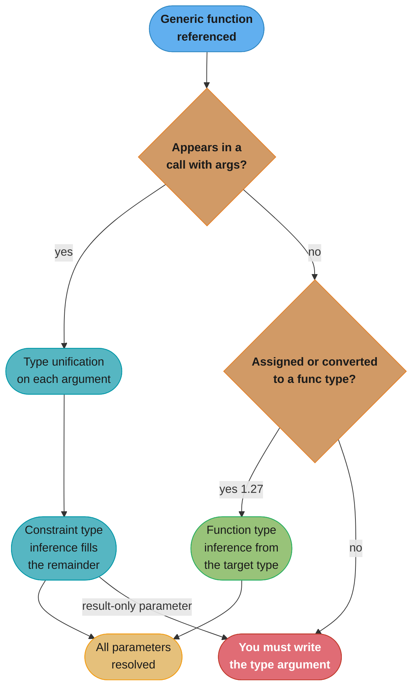
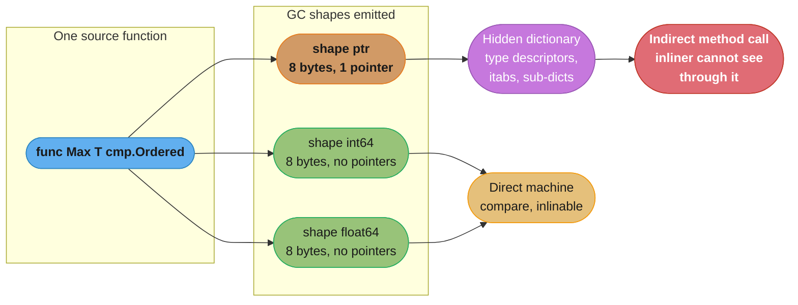

# Generics and Type Parameters

## 1. Concept Overview

Go shipped generics in `[1.18]` after a decade of deliberately not having them. The
result is narrower than Java's or C++'s on purpose: a function or a type may declare
**type parameters**, each bounded by a **constraint**, and the compiler checks every
instantiation statically. There are no wildcards, no variance annotations, no covariant
containers, and — until `[1.27]` — no type parameters on methods at all.

Three things make Go generics feel different from every other generic system a senior
engineer has used:

1. **A constraint is an interface**, and an interface now describes a *type set* rather
   than only a method set. `interface{ ~int | ~string }` is a perfectly good interface;
   it just cannot be used as a variable type, only as a constraint.
2. **Inference runs on arguments, not on results.** `slices.Contains(xs, "a")` infers
   both parameters from the two arguments. `Zero()` — a function whose only type
   parameter appears in the return type — never infers, and you must write `Zero[int]()`.
3. **The compiler neither erases nor fully monomorphizes.** It emits one copy per **GC
   shape** and passes a hidden **dictionary** for everything the shape cannot answer.
   That is why a `[T any]` call over pointer types can be *slower* than the interface
   call it replaced — a fact that decides whether generics belong in your hot path.

The payoff is the `slices`, `maps`, `cmp` and `iter` packages: `sort.Slice`'s
`func(i, j int) bool` closure and its `reflect`-driven swap are gone, replaced by
`slices.SortFunc` compiled against the real element type.

**Related reading:** [Interfaces, Methods and Embedding](../interfaces_methods_and_embedding/interfaces_methods_and_embedding.md)
for the `(type, value)` pair that generics deliberately avoid, and
[Java Generics and the Type System](../../java/generics_and_type_system/generics_and_type_system.md)
for the erasure model this one was designed against.

---

## 2. Intuition

> **One-line analogy**: A Go constraint is a *guest list*, not a *dress code*. Java's
> `<T extends Comparable<T>>` says "wear something that implements this method"; Go's
> `~int | ~string` says "these specific underlying types are on the list, and nobody
> else gets in."

**Mental model**: Write the function you would have written for `[]int`. Now ask which
lines actually depend on the element being an `int`. If the answer is "only the `<`
comparison", replace `int` with `T` and put the `<` requirement in the constraint
(`cmp.Ordered`). If the answer is "the whole body", you do not have a generic function
— you have two functions that happen to look alike.

**Why it matters**: Generics are the only Go feature where the *wrong* choice costs
performance rather than just readability. An interface parameter costs one indirect
call through an `itab`. A type parameter costs one indirect call through a dictionary
*plus* a dictionary load *plus* a lost inlining opportunity — and buys you nothing if
you were only ever calling one method. Reaching for `[T any]` because it looks modern
is how a hot loop gets 20% slower on a green build.

**Key insight**: The type set is the whole design. Once you see `interface` as "a set
of types" rather than "a set of methods", `~`, unions, `comparable` and the ban on
using a constraint as a variable type all fall out of one rule instead of being four
unrelated warts.

---

## 3. Core Principles

- **A type parameter list follows the name, in square brackets**: `func F[T any](v T) T`,
  `type Stack[T any] struct{ items []T }`. Every type parameter must have a constraint;
  `any` is the alias for `interface{}` and is the constraint that permits everything.
- **A constraint is an interface used in a constraint position.** Every ordinary
  interface (`fmt.Stringer`, `io.Reader`, `error`) is a legal constraint. The reverse is
  not true: an interface containing a union or a `~` term may be used *only* as a
  constraint, never as a variable, field, or parameter type.
- **The type set defines satisfaction.** An interface's type set is the set of all types
  that implement it. `fmt.Stringer`'s type set is infinite (every type with a
  `String() string` method); `interface{ int }`'s type set has exactly one member.
- **`~T` means "underlying type `T`".** `~string` admits `type UserID string`; a bare
  `string` term admits only the predeclared `string` itself.
- **`comparable` means `==` and `!=` are legal.** It is what makes `map[K]V` with a type
  parameter key possible.
- **Inference flows from arguments to type parameters, never backwards from the result.**
  `[1.27]` extends *function type inference* to assignment and conversion contexts, but
  a call's result type still never drives inference.
- **Method declarations may declare their own type parameters `[1.27]`.** Interface
  methods still may not, and a generic method cannot implement an interface method.
- **Instantiation is static.** `Stack[int]` and `Stack[string]` are two distinct,
  unrelated types. There is no `Stack[any]` that holds either of them.

---

## 4. Types / Architectures / Strategies

### The four kinds of constraint

| Kind | Written as | Admits | Use when |
|------|-----------|--------|----------|
| Method constraint | `interface{ String() string }` | any type with that method set | the body calls methods |
| Type-set constraint | `interface{ int \| float64 }` | exactly those two types | the body uses an operator |
| Approximation | `interface{ ~int \| ~string }` | any type whose underlying type matches | callers have named types |
| Predeclared | `any`, `comparable` | everything / everything supporting `==` | containers and map keys |

A constraint may mix a type set and a method set in one interface:

```go
// Admits any string-underlying type that also has a Validate method.
type Key interface {
    ~string
    Validate() error
}
```

### Generic function vs generic type vs generic method

```go
// Generic function — type parameters on the func.
func Map[S, D any](in []S, f func(S) D) []D {
    out := make([]D, 0, len(in))
    for _, v := range in {
        out = append(out, f(v))
    }
    return out
}

// Generic type — type parameters on the type; methods use them but (historically)
// could not add new ones.
type Set[T comparable] struct {
    m map[T]struct{}
}

func (s *Set[T]) Add(v T) { s.m[v] = struct{}{} }

// Generic method [1.27] — the method declares a type parameter of its own.
// This is exactly the shape math/rand/v2 uses for (*Rand).N.
type Registry struct{ data map[string]any }

func (r *Registry) Lookup[V any](key string) (V, bool) {
    v, ok := r.data[key]
    if !ok {
        var zero V
        return zero, false
    }
    typed, ok := v.(V)
    return typed, ok
}
```

### Generic type aliases `[1.24]`

```go
// A type alias may now carry its own type parameters.
type Pair[K comparable, V any] = struct {
    Key K
    Val V
}

type StringSet = Set[string] // full instantiation, also legal
```

### Self-referential generic types `[1.26]`

A generic type may refer to itself inside its own type parameter list, which expresses
the "curiously recurring template pattern" that Java writes as
`<T extends Comparable<T>>`:

```go
// [1.26] — Adder appears in its own type parameter list.
type Adder[A Adder[A]] interface {
    Add(A) A
}

func SumAll[A Adder[A]](vs []A) A {
    var acc A
    for _, v := range vs {
        acc = acc.Add(v)
    }
    return acc
}
```

The constraint now says "a type that can add *itself*", which is stronger than
`interface{ Add(any) any }` and needs no runtime assertion.

---

## 5. Architecture Diagrams

### How a type argument is checked against a constraint



*`UserID` is `type UserID string`. It fails the exact `string` term and passes the
`~string` term — the single most common generics compile error in a codebase that uses
named scalar types.*

### Where type inference stops



*The red box is the whole story: a type parameter that appears only in the result type
is unreachable by inference, in every Go version.*

### What the compiler actually emits: GC shapes and dictionaries



*Every pointer-shaped type argument — `*User`, `map[string]int`, `chan int`, `[]byte`'s
header pointer, any single-pointer struct — collapses into the same `ptr` stencil and
therefore pays the dictionary. Non-pointer scalars get their own stencil and pay
nothing.*

### GC-shape grouping, side by side

```
  Type argument        GC shape         Stencil     Method call on T
  -----------------    -------------    --------    --------------------------
  int                  int (8B)         own         direct, inlinable
  int64                int64 (8B)       own         direct, inlinable
  float64              float64 (8B)     own         direct, inlinable
  struct{a, b int}     16B, no ptr      own         direct, inlinable
  -----------------    -------------    --------    --------------------------
  *User            \                                indirect via dictionary
  *Order            |                               indirect via dictionary
  map[string]int    >  ptr (8B, 1 ptr)  SHARED      indirect via dictionary
  chan int          |                               indirect via dictionary
  func()           /                                indirect via dictionary

  Five distinct type arguments, ONE compiled body. The dictionary is the
  only thing that tells that body which *User it is looking at.
```

*This grouping is the reason a generic function over structs benchmarks like
hand-written code, while the same function over pointers benchmarks like an interface.*

---

## 6. How It Works — Detailed Mechanics

### The `~` token, concretely

```go
type Ordered interface {
    ~int | ~int8 | ~int16 | ~int32 | ~int64 |
        ~uint | ~uint8 | ~uint16 | ~uint32 | ~uint64 | ~uintptr |
        ~float32 | ~float64 | ~string
}

type Celsius float64
type Fahrenheit float64

func Max[T Ordered](a, b T) T {
    if a > b {
        return a
    }
    return b
}

func main() {
    _ = Max(Celsius(21.5), Celsius(19.0)) // compiles: ~float64 matches
    // Max(Celsius(21.5), Fahrenheit(70)) // does NOT compile: T cannot be
    //                                    // both Celsius and Fahrenheit
}
```

The second line is the feature, not a limitation. `T` unifies to exactly one type, so a
function over `Ordered` can never silently add a Celsius to a Fahrenheit — something a
plain `float64` signature happily does.

This is the same constraint set the standard library exposes as `cmp.Ordered` `[1.21]`.
Use `cmp.Ordered`; the `golang.org/x/exp/constraints` package still carries `Integer`,
`Float`, `Signed` and `Unsigned` for the cases the standard library does not cover.

### `comparable`, and the trap that moved from compile time to run time

```go
func Index[T comparable](s []T, v T) int {
    for i := range s {
        if s[i] == v {
            return i
        }
    }
    return -1
}

func main() {
    Index([]string{"a", "b"}, "b") // 1

    // any SATISFIES comparable (since Go 1.20) even though it is not
    // strictly comparable. This compiles:
    vals := []any{1, "x", []int{1, 2}}
    Index(vals, 1) // returns 0, fine

    // ...and this compiles too, then PANICS at runtime:
    // "comparing uncomparable type []int"
    Index(vals, []int{1, 2})
}
```

The distinction the spec draws is *implements* versus *satisfies*. `any` does not
**implement** `comparable` — it is not strictly comparable. It does **satisfy** it,
which is enough to instantiate. The compiler's job was to allow `map[any]bool`-shaped
generic code; the price is that the failure surfaces as a runtime panic in `==` instead
of a compile error. `[]int` still fails outright, because slices support no comparison
at all.

### Type inference, step by step

Inference runs in two stages. **Function argument type inference** unifies each ordinary
argument's type with the corresponding parameter type. **Constraint type inference**
then propagates through the constraints themselves.

```go
type Slice[E any] interface{ ~[]E }

func Scale[S Slice[E], E cmp.Ordered](s S, factor E) S {
    out := make(S, len(s))
    for i, v := range s {
        out[i] = v * factor
    }
    return out
}

type Points []float64

func main() {
    p := Points{1, 2, 3}
    // Argument inference gives S = Points.
    // Constraint inference then reads ~[]E against Points' underlying
    // []float64 and gives E = float64. Neither argument mentions float64
    // by itself.
    _ = Scale(p, 2.0)
}
```

Note the return type: `S`, not `[]E`. Written as `[]E` the function would return a plain
`[]float64` and callers would lose the `Points` type — the classic beginner bug in
slice-generic code.

### Where inference gives up

```go
func Zero[T any]() T {
    var z T
    return z
}

func main() {
    // _ = Zero()               // ERROR: cannot infer T
    // var x int = Zero()       // ERROR: still cannot infer T
    _ = Zero[int]()             // fine
}
```

Go has never inferred a type argument from the assignment target of a *call*, and
`[1.27]` did not change that. What `[1.27]` did change is **function type inference**
when a generic function is used as a *value*:

```go
func Map[S, D any](in []S, f func(S) D) []D { /* ... */ }

// [1.27]: legal without writing Map[int, string] — the target function
// type supplies both type arguments.
var toStrings func([]int, func(int) string) []string = Map

// The same inference now works for a conversion, and for a generic
// function passed where a concrete func type is expected.
type Mapper func([]int, func(int) string) []string
var m = Mapper(Map)
```

### Generic methods `[1.27]` and the interface restriction

```go
// math/rand/v2 uses exactly this shape: the method carries its own
// type parameter, independent of the receiver.
//    func (r *Rand) N[Int intType](n Int) Int

// This is still illegal, in every version:
// type Container interface {
//     Get[T any](key string) T   // interface methods cannot declare
// }                              // type parameters

// And a generic method cannot satisfy a non-generic interface method:
// type Getter interface{ Get(string) any }
// func (r *Registry) Get[T any](k string) T { ... }  // does not implement Getter
```

The restriction exists because interface dispatch is dynamic. Satisfying
`Get[T any]` through an interface would require the compiler to have already emitted a
stencil for every `T` any caller might ever pick, across every package that might hold
that interface value — the compiler cannot know that set, and Go has no runtime code
generation. C# solves this by reifying generics in the CLR and JIT-compiling per
instantiation; Go does not have that machinery and is not adding it.

### The standard library payoff

```go
import (
    "cmp"
    "maps"
    "slices"
)

type User struct {
    Name string
    Age  int
}

func demo(users []User, byID map[int]User) {
    // Sort by a field, no closure over indices, no reflect-driven swap.
    slices.SortFunc(users, func(a, b User) int {
        return cmp.Compare(a.Age, b.Age)
    })

    // Binary search on a sorted slice, with the comparison compiled in.
    i, found := slices.BinarySearchFunc(users, User{Age: 30},
        func(a, t User) int { return cmp.Compare(a.Age, t.Age) })
    _, _ = i, found

    _ = slices.Contains([]string{"a", "b"}, "b") // true
    _ = slices.Clone(users)                      // shallow copy, right type
    _ = slices.Index([]int{4, 5, 6}, 5)          // 1
    _ = slices.Max([]int{4, 5, 6})               // 6

    // maps.Keys returns iter.Seq[int] [1.23], not a slice.
    ids := slices.Sorted(maps.Keys(byID)) // []int, ascending
    _ = ids
    for _, u := range maps.Values(byID) {
        _ = u
    }
}
```

`maps.Keys` returning an iterator rather than a slice is deliberate: the old
`golang.org/x/exp/maps.Keys` allocated a slice on every call even when the caller only
wanted to loop once. `iter.Seq[V]` is nothing more than
`func(yield func(V) bool)` — a generic function type — and range-over-func `[1.23]` is
the syntax that makes it iterable. Generics are what made a single `iter.Seq` usable by
`slices.Collect`, `slices.Sorted`, `maps.Keys` and every user-written iterator at once.

---

## 7. Real-World Examples

- **`slices`, `maps`, `cmp` in the standard library `[1.21]`** — the reference
  implementation of the whole feature. `slices.SortFunc` replaced `sort.Slice`, whose
  `reflect.Swapper`-based swap cost a function call per swap; the generic version emits
  the element move inline.
- **`math/rand/v2`'s `Rand.N` `[1.27]`** — the first generic *method* in the standard
  library. `r.N(10)` returns the type you passed, so `r.N(time.Second)` yields a
  `time.Duration` rather than an `int64` you have to convert.
- **`errors.AsType[T]` `[1.26]`** — the generic form of `errors.As`, replacing the
  two-step `var target *MyErr; errors.As(err, &target)` dance with
  `target, ok := errors.AsType[*MyErr](err)`.
- **`golang.org/x/sync/errgroup`** — not generic itself, but the ecosystem around it is:
  bounded fan-out helpers over `[]T` returning `[]R` are the single most common
  hand-written generic in production Go services.
- **Kubernetes `client-go`** — `cache.TypedStore[T]` and the typed workqueues replaced a
  decade of `interface{}` plus a type assertion in every consumer. The migration removed
  an entire class of "wrong object type in the workqueue" panics.
- **`ent` and `sqlc`** — both generate concrete types rather than using generics for the
  query layer, and both use generics for the *combinators* (predicates, option
  builders). That split is the industry's practical answer to where generics pay.

---

## 8. Tradeoffs

### Generic function vs interface parameter vs code duplication

| | `func F[T C](v T)` | `func F(v C)` (interface) | Two concrete functions |
|---|---|---|---|
| Type safety at call site | full, `T` is the real type | erased to the interface | full |
| Return type | can return `T` | returns the interface | concrete |
| Method call cost | indirect via dictionary (pointer shapes) | indirect via itab | direct, inlinable |
| Operators (`<`, `+`) | yes, with a type-set constraint | no | yes |
| Binary size | one copy per GC shape | one copy | one copy per function |
| Compile time | slower — instantiation and dictionary construction | fastest | fast |
| Readability at 3 call sites | worse | best | best |

### Erasure vs gcshape stenciling vs monomorphization

| | Java (erasure) | Go (gcshape + dictionary) | C++ (templates) |
|---|---|---|---|
| Copies emitted | exactly 1 | 1 per GC shape (all pointers share one) | 1 per concrete type |
| Primitives | boxed — `List<Integer>` allocates a 16-byte `Integer` per element | `int` gets its own stencil, stays in a register | native, zero cost |
| Runtime type info | none; `List<String>` is `List` — needs a `TypeToken` to recover | full, in the dictionary — `var z T` knows what to zero | full, at compile time |
| Indirect calls | virtual dispatch, but the JIT devirtualizes after profiling | dictionary indirection the inliner cannot see through | none |
| Binary/code bloat | none | modest — bounded by the number of shapes | worst; the classic template bloat |
| Compile time | fast | moderate | worst; the classic slow C++ build |
| Cross-type mistakes | heap pollution via unchecked casts | impossible — no erasure to exploit | impossible |

The honest summary: Java pays at **runtime** (boxing, dispatch) and recovers some of it
with a profiling JIT. C++ pays at **build time** (bloat, compile seconds) and pays
nothing at runtime. Go split the difference and, for pointer-shaped type arguments,
landed closer to Java's cost than to C++'s — with none of Java's JIT to claw it back,
since Go compiles ahead of time. Profile-guided optimization `[1.21]` can devirtualize
some dictionary calls, but it is not a general escape.

---

## 9. When to Use / When NOT to Use

**Use generics when:**

- You are writing a function over `[]T`, `map[K]V` or `chan T` whose body does not care
  what `T` is — `Filter`, `Keys`, `Chunk`, `GroupBy`. This is the case the feature was
  built for.
- You are implementing a general-purpose data structure: a set, an ordered map, an LRU
  cache, a typed worker pool. Without generics these force `any` plus a type assertion
  on every read.
- The methods are identical for every type and differ only in the types they mention —
  `Clone() T`, `Add(T) T`.
- You need to return the caller's own type. `slices.Clone(Points{...})` returning
  `Points` rather than `[]float64` is impossible with interfaces.

**Do NOT use generics when:**

- **There is exactly one concrete type today.** Write it for that type. The Go proverb
  applies: a little copying is better than a little abstraction. Add the type parameter
  at the *third* call site, not the first.
- **An interface says the same thing more clearly.** If the body only calls
  `v.Write(p)`, take an `io.Writer`. `func F[T io.Writer](w T)` is strictly worse: same
  indirection, more syntax, and now the caller cannot pass a heterogeneous slice.
- **The implementation actually differs per type.** A `switch any(v).(type)` inside a
  generic body is a confession that you wanted two functions.
- **The hot path is measured.** A dictionary-dispatched method call inside a
  million-iteration loop is a real cost. Benchmark the generic version against the
  concrete one with `b.Loop()` `[1.24]` before you commit it.
- **You are tempted to build a generic "utils" package.** Generic helper packages are
  where Go codebases go to become unreadable; the type parameter lists grow four
  parameters deep and every error message becomes a paragraph.

---

## 10. Common Pitfalls

### Pitfall 1 — the `~` omission that blocks an entire migration

A payments service defined `type AccountID string` and `type MerchantID string` across
47 files, then added a generic `Dedup` helper constrained by `interface{ string | int }`.
Every call site failed to compile with "AccountID does not satisfy the constraint". The
team's first fix was to convert at every call — `Dedup([]string(ids))` — which erased
the type safety the named types existed to provide and shipped one bug where a
`MerchantID` slice was passed to an account lookup.

```go
// BROKEN: exact type terms admit only the predeclared types.
type Key interface {
    string | int
}

// FIX: ~ admits any type whose underlying type matches.
type Key interface {
    ~string | ~int
}
```

**Rule:** in a library, always write `~`. An exact term is only correct when you
deliberately want to exclude named types, which is rare enough that it deserves a
comment.

### Pitfall 2 — a generic hot path that got slower than the interface it replaced

A metrics aggregator replaced `func Reduce(vals []Metric, f Reducer)` (an interface with
one method) with `func Reduce[T Reducer](vals []Metric, f T)`, expecting inlining. All
production `Reducer` implementations were pointer types, so all of them landed in the
single `ptr` GC shape. The method call inside the loop went from an itab call to a
dictionary load plus an indirect call, the inliner stopped seeing through it, and p99
aggregation latency rose from 8 ms to 11 ms — a 37% regression on a change that added
no logic at all. Reverting the signature restored 8 ms.

**Rule:** if the only thing the body does with `T` is call one method, an interface is
both simpler and faster. Generics pay when they eliminate boxing or an assertion, not
when they merely rename an interface.

### Pitfall 3 — `comparable` compiling and then panicking in production

An event router used `map[any]handler` and a generic `Index[T comparable]` helper. It
compiled cleanly. Six weeks later a caller passed a `[]string` key derived from request
headers, and the `==` panicked with "comparing uncomparable type []string" inside a
handler goroutine with no `recover`, taking the process down. The compile-time
`comparable` check had accepted `any` because `any` *satisfies* `comparable`.

**Rule:** constrain by the narrowest thing that works. If keys are always strings, write
`~string`, not `comparable`, and certainly not `any`.

### Pitfall 4 — returning `[]E` and destroying the caller's named type

```go
// BROKEN: caller passes Points, gets []float64 back and has to convert.
func Filter[E any](s []E, keep func(E) bool) []E { /* ... */ }

// FIX: parameterize on the slice type so the named type survives.
type Slice[E any] interface{ ~[]E }

func Filter[S Slice[E], E any](s S, keep func(E) bool) S {
    out := make(S, 0, len(s))
    for _, v := range s {
        if keep(v) {
            out = append(out, v)
        }
    }
    return out
}
```

A logging library shipped the broken form; every one of its 60-odd internal call sites
grew a `Points(...)` conversion, and two of them converted to the wrong named type
because both were `[]float64` underneath and the compiler had nothing left to check.

### Pitfall 5 — instantiating in a loop and blaming the runtime

Type instantiation happens at **compile time**, once per distinct type argument. Teams
who see slow builds after adding generics sometimes assume there is a runtime cost to
`Stack[int]{}` inside a loop. There is none — it is an ordinary composite literal. The
build slowdown is real but lives entirely in the compiler: a package with 40 distinct
instantiations of a deeply nested generic type can add several seconds to a cold build.
Measure with `go build -gcflags=-m=0 -x` timing, not with a benchmark.

### Pitfall 6 — no method-level type parameters before `[1.27]`, and still none on interfaces

Codebases that predate `[1.27]` routinely hoisted a type parameter onto the *type*
because the method could not carry one — `type Cache[T any]` where only `Get` needed
`T`, forcing one cache instance per value type and defeating the point of a shared
cache. `[1.27]` fixes this for concrete methods. It does **not** fix it for interfaces:
`interface{ Get[T any](string) T }` is still illegal, so a plugin boundary still needs
`any` plus an assertion.

---

## 11. Technologies & Tools

| Tool | What it does for generics |
|------|---------------------------|
| `go vet` | Reports impossible type assertions and misuse of generic APIs surfaced by the type checker |
| `gopls` | Shows inferred type arguments inline; "cannot infer T" diagnostics with the failing unification step |
| `staticcheck` | Flags a type parameter used exactly once (the "should be an interface" smell) and unused type parameters |
| `golangci-lint` | Aggregates the above; `gocritic` carries generics-specific checks |
| `go build -gcflags=-m` | Escape analysis output; shows when a dictionary-dispatched call blocks inlining |
| `go tool compile -S` | Assembly per stencil — the ground truth for how many copies were emitted |
| `benchstat` | Compares the generic and concrete versions with p-values, so the "it's faster now" claim is testable |
| `cmp` `[1.21]` | Stdlib `Ordered` constraint plus `Compare`, `Less`, `Or` |
| `slices` / `maps` `[1.21]` | The generic collection algorithms; `maps.Keys`/`Values` return `iter.Seq` `[1.23]` |
| `iter` `[1.23]` | `Seq[V]` and `Seq2[K, V]`, the generic function types behind range-over-func |
| `golang.org/x/exp/constraints` | `Integer`, `Float`, `Signed`, `Unsigned` — the constraints `cmp` does not carry |

---

## 12. Interview Questions with Answers

**Q: Why does a constraint need `~string` instead of plain `string`?**
**Short:** A bare type term matches only that exact predeclared type, while `~T` matches every type whose underlying type is `T`.

A bare `string` term in a type set matches only the predeclared `string` type. A named
type such as `type UserID string` is a *different* type with `string` as its underlying
type, so it fails the constraint with "UserID does not satisfy the constraint". The `~`
approximation token widens the term to "any type whose underlying type is `string`",
which admits `UserID`, `AccountID` and every other string-based named type. In library
code always write `~`; a bare term is correct only when you deliberately want to exclude
named types, which is rare enough to deserve a comment explaining why.

**Q: Does `any` satisfy the `comparable` constraint, and what does that cost you?**
**Short:** Since Go 1.20 an ordinary interface satisfies `comparable` even though it is not strictly comparable, moving the failure from compile time to a runtime panic.

Yes — since Go 1.20, ordinary interface types *satisfy* `comparable` even though they do
not *implement* it. The spec draws that distinction precisely so generic code can be
instantiated with `any` and so `map[any]V` keeps working. The price is that the check
moved: `Index[any](vals, []int{1,2})` compiles and then panics at runtime with
"comparing uncomparable type []int" when `==` executes. `[]int` itself still fails at
compile time, because slices support no comparison at all. Practical guidance: constrain
by the narrowest thing that works — `~string` over `comparable`, and `comparable` over
`any`.

**Q: Why can Go not infer the type argument for a function whose type parameter appears only in the return type?**
**Short:** Unification runs over the arguments supplied at the call, so a parameter mentioned nowhere in the argument list has nothing to unify against.

Inference in Go unifies the types of the ordinary arguments at the call site against the
declared parameter types, then propagates through constraint type inference. A type
parameter that never appears in the parameter list is untouched by both stages, so
`func Zero[T any]() T` can never be inferred — you must write `Zero[int]()`. Assignment
context does not help either: `var x int = Zero()` is still an error, because Go has
never driven a call's type arguments from the type of the variable it is assigned to.
Go 1.27 generalized *function type inference*, which is a different thing: assigning the
generic function itself to a `func([]int, func(int) string) []string` variable now
infers from that target type.

**Q: Can a generic function be slower than the interface-based version it replaced?**
**Short:** Yes — every pointer-shaped type argument shares one stencil and reaches its methods through a dictionary the inliner cannot see through.

Yes, and it is a common regression. The compiler emits one body per GC shape, and every
pointer type — `*User`, `map[k]v`, `chan T`, `func()` — collapses into a single `ptr`
shape. Method calls on `T` inside that body go through the hidden dictionary: a load,
then an indirect call the inliner cannot penetrate. An interface call goes through an
itab, which is one indirection and no dictionary load. So replacing a one-method
interface parameter with `[T Reducer]` typically costs a little rather than saving
anything. Generics win when they remove boxing or a type assertion — over `int`,
`float64` or a plain struct, each of which gets its own stencil and compiles to direct
machine instructions.

**Q: When should you deliberately not use generics in Go?**
**Short:** Skip them when one concrete type exists today, when an interface expresses the requirement more clearly, or when the body branches on the type anyway.

Skip them in four situations. First, when exactly one concrete type exists — write it
concretely and add the parameter at the third call site, not the first. Second, when the
body only calls methods on the value; an `io.Writer` parameter is clearer, no slower,
and lets the caller pass a heterogeneous slice. Third, when the implementation genuinely
differs per type — a `switch any(v).(type)` inside a generic body means you wanted two
functions. Fourth, in a measured hot path where the dictionary indirection shows up in a
profile. The cost is never zero: longer signatures, worse error messages, slower
compiles, and a real dispatch penalty on pointer shapes.

**Q: What is the difference between a method constraint and a type-set constraint?**
**Short:** A method constraint lists behaviour the type argument must have; a type-set constraint enumerates which underlying types are allowed so the body may use operators.

A method constraint is an ordinary interface such as `fmt.Stringer` — it says the type
argument must have those methods, and the body may call them. A type-set constraint uses
union terms such as `~int | ~float64` — it enumerates which types are admitted, and the
body may use the operators every member supports. You need the second kind whenever the
body writes `a < b` or `a + b`, because no method expresses a built-in operator. The two
compose in one interface: `interface{ ~string; Validate() error }` requires both a
string underlying type and a method. Only the method-only form may also be used as an
ordinary variable type; anything with a union or `~` is constraint-only.

**Q: Why is `cmp.Ordered` preferred over `constraints.Ordered`?**
**Short:** `cmp` is in the standard library and covered by the compatibility promise, whereas `golang.org/x/exp` is explicitly experimental and may change.

`cmp.Ordered` `[1.21]` lives in the standard library and is therefore covered by the Go 1
compatibility promise, so a dependency on it can never break your build. The `x/exp`
module is explicitly experimental — its packages may change signature or disappear, and
pulling it in adds a dependency to every consumer of your library for one type
declaration. `cmp` also carries `Compare`, `Less` and `Or`, which is what
`slices.SortFunc` wants as a comparison function. Keep `golang.org/x/exp/constraints`
only for `Integer`, `Float`, `Signed` and `Unsigned`, which the standard library does
not yet provide.

**Q: Can an interface method declare type parameters?**
**Short:** No — interface methods may never declare type parameters, and a method that does cannot implement an ordinary interface method.

No, and this restriction survived the Go 1.27 change that allowed type parameters on
concrete method declarations. `interface{ Get[T any](string) T }` is illegal, and a
generic method `func (r *Registry) Get[T any](string) T` does not implement a
non-generic `Get(string) any`. The reason is dispatch: an interface value is resolved at
run time, so the compiler would need a stencil for every `T` any caller anywhere might
pick, across packages it has never seen. Go compiles ahead of time with no runtime code
generation, so that set is unknowable. C# avoids the problem by reifying generics in the
CLR and JIT-compiling per instantiation; Go has no equivalent machinery.

**Q: What did generic methods in Go 1.27 change, and what problem did they solve?**
**Short:** Method declarations may now carry their own type parameters, so a type no longer has to be parameterized for the sake of one method.

Go 1.27 allows a method declaration to declare its own type parameters, independent of
the receiver's. The standard library's example is `math/rand/v2`, where
`func (r *Rand) N[Int intType](n Int) Int` returns the same type you passed, so
`r.N(time.Second)` yields a `time.Duration` instead of an `int64` you must convert.
Before this, the only way to give a method a type parameter was to hoist it onto the
type, which forced one instance per value type — a `Cache[T]` where only `Get` needed
`T` could not be shared across value types at all. The restriction that remains is that
interface methods still cannot declare type parameters.

**Q: How does Go's gcshape stenciling differ from Java's erasure and C++ templates?**
**Short:** Java emits one erased copy and boxes primitives, C++ emits one copy per concrete type, and Go emits one copy per memory layout plus a runtime dictionary.

Java erases type parameters to their bound and emits exactly one bytecode body, so
`List<Integer>` boxes every `int` into a 16-byte heap object and no generic type
information survives to run time. C++ fully monomorphizes: one machine-code body per
concrete type, zero indirection at run time, at the cost of the famous template bloat
and slow builds. Go sits between them — one body per GC shape, where every pointer-sized
pointer-containing type shares a single shape, plus a hidden dictionary argument
carrying the type descriptors and method tables that shape cannot supply. So `int` is
never boxed in Go, but a method call on a pointer-typed `T` is an indirect call Go's
ahead-of-time compiler cannot devirtualize the way a profiling JIT can.

**Q: What is inside the hidden dictionary a generic function receives?**
**Short:** It holds the runtime type descriptors, method tables and sub-dictionaries the shared stencil needs to act on the actual type argument.

The dictionary is a static, read-only data structure the compiler builds per
instantiation and passes as a hidden first argument. It carries the `runtime._type`
descriptors for each type argument (so `var z T` can zero the right number of bytes and
the GC can scan correctly), the itabs needed to call methods on `T`, and
sub-dictionaries for any generic function this one calls with derived type arguments. It
exists because one stencil serves many concrete types: the code knows the *layout* from
its shape but not the *identity*. That is also the cost — the dictionary load plus the
indirect call is exactly what the inliner cannot follow.

**Q: Why can you not freely use operators or conversions on a value of type parameter type?**
**Short:** An operation is legal on a type parameter only if it is legal for every single type in the constraint's type set.

Because the compiler must prove the operation is valid for *every* type the constraint
admits, not just the one at the current call site. With `[T any]` the type set is
everything, so almost nothing is permitted: no `<`, no `+`, no indexing, no `range`. Add
`cmp.Ordered` and comparison plus `+` become legal because every member supports them.
The same rule governs `range` and indexing: they work only when every type in the set
has the same element type, which is why slice-generic code is written against
`interface{ ~[]E }` rather than `any`. The practical consequence is that widening a
constraint later can silently break the body, so constrain narrowly from the start.

**Q: What is a generic type alias and when is it useful?**
**Short:** Go 1.24 lets a type alias declare its own type parameters, so an alias can forward parameters instead of only naming a full instantiation.

Since `[1.24]` a type alias may declare type parameters:
`type Pair[K comparable, V any] = struct{ Key K; Val V }`. Before that, an alias could
only name a fully instantiated type (`type StringSet = Set[string]`), so a package that
wanted to re-export a generic type under a new name had to declare a *defined* type
instead — which creates a distinct type that does not interconvert with the original and
loses the original's method set. Generic aliases are the mechanism for gradual package
refactors: move a generic type to a new package and leave a parameterized alias behind,
and every existing call site keeps compiling unchanged.

**Q: What are self-referential generic types and what pattern do they enable?**
**Short:** Go 1.26 lets a generic type appear inside its own type parameter list, which expresses constraints such as "a type that can add itself".

`[1.26]` allows a generic type to refer to itself in its own type parameter list:
`type Adder[A Adder[A]] interface{ Add(A) A }`. This is the curiously-recurring-template
pattern that Java spells `<T extends Comparable<T>>`. It lets a constraint say "a type
whose `Add` takes and returns *its own type*", which is strictly stronger than
`interface{ Add(any) any }` and needs no runtime type assertion inside the generic body.
Use it for algebraic interfaces — adders, mergers, cloners — where the operation must
stay closed over the concrete type. It is not needed for the ordinary case where the
type parameter is just an element type.

**Q: What does `maps.Keys` return, and how do you get a sorted slice of keys?**
**Short:** It returns an `iter.Seq` iterator rather than a slice, so you pass it through `slices.Sorted` or `slices.Collect` to materialize one.

`maps.Keys` returns `iter.Seq[K]` `[1.23]`, an iterator, not a slice. The predecessor in
`golang.org/x/exp/maps` returned a slice and therefore allocated on every call even when
the caller only wanted to loop once. To get a sorted slice write
`slices.Sorted(maps.Keys(m))`; for an unsorted one, `slices.Collect(maps.Keys(m))`; to
just iterate, `for k := range maps.Keys(m)` — or simply range the map directly, which is
cheaper still. `maps.Values` behaves the same way, and `maps.All` yields `iter.Seq2` for
key and value together.

**Q: Why prefer `slices.SortFunc` over `sort.Slice`?**
**Short:** `slices.SortFunc` compiles against the real element type and takes a three-way comparison, so it avoids reflection-driven swaps and index-based closures.

`sort.Slice` takes a `func(i, j int) bool` closure over indices and performs its element
swaps through `reflect.Swapper`, which costs a function call per swap and cannot inline.
`slices.SortFunc` is generic over the element type, so the comparison receives the
elements themselves and the swap is an ordinary typed move the compiler emits inline. It
also takes a three-way `func(a, b E) int` rather than a boolean less, which composes
directly with `cmp.Compare` and removes the classic "is this strict or non-strict?"
ambiguity that produces unstable sorts. Use `slices.SortStableFunc` when equal elements
must keep their input order.

**Q: What is `iter.Seq` and how does it relate to generics?**
**Short:** `iter.Seq[V]` is the generic function type `func(yield func(V) bool)` that range-over-func iterates, giving every container one shared iteration protocol.

`iter.Seq[V]` is a type alias for `func(yield func(V) bool)`, and `iter.Seq2[K, V]` is
its two-value form. Range-over-func `[1.23]` lets you write `for v := range seq` against
either. Generics are what make this one protocol rather than dozens: `slices.Collect`,
`slices.Sorted`, `maps.Keys`, `strings.SplitSeq` and any user-written iterator all
produce the same parameterized type, so the consumers compose without adapters.
Returning `false` from `yield` stops the iteration, which is how `break` and an early
`return` propagate into the producer — a producer that ignores the boolean is the
standard bug in hand-written iterators.

**Q: What changed about function type inference in Go 1.27?**
**Short:** Inference from a target function type now works everywhere a generic function is assigned to a variable or converted, not only when it is passed as an argument.

Go 1.27 generalized function type inference to every context where a generic function is
assigned to a variable of function type or converted to a matching function type.
Previously that inference worked only when the generic function was passed as an
argument to another function; assigning it to a variable required writing the type
arguments explicitly. So `var f func([]int, func(int) string) []string = Map` now
compiles where it once needed `Map[int, string]`, and the same holds for
`Mapper(Map)`. It does not change inference for *calls* — a type parameter appearing
only in a call's result type is still uninferable.

**Q: Can a union constraint contain an interface that has methods?**
**Short:** No — a union with more than one term may not include an interface with methods, nor `comparable`, nor any interface embedding one.

No. A union term may be a non-interface type, an approximation such as `~int`, or an
interface with an empty method set, but a union of two or more terms cannot include an
interface that has methods, cannot include `comparable`, and cannot include an interface
that embeds either. The reason is implementability: the compiler would have to decide
whether a type belongs to a set defined partly by structure and partly by behaviour,
which makes the type set undecidable in general. What you can do instead is combine the
two as separate elements in the same interface — `interface{ ~string; Validate() error }`
intersects a type set with a method set, which is well defined.

**Q: What does instantiating a generic type cost at run time?**
**Short:** Nothing — instantiation happens entirely at compile time, so a composite literal of a generic type is as cheap as any other struct literal.

Nothing at run time. `Stack[int]{}` inside a loop is an ordinary composite literal;
`Stack[int]` and `Stack[string]` were resolved to distinct concrete types during
compilation. The cost is entirely in the compiler: each distinct type argument produces
a stencil for the shape if one does not exist and a dictionary for the instantiation, so
a package with 40 distinct instantiations of a deeply nested generic type can add
several seconds to a cold build. Measure that with build timing, never with a runtime
benchmark, and remember that `Stack[int]` and `Stack[string]` are unrelated types with
no common supertype — there is no `Stack[any]` that holds both.

---

## 13. Best Practices

- **Write `~` in every library constraint.** An exact type term silently excludes named
  types and is the most common instantiation failure in real codebases.
- **Constrain as narrowly as the body requires.** `~string` beats `comparable` beats
  `any`, and each step narrower converts a possible runtime panic into a compile error.
- **Use `cmp.Ordered`, not `constraints.Ordered`.** Standard library, compatibility
  promise, no extra module dependency.
- **Parameterize on the slice type, not the element type, when you return a slice** —
  `[S ~[]E, E any](s S) S` — so a caller's named type survives the round trip.
- **Add the type parameter at the third call site.** Two near-duplicate functions are
  cheaper to read and faster to run than one premature abstraction.
- **Prefer an interface when the body only calls methods.** It is shorter, no slower,
  and lets callers hold a heterogeneous slice.
- **Benchmark before you generify a hot path.** Compare with `benchstat` over `b.Loop()`
  `[1.24]` runs; a pointer-shaped type argument routes method calls through a dictionary.
- **Never name a type parameter `T` when a domain word fits.** `[E any]` for elements,
  `[K comparable, V any]` for maps, `[S ~[]E]` for slices — the standard library's own
  vocabulary.
- **Keep type parameter lists to two or three.** Four is a signal that the abstraction is
  wrong; the error messages alone will cost your team more than the duplication would.
- **Do not build a generic `utils` package.** Put each generic helper next to the code
  that motivated it, and let a second real caller pull it up.

---

## 14. Case Study

### A typed in-memory cache for a request-scoped service

A payments API keeps three hot lookups in process: merchants keyed by `MerchantID`,
FX rates keyed by currency pair, and rate-limit buckets keyed by API key. The first
implementation used one `map[string]any` and a type assertion at every read.

**The broken version, and what it cost.** Two of the three call sites asserted to the
wrong type after a refactor renamed a struct. The assertions were the comma-ok form, so
nothing panicked — the code silently took the cache-miss branch on every read, the hit
rate on merchant lookups fell from 94% to 0%, and the downstream merchant service saw
its request rate rise from 400 rps to 6,800 rps for eleven hours before an on-call
engineer noticed the database CPU.

```go
// BROKEN: the key type is stringly-typed and the value type is unchecked.
type Cache struct {
    mu sync.RWMutex
    m  map[string]any
}

func (c *Cache) Get(key string) (any, bool) {
    c.mu.RLock()
    defer c.mu.RUnlock()
    v, ok := c.m[key]
    return v, ok
}

// Call site — the assertion is the whole safety net, and it is silent.
v, ok := cache.Get(string(id))
m, ok2 := v.(*Merchant) // renamed to *MerchantRecord; ok2 is now always false
if !ok || !ok2 {
    m = fetchFromService(id) // taken on 100% of reads, nobody noticed
}
```

```go
// FIX: parameterize on both key and value. The wrong type is now a
// compile error, and the named key type cannot be crossed with another.
type Cache[K comparable, V any] struct {
    mu  sync.RWMutex
    m   map[K]entry[V]
    ttl time.Duration
}

type entry[V any] struct {
    val     V
    expires time.Time
}

func New[K comparable, V any](ttl time.Duration) *Cache[K, V] {
    return &Cache[K, V]{m: make(map[K]entry[V], 1024), ttl: ttl}
}

func (c *Cache[K, V]) Get(key K) (V, bool) {
    c.mu.RLock()
    e, ok := c.m[key]
    c.mu.RUnlock()
    if !ok || time.Now().After(e.expires) {
        var zero V
        return zero, false
    }
    return e.val, true
}

func (c *Cache[K, V]) Put(key K, val V) {
    c.mu.Lock()
    c.m[key] = entry[V]{val: val, expires: time.Now().Add(c.ttl)}
    c.mu.Unlock()
}

// Three instantiations, three unrelated types. Passing a CurrencyPair to
// the merchant cache does not compile.
var (
    merchants = New[MerchantID, *MerchantRecord](5 * time.Minute)
    rates     = New[CurrencyPair, decimal.Decimal](30 * time.Second)
    buckets   = New[APIKey, *Bucket](time.Minute)
)
```

**Why the key constraint is `comparable` and not `~string`.** `CurrencyPair` is a
two-field struct, so a `~string` constraint would exclude it. `comparable` is the right
width here — but note the residual risk from the `comparable` discussion above: if
someone later instantiates `New[any, X]`, the map operations can panic on an
uncomparable dynamic type. The team added a single unit test asserting that every
instantiation in the package uses a concrete key type, which costs three lines and
closes the hole.

**What generics did not fix.** Eviction. The map grows without bound because nothing
deletes expired entries; `Get` only hides them. The production version added a sweeper
goroutine ticking every 30 seconds and a `len(c.m) > 100_000` hard cap, neither of which
generics have any opinion about. This is the correct division of labour: generics remove
the type errors, and nothing else.

**Measured result.** The typed cache eliminated the assertion class of bug entirely. The
performance change was neutral to slightly positive — `MerchantID` is a string, which
gets its own GC shape rather than the shared pointer shape, so `Get` compiled to a
direct map access with no dictionary involvement. Had the keys been pointers, the same
change would have been performance-neutral at best; the team benchmarked both before
committing, which is the habit that makes generics safe to adopt in a hot path.

**Cross-references:** the erasure-based alternative and its heap-pollution failure mode
are in [Java Generics and the Type System](../../java/generics_and_type_system/generics_and_type_system.md);
the interface-based alternative and the typed-nil trap are in
[Interfaces, Methods and Embedding](../interfaces_methods_and_embedding/interfaces_methods_and_embedding.md);
the API-design question of whether to expose a generic type at all is in
[Idiomatic API and Package Design](../idiomatic_api_and_package_design/idiomatic_api_and_package_design.md).
