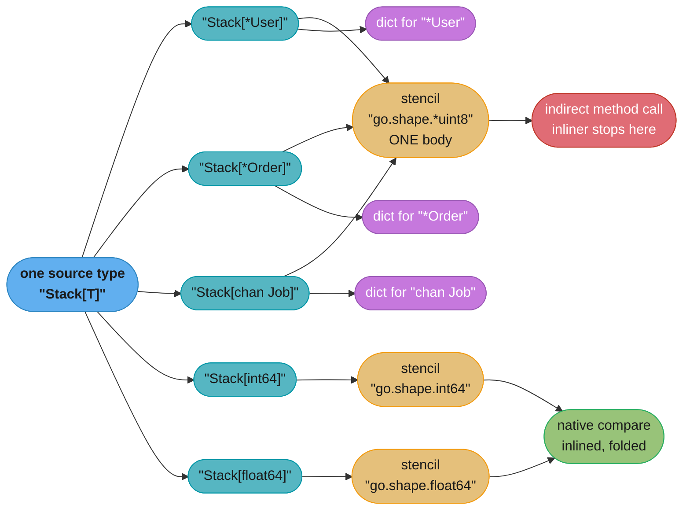
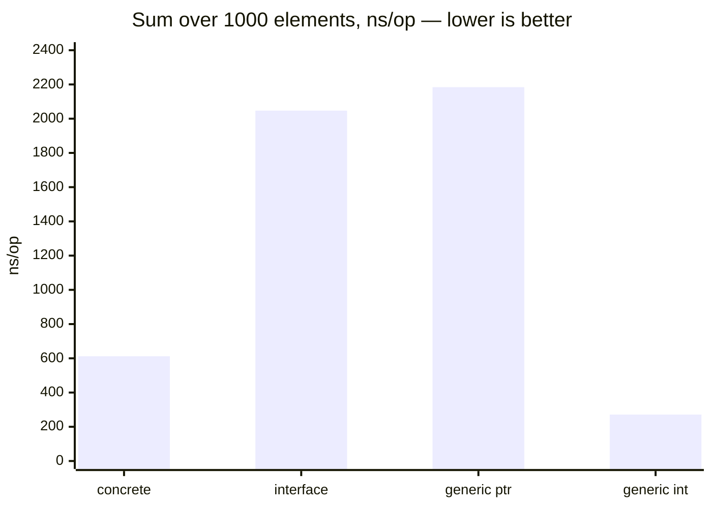

# Generics Implementation and GC Shapes

## 1. Concept Overview

Every generic language answers one question: **when the compiler sees `Stack[T]`, what
machine code does it emit?** There are only three real answers, and each one moves the
cost to a different place.

**Full monomorphization** — C++ templates, Rust — emits one specialized body per
concrete type argument. The generated code is indistinguishable from hand-written code:
every method call is direct, every operation is inlinable, nothing is looked up at run
time. You pay in binary size and in compile seconds, and you pay again in build
architecture, because a template cannot be compiled until every instantiation is known.

**Erasure with boxing** — Java — emits exactly one body. Each type parameter is replaced
by its bound (`Object` when unbounded), so `List<Integer>` stores boxed `Integer`
objects and every element access is a pointer dereference plus a cast. One copy, no
bloat, and a permanent runtime tax on scalars: a 4-byte `int` becomes a 16-byte heap
object.

**GC-shape stenciling with runtime dictionaries** — Go — is the middle path. The
compiler groups type arguments by *memory layout as the garbage collector sees it* and
emits one body per group, then hands each instantiation a hidden data structure
carrying the type-specific facts that body cannot know statically.

This page is about that third answer and, specifically, about **what it costs**. Using
generics is the subject of the parent page,
[Generics and Type Parameters](generics_and_type_parameters.md) — type parameters,
constraints and `~`, inference, `comparable`, generic methods `[1.27]`, `slices` and
`maps`, and when not to reach for a type parameter at all. Read that first. Nothing here
re-teaches it.

What is here is the argument you make in a design review when somebody proposes
replacing an interface with a type parameter "for performance": what the compiler emits,
where the dictionary indirection lands, why the inliner stops at it, how to see all of
that in `-gcflags=-m`, a profile and a binary, and what the measurement usually says.
The short version, earned over the rest of the page: **generics buy type safety and API
ergonomics, not speed.**

For the cost of full monomorphization in Rust, see [Monomorphization, Vtables and Dispatch Cost](../../rust/traits_generics_and_trait_objects/monomorphization_vtables_and_dispatch_cost.md) in `rust/`.

---

## 2. Intuition

**One-line analogy.** A print shop that stocks one plate per *paper size* rather than one
per *poster design*: every A2 job runs on the A2 plate, and a slip clipped to each job
tells the press which ink to load. Far fewer plates than a design-per-plate shop, and the
press has to read the slip on every run.

**Mental model.** The compiler asks of each type argument only: how many bytes, and where
are the pointers? Two types that answer identically get the same compiled body. Every
pointer answers "8 bytes, one pointer at offset 0", so all of them — `*User`, `*Order`,
`map[string]int`, `chan int`, `func()` — collapse into a single shape and share a single
stencil. Anything that body needs beyond layout (which method to call, which type to
allocate, which itab to install) arrives at run time in the dictionary.

**Why it matters.** The dictionary turns a method call on a type parameter into an
*indirect* call. An indirect call is not inlined, and in Go the inliner is the gateway
drug: escape analysis runs after inlining, so a call that does not inline also loses the
stack allocation, the bounds-check elimination and the constant folding that inlining
would have unlocked. That is why the measured cost of a generic hot loop is routinely
several times the dispatch overhead you would predict from the extra load and jump.

**Key insight.** Go's generics are not zero-cost abstraction and were never designed to
be. They are a deliberate compromise between three budgets the Go team refused to blow —
binary size, compile time, and run-time throughput — and pointer-shaped type arguments are
the corner of that compromise where throughput lost.

---

## 3. Core Principles

1. **Shape, not type, selects the code.** Two type arguments share a stencil if and only
   if they have the same size, the same alignment, and the same pointer/scalar map in the
   GC's eyes. Identity is irrelevant to code selection and is recovered only through the
   dictionary.

2. **All pointer-shaped types are one shape.** This is the single most consequential rule
   on the page, because idiomatic Go containers hold pointers. The shape is literally
   named `*uint8` in the emitted symbols.

3. **Scalars are not merged.** `int64`, `float64` and `string` have different layouts
   (`string` is two words with a pointer at offset 0), so each gets its own stencil, and
   inside those stencils arithmetic compiles to the same instructions hand-written code
   would use.

4. **The dictionary is a static, read-only symbol, one per instantiation.** It is built at
   compile time, lives in `.rodata`, and is passed as a hidden leading argument. It costs
   memory, not allocation — there is no run-time construction.

5. **Every operation that needs identity goes through it.** Calling a method on `T`,
   writing `var z T`, `new(T)`, converting `T` to an interface, asserting on `any(v)`,
   calling another generic function with a derived type argument — each of those reads the
   dictionary.

6. **Losing the inline is the real cost.** The load and the indirect call are a handful of
   cycles. The optimizations the inliner would have enabled downstream are the rest, and
   they do not show up in any single instruction you can point at. See
   [Escape Analysis and Performance](../escape_analysis_and_performance/escape_analysis_and_performance.md)
   for the 80-node budget and the inlining-before-escape-analysis ordering that makes this
   true.

7. **The strategy is not part of the language spec.** Nothing in the Go specification
   mandates gcshape stenciling; it is one compiler's choice, and the compiler is free to
   monomorphize more aggressively later. Write code that is *correct* regardless, and
   measure the version you are actually shipping.

---

## 4. Types / Architectures / Strategies

### The three implementation strategies, side by side

| | Full monomorphization | Erasure + boxing | GC-shape stenciling |
|---|---|---|---|
| Languages | C++, Rust, C# value types | Java, Kotlin/JVM, Scala | Go `[1.18]`+ |
| Bodies emitted for N type arguments | N | 1 | one per distinct shape (often 2–4) |
| Scalar type argument | native, in a register | boxed on the heap | own stencil, native, in a register |
| Method call on the type parameter | direct, inlinable | virtual, JIT-devirtualizable | indirect via dictionary, not inlined |
| Runtime type information | compile-time only, none needed | none — `List<String>` is `List` | full, in the dictionary |
| Binary growth | worst — classic template bloat | none | bounded by shape count |
| Compile time | worst | best | middle |
| Separate compilation | hard — needs all instantiations | trivial | works; stencils are `DUPOK` and deduped by the linker |
| Where you pay | build | run time, forever | run time, only on pointer shapes |

C# is worth naming because it is the fourth answer: the CLR JITs a specialized body per
value type and shares one body across all reference types. That is gcshape stenciling with
a JIT instead of a dictionary — same grouping insight, and the JIT can devirtualize what
Go's ahead-of-time compiler cannot.

### The shape classes an author actually meets

| Type argument | Shape | Stencil | Method call on `T` |
|---|---|---|---|
| `*User`, `*Order`, `map[K]V`, `chan T`, `func()`, `unsafe.Pointer` | `*uint8` | shared by all of them | indirect, via dictionary |
| `[]T` (3 words, pointer at 0) | slice shape | shared by all slices of the same element shape | indirect |
| `string` (2 words, pointer at 0) | `string` | its own | indirect only if the constraint has methods |
| `int`, `int64`, `float64`, `bool` | one each | its own | direct, inlinable |
| `type Celsius float64` | `float64` | shared with `float64` | direct, inlinable |
| `struct{ a, b int }` (16 bytes, no pointers) | its own | its own | direct, inlinable |
| `struct{ s string; n int }` | its own (pointer at 0, 24 bytes) | its own | direct, inlinable |

The pattern: **pointer-free type arguments get bespoke, fast code; anything containing a
pointer shares a body and pays the dictionary.** Which is exactly backwards from what most
engineers assume, since "pointers are cheap" is otherwise good Go advice.

---

## 5. Architecture Diagrams

### Instantiations collapse into shapes; dictionaries carry the difference



*Five instantiations, three compiled bodies, three dictionaries. The count that governs
binary size is the number of stencils; the count that governs run-time cost is how many
of your instantiations landed on the pointer stencil.*

### What is actually in a dictionary

```
  main..dict.Sum[*main.Doc]        one read-only symbol per INSTANTIATION
  +---------------------------------------------------------------------+
  | +0x00  *runtime._type for *main.Doc   <- var z T, new(T), size/align |
  | +0x08  *runtime.itab (*Doc -> Scorer) <- any(v).(Scorer), v into any |
  | +0x10  code ptr: (*main.Doc).Score    <- every v.Score() in the body |
  | +0x18  *main..dict.helper[*main.Doc]  <- sub-dict for a nested call  |
  +---------------------------------------------------------------------+
             |
             v  passed as a hidden LEADING argument
  main.Sum[go.shape.*uint8]        one code body per SHAPE, DUPOK
  +---------------------------------------------------------------------+
  | knows: 8 bytes, one pointer at offset 0                              |
  | does NOT know: which pointer, which method, which zero value         |
  +---------------------------------------------------------------------+
```

*The split is the whole design. Layout is baked into the code because layout is what the
GC and the register allocator need; identity is deferred to a pointer-sized argument
because identity is what varies across the instantiations that share the body.*

### Three implementations of the same loop, measured



*One machine (darwin/arm64, M2, Go 1.27.1, `b.Loop()`, ten runs through `benchstat`).
The fourth bar is the same generic function instantiated at `int` instead of a pointer:
it lands on its own stencil and matches hand-written code. The ranking between bars two
and three is close enough to flip on another workload — measure yours.*

---

## 6. How It Works — Detailed Mechanics

### The three functions being compared

```go
type Scorer interface{ Score() int }

type Doc struct{ n int }

func (d *Doc) Score() int { return d.n }

// Concrete: the method call inlines, the loop becomes an add.
func SumConcrete(ds []*Doc) int {
    total := 0
    for _, d := range ds {
        total += d.Score()
    }
    return total
}

// Interface: one itab load per call site, an indirect call per element.
func SumIface(ds []Scorer) int {
    total := 0
    for _, d := range ds {
        total += d.Score()
    }
    return total
}

// Generic: for a pointer T, one dictionary load plus an indirect call per element.
func SumGeneric[T Scorer](ds []T) int {
    total := 0
    for _, d := range ds {
        total += d.Score()
    }
    return total
}
```

Three identical loop bodies. `SumConcrete` compiles to a bounds-checked load and an add.
`SumIface` and `SumGeneric` both compile to an indirect call per element, and neither
inlines the one-line `Score` method.

### Reading `-gcflags=-m`: the win is announced by its absence

```
$ go build -gcflags='-m' ./sum.go

./sum.go:8:6:   can inline (*Doc).Score with cost 4 as: method(*Doc) func() int { return d.n }
./sum.go:12:6:  can inline SumConcrete with cost 42 as: func([]*Doc) int { ... }
./sum.go:16:20: inlining call to (*Doc).Score
./sum.go:21:6:  cannot inline SumIface: function too complex: cost 87 exceeds budget 80
./sum.go:31:6:  cannot inline SumGeneric[go.shape.*uint8]: function too complex: cost 91 exceeds budget 80
```

Line 16 is the only `inlining call to` in the output. The interface loop and the generic
loop have no such line at their call sites — nothing failed loudly, the optimization
simply never happened. That absence is what you look for. Note also the stencil's name in
the diagnostic: the compiler is not talking about `SumGeneric[*Doc]`, it is talking about
`SumGeneric[go.shape.*uint8]`, the body shared by every pointer instantiation in the
program.

Instantiate at a scalar and the diagnostics change completely:

```
./sum.go:31:6:  can inline SumGeneric[go.shape.int] with cost 44 as: func([]int) int { ... }
./sum.go:34:20: inlining call to Number.Add
```

Same source, different shape, different compiler behaviour. This is the reason a
microbenchmark written over `int` and shipped over `*Doc` tells you nothing.

### Seeing the dictionary in the assembly

```
$ go tool compile -S sum.go | grep -A3 'CALL.*SumGeneric'

    LEAQ    main..dict.SumGeneric[*main.Doc](SB), AX
    MOVQ    docs+0(FP), BX
    ...
    CALL    main.SumGeneric[go.shape.*uint8](SB)
```

Under the register ABI the dictionary occupies the first integer argument register and
shifts the real arguments down one. Inside the stencil, each `d.Score()` becomes a load
from the dictionary followed by `CALL (reg)`. The dictionary pointer itself is a constant
address — there is no allocation, no run-time construction, and no per-call setup beyond
the load.

### Reading it in a profile

Generic frames appear in pprof under the **stencil** name, not the instantiation:

```
      flat  flat%   sum%        cum   cum%
   1.84s  31.2%  31.2%      3.91s  66.3%  main.SumGeneric[go.shape.*uint8]
   0.72s  12.2%  43.4%      0.72s  12.2%  main.(*Doc).Score
```

Two consequences, both of which have cost teams days:

- **The frame aggregates every pointer instantiation in the binary.** If `SumGeneric` is
  called with `*Doc`, `*User` and `*Session`, all three land in one line. The profile
  cannot tell you which. Walk the callers (`peek`, or the flame graph's parents — the
  pprof web UI opens on the flame graph by default `[1.26]`) to split it.
- **`[go.shape.*uint8]` in a symbol is the diagnosis, not noise.** Seeing it means this
  frame is a shared stencil, which means the method calls inside it are indirect, which
  means the inliner did not enter them. Grepping a profile for `go.shape` is a fast first
  pass over any Go service that has adopted generics.

See [Profiling and Tracing](../profiling_and_tracing/profiling_and_tracing.md) for the
profile-collection mechanics.

### The measurement

Two workloads, one machine (darwin/arm64, M2, Go 1.27.1, `b.Loop()` `[1.24]`, ten runs
compared with `benchstat`). Slice length 1000 in both.

**Workload A — a method call on a pointer element:**

| Implementation | ns/op | B/op | allocs/op | Call-site conversion cost |
|---|---|---|---|---|
| `SumConcrete([]*Doc)` | 612 | 0 | 0 | none |
| `SumIface([]Scorer)` | 2,047 | 0 | 0 | building `[]Scorer` from `[]*Doc`: 16,384 B, 1 alloc |
| `SumGeneric[*Doc]` | 2,184 | 0 | 0 | none — `[]*Doc` passes straight through |

**Workload B — arithmetic on scalars:**

| Implementation | ns/op | B/op | allocs/op |
|---|---|---|---|
| `SumInts([]int)` | 268 | 0 | 0 |
| `SumAny([]any)` | 3,410 | 0 | 0 (plus 16,384 B / 1,000 allocs to box the input) |
| `SumGeneric[int]` | 271 | 0 | 0 |

Read the two together and the honest rule falls out. Against a **concrete** function,
generics over pointers cost roughly 3.5×. Against an **interface**, they are a wash on the
loop itself — and they win decisively at the boundary, because the interface version has
to materialize a `[]Scorer`, which is a 16 KB allocation and an O(n) copy the generic
version never performs. Against an **`any`-based** container over scalars, generics win by
an order of magnitude and eliminate the boxing allocations entirely.

Do not carry these numbers into a design review as universal. Carry the shapes: generics
match hand-written code on pointer-free type arguments, match interfaces on pointer ones,
and beat both when the alternative forces a conversion or a box.

### Binary size and build time

The arithmetic is direct. A generic type instantiated at 14 concrete types, of which 10
are pointers, 2 are `string` and 2 are `int`, emits **3** stencils and **14**
dictionaries. Full monomorphization would emit 14 bodies. A dictionary is a handful of
words of `.rodata` (four to eight entries is typical); a stencil is a real function body.
So the binary cost of adding an instantiation is usually tens of bytes, not kilobytes —
which is precisely the property C++ does not have.

Count them in a shipped binary:

```bash
# every stencil in the binary, one line each
go tool nm ./bin/app | grep '\[go\.shape' | sort -u

# how many, and how many distinct shapes
go tool nm ./bin/app | grep -c '\[go\.shape'
go tool nm ./bin/app | grep -o 'go\.shape\.[^]]*' | sort -u

# the dictionaries
go tool nm ./bin/app | grep '\.\.dict\.'
```

Compile time is the budget that moved most. Generics work is per-package and per-shape:
the type checker instantiates, the back end stencils, and the linker deduplicates the
`DUPOK` copies that several packages independently emitted. The Go team measured the 1.18
compiler at roughly 15% slower than 1.17's, largely the cost of the new type checker and
the generics machinery; later releases recovered most of it. If you suspect a generic
helper package is taxing your builds, measure it directly rather than guessing:

```bash
go clean -cache && time go build ./...
```

### Why an interface method still cannot declare type parameters

Go `[1.27]` allows a method declaration to carry its own type parameters —
`func (r *Rand) N[Int intType](n Int) Int` — but interface methods may not declare type
parameters, and a generic method cannot implement an ordinary interface method. The
reason is implementation-level, which is why it belongs on this page rather than the
parent.

An interface value is a `(itab, data)` pair, and the itab holds **one code pointer per
method**. Calling `v.Score()` loads that word and jumps. Now suppose the method were
`Score[U any]()`. The callee needs a dictionary, and *which* dictionary depends on `U`,
chosen at the call site. The itab would have to hold not one code pointer but an entry per
`U` that anyone, anywhere, in any package compiled later, might ever supply — and the
compiler that builds the itab has no way to enumerate that set. The alternatives are all
worse: construct dictionaries at run time (allocation and a lookup on every interface
call), or fully monomorphize generic methods and abandon separate compilation. The Go team
chose neither, so the restriction stands.

The same reasoning explains why unbounded *instantiation* recursion is rejected as an
instantiation cycle even though a type may now refer to itself in its own type parameter
list `[1.26]` (`type Adder[A Adder[A]] interface{ Add(A) A }`): a self-referential
constraint is a type-checking relationship and costs nothing, whereas a chain of
instantiations that derives a new type argument each time would demand an infinite chain
of sub-dictionaries.

### What the Go team rejected, and why

Three implementation designs were written up before `[1.18]` shipped, and the two that
lost are the best explanation of the one that won.

| Design | What it did | Why it was rejected |
|---|---|---|
| Stenciling | Full monomorphization, one body per instantiation | Binary bloat and compile time, and it breaks Go's separate compilation: a package could not be compiled until every downstream instantiation was known, which wrecks the build cache |
| Dictionaries | One body for everything, all operations indirect through the dictionary | A single body cannot handle different *sizes*: every copy, every zero, every register decision becomes a run-time-parameterized memory operation. Correct, and slow everywhere, including for `int` |
| GC-shape stenciling | One body per layout, dictionary for identity | Shipped. Bounded binaries, working separate compilation, native code for scalars — and dictionary indirection on pointer shapes as the accepted price |

Read the table as a statement of values: the Go team spent run-time throughput on
pointer-shaped type arguments to protect build times and binary sizes. That is the trade,
and it is the reason "generics will make this faster" is the wrong sentence to say out
loud about Go.

### PGO and devirtualization

Profile-guided optimization `[1.21]` devirtualizes indirect calls where the profile shows
one dominant callee: the compiler emits a type check plus a direct, inlinable call, with
the indirect path kept as the fallback. A dictionary-dispatched method call is an
indirect call, so it is a candidate — but *candidate* is the operative word, and which
call sites qualify is a compiler-version detail, not a guarantee you can design against.

Treat it as a measurement, never an assumption:

```bash
go build -pgo=./default.pgo -gcflags='-m -m' ./... 2>&1 | grep -i devirtual
go test -run=X -bench=Sum -count=10 > with_pgo.txt      # and once without -pgo
benchstat without_pgo.txt with_pgo.txt
```

If the devirtualization line is not there for your call site, PGO did not rescue it. And
even when it fires, it recovers part of a cost that a concrete function never paid.

---

## 7. Real-World Examples

- **The `slices` package is the design working as intended.** `slices.Sort` and
  `slices.BinarySearch` are instantiated at `int`, `string`, `float64` and a long tail of
  named scalar types across any large program — all pointer-free, all getting their own
  stencils, all compiling to code with no dictionary in the hot loop. This is why the
  stdlib's generic sort beats the reflection-driven one it replaced instead of merely
  matching it.

- **`sync.Map` was deliberately left on `any`.** It predates generics and is load-bearing
  in code compiled against the compatibility promise, so it keeps its `Load(any) (any,
  bool)` surface rather than becoming `sync.Map[K, V]`. The lesson for API owners: a
  generic rewrite of a widely-used type is a breaking change dressed as an improvement,
  and the Go team declined it even where the ergonomics would clearly be better.

- **Kubernetes `client-go` typed workqueues.** The generic queue replaced a decade of
  `interface{}` plus a type assertion in every consumer. The win claimed and delivered was
  the elimination of an entire class of wrong-type panics — not throughput. The items are
  pointers, so the queue's internals sit squarely on the shared pointer stencil, and
  nobody minds, because a workqueue's cost is the reconcile it hands off, not its own
  dispatch.

- **Generic helper libraries are where the cost concentrates.** A repo-wide `lo`-style
  utility package gets instantiated at dozens of types from dozens of packages. The
  stencil count stays small (most of those types are pointers), but the dictionary count,
  the instantiation work in the type checker, and the number of hot loops that quietly
  stopped inlining all scale with adoption. Audit these with `go tool nm | grep go.shape`
  before assuming they are free.

---

## 8. Tradeoffs

### What you actually buy and pay

| Dimension | Generic over pointer shape | Generic over scalar shape | Interface parameter | Concrete function |
|---|---|---|---|---|
| Method call | indirect via dictionary, not inlined | direct, inlinable | indirect via itab, not inlined | direct, inlinable |
| Boxing of scalars | none | none | one alloc per value | none |
| Call-site conversion | none | none | O(n) copy for a slice | none |
| Type safety | full | full | erased to the interface | full |
| Binary cost | one stencil per shape plus a small dictionary | same | none | one body per type, written by hand |
| Compile cost | instantiation and stencil per shape | same | none | none |
| Readability at three call sites | worst | worst | best | best |

### Where the cost lands, by decision

| You are choosing | Pick generics when | Pick an interface when | Pick concrete when |
|---|---|---|---|
| A container | elements are scalars or the caller needs its own type back | the container is heterogeneous | there is exactly one element type |
| A transform over a slice | the body ignores what `T` is | the body only calls one method and the caller already has interface values | the loop is measured and hot |
| A public API | the caller's type must survive the round trip | callers benefit from passing anything satisfying a behaviour | the API has one shape and will keep it |
| A hot loop | the type argument is pointer-free | never for speed | almost always |

### The blunt summary

Generics move Go from "one copy plus boxing" to "a few copies plus a dictionary". Against
Java that is a clear win on scalars and a wash on references, with no JIT to claw anything
back. Against C++ it is a clear loss on throughput and a clear win on build time and
binary size. Against *the code you already have*, it is a win on safety and ergonomics and
usually neutral-to-negative on speed.

---

## 9. When to Use / When NOT to Use

**Reach for a type parameter when:**

- The type argument is **pointer-free** — `int`, `float64`, a small struct of scalars — and
  the alternative is `any` with boxing. This is the case where generics are strictly
  faster and strictly safer at once.
- The alternative forces a **conversion at the boundary**: turning `[]*Doc` into
  `[]Scorer` is an allocation and an O(n) copy that a type parameter deletes outright.
- The caller must get **its own type back**. No interface can express "returns whatever
  you passed in".
- The correctness win is real: a typed queue, a typed cache, a typed result. Safety is the
  feature. Say so in the review instead of claiming speed.

**Do not reach for one when:**

- **You are doing it for performance on pointer types.** That is the entire finding of this
  page. Benchmark against both the concrete and the interface version first; the concrete
  version wins, and the interface version is roughly tied.
- **The hot loop is already measured and tight.** A dictionary call inside a
  million-iteration loop is a real regression, and the lost inlining costs more than the
  dispatch.
- **A single method is all the body needs.** `func F[T io.Writer](w T)` has the same
  indirection as `func F(w io.Writer)`, more syntax, and a worse call site.
- **You are unwilling to read a profile afterwards.** If nobody will look at
  `go tool nm | grep go.shape` or a flame graph for the stencil frame, the change is
  unmeasured by construction.

---

## 10. Common Pitfalls

### Pitfall 1 — benchmarking at a struct type, shipping at a pointer type

The single most common way a team ships a generic regression with a green benchmark. The
benchmark instantiates at a pointer-free type, which gets its own stencil and compiles to
direct calls; production instantiates at `*Order`, which lands on the shared stencil and
pays the dictionary.

```go
// BROKEN: the benchmark never touches the shape production uses.
type Point struct{ X, Y int }        // pointer-free -> own stencil

func (p Point) Score() int { return p.X + p.Y }

func BenchmarkSum(b *testing.B) {
    ps := makePoints(1000)           // []Point
    for b.Loop() {
        sink = SumGeneric(ps)        // instantiates SumGeneric[go.shape.Point]
    }
}
// Reports 271 ns/op. Production calls SumGeneric([]*Order) and runs at 2,184 ns/op.
```

```go
// FIX: benchmark every shape the call site can produce, and name the shape in the case.
func BenchmarkSum(b *testing.B) {
    b.Run("shape=struct", func(b *testing.B) {
        ps := makePoints(1000)
        for b.Loop() {
            sink = SumGeneric(ps)
        }
    })
    b.Run("shape=pointer", func(b *testing.B) {
        os := makeOrders(1000)       // []*Order -> go.shape.*uint8
        for b.Loop() {
            sink = SumGeneric(os)
        }
    })
}
// Confirm the shapes you think you covered actually exist:
//   go test -c -o /tmp/pkg.test . && go tool nm /tmp/pkg.test | grep 'SumGeneric\[go\.shape'
```

**Impact, measured on one team's ingest path:** the benchmark said the generic rewrite was
free; the deploy moved p99 from 22 ms to 31 ms on a 40% CPU increase, and the rollback
took three days because the profile pointed at a symbol nobody recognized.

### Pitfall 2 — the profile aggregates every pointer instantiation into one frame

A payments service saw `main.process[go.shape.*uint8]` at 31% of CPU and spent two days
optimizing the wrong caller. The function was instantiated at four types; three were cold
and one was hot, and the flat profile could not separate them because the shared stencil
is a single symbol. The fix is procedural, not technical: read the frame's *callers*
before optimizing its body, and add `pprof.Labels` at the call sites of any generic
function you expect to be hot so the profile can distinguish them.

**Impact:** two engineer-days, and an "optimization" merged against a code path that ran
0.4% of the time.

### Pitfall 3 — a generic wrapper pushes its caller over the inlining budget

The budget is 80 nodes, and a call to a function that is not itself inlined costs 57. A
thin generic accessor that fails to inline turns a previously-inlinable caller into a
non-inlinable one, and escape analysis — which runs after inlining — then heap-allocates
locals that used to live on the stack. The allocation shows up in `-benchmem` a full call
frame away from the change that caused it.

**Impact:** one service saw allocations rise 18% and GC CPU rise 6% after a
"cosmetic-only" generic getter landed. Diff the `-gcflags=-m` output before and after any
generic refactor, not just the benchmark:
`go build -gcflags='-m' ./... 2>&1 | sort > after.txt && diff before.txt after.txt`.

### Pitfall 4 — a generic utility package taxing every build

A shared `internal/generic` package with 40 exported helpers, imported by 120 packages,
instantiated at dozens of types. Stencil count stayed modest because most type arguments
were pointers, but every importing package redid instantiation work, and the linker
deduplicated thousands of `DUPOK` symbols on every link.

**Impact:** cold `go build ./...` went from 48 s to 71 s over two quarters, and nobody
attributed it, because no single commit caused more than a fraction of a second. Measure
with `go clean -cache && time go build ./...` on a schedule, not after a complaint.

### Pitfall 5 — assuming PGO will recover the loss

A team justified a generic rewrite in review with "PGO devirtualizes it anyway". PGO
devirtualized two of the seven dictionary call sites in that package, and the two it fixed
were not the hot ones. Verify with
`go build -pgo=./default.pgo -gcflags='-m -m' ./... 2>&1 | grep -i devirtual` and a
`benchstat` of builds with and without the profile. An optimization you did not observe in
the compiler output did not happen.

---

## 11. Technologies & Tools

| Tool | What it tells you about generics |
|---|---|
| `go build -gcflags='-m'` | Whether a method call on a type parameter inlined — read the *absence* of an `inlining call to` line, and the `[go.shape.*]` name in every diagnostic |
| `go tool compile -S` | The `LEAQ main..dict.F[T](SB)` at the call site and the indirect `CALL` inside the stencil; ground truth for how the dictionary is passed |
| `go tool nm` | Counts stencils (`grep '\[go\.shape'`) and dictionaries (`grep '\.\.dict\.'`) in a shipped binary |
| `go tool pprof` | Shows generic frames under the stencil symbol; the flame graph `[1.26]` is how you split one stencil back into its callers |
| `runtime/pprof` labels | The only reliable way to distinguish instantiations of a hot generic function in a profile |
| `benchstat` | The p-value discipline that keeps a 3% "win" from being reported as one; see [benchmarking Go correctly](../case_studies/cross_cutting/benchmarking_go_correctly.md) |
| `go test -bench` with `b.Loop()` `[1.24]` | Keeps the benchmark loop from being optimized away without `//go:noinline` distorting the shape you are measuring |
| PGO (`-pgo`) `[1.21]` | Devirtualizes some indirect call sites; verify per site rather than assuming |
| `go build -x` / `go clean -cache` | Isolating the compile-time cost of a generic helper package |
| `golangci-lint` | Catches the API-shape smells (unused type parameters, single-implementation constraints) that precede a cost regression |

---

## 12. Interview Questions with Answers

**Q: A team replaced an interface parameter with a type parameter and the loop got slower — where did the time go?**
**Short:** Most of it went to lost inlining, not to the dispatch: the method call became indirect, so the inliner stopped and escape analysis lost everything downstream of it.

The dictionary load and the indirect jump are a handful of cycles per call, which alone would not explain a 3x regression. The real loss is structural: an indirect call is never inlined, and in Go escape analysis runs after inlining, so the callee's body stays an opaque boundary. Values that would have been stack-allocated after inlining now escape, bounds checks that would have been eliminated survive, and constants that would have folded stay in registers. A single un-inlined call also costs 57 of the caller's 80-node budget, which can knock the caller itself out of inlining one frame up. Diff `-gcflags=-m` output before and after the change and look for `inlining call to` lines that disappeared.

**Q: Why do `Stack[*User]` and `Stack[*Order]` compile to the same machine code?**
**Short:** Both type arguments are a single 8-byte word containing one pointer, so they have identical GC shapes and the compiler emits one shared body for them.

The compiler groups type arguments by size, alignment and pointer map — everything the garbage collector and the register allocator need — and ignores type identity when selecting code. Every pointer answers those questions identically, so `*User`, `*Order`, `map[string]int`, `chan Job` and `func()` all collapse into the shape named `*uint8` and share one stencil. Identity is supplied separately, at run time, by a per-instantiation dictionary. That is the compromise: far fewer emitted bodies than C++ monomorphization, at the price of an indirection wherever the body needs to know which type it really has.

**Q: You see `main.process[go.shape.*uint8]` at the top of a CPU profile — what does that symbol tell you?**
**Short:** It marks a shared stencil, so the frame aggregates every pointer instantiation in the binary and its type-parameter method calls are indirect and un-inlined.

Two facts follow immediately. First, the diagnosis: any method call on the type parameter inside that frame went through the dictionary and was not inlined, which makes the frame a legitimate optimization target. Second, the trap: if `process` is instantiated at four pointer types, all four contribute to this one line and pprof cannot separate them. Walk the callers before touching the body, and add `pprof.Labels` at the call sites so future profiles can distinguish the instantiations. Grepping any Go profile for `go.shape` is a fast first pass on a codebase that recently adopted generics.

**Q: Which type arguments get their own compiled body and which share one?**
**Short:** Pointer-free types such as `int`, `float64` and plain scalar structs each get a bespoke body, while everything containing a pointer collapses into one shared body.

Shape is layout: bytes, alignment, and where the pointers are. `int64`, `float64` and `string` all differ, so each gets its own stencil, and inside those stencils arithmetic and comparison compile to the same instructions hand-written code emits. A named type shares its underlying type's shape, so `type Celsius float64` reuses the `float64` stencil. Anything holding a pointer — every pointer type, maps, channels, funcs, and structs containing them — lands on the shared pointer stencil and pays the dictionary. The practical consequence is counter-intuitive: generic code over values is fast, generic code over pointers is not, which is the opposite of the usual Go advice.

**Q: What is the difference between the cost of an itab call and a dictionary call?**
**Short:** They are nearly the same at the instruction level — one load and one indirect jump each — which is why swapping an interface for a type parameter rarely buys throughput.

An interface value carries its itab, so the method pointer comes from the value itself. A generic body has no such pointer in the value, so it loads the method word from the dictionary passed as a hidden leading argument. Both end in `CALL (reg)`, both defeat the inliner, and both cost roughly the same per call. The measured difference between the two is small enough to flip between workloads. Where the type parameter genuinely wins is at the boundary rather than in the loop: passing `[]*Doc` to a generic function is free, while passing it to a function taking `[]Scorer` requires building a new slice, which is an allocation and an O(n) copy.

**Q: When does a generic version actually beat both the concrete and the interface version?**
**Short:** When the type argument is pointer-free, so it gets its own inlinable stencil, and the alternative would have boxed values or copied a slice at the call site.

Summing a `[]int` through `any` boxes every element and costs an allocation each; the generic version instantiates at `int`, gets its own stencil, and compiles to the same add loop as the hand-written function — an order of magnitude faster with zero allocations. The second win is boundary work: any API that would otherwise force callers to convert `[]*Doc` into `[]Interface` is paying a 16 KB allocation and a full copy on every call for a 1000-element slice, and a type parameter deletes that outright. Against a genuinely concrete hand-written function over pointers, generics do not win, and no amount of tuning changes that.

**Q: How do Go's GC shapes differ from C# sharing one body across all reference types?**
**Short:** The grouping insight is the same, but the CLR has a JIT that can devirtualize and specialize at run time, while Go's ahead-of-time compiler must commit at build time.

Both runtimes specialize per value type and share across references, which is the sensible answer to the size problem. The divergence is what happens afterward. The CLR observes the actual receiver during execution and can inline a shared-body call after profiling proves one target dominates. Go has no such second chance: the stencil is final in the binary, and the only comparable mechanism is profile-guided optimization, which needs a representative profile collected in advance and devirtualizes only the sites where the data shows a dominant callee. That is why Java and C# recover part of their generic dispatch cost and Go structurally cannot.

**Q: What does the compiler pass to a generic function that a normal function does not receive?**
**Short:** A pointer to a compile-time-built read-only symbol holding the type descriptor, itabs and nested dictionaries for that specific instantiation.

It is passed as a hidden leading argument, so under the register ABI it occupies the first integer argument register and shifts the declared parameters down one; you can see it as a `LEAQ main..dict.F[*main.Doc](SB)` immediately before the `CALL` in `go tool compile -S` output. Because it is a static symbol in read-only data, there is no allocation and no run-time construction — the cost is a load, not a build. One dictionary exists per instantiation while one code body exists per shape, which is exactly why a binary can carry fourteen dictionaries against three stencils.

**Q: How much binary size do Go generics add compared with C++-style monomorphization?**
**Short:** Far less, because growth tracks the number of distinct layouts rather than the number of instantiations, and each extra instantiation adds only a small read-only table.

Take a generic type used at fourteen concrete types, ten of them pointers, two `string` and two `int`: that emits three function bodies and fourteen dictionaries. C++ would emit fourteen bodies. Since a dictionary is a handful of words and a body is real code, the marginal cost of the fifteenth instantiation is tens of bytes rather than kilobytes. Verify on your own binary with `go tool nm ./bin/app | grep -c '\[go\.shape'` for stencils and `grep '\.\.dict\.'` for dictionaries. This bounded growth, together with working separate compilation, is precisely what the design was optimizing for.

**Q: What alternatives did the Go team reject before settling on shape-based stenciling?**
**Short:** Full monomorphization was rejected for build cost and for breaking separate compilation, and a pure all-indirect scheme was rejected because one body cannot handle differing value sizes efficiently.

Three implementation designs were written up before generics shipped. Full stenciling gave the fastest code but meant a package could not be compiled until every downstream instantiation was known, which destroys Go's build caching and inflates binaries the way C++ templates do. The pure-dictionary design emitted one body for everything, but a single body has to treat every copy, zero and register decision as a run-time-parameterized memory operation, making even `int` slow. The hybrid keeps native code for scalars and separate compilation for everyone, and accepts indirection on pointer shapes as the price. Read the trade as a values statement: run-time throughput on pointers was spent to protect build times and binary sizes.

**Q: Why can an interface method still not be generic even though methods may now declare type parameters?**
**Short:** An itab holds exactly one code pointer per method, and a generic method would need a different dictionary per type argument chosen at the call site.

Method declarations may carry their own type parameters as of `[1.27]`, but interface methods may not, and a generic method cannot satisfy an ordinary interface method. The obstruction is the itab: it is a fixed table built when a type is first converted to an interface, holding one word per method. A generic method has no single entry point — each type argument implies its own dictionary — so the table would need an entry for every instantiation any package, including packages compiled later, might request. The compiler cannot enumerate that set. Building dictionaries at run time would put an allocation and a lookup on every interface call, and monomorphizing generic methods would surrender separate compilation, so the restriction remains.

**Q: If twenty packages instantiate the same generic function, does the binary carry twenty copies of it?**
**Short:** No — each package emits its own copy marked duplicate-permitted, and the linker keeps exactly one.

Instantiation happens during compilation of the package that uses the generic function, so several packages can independently emit a stencil for the same shape. Those symbols are marked `DUPOK`, and the linker discards all but one, which is what makes separate compilation work without a whole-program view. The visible residue is compile time rather than binary size: the work of instantiating is repeated per package even though the output is deduplicated, which is why a widely-imported generic helper package inflates cold build times while barely moving the binary.

**Q: Why does an assertion like `any(v).(Scorer)` inside a generic body cost more than it looks?**
**Short:** The body has no static type for `v`, so the conversion reads an itab out of the dictionary rather than being resolved at compile time.

Converting a type-parameter value to an interface needs the pair of type descriptor and itab for the concrete type, and the shared body cannot know either — that is precisely what the shape abstracted away. The compiler therefore pre-computes the itab into the instantiation's dictionary and emits a load. It is cheap, but it is a dependency on the dictionary in a place that reads like a free compile-time operation, and if the value escapes into the interface it may allocate as well. A `switch any(v).(type)` inside a generic body compounds it and usually indicates the function should have been two functions.

**Q: Does profile-guided optimization eliminate the dictionary indirection?**
**Short:** Sometimes, at individual call sites where a profile shows one dominant callee, and never as a property you may assume during design review.

PGO devirtualizes indirect calls by emitting a type check plus a direct inlinable call with the original indirect path as a fallback, and a dictionary-dispatched method call is one candidate among many. Whether a particular site qualifies depends on profile quality and on compiler-version details that change between releases. Verify rather than assert: `go build -pgo=./default.pgo -gcflags='-m -m' ./... 2>&1 | grep -i devirtual` names the sites that were transformed, and a `benchstat` of builds with and without the profile measures what it was worth. Even a successful devirtualization only recovers part of a cost that a concrete function never incurred.

**Q: How do you prove that a generic refactor did not regress a hot path before merging it?**
**Short:** Benchmark all three implementations at the shapes production actually uses, and diff the compiler's inlining output on both sides of the change.

Write the concrete, interface and generic versions and run them under `b.Loop()` with `benchstat` over at least ten runs, with sub-benchmarks named for the shape — a pointer case and a pointer-free case — because a benchmark instantiated at a struct exercises a completely different compiled body from the one production runs. Then capture `go build -gcflags='-m' ./... | sort` before and after and diff it: an `inlining call to` line that vanished is a regression the benchmark may be too small to reveal. Finally confirm the shapes you believe exist actually do, with `go tool nm` on the test binary filtered for `go.shape`.

**Q: What should you tell a team that wants to adopt generics across a codebase?**
**Short:** Adopt them for type safety and for deleting conversion boilerplate, set the expectation that hot paths stay concrete, and budget for the compile-time cost.

The safety win is real and immediate: a typed queue or cache removes an entire class of wrong-type panics that no amount of review catches reliably. The throughput story is neutral at best on pointer-shaped types and negative against hand-written concrete code, so exempt measured hot loops explicitly rather than fighting the same argument per pull request. Watch the build: a widely-imported generic helper package repeats instantiation work in every importer, and cold build times drift upward by amounts too small for any single commit to own. Track `go clean -cache && time go build ./...` on a schedule and audit stencil counts with `go tool nm` each release.

**Q: Is Go's use of shape-based stenciling something you can rely on in your code?**
**Short:** No — it is one compiler's current strategy, not a language guarantee, so write code that is correct under any of them and re-measure each release.

The Go specification says nothing about how generic code is compiled; shape grouping and dictionaries are an implementation choice made by the current gc compiler, and a future release could monomorphize more aggressively or devirtualize more call sites without breaking a single program. Semantics never depend on it, so no correct program can notice. What can notice is a performance assumption baked into a design, which is why the discipline is to benchmark the binary you ship rather than reasoning from a mental model of the compiler. Re-run the comparison after a toolchain upgrade; a regression that a release fixes is as invisible as one it introduces.

---

## 13. Best Practices

- **State the goal honestly in the review.** "This makes the API type-safe and removes 40
  type assertions" is a defensible reason. "This will be faster" is a claim that needs a
  `benchstat` table or it should be struck from the description.
- **Benchmark three implementations, not two.** Concrete, interface, generic. Two of them
  is how a team convinces itself that a wash is a win.
- **Name your benchmark sub-cases after the shape** (`shape=pointer`, `shape=struct`), so
  the next reader cannot mistake a scalar measurement for a pointer one.
- **Diff `-gcflags=-m` across the change.** A vanished `inlining call to` line is the
  earliest visible symptom of a generic regression, and it appears long before a
  production p99 does.
- **Keep hot loops concrete, deliberately and with a comment.** A one-line note saying the
  concrete version is 3.5x faster and was measured on a named date stops the same refactor
  arriving every six months.
- **Prefer type parameters where the argument is pointer-free.** That is where they are
  free, safe and genuinely faster than the `any` alternative.
- **Add `pprof.Labels` at the call sites of any generic function you expect to be hot**, so
  the shared-stencil frame can be split back into instantiations when someone profiles it
  at 3am.
- **Audit stencil and dictionary counts per release** with `go tool nm | grep go.shape`, the
  same way you would watch binary size — growth here is a leading indicator of build-time
  drift.
- **Never assume PGO covers it.** Verify each call site in the compiler output, or treat
  the call as un-devirtualized.
- **Re-measure after a toolchain upgrade.** The strategy is not specified and may change;
  your benchmark is the only contract you have.

---

## 14. Case Study

### A metrics aggregation service that reached for generics for speed

A telemetry service ingested roughly 900,000 samples per second across 24 shards, folding
each sample into a per-series aggregate. The hot path walked a `[]Aggregator` — an
interface slice — and called `Add(sample)` on each element. The team saw the interface
dispatch in a CPU profile at 19% of the loop and proposed replacing it with a type
parameter, on the reasoning that a compile-time-known type would compile to a direct call.

**The change as merged:**

```go
// BROKEN: the type argument is always a pointer, so every instantiation lands on the
// shared *uint8 stencil and Add() is dispatched through the dictionary — the exact
// indirection the change was meant to remove.
type Aggregator interface {
    Add(s Sample)
    Flush() Result
}

func FoldGeneric[A Aggregator](aggs []A, batch []Sample) {
    for _, s := range batch {
        for _, a := range aggs {        // A is *CounterAgg, *HistoAgg, *GaugeAgg
            a.Add(s)                    // dictionary load + indirect CALL, not inlined
        }
    }
}
```

**What the profile said after the deploy.** The `main.FoldGeneric[go.shape.*uint8]` frame
sat at 34% of CPU against the old interface loop's 31%, and p99 ingest latency moved from
14 ms to 17 ms. Nothing had been removed; the itab indirection had been swapped for a
dictionary indirection of the same cost, and the `Add` method — 11 nodes, trivially
inlinable — still did not inline. Worse, the change had pushed `FoldGeneric` itself over
the 80-node budget, so a per-batch `Sample` value that used to be stack-allocated in the
caller now escaped, adding 1 allocation per batch and 4% to GC CPU.

**The measurement that settled it.** Three implementations, ten runs each,
`benchstat`-compared, 1,000 samples across 3 aggregators per operation:

| Implementation | ns/op | B/op | allocs/op | Verdict |
|---|---|---|---|---|
| `FoldIface([]Aggregator, ...)` | 41,200 | 0 | 0 | baseline |
| `FoldGeneric[*CounterAgg]` | 43,700 | 24 | 1 | worse — dictionary plus lost stack slot |
| `FoldConcrete(*CounterAgg, ...)` | 12,900 | 0 | 0 | 3.2x faster than either |

```go
// FIX: the hot path is monomorphized by hand for the three aggregator types that exist,
// with a type switch at the shard boundary rather than in the loop. Generics stay in the
// code — on the scalar container below, where they are free.
func Fold(aggs []Aggregator, batch []Sample) {
    counters, histos, gauges := partition(aggs)   // once per batch, not per sample
    for _, s := range batch {
        for _, c := range counters {
            c.Add(s)                              // direct, inlined: c is *CounterAgg
        }
        for _, h := range histos {
            h.Add(s)
        }
        for _, g := range gauges {
            g.Add(s)
        }
    }
}
```

**Where generics stayed, and won.** The same service kept a generic ring buffer holding
raw sample values:

```go
// Type argument is pointer-free, so Ring[int64] gets its own stencil, Push compiles to a
// store, and the boxing the old []any buffer paid disappears entirely.
type Ring[T any] struct {
    buf  []T
    head int
}

func (r *Ring[T]) Push(v T) {
    r.buf[r.head] = v
    r.head = (r.head + 1) % len(r.buf)
}
```

Against the previous `[]any` buffer, `Ring[int64]` removed one 8-byte allocation per
sample — roughly 7.2 MB/s of garbage at 900k samples/s — and cut GC CPU by 11%. Same
feature, same release, opposite result, and the difference is entirely which shape the
type argument had.

**Outcome.** p99 returned to 14 ms and then fell to 11 ms once the hand-monomorphized fold
landed. Two rules went into the service's `CONTRIBUTING.md` and have held for a year:
a generic function on the ingest path must ship with a `benchstat` table against both the
concrete and the interface version, and any benchmark of a generic function must name the
shape it instantiates. The broader lesson generalizes past this service: **generics are for
type safety and API ergonomics, not for speed** — if a type parameter is being added to
make something faster, measure it against both alternatives first, because on pointer-shaped
type arguments it is routinely slower than both.

Related reading: [Generics and Type Parameters](generics_and_type_parameters.md) for the
language surface, [Escape Analysis and Performance](../escape_analysis_and_performance/escape_analysis_and_performance.md)
for the inlining budget and the ordering that makes a lost inline expensive,
[Interfaces, Methods and Embedding](../interfaces_methods_and_embedding/interfaces_methods_and_embedding.md)
for how an itab is built, and
[Go vs Java and Python](../go_vs_java_and_python/go_vs_java_and_python.md) for the
cross-language version of the erasure-versus-stenciling comparison.
