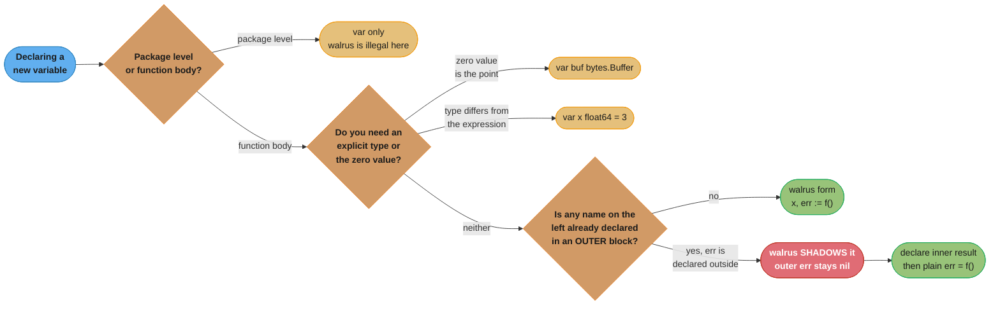
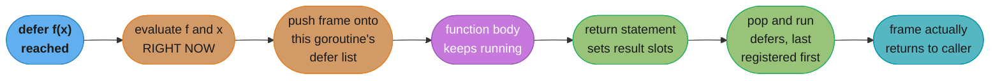
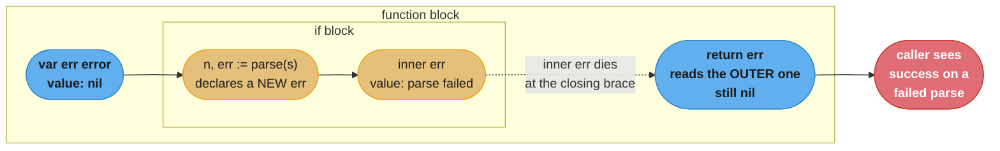
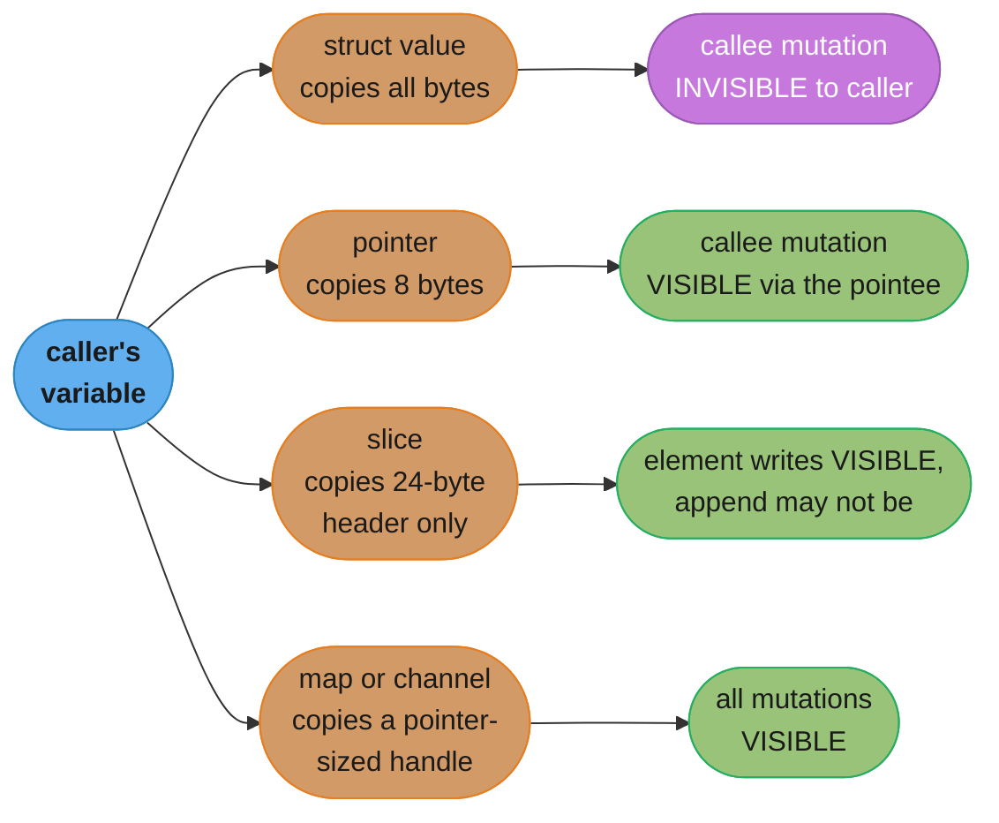
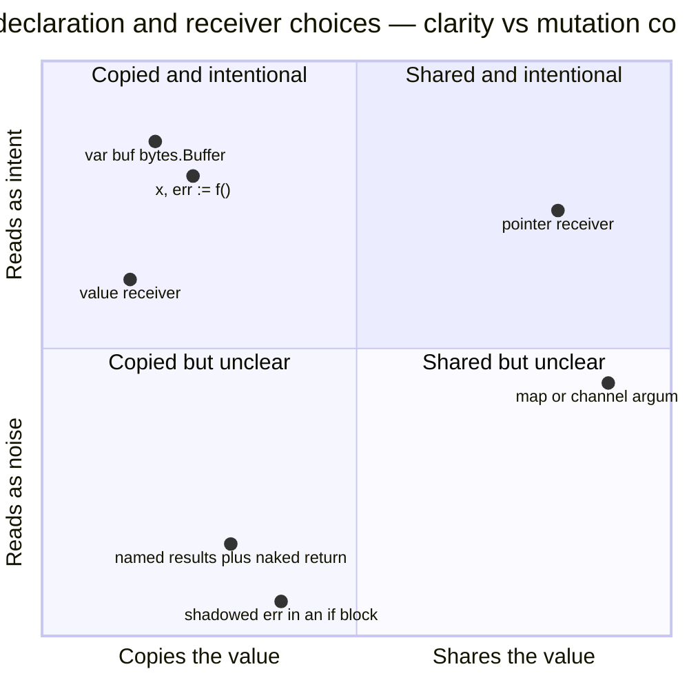

# Go Fundamentals & Idioms

---

## 1. Concept Overview

Go is a small language on purpose. The specification fits in roughly 90 pages, there are 25 keywords,
and there is exactly one loop construct. Everything a Java or Python engineer expects to find — class
hierarchies, exceptions, constructors, access modifiers, operator overloading, generics-everywhere,
implicit conversions — is either absent or deliberately narrowed. The compensation is that a Go
codebase you have never seen reads the same as the one you wrote, and `gofmt` removes formatting from
the space of things a reviewer can argue about.

That minimalism is not free. Go replaces the missing machinery with a set of conventions that the
compiler does not enforce and that are therefore invisible until a reviewer or a production incident
points at them. Visibility is controlled by the *capitalization of an identifier*, not by a keyword.
Object construction is controlled by the *zero value being useful*, not by a constructor. Cleanup is
controlled by `defer`, whose two rules — last-in-first-out order, and arguments evaluated at the
moment the `defer` statement runs — produce the single most common "wait, why did it print that?"
moment in the language. And assignment has two forms, `var` and `:=`, whose difference is scoping, not
style: a `:=` in an inner block that reuses the name `err` creates a *new* `err`, leaves the outer one
`nil`, and compiles without a warning.

This module is the section's entry point. It covers the package model, zero values and struct design,
declaration forms and the shadowing bug, `defer` in depth, value semantics, named returns, `iota`, the
four forms of `for`, the conditionless `switch`, the blank identifier, and the idiom list a Go reviewer
will actually flag on your first pull request. Target version is **Go 1.27** (released 2026-08-19).

---

## 2. Intuition

> Go is a language with no locks on the doors and a very strict neighbourhood watch. Nothing stops you
> writing un-Go-like code, but every reviewer, every linter, and eventually every 3am pager will.

**Mental model:** Think of a Go package as a single translation unit with a one-bit ACL per identifier,
stored in the first letter. `Server` is exported. `server` is not. There is no `protected`, no
`internal` modifier, no friend classes — the only other lever is a directory named `internal/`, which
restricts an entire package to its subtree. Two levers, total.

**Why it matters:** Java and Python engineers arriving in Go usually write correct-but-foreign code for
about two weeks: constructors named `NewXFactory`, getters named `GetName()`, error handling wrapped in
`panic`/`recover` because it resembles try/catch, and struct types that are unusable until four setters
have been called. All of it compiles. All of it gets flagged in review. Learning the idioms first is
strictly cheaper than learning them from a diff.

**Key insight:** Almost every Go surprise reduces to one of two facts. The first is that **everything is
a copy** — assignment, argument passing, and range iteration all copy the value, and a method with a
value receiver operates on a copy of the receiver. The second is that **`defer` captures its arguments
immediately but runs its body later**, which is exactly backwards from how a lambda behaves in every
other mainstream language. Internalise those two and most of the language's traps stop being traps.

---

## 3. Core Principles

**1. Capitalization is the access control.**
An identifier beginning with an uppercase letter is exported from its package; anything else is package
private. This applies uniformly to types, functions, methods, struct fields, constants, and variables.
There is no in-between level. The only additional scoping tool is the `internal/` directory: a package
under `a/b/internal/c` may be imported only by packages rooted at `a/b`, enforced by the toolchain.

**2. The zero value should be useful, so there are no constructors.**
Every variable is initialised to its type's zero value: `0` for numerics, `""` for strings, `false` for
bools, and `nil` for pointers, slices, maps, channels, functions, and interfaces. Go has no constructor
mechanism and no `new`-must-be-called rule, so a well-designed struct is usable the instant it is
declared. `var buf bytes.Buffer` is a working buffer. `var mu sync.Mutex` is an unlocked mutex. `var wg
sync.WaitGroup` is a ready wait group. Designing a type whose zero value panics is a design decision you
must justify.

**3. Everything is passed by copy.**
Go has no reference parameters. Passing a struct copies every byte of it. Passing a pointer copies the
8-byte pointer. Passing a slice copies the 24-byte slice header, not the backing array. Ranging over a
slice of structs copies each element into the loop variable. There is exactly one way to let a function
mutate a caller's value: pass a pointer.

**4. `defer` evaluates arguments now and runs the body later, in LIFO order.**
`defer f(x)` evaluates `f` and `x` at the moment the `defer` statement executes, records the call on a
per-goroutine stack, and invokes it when the *enclosing function* returns — not when the enclosing block
ends. Multiple defers pop in reverse order of registration. This is the whole of the semantics, and
every `defer` surprise follows from it.

**5. Errors are values returned alongside results, not thrown.**
The idiom is `if err != nil { return err }` immediately after the call. `panic` is for programmer bugs
and unrecoverable invariants, not for control flow. A function that returns `(T, error)` guarantees
nothing about `T` when `err != nil`, so never use the value before checking.

**6. Composition over inheritance, always.**
There is no `extends`. A struct embeds another type to promote its fields and methods, and an interface
is satisfied structurally — no `implements` clause exists. A type satisfies `io.Writer` by having a
`Write([]byte) (int, error)` method, whether or not its author ever heard of `io.Writer`.

**7. Formatting and vetting are not opinions.**
`gofmt` output is the only legal formatting. `go vet` runs as part of `go test` by default, and since
Go 1.27 the `stdversion` check is part of that default set, catching use of a symbol newer than the
module's declared Go version.

---

## 4. Types / Architectures / Strategies



The one decision this diagram encodes: `:=` is not "shorter `var`", it is *declare-and-assign in the
current block*, and the current block is the trap. Everything else is preference.

### Strategy 1: `var` for zero values and package scope

`var` is the only declaration form legal at package level, and the only one that lets you state a type
without an initialiser. Reach for it when the zero value is the intended starting state
(`var b strings.Builder`), when you need a wider type than the literal implies (`var ratio float64 = 3`),
or when you are declaring a variable whose value is assigned in several branches below.

### Strategy 2: `:=` inside functions, with a hard eye on scope

The short variable declaration requires at least one *new* name on the left. Existing names in the
**same** block are plain assignments — this is why `x, err := f()` followed by `y, err := g()` works
without a redeclaration error. Existing names in an **outer** block are not reused: they are shadowed.

### Strategy 3: `defer` for every acquire/release pair

Register the release immediately after a successful acquire, in the same two lines. `f, err := os.Open(p)`,
check the error, then `defer f.Close()`. The LIFO ordering means a nested acquire releases before an
outer one, which is the order you want for lock → transaction → file.

### Strategy 4: named returns only where they earn it

Name the results when a deferred function must observe or mutate them — error decoration, `recover`
translation, metrics on the outcome. Do not name them merely to document; that is what a doc comment is
for, and a naked `return` in a 60-line function is unreadable.

### Strategy 5: value receivers by default, pointer receivers when you must

Use a pointer receiver when the method mutates the receiver, when the struct is large enough that
copying costs more than the extra indirection, or when the type contains a `sync.Mutex` (copying a
locked mutex is a bug `go vet` will report). Then use pointer receivers for **every** method on that
type — a mixed method set is the most common source of "does not implement" compile errors.

### Strategy 6: `iota` for enumerations, with a typed base

Declare a named type, use `iota` inside a `const` block, and give the type a `String()` method. The
named type turns a bare integer into something the compiler will refuse to mix with an unrelated
enumeration, which is the entire benefit.

---

## 5. Architecture Diagrams

### Diagram 1: what `defer` actually does



The split between "evaluate arguments now" (step 2) and "run the body later" (step 6) is the whole
model. A `defer` also runs *after* the `return` expression has been written into the result slots,
which is what makes a named result mutable from a deferred function.

### Diagram 2: how `:=` shadows an outer `err`



Two variables named `err` exist at once. The inner one holds the real failure and is discarded at the
closing brace; the outer one is what `return err` reads. The `shadow` analyzer is not part of the
default `go vet` suite — `golangci-lint` with `govet`'s `shadow` check enabled catches this in CI.

### Diagram 3: value semantics — what a call actually copies



A map and a channel behave like references because the value you copy is already a pointer to a runtime
structure. A slice sits in between: the header is copied so element writes land on the shared backing
array, but an `append` that reallocates gives the callee a new array the caller never sees. That
half-shared behaviour is covered in
[Data Structures & Memory Layout](../data_structures_and_memory_layout/data_structures_and_memory_layout.md).

---

## 6. How It Works — Detailed Mechanics

### 6.1 Packages, exports, and `internal/`

```go
// package name is the last element of the import path by convention, not by rule.
package store

// Exported: capital S. Visible to any importer.
type Server struct {
    Addr    string // exported field, settable by importers
    timeout time.Duration // unexported: only this package can touch it
}

// Exported constructor by convention, because timeout has no useful zero value here.
func New(addr string) *Server {
    return &Server{Addr: addr, timeout: 5 * time.Second}
}

// unexported helper
func normalize(addr string) string { return strings.TrimSpace(addr) }
```

There is no `public`, `private`, `protected`, or `package-private` keyword — the first rune of the
identifier is the entire mechanism. Note the consequence for JSON: `encoding/json` uses reflection and
can only see exported fields, so an unexported field is silently omitted from marshalled output. That
one interaction accounts for a large share of "my API returns `{}`" bug reports.

### 6.2 Zero values and why there are no constructors

```go
type Buffer struct {
    data []byte // nil slice: append works on it immediately
    mu   sync.Mutex // zero value is an unlocked mutex
}

func main() {
    var b Buffer // no constructor, no New, no init
    b.mu.Lock()
    b.data = append(b.data, 'h', 'i') // append to a nil slice allocates for you
    b.mu.Unlock()
    fmt.Println(string(b.data)) // hi
}
```

`Buffer`'s zero value works. That is the design target. When a type genuinely cannot have a useful zero
value — it needs a database handle, a timeout, a logger — write a function named `New` (or `NewThing`
if the package exports several), returning `*Thing` or `(*Thing, error)`. It is a plain function, not a
language feature, and nothing forces callers to use it.

### 6.3 `defer`: the four rules, demonstrated

```go
func deferRules() (result int) {
    // Rule 1: LIFO. Prints 3, 2, 1.
    for i := 1; i <= 3; i++ {
        defer fmt.Println("lifo", i)
    }

    // Rule 2: arguments are evaluated at defer time, not at run time.
    x := 10
    defer fmt.Println("x was", x) // captures 10 here
    x = 99                        // has no effect on the line above

    // Rule 3: a closure body reads the variable at RUN time.
    defer func() { fmt.Println("x is now", x) }() // prints 99

    // Rule 4: a deferred closure can mutate a NAMED result.
    defer func() { result *= 2 }()
    return 21 // result is set to 21, then doubled to 42
}
```

`deferRules()` returns 42. Rule 4 is the only mechanism Go gives you to change a return value after the
`return` statement, and it is why error-decorating wrappers and `recover` translators need named
results.

### 6.4 The cost of `defer`

Since Go 1.14 the compiler **open-codes** defers: instead of allocating a `_defer` record and pushing it
onto a linked list, it inlines the deferred call at each return site behind a bitmask of which defers are
live. The result is on the order of **1 ns per defer**, close enough to a direct call that the old
"don't defer in hot loops" folklore no longer applies to the common case.

The open-coding requires the function to have at most **8 defer statements** and **none of them inside a
loop**. A `defer` in a loop falls back to the heap-allocated path, which costs tens of nanoseconds — and
more importantly leaks the resource until the whole function returns:

```go
// This is NOT open-coded: the defer is inside a loop.
func processAll(paths []string) error {
    for _, p := range paths {
        f, err := os.Open(p)
        if err != nil {
            return err
        }
        defer f.Close() // 10,000 paths = 10,000 open fds held until processAll returns
        io.Copy(io.Discard, f)
    }
    return nil
}
```

The fix is a per-iteration function so the `defer` has a frame to return from — shown in Section 10.

### 6.5 Value semantics and receivers

```go
type Counter struct{ n int }

func (c Counter) IncVal()  { c.n++ } // operates on a COPY, discards the increment
func (c *Counter) IncPtr() { c.n++ } // operates on the caller's value

func main() {
    c := Counter{}
    c.IncVal()
    c.IncPtr()
    fmt.Println(c.n) // 1, not 2
}
```

`c.IncPtr()` compiles even though `c` is not a pointer: Go inserts `(&c).IncPtr()` automatically when
the value is *addressable*. It is not addressable when it comes out of a map, so `m["k"].IncPtr()` does
not compile — see the map section of the memory-layout module.

The copy cost is real but usually smaller than people fear. A struct of 4 `int64`s is 32 bytes and
copies in a few nanoseconds; the crossover where a pointer receiver wins on copy cost alone is roughly
the size of a cache line, **64 bytes**, though correctness (mutation, embedded mutex) decides it far
more often than size.

### 6.6 `iota` and typed constants

```go
type State uint8

const (
    StateIdle State = iota // 0
    StateRunning           // 1
    StateStopping          // 2
    _                      // 3 reserved, skipped with the blank identifier
    StateFailed            // 4
)

func (s State) String() string {
    switch s {
    case StateIdle:
        return "idle"
    case StateRunning:
        return "running"
    case StateStopping:
        return "stopping"
    case StateFailed:
        return "failed"
    }
    return fmt.Sprintf("State(%d)", uint8(s))
}

// iota also supports expressions, re-evaluated per ConstSpec line.
type ByteSize float64

const (
    _  = iota // skip 0
    KB = 1 << (10 * iota) // 1 << 10 = 1024
    MB                    // 1 << 20 = 1048576
    GB                    // 1 << 30
)
```

`iota` is the index of the current `ConstSpec` within its `const` block, starting at 0 and resetting at
every new `const` keyword. An omitted expression repeats the previous line's expression with the new
`iota`, which is what makes the `KB`/`MB`/`GB` block work.

### 6.7 The four forms of `for`

```go
for i := 0; i < n; i++ {}      // 1. three-clause, the C form
for cond {}                    // 2. condition only, Go's while
for {}                         // 3. infinite, needs break or return
for i, v := range xs {}        // 4. range over slice, array, string, map, channel, int, func

for range 5 {}                 // range over an int [1.22]: runs 5 times, no variable needed
for v := range seq {}          // range over an iterator func [1.23]
```

Two range facts that bite. First, `v` is a **copy** of the element, so `for _, u := range users { u.Age++ }`
mutates nothing; index with `users[i].Age++` instead. Second, since **Go 1.22** the loop variables in
forms 1 and 4 are **per-iteration**, so a goroutine or closure capturing `i` sees that iteration's value.
Code written against Go 1.21 or earlier that copied the loop variable into a local (`i := i`) still works
and is now redundant.

### 6.8 `switch` without a condition, and the blank identifier

```go
// A bare switch is an if/else-if chain that reads top-to-bottom.
func grade(score int) string {
    switch {
    case score >= 90:
        return "A"
    case score >= 80:
        return "B"
    case score >= 70:
        return "C"
    default:
        return "F"
    }
}

// Cases do not fall through. fallthrough is explicit and rare.
// Multiple values per case replace most of what fallthrough was used for.
switch method {
case http.MethodPut, http.MethodPatch, http.MethodPost:
    write(w, r)
case http.MethodGet, http.MethodHead:
    read(w, r)
}

// The blank identifier discards a value, satisfies an unused-import check,
// or asserts an interface at compile time.
_, err := io.Copy(io.Discard, r)          // discard the byte count
var _ io.Writer = (*Server)(nil)          // compile-time assertion, zero runtime cost
import _ "github.com/lib/pq"              // import for side effects only
for _, v := range xs {}                   // index not needed
```

The compile-time interface assertion is the one worth memorising: it costs nothing at runtime, and it
turns "this type stopped satisfying `io.Writer`" from a confusing error at a distant call site into a
one-line error in the file that owns the type.

---

## 7. Real-World Examples

**Kubernetes `client-go`:** every options struct in `k8s.io/client-go` is designed so its zero value is
a valid "no options" request — `metav1.ListOptions{}` lists everything. The library never requires a
builder, and callers write `client.CoreV1().Pods(ns).List(ctx, metav1.ListOptions{})` with a literal.

**`net/http`:** `http.Server{}` is usable with only `Addr` and `Handler` set, and `http.Client{}` is a
working client with no timeout. That last zero value is the famous counter-example: a useful zero value
and a *safe* zero value are not the same thing, and `http.Client{}`'s zero timeout means "wait forever",
which has taken down more services than any other default in the standard library.

**`sync` package:** `sync.Mutex`, `sync.RWMutex`, `sync.WaitGroup`, `sync.Once`, and `sync.Map` all have
useful zero values and no constructors. This is why you embed `sync.Mutex` in a struct rather than
storing a `*sync.Mutex` — and why `go vet`'s `copylocks` check exists, because copying a struct that
embeds a mutex silently duplicates the lock.

**Docker / Moby:** the codebase uses `defer` for every lock, every container-state release, and every
temporary directory. The convention there — acquire, check error, `defer` the release on the very next
line — is what makes an 800-line function auditable for leaks by reading only the top of each block.

**Prometheus:** `prometheus.Counter` and friends are interfaces satisfied structurally, and the
registration pattern uses `MustRegister` in `init()` for package-level metrics. It is one of the few
production Go codebases where `init()` and `Must*` panics are idiomatic, because a metric that fails to
register is a programming error discovered at process start, not a runtime condition.

**`errgroup` in `golang.org/x/sync`:** its zero value is a valid group that waits without cancellation,
while `errgroup.WithContext(ctx)` returns the cancelling variant. Same type, two behaviours, no builder.

---

## 8. Tradeoffs

| Decision | Option A | Option B | When A wins | When B wins |
|---|---|---|---|---|
| Declaration | `var x T` | `x := expr` | Zero value is the intent, package scope, explicit type needed | Value and type both come from the expression |
| Receiver | value `func (t T)` | pointer `func (t *T)` | Small immutable type, want copy semantics, map/slice element methods | Mutation, struct over ~64 bytes, contains a mutex, any other method uses a pointer |
| Returns | `(int, error)` | `(n int, err error)` | Most functions — names add nothing | A deferred func must read or modify the result |
| Construction | zero value | `New(...)` | Type works with all fields zero | A field has no valid zero (DB handle, logger, timeout) |
| Enumeration | `const` + `iota` | `string` constants | Compact, comparable, `String()` gives the label | Value crosses a wire or a DB and must survive reordering |
| Error handling | `if err != nil` | `panic`/`recover` | Everything that can fail in normal operation | Programmer bug, unrecoverable invariant, package boundary that must not leak a panic |
| Cleanup | `defer` | explicit call at each return | Always, unless in a loop | Loop bodies, or when release must happen before more work in the same frame |



The two bottom entries are the ones this module exists to prevent: a naked `return` in a long function
and a shadowed `err` both read as intent to the author and as noise to everyone else.

---

## 9. When to Use / When NOT to Use

### Use `defer` when:
- Releasing anything acquired: file handles, locks, transactions, HTTP response bodies, goroutine-scoped tracing spans
- A function has several return paths and the cleanup must run on all of them
- A deferred closure must decorate the returned error or translate a `recover` into an error

### Use a pointer receiver when:
- The method mutates the receiver
- The struct exceeds roughly 64 bytes and the method is on a hot path
- The type embeds `sync.Mutex`, `sync.WaitGroup`, or anything else `go vet`'s `copylocks` flags
- Any other method on the type already uses one — keep the method set uniform

### Use named return values when:
- A deferred function must read the result (metrics, structured logging of the outcome)
- A deferred function must replace the result (`recover` translated into an `error`, `%w` decoration)

### Do NOT use `defer` when:
- It sits inside a loop body — the resource is held until the enclosing function returns
- The release must happen before more work in the same frame, such as unlocking before a slow network call
- You are in the hottest measured loop of a profile *and* the defer cannot be open-coded (more than 8 defers or inside a loop)

### Do NOT use `panic`/`recover` when:
- You want try/catch. Return an error
- A remote call failed, a file is missing, or input is malformed — those are ordinary values
- The panic would cross a package boundary. Recover at the boundary (an HTTP middleware, a worker loop) and convert to an error

### Do NOT use named returns when:
- The function is longer than about 15 lines and the `return` would be naked — the reader has to scan the whole body to learn what is returned
- The names are `result` and `err` and add nothing a doc comment would not say better

---

## 10. Common Pitfalls

### Pitfall 1: the shadowed `err` that hides a real failure

An internal payments service reported a **0.00% error rate** on a validation endpoint for six weeks
while the downstream ledger rejected 3.1% of its writes. The cause was one `:=` inside an `if`.

```go
// BROKEN — the := inside the if block declares a SECOND err
func handle(raw string) error {
    var err error
    var amount int64

    if strings.HasPrefix(raw, "amt=") {
        amount, err := strconv.ParseInt(raw[4:], 10, 64) // new amount AND new err
        if amount < 0 {
            return errors.New("negative amount")
        }
        _ = err // silences the compiler; the parse error dies here
    }

    // err is still nil. amount is still 0. Both writes above went to inner copies.
    return err
}
```

```go
// FIX — declare the new value, assign the existing err
func handle(raw string) error {
    var amount int64

    if strings.HasPrefix(raw, "amt=") {
        parsed, err := strconv.ParseInt(raw[4:], 10, 64)
        if err != nil {
            return fmt.Errorf("parse amount: %w", err)
        }
        if parsed < 0 {
            return errors.New("negative amount")
        }
        amount = parsed // explicit assignment to the outer variable
    }

    _ = amount
    return nil
}
```

The tell in the broken version is `_ = err`, which the author added to make the compiler stop
complaining about an unused variable. **Treat `_ = err` as a code smell that means "I shadowed
something".** Enable the `shadow` analyzer in `golangci-lint`; it is not part of the default `go vet`
suite and CI will not catch this for you otherwise.

### Pitfall 2: `defer` inside a loop exhausting the file-descriptor limit

A log-ingestion job that opened one file per uploaded batch crashed with
`too many open files` after processing about 1,020 files against a soft `RLIMIT_NOFILE` of 1,024.

```go
// BROKEN — every f.Close() waits for processAll to return
func processAll(paths []string) error {
    for _, p := range paths {
        f, err := os.Open(p)
        if err != nil {
            return err
        }
        defer f.Close()
        if _, err := io.Copy(io.Discard, f); err != nil {
            return err
        }
    }
    return nil
}
```

```go
// FIX — give the defer a frame of its own
func processAll(paths []string) error {
    for _, p := range paths {
        if err := processOne(p); err != nil {
            return fmt.Errorf("process %s: %w", p, err)
        }
    }
    return nil
}

func processOne(p string) error {
    f, err := os.Open(p)
    if err != nil {
        return err
    }
    defer f.Close() // runs at the end of THIS call, one fd at a time
    _, err = io.Copy(io.Discard, f)
    return err
}
```

Peak descriptor count went from `len(paths)` to 1. The extracted function is also open-coded, so the
defer costs about 1 ns instead of a heap allocation per iteration.

### Pitfall 3: mutating the range copy and wondering why nothing changed

```go
// BROKEN — v is a copy of each element
type User struct {
    Name   string
    Active bool
}

func deactivateAll(users []User) {
    for _, v := range users {
        v.Active = false // writes to the loop variable, discarded next iteration
    }
}
```

```go
// FIX — index into the slice, or range over pointers
func deactivateAll(users []User) {
    for i := range users {
        users[i].Active = false
    }
}
```

This is the single most common Go bug in code written by engineers coming from Python, where `for u in
users` yields the object itself. In a team audit of one 40k-line service, 7 of 11 range loops over a
slice of structs that intended mutation had this bug; none produced a compile error and only 2 had a
test that would have caught it.

### Pitfall 4: a value receiver on a type with a mutex

```go
// BROKEN — go vet copylocks flags this, and the lock protects nothing
type Cache struct {
    mu sync.Mutex
    m  map[string]string
}

func (c Cache) Get(k string) string { // value receiver copies the mutex
    c.mu.Lock()
    defer c.mu.Unlock()
    return c.m[k]
}
```

```go
// FIX — pointer receiver, uniformly across the whole type
func (c *Cache) Get(k string) string {
    c.mu.Lock()
    defer c.mu.Unlock()
    return c.m[k]
}
```

Each `Get` call locks a fresh copy of the mutex, so two goroutines reading and writing `c.m`
concurrently race on the map and the runtime aborts the process with a
`concurrent map read and map write` fatal error — which, unlike a panic, cannot be recovered.

### Pitfall 5: unexported fields vanishing from JSON

```go
// BROKEN — encoding/json sees no exported fields, marshals {}
type Response struct {
    status int
    body   string
}
```

```go
// FIX — export the fields and tag them
type Response struct {
    Status int    `json:"status"`
    Body   string `json:"body"`
}
```

An API gateway shipped `{}` for every 200 response for four hours because a refactor lower-cased two
field names to satisfy a linter rule that had been misconfigured. Marshalling never errors on this — the
output is a syntactically perfect empty object.

### Pitfall 6: `defer` capturing the wrong moment

```go
// BROKEN — start is captured at defer time, so the duration is always ~0
func trace(name string) {
    start := time.Now()
    defer log.Printf("%s took %v", name, time.Since(start)) // Since() evaluated NOW
    doWork()
}
```

```go
// FIX — wrap in a closure so the body runs at return time
func trace(name string) {
    start := time.Now()
    defer func() { log.Printf("%s took %v", name, time.Since(start)) }()
    doWork()
}
```

A team shipped a latency dashboard where every handler reported between 200 ns and 900 ns. The metric
was measuring the cost of `time.Since` on a timestamp taken microseconds earlier, not the handler.

---

## 11. Technologies & Tools

| Tool | What it does | Why it matters here |
|---|---|---|
| `gofmt` / `gofumpt` | Canonical formatter; `gofumpt` is a stricter superset | Formatting is not reviewable in Go, which removes a whole class of PR comments |
| `go vet` | Ships with the toolchain, runs by default under `go test` | Catches `copylocks`, `printf` mismatches, `lostcancel`, and since Go 1.27 the `stdversion` check |
| `staticcheck` | Deep static analysis, roughly 150 checks | Finds dead code, impossible conditions, and misuse of standard-library APIs that `go vet` does not |
| `golangci-lint` | Runs many linters in parallel with shared parsing | The CI standard; enable `govet` with `shadow`, `errcheck`, `ineffassign`, `revive` |
| `errcheck` | Reports unchecked error returns | The `_ = err` smell from Pitfall 1 shows up here first |
| `ineffassign` | Reports assignments never read | Directly detects the shadowed-variable pattern's dead inner write |
| `revive` | Configurable style linter, successor to `golint` | Enforces the naming idioms in Section 13 (`GetX`, stuttering, receiver-name consistency) |
| `gopls` | The official language server | Rename, extract-function, and inline diagnostics in every editor |
| `go fix` | Rewritten in Go 1.26 as the home of "modernizers" | Rewrites old patterns to current ones automatically; new fixers in 1.27 include `slicesbackward` and `atomictypes` |
| `go doc` | Renders package documentation | Supports `package@version` and the `-ex` flag for executable examples as of Go 1.27 |
| `delve` (`dlv`) | The Go debugger | Understands goroutines, defers, and the runtime's stack layout in a way gdb does not |

---

## 12. Interview Questions with Answers

**Q: Why does an `err` assigned inside an `if` block sometimes stay `nil` outside it?**
**Short:** Because `:=` inside an inner block declares a brand-new variable that shadows the outer one, which is never written.

The short variable declaration `:=` declares every name on its left that is not already declared **in
that same block**. An outer `err` is in a different block, so `x, err := f()` inside an `if` creates a
second `err` that lives and dies inside the braces. The outer one keeps whatever it had, usually `nil`,
and `return err` reports success. The compiler is happy because both variables are used. The practical
tell is an `_ = err` line the author added to silence the unused-variable error. Enable the `shadow`
analyzer in `golangci-lint` — it is not in the default `go vet` set — and prefer naming the inner result
something else and assigning to the outer `err` with plain `=`.

**Q: In what order do deferred calls run, and when are their arguments evaluated?**
**Short:** Deferred calls run last-registered-first when the enclosing function returns, but their arguments are evaluated at the defer statement.

Registration pushes onto a per-goroutine stack, so the order is LIFO — three defers registered with 1,
2, 3 print 3, 2, 1. The argument evaluation is the part that surprises people: `defer fmt.Println(x)`
snapshots `x` at the moment the `defer` line executes, so a later `x = 99` does not change what is
printed. If you want the value at return time, wrap the call in a closure: `defer func() {
fmt.Println(x) }()` reads `x` when the closure runs. This distinction is what breaks naive timing code
such as `defer log.Print(time.Since(start))`, which measures nothing.

**Q: How can a deferred function change what a function returns?**
**Short:** Only by using named result parameters, since a deferred body runs after the return value is written into the result slot.

A `return v` statement first copies `v` into the function's result slots, then runs the deferred calls,
then hands control back to the caller. A deferred closure can therefore read and reassign a **named**
result, and that new value is what the caller sees: `func f() (n int) { defer func(){ n *= 2 }();
return 21 }` returns 42. With unnamed results there is no identifier to reassign, so the deferred
function has no way to reach the value. This is the standard mechanism for `recover`-to-error
translation and for wrapping an error with `%w` at a single exit point.

**Q: Why is `defer f.Close()` inside a loop a bug?**
**Short:** Every defer waits for the enclosing function to return, so a thousand-iteration loop holds a thousand handles open at once.

`defer` is scoped to the function, not to the block or the loop iteration. A loop over 10,000 files
registers 10,000 `Close` calls that all fire after the last iteration, so peak descriptor usage equals
the iteration count and the process dies on `too many open files` once it passes `RLIMIT_NOFILE`, often
1,024. Extract the body into its own function so each `defer` has a frame that returns per iteration.
The extracted version is also faster, because a defer inside a loop cannot be open-coded and falls back
to the heap-allocated path.

**Q: How does Go decide what is visible outside a package?**
**Short:** The first letter of the identifier decides it — uppercase is exported, anything else is package-private.

There is no visibility keyword anywhere in the language. `Server` is exported and `server` is not, and
the rule applies identically to types, functions, methods, struct fields, constants, and package-level
variables. The only other lever is the `internal/` directory: a package at `a/b/internal/c` may be
imported only by code rooted at `a/b`, and the toolchain enforces that. A consequence worth naming in an
interview is that `encoding/json` uses reflection, which cannot see unexported fields, so lower-casing a
struct field silently removes it from marshalled JSON with no error.

**Q: What is a zero value, and why does Go have no constructors?**
**Short:** Every declared variable starts at its type's zero value, and Go's design goal is that this state already be usable.

Numerics start at 0, strings at `""`, bools at `false`, and pointers, slices, maps, channels, funcs, and
interfaces at `nil`. Because the language guarantees this, the idiom is to design types whose zero value
already works: `var b bytes.Buffer` is a working buffer, `var mu sync.Mutex` is an unlocked mutex, and
`var wg sync.WaitGroup` is ready to use. When a field genuinely has no valid zero — a database handle, a
logger, a non-zero timeout — write a plain function called `New` returning `*T` or `(*T, error)`.
Nothing in the language forces callers through it, which is exactly why the zero value should still be
safe rather than a landmine.

**Q: When should a method take a pointer receiver instead of a value receiver?**
**Short:** Use a pointer whenever the method mutates state, the struct is large, or the type embeds a lock.

Three triggers, in order of importance. Mutation is decisive: a value receiver operates on a copy, so
`func (c Counter) Inc() { c.n++ }` increments nothing. A type containing a `sync.Mutex`, `sync.WaitGroup`,
or `strings.Builder` must use pointers because copying it duplicates the lock — `go vet`'s `copylocks`
check reports this. Size matters last: the crossover is roughly a cache line at 64 bytes, and below that
the copy is a couple of nanoseconds. Once any method on a type uses a pointer receiver, use one for
every method, because a mixed method set means `T` satisfies fewer interfaces than `*T` and produces
confusing "does not implement" errors.

**Q: What does `defer` cost in a hot path?**
**Short:** About one nanosecond in the common case, because the compiler open-codes it inline at each return site.

Since Go 1.14 the compiler emits the deferred call directly before each `return`, guarded by a bitmask
of which defers are live, instead of allocating a record and linking it onto a runtime list. That makes
a defer close enough to a direct call that the old "avoid defer in hot loops" advice is obsolete. The
open-coding has two conditions: the function declares at most 8 defer statements, and none of them sits
inside a loop. Break either condition and the function falls back to the heap path at tens of
nanoseconds per defer, which is one more reason to lift a loop body into its own function.

**Q: What is the difference between `var x = expr` and `x := expr`?**
**Short:** They produce identical variables inside a function, but only `var` is legal at package level and only `var` can state a type without a value.

Within a function body the two are interchangeable when the type comes from the expression, and style
guides simply prefer `:=`. Three cases force `var`: package-level declarations, where `:=` is a syntax
error; declarations without an initialiser, such as `var err error`; and declarations whose type differs
from the literal's default, such as `var ratio float64 = 3`, since `3` would otherwise be an `int`. The
real difference is scoping behaviour rather than syntax — `:=` declares in the current block, which is
what makes it shadow outer names, while a plain `=` assignment never does.

**Q: What do named return values give you, and when do they hurt?**
**Short:** They give a deferred function a handle on the result, and they hurt when a naked return forces the reader to scan the body.

Naming the results is the only way a deferred closure can read or replace what the function returns, so
error decoration, `recover` translation, and outcome metrics all need it. The cost is readability. A
bare `return` in a 60-line function tells the reader nothing, and the names frequently drift out of
sync with what the function actually does. The workable rule is: name the results only when a `defer`
needs them, and even then write explicit `return x, err` statements rather than naked returns, so the
signature and the exit points still agree.

**Q: What does `iota` evaluate to inside a `const` block?**
**Short:** It is the zero-based index of the current constant specification line, resetting at each new const keyword.

`iota` starts at 0 on the first `ConstSpec` of a `const (...)` block and increments by one per line,
whether or not that line mentions `iota`. Omitting the expression on a line repeats the previous line's
expression with the updated `iota`, which is why `KB = 1 << (10 * iota)` followed by bare `MB` and `GB`
produces 1024, 1048576, and 1073741824. Skip a value with the blank identifier on its own line. Always
declare a named type for the constants (`type State uint8`) and give it a `String()` method — the named
type is what stops the compiler from letting you mix two unrelated enumerations, and `stringer`
generates the method for you.

**Q: What are the forms of Go's `for` loop?**
**Short:** Four — the three-clause C form, a condition-only form, a bare infinite form, and the range form.

Go has no `while` and no `do`, so `for cond {}` is the while loop and `for {}` is the infinite loop.
The range form iterates slices, arrays, strings, maps, channels, integers, and iterator functions. Two
range facts matter in interviews: the value variable is a **copy** of the element, so mutating it does
nothing to the underlying slice, and since Go 1.22 the loop variables are **per-iteration**, so a
goroutine capturing the loop variable sees that iteration's value rather than the final one. Ranging
over an integer (`for range 5`) also arrived in 1.22, and ranging over an iterator function in 1.23.

**Q: Why does a bare `switch` replace most if-else chains in Go?**
**Short:** A conditionless switch evaluates each case as a boolean and reads as a flat decision table instead of nested braces.

`switch { case a: ...; case b: ... }` with no tag expression is exactly an if/else-if chain, but it
lines the conditions up at one indentation level, which is why Go code uses it for anything past two
branches. Cases do not fall through, so no `break` is needed, and a single case can list several values
separated by commas. The explicit `fallthrough` keyword exists but is rare. The related form,
`switch v := x.(type)`, is the type switch and is the idiomatic way to branch on the dynamic type behind
an interface value.

**Q: What is the blank identifier used for?**
**Short:** It discards a value the language would otherwise force you to name, and it doubles as a compile-time assertion tool.

`_` can appear anywhere a variable name can and binds nothing, so `_, err := f()` drops the first
result, `for _, v := range xs` drops the index, and `_ = x` marks a value deliberately unused. Two
non-obvious uses matter in review. `import _ "github.com/lib/pq"` imports a package purely for its
`init()` side effects, which is how database drivers register themselves. And `var _ io.Writer =
(*Server)(nil)` asserts at compile time that `*Server` satisfies `io.Writer` with zero runtime cost,
turning a distant "cannot use as io.Writer" error into a one-line failure in the file that owns the type.

**Q: Is passing a large struct by value expensive in Go?**
**Short:** It copies every byte, but the crossover where a pointer wins is around a cache line, so correctness usually decides it first.

A 32-byte struct copies in a couple of nanoseconds and may not even reach memory, since the compiler
can keep it in registers. The measured crossover where the indirection of a pointer beats the copy is
roughly 64 bytes, one cache line, and even then the difference is small unless the call is in a hot
loop. What actually decides the choice is semantics: pass a pointer when the callee must mutate, when
the struct embeds a lock, or when the value must be shared. A benefit of copying that people forget is
that a value argument cannot escape to the heap through the callee, so value passing often *reduces*
allocation — check with `go build -gcflags=-m`.

**Q: Why is a method called `GetName()` flagged in Go review?**
**Short:** Go's convention drops the Get prefix on accessors, so the getter is `Name()` and only the setter keeps a verb.

The standard library reads `req.URL`, `t.Name()`, `buf.Len()` — never `GetLen()`. A `Get` prefix in Go
signals an operation that does real work, such as `http.Get` performing a request. The setter keeps its
verb (`SetName`) because there is nothing else to call it. Related naming rules a reviewer applies at
the same time: avoid **stuttering**, so `http.Server` rather than `http.HTTPServer` and `store.New`
rather than `store.NewStore`, since the caller always writes the package name; and keep receiver names
short and identical across every method on a type (`s *Server`, never `this` or `self`).

**Q: What is stuttering in Go naming and how do you avoid it?**
**Short:** Stuttering is repeating the package name inside an identifier, since callers already write the package as a prefix.

Callers see `package.Identifier`, so a type named `HTTPServer` in package `http` reads as
`http.HTTPServer` at every use. The fix is to name for the call site: `http.Server`, `bytes.Buffer`,
`list.List`, `store.New` instead of `store.NewStore`. The rule extends to error variables (`store.ErrNotFound`,
not `store.ErrStoreNotFound`) and to package names themselves — prefer a short single word like `store`,
`auth`, or `parse`, and avoid the generic sinks `util`, `common`, `helpers`, and `base`, which grow
without bound because nothing is out of scope for them.

**Q: What happens if a deferred function panics?**
**Short:** The remaining deferred calls still run, and the new panic replaces the original one in the reported panic chain.

Panicking unwinds the stack while running each deferred call in LIFO order. If one of those deferred
calls panics itself, the runtime continues with the remaining defers and the final report shows both,
with the newest panic as the active one — the original is printed as `panic: first [recovered]`-style
context rather than silently discarded. A `recover()` inside a deferred function stops the unwinding and
returns the panic value, but it only works when called **directly** by a deferred function; calling it
from a helper the deferred function invokes returns `nil`. Recover at a boundary you own — an HTTP
middleware, a worker loop — and convert the value to an error rather than resuming.

**Q: Why does early return beat nested conditionals in Go?**
**Short:** Handling failures first keeps the happy path at the leftmost indentation, so the function's normal flow reads straight down.

Because every fallible call returns an error alongside its result, deeply nesting the success case
produces a staircase that pushes the real logic ten levels deep. The convention is to handle each error
immediately and return, leaving the successful path unindented. `gofmt` will not do this for you, but
`revive`'s `indent-error-flow` and `early-return` rules will flag the inverse. The same instinct applies
to `if err != nil { return err } else { ... }` — the `else` is always removable, and a linter will say so.

**Q: When should you write an `init()` function?**
**Short:** Almost never — reserve it for registering with a package-level registry, and prefer explicit setup functions everywhere else.

`init()` runs after package-level variables are initialised and before `main`, in file order within a
package and in dependency order across packages. That ordering is implicit, untestable, and impossible
to skip, so configuration, connection setup, and flag parsing all belong in explicit functions the
caller invokes. The legitimate cases are self-registration patterns — a database driver calling
`sql.Register`, a Prometheus collector calling `MustRegister` — where the whole point is that importing
the package is the registration. If an `init()` can fail for any reason other than a programming bug,
that logic should be a function returning an error instead.

---

## 13. Best Practices

1. **Return early, keep the happy path unindented.** Handle each `err` immediately with a `return`, and
   never write `else` after a block that returns.
2. **Wrap errors with context using `%w`.** `fmt.Errorf("open config %s: %w", path, err)` preserves
   `errors.Is`/`errors.As` while adding the one fact the caller cannot reconstruct.
3. **Declare `defer` on the line after the acquire succeeds.** Not three lines later, not at the end of
   the block — immediately, so a reader can pair them without scrolling.
4. **Never `defer` inside a loop.** Extract the body into a function.
5. **Design for a useful zero value.** If you must write a `New`, make it a plain function named `New`
   in its own package, and never `NewXFactory` or a builder chain.
6. **Keep the method set uniform.** Every method on a type takes either a value receiver or a pointer
   receiver, not a mix, and the receiver name is the same short identifier throughout.
7. **Give enumerations a named type and a `String()` method.** Generate the method with `stringer`
   rather than hand-writing a switch that drifts.
8. **Treat `_ = err` as a defect.** It is almost always covering a shadowed variable or an unchecked
   error, and `errcheck` plus the `shadow` analyzer will find both.
9. **Never name a package `util`, `common`, `helpers`, or `base`.** Name it for what it provides.
10. **Accept interfaces, return concrete types.** Define the interface in the consuming package with the
    one or two methods you actually call, not in the package that implements it.
11. **Run `gofmt`, `go vet`, and `golangci-lint` in CI, not locally-only.** Enable `govet` with `shadow`,
    plus `errcheck`, `ineffassign`, and `revive`.
12. **Use `context.Context` as the first parameter of any function that does I/O**, named `ctx`, never
    stored in a struct field. Covered in
    [Context & Cancellation](../context_and_cancellation/context_and_cancellation.md).
13. **Compile-assert your interface implementations** with `var _ Iface = (*Impl)(nil)` next to the type.
14. **Prefer `for i := range xs` over `for i, v := range xs` when you intend to mutate**, so the copy
    never exists to confuse anyone.

---

## 14. Case Study

### Auditing a 22,000-line Go service inherited from a departing team

A payments team took over a settlement service written by a group that had moved to Go from Java six
months earlier. The service compiled cleanly, passed 340 unit tests, and had a 0.02% reported error
rate. Over the following quarter it produced three incidents that all traced back to idioms, not logic.

**Incident 1 — a reconciliation job that silently reconciled nothing.**

The nightly job compared 4.1 million ledger rows against the bank file. It reported success every night
for 41 days while writing zero corrections.

```go
// BROKEN — value receiver on a type whose method is supposed to accumulate
type Reconciler struct {
    fixes []Fix
    mu    sync.Mutex
}

func (r Reconciler) Record(f Fix) { // copies Reconciler, including the mutex
    r.mu.Lock()
    defer r.mu.Unlock()
    r.fixes = append(r.fixes, f) // appends to the copy's slice header
}

func (r *Reconciler) Fixes() []Fix { return r.fixes } // always empty
```

```go
// FIX — pointer receiver on every method of the type
type Reconciler struct {
    fixes []Fix
    mu    sync.Mutex
}

func (r *Reconciler) Record(f Fix) {
    r.mu.Lock()
    defer r.mu.Unlock()
    r.fixes = append(r.fixes, f)
}

func (r *Reconciler) Fixes() []Fix {
    r.mu.Lock()
    defer r.mu.Unlock()
    return slices.Clone(r.fixes)
}
```

`go vet`'s `copylocks` check reports the broken version — `Record passes lock by value` — and the team
had disabled `go vet` in CI because it "duplicated the linter". Cost: 41 nights of unreconciled ledger,
about 9,400 rows requiring manual correction.

**Incident 2 — a 0.00% error rate on an endpoint that was failing 3.1% of calls.**

Every handler used the shadowed-`err` pattern from Pitfall 1. The 340 tests all asserted on the returned
value and never on the error, so the tests agreed with the bug. Enabling the `shadow` analyzer flagged
**61** occurrences across the repo; 9 of them were real bugs on error paths and the rest were harmless
but were fixed anyway to make the signal usable in future.

**Incident 3 — file-descriptor exhaustion during a large backfill.**

The backfill tool used `defer f.Close()` inside a loop over S3 objects. It worked on every test run of
fewer than 900 objects and died on the first production run of 12,000 with `too many open files`.
Extracting the loop body into `processOne` capped peak descriptors at 1.

**What the team changed:**

| Change | Effect |
|---|---|
| Re-enabled `go vet` in CI, blocking on failure | Caught `copylocks` and 4 `printf` argument mismatches immediately |
| Added `golangci-lint` with `govet`(shadow), `errcheck`, `ineffassign`, `revive` | 61 shadow findings, 118 unchecked errors, 23 naming violations |
| Repo-wide rule: no `defer` inside a loop body | Enforced by a `revive` custom rule; 6 sites fixed |
| Made every method set uniform | 14 types converted to all-pointer receivers |
| Renamed 31 `GetX()` accessors to `X()` and de-stuttered 9 types | Purely cosmetic, but it ended the "is this Go or Java?" review argument |

**Outcome after one quarter:** reported error rate rose from 0.02% to 3.1% on day one, which was the
point — the number finally matched reality. Incidents attributable to language idioms dropped to zero
over the following two quarters. The entire fix set was mechanical; not one of the three incidents
required understanding the settlement domain, which is the argument for putting the idiom linters in CI
before the first line of business logic is written.

**Related reading:** [Errors & Panics](../errors_and_panics/errors_and_panics.md) for the error-value
discipline this case study assumes, and
[Idiomatic API & Package Design](../idiomatic_api_and_package_design/idiomatic_api_and_package_design.md)
for the naming and interface rules at package scale.
