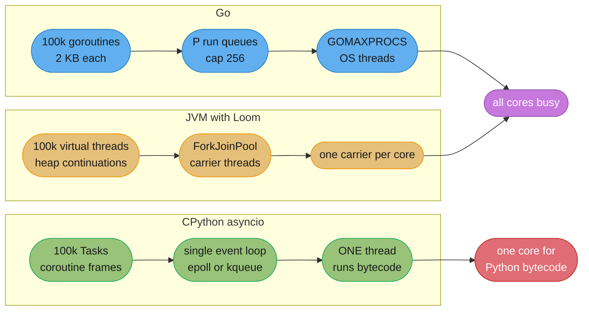
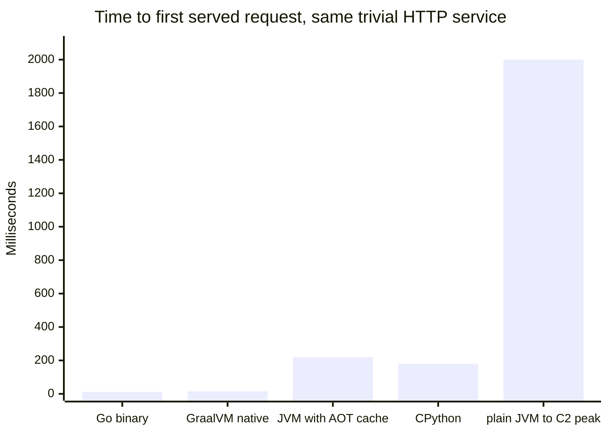
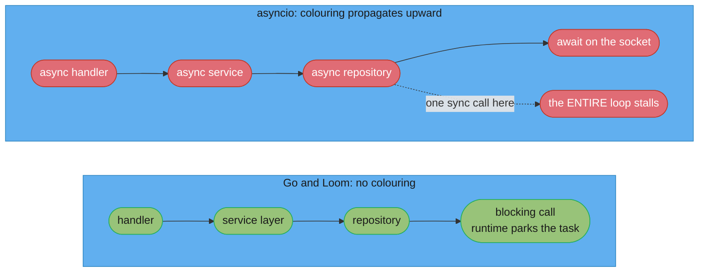
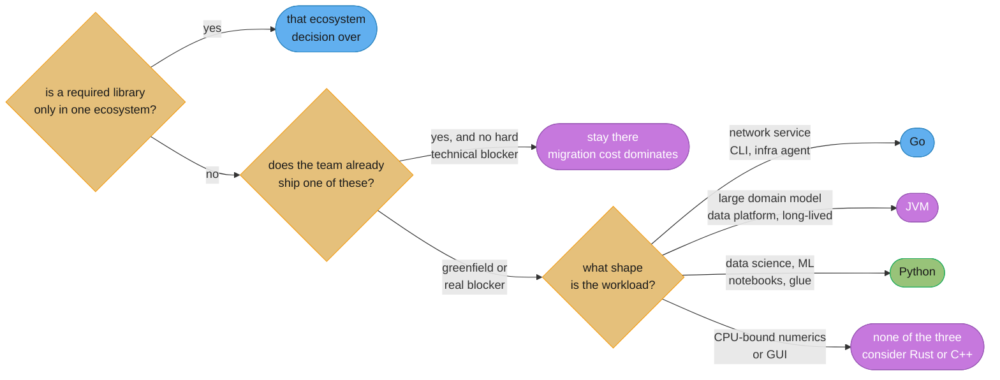

# Go vs Java and Python

## 1. Concept Overview

This module compares three runtimes that a staff engineer is regularly asked to choose between,
and it is written to be *defensible in both directions* — every claim about the JVM is checked
against [JVM Internals](../../java/jvm_internals/jvm_internals.md) and
[Structured Concurrency and Loom](../../java/structured_concurrency_and_loom/structured_concurrency_and_loom.md),
and every claim about Python is checked against
[The GIL and Free-Threading](../../python/the_gil_and_free_threading/the_gil_and_free_threading.md)
and [asyncio and Event Loop](../../python/asyncio_and_event_loop/asyncio_and_event_loop.md). The
comparison is worthless if either half is folklore, and most published Go-versus-Java comparisons
are describing a JVM from 2018 and a Python from 2019.

The five axes that actually decide a language choice:

| Axis | Go | JVM | CPython |
|------|-----|-----|---------|
| Concurrency | Goroutines on a GMP scheduler, 2 KB stacks, CSP channels | Virtual threads on carrier threads, ~few KB stacks, `StructuredTaskScope` | Event loop with `async`/`await`, or threads under a GIL, or the free-threaded build |
| Memory | Non-generational, non-compacting concurrent mark-sweep, sub-ms pauses | G1 (generational, compacting, ~2048 regions, 10–200 ms) or ZGC (colored pointers, sub-1 ms) | Reference counting plus a three-generation cycle collector |
| Errors | Values returned and checked explicitly | Checked and unchecked exceptions, stack unwinding | Exceptions, unchecked |
| Types | Structural interfaces, gcshape stenciling | Nominal interfaces, erasure with boxing | Duck typing plus gradual hints, unenforced at runtime |
| Start / footprint | 5–20 ms, 15–40 MB RSS | 400 ms to `main`, ~2 s to peak, 150–400 MB RSS | 80–300 ms import cost, 40–120 MB RSS |

The structural point this module keeps returning to: **Go and Loom converge on the same answer —
cheap, blocking-style concurrency where the runtime hides the multiplexing — while asyncio makes
concurrency a property of a function's type.** That single difference explains most of the
day-to-day ergonomic gap, and it explains why Python's answer to CPU-bound work has always been
"leave Python" while Go's and Java's is "use more cores".

What this module is *not*: an argument that one of them wins. All three are running large systems
correctly today. The decision framework in §9 puts migration cost and team skill where they
actually sit in a real decision, which is usually above every technical axis above.

---

## 2. Intuition

> Three languages, three answers to "what is scarce". Go decided the *stack* was scarce and made
> it 2 KB. The JVM decided the *OS thread* was scarce and stopped needing one per task. Python
> decided the *interpreter* was scarce and put a lock around it, then spent thirty years routing
> around that decision.

**Mental model.** Every concurrency story is a story about a resource ceiling.

- Go's ceiling was never threads, because a goroutine was never a thread. `newproc` allocates a
  ~400-byte `g` plus a 2 KB heap stack, and the scheduler multiplexes them onto `GOMAXPROCS`
  OS threads. A million goroutines is an ordinary thing to have.
- The JVM's ceiling was the 1 MB OS stack a platform thread reserves whether it uses it or not.
  Loom replaced that with a continuation on the heap of a few KB. Same arithmetic, ten years later,
  and no change to how you write the code.
- CPython's ceiling is the GIL: one thread executes bytecode at a time, with a 5 ms switch
  interval. `asyncio` sidesteps it for I/O by never needing a second thread; free-threading
  `python3.14t` removes it outright, at the cost of every extension having to be re-audited.

**Key insight:** Go and Loom are the *same idea* arrived at from opposite directions — both let you
write `resp, err := http.Get(url)` or `var r = client.send(req)` and block, because blocking is
cheap when the thing that blocks is not an OS thread. Python's `asyncio` cannot do that, because
suspension in CPython requires a coroutine frame, which requires the caller to `await`, which
requires the caller to be `async`, all the way up. That is **function colouring**, and it is a
type-system consequence, not a performance one.

```
concurrency ceiling = memory budget / per-task stack cost
```

**In plain terms.** "None of these runtimes made concurrency faster. Two of them made the per-task
memory cost small enough that the ceiling stopped mattering, and one of them made the *thread*
unnecessary instead."

| Symbol | What it is |
|--------|------------|
| 2 KB | A goroutine's initial stack, grown by copying |
| ~4 KB | A virtual thread's initial heap stack (the "~few KB" figure made concrete) |
| ~1 MB | A platform thread's reserved OS stack, used or not |
| 5 ms | CPython's GIL switch interval (`sys.getswitchinterval()`) |
| ~400 bytes | The `runtime.g` struct itself, before the stack |

**Walk one example.** 100,000 concurrent idle connections, counting only per-task stack memory:

```
  goroutines            100,000 x 2 KB          = 195 MiB
  virtual threads       100,000 x 4 KB          = 391 MiB
  platform threads      100,000 x 1 MB          = 97.7 GiB   -> impossible
  asyncio tasks         100,000 x ~1 KB frame   = ~98 MiB    -> also fine
  OS threads in Python  100,000 x 8 MB default  = 782 GiB    -> absurd

  the real comparison is therefore three-way, not two-way:
    Go            195 MiB, blocking-style code, real parallelism across cores
    Loom          391 MiB, blocking-style code, real parallelism across cores
    asyncio        98 MiB, coloured code,       one core for Python bytecode
```

The asyncio number is the *smallest*, which is the part people find surprising and which is exactly
why the comparison is not about memory. A coroutine frame is cheaper than any stack. What asyncio
buys with that cheapness is a single core and a colouring constraint; what Go and Loom buy with
their larger per-task cost is code that reads like it is not concurrent and scales across every
core you have.

**Why this matters:** a team choosing a language for a service that fans out to eight backends per
request is choosing between "write it straight and let the runtime handle it" and "restructure the
whole call chain around `async`". That is an architectural decision disguised as a syntax
preference, and it is very expensive to reverse.

---

## 3. Core Principles

1. **Compare current runtimes, not remembered ones.** Virtual threads have been GA since Java 21,
   `synchronized` stopped pinning in Java 24 (JEP 491), and free-threaded Python has been
   officially supported since 3.14 (PEP 779). Any comparison that says "Java needs a thread per
   request" or "Python can never use two cores" is describing software that no longer exists.

2. **Concurrency model and parallelism model are different questions.** Go and the JVM answer both
   with the same mechanism. CPython answers them with two different mechanisms (`asyncio` for
   concurrency, processes or the free-threaded build for parallelism), and conflating them is the
   root of most bad Python architecture.

3. **Function colouring is a type-system property with an engineering cost.** `async def` is
   contagious upward through every caller. Neither goroutines nor virtual threads have an
   equivalent, which is the single largest ergonomic difference between the three.

4. **Every GC optimizes for something and pays for it somewhere.** Go bought sub-millisecond,
   heap-size-independent pauses with throughput and fragmentation. ZGC bought the same pauses with
   a load barrier on every reference read. G1 bought compaction and generational throughput with
   10–200 ms pauses. CPython bought immediate deterministic reclamation with a per-object refcount
   that is exactly what made the GIL necessary.

5. **Explicit error values and exceptions differ in what they make *visible*, not in what they can
   express.** `if err != nil` puts every failure edge in the reader's face at the cost of line
   count; exceptions keep the happy path clean at the cost of an invisible control-flow graph.
   Both are defensible; only one of them is checkable by `errcheck`.

6. **Startup cost is paid per process, not per request.** It is invisible in a long-running
   monolith and dominant in a serverless function, a CLI, a Kubernetes Job, or anything that scales
   to zero. That is the whole reason the axis exists.

7. **Peak throughput and startup are in tension on the JVM and not on Go.** C2 needs roughly 15,000
   invocations to compile a method at Tier 4, and the profile it collects lets it devirtualize and
   inline in ways an AOT compiler cannot. Go's compiler emits its final code before it has seen any
   input at all — which is why it starts instantly and why PGO `[1.21]` exists.

8. **The library ecosystem decides more real projects than any runtime property.** No amount of
   goroutine elegance replaces PyTorch, and no amount of JVM throughput replaces `client-go`.

9. **Team skill and migration cost usually dominate.** A correct Go service written by a team that
   has never written Go loses to a correct Java service written by a team that has shipped Java for
   a decade, and this is the axis most language comparisons refuse to score.

---

## 4. Types / Architectures / Strategies

### 4.1 The three concurrency models

| Property | Goroutines | Virtual threads (Loom) | asyncio |
|----------|------------|------------------------|---------|
| Unit | `g` struct + growable stack | Continuation on the heap | Coroutine frame + `Task` |
| Initial cost | 2 KB stack, ~400 B struct | ~4 KB heap stack | ~1 KB frame |
| Scheduler | GMP: `GOMAXPROCS` Ps, 256-entry local run queues, work stealing | `ForkJoinPool` of carrier threads, count = CPU cores | Single-threaded event loop over `epoll`/`kqueue` |
| Blocking call | Runtime parks the goroutine, M keeps running others | JVM unmounts the virtual thread from its carrier | Nothing unmounts — a blocking call freezes the whole loop |
| Preemption | Asynchronous, `SIGURG` after a 10 ms slice `[1.14]` | Cooperative at unmount points | Cooperative at `await` only |
| Parallelism | Real, across `GOMAXPROCS` cores | Real, across carrier threads | One core for Python bytecode |
| Code colour | None | None | `async`/`await`, contagious |
| Structured scope | `errgroup`, `sync.WaitGroup.Go` `[1.25]` | `StructuredTaskScope` (preview) | `asyncio.TaskGroup` (3.11+) |
| Cancellation | `context.Context`, cooperative | `Thread.interrupt` plus scope cancellation | `Task.cancel` raising `CancelledError` |
| The gotcha | Goroutine leaks, unclosed channels | Pinning on a native frame (JNI, FFM) | One synchronous call blocks every task |

### 4.2 The three memory managers

| Property | Go GC | G1 | ZGC | CPython |
|----------|-------|-----|-----|---------|
| Algorithm | Concurrent tricolor mark-sweep | Generational, regional, evacuating | Concurrent, colored pointers | Refcount + generational cycle GC |
| Generational | No | Yes | Yes (since JEP 490) | Yes, three generations |
| Compacting | **No** | Yes | Yes, concurrently | No (pymalloc arenas) |
| STW pause | Sub-millisecond, flat in heap size | 10–200 ms, scales with live data evacuated | Sub-1 ms, flat in heap size | Cycle collection pauses the thread |
| Mutator cost | Write barrier during mark | Write barrier (SATB + card table) | **Load barrier on every reference read**, low single-digit % throughput | Refcount increment/decrement on every reference |
| Primary knob | `GOGC` (default 100), `GOMEMLIMIT` `[1.19]` | `MaxGCPauseMillis` (default 200) | Heap size | `gc.set_threshold` |
| Optimizes for | Predictable latency, simplicity | Balanced throughput and latency | Latency on huge heaps | Determinism and immediate reclamation |
| Pays with | Throughput, fragmentation | Pause length | Read throughput | The GIL itself |
| Recent | Green Tea GC on by default `[1.26]`, 10–40% less GC overhead | G1 becomes the default in every environment in JDK 27 (JEP 523) | Generational-only since Java 24 | Free-threading changes refcounting to biased |

### 4.3 The three type systems

| Property | Go | Java | Python |
|----------|-----|------|--------|
| Interface satisfaction | **Structural** — no `implements` clause | **Nominal** — must declare `implements` | Duck typing — no declaration at all |
| Generics representation | GC-shape stenciling: one body per pointer-shape, runtime dictionary for type-specific operations | Erasure: one body, `Object` at runtime, boxing for primitives | None at runtime; `list[int]` is documentation |
| Cost of a generic over pointers | A dictionary indirection, sometimes slower than an interface | A cast plus, for primitives, an allocation per boxed value | Zero, because it does nothing |
| Static checking | Compiler | Compiler | Optional: `mypy`, `pyright`, unenforced at runtime |
| Variance | None | Wildcards (`? extends`, `? super`) | Structural via `Protocol` |
| Sum types | None. Interface plus type switch | Sealed interfaces plus pattern matching | `Union` plus `match` |
| Null | Zero values; typed-nil interface trap | `null`, `Optional`, no non-nullable types | `None` |
| Verdict | Small, learnable, deliberately under-expressive | Expressive, verbose, erasure scars | Maximally flexible, zero runtime guarantee |

### 4.4 Startup and footprint strategies

| Strategy | Runtime | Cold start | Peak throughput | Cost |
|----------|---------|-----------|-----------------|------|
| Plain Go binary | Go | 5–20 ms | Full immediately | None |
| Go + PGO `[1.21]` | Go | 5–20 ms | +2–14% on the profiled workload | A representative profile in the build |
| Plain JVM | JVM | ~400 ms to `main`, ~2 s to C2 peak | Highest of the three after warm-up | Warm-up window |
| JVM + AppCDS / AOT cache | JVM | 150–250 ms to `main` | Unchanged | A training run in CI |
| GraalVM native-image | JVM | **~15 ms** | Typically below JIT peak | Closed world, reachability metadata, no agents |
| CPython | Python | 80–300 ms of import | Lowest by an order of magnitude | Interpreter overhead |
| Python + lazy imports | Python | 30–80 ms | Unchanged | Import discipline |

---

## 5. Architecture Diagrams

### The three concurrency models, side by side



*Go and Loom differ only in vocabulary at this level: many cheap tasks, a small pool of OS threads,
the runtime moving one onto the other when it blocks. asyncio's bottom box is the whole difference
— the multiplexing is identical, but only one thread ever executes Python bytecode.*

### Cold start, from process exec to first useful work



*The two left bars are the same order of magnitude, which is the point: GraalVM native-image buys
the JVM ecosystem Go's startup profile, at the cost of a closed world. The rightmost bar is not
"the JVM is slow" — it is where the JVM becomes the fastest of the five, and a long-running service
lives entirely to the right of it.*

### Function colouring: what propagates and what does not



*Adding one `await` at the bottom of a Python call chain forces `async def` on every function above
it. The dotted edge is the failure mode that colouring exists to prevent and routinely fails to:
a single synchronous library call anywhere in an async stack blocks every other task on that loop.*

### The decision, as a staff engineer would present it



*The two questions above the workload question are the ones that decide most real projects, and the
ones most comparisons skip entirely.*

---

## 6. How It Works — Detailed Mechanics

### 6.1 The same fan-out, three times

Fetch three URLs concurrently, fail fast on the first error, and cancel the rest.

```go
// Go: errgroup. No colouring — this function is an ordinary function.
func fetchAll(ctx context.Context, urls []string) ([][]byte, error) {
    g, ctx := errgroup.WithContext(ctx)
    out := make([][]byte, len(urls))

    for i, u := range urls {
        g.Go(func() error {
            req, err := http.NewRequestWithContext(ctx, http.MethodGet, u, nil)
            if err != nil {
                return err
            }
            resp, err := http.DefaultClient.Do(req)
            if err != nil {
                return fmt.Errorf("get %s: %w", u, err)
            }
            defer resp.Body.Close()

            b, err := io.ReadAll(resp.Body)
            if err != nil {
                return fmt.Errorf("read %s: %w", u, err)
            }
            out[i] = b
            return nil
        })
    }
    return out, g.Wait() // first non-nil error cancels ctx for the others
}
```

```java
// JVM: StructuredTaskScope. Also no colouring — an ordinary method.
// StructuredTaskScope is a preview API; JEP 525 is its current shape in Java 26.
List<byte[]> fetchAll(List<URI> uris) throws Exception {
    try (var scope = StructuredTaskScope.open(
             StructuredTaskScope.Joiner.<byte[]>allSuccessfulOrThrow())) {
        var tasks = uris.stream()
            .map(u -> scope.fork(() -> client.send(
                    HttpRequest.newBuilder(u).build(),
                    HttpResponse.BodyHandlers.ofByteArray()).body()))
            .toList();
        scope.join();                       // first failure cancels the siblings
        return tasks.stream().map(StructuredTaskScope.Subtask::get).toList();
    }
}
```

```python
# CPython: TaskGroup. Note that this function is now async, and so is every
# caller of it, and every caller of those.
async def fetch_all(urls: list[str]) -> list[bytes]:
    out: list[bytes] = [b""] * len(urls)

    async def one(i: int, u: str) -> None:
        async with session.get(u) as resp:
            resp.raise_for_status()
            out[i] = await resp.read()

    async with asyncio.TaskGroup() as tg:   # first exception cancels siblings
        for i, u in enumerate(urls):
            tg.create_task(one(i, u))
    return out
```

Three near-identical shapes, and the difference is entirely in the signatures. The Go and Java
versions can be called from anywhere. The Python version can only be called from another `async`
function or through `asyncio.run`, and that constraint propagates to the top of the program.

The runtime behaviour also differs in one way the code does not show. All three multiplex I/O onto
few OS threads. Only Go and the JVM will run the *post-I/O* work — JSON decoding, validation,
business logic — on multiple cores simultaneously. In the Python version every byte of decoding
happens on one core, serialized by the GIL.

### 6.2 What blocking costs in each

```go
// Go: this blocks the goroutine, not the thread. The M running it hands its P
// to another goroutine and the syscall proceeds; sysmon retakes the P if the
// syscall exceeds 20 microseconds. Zero action required from the programmer.
data, err := os.ReadFile("/etc/hosts")
```

```java
// JVM: virtual thread unmounts from its carrier at the blocking point,
// the carrier picks up another virtual thread. Also automatic.
byte[] data = Files.readAllBytes(Path.of("/etc/hosts"));
```

```python
# CPython asyncio: this is a synchronous call inside an event loop.
# It blocks the ONLY thread that runs coroutines. Every other task stalls
# for the duration -- including unrelated requests from other users.
data = open("/etc/hosts", "rb").read()          # BROKEN inside async code

# The fix is explicit and manual: push it to a thread pool.
data = await asyncio.to_thread(lambda: open("/etc/hosts", "rb").read())
```

This is the highest-consequence practical difference in the module. In Go and on Loom, "did I
accidentally block?" is not a question you have to ask. In asyncio it is a question you have to ask
about **every third-party library you import**, forever, and the failure mode is a latency spike on
requests that have nothing to do with the blocking call.

Loom's equivalent hazard is **pinning**: a virtual thread that blocks while a native frame is on
its stack (a JNI call or a Foreign Function and Memory downcall) cannot unmount, so it holds its
carrier. It is narrower than asyncio's hazard in two ways — `synchronized` and `Object.wait()`
stopped pinning in Java 24 (JEP 491), so only native frames remain, and the carrier pool has one
thread per core rather than one thread total, so pinning degrades throughput rather than halting
everything. See [Structured Concurrency and Loom](../../java/structured_concurrency_and_loom/structured_concurrency_and_loom.md).

Go's equivalent hazard is a **goroutine leak** — a goroutine blocked forever on a channel nobody
will ever send to. It costs memory and a stack, not latency, and the `goroutineleak` profile is GA
in `[1.27]` specifically to find them. See
[Concurrency Patterns and Pitfalls](../concurrency_patterns_and_pitfalls/concurrency_patterns_and_pitfalls.md).

### 6.3 CPU-bound work: the honest three-way

```go
// Go: N goroutines, N cores, no ceremony. GOMAXPROCS is the only limit.
var wg sync.WaitGroup
for _, chunk := range chunks {
    wg.Go(func() { results[chunk.id] = expensive(chunk) })  // WaitGroup.Go [1.25]
}
wg.Wait()
```

```java
// JVM: platform threads, not virtual ones. Virtual threads are for blocking,
// and give no benefit for CPU-bound work -- there is nothing to unmount for.
try (var pool = Executors.newFixedThreadPool(Runtime.getRuntime().availableProcessors())) {
    var futures = chunks.stream().map(c -> pool.submit(() -> expensive(c))).toList();
    for (var f : futures) results.add(f.get());
}
```

```python
# CPython: threads do NOT help here on the default build -- the GIL serializes
# bytecode execution. Three real options, in order of how often they are right:
#   1. processes
with ProcessPoolExecutor() as pool:
    results = list(pool.map(expensive, chunks))

#   2. a C/Rust extension that releases the GIL (NumPy, Polars, PyO3)
#   3. the free-threaded build, python3.14t, officially supported since 3.14
#      (PEP 779), at a single-threaded penalty of roughly 1% on macOS aarch64
#      to 8% on x86-64 Linux, and only if every extension you import is safe
```

The Python row is where free-threading genuinely changes the conversation, and where it is easy to
overstate the change. `python3.14t` does remove the GIL and does give real thread parallelism. What
it does not do is make CPython's *per-core* throughput competitive: a tight numeric loop in pure
Python is 30–100x slower than the equivalent Go or Java, and eight cores of that is still slower
than one core of Go. Free-threading matters most for workloads already dominated by C extensions
that were fighting over the GIL, not for pure-Python compute.

### 6.4 Errors: what each makes visible

```go
// Go: every failure edge is a line of code. errors.Is walks the %w chain;
// errors.AsType is the generic form of errors.As [1.26].
func loadUser(ctx context.Context, id string) (*User, error) {
    row := db.QueryRowContext(ctx, "SELECT name, email FROM users WHERE id = $1", id)

    var u User
    if err := row.Scan(&u.Name, &u.Email); err != nil {
        if errors.Is(err, sql.ErrNoRows) {
            return nil, fmt.Errorf("user %s: %w", id, ErrNotFound)
        }
        return nil, fmt.Errorf("scan user %s: %w", id, err)
    }
    return &u, nil
}
```

```java
// Java: the happy path is uninterrupted. The failure paths are elsewhere,
// or nowhere, and the compiler only helps for checked exceptions.
User loadUser(String id) {
    try {
        return jdbc.queryForObject(SQL, USER_MAPPER, id);
    } catch (EmptyResultDataAccessException e) {
        throw new NotFoundException("user " + id, e);
    }
}
```

```python
# Python: same shape as Java, with no checked-exception concept at all.
def load_user(conn, user_id: str) -> User:
    row = conn.execute("SELECT name, email FROM users WHERE id = ?", (user_id,)).fetchone()
    if row is None:
        raise NotFoundError(f"user {user_id}")
    return User(*row)
```

The honest accounting:

| | Explicit error values (Go) | Exceptions (Java, Python) |
|---|---|---|
| Failure edges visible at the call site | Every one | None |
| Line count | Roughly 30% more in I/O-heavy code | Lower |
| Control-flow graph | Fully in the source | Implicit, includes every transitive `throw` |
| Compiler enforcement | None — but `errcheck` catches an ignored error | Checked exceptions only, and those are widely bypassed |
| Accidental swallow | `_ = doThing()` — visible in review | `catch (Exception e) {}` — also visible, and far more common |
| Stack trace | Not by default; `%w` chains give causal context instead | Automatic and complete |
| Cost across an API boundary | The error type is part of the contract | The exception type is part of the contract |

What `if err != nil` genuinely buys is that the *reader* of a function can see every way it can
fail without opening any other file. What it genuinely costs is verbosity and the loss of automatic
stack traces — Go's answer is `%w` wrapping, which gives you a causal chain rather than a call
chain, and which is more useful across process boundaries and less useful inside one process. See
[Errors and Panics](../errors_and_panics/errors_and_panics.md).

### 6.5 The type systems at runtime

```go
// Go: structural. This type satisfies io.Writer without ever naming it,
// and io.Writer was defined years before this type existed.
type auditLog struct{ f *os.File }

func (a *auditLog) Write(p []byte) (int, error) { return a.f.Write(p) }

var _ io.Writer = (*auditLog)(nil)   // optional compile-time assertion
```

```java
// Java: nominal. The declaration is required, and it must exist before
// any code can treat AuditLog as an Appendable.
class AuditLog implements Appendable {
    public Appendable append(CharSequence csq) { /* ... */ return this; }
    // plus the other two overloads the interface requires
}
```

```python
# Python: duck typing. Nothing is declared and nothing is checked at runtime.
# typing.Protocol gives a static checker something to verify; the interpreter
# ignores it completely.
class AuditLog:
    def write(self, data: bytes) -> int: ...
```

Structural typing is the reason Go's standard library composes so well: `io.Reader` and `io.Writer`
are single-method interfaces that thousands of unrelated types satisfy by accident, and the
consumer defines the interface it needs rather than the producer publishing one. The cost is that
an interface satisfaction is invisible — nothing in `auditLog`'s source says it is an `io.Writer`,
so finding all implementations requires tooling rather than a text search, and a method rename can
silently un-satisfy an interface at a distant call site.

Generics representation is where all three differ most:

| | Go: GC-shape stenciling | Java: erasure | Python: nothing |
|---|---|---|---|
| `List[int]` at runtime | One body per GC shape; `int` and `int64` share, all pointers share one | `Object`, with a boxed `Integer` per element | A `list`, hints discarded |
| Cost of a generic over pointer types | A runtime dictionary lookup per type-specific operation | A checkcast | Zero |
| Can be slower than the alternative | **Yes** — a `[T any]` over pointers can be slower than an `interface` method call | Boxing a primitive allocates | N/A |
| Primitive specialization | Yes for distinct shapes | No — `List<int>` is illegal | N/A |

The Go point deserves emphasis because it surprises people: generics are not automatically faster
than interfaces. The compiler generates one function body per *GC shape*, and every pointer type
shares a single shape, so a `[T any]` instantiated over a hundred struct pointers produces one body
that consults a runtime dictionary. That indirection can cost more than the interface dispatch it
replaced. See [Generics and Type Parameters](../generics_and_type_parameters/generics_and_type_parameters.md).

### 6.6 Startup, warm-up and footprint

```
Same trivial HTTP service, measured from process exec to first 200 response:

  Go binary                      12 ms      RSS  18 MB   flat from instruction one
  GraalVM native-image           15 ms      RSS  45 MB   flat, no JIT to warm
  JVM + AOT cache (JEP 483/515) 220 ms      RSS 180 MB   climbs to C2 peak over ~2 s
  CPython + uvicorn             180 ms      RSS  55 MB   flat, and the flat is low
  plain JVM, cold              ~400 ms      RSS 210 MB   C2 peak at roughly 2,000 ms

Steady-state throughput on the same box, after warm-up, relative:
  JVM at C2 peak                 1.00
  Go                             0.85 - 1.00   (workload dependent; Go wins on
                                                allocation-light, JVM wins where
                                                C2 devirtualizes a hot megamorphic site)
  GraalVM native-image           0.70 - 0.90   (no runtime profile to optimize with)
  CPython                        0.02 - 0.05   (pure Python; C extensions change this entirely)
```

The JVM's warm-up is not a defect, it is the mechanism that produces its peak. C2 compiles at Tier 4
after roughly 15,000 invocations, and the profile collected at Tier 3 lets it devirtualize a call
site that is megamorphic in the type system but monomorphic in practice — an optimization no
ahead-of-time compiler can make, because it depends on runtime data. Go's answer is PGO `[1.21]`,
which feeds a production profile back into the build and typically buys 2–14%; it closes part of the
gap and cannot close all of it, because the profile is from yesterday's traffic.

The startup numbers explain the deployment consequences directly:

- **Serverless** bills cold start. Go and native-image are viable; a plain JVM is a provisioned-
  concurrency problem; CPython is fine if imports are disciplined.
- **Autoscaling** turns startup into shed traffic. A pod ready in 12 ms absorbs a spike; one ready
  in 2.4 s (image pull plus JVM warm-up) does not.
- **CLI tools** pay startup on every invocation. A 400 ms JVM start makes a CLI feel broken; this
  is why `kubectl`, `terraform`, `gh` and `docker` are all Go binaries.
- **Long-lived services** pay it once a deploy and should ignore this entire axis.

### 6.7 Tooling and ecosystem

| | Go | JVM | Python |
|---|---|-----|--------|
| Build | `go build`, one tool, no config file | Maven or Gradle, both configurable to arbitrary depth | `uv`, `pip`, `poetry`, `hatch`, historically fragmented |
| Dependency resolution | Minimal version selection — deterministic, no lockfile needed beyond `go.sum` | Nearest-wins with conflict mediation; `dependencyManagement` blocks | Resolver-based; `uv` finally made it fast |
| Formatter | `gofmt`, **no options** | `google-java-format`, `spotless`, configurable | `black`, `ruff format`, configurable |
| Test runner | `go test`, in the toolchain | JUnit plus a build-tool plugin | `pytest`, plus `unittest` in the stdlib |
| Profiler | `net/http/pprof` in the stdlib | JFR in the JDK, plus async-profiler | `cProfile`, `py-spy` |
| Race detector | `go test -race` | None equivalent; `jcstress` for JMM tests | `-X faulthandler`, thread sanitizers for the free-threaded build |
| Vulnerability scan | `govulncheck`, reachability-based | OWASP dependency-check, `mvn versions` | `pip-audit`, `safety` |
| Ecosystem breadth | Narrow and deep: networking, infra, cloud | **Vast** — the largest of the three by far | Vast in data, ML and scripting |
| Ecosystem gaps | Numerics, GUI, ML training | Nothing significant | Systems programming, single-binary CLIs |

`gofmt` having no options is a genuine engineering property, not a stylistic one: it deleted an
entire category of code review argument and made every Go codebase in the world look the same,
which measurably reduces the cost of reading unfamiliar code. Java and Python both have formatters;
neither has one that everyone uses with the same settings.

The ecosystem row is the one that decides projects. There is no Go equivalent of PyTorch, and there
will not be. There is no Python equivalent of `client-go` or `controller-runtime`. There is no Go
equivalent of the JVM's data ecosystem — Spark, Flink, Kafka Streams, Iceberg's reference
implementation. A language choice that fights its ecosystem loses.

### 6.8 Build and deploy

| | Go | JVM | Python |
|---|---|-----|--------|
| Artifact | One static binary | A JAR or a fat JAR, plus a JRE | Source plus a virtualenv, or a wheel |
| Runtime on the host | None | A matching JRE | A matching interpreter plus site-packages |
| Cross-compile | `GOOS` and `GOARCH`, one command | Bytecode is portable; native bits are not | Pure Python is portable; wheels are per-platform |
| Minimal container | `distroless/static`, ~11 MB | `eclipse-temurin:21-jre-alpine` plus JAR, ~180 MB; jlink-trimmed ~90 MB | `python:3.14-slim` plus deps, ~120–400 MB |
| Version pinning | `go.mod` toolchain directive plus `go.sum` | `pom.xml` plus a lockfile plugin | `uv.lock` or `requirements.txt` with hashes |
| Reproducible build | Byte-identical with `-trimpath` and a pinned toolchain | Achievable, requires effort | Achievable for pure Python, hard with native wheels |

The Go column is why this section's sibling module exists — see
[Build, Deployment and Supply Chain](../build_deployment_and_supply_chain/build_deployment_and_supply_chain.md).
The 11 MB versus 180 MB versus 250 MB image comparison is not vanity: it is pull time on every
scale-out event, and it is CVE surface in every scan.

---

## 7. Real-World Examples

**Kubernetes chose Go in 2014 and it defined the infrastructure ecosystem.** The reasons given at
the time were exactly the ones in this module: a static binary that runs on any node, fast startup
for a control plane that must recover quickly, and goroutines for a controller that watches
thousands of resources concurrently. The follow-on effect is larger than the original decision —
etcd, Prometheus, Envoy's control plane, Terraform, Docker, containerd, Vault, Consul and Cilium's
agent are all Go, which means an infrastructure engineer who does not write Go cannot read the
systems they operate.

**Netflix runs the JVM for its core services and has not moved.** Deep library investment, a
throughput profile where C2's peak matters, and a fleet where a 400 ms start is irrelevant because
instances live for days. They adopted virtual threads rather than rewriting in Go, which is the
textbook case of the migration-cost axis dominating.

**Uber moved parts of its stack from Python to Go and published the numbers.** The reported wins
were latency consistency and per-host throughput on network-bound services. What they did not move
was the ML and data-science stack, which stayed in Python, because that is where the libraries are.

**Instagram runs one of the largest Python deployments in the world.** They did not rewrite. They
invested in CPython itself (contributing to the performance work that landed across 3.11–3.14),
disabled the cycle collector in their web workers to avoid copy-on-write page faults under
pre-fork, and scaled horizontally. This is a legitimate answer and it is frequently the right one.

**Dropbox migrated its performance-critical sync engine from Python to Rust, not Go**, and wrote
publicly about why: they needed control over memory layout and no GC pauses in a client that runs
on a user's laptop. It is a useful data point precisely because it lands outside the three.

**Cloudflare, Datadog and Grafana Labs ship Go agents to customer hosts** for the same reason:
the deliverable is one file that runs on any Linux, and the alternative — asking a customer to
install a Python or Java runtime — is a support burden nobody wants.

---

## 8. Tradeoffs

### Concurrency

| Dimension | Go | JVM with Loom | CPython asyncio |
|-----------|-----|---------------|-----------------|
| Ergonomics | Blocking-style, no colouring | Blocking-style, no colouring | Coloured `async`/`await` |
| Tasks per GB of stack budget | ~500k at 2 KB | ~250k at 4 KB | ~1M at ~1 KB frames |
| Parallel execution of task bodies | Yes | Yes | No (default build) |
| Accidental blocking | Impossible to get wrong | Only via a native frame (pinning) | The primary production hazard |
| Structured concurrency | `errgroup`, mature | `StructuredTaskScope`, preview | `TaskGroup`, stable since 3.11 |
| Cancellation model | `context.Context`, explicit and threaded | Scope cancellation plus interrupts | `CancelledError` raised into the task |
| Debuggability | Goroutine dump; leak profile GA `[1.27]` | Thread dump shows virtual threads | Task introspection is weaker |
| Verdict | Best default for network services | Equal on ergonomics, better libraries | Excellent for pure I/O fan-out, hazardous with sync libraries |

### Memory and latency

| Dimension | Go | G1 | ZGC | CPython |
|-----------|-----|-----|-----|---------|
| p99.9 latency under load | Excellent, pauses flat in heap size | Pause grows with live data | Excellent, flat | Excellent until a gen-2 collection |
| Throughput | Good, not best | Best of the four | Good, load barrier costs a few % | Poor |
| Memory efficiency | Fragments — no compaction | Compacts, defragments for free | Compacts concurrently | High per-object overhead (16 B header, 28 B for a small int) |
| Tuning surface | `GOGC`, `GOMEMLIMIT` — two knobs | Dozens of flags | Few flags | `gc.set_threshold`, rarely touched |
| Failure mode | Fragmentation on churning large objects | A humongous-object storm | Allocation stall on a full heap | Uncollected cycles with finalizers |
| Verdict | Simple and predictable | The throughput default | The huge-heap latency answer | Deterministic, expensive |

### Types and maintainability

| Dimension | Go | Java | Python |
|-----------|-----|------|--------|
| Time for a new hire to be productive | Days | Weeks | Days |
| Expressiveness for a rich domain model | **Weak** — no sum types, no variance, no inheritance | Strong — sealed types, pattern matching, records | Strong at authoring time, unenforced at runtime |
| Refactoring safety | Good, compiler-checked | Best of the three | Weakest; depends on test coverage and `mypy` discipline |
| Reading unfamiliar code | Easiest — one formatting, few features | Harder — frameworks, annotations, reflection | Hardest at scale — dynamic dispatch everywhere |
| Boilerplate | High for errors, low elsewhere | High everywhere | Lowest |
| Verdict | Optimized for reading, not writing | Optimized for large-team expressiveness | Optimized for writing speed |

### Operational profile

| Dimension | Go | JVM | Python |
|-----------|-----|-----|--------|
| Cold start | 5–20 ms | 400 ms plain, 220 ms with AOT cache, 15 ms native-image | 80–300 ms |
| Idle RSS | 15–40 MB | 150–400 MB | 40–120 MB |
| Container image | ~11 MB | ~180 MB (~90 MB jlink-trimmed) | ~120–400 MB |
| Runtime on host | None | A JRE | An interpreter |
| Observability | `pprof` in the stdlib | JFR, the most mature of the three | `py-spy`, weakest of the three |
| Verdict | Best operational story | Best observability | Weakest on both, best on iteration speed |

---

## 9. When to Use / When NOT to Use

**Choose Go when:**
- The workload is a network service, a proxy, an agent, or a CLI
- The artifact needs to be one file that runs anywhere — a customer-installed agent, a developer tool
- Cold start or footprint is on the critical path (serverless, aggressive autoscaling, edge)
- p99 latency predictability matters more than peak throughput
- You are writing infrastructure that must integrate with the Kubernetes ecosystem
- The team is mixed-seniority and code review throughput matters — the small language is a feature

**Do NOT choose Go when:**
- The domain model is rich and algebraic — you will miss sum types and inheritance daily
- The work is CPU-bound numerics, where you want NumPy, BLAS, or the JVM's vector API
- A mature library exists in exactly one other ecosystem (PyTorch, Spark, a vendor SDK)
- You need a GUI
- The team has ten years of JVM experience and no technical blocker forces the move

**Choose the JVM when:**
- The system is large, long-lived, and modelled with a deep domain layer
- Peak throughput after warm-up is the metric that matters
- You need the data ecosystem — Spark, Flink, Kafka Streams, Iceberg
- You need the best observability story available (JFR, async-profiler, a mature APM ecosystem)
- The team already ships JVM services well

**Do NOT choose the JVM when:**
- Cold start is billed or on the request path, and native-image's closed world is unacceptable
- The deliverable must run on a machine you do not control without a runtime install
- Memory per instance is hard-capped low (sidecars, IoT, dense multi-tenant)

**Choose Python when:**
- The work is data science, ML, scientific computing, or analysis
- The task is glue — orchestrating other systems, scripting, automation
- Iteration speed dominates and the workload is I/O-bound
- The team is data scientists, and correctness-by-review matters less than time-to-first-result

**Do NOT choose Python when:**
- The workload is CPU-bound pure Python (free-threading helps parallelism, not per-core speed)
- The service has a hard p99 budget and a large team touching it
- The deployment target cannot carry an interpreter and site-packages
- You will be importing libraries you have not audited for blocking calls into an async service

**The decision framework, in the order the questions actually get asked:**

1. **Is a required library available in exactly one ecosystem?** If yes, that ecosystem wins and
   the rest of this list is academic. This resolves more decisions than every technical axis
   combined.
2. **Does the team already ship one of these well?** A team's tenth Java service beats their first
   Go service on every metric that matters for the first year. Overriding this needs a blocker,
   not a preference.
3. **What is the deployment shape?** Serverless, an agent on a customer host, or aggressive
   autoscaling pushes hard toward Go. A long-lived service in your own cluster is neutral.
4. **What shape is the workload?** Network I/O fan-out favours Go and Loom equally. CPU-bound
   numerics favours the JVM or leaving all three. A rich domain model favours the JVM.
5. **What is the migration cost, honestly counted?** Rewriting a working service is 6–18 months of
   a team's capacity, produces no new features, and reintroduces bugs the original fixed years ago.
   The number of "we rewrote it in X" posts that omit this is not evidence that it is small.

---

## 10. Common Pitfalls

### 10.1 Porting an async Python architecture into Go

A team migrating a FastAPI service to Go carried the async structure across, wrapping every call
site in a channel-based future type and threading a custom `Result[T]` through the whole codebase
to avoid `if err != nil`. The result was 4,000 lines of machinery re-implementing what goroutines
already did, and a goroutine leak in the future type that grew RSS by ~40 MB an hour until the pod
was `OOMKilled` roughly every 11 hours. Deleting the abstraction and calling the blocking API
directly removed 3,600 lines and the leak. The lesson generalizes: in Go and on Loom, the correct
port of an async architecture is a *synchronous* one.

### 10.2 Benchmarking a cold JVM against Go and publishing it

A platform evaluation ran a 60-second load test against both a Go and a Spring Boot service and
reported that Go was 3.4x faster. The measurement started at process start, so most of the JVM
window was interpreted and Tier 3 code — C2 had not finished compiling the hot path. Re-run with a
120-second warm-up discarded, the JVM was within 8% of Go and ahead on two of the five endpoints.
The evaluation had nearly triggered a rewrite on a measurement artifact. Any JVM comparison without
a stated warm-up period is not a measurement.

### 10.3 One synchronous call in an async Python service

A recommendation API on `asyncio` used a vendor SDK for feature flags. The SDK's `get_flag()` was
synchronous and did an HTTP call with a 2-second timeout. Under a vendor outage every flag lookup
blocked the single event loop for the full 2 seconds, and because the loop is shared, **every
concurrent request** — including ones that never touched a flag — saw p99 latency go from 45 ms to
2.1 s. The service had 800 concurrent requests per instance and effectively served 0.5 requests per
second during the incident. The fix was `asyncio.to_thread` around the SDK, and the durable fix was
a lint rule banning that SDK from async modules. This class of incident has no analogue in Go or
on Loom.

### 10.4 Virtual threads used for CPU-bound work

A team replaced a fixed thread pool with `Executors.newVirtualThreadPerTaskExecutor()` across the
entire codebase, including an image-resizing path. Throughput on that path dropped 22%. Virtual
threads exist to make *blocking* cheap; a CPU-bound task never blocks, so there is nothing to
unmount for, and the change added continuation bookkeeping while removing the pool's natural
bounding — 3,000 concurrent resize tasks all contended for the same carrier threads. Reverting the
CPU-bound path to a fixed platform-thread pool sized to the core count restored throughput.

### 10.5 Assuming Go generics are faster than interfaces

A hot-path refactor replaced an `interface{ Process(Event) error }` dispatch with a
`[T Processor]` generic, expecting monomorphization. Benchmarks got **6% slower**. Go uses GC-shape
stenciling: all pointer types share one instantiation, so the generic body consults a runtime
dictionary for type-specific operations instead of calling through an itab — one indirection traded
for another, plus dictionary loads. Generics are a *type-safety* and *code-duplication* tool in Go;
treat any performance claim as something to measure.

```go
// BROKEN: assumed to be monomorphized and inlined. It is not -- every pointer
// type shares one GC shape, so this body does dictionary lookups at runtime.
func ProcessAll[T Processor](items []T) error {
    for _, it := range items {
        if err := it.Process(); err != nil {   // dictionary-mediated call
            return err
        }
    }
    return nil
}
```

```go
// FIX: if the goal was speed, measure both. The interface version was faster
// here; if it had not been, the answer is a concrete type, not a type parameter.
func ProcessAll(items []Processor) error {
    for _, it := range items {
        if err := it.Process(); err != nil {   // itab call, one indirection
            return err
        }
    }
    return nil
}
```

### 10.6 Comparing Go's GC to G1 on pause time and stopping there

A latency-sensitive team migrated a Java service to Go citing Go's sub-millisecond pauses against
G1's 200 ms target. p99 improved as predicted. What they had not measured was throughput: the
service allocated heavily, and Go's non-generational collector rescans long-lived objects every
cycle where G1's young collection would have skipped them. GC CPU went from 6% to 19% of total, and
they needed 40% more instances for the same request rate. The right comparison was Go against
**ZGC**, not against G1 — and ZGC would have given them the same pause profile without the
throughput loss.

### 10.7 Believing free-threading makes pure Python fast

A data team moved a scoring pipeline to `python3.14t` expecting an 8x speedup on an 8-core box.
They measured 5.4x on the parallel section and a 7% regression on the single-threaded sections
(consistent with the documented penalty of roughly 1% on macOS aarch64 to 8% on x86-64 Linux), for
a net end-to-end win of 2.1x. The pipeline was still 40x slower than the Go prototype, because
free-threading removes a *serialization* constraint and does nothing about CPython's per-operation
interpreter overhead. Two of their dependencies also had no free-threaded wheels and had to be
pinned to the GIL build, which forced a split deployment.

### 10.8 Treating "Go is simple" as "Go is easy"

A team new to Go shipped a service with `sync.Map` used as a general-purpose concurrent map (it is
optimized for two narrow access patterns and was 3x slower than a `sync.RWMutex`-guarded map here),
loop-variable captures that predated the `[1.22]` per-iteration semantics they assumed, and a
typed-nil interface comparison that made an error check silently never fire — a `*MyError` nil
pointer stored in an `error` interface is not `nil`. Go's small surface area means a newcomer reads
code quickly; it does not mean the runtime has fewer sharp edges. Budget the same ramp-up you would
for any runtime.

---

## 11. Technologies & Tools

| Tool | Ecosystem | What it does here |
|------|-----------|-------------------|
| `go tool pprof` | Go | CPU, heap, block, mutex and goroutine profiles from the stdlib |
| `go test -race` | Go | Dynamic data-race detection; no equivalent exists on the JVM |
| `govulncheck` | Go | Reachability-based vulnerability analysis |
| PGO | Go | Profile-guided optimization `[1.21]`, typically 2–14% |
| JDK Flight Recorder | JVM | Always-on production profiling; the most mature of the three |
| async-profiler | JVM | Low-overhead sampling without the safepoint bias of older profilers |
| GraalVM `native-image` | JVM | Closed-world AOT compilation to a ~15 ms-start binary |
| AppCDS / AOT cache | JVM | JEP 483 and JEP 515; cuts JVM start without giving up the JIT |
| `jlink` | JVM | Trims a JRE to the modules used, roughly halving the image |
| `py-spy` | Python | Sampling profiler that attaches to a running process |
| `uv` | Python | Fast dependency resolution and virtualenv management |
| `mypy` / `pyright` | Python | Static checking of type hints the runtime ignores |
| `python3.14t` | Python | The officially supported free-threaded build (PEP 779) |
| PyO3 / Cython | Python | Native extensions that release the GIL for real parallelism |
| `hey` / `wrk` / `k6` | All | Load generation; mandatory for any cross-runtime claim |
| `hyperfine` | All | Startup-time measurement with statistical rigour |

---

## 12. Interview Questions with Answers

**Q: Are goroutines and Java virtual threads the same thing?**
**Short:** They are the same idea with different implementations — cheap user-mode tasks multiplexed onto a small pool of OS threads, letting you write blocking code that scales.

A goroutine is a `g` struct plus a 2 KB heap stack that grows by copying, scheduled by the GMP runtime across `GOMAXPROCS` OS threads with 256-entry local run queues and work stealing. A virtual thread is a continuation on the JVM heap with a stack of a few KB, mounted on a carrier thread from a `ForkJoinPool` sized to the core count. Both park the task rather than the thread when it blocks, both give real parallelism across cores, and neither colours your functions. The meaningful differences are in preemption — Go preempts asynchronously via `SIGURG` after a 10 ms slice, while a virtual thread yields at unmount points — and in the failure mode, which is a goroutine leak for Go and pinning on a native frame for Loom.

**Q: Why does asyncio "colour" your functions when goroutines and virtual threads do not?**
**Short:** Suspension in CPython requires a coroutine frame, which requires the caller to `await`, which forces `async def` all the way up the call chain.

Go and the JVM suspend a task by saving its *stack*, which the runtime can do to any function without the function knowing. CPython has no such mechanism for ordinary functions, so suspension is expressed in the type system: only an `async def` can be suspended, only an `async def` can `await`, and therefore any function that transitively needs to suspend must itself be `async`. That is why adding one awaited call at the bottom of a chain forces a signature change on every caller above it, and why the ecosystem is split into sync and async halves of the same libraries. The practical hazard follows directly — one synchronous call inside an async stack blocks the single event loop and stalls every other task on it, which is the most common production failure in async Python and has no analogue in Go.

**Q: Go's GC has sub-millisecond pauses — does that make it better than G1?**
**Short:** No, it makes it better on pause time and worse on throughput, which is a different question from which collector is better.

Go's collector is concurrent, non-generational and non-compacting, so its stop-the-world phases are sub-millisecond and flat in heap size. G1 is generational and compacting, so a young collection skips long-lived objects entirely and the heap gets defragmented for free, at the cost of a 10–200 ms evacuation pause. On an allocation-heavy service with a large long-lived working set, Go rescans that set on every cycle where G1 would not, and GC CPU can be several times higher — one team measured 6% to 19% after migrating. The right comparison for a latency-critical JVM service is Go against **ZGC**, which gives the same sub-millisecond flat pauses while staying generational and compacting, paying instead a low single-digit throughput cost for its load barrier.

**Q: Does Python's free-threading build make the GIL argument obsolete?**
**Short:** It removes the serialization constraint but not CPython's per-operation interpreter overhead, so pure-Python compute stays roughly 30–100x slower than Go per core.

`python3.14t` has been officially supported since 3.14 under PEP 779, replaces plain reference counting with biased refcounting plus per-object locking, and does give genuine thread parallelism. Its costs are a single-threaded penalty of roughly 1% on macOS aarch64 to 8% on x86-64 Linux, and a C-extension ecosystem where any module not built free-threaded-safe forces you back to the GIL build. What it does not change is that eight cores of interpreted Python are still slower than one core of Go on a tight numeric loop. Free-threading matters most where C extensions were already fighting over the GIL; it is not a reason to reach for pure Python on CPU-bound work.

**Q: What does `if err != nil` actually buy over exceptions?**
**Short:** It puts every failure edge in the source where the reader sees it, so a function's complete control-flow graph is visible without opening another file.

An exception makes the happy path clean and the failure paths invisible — the set of things a Java or Python method can throw includes everything its transitive callees throw, and nothing at the call site tells you. Go's cost for making that visible is roughly 30% more lines in I/O-heavy code and the loss of automatic stack traces; its compensation is `%w` wrapping, which gives a causal chain rather than a call chain, and `errors.Is`/`errors.As` (or `errors.AsType` `[1.26]`) for structured inspection. Neither model is more expressive. The honest summary is that Go optimizes for the reader and exceptions optimize for the writer, and `errcheck` gives Go a static guarantee that no ignored error slipped through, which checked exceptions were supposed to provide and largely failed to.

**Q: Which of the three has the best CPU-bound parallelism story, and why is that not the whole question?**
**Short:** The JVM wins on raw parallel throughput after warm-up, but per-core speed and library availability usually decide the workload before parallelism does.

The JVM's C2 compiler, after roughly 15,000 invocations, produces the fastest code of the three on most numeric and object-heavy workloads, and platform threads give it unrestricted parallelism. Go is typically within 15% and starts at full speed with no warm-up, which flips the ranking for short-lived processes. CPython is 30–100x behind per core on pure Python, and the free-threaded build changes the parallelism story without changing that. The reason this is not the whole question is that serious CPU-bound work in all three ecosystems is usually delegated: to NumPy or Polars in Python, to the vector API or a native library on the JVM, and in Go's case frequently to another language entirely, because Go has the weakest numerics story of the three.

**Q: Why is Go's startup measured in milliseconds and the JVM's in seconds, and what closes the gap?**
**Short:** The JVM re-does class loading, verification, linking and JIT warm-up on every launch, and AOT caching or GraalVM native-image removes most of that.

A Go binary is fully compiled machine code with a runtime that initializes in a few milliseconds — roughly 12 ms to a first served request, flat from instruction one. A plain JVM spends about 120 ms loading classes, another 180 ms verifying and linking, reaches `main` around 400 ms, and only hits C2 peak throughput after roughly 2 seconds of traffic. The AOT cache (JEP 483, with method profiling in JEP 515) stores the parsed and linked state from a training run and takes the start down to roughly 220 ms while keeping the JIT. GraalVM native-image does all of it at build time and starts in about 15 ms, giving up the open world, runtime agents, and typically 10–30% of peak throughput because there is no runtime profile to optimize with.

**Q: Go generics versus Java generics versus Python typing — what is actually different at runtime?**
**Short:** Go emits one body per GC shape with a runtime dictionary, Java erases to `Object` and boxes primitives, and Python discards the hints entirely.

Go's gcshape stenciling groups types by memory shape, so every pointer type shares a single instantiation that consults a dictionary for type-specific operations — which is why a `[T any]` over pointers can be *slower* than the interface call it replaced, a result that surprises most people. Java's erasure means `List<String>` is a `List` of `Object` at runtime with a synthetic cast, and `List<Integer>` allocates a boxed object per element, which is why primitive specialization has been a decade-long JEP effort. Python's `list[int]` is documentation: `mypy` or `pyright` check it statically and the interpreter never looks at it. The practical consequence is that only Go can specialize on primitive shapes, only Java has variance, and only Python lets a type hint be wrong at runtime with no consequence.

**Q: When does the JVM beat Go on throughput?**
**Short:** When C2 can devirtualize and inline a hot call site using a runtime profile that no ahead-of-time compiler could have seen.

C2 collects a type profile at Tier 3 and uses it at Tier 4 to turn a call site that is megamorphic in the type system but monomorphic in practice into a direct inlined call, then optimizes across the inlined boundary. Go's compiler emits its final code before observing any input, so it cannot make that transformation — PGO `[1.21]` closes part of the gap by feeding yesterday's production profile into today's build, typically buying 2–14%, but a profile from yesterday is weaker than one from the last thousand calls. The JVM also has a compacting generational collector that gives it bump-pointer allocation and free defragmentation. Against that, Go wins on allocation-light workloads, on anything short-lived enough that warm-up dominates, and on memory footprint by a factor of roughly five.

**Q: Your team is choosing between Go and Python for a new ML-serving API — how do you decide?**
**Short:** Split it — Python where the model runs because that is where the libraries are, Go for the serving layer if latency and footprint justify a second language.

If the model is a PyTorch or scikit-learn artifact loaded in-process, Python wins outright and the discussion ends: there is no Go equivalent, and reimplementing inference is not a serving-layer decision. If the model is served by a dedicated runtime (Triton, TorchServe, an ONNX runtime, or a vendor API), then the API in front of it is an ordinary network service and Go's argument applies — 12 ms cold start, 18 MB RSS, real parallelism for pre- and post-processing, an 11 MB image. The cost you are buying is a second language in the stack, which is a real organizational tax, so it needs a real justification: aggressive autoscaling, a hard p99 budget, or a footprint constraint. Absent one of those, one language beats two.

**Q: Go's GC does not compact — what does that cost you?**
**Short:** Heap fragmentation, so RSS can stay high after a workload shrinks and a large contiguous allocation can fail on a heap with plenty of free bytes.

Compacting collectors like G1 and ZGC relocate live objects, which coalesces free space and lets allocation be a pointer bump. Go's collector never moves an object, so free space is a set of size-classed spans and a heap that has churned through varied object sizes ends up with holes that no future allocation fits. The visible symptoms are RSS that does not fall back after a traffic spike (the runtime returns memory to the OS lazily and cannot defragment first) and, rarely, an allocation failure with substantial free memory. What the decision buys is enormous: no read or write barrier for relocation, no pointer indirection, no need to update every reference to a moved object, and pauses that stay sub-millisecond regardless of heap size. It is a deliberate trade, and it is the trade that makes the rest of the collector simple.

**Q: What is the honest cost of Go's structural interfaces?**
**Short:** Satisfaction is invisible in the source, so a type never declares what it implements and a method rename can silently break a distant call site.

The benefit is real and large: `io.Reader` and `io.Writer` are satisfied by thousands of types whose authors never heard of them, consumers can define the narrow interface they actually need instead of importing a producer's wide one, and mocking requires no framework. The costs are three. Finding every implementation of an interface requires tooling rather than grep for `implements`. Renaming a method compiles fine at the definition and fails at whatever call site expected the interface, sometimes in another module. And an interface holding a typed nil pointer is not `nil`, which is Go's most-hit trap — a `*MyError` nil stored in an `error` makes `err != nil` true and the error check silently never fires. Compile-time assertions like `var _ io.Writer = (*T)(nil)` recover the first two.

**Q: Which runtime handles 1M concurrent connections best?**
**Short:** Go and the JVM with virtual threads are close, with Go ahead on memory, and asyncio is competitive on connections but not on the work behind them.

Per-task stack cost sets the memory floor: 2 KB for a goroutine, about 4 KB for a virtual thread, roughly 1 KB for a coroutine frame — so at a million connections that is roughly 2 GB, 4 GB, and 1 GB respectively before any application state. asyncio's number is the smallest, which is why the answer is not decided on memory. It is decided on what happens after the bytes arrive: Go and the JVM decode, validate and dispatch across every core, while CPython does all of it on one. Go additionally wins on total footprint — a 1M-connection Go process typically sits at a fraction of the JVM's RSS for the same work — and the real engineering problems at that scale (sharded connection registries, write-buffer pooling, slow-consumer eviction) are identical in all three.

**Q: Why do people say Go has "no ecosystem" and is that fair in 2026?**
**Short:** It is unfair as a blanket claim and precisely correct in three areas — numerics, machine learning, and GUI — where the gap is structural rather than temporary.

Go's ecosystem is narrow and unusually deep where it exists: cloud infrastructure, Kubernetes tooling, networking, observability agents and CLIs are better served in Go than anywhere else, and the standard library covers HTTP, TLS, crypto and templating to a production standard that Python and Java both reach only with dependencies. Where the claim holds is scientific computing (no NumPy equivalent, and the language lacks operator overloading and generics-over-numerics expressiveness to build one), ML training (no PyTorch equivalent, and the CUDA ecosystem is C++ and Python), and GUI toolkits. These gaps will not close, because they are not about effort — they follow from language design choices Go made deliberately. The correct framing is to check whether your specific required library exists, not to argue about ecosystem size.

**Q: What is the real deployment difference between the three?**
**Short:** Go ships one file with no runtime on the host, the JVM ships bytecode plus a matching JRE, and Python ships source plus an interpreter and site-packages.

That single difference produces an ~11 MB container image for Go against roughly 180 MB for a JVM service (about 90 MB with a jlink-trimmed runtime) and 120–400 MB for Python, and image size is pull time on every scale-out plus CVE surface in every scan. It also decides whether you can ship to a machine you do not control: a Go agent is one file a customer copies, while asking them to install a JRE or a Python environment is a support burden that has killed products. Cross-compilation follows the same pattern — `GOOS` and `GOARCH` and nothing else for Go, portable bytecode with non-portable native bits for the JVM, and per-platform wheels for anything Python with a C extension. The counterweight is that a JAR runs unmodified on any JRE of the right version, which is genuinely convenient inside a homogeneous fleet.

**Q: How does pinning in Loom compare to anything in Go?**
**Short:** Pinning degrades throughput by holding one carrier thread, while Go's analogous hazard is a goroutine leak that costs memory rather than latency.

A virtual thread that blocks while a native frame is on its stack — a JNI call or a Foreign Function and Memory downcall — cannot unmount, so it occupies a carrier thread for the duration. With a carrier pool sized to the core count, enough simultaneous pinned threads collapse throughput. It used to be much worse: `synchronized` and `Object.wait()` also pinned until Java 24 (JEP 491) fixed that, which is why older advice about replacing every `synchronized` with a `ReentrantLock` is now obsolete. Go has no equivalent because the scheduler can always park a goroutine, and its own hazard is different in kind — a goroutine blocked forever on a channel nobody will send to leaks a stack and a `g` struct, growing RSS quietly. The `goroutineleak` profile went GA in `[1.27]` to find exactly those.

**Q: What is Go genuinely bad at?**
**Short:** CPU-bound numerics, GUI applications, and rich algebraic domain models — three gaps that follow from deliberate language design rather than from immaturity.

Numerics suffers from no operator overloading, generics that cannot express numeric abstractions cleanly, and no NumPy-class library to fall back on, so serious array work means cgo or another language. GUI has no credible cross-platform toolkit and no path to one. Domain modelling hits the absence of sum types, of variance, and of inheritance — Go's answer is an interface plus a type switch, which the compiler cannot check for exhaustiveness, so adding a variant silently leaves every switch incomplete. Add to that the boilerplate of explicit error handling in code that mostly transforms data, and the practical rule is: Go is superb where the work is I/O, coordination and shipping a binary, and it fights you where the work is mathematics or a deep type hierarchy.

**Q: Your team knows Java well and you are proposing Go — what is the actual migration cost?**
**Short:** Six to eighteen months of team capacity producing no new features, plus the reintroduction of bugs the original service fixed years ago.

The language itself is the cheap part — a competent Java engineer writes acceptable Go in about two weeks. What is expensive is everything around it: rebuilding the observability, deployment and library layer your JVM services take for granted; losing the accumulated production knowledge encoded in the old service's edge-case handling; running two stacks during the transition, which means two on-call runbooks and two dependency-upgrade treadmills; and hiring into a smaller local talent pool. The honest framing for a staff engineer is that a rewrite needs a blocker rather than a preference — a hard cold-start requirement, an ecosystem you must integrate with, or a footprint ceiling. If the JVM service works and the complaint is aesthetic, adopting virtual threads and an AOT cache gets most of the operational win for a fraction of the cost.

**Q: How do the three compare on memory footprint for the same service?**
**Short:** Roughly 18 MB RSS for Go, 55 MB for CPython, and 180–400 MB for the JVM on an equivalent trivial HTTP service.

The JVM's figure comes from the heap it reserves up front plus metaspace, JIT-compiled code caches, and the compiler threads themselves — and it is tunable downward but not to Go's range. Python's per-object overhead is the interesting middle case: a `PyObject` header is 16 bytes minimum and even `int(0)` occupies 28 bytes, so a data-heavy Python process balloons far past its Go equivalent even though a bare interpreter is light. Go's number is low because objects carry no header beyond what the type needs, goroutine stacks start at 2 KB, and there is no JIT infrastructure to host. The consequence is density: how many instances fit on a node, and whether a sidecar or an IoT target is viable at all.

**Q: Is "Go is simple" a technical claim or a cultural one?**
**Short:** It is a technical claim about the language surface and a false claim about the runtime, which has as many sharp edges as any other.

The surface is genuinely small — 25 keywords, no inheritance, no exceptions, no operator overloading, one formatting enforced by `gofmt` with no options — and that measurably shortens the time to read unfamiliar code and removes an entire category of review argument. The runtime is not simple. `sync.Map` is optimized for two narrow access patterns and is slower than a mutex-guarded map elsewhere; a typed nil pointer in an interface is not `nil`; slice aliasing after `append` produces action-at-a-distance bugs; and the memory model needs the same care as Java's. The accurate statement is that Go is optimized for *reading*, not for writing and not for operating. Budget the same ramp-up you would for any runtime, and be suspicious of anyone who says otherwise.

---

## 13. Best Practices

1. **Check the current runtime before making any comparison claim.** Virtual threads have been GA since Java 21, `synchronized` stopped pinning in Java 24, and free-threading has been supported since Python 3.14. Most published comparisons are stale.
2. **Never benchmark a cold JVM.** State the warm-up period or the number is meaningless; C2 needs roughly 15,000 invocations to compile a hot method.
3. **Compare Go's collector against ZGC, not G1,** when the axis is pause time — they occupy the same design point and the comparison stays honest.
4. **Choose the ecosystem before the language.** A required library that exists in exactly one of the three settles the decision.
5. **Weigh team experience above every technical axis.** The tenth service in a familiar language beats the first in an unfamiliar one for at least a year.
6. **Do not port an async architecture into Go or onto Loom.** The correct translation of async code in either is straight-line blocking code.
7. **Use virtual threads for blocking work and platform threads for CPU-bound work.** There is nothing to unmount for in a compute loop.
8. **In async Python, audit every third-party call for synchronous I/O** and wrap it in `asyncio.to_thread`. Enforce it with a lint rule, not with discipline.
9. **Measure before assuming Go generics are faster than an interface.** GC-shape stenciling means they often are not.
10. **State the deployment shape early in the decision.** Serverless, customer-installed agents, and aggressive autoscaling push toward Go far harder than any language-feature argument.
11. **Set `GOMEMLIMIT` in Go and size the heap explicitly on the JVM.** Neither runtime's default knows about your container limit.
12. **Prefer improving the runtime you have to rewriting.** Virtual threads plus an AOT cache recover most of the operational gap at a fraction of a rewrite's cost.
13. **Write down the migration cost in engineer-months before proposing a rewrite,** and put it next to the expected win. Most proposals do not survive the comparison.
14. **When you do run two languages, draw the boundary at a network hop,** not inside a process. A Python model server behind a Go API is maintainable; cgo bindings between them are not.

---

## 14. Case Study

### A three-language platform, and the two rewrites that were right and the one that was wrong

**Context.** A 90-engineer fintech ran three stacks: a Java monolith holding the ledger and the
core domain model, a Python service layer for risk scoring and analytics, and a growing set of Go
infrastructure agents. Latency was inconsistent, cloud spend was rising, and an architecture review
proposed consolidating everything onto Go.

**The review's proposal, and why it was wrong.** The proposal cited Go's 12 ms start against the
monolith's 4-second boot and its 18 MB RSS against the monolith's 3.2 GB heap. Both numbers were
accurate and neither was relevant: the monolith ran on 24 long-lived instances that restarted twice
a month, so startup cost roughly 96 seconds of downtime per month across the fleet, and the 3.2 GB
was mostly the ledger's in-memory index, which Go would also have to hold. The proposal also
omitted that the domain model used sealed interfaces and exhaustive pattern matching across 40
transaction types — a shape Go cannot express, whose Go translation is an interface plus a type
switch the compiler cannot check for exhaustiveness. The estimated migration was 14 engineer-months
against a projected saving of about $2,100 a month in compute. It was rejected.

**What was done to the monolith instead.** Virtual threads replaced a 400-thread request pool, an
AOT cache (JEP 483 with JEP 515 method profiling) cut boot from 4.1 s to 1.3 s, and the collector
moved from G1 to ZGC. p99 went from 340 ms to 95 ms and the instance count dropped from 24 to 17.
Total cost: 6 engineer-weeks.

**Rewrite one, which was right: the API gateway.** A Python `asyncio` gateway fronted every service.
It was the source of the platform's worst incidents, all the same shape as this one:

```python
# BROKEN: a synchronous vendor SDK call inside an async handler. During a vendor
# outage this blocked the ONLY event loop thread for the full 2-second timeout,
# so every concurrent request on that instance -- 800 of them, most touching no
# feature flag at all -- saw p99 go from 45 ms to 2.1 s.
@app.get("/v1/quote/{symbol}")
async def quote(symbol: str) -> Quote:
    if flags.get_flag("new-pricing", default=False):   # blocking HTTP, 2 s timeout
        return await new_pricing(symbol)
    return await legacy_pricing(symbol)
```

```go
// FIX: in Go the same call is an ordinary blocking call. The goroutine parks,
// the OS thread picks up another request, and a vendor outage degrades exactly
// the requests that touch the flag -- not every request on the instance.
func (h *Handler) quote(w http.ResponseWriter, r *http.Request) {
    ctx, cancel := context.WithTimeout(r.Context(), 300*time.Millisecond)
    defer cancel()

    symbol := r.PathValue("symbol")

    on, err := h.flags.Enabled(ctx, "new-pricing")
    if err != nil {
        // A flag lookup failure is not a request failure. Fall back and move on.
        h.log.WarnContext(ctx, "flag lookup failed", "flag", "new-pricing", "err", err)
        on = false
    }

    q, err := h.price(ctx, symbol, on)
    if err != nil {
        http.Error(w, "pricing unavailable", http.StatusBadGateway)
        return
    }
    writeJSON(w, q)
}
```

The Go version is not better because Go is faster. It is better because the blocking hazard that
made the Python version fragile does not exist in Go, so the fix survives the next engineer who
adds a dependency without reading its source. Results: p99 from 45 ms to 11 ms, instances from 30
to 8, image from 340 MB to 11 MB, and cold start from 220 ms to 12 ms, which let the gateway
autoscale on request rate instead of running permanently over-provisioned.

**Rewrite two, which was right: the deployment agent.** A Python agent installed on customer hosts
required a Python 3.11+ interpreter, which generated a steady stream of support tickets from hosts
running an older distro Python. Rewritten as a single 9 MB static Go binary cross-compiled for
`linux/amd64`, `linux/arm64` and `darwin/arm64`, install became copying one file. Installation
support tickets went from about 40 a month to 2.

**What stayed in Python, and why that was also right.** The risk-scoring service loads scikit-learn
and XGBoost models. There is no Go equivalent and there will not be one. The team's improvements
there were entirely inside Python: moving CPU-bound scoring to a `ProcessPoolExecutor`, replacing
a pandas hot path with Polars (which releases the GIL in Rust), and evaluating `python3.14t`. The
free-threading evaluation is instructive — 5.4x on the parallel section, a 7% regression
single-threaded, a 2.1x net win, and two dependencies with no free-threaded wheels that forced a
split deployment. They shipped the process pool and deferred free-threading for two quarters.

**Final state.**

| Component | Language | Why |
|-----------|----------|-----|
| Ledger and domain core | Java, virtual threads, ZGC | Rich domain model, deep library investment, migration cost dominates |
| API gateway | Go | I/O fan-out, autoscaling, the blocking-hazard argument |
| Deployment agent | Go | One file on a host we do not control |
| Risk scoring | Python | scikit-learn and XGBoost exist nowhere else |
| Infrastructure agents | Go | Kubernetes ecosystem integration |

| Metric | Before | After |
|--------|--------|-------|
| Gateway p99 | 45 ms | 11 ms |
| Monolith p99 | 340 ms | 95 ms |
| Gateway instances | 30 | 8 |
| Monolith instances | 24 | 17 |
| Monolith boot | 4.1 s | 1.3 s |
| Agent install tickets per month | ~40 | 2 |
| Engineer-months spent | — | 9 |
| Engineer-months in the rejected proposal | 14 (monolith alone) | — |

**What the team would say about it afterwards.** The consolidation proposal was wrong not because
Go was the wrong language but because "one language" was the wrong goal. Two of the three rewrites
returned more than they cost, and both were justified by a *structural* property — the async
blocking hazard, and the runtime-on-a-customer-host problem — rather than by a benchmark. The
monolith stayed on the JVM and got most of the same operational win for 6 engineer-weeks instead
of 14 engineer-months, which is the outcome a language comparison should be designed to find.

---

## Related / See Also

- [Goroutines and the Scheduler](../goroutines_and_the_scheduler/goroutines_and_the_scheduler.md) — GMP, work stealing, `sysmon`, asynchronous preemption
- [The Runtime and Garbage Collector](../the_runtime_and_garbage_collector/the_runtime_and_garbage_collector.md) — tricolor mark-sweep, `GOGC` and `GOMEMLIMIT`, Green Tea GC `[1.26]`
- [Errors and Panics](../errors_and_panics/errors_and_panics.md) — error values, `%w` wrapping, `errors.Is`/`As`/`AsType`
- [Generics and Type Parameters](../generics_and_type_parameters/generics_and_type_parameters.md) — constraints, inference limits, and what gcshape stenciling costs
- [Interfaces, Methods and Embedding](../interfaces_methods_and_embedding/interfaces_methods_and_embedding.md) — structural satisfaction, itabs, the typed-nil trap
- [Concurrency Patterns and Pitfalls](../concurrency_patterns_and_pitfalls/concurrency_patterns_and_pitfalls.md) — goroutine leaks, `errgroup`, bounded pools
- [Escape Analysis and Performance](../escape_analysis_and_performance/escape_analysis_and_performance.md) — PGO `[1.21]`, inlining, allocation avoidance
- [Build, Deployment and Supply Chain](../build_deployment_and_supply_chain/build_deployment_and_supply_chain.md) — the static-binary deployment story in full
- [Structured Concurrency and Loom](../../java/structured_concurrency_and_loom/structured_concurrency_and_loom.md) — virtual threads, carrier threads, pinning, `StructuredTaskScope`
- [JVM Internals](../../java/jvm_internals/jvm_internals.md) — G1 and ZGC mechanics, C1/C2 tiering, the Java memory model
- [Java Concurrency](../../java/concurrency/concurrency.md) — the pre-Loom model that virtual threads replaced
- [Generics and the Java Type System](../../java/generics_and_type_system/generics_and_type_system.md) — erasure, wildcards, boxing
- [AOT Startup and Class Data Sharing](../../java/aot_startup_and_class_data_sharing/aot_startup_and_class_data_sharing.md) — the cheap answer to JVM startup
- [GraalVM Native Image](../../java/graalvm_native_image/graalvm_native_image.md) — the closed-world answer, and what it costs
- [The GIL and Free-Threading](../../python/the_gil_and_free_threading/the_gil_and_free_threading.md) — PEP 703, PEP 779, and the six concurrency strategies
- [asyncio and Event Loop](../../python/asyncio_and_event_loop/asyncio_and_event_loop.md) — the event loop, `TaskGroup`, and what blocks it
- [CPython Memory Model](../../python/cpython_memory_model/cpython_memory_model.md) — reference counting, the cycle collector, per-object overhead
