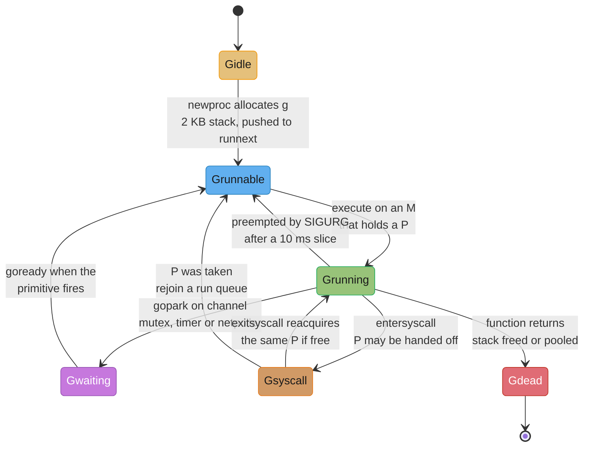
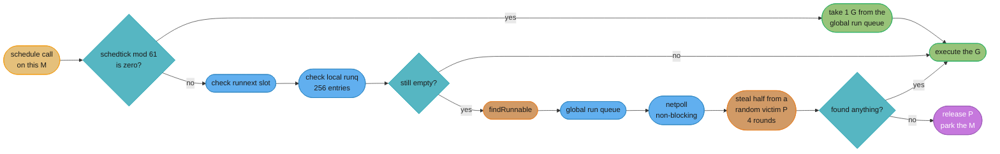
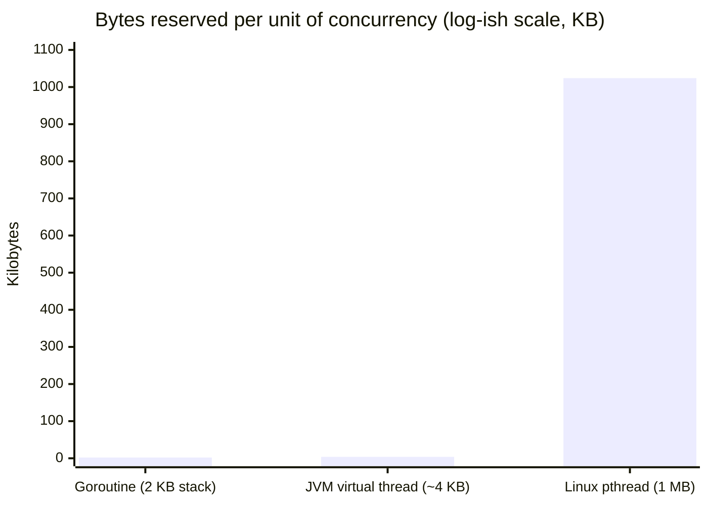
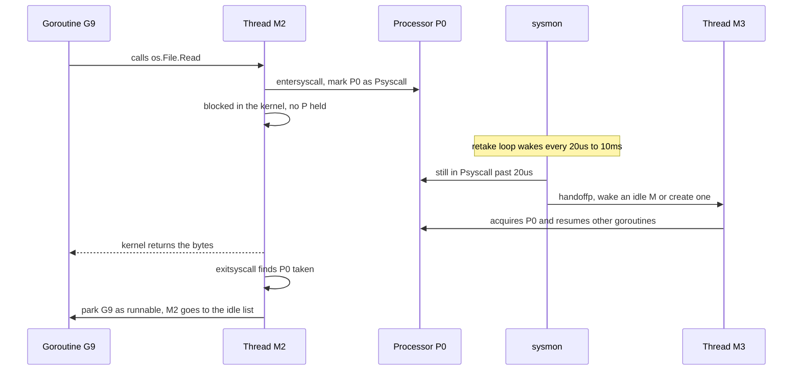

# Goroutines and the Scheduler

---

## 1. Concept Overview

A goroutine is not a thread. It is a `runtime.g` struct — roughly 400 bytes of bookkeeping — plus a
**2 KB stack allocated on the heap**, and the Go runtime multiplexes an unbounded number of them onto
a small, fixed set of operating-system threads. `go f()` costs about the same as a small heap
allocation. `pthread_create` costs a syscall, a page-table update, and a **~1 MB stack reservation**
that the kernel will honour whether the thread uses it or not. That single ratio — 2 KB against 1 MB,
roughly 500x — is why a Go program can hold a million concurrent connections in one process and a
thread-per-connection C or pre-Loom Java program cannot.

The mechanism that makes it work is the **GMP scheduler**: `G` for goroutine, `M` for machine (an OS
thread), and `P` for processor — a scheduling context that owns a run queue and represents *permission
to execute Go code*. `GOMAXPROCS` is the number of Ps, and therefore the number of goroutines running
Go code simultaneously. An M must hold a P to run a G. That indirection is the whole design: it gives
every OS thread a lock-free local run queue, lets an idle thread steal work from a busy one, and lets
the runtime detach a thread that has wandered into a blocking syscall without stalling the CPU it was
occupying.

Around that core sit four mechanisms that only ever surface at 3am. **`sysmon`**, a threadless monitor
loop, retakes a P from a thread stuck in a syscall for more than 20 microseconds and preempts a
goroutine that has been running for more than 10 milliseconds. **Asynchronous preemption** `[1.14]`
delivers a `SIGURG` signal to make that preemption possible even inside a tight loop that never calls a
function — the fix for a class of hang that used to freeze whole programs. The **netpoller** parks a
goroutine on `epoll`/`kqueue`/IOCP so that a million blocked network reads consume zero OS threads. And
**container-aware `GOMAXPROCS`** `[1.25]` stops a binary in a 0.5-CPU Kubernetes pod from creating one
P per host core and throttling itself to death.

This module is about all four. Target version is **Go 1.27** (released 2026-08-19).

---

## 2. Intuition

> The scheduler is a restaurant with `GOMAXPROCS` tables. Goroutines are orders, threads are waiters.
> A waiter who is standing at a table can serve orders; a waiter who has walked into the kitchen and is
> waiting on the oven gives up the table so someone else can use it. The tables, not the waiters, are
> the scarce resource — and the kitchen is where the OS lives.

**Mental model:** a P is a *licence to burn CPU on Go code*. There are exactly `GOMAXPROCS` licences.
An M without a licence cannot run Go, so it either sleeps or blocks in the kernel. Because the licence
count is fixed and small, the runtime can afford to give each licence its own **lock-free 256-entry run
queue** — the fast path of `go f()` is a bounds check and a store, with no atomic and no lock at all.

**Why it matters:** every practical goroutine question reduces to "did that block cost me a P or a
thread?" Blocking on a channel, a mutex, a `time.Sleep`, or a network read costs neither — the goroutine
parks, the M immediately picks the next G off the same P, and the thread never enters the kernel.
Blocking in a file read, a DNS lookup through cgo, or any raw syscall costs a **thread**: the M carries
the goroutine into the kernel and hands its P to a different M, which may have to be created. Programs
that spawn 20,000 OS threads have not created too many goroutines; they have created too many
*simultaneous blocking syscalls*.

**Key insight:** Go's concurrency ceiling is set by memory, not by the kernel, and the runtime's job is
to make sure a blocked goroutine never holds a CPU licence. Everything else — work stealing, `runnext`,
the 1-in-61 global-queue poll, `sysmon` — is fairness and cache-locality tuning on top of that one idea.

```
concurrent goroutines that fit = memory budget / (g struct + stack)
threads actually needed        = goroutines blocked in syscalls, not goroutines total
```

**Walk the arithmetic.** One million idle goroutines, each at its initial stack:

```
  g struct            ~400 bytes
  initial stack        2,048 bytes
  per goroutine       ~2,448 bytes

  1,000,000 goroutines  x 2,448 bytes   =   2.45 GB   -> a large but ordinary box
  1,000,000 OS threads  x 1,048,576     = 1,048.6 GB   -> 1 TB, physically impossible

  ratio                                 = ~428x
```

The million-goroutine program is memory-bound and runs. The million-thread program does not exist. But
notice the second line of the model: those million goroutines are served by roughly `GOMAXPROCS` + a
handful of threads, because they are all parked on the netpoller, not sitting in syscalls.

---

## 3. Core Principles

**1. A goroutine is a struct plus a growable stack, and the stack starts at 2 KB.**
`newproc` allocates (or reuses from a free list) a `g`, gives it a 2 KB stack from the runtime's stack
allocator, sets its program counter to the function you passed, and pushes it onto the current P's
`runnext` slot. There is no kernel involvement anywhere in that path.

**2. P exists so that run queues can be lock-free and work can be stolen.**
Without P, every M would contend on one global queue and every `go f()` would be an atomic
compare-and-swap on a shared structure. With P, the common case touches only thread-local state.

**3. An M must hold a P to execute Go code — and only Go code.**
A thread inside a syscall, inside cgo, or spinning for work does not need a P and gives it up. This is
why `GOMAXPROCS=8` and 60 live OS threads are perfectly consistent with each other.

**4. Blocking on a runtime primitive parks the goroutine; blocking in the kernel parks the thread.**
`gopark` moves a G to `_Gwaiting`, hands the M straight back to `schedule()`, and costs roughly the
same as a function call. `entersyscall` keeps the G glued to the M and puts the P into `_Psyscall`,
where `sysmon` may take it away.

**5. Preemption is asynchronous and signal-based.** `[1.14]`
The runtime sends `SIGURG` to a thread running a goroutine that has held its P for more than 10 ms.
The signal handler checks that the goroutine is at an *asynchronously preemptible* point and, if so,
injects a call to `asyncPreempt`, which spills registers and re-enters the scheduler.

**6. Fairness is bounded, not perfect.** A goroutine gets a 10 ms time slice. The global queue is
checked every 61st scheduling decision. A stolen batch is half the victim's queue. These are three
tuned constants, not invariants — do not build a design that depends on their exact values.

**7. `GOMAXPROCS` is the CPU parallelism knob and it now respects the cgroup.** `[1.25]`
On Linux the runtime reads the cgroup CPU bandwidth limit and defaults `GOMAXPROCS` to that limit when
it is lower than `runtime.NumCPU()`, and it re-checks periodically as the limit changes.

**8. Never assume a goroutine ends.** Nothing joins goroutines for you. A goroutine blocked on a channel
nobody will ever write to is a live object, its stack is a GC root, and it will sit there until the
process exits.

---

## 4. Types / Architectures / Strategies

### 4.1 The three entities

| Entity | What it is | How many | Where it lives |
|---|---|---|---|
| **G** (`runtime.g`) | A goroutine: stack, program counter, status, defer chain, `sudog` links | Unbounded — millions | Heap; ~400 bytes + a 2 KB starting stack |
| **M** (`runtime.m`) | An OS thread the runtime created, plus its `g0` system stack | Grows on demand; capped at 10,000 by default | One `pthread`/`clone` per M |
| **P** (`runtime.p`) | A scheduling context: 256-entry local run queue, `runnext` slot, mcache, timer heap, deferpool | Exactly `GOMAXPROCS` | Fixed array in the runtime |

### 4.2 Where a runnable goroutine can be waiting

| Location | Capacity | Cost to take from | Fairness role |
|---|---|---|---|
| `P.runnext` | 1 | Single atomic load | Cache locality: the goroutine you just woke runs next |
| `P.runq` (local) | 256 | Lock-free ring buffer, no atomic in the common case | The hot path |
| `sched.runq` (global) | Unbounded linked list | Needs `sched.lock` | Overflow target and starvation escape hatch |
| Netpoller ready list | Unbounded | `netpoll()` — one `epoll_wait` | Where I/O completions arrive |
| Another P's `runq` | — | Work stealing takes half | Load balancing across cores |

### 4.3 The four ways a goroutine stops running

| Blocking kind | Example | What happens to the G | What happens to the P | What happens to the M | Thread cost |
|---|---|---|---|---|---|
| **Runtime park** | channel send/recv, `sync.Mutex`, `time.Sleep`, `WaitGroup.Wait` | `gopark` → `_Gwaiting` | Kept, immediately runs the next G | Keeps running Go | Zero |
| **Network I/O** | `conn.Read`, `conn.Write` | Parked on the netpoller → `_Gwaiting` | Kept | Keeps running Go | Zero |
| **Blocking syscall** | `os.File.Read` on Linux, `getrandom`, most of `syscall` | `_Gsyscall`, glued to the M | Released to another M if the call exceeds ~20 µs | Blocked in the kernel | One thread, for the duration |
| **cgo call** | `C.compute()`, glibc DNS resolution | `_Gsyscall`, glued to the M | Same handoff rule as a syscall | Blocked in C | One thread, for the duration |

That table is the module in one page. The first two rows are why Go scales; the last two are why your
process has 400 threads.

### 4.4 Preemption strategies through Go's history

| Era | Mechanism | Failure mode |
|---|---|---|
| Go 1.0–1.13 | **Cooperative only** — the stack-growth check in a function prologue doubled as the preemption check | A loop with no function calls and no allocation was un-preemptible. `for {}` on `GOMAXPROCS=1` froze the program; a GC cycle could never start because it could not stop that goroutine |
| Go 1.14 onward | **Asynchronous preemption** — `SIGURG` delivered to the thread, handler injects `asyncPreempt` | Non-preemptible regions still exist (inside the runtime, holding certain locks, in assembly without register maps), but user Go code is preemptible |

---

## 5. Architecture Diagrams

### Diagram 1: the GMP topology

Alignment carries the meaning here, so this one stays ASCII.

```
                          GLOBAL RUN QUEUE (sched.runq, needs sched.lock)
                          [ G ][ G ][ G ][ G ] ... unbounded
                                    ^
                    overflow of 128 |         | checked every 61st schedule()
                                    |         v
   +--------------------------------+---------------------------------------+
   |                                                                        |
   v                                                                        v
 +---------------------------+                          +---------------------------+
 | P0        (GOMAXPROCS=2)  |                          | P1                        |
 | runnext: [ G7 ]           |                          | runnext: [    ]           |
 | runq:    [G1][G2][G3]...  |   <==== steals half ==== | runq:    [ empty ]        |
 |          cap 256          |                          |          cap 256          |
 | mcache, timers, deferpool |                          | mcache, timers, deferpool |
 +-------------+-------------+                          +-------------+-------------+
               |                                                      |
        holds  |                                               holds  |
               v                                                      v
        +-------------+                                        +-------------+
        | M0 (thread) |                                        | M1 (thread) |
        | running G7  |                                        | idle/spin   |
        +-------------+                                        +-------------+

        +-------------+          +-------------+          +-------------+
        | M2 no P     |          | M3 no P     |          | sysmon      |
        | in syscall  |          | sleeping on |          | no P, no G  |
        | with G9     |          | idle M list |          | 20us..10ms  |
        +-------------+          +-------------+          +-------------+

        NETPOLLER (epoll / kqueue / IOCP): thousands of Gs parked, zero threads
```

Every M in the bottom two rows is an OS thread that exists but is not burning CPU. Only the two Ps at
the top confer the right to run Go code, so `GOMAXPROCS=2` here means exactly two goroutines execute at
any instant — no matter that six threads exist.

### Diagram 2: the goroutine state machine



The two transitions that matter for capacity planning are the purple one and the orange one. Parking
(`Gwaiting`) is free and scales to millions. Entering a syscall (`Gsyscall`) can cost an OS thread, and
threads are capped at 10,000.

### Diagram 3: what `schedule()` actually looks for, in order



The `mod 61` branch is the only thing standing between two chatty goroutines that keep re-queueing each
other into `runnext` and total starvation of everything in the global queue.

### Diagram 4: what one unit of concurrency costs



A pthread reserves 512x what a goroutine allocates. The comparison is not entirely fair — the pthread's
megabyte is *virtual* address space and only the touched pages become resident — but the reservation is
what exhausts a 32-bit address space and what the kernel accounts for, and it is why thread pools exist
at all.

### Diagram 5: syscall handoff



The point of the handoff is that P0 spent about 20 microseconds idle rather than the full duration of a
disk read. The cost is that the process now owns one more OS thread, permanently, on the idle M list.

---

## 6. How It Works — Detailed Mechanics

### 6.1 What `go f()` compiles to

The statement becomes a call to `runtime.newproc`, which runs on the system stack:

```go
// Roughly what the runtime does, with error paths and locking elided.
func newproc(fn *funcval) {
    gp := getg()
    systemstack(func() {
        newg := newproc1(fn, gp, sys.GetCallerPC())   // grab a g from gfree, or allocate
        pp := getg().m.p.ptr()
        runqput(pp, newg, true)                       // true == put in the runnext slot
        if mainStarted {
            wakep()                                   // maybe start another P/M pair
        }
    })
}
```

Three costs, all small: a `g` is usually recycled from the P's `gfree` list rather than allocated; the
2 KB stack likewise comes from a per-P stack cache; and `runqput` with `next=true` is a single atomic
swap of the `runnext` pointer. Measured on a modern x86 box, `go func(){}()` is on the order of
**150–250 ns**, against roughly **10–20 µs** for `pthread_create`. Benchmark it on your own hardware
before quoting a number in a design review.

### 6.2 `runqput`, `runnext`, and the ping-pong problem

`runnext` is a one-slot buffer that jumps the queue. Its reason for existing is the request/response
pattern where goroutine A wakes B and immediately blocks waiting for B's reply:

```go
// Ping-pong: without runnext, B goes to the tail of a 256-deep queue and A
// waits for 255 unrelated goroutines to run first.
func pingpong(rounds int) {
    ping, pong := make(chan struct{}), make(chan struct{})
    go func() {
        for range rounds {
            <-ping
            pong <- struct{}{}
        }
    }()
    for range rounds {
        ping <- struct{}{}
        <-pong
    }
}
```

With `runnext`, the goroutine you just made runnable is the very next one to run on this P, and the
value being handed over is still in L1 cache. Without it, latency for this pattern would be governed by
queue depth rather than by the work.

The safety valve is that a goroutine sitting in `runnext` **can be stolen after a 3 µs grace period** —
otherwise two goroutines could swap the slot back and forth forever and starve an idle P.

When the 256-entry local queue is full, `runqput` calls `runqputslow`, which moves **half the local
queue (128 entries) plus the new goroutine to the global queue** in one batch under `sched.lock`. That
batching is why a burst of `go` statements does not turn into 256 lock acquisitions.

### 6.3 The 1-in-61 global-queue check

```go
// runtime/proc.go, schedule(), simplified
if gp == nil && pp.schedtick%61 == 0 && sched.runqsize > 0 {
    lock(&sched.lock)
    gp = globrunqget(pp, 1)
    unlock(&sched.lock)
}
```

Without this, a pair of goroutines that keep waking each other into `runnext` would hold a P forever and
anything sitting in the global queue — including goroutines pushed there by `runqputslow` — would never
run. 61 is prime specifically so that it does not resonate with any periodic pattern in the workload.
It is a starvation bound, not a fairness guarantee: on a busy P the global queue is still drained one
goroutine per 61 scheduling decisions.

### 6.4 Work stealing

When a P's local queue, the global queue, and the netpoller all come up empty, the M **spins**: it
stays awake without a G and tries to steal. The rules:

- Up to **4 rounds** of stealing attempts before giving up.
- Each round walks all Ps in a **randomized order** with a random coprime stride, so N idle Ps do not
  all hammer P0.
- A successful steal takes **half of the victim's local run queue**, not one goroutine — amortising the
  cost of the atomic operations over many items.
- Only on the **final** round will a thief take the victim's `runnext` slot, and only if that goroutine
  has been sitting there for more than 3 µs.
- The number of spinning Ms is capped at `GOMAXPROCS/2` to bound the CPU burned on stealing.

If all four rounds fail, the M drops its P onto the idle list and parks on a futex. Waking it later is
a syscall, which is why the runtime tries hard to keep one M spinning: `wakep()` prefers handing work to
a spinning thread over waking a sleeping one.

### 6.5 `sysmon`: the thread with no P

`sysmon` runs `M` code on a dedicated thread that never acquires a P and is therefore invisible to
`GOMAXPROCS`. It loops with an adaptive delay starting at **20 µs** and backing off to **10 ms** when
the program is idle. Each pass it:

1. Runs `netpoll()` if nobody has polled in the last 10 ms, and injects ready goroutines into the global
   queue.
2. Calls `retake()`, which walks every P:
   - a P in `_Psyscall` for more than **20 µs** (one `sysmon` tick) has its P handed off via `handoffp`;
   - a P in `_Prunning` whose current goroutine has held it for more than **10 ms** is marked for
     preemption via `preemptone`.
3. Forces a GC if none has run for **2 minutes**.
4. Scavenges unused heap pages back to the OS.

`sysmon` is why a goroutine cannot monopolise a core and why a P is not lost to a slow disk read. It is
also why an idle Go process still shows a small, constant background CPU usage.

### 6.6 Asynchronous preemption `[1.14]`

Before Go 1.14, the *only* preemption point was the stack-growth check that the compiler emits in every
non-leaf function prologue. A goroutine that called no functions could not be stopped:

```go
// This program HUNG FOREVER on Go 1.13 with GOMAXPROCS=1.
// The busy goroutine never calls a function, so the runtime cannot stop it,
// so the garbage collector's stop-the-world never completes.
func main() {
    runtime.GOMAXPROCS(1)
    go func() {
        for {          // no call, no allocation, no preemption point
        }
    }()
    time.Sleep(time.Millisecond)
    runtime.GC()       // blocks forever waiting to stop the goroutine above
}
```

Go 1.14 made this terminate. `preemptM` sends **`SIGURG`** to the target thread. The signal handler
(`sighandler`) checks whether the interrupted program counter is at an *async-preemption-safe* point —
one where the compiler emitted a register map so the GC can find pointers — and if so rewrites the
return address to push a call to `runtime.asyncPreempt`, which spills every register into a
`asyncPreemptState` frame and calls into the scheduler.

`SIGURG` was chosen because it is not used for anything else, does not terminate the process by default,
and can be delivered repeatedly. The cost is real and visible: a Go program under heavy preemption
generates thousands of signals per second, and any `syscall` you make in a loop can now return `EINTR`.
Standard-library calls retry automatically; **your own raw `syscall.Syscall` calls must handle `EINTR`
themselves**.

Non-preemptible regions still exist: code holding runtime locks, code inside `//go:nosplit` functions,
and hand-written assembly without register maps. They are short by construction.

### 6.7 Why network I/O is free and file I/O is not

Every `net.Conn` in Go is a non-blocking file descriptor registered with the platform poller —
`epoll` on Linux, `kqueue` on BSD and macOS, IOCP on Windows. `conn.Read` does this:

```
read(fd) -> EAGAIN  ->  runtime.netpollblock  ->  gopark(G, waiting for I/O)
                                                     M is free, runs the next G
epoll_wait reports fd readable  ->  netpollready  ->  goready(G)  ->  back on a run queue
```

No thread is consumed while waiting. This is what makes goroutine-per-connection viable at a million
connections.

**Regular files on Linux are not in that story.** `epoll` on a regular file always reports ready, so the
runtime does not register them; `os.File.Read` is a genuine blocking `read(2)` that parks the whole
thread. A service that reads 500 files concurrently really does create up to 500 OS threads. The same
applies to `getaddrinfo` when the cgo resolver is in use, to `os/exec`, and to most of `syscall`. Use
the pure-Go DNS resolver (`GODEBUG=netdns=go`) and bound file I/O with a semaphore.

### 6.8 Stacks that grow by copying

Each goroutine starts with 2 KB. The compiler emits a prologue in every non-leaf function that compares
the stack pointer against `g.stackguard0`; when the frame will not fit, it calls `runtime.morestack` →
`runtime.newstack`, which:

1. allocates a **new stack of double the size** (2 KB → 4 KB → 8 KB → …);
2. copies the old stack's bytes into it;
3. **adjusts every pointer that pointed into the old stack** — the runtime knows where they are from the
   compiler's stack maps;
4. frees the old stack.

Two consequences that people trip over. First, **a goroutine's stack address changes over its life**, so
a pointer to a local that escapes to C via cgo is invalid the moment the stack moves — which is exactly
why the cgo pointer-passing rules exist. Second, the growth path has a hard ceiling:
`runtime/debug.SetMaxStack` defaults to **1 GB on 64-bit** and 250 MB on 32-bit, and unbounded recursion
dies with `goroutine stack exceeds 1000000000-byte limit` followed by `fatal error: stack overflow` —
not a `panic`, and therefore **not recoverable**.

Stacks also shrink: during a GC cycle, a goroutine using less than **one quarter** of its stack has it
halved, so a goroutine that once needed 1 MB does not hold it forever.

### 6.9 `GOMAXPROCS`, containers, and the CFS throttle `[1.25]`

Before Go 1.25 the default was `runtime.NumCPU()`, which on Linux reports the *host's* CPU count from
the scheduler affinity mask — it has never known anything about cgroup CPU **bandwidth** limits. Put
that binary in a Kubernetes pod with `limits.cpu: 500m` on a 64-core node and you got 64 Ps competing
for half a core:

```
  cgroup quota:  cpu.max = "50000 100000"   -> 50 ms of CPU per 100 ms period = 0.5 CPU

  Go 1.24 default:  GOMAXPROCS = NumCPU() = 64
    64 runnable goroutines all want CPU at once
    they burn the entire 50 ms quota in 50/64 = 0.78 ms of wall time
    the cgroup is then THROTTLED for the remaining 99.2 ms of the period
    => p99 latency picks up a ~99 ms cliff, every period, forever
    => GC assist and mark workers are scaled to 64 Ps and thrash the same quota

  Go 1.25 default:  GOMAXPROCS = ceil(0.5) = 1     (never below 1)
    1 goroutine runs at a time, quota is consumed evenly across the period
    throttling drops to near zero
```

Go 1.25 changed the default on Linux to consider the cgroup CPU bandwidth limit and use it when it is
lower than the logical CPU count, and — on **all** operating systems — to periodically re-check and
update `GOMAXPROCS` when the available CPUs or the cgroup limit change. Both behaviours switch off
automatically if you set the `GOMAXPROCS` environment variable or call `runtime.GOMAXPROCS`, and can be
disabled explicitly with `GODEBUG=containermaxprocs=0` and `GODEBUG=updatemaxprocs=0`.

Two operational details. The runtime uses the CPU **limit**, never the CPU **request** — a pod with a
request and no limit still sees the whole node. And `runtime.SetDefaultGOMAXPROCS()` `[1.25]` restores
the automatic default, which is how you undo an inherited `GOMAXPROCS` env var from a base image
without knowing what value to write.

### 6.10 Reading `schedtrace`

```text
$ GODEBUG=schedtrace=1000 ./server
SCHED 1002ms: gomaxprocs=8 idleprocs=0 threads=14 spinningthreads=1 idlethreads=4 runqueue=27 [12 9 14 3 8 0 6 11]
SCHED 2003ms: gomaxprocs=8 idleprocs=0 threads=14 spinningthreads=0 idlethreads=3 runqueue=61 [18 22 17 9 14 5 12 19]
```

| Field | Meaning | What a bad value looks like |
|---|---|---|
| `gomaxprocs` | Number of Ps | Not 1 in a 1-CPU container means the cgroup was not detected |
| `idleprocs` | Ps with no M | Persistently equal to `gomaxprocs` under load means you are blocked, not CPU-bound |
| `threads` | Total Ms | Climbing past a few hundred means blocking syscalls or cgo |
| `spinningthreads` | Ms hunting for work | Consistently high means the queues are empty and load is imbalanced |
| `runqueue` | Global queue depth | Growing monotonically means you are oversubscribed — more runnable work than CPU |
| `[…]` | Per-P local queue depths | Wildly uneven values mean work stealing is not keeping up |

Both lines above are unhealthy: `idleprocs=0` with `runqueue` growing from 27 to 61 is a CPU-saturated
service that needs either more `GOMAXPROCS` or less work. Add `scheddetail=1` for a per-G, per-M, per-P
dump — it is enormous, so use it on a reproduction, never in production.

### 6.11 Scheduler metrics from inside the process `[1.26]`

`GODEBUG` output goes to stderr and cannot be scraped. `runtime/metrics` can:

```go
package main

import (
    "fmt"
    "runtime/metrics"
)

func main() {
    samples := []metrics.Sample{
        {Name: "/sched/goroutines:goroutines"},         // live goroutines, same as NumGoroutine
        {Name: "/sched/threads:threads"},               // OS threads the runtime knows about  [1.26]
        {Name: "/sched/goroutines-created:goroutines"}, // monotonic creation counter          [1.26]
        {Name: "/sched/latencies:seconds"},             // histogram: runnable -> running delay
    }
    metrics.Read(samples)

    fmt.Println("live goroutines:", samples[0].Value.Uint64())
    fmt.Println("os threads:     ", samples[1].Value.Uint64())
    fmt.Println("created total:  ", samples[2].Value.Uint64())

    h := samples[3].Value.Float64Histogram()
    fmt.Println("sched latency buckets:", len(h.Counts))
}
```

Go 1.26 added counts of goroutines by state under the **`/sched/goroutines` prefix** (waiting, runnable,
and so on), the OS-thread count as `/sched/threads:threads`, and a lifetime creation counter as
`/sched/goroutines-created:goroutines`. Export all three. `/sched/goroutines-created:goroutines` is the
one that catches a leak early: a healthy service's creation *rate* is proportional to its request rate,
while the live count stays flat. A live count that tracks the creation count is a leak.

`/sched/latencies:seconds` — the delay between `_Grunnable` and actually running — is the single best
number for "am I CPU-starved?". A p99 above **10 ms** on a latency-sensitive service means goroutines
are queueing for a P.

### 6.12 `LockOSThread` and `Gosched`

```go
// Mandatory whenever the OS or a C library keys state to the thread itself.
func renderLoop(ctx context.Context) {
    runtime.LockOSThread()          // OpenGL contexts are per-thread
    defer runtime.UnlockOSThread()
    gl.MakeContextCurrent(window)
    for ctx.Err() == nil {
        gl.Clear(gl.COLOR_BUFFER_BIT)
        window.SwapBuffers()
    }
}
```

`LockOSThread` pins the calling goroutine to its M for the rest of the call. Legitimate uses are narrow:
per-thread OS state (OpenGL and most UI toolkits, which additionally demand the *main* thread — hence
`runtime.LockOSThread` in an `init()`), Linux namespaces and `setns`, `unshare`, per-thread credentials
via `setresuid`, and `ptrace`. The cost is that the M can never be reused for another goroutine, and if
the goroutine exits without unlocking, **the thread is destroyed** rather than returned to the pool.

`runtime.Gosched()` yields the P voluntarily, putting the current goroutine on the *global* run queue.
Since asynchronous preemption `[1.14]` it is almost never needed — the cases where it still helps are
benchmark harnesses and tight non-preemptible runtime-adjacent loops. If you find yourself sprinkling
`Gosched` to fix a fairness problem, the real bug is usually a lock held too long.

---

## 7. Real-World Examples

**Kubernetes `kubelet` and `kube-apiserver`.** Both run with an explicit `GOMAXPROCS` in most
distributions precisely because they predate `[1.25]` and were routinely deployed with CPU limits. The
apiserver's watch machinery is a textbook netpoller workload: tens of thousands of long-lived HTTP/2
streams, each a handful of goroutines, all parked with zero thread cost.

**CockroachDB.** Sets `GOMAXPROCS` from the cgroup and warns loudly at startup when the ratio of
`GOMAXPROCS` to the CPU limit is wrong, because their storage layer's latency is dominated by scheduler
queueing. They also historically fought the "file I/O parks a thread" problem, which is why their Pebble
storage engine cares deeply about how many concurrent `pread` calls are in flight.

**Prometheus.** A scrape is one goroutine per target, blocked on the netpoller for almost its whole
life. A 10,000-target Prometheus has 10,000 mostly-parked goroutines and roughly `GOMAXPROCS` busy
threads. Its `go_goroutines` and `go_threads` metrics — exposed by `client_golang` from the same runtime
sources as §6.11 — are the standard leak alert in every Prometheus deployment.

**Docker and containerd.** Heavy cgo and `os/exec` users, and consequently heavy thread users. A
containerd shim with hundreds of OS threads is not misbehaving; every blocking `runc` invocation and
every libc call parks an M.

**Cloudflare's edge.** Publicly documented goroutine-per-connection Go proxies handling millions of
concurrent connections per machine, with the memory budget dominated by per-connection *buffers*, not
by goroutine stacks — the 2 KB stack is rounding error next to a 4 KB read buffer plus a 4 KB write
buffer.

---

## 8. Tradeoffs

### 8.1 Goroutine vs OS thread vs JVM virtual thread vs `asyncio` task

| Dimension | Goroutine | Linux pthread | JVM virtual thread | Python `asyncio` task |
|---|---|---|---|---|
| Initial stack | 2 KB heap, grows by copying | ~1 MB reserved, fixed | ~few KB heap continuation, grows | No stack; a coroutine frame |
| Creation cost | ~150–250 ns | ~10–20 µs | ~1 µs | ~1 µs |
| Scheduler | Runtime GMP, work-stealing | Kernel CFS/EEVDF | JVM `ForkJoinPool` | Single-threaded event loop |
| Parallelism | `GOMAXPROCS` cores | All cores | All cores | **One** core (until free-threading) |
| Blocking call | Compiler and runtime intercept it transparently | Blocks the thread | JDK intercepts it in the JDK's own I/O layer | **`await` required — a blocking call stalls everything** |
| Preemption | Asynchronous, `SIGURG`, 10 ms slice | Kernel timeslice | **Cooperative only** — a CPU-bound virtual thread does not yield | Cooperative only |
| Pinning trap | `LockOSThread`, cgo, blocking syscall | N/A | Native frames (JNI, FFM) | N/A |
| Stack trace | Full, one goroutine per trace | Full | Full | Fragmented across `await`s |
| Practical ceiling | Millions | Thousands | Millions | Hundreds of thousands |

The row worth arguing about in an interview is **preemption**. Go preempts a CPU-bound goroutine after
10 ms; the JVM does not preempt a CPU-bound virtual thread at all, so a virtual thread running a tight
loop occupies its carrier until it finishes. Go's model is more robust against one bad goroutine; the
JVM's is simpler and has no signal-handling cost. See
[Structured Concurrency and Project Loom](../../java/structured_concurrency_and_loom/structured_concurrency_and_loom.md)
for the JVM side, and
[The GIL and Free Threading](../../python/the_gil_and_free_threading/the_gil_and_free_threading.md)
for why the `asyncio` column has a "one core" entry.

### 8.2 What the GMP design bought and what it cost

| Gained | Paid for with |
|---|---|
| Lock-free `go f()` on the common path | A whole extra entity (P) that every runtime contributor must reason about |
| Blocking syscalls do not stall a core | An unbounded thread count driven by syscall concurrency, capped only at 10,000 |
| Transparent blocking-style I/O | A netpoller that regular files sit outside of, invisibly |
| Millions of concurrent tasks | No structured concurrency: nothing joins a goroutine, so leaks are the default failure |
| CPU-bound goroutines get preempted | Signal traffic, `EINTR` on raw syscalls, non-preemptible runtime regions |
| Cache-friendly `runnext` handoff | A starvation risk patched by two magic constants (61, and the 3 µs steal grace) |

### 8.3 Setting `GOMAXPROCS`

| Value | When it is right | What it costs |
|---|---|---|
| Automatic `[1.25]` | Almost always, from Go 1.25 onward | Nothing; it is the default |
| `= CPU limit`, set explicitly | Older Go, or a limit expressed in a way the runtime cannot read | Goes stale when the limit changes |
| `= CPU limit + 1` or `+ 2` | Workloads with frequent short blocking syscalls | Mild oversubscription and more context switching |
| `1` | Reproducing a race; deterministic benchmarks | No parallelism at all — never in production |
| `> NumCPU` | Essentially never | More Ps than cores means pure scheduler overhead |

---

## 9. When to Use / When NOT to Use

### Start a goroutine when:
- The work is genuinely concurrent and its result is either awaited by a channel or `errgroup`, or the
  work is fire-and-forget with an explicit lifetime.
- You are handling a network connection or request — one goroutine per connection is the idiom, and it
  is free because the netpoller absorbs the blocking.
- You need a timeout or cancellation boundary around a call that does not accept a `context`.
- The goroutine's exit condition is written down somewhere before the `go` keyword is typed.

### Do NOT start a goroutine when:
- You cannot state, in one sentence, what makes it return. That is the definition of a leak.
- The work is a pure CPU computation and you already have `GOMAXPROCS` goroutines running — you are
  adding queueing, not parallelism.
- The caller needs the result immediately. `go f(); <-done` is a slow function call.
- It is unbounded per request. `for _, item := range items { go process(item) }` on a 500,000-element
  slice is a fork bomb; use a bounded worker pool. See
  [Concurrency Patterns and Pitfalls](../concurrency_patterns_and_pitfalls/concurrency_patterns_and_pitfalls.md).

### Set `GOMAXPROCS` manually when:
- You run Go 1.24 or earlier under a CPU limit — this is the single highest-value one-line fix.
- You deliberately want to leave headroom for a sidecar sharing the CPU quota.
- You are benchmarking and need determinism.

### Do NOT touch `GOMAXPROCS` when:
- You are on Go 1.25 or later in a container. The default is already right, and setting the environment
  variable **disables** the automatic updating.
- You are "tuning for throughput" without a measurement. Raising it above the CPU limit makes CFS
  throttling worse, not better.

### Use `runtime.LockOSThread` when:
- The C library or OS API keys state to the thread: OpenGL, most UI toolkits, `setns`, `unshare`,
  per-thread credentials, `ptrace`.

### Do NOT use `runtime.LockOSThread` when:
- You are trying to "make things faster" or to pin a goroutine to a CPU. It does neither — it pins to a
  *thread*, and the OS still moves that thread between cores.

---

## 10. Common Pitfalls

### Pitfall 1: 64 Ps inside half a CPU — the CFS throttling incident

A payments API moved from 4-vCPU VMs to Kubernetes on 64-core nodes with `limits.cpu: "1"`. p50 latency
was unchanged. **p99 went from 40 ms to 1.2 seconds**, and `container_cpu_cfs_throttled_seconds_total`
showed the pods throttled for 85% of every 100 ms period.

```go
// BROKEN: Go 1.24 binary, containerized, no GOMAXPROCS set.
// runtime.NumCPU() reports 64 (the node), the cgroup quota allows 1 CPU.
// The runtime starts 64 Ps, GC scales its mark workers to 64 Ps, and the
// pod burns its entire 100 ms quota in ~1.5 ms of wall time, then stalls.
func main() {
    log.Printf("GOMAXPROCS=%d NumCPU=%d", runtime.GOMAXPROCS(0), runtime.NumCPU())
    // GOMAXPROCS=64 NumCPU=64   <- inside a 1-CPU cgroup
    srv := newServer()
    log.Fatal(srv.ListenAndServe())
}
```

```go
// FIX (Go 1.25 or later): upgrade and delete the tuning. The runtime reads the
// cgroup CPU bandwidth limit itself and re-checks it as it changes.
func main() {
    // If a base image or Helm chart set GOMAXPROCS, that DISABLES the automatic
    // default. This one line restores it.
    runtime.SetDefaultGOMAXPROCS() // [1.25]
    log.Printf("GOMAXPROCS=%d NumCPU=%d", runtime.GOMAXPROCS(0), runtime.NumCPU())
    // GOMAXPROCS=1 NumCPU=64
    srv := newServer()
    log.Fatal(srv.ListenAndServe())
}
```

**Impact after the fix:** p99 1.2 s → 55 ms, throttled fraction 85% → under 2%, and CPU *usage* went
**up** — the pod could finally spend its quota smoothly instead of in a burst followed by a stall. On
Go 1.24 and earlier the equivalent fix is `GOMAXPROCS` from the downward API or the `automaxprocs`
library. The tell in `schedtrace` is `gomaxprocs=64` with `idleprocs` oscillating between 0 and 64.

### Pitfall 2: 8,000 OS threads from an unbounded file scan

An indexing service walked a filesystem and `go`-routined a `os.ReadFile` per entry. Goroutines were
cheap, so nobody bounded them. The process died with `runtime: program exceeds 10000-thread limit`.

The cause is §6.7: regular-file reads are not on the netpoller, so each concurrent read parks an M, and
`sysmon` spawns a fresh one to keep the P busy. 8,000 concurrent reads means 8,000 threads at ~8 KB of
kernel stack plus ~1 MB of reserved user stack each. Peak RSS was 6.4 GB with a 300 MB heap.

The fix is a semaphore around the *syscall*, not around the goroutine:

```go
sem := make(chan struct{}, 64) // 64 concurrent blocking reads, so <= ~64 extra threads
for _, path := range paths {
    go func() {
        sem <- struct{}{}
        defer func() { <-sem }()
        data, err := os.ReadFile(path)
        _ = data
        _ = err
    }()
}
```

**Impact:** threads 8,000 → 71, RSS 6.4 GB → 480 MB, and wall-clock time *improved* by 30% because the
disk queue stopped thrashing. `runtime/debug.SetMaxThreads` can raise the 10,000 cap, but raising it is
almost always the wrong fix — it converts a crash into a slow death.

### Pitfall 3: the goroutine leak that looks like a memory leak

```go
// BROKEN: on timeout the caller returns, nothing ever receives from ch,
// and the worker goroutine blocks on the send forever. Its stack, its
// closure, and everything they reference stay reachable.
func fetchWithTimeout(url string) (string, error) {
    ch := make(chan string)          // unbuffered
    go func() {
        ch <- slowGet(url)           // blocks forever after the timeout below
    }()
    select {
    case v := <-ch:
        return v, nil
    case <-time.After(2 * time.Second):
        return "", errors.New("timeout")
    }
}
```

At 500 requests per second with a 3% timeout rate, that leaks 15 goroutines per second — 1.3 million
per day. Heap growth is slow enough to look like a normal memory leak, and every heap profile points at
the wrong thing because the *retained* objects are ordinary response bodies.

```go
// FIX: a buffer of 1 lets the sender complete and exit even with no receiver.
// Better still, propagate a context so slowGet stops doing the work at all.
func fetchWithTimeout(ctx context.Context, url string) (string, error) {
    ctx, cancel := context.WithTimeout(ctx, 2*time.Second)
    defer cancel()
    ch := make(chan string, 1)       // buffered: the send never blocks
    go func() { ch <- slowGet(ctx, url) }()
    select {
    case v := <-ch:
        return v, nil
    case <-ctx.Done():
        return "", ctx.Err()
    }
}
```

**Impact:** RSS stopped growing and the daily restart went away. The diagnostic that finds this in
seconds is the goroutine profile — see Pitfall 6.

### Pitfall 4: a `runtime.Gosched()` cargo-culted into a hot loop

A team on Go 1.19 inherited a `runtime.Gosched()` inside a per-message loop, added years earlier "for
fairness" on Go 1.11. Every call pushed the goroutine onto the **global** run queue, forcing a
`sched.lock` acquisition and losing the `runnext` cache locality — under load the lock became the
bottleneck and throughput sat at 40% of what the same code did with the line deleted.

Asynchronous preemption `[1.14]` made the line obsolete: a goroutine in a loop is now interrupted after
10 ms whether it yields or not. **Impact of the one-line deletion:** 210k messages/s → 520k
messages/s, and `sched.lock` contention disappeared from the mutex profile.

### Pitfall 5: `LockOSThread` without `UnlockOSThread`

A CLI that entered a Linux network namespace called `runtime.LockOSThread()` and never unlocked. Every
invocation of the helper goroutine destroyed its M on exit — the runtime does that deliberately, because
a thread whose namespace was mutated must never be reused. In a loop over 20,000 namespaces the process
created and destroyed 20,000 threads, and `clone`/`exit` syscall overhead dominated the profile at 60%
of CPU.

The fix is `defer runtime.UnlockOSThread()` **plus** restoring the namespace before unlocking — an
unlocked thread with a mutated namespace is worse than a destroyed one, because it silently poisons
whatever goroutine lands on it next.

### Pitfall 6: never having looked at a goroutine dump

Three of the five pitfalls above are visible in five seconds from a running process, and most teams have
never fetched one:

```bash
# Every goroutine's stack, grouped and counted. The leak is the one with a
# count in the tens of thousands, all stopped at the same line.
curl -s 'localhost:6060/debug/pprof/goroutine?debug=1' | head -40

# Full stacks, one per goroutine, when you need the arguments.
curl -s 'localhost:6060/debug/pprof/goroutine?debug=2' > goroutines.txt

# Goroutines that are provably unblockable, not merely numerous.  [1.27]
curl -s 'localhost:6060/debug/pprof/goroutineleak' > leak.pb.gz
go tool pprof -http=:8080 leak.pb.gz
```

`SIGQUIT` (`Ctrl-\`) dumps every goroutine stack and kills the process — the right tool when a binary
is wedged and has no pprof endpoint. The `goroutineleak` profile, **GA in Go 1.27**, is the one that
distinguishes "50,000 goroutines because we have 50,000 connections" from "50,000 goroutines blocked on
a channel that is unreachable from any runnable goroutine". It uses the garbage collector: if a
goroutine is blocked on a primitive that no runnable goroutine can reach, nothing can ever unblock it.

---

## 11. Technologies & Tools

| Tool | What it is for | How you invoke it |
|---|---|---|
| **`GODEBUG=schedtrace=N`** | Scheduler summary every N ms on stderr | `GODEBUG=schedtrace=1000 ./binary` |
| **`GODEBUG=scheddetail=1`** | Per-G, per-M, per-P dump alongside `schedtrace` | `GODEBUG=schedtrace=1000,scheddetail=1 ./binary` |
| **`runtime/metrics`** | Scheduler counters and histograms as data, not text | `metrics.Read` on `/sched/*` |
| **`net/http/pprof`** | Goroutine, CPU, heap, block and mutex profiles over HTTP | `import _ "net/http/pprof"` |
| **`goroutineleak` profile `[1.27]`** | Provably unblockable goroutines, GC-detected | `/debug/pprof/goroutineleak` |
| **`runtime/trace`** | Per-goroutine timeline: why a goroutine did not run for 40 ms | `go tool trace trace.out` |
| **`go test -race`** | Happens-before race detector, ~10x slowdown, ~5x memory | `go test -race ./...` |
| **`go test -cpu=1,2,4,8`** | Runs the suite at several `GOMAXPROCS` values | Catches parallelism-dependent bugs |
| **`delve`** | The Go debugger; `goroutines` and `goroutine N bt` list and enter goroutines | `dlv attach $(pgrep server)` |
| **`uber-go/automaxprocs`** | Sets `GOMAXPROCS` from the cgroup on Go 1.24 and earlier | Blank import; unnecessary from `[1.25]` |
| **`golang.org/x/sync/errgroup`** | Bounded, cancellable goroutine groups with error propagation | `g.SetLimit(n)` |
| **`go.uber.org/goleak`** | Fails a test when it leaks a goroutine | `defer goleak.VerifyNone(t)` |
| **`perf` / `bpftrace`** | Off-CPU analysis when the delay is in the kernel, not the runtime | See [Off-CPU and eBPF Analysis](../../backend/off_cpu_and_ebpf_analysis/off_cpu_and_ebpf_analysis.md) |

Related reading: [Processes, Threads and Context Switching](../../cs_fundamentals/processes_threads_and_context_switching/processes_threads_and_context_switching.md)
for the kernel-side model this whole design is built to avoid, and
[Profiling and Tracing](../profiling_and_tracing/profiling_and_tracing.md) for the tooling in depth.

---

## 12. Interview Questions with Answers

**Q: What does a goroutine actually cost compared with an OS thread?**
**Short:** About 2.4 KB up front — a roughly 400-byte struct plus a 2 KB heap stack — against roughly 1 MB of reserved stack for a pthread.

The runtime allocates a `g` struct (usually recycled from a per-P free list) and a 2 KB stack that grows
by copying. Creation is on the order of 150–250 ns with no syscall, against roughly 10–20 µs for
`pthread_create`, which needs a syscall and a 1 MB stack reservation. The practical consequence is
arithmetic: a million goroutines is about 2.45 GB and runs on ordinary hardware, while a million threads
would need about 1 TB of stack reservation and cannot exist. Quote the ratio, not the absolute numbers,
and measure creation cost on your own box before putting it in a design doc.

**Q: Why does the scheduler need a P at all instead of scheduling Gs directly onto Ms?**
**Short:** P is the unit that owns a lock-free local run queue, so the common path of starting a goroutine touches no shared state and no lock.

Go's pre-1.1 scheduler did map goroutines straight onto threads with one global run queue guarded by one
mutex, and it did not scale past a handful of cores. Introducing P gives every thread that is running Go
code its own 256-entry ring buffer, its own memory allocator cache, its own timer heap and its own defer
pool, which turns `go f()` into a bounds check and a store. P also gives the runtime something to *hand
off*: when a thread blocks in the kernel it releases its P, so the CPU slot moves to a different thread
without the blocked goroutine having to move. And because Ps are a fixed small array, work stealing has
a bounded, enumerable set of victims to choose from.

**Q: Will a goroutine running a tight loop with no function calls ever be preempted?**
**Short:** Yes since Go 1.14 — the runtime signals the thread with SIGURG and injects a call to asyncPreempt at a safe point.

Before Go 1.14 the answer was no, and it was a real hang: the only preemption check was the stack-growth
test in a function prologue, so `for {}` on `GOMAXPROCS=1` froze the whole program because the garbage
collector's stop-the-world could never complete. Asynchronous preemption sends `SIGURG` to the offending
thread; the handler verifies the interrupted program counter is at a point where the compiler emitted a
register map, then rewrites the return address to call `runtime.asyncPreempt`, which spills registers and
re-enters the scheduler. Two side effects to know: raw `syscall.Syscall` calls can now return `EINTR` and
your code must retry them, and short regions inside the runtime and in hand-written assembly remain
non-preemptible by design.

**Q: What happens to the P when a goroutine makes a blocking syscall?**
**Short:** The P is marked Psyscall and, if the call runs longer than about 20 microseconds, sysmon hands it to another thread.

`entersyscall` records that the M is leaving Go code and puts its P into `_Psyscall` without releasing it
— that optimism is deliberate, because a fast syscall returning in under a microsecond can reclaim the
same P with no coordination at all. If `sysmon`'s retake loop sees the P still in `_Psyscall` on a later
tick, it calls `handoffp`, which wakes an idle M or creates a fresh one to take the P over. When the
original syscall finally returns, `exitsyscall` finds its P gone, so the goroutine goes back on a run
queue and the now-Pless thread parks on the idle M list. The visible cost is a permanently larger thread
count, which is why a service doing heavy file I/O can show hundreds of threads at `GOMAXPROCS=8`.

**Q: Why does blocking on a channel not consume an OS thread while reading a file does?**
**Short:** A channel block parks the goroutine and returns the thread to the scheduler, whereas a regular-file read is a real syscall that parks the thread inside the kernel.

`gopark` moves the goroutine to `_Gwaiting`, unlinks it from the M, and jumps straight back into
`schedule()`, which picks the next runnable goroutine on the same P — nothing enters the kernel and the
cost is comparable to a function call. Network reads get the same treatment because every `net.Conn` is
a non-blocking descriptor registered with `epoll`, `kqueue` or IOCP, so `EAGAIN` becomes a park and the
poller wakes the goroutine later. Regular files on Linux are the exception: `epoll` always reports a
regular file as ready, so the runtime cannot use the poller and `os.File.Read` blocks its thread for the
whole duration. That single asymmetry is why file-heavy services need a semaphore around their reads
while connection-heavy services need nothing.

**Q: What is the 1-in-61 rule and what breaks without it?**
**Short:** Every 61st scheduling decision a P takes one goroutine from the global queue instead of its local one, which is the only thing preventing global-queue starvation.

Two goroutines that keep waking each other land in the `runnext` slot each time, so a P can service them
forever without ever touching its local queue, let alone the global one. Meanwhile the global queue
holds anything that overflowed a full local queue, everything injected by `sysmon` from the netpoller,
and every goroutine that called `Gosched`. The check is literally `pp.schedtick%61 == 0 &&
sched.runqsize > 0` in `schedule()`; 61 is prime so it cannot resonate with a periodic workload. Treat
it as a starvation bound rather than a fairness mechanism — one goroutine per 61 decisions is a trickle,
not a fair share.

**Q: What is the `runnext` slot for?**
**Short:** It is a one-goroutine bypass of the run queue that makes a wake-and-wait handoff run immediately, keeping the handed-over data in L1 cache.

Consider a goroutine that sends on a channel and then blocks waiting for the reply. Without `runnext`,
the goroutine it just made runnable goes to the tail of a queue that may hold 256 entries, so the
round-trip latency is set by queue depth rather than by the work. `runqput(pp, g, true)` instead puts it
in a single dedicated slot that `schedule()` checks before the local queue, so the receiver runs next on
the same core while the value is still hot. The runtime guards against abuse: a goroutine parked in
`runnext` becomes stealable after roughly 3 microseconds, so two goroutines cannot ping-pong the slot
forever while another P sits idle.

**Q: How does work stealing decide what to take?**
**Short:** An idle processor makes up to four randomized passes over the other processors and takes half of the first non-empty local queue it finds.

The randomization uses a random start offset and a random coprime stride so that N idle Ps do not all
converge on P0. Taking half rather than one item amortises the atomic operations over many goroutines
and leaves the victim with work, which avoids immediately reversing the imbalance. The victim's
`runnext` slot is only eligible on the last pass, and only if its occupant has been sitting there past
the 3-microsecond grace period, so the stealing machinery does not defeat the locality optimisation it
sits next to. Before stealing at all, `findRunnable` checks the global queue and does a non-blocking
`netpoll`, because both are cheaper than touching another core's cache lines.

**Q: What does `sysmon` do, and how is it scheduled if it has no P?**
**Short:** It is a dedicated OS thread that runs outside the GOMAXPROCS accounting, looping from 20 microseconds up to 10 milliseconds to retake processors and force preemption.

Running without a P is exactly the point — a monitor that needed a scheduling slot could be starved by
the very condition it exists to detect. Each pass it polls the network if nobody else has in 10 ms and
injects the ready goroutines into the global queue, then calls `retake()`, which hands off any P stuck
in `_Psyscall` past one tick and marks for preemption any goroutine that has held its P for more than
10 ms. It also forces a garbage collection if none has run for two minutes and returns unused heap pages
to the OS. The observable trace of all this is the small constant background CPU an entirely idle Go
process consumes.

**Q: A Go service moved into a CPU-limited Kubernetes pod and p99 latency got 30x worse. Why?**
**Short:** Before Go 1.25 the runtime read the host's core count, so a binary in a half-CPU pod created dozens of processors and was throttled by the kernel's CFS quota.

`runtime.NumCPU()` reflects the scheduler affinity mask and has never known about cgroup CPU *bandwidth*
limits, so a 64-core node produced `GOMAXPROCS=64` regardless of `limits.cpu: 500m`. Sixty-four runnable
goroutines then consume the entire 50 ms quota in well under a millisecond of wall time, and the cgroup
is frozen for the remaining 99 ms of every period — a hard latency cliff that appears only at p95 and
above, which is why p50 looks fine. Go 1.25 changed the default on Linux to use the cgroup CPU bandwidth
limit whenever it is lower than the logical CPU count, and to re-check it periodically on every OS. On
older releases set `GOMAXPROCS` from the downward API or blank-import `automaxprocs`; note that setting
the environment variable also disables the newer automatic updating, which `runtime.SetDefaultGOMAXPROCS()`
restores.

**Q: How do goroutine stacks grow, and what does that break?**
**Short:** They double and are copied to a new allocation, with every pointer into the old stack rewritten — so a goroutine's stack address is not stable.

The compiler puts a stack-bound check in every non-leaf prologue; when the next frame will not fit,
`morestack` calls `newstack`, which allocates double the current size, memcpy's the contents, walks the
compiler's stack maps to adjust every pointer that referenced the old stack, and frees the original.
That relocation is precisely why cgo forbids passing a Go pointer to memory that C will retain — the
address can change under C's feet. Growth is capped by `runtime/debug.SetMaxStack`, defaulting to 1 GB
on 64-bit, and exceeding it is a `fatal error: stack overflow` that `recover` cannot catch. Stacks also
shrink during GC when a goroutine is using less than a quarter of its current stack.

**Q: How does a goroutine differ from a JVM virtual thread?**
**Short:** Both multiplex user-mode tasks onto a small thread pool, but Go preempts a CPU-bound task after 10 milliseconds and the JVM does not preempt at all.

The similarities are real: both start with a few kilobytes of growable heap-allocated stack, both are
scheduled by the language runtime onto roughly one carrier per core, both keep the blocking programming
model, and both give you a complete stack trace. The differences are preemption and pinning. Go's
`sysmon` signals a thread whose goroutine has run 10 ms, so one runaway loop cannot monopolise a core;
a JVM virtual thread yields only at a blocking point, so a tight loop occupies its carrier until it
finishes. Go's pinning traps are `LockOSThread`, cgo and blocking syscalls, while the JVM's are native
frames from JNI and the Foreign Function and Memory API — `synchronized` stopped pinning in Java 24.
Go also has no structured-concurrency construct in the language, whereas `StructuredTaskScope` makes
leaks hard by design.

**Q: When is `runtime.LockOSThread` genuinely required?**
**Short:** Only when the operating system or a C library keys state to the thread itself — OpenGL contexts, Linux namespaces, per-thread credentials, and ptrace.

Pinning guarantees that every subsequent syscall from that goroutine executes on the same kernel thread,
which matters because `setns`, `unshare`, `setresuid` and `ptrace` all mutate per-thread state on Linux,
and because OpenGL and most UI toolkits bind their context to a thread (often specifically the process's
main thread, which is why `runtime.LockOSThread()` in an `init` function is a standard GUI idiom). The
cost is that the M can serve no other goroutine for the duration, so pinning many goroutines shrinks
your effective thread pool. Always pair it with `defer runtime.UnlockOSThread()`: a goroutine that exits
while still locked causes the runtime to destroy the thread rather than reuse it, and a thread whose
namespace you mutated must never be recycled anyway.

**Q: Is `runtime.Gosched()` still useful?**
**Short:** Rarely — asynchronous preemption made voluntary yielding unnecessary, and each call pushes the goroutine onto the global queue, costing a lock and the cache locality of runnext.

Before Go 1.14 a CPU-bound loop had to yield or it would never give up its processor, so `Gosched` calls
were scattered through hot loops as a fairness workaround. Now `sysmon` interrupts such a loop after
10 ms whether it cooperates or not, so the surviving calls are almost always dead weight — and worse
than dead, because `goschedImpl` puts the goroutine on the *global* run queue, acquiring `sched.lock`
every time. The legitimate remaining uses are narrow: benchmark harnesses that want a specific
interleaving, and loops inside non-preemptible runtime-adjacent code. If a `Gosched` appears to fix a
fairness problem in application code, the actual bug is usually a lock held across too much work.

**Q: Why does a Go process show 200 OS threads when `GOMAXPROCS` is 8?**
**Short:** Threads are created on demand for blocking syscalls and cgo calls, and they are never reclaimed — only parked on the idle list.

`GOMAXPROCS` caps how many threads run Go code simultaneously, not how many threads exist. Every
concurrent blocking syscall — file I/O, cgo, `os/exec`, the cgo DNS resolver — keeps one M inside the
kernel while `sysmon` hands its P to another M, so peak thread count tracks peak *simultaneous blocking
calls*. The runtime parks surplus threads on an idle list rather than destroying them, since creating a
thread is far more expensive than keeping one asleep, so the count is a high-water mark that never goes
down. The hard ceiling is 10,000 by default and hitting it is a fatal error; raise it with
`debug.SetMaxThreads` only as a stopgap, because the real fix is bounding concurrent blocking calls with
a semaphore.

**Q: What do the fields in `GODEBUG=schedtrace=1000` output mean?**
**Short:** They report processors, threads, spinning threads, the global queue depth, and per-processor local queue depths once per interval on stderr.

A line reads `SCHED 1002ms: gomaxprocs=8 idleprocs=0 threads=14 spinningthreads=1 idlethreads=4
runqueue=27 [12 9 14 3 8 0 6 11]`. Read it in three moves: `gomaxprocs` against your CPU limit tells you
whether the container was detected; `runqueue` growing across consecutive lines with `idleprocs=0` means
you are genuinely CPU-oversubscribed; and `threads` climbing into the hundreds means blocking syscalls or
cgo, not too many goroutines. Wildly uneven bracketed per-P depths mean work stealing is not keeping up,
usually because goroutines are being created faster than they are drained. Adding `scheddetail=1`
produces a per-G, per-M, per-P dump that is far too large for production but invaluable on a local
reproduction.

**Q: What does a cgo call do to the scheduler?**
**Short:** It behaves like a blocking syscall — the goroutine is glued to its thread, and a call lasting past 20 microseconds loses its processor to another thread.

Crossing into C means switching from the goroutine's growable segmented stack to the M's fixed `g0`
system stack, marking the M as being in a syscall, and giving `sysmon` licence to retake the P. Baseline
overhead came down roughly 30% in Go 1.26 and is on the order of tens of nanoseconds per call on modern
hardware, but you should measure it on your own machine rather than quoting a figure. The scheduling
consequences dominate the raw overhead anyway: a long C call is an OS thread held for its whole
duration, C code cannot be preempted or stack-grown by the runtime, and a C callback into Go needs a
whole new goroutine. Batch work across the boundary rather than making many small calls.

**Q: What is a spinning thread and why does the runtime keep one around?**
**Short:** A spinning M is a thread that holds a processor but has no goroutine and is actively hunting for work rather than going to sleep.

Parking a thread and waking it again costs a futex round-trip, so when new work appears the runtime much
prefers to hand it to a thread that is already awake. `wakep()` therefore checks for a spinning M first
and only wakes a sleeping one as a fallback. The count is capped at roughly half of `GOMAXPROCS` so that
stealing does not itself become the workload, and a spinning M that fails four rounds of stealing gives
up its P and parks. In `schedtrace`, a persistently high `spinningthreads` value alongside low
`runqueue` means the machine has more parallelism than work — usually a sign `GOMAXPROCS` is set higher
than the workload justifies.

**Q: How do you tell a goroutine leak from legitimate high concurrency?**
**Short:** A leak shows thousands of goroutines stopped at one identical line whose creation count keeps climbing while nothing drains it.

Fetch `/debug/pprof/goroutine?debug=1` and read the grouped counts: 50,000 goroutines blocked at 50,000
different connection reads is a healthy proxy, while 50,000 blocked on the same channel send in
`fetchWithTimeout` is a leak. Export `/sched/goroutines-created:goroutines` `[1.26]` next to the live
count — in a healthy service the creation *rate* tracks request rate while the live count stays flat, so
a live count that grows in lockstep with the creation count is diagnostic. The definitive tool is the
`goroutineleak` profile, GA in Go 1.27 at `/debug/pprof/goroutineleak`, which uses the garbage collector
to prove unblockability: if the primitive a goroutine waits on is unreachable from every runnable
goroutine, nothing can ever wake it. In tests, `go.uber.org/goleak` fails the test rather than waiting
for production to notice.

**Q: Does the scheduler guarantee fairness between goroutines?**
**Short:** It guarantees bounds, not fairness — a 10 millisecond time slice, one global-queue pull per 61 decisions, and stealable runnext after 3 microseconds.

Each of those is a starvation bound tuned by the runtime team, and none is a scheduling guarantee you
may build on. Nothing promises that two CPU-bound goroutines get equal CPU, that a goroutine made
runnable first runs first, or that `select` picks cases in any particular order. Goroutines also have no
priority mechanism at all, deliberately, so you cannot mark work as latency-critical. The design
consequence is that if you need ordering or prioritisation you implement it above the scheduler — with
your own queues, a bounded worker pool per class of work, or separate processes — and the constants
above are for interpreting a `schedtrace`, never for encoding into a design.

**Q: What is the practical upper bound on goroutines in one process?**
**Short:** Memory, not the runtime — roughly 2.4 KB each while they stay at their initial stack, so a million costs about 2.45 GB.

There is no configured goroutine limit; the ceiling is the heap you are willing to spend, and stacks
grow so the real cost depends on how deep each goroutine's call chain gets. Two other limits bite first
in practice. Threads are capped at 10,000, so concurrency built on blocking syscalls dies long before
concurrency built on network I/O. And every live goroutine's stack is a GC root that must be scanned,
so a million goroutines with deep stacks measurably lengthens the mark phase even though Green Tea
`[1.26]` cut overall GC overhead by 10–40%. In real systems the binding constraint is almost always the
per-goroutine *buffers* — a 4 KB read buffer plus a 4 KB write buffer per connection dwarfs the 2 KB
stack.

---

## 13. Best Practices

1. **Write the exit condition before you write `go`.** If you cannot say in one sentence what makes the
   goroutine return, you have written a leak. Pass a `context`, close a channel, or use `errgroup`.
2. **Bound anything unbounded.** `for range items { go work(item) }` over a large slice is a fork bomb.
   Use `errgroup.Group.SetLimit(n)` or a buffered-channel semaphore.
3. **Let Go 1.25+ set `GOMAXPROCS` and delete your tuning.** If a base image or chart already sets the
   environment variable, that disables both the container default and the periodic update; call
   `runtime.SetDefaultGOMAXPROCS()` to restore them.
4. **Bound concurrent blocking syscalls separately from goroutines.** File reads, cgo calls and
   `os/exec` each hold an OS thread; the semaphore belongs around the syscall, not around the goroutine.
5. **Export `/sched/goroutines:goroutines`, `/sched/threads:threads`,
   `/sched/goroutines-created:goroutines` `[1.26]` and `/sched/latencies:seconds`.** Alert on a live
   count growing in lockstep with the creation count, and on scheduler-latency p99 above 10 ms.
6. **Use the pure-Go DNS resolver** (`GODEBUG=netdns=go`, the default when cgo is disabled). The cgo
   resolver turns every lookup into a blocking C call and an OS thread.
7. **Never assume execution order.** Two goroutines started in sequence have no defined relative order.
   If you need ordering, synchronise explicitly.
8. **Run tests with `-race` and at several `-cpu` values.** `go test -race -cpu=1,4,8 ./...` catches
   both data races and bugs that only appear at a specific parallelism.
9. **Add `goleak.VerifyNone(t)` to packages that spawn goroutines.** A leak caught in CI costs minutes;
   the same leak in production costs a nightly restart and a week of misdirected heap profiling.
10. **Reach for `LockOSThread` only for per-thread OS state**, always with a paired
    `defer runtime.UnlockOSThread()`, and restore any mutated thread state before unlocking.
11. **Do not pool goroutines to "avoid creation cost".** At 150–250 ns each, pooling adds coordination
    and defeats the design. Pool the *expensive* thing — a connection, a buffer — not the goroutine.
12. **Keep a `net/http/pprof` endpoint on every service**, bound to localhost or an admin port. The
    goroutine dump is the single highest-value diagnostic in this module and it is one import away.

---

## 14. Case Study

### A WebSocket fan-out service that fell over at 40,000 connections

**The system.** A notification gateway holding long-lived WebSocket connections and pushing events from
Kafka to subscribers. Design target: 250,000 connections per pod across 20 pods. Each connection got
two goroutines — a reader and a writer — which is the standard idiom.

**Symptoms.** At about 40,000 connections per pod the service degraded sharply:

- p99 push latency climbed from 12 ms to 900 ms.
- `go_threads` sat at **9,800** and the pod eventually died with
  `runtime: program exceeds 10000-thread limit`.
- CPU usage was 35% of the pod's 4-CPU limit, yet the CFS throttle counter was climbing.
- Heap was a flat 1.8 GB — no memory leak.

**Step 1 — read the scheduler, not the heap.** The team had spent two days in heap profiles. The
scheduler said otherwise immediately:

```text
SCHED 30012ms: gomaxprocs=32 idleprocs=29 threads=9784 spinningthreads=0 idlethreads=118 runqueue=0 [0 0 1 0 ...]
```

Three facts in one line. `gomaxprocs=32` in a pod with `limits.cpu: "4"` — the container limit was never
detected. `threads=9784` against `runqueue=0` — the process was not CPU-bound at all, it was drowning in
blocking syscalls. And `idleprocs=29` — 29 of 32 processors had nothing to do.

**Step 2 — find the blocking syscall.** `/debug/pprof/goroutine?debug=1` grouped the goroutines:

```
goroutine profile: total 81243
39102 @ 0x... net.(*conn).Read           <- healthy: parked on the netpoller, zero threads
39101 @ 0x... gateway.(*client).writeLoop
  978 @ 0x... os.(*File).Write           <- 978 goroutines inside a blocking write syscall
  972 @ 0x... net.cgoLookupIP            <- 972 goroutines inside the cgo DNS resolver
```

The 78,000 connection goroutines were fine — parked on the netpoller, costing no threads. The 1,950
goroutines in the bottom two groups were the entire problem, and each one held an OS thread.

The `os.(*File).Write` goroutines were an audit logger doing one unbuffered `f.Write` per event. The
`net.cgoLookupIP` goroutines came from a webhook forwarder resolving a hostname per delivery through the
**cgo** resolver, because the binary was built with cgo enabled and the image had an `nsswitch.conf`
entry the pure-Go resolver would not handle.

**Step 3 — the broken code and the fix.**

```go
// BROKEN: one blocking write syscall per event, unbounded concurrency.
// Regular files are NOT on the netpoller, so each concurrent Write parks an
// entire OS thread. 978 concurrent writes == 978 threads.
func (a *auditor) Log(ev Event) {
    go func() {
        line, _ := json.Marshal(ev)
        a.file.Write(append(line, '\n')) // blocking syscall, no bound, no batching
    }()
}

// BROKEN: cgo DNS resolution on every webhook delivery, also unbounded.
// Each in-flight lookup is a C call, so each holds a thread for its duration.
func (w *webhooker) send(ctx context.Context, url string, body []byte) error {
    req, _ := http.NewRequestWithContext(ctx, http.MethodPost, url, bytes.NewReader(body))
    resp, err := http.DefaultClient.Do(req) // DefaultClient: no bound on concurrent dials
    if err != nil {
        return err
    }
    defer resp.Body.Close()
    return nil
}
```

```go
// FIX 1: one writer goroutine behind a buffered channel, with a bufio.Writer.
// 978 threads become exactly 1, and 40,000 syscalls per second become ~120.
type auditor struct {
    ch chan Event
    bw *bufio.Writer
}

func newAuditor(f *os.File) *auditor {
    a := &auditor{ch: make(chan Event, 8192), bw: bufio.NewWriterSize(f, 256<<10)}
    go a.run()
    return a
}

func (a *auditor) run() {
    tick := time.NewTicker(250 * time.Millisecond)
    defer tick.Stop()
    for {
        select {
        case ev, ok := <-a.ch:
            if !ok {
                a.bw.Flush()
                return
            }
            line, _ := json.Marshal(ev)
            a.bw.Write(append(line, '\n'))
        case <-tick.C:
            a.bw.Flush()
        }
    }
}

// Non-blocking submit: shedding an audit line beats stalling a push.
func (a *auditor) Log(ev Event) {
    select {
    case a.ch <- ev:
    default:
        auditDropped.Inc()
    }
}

// FIX 2: pure-Go resolver plus a bounded, pooled HTTP client.
// The pure-Go resolver parks on the netpoller instead of holding a thread,
// and MaxIdleConnsPerHost stops the dial storm that caused the lookups.
var webhookClient = &http.Client{
    Timeout: 5 * time.Second,
    Transport: &http.Transport{
        MaxIdleConns:        512,
        MaxIdleConnsPerHost: 64, // the default is 2, which forces a dial per request
        IdleConnTimeout:     90 * time.Second,
        DialContext: (&net.Dialer{
            Timeout:  2 * time.Second,
            Resolver: &net.Resolver{PreferGo: true}, // never the cgo resolver
        }).DialContext,
    },
}

func (w *webhooker) send(ctx context.Context, url string, body []byte) error {
    req, err := http.NewRequestWithContext(ctx, http.MethodPost, url, bytes.NewReader(body))
    if err != nil {
        return err
    }
    resp, err := webhookClient.Do(req)
    if err != nil {
        return err
    }
    defer resp.Body.Close() // the Transport drains the unread body [1.27]
    return nil
}
```

**Step 4 — the `GOMAXPROCS` half.** Separately, `gomaxprocs=32` in a 4-CPU pod meant the garbage
collector scaled its mark workers to 32 Ps and burned the CFS quota in bursts. The binary was on Go
1.24. Upgrading to Go 1.27 fixed it with no code: the runtime read `cpu.max` and set `GOMAXPROCS=4`.
Because the deployment's Helm chart set a stale `GOMAXPROCS` environment variable inherited from the
VM era, one line was still needed at startup:

```go
func init() {
    // The env var from the chart disables both the container-aware default and
    // the periodic re-check. Restore the runtime default explicitly.  [1.25]
    runtime.SetDefaultGOMAXPROCS()
}
```

**Results.**

| Metric | Before | After |
|---|---|---|
| Connections per pod | 40,000 (crashed above) | 260,000 |
| OS threads | 9,784 | 46 |
| `GOMAXPROCS` | 32 (in a 4-CPU pod) | 4 |
| p99 push latency | 900 ms | 14 ms |
| CFS throttled fraction | 41% | 0.3% |
| RSS | 1.8 GB | 2.6 GB (at 6.5x the connections) |
| Audit write syscalls/s | ~40,000 | ~120 |
| Pods needed for 5M connections | 125 | 20 |

**What the team took away.**

1. **80,000 goroutines were never the problem.** Goroutines parked on the netpoller are nearly free; the
   1,950 goroutines inside blocking syscalls were what killed the process. Count threads, not goroutines.
2. **`schedtrace` answered in one line what two days of heap profiling could not.** `threads` versus
   `runqueue` versus `idleprocs` localises almost every scheduler pathology immediately.
3. **The cgo DNS resolver is a thread multiplier.** `net.Resolver{PreferGo: true}`, or building with
   `CGO_ENABLED=0`, moves resolution onto the netpoller.
4. **`GOMAXPROCS` and thread count are unrelated problems** that present with similar symptoms. They had
   to be fixed separately; fixing only one would have moved the cliff rather than removing it.
5. **An environment variable set years ago silently disabled a runtime improvement.** Audit inherited
   `GOMAXPROCS`, `GOGC` and `GOMEMLIMIT` settings on every Go upgrade — see
   [The Runtime and Garbage Collector](../the_runtime_and_garbage_collector/the_runtime_and_garbage_collector.md).
