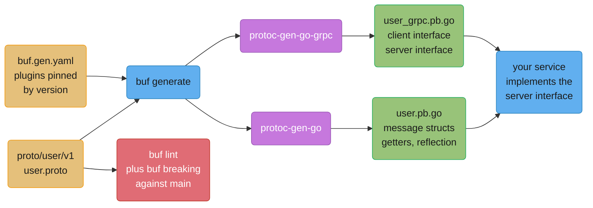
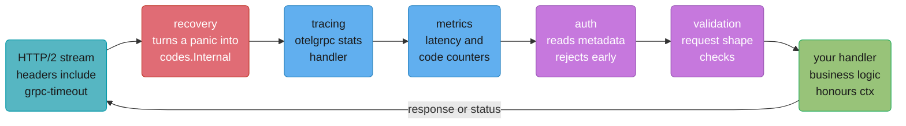
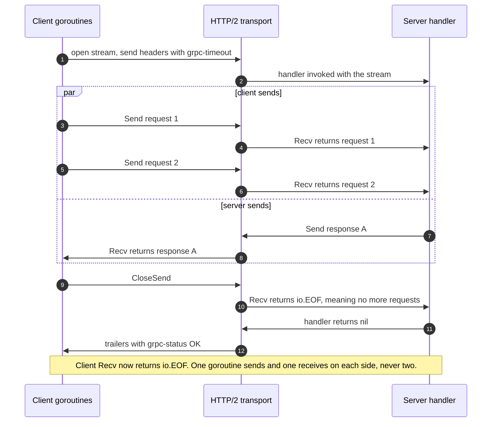

# gRPC and Protobuf in Go

---

## 1. Concept Overview

Go and gRPC grew up together. gRPC's reference implementation, `google.golang.org/grpc`,
is written in Go; Kubernetes, etcd, Envoy's xDS clients, Temporal, CockroachDB and Vault all
speak it in Go. If you write backend Go, you will at some point stare at a 4,000-line
`_grpc.pb.go` file that nobody on the team wrote and everybody on the team depends on.

This page is about **the Go implementation**, not about gRPC as an architectural choice.
Whether to use gRPC at all, how protobuf's wire format achieves its compactness, what the
four RPC modes mean at a protocol level, and how to evolve a schema across a fleet are
taught once in
[gRPC and Protocol Buffers](../../backend/grpc_and_protobuf/grpc_and_protobuf.md); the JVM
stub equivalent — `StreamObserver`, the blocking/async/future stub triple, Netty transports —
is [gRPC and Protobuf in Java](../../java/grpc_protobuf/grpc_protobuf.md). Read those for
the design decision. Read this for what `protoc-gen-go` actually emits, what `go vet` will
scream about, and why your gRPC clients are all hammering one pod.

The Go-specific ground this page covers:

- The **toolchain split** — `protoc` versus `buf`, and why `protoc-gen-go` and
  `protoc-gen-go-grpc` are two separate binaries.
- The **generated code shape** — an unexported `state` field that makes a message
  uncopyable, nil-safe getters, presence-as-pointer, `oneof` as an interface.
- The **four RPC modes** as concrete Go signatures, and the stream lifecycle rules that
  cause most production stream bugs.
- **Interceptors** — the only extension point, and the panic-recovery one you must write on
  day one because gRPC-Go does not recover for you.
- **`status`/`codes`**, deadlines carried in `grpc-timeout`, keepalive enforcement, and
  the load-balancing failure that is unique to long-lived HTTP/2 connections.
- The alternatives worth knowing: **`connect-go`**, **grpc-gateway**, **`bufconn`**,
  reflection plus `grpcurl`.

Versions this page is written against: Go **1.27** (released 2026-08-19),
`google.golang.org/grpc` **v1.83.2**, `google.golang.org/protobuf` **v1.36.12**,
`connectrpc.com/connect` **v1.20.0**.

---

## 2. Intuition

> A `.proto` file is a treaty between two teams who will never meet. `protoc` is the
> notary: it turns the treaty into two sets of paperwork, one for each side, and both sets
> are generated from the same original so neither side can quietly change the terms. The
> generated Go file is not code you own — it is a notarized copy, and the way to change it
> is to change the treaty.

**Mental model:** everything gRPC-Go does at runtime is *one HTTP/2 stream per RPC over a
long-lived, multiplexed connection*. Once you hold that sentence, the surprises stop being
surprising. A deadline is a header on that stream (`grpc-timeout`). An error is a trailer
(`grpc-status`, `grpc-message`). A "connection" is not a connection — it is a
`ClientConn`, a managed pool with a resolver and a load-balancing policy behind it. And the
reason your Kubernetes Service pins every client to one backend is that L4 load balancing
picks a pod **once**, at connection time, and then a thousand RPCs ride that one choice.

**Why it matters:** the two most expensive gRPC-Go incidents both come from treating the
generated code as ordinary Go. Copying a message by value looks free and corrupts internal
state. Comparing two messages with `reflect.DeepEqual` looks correct and produces a test
that passes on Tuesday and fails on Wednesday because the unexported `sizeCache` happened to
be populated. Both are caught by tools — `go vet`'s copylocks analyzer and
`protocmp.Transform` — and neither is caught by reading the code.

**Key insight:** the generated struct is a **handle to a protobuf message**, not a plain Go
struct that happens to have your fields on it. Treat it as one — pass pointers, compare with
`proto.Equal`, copy with `proto.Clone`, read with getters — and every trap on this page
disappears.

---

## 3. Core Principles

1. **The `.proto` is the source of truth; the `.pb.go` is a build artifact.** Never hand-edit
   generated code. If you need behaviour on a message type, put it on a wrapper type in your
   own package.
2. **Always pass messages by pointer.** The generated struct contains a
   `protoimpl.MessageState`, which contains a `DoNotCopy` marker. Copying it is a bug that
   `go vet` reports as a lock copy.
3. **Getters, never fields, for reads.** `req.GetUser().GetAddress().GetCity()` returns
   `""` on a nil chain. `req.User.Address.City` panics.
4. **Every server handler must respect `ctx`.** The client's deadline arrives as a header
   and becomes the handler's `ctx` deadline. A handler that ignores it burns server capacity
   on work whose answer is already discarded.
5. **Interceptors are the only cross-cutting hook.** Auth, logging, metrics, tracing,
   retries and panic recovery all live there. There is no filter chain, no servlet, no
   middleware convention other than this one.
6. **Errors are `status` values, not Go errors, on the wire.** Anything you return that is
   not a `*status.Status` becomes `codes.Unknown` with your `Error()` string in the message
   field — which is how internal error text leaks to external callers.
7. **A stream has exactly one writer goroutine and one reader goroutine.** Concurrent `Send`
   on the same stream is a data race in the transport, not a queue.
8. **gRPC's load balancing is client-side, and it only works if the client can see
   individual backends.** A ClusterIP Service hides them; that is the whole bug.

---

## 4. Types / Architectures / Strategies

### The two toolchains

| | `protoc` + plugins | `buf` |
|---|---|---|
| Install | C++ binary plus each plugin, versions managed by hand | one Go binary, plugins pinned in `buf.gen.yaml` |
| Invocation | a 6-line shell command with `-I` paths | `buf generate` |
| Dependencies | `git submodule` or vendored `.proto` trees | `buf.lock` + the Buf Schema Registry |
| Lint | none | `buf lint` with the `STANDARD` rule set |
| Breaking-change check | none | `buf breaking --against '.git#branch=main'` |
| Format | none | `buf format -w` |
| Config version | n/a | `v2` (current), `v1` still accepted |

New services should use `buf`. `protoc` remains the thing `buf` shells out to conceptually,
and knowing its flags is still how you debug a broken generation step.

### Why two Go plugins

`protoc-gen-go` emits **messages** (`user.pb.go`). `protoc-gen-go-grpc` emits **service
stubs** (`user_grpc.pb.go`). They were one plugin until the Go protobuf v2 rewrite
(`google.golang.org/protobuf`), and were split because the two artifacts have different
lifecycles: message types are consumed by programs that never make an RPC (a Kafka consumer
decoding a payload, a batch job reading a proto-encoded file), and the gRPC runtime's
release cadence should not force a regeneration of every message type in a company.

The practical consequence: **two plugin versions to pin**, and a `_grpc.pb.go` regenerated
by a newer plugin against a `.pb.go` from an older one is a normal, supported state.

### The three Go API levels

| Level | Struct fields | Reads | Writes | Default for |
|-------|--------------|-------|--------|-------------|
| `API_OPEN` | exported | field or getter | field | proto2/proto3 syntax files |
| `API_HYBRID` | exported | field or getter | field or setter | transitional only |
| `API_OPAQUE` | unexported | `GetX`/`HasX` only | `SetX`/`ClearX` | Edition 2024 and newer |

Select with `option features.(pb.go).api_level = API_OPAQUE;` in an editions file, or
`--go_opt=default_api_level=API_OPAQUE` on the command line. Opaque messages are built with
a generated builder (`LogEntry_builder{...}.Build()`) rather than a struct literal. Most
existing Go code is `API_OPEN`; everything on this page works at every level, because the
getters are generated at all three.

### The four RPC modes, as Go signatures

| Mode | Server signature | Client signature |
|------|-----------------|------------------|
| Unary | `F(context.Context, *Req) (*Res, error)` | `F(ctx, *Req, ...grpc.CallOption) (*Res, error)` |
| Server-stream | `F(*Req, grpc.ServerStreamingServer[Res]) error` | `F(ctx, *Req, ...) (grpc.ServerStreamingClient[Res], error)` |
| Client-stream | `F(grpc.ClientStreamingServer[Req, Res]) error` | `F(ctx, ...) (grpc.ClientStreamingClient[Req, Res], error)` |
| Bidi | `F(grpc.BidiStreamingServer[Req, Res]) error` | `F(ctx, ...) (grpc.BidiStreamingClient[Req, Res], error)` |

Those generic stream types are `protoc-gen-go-grpc` v1.5 and later. Before v1.5 each RPC got
its own named interface (`Chat_ServiceServer`); the generator now assigns a generic
interface instead, which is why mock generators that scan for named interfaces stopped
finding them.

### Interceptor kinds

Four types, two on each side:

- `grpc.UnaryServerInterceptor`, `grpc.StreamServerInterceptor`
- `grpc.UnaryClientInterceptor`, `grpc.StreamClientInterceptor`

Register with `grpc.ChainUnaryInterceptor(...)`/`grpc.ChainStreamInterceptor(...)` on the
server and `grpc.WithChainUnaryInterceptor(...)`/`grpc.WithChainStreamInterceptor(...)` on
the client. A stream interceptor fires **once, at stream open** — it cannot see individual
messages unless it wraps the `ServerStream` and overrides `SendMsg`/`RecvMsg`.

---

## 5. Architecture Diagrams

### Code generation pipeline



`buf lint` and `buf breaking` are a CI gate on the `.proto`, not a step in generation — the
schema is reviewed before it is allowed to become code.

### The server interceptor chain



Order is the order you pass them to `ChainUnaryInterceptor`: the first argument is
outermost, so it sees the request first and the response last. Recovery must be first, or
a panic in the auth interceptor kills the process.

### Bidirectional stream lifecycle



The asymmetry is the thing to memorise: `io.EOF` from the server's `Recv` means *the client
finished sending*; `io.EOF` from the client's `Recv` means *the whole RPC completed
successfully*. A non-EOF error from the client's `Recv` is the RPC's final status.

---

## 6. How It Works — Detailed Mechanics

### The schema

```protobuf
edition = "2024";

package user.v1;

option go_package = "github.com/acme/gen/user/v1;userv1";

message User {
    string id = 1;
    string email = 2;
    // Explicit presence: absent and empty-string are different states.
    optional string display_name = 3;
    Tier tier = 4;
    oneof contact {
        string phone = 5;
        string webhook_url = 6;
    }
}

enum Tier {
    TIER_UNSPECIFIED = 0;
    TIER_FREE = 1;
    TIER_PRO = 2;
}

service UserService {
    rpc GetUser(GetUserRequest) returns (User);
    rpc ListUsers(ListUsersRequest) returns (stream User);
    rpc ImportUsers(stream User) returns (ImportSummary);
    rpc Sync(stream SyncEvent) returns (stream SyncEvent);
}
```

`buf lint`'s `STANDARD` rules enforce most of the conventions above: package ends in a
version, enum values are prefixed with the enum name, the zero value is `_UNSPECIFIED`.

### `buf.gen.yaml` and `buf.yaml`

```yaml
# buf.yaml
version: v2
modules:
  - path: proto
lint:
  use:
    - STANDARD
breaking:
  use:
    - FILE
```

```yaml
# buf.gen.yaml
version: v2
managed:
  enabled: true
plugins:
  - remote: buf.build/protocolbuffers/go:v1.36.12
    out: gen
    opt: paths=source_relative
  - remote: buf.build/grpc/go:v1.5.1
    out: gen
    opt:
      - paths=source_relative
      - require_unimplemented_servers=true
```

CI gate, three lines:

```bash
buf lint
buf breaking --against '.git#branch=main'
buf format --diff --exit-code
```

`buf breaking` catches the changes that silently corrupt data across a fleet: reusing a
field number for a different type, changing a field's cardinality, deleting a field without
`reserved`. It runs in about 200 ms on a few hundred files — cheap enough that there is no
argument for not running it.

### The generated message struct

```go
type User struct {
    state         protoimpl.MessageState
    sizeCache     protoimpl.SizeCache
    unknownFields protoimpl.UnknownFields

    Id          string  `protobuf:"bytes,1,opt,name=id,proto3" json:"id,omitempty"`
    Email       string  `protobuf:"bytes,2,opt,name=email,proto3" json:"email,omitempty"`
    DisplayName *string `protobuf:"bytes,3,opt,name=display_name,json=displayName,proto3,oneof"`
    Tier        Tier    `protobuf:"varint,4,opt,name=tier,proto3,enum=user.v1.Tier"`
    Contact     isUser_Contact `protobuf_oneof:"contact"`
}
```

Three unexported fields do all the damage:

- **`state`** is a `protoimpl.MessageState`, which embeds `pragma.DoNotCompare` and
  `pragma.DoNotCopy`. `DoNotCopy` is declared as `[0]sync.Mutex` — a zero-width array of
  mutexes. It costs zero bytes and zero instructions, and it makes `go vet`'s **copylocks**
  analyzer report any copy of the struct as "passes lock by value". That is the entire
  mechanism: a type-system booby trap with no runtime cost.
- **`sizeCache`** memoizes the marshalled size. Copy a message after it has been
  marshalled and the copy carries a size that may not match its contents.
- **`unknownFields`** holds fields this binary's schema does not know about, so a proxy can
  round-trip a message written by a newer producer without dropping data. `reflect.DeepEqual`
  compares this raw byte slice; two semantically identical messages differ.

```go
// BROKEN: go vet reports "assignment copies lock value".
func normalize(u userv1.User) userv1.User {
    u.Email = strings.ToLower(u.Email)
    return u
}

// FIX: messages are always handles. Pass the pointer, clone when you need a copy.
func normalize(u *userv1.User) *userv1.User {
    out := proto.Clone(u).(*userv1.User)
    out.Email = strings.ToLower(out.GetEmail())
    return out
}
```

### Comparing messages in tests

```go
// BROKEN: compares sizeCache and unknownFields. Flaky by construction.
if !reflect.DeepEqual(got, want) {
    t.Fatalf("mismatch")
}

// FIX: protocmp.Transform teaches go-cmp about protobuf semantics.
if diff := cmp.Diff(want, got, protocmp.Transform()); diff != "" {
    t.Fatalf("GetUser() mismatch (-want +got):\n%s", diff)
}
```

`protocmp.Transform()` also unlocks the option set you actually want:
`protocmp.IgnoreFields(&userv1.User{}, "updated_at")` for a server-set timestamp,
`protocmp.SortRepeated(...)` for an unordered list. `proto.Equal(a, b)` is the boolean form
when you do not need a diff.

### Presence, enums, and `oneof`

```go
u := &userv1.User{Id: "u-1"}

u.GetDisplayName()          // "" — nil-safe, but you cannot tell absent from empty
u.DisplayName != nil        // false — this is the presence test
u.DisplayName = proto.String("Ada")   // proto.String/Int32/Bool build the pointers

// Enums are int32 with generated names. Never switch on the numeric value.
switch u.GetTier() {
case userv1.Tier_TIER_PRO:
    // ...
case userv1.Tier_TIER_UNSPECIFIED:
    // A field the producer never set looks exactly like this. Handle it.
}

// oneof is an interface plus one wrapper struct per member.
switch c := u.GetContact().(type) {
case *userv1.User_Phone:
    send(c.Phone)
case *userv1.User_WebhookUrl:
    post(c.WebhookUrl)
case nil:
    // No contact set. This case is not optional in real code.
}

u.Contact = &userv1.User_Phone{Phone: "+15551234"}
```

Proto3 originally deleted field presence for scalars: a `string` set to `""` and a `string`
never set were the same message on the wire. That broke patch semantics for every API that
needed "leave this field alone" to differ from "set this field to empty", so `optional`
returned as explicit presence — and in Go it is spelled as a **pointer**. Message fields,
`oneof` members and `repeated` fields have always had presence; only scalars needed the
keyword.

When the payload is genuinely dynamic, `structpb.NewStruct(map[string]any{...})` gives you a
JSON-shaped value and `anypb.New(msg)` / `anypb.UnmarshalTo` gives you a typed envelope. Both
cost you the schema — reach for them for a metadata bag or a plugin payload, never because
designing the message felt hard.

### The four modes, implemented

```go
type server struct {
    userv1.UnimplementedUserServiceServer   // forward compatibility, keep it embedded
    store *Store
}

// Unary.
func (s *server) GetUser(ctx context.Context, req *userv1.GetUserRequest) (*userv1.User, error) {
    u, err := s.store.Get(ctx, req.GetId())     // ctx carries the client's deadline
    switch {
    case errors.Is(err, ErrNotFound):
        return nil, status.Errorf(codes.NotFound, "user %q", req.GetId())
    case err != nil:
        s.log.Error("store.Get", "err", err)     // full detail to the log
        return nil, status.Error(codes.Internal, "lookup failed")   // opaque to the caller
    }
    return u, nil
}

// Server-streaming: the handler returning is what ends the stream.
func (s *server) ListUsers(req *userv1.ListUsersRequest, stream grpc.ServerStreamingServer[userv1.User]) error {
    for u, err := range s.store.Iterate(stream.Context(), req.GetTier()) {
        if err != nil {
            return status.Error(codes.Internal, "iteration failed")
        }
        if err := stream.Send(u); err != nil {
            return err      // client went away, already a status error, do not wrap
        }
    }
    return nil
}

// Client-streaming: Recv returns io.EOF when the client calls CloseSend.
func (s *server) ImportUsers(stream grpc.ClientStreamingServer[userv1.User, userv1.ImportSummary]) error {
    var n int64
    for {
        u, err := stream.Recv()
        if errors.Is(err, io.EOF) {
            return stream.SendAndClose(&userv1.ImportSummary{Imported: n})
        }
        if err != nil {
            return err
        }
        if err := s.store.Put(stream.Context(), u); err != nil {
            return status.Error(codes.Internal, "write failed")
        }
        n++
    }
}

// Bidi: one reader goroutine, one writer goroutine, never two of either.
func (s *server) Sync(stream grpc.BidiStreamingServer[userv1.SyncEvent, userv1.SyncEvent]) error {
    out := make(chan *userv1.SyncEvent, 64)
    g, ctx := errgroup.WithContext(stream.Context())

    g.Go(func() error {           // reader
        defer close(out)
        for {
            ev, err := stream.Recv()
            if errors.Is(err, io.EOF) {
                return nil
            }
            if err != nil {
                return err
            }
            select {
            case out <- s.apply(ev):
            case <-ctx.Done():
                return ctx.Err()
            }
        }
    })
    g.Go(func() error {           // the ONLY writer
        for ev := range out {
            if err := stream.Send(ev); err != nil {
                return err
            }
        }
        return nil
    })
    return g.Wait()
}
```

Client side, the same four:

```go
cc, err := grpc.NewClient(
    "dns:///users.svc.cluster.local:50051",
    grpc.WithTransportCredentials(creds),
    grpc.WithDefaultServiceConfig(`{"loadBalancingConfig":[{"round_robin":{}}]}`),
    grpc.WithChainUnaryInterceptor(timeoutInterceptor(2*time.Second)),
)
if err != nil {
    return err
}
defer cc.Close()
client := userv1.NewUserServiceClient(cc)

// Server-stream read loop.
st, err := client.ListUsers(ctx, &userv1.ListUsersRequest{Tier: userv1.Tier_TIER_PRO})
if err != nil {
    return err
}
for {
    u, err := st.Recv()
    if errors.Is(err, io.EOF) {
        break                 // the RPC succeeded
    }
    if err != nil {
        return err            // this IS the RPC's status
    }
    use(u)
}
```

`grpc.NewClient` does not connect. It builds a `ClientConn`, starts the resolver, and
returns; the first RPC triggers the dial. That is why it takes no `context.Context` and why
it does not fail on an unreachable backend — a startup health check must make a real RPC, or
call `cc.Connect()` and watch `cc.WaitForStateChange`.

### Interceptors

```go
func RecoveryUnary(log *slog.Logger) grpc.UnaryServerInterceptor {
    return func(ctx context.Context, req any, info *grpc.UnaryServerInfo,
        handler grpc.UnaryHandler) (resp any, err error) {

        defer func() {
            if r := recover(); r != nil {
                log.ErrorContext(ctx, "handler panic",
                    "method", info.FullMethod,
                    "panic", r,
                    "stack", string(debug.Stack()))
                panicTotal.WithLabelValues(info.FullMethod).Inc()
                err = status.Error(codes.Internal, "internal error")
                resp = nil
            }
        }()
        return handler(ctx, req)
    }
}
```

Two details that are easy to get wrong. The **named return values** are load-bearing: a
deferred closure can only change the returned `err` if the result is named. And the
equivalent stream interceptor must exist too, or a panic inside a streaming handler still
takes the process down:

```go
func RecoveryStream(log *slog.Logger) grpc.StreamServerInterceptor {
    return func(srv any, ss grpc.ServerStream, info *grpc.StreamServerInfo,
        handler grpc.StreamHandler) (err error) {

        defer func() {
            if r := recover(); r != nil {
                log.Error("stream handler panic", "method", info.FullMethod, "panic", r,
                    "stack", string(debug.Stack()))
                err = status.Error(codes.Internal, "internal error")
            }
        }()
        return handler(srv, ss)
    }
}

s := grpc.NewServer(
    grpc.ChainUnaryInterceptor(RecoveryUnary(log), authUnary, validateUnary),
    grpc.ChainStreamInterceptor(RecoveryStream(log), authStream),
    grpc.StatsHandler(otelgrpc.NewServerHandler()),
    grpc.KeepaliveParams(keepalive.ServerParameters{
        MaxConnectionAge:      30 * time.Minute,
        MaxConnectionAgeGrace: 30 * time.Second,
        Time:                  2 * time.Hour,
        Timeout:               20 * time.Second,
    }),
    grpc.KeepaliveEnforcementPolicy(keepalive.EnforcementPolicy{
        MinTime:             30 * time.Second,
        PermitWithoutStream: true,
    }),
)
```

To touch individual messages on a stream, wrap the `grpc.ServerStream` and override
`RecvMsg`/`SendMsg` — that wrapper is the only place per-message stream logic can live.

### `status`, `codes`, and error details

```go
// Domain error to gRPC code, in exactly one place.
func toStatus(err error) error {
    switch {
    case err == nil:
        return nil
    case errors.Is(err, ErrNotFound):
        return status.Error(codes.NotFound, "not found")
    case errors.Is(err, ErrConflict):
        return status.Error(codes.AlreadyExists, "already exists")
    case errors.Is(err, context.DeadlineExceeded):
        return status.Error(codes.DeadlineExceeded, "deadline exceeded")
    case errors.Is(err, ErrQuota):
        return status.Error(codes.ResourceExhausted, "quota exceeded")
    default:
        return status.Error(codes.Internal, "internal error")
    }
}

// Structured details a client can act on, rather than a string it must parse.
st := status.New(codes.InvalidArgument, "invalid request")
st, _ = st.WithDetails(&errdetails.BadRequest{
    FieldViolations: []*errdetails.BadRequest_FieldViolation{
        {Field: "email", Description: "must contain @"},
    },
})
return nil, st.Err()

// Client side.
if s, ok := status.FromError(err); ok {
    for _, d := range s.Details() {
        if br, ok := d.(*errdetails.BadRequest); ok {
            for _, v := range br.GetFieldViolations() { showFieldError(v) }
        }
    }
}
```

`status.FromError` returns `ok == false` for an error that never crossed a gRPC boundary,
which is how you tell "the server said no" from "our own code failed before we asked".
`codes.Internal` is the honest answer for anything you have not deliberately classified: the
alternative is `codes.Unknown` with your raw `Error()` text on the wire, which has leaked
SQL, hostnames and connection strings to external callers more than once.

Codes that carry retry semantics for a caller: `Unavailable` (retry with backoff),
`DeadlineExceeded` (retry only if the operation is idempotent and budget remains),
`ResourceExhausted` (back off hard), `Aborted` (retry the whole transaction),
`FailedPrecondition` (do not retry until state changes). `Internal`, `InvalidArgument`,
`NotFound`, `PermissionDenied` and `Unauthenticated` are never retried.

### Deadlines on the wire

A client deadline becomes the `grpc-timeout` header, an integer plus a unit character
(`H`, `M`, `S`, `m`, `u`, `n`) — a 2-second deadline is `2000m`. The server subtracts nothing
and simply sets a deadline on the handler's `ctx` from the received value. So the deadline is
**relative**, immune to clock skew, and propagates automatically through every hop that
passes its `ctx` down.

```go
// Every outbound call gets a budget derived from the inbound one.
func (s *server) GetOrder(ctx context.Context, req *orderv1.GetOrderRequest) (*orderv1.Order, error) {
    // Reserve 100 ms of the remaining budget for our own serialization and response write.
    if dl, ok := ctx.Deadline(); ok {
        var cancel context.CancelFunc
        ctx, cancel = context.WithDeadline(ctx, dl.Add(-100*time.Millisecond))
        defer cancel()
    }
    u, err := s.users.GetUser(ctx, &userv1.GetUserRequest{Id: req.GetUserId()})
    ...
}
```

The arithmetic — how a 300 ms edge budget is divided across four hops, and why a fan-out of
five calls at 200 ms each does not fit in a 250 ms budget — is
[Latency Budgets and SLO Math](../../backend/latency_budgets_and_slo_math/latency_budgets_and_slo_math.md).
The Go rule is narrower and absolute: **a handler that does not thread `ctx` into every
downstream call and every query has broken deadline propagation for the entire subtree
below it.**

### Load balancing, and the Kubernetes trap

gRPC multiplexes every RPC of one `ClientConn`-to-backend pair onto **one TCP connection**.
A Kubernetes `ClusterIP` Service load-balances at L4 — it picks a pod when the TCP connection
is established, and every subsequent RPC on that connection rides the same choice. Ten
clients, ten connections, twenty pods: ten pods idle.

```go
// BROKEN: one TCP connection to a virtual IP. L4 stickiness, no client-side balancing.
cc, _ := grpc.NewClient("users:50051", grpc.WithTransportCredentials(creds))

// FIX: a headless Service resolves to every pod IP; round_robin opens a subconn to each.
cc, _ := grpc.NewClient(
    "dns:///users-headless.default.svc.cluster.local:50051",
    grpc.WithTransportCredentials(creds),
    grpc.WithDefaultServiceConfig(`{"loadBalancingConfig":[{"round_robin":{}}]}`),
)
```

`pick_first` is the default policy: it tries addresses in order and sticks to the first that
connects. `round_robin` opens a subconnection to every resolved address and rotates per RPC.
The DNS resolver re-resolves on a 30-second minimum interval, so a scale-up takes up to
30 seconds to attract traffic — with `MaxConnectionAge` set on the server (30 minutes above,
plus a grace period), connections also recycle so long-lived clients rediscover the fleet.

The three fixes, in ascending order of how much infrastructure you already have:

1. **Headless Service + `round_robin`** — zero new components, works today, rebalances only
   on re-resolve.
2. **An L7 proxy** — Envoy, Linkerd, or a service mesh sidecar terminates HTTP/2 and balances
   per-request. This is what most large fleets do; see
   [Service Mesh and Service Discovery](../../backend/service_mesh_and_service_discovery/service_mesh_and_service_discovery.md).
3. **xDS** — grpc-go speaks xDS natively (`xds:///service`), taking policy from the same
   control plane Envoy uses, with no proxy hop.

### TLS and mTLS

```go
// Server: mutual TLS, client certificate required and verified against our CA.
pool := x509.NewCertPool()
pool.AppendCertsFromPEM(caPEM)
cert, err := tls.LoadX509KeyPair("server.crt", "server.key")
if err != nil {
    return err
}
creds := credentials.NewTLS(&tls.Config{
    Certificates: []tls.Certificate{cert},
    ClientAuth:   tls.RequireAndVerifyClientCert,
    ClientCAs:    pool,
    MinVersion:   tls.VersionTLS13,
})
s := grpc.NewServer(grpc.Creds(creds))

// Client.
cc, err := grpc.NewClient(target, grpc.WithTransportCredentials(credentials.NewTLS(&tls.Config{
    Certificates: []tls.Certificate{clientCert},
    RootCAs:      pool,
    MinVersion:   tls.VersionTLS13,
})))
```

For local development and inside a mesh that already does mTLS at the sidecar,
`grpc.WithTransportCredentials(insecure.NewCredentials())` is the explicit, greppable way to
say "no TLS here" — it exists precisely so that the absence of TLS is never accidental.

### Testing with `bufconn`

```go
func newTestClient(t *testing.T) userv1.UserServiceClient {
    t.Helper()
    lis := bufconn.Listen(1024 * 1024)
    srv := grpc.NewServer()
    userv1.RegisterUserServiceServer(srv, &server{store: newMemStore()})
    go func() { _ = srv.Serve(lis) }()
    t.Cleanup(srv.Stop)

    // passthrough:/// is required: NewClient defaults to the dns resolver, which
    // would try to resolve "bufnet" as a hostname and fail.
    cc, err := grpc.NewClient("passthrough:///bufnet",
        grpc.WithContextDialer(func(ctx context.Context, _ string) (net.Conn, error) {
            return lis.DialContext(ctx)
        }),
        grpc.WithTransportCredentials(insecure.NewCredentials()))
    if err != nil {
        t.Fatal(err)
    }
    t.Cleanup(func() { _ = cc.Close() })
    return userv1.NewUserServiceClient(cc)
}
```

An in-memory listener, no port, no firewall, no flaky `net.Listen(":0")` race — and the
real interceptor chain, real serialization, real status codes. It is strictly better than
calling the handler method directly, which skips everything gRPC does.

### Reflection and `grpcurl`

```go
if cfg.Env != "prod" {
    reflection.Register(s)
}
```

```bash
grpcurl -plaintext localhost:50051 list
grpcurl -plaintext localhost:50051 describe user.v1.UserService.GetUser
grpcurl -plaintext -d '{"id":"u-1"}' localhost:50051 user.v1.UserService/GetUser
```

Reflection lets a client discover the schema at runtime, so `grpcurl` needs no `.proto`
file. That is also why it is usually gated off in production: it publishes your entire API
surface to anyone who can reach the port.

### `connect-go` and grpc-gateway

`connectrpc.com/connect` generates a plain `http.Handler` that speaks **three** protocols on
one endpoint: gRPC, gRPC-Web, and Connect's own protocol, which is ordinary HTTP/1.1 with a
JSON or protobuf body.

```go
mux := http.NewServeMux()
path, handler := userv1connect.NewUserServiceHandler(&server{}, connect.WithInterceptors(auth))
mux.Handle(path, handler)
// h2c so the same server also serves HTTP/2 without TLS, behind a terminating proxy.
http.ListenAndServe(":8080", h2c.NewHandler(mux, &http2.Server{}))
```

```bash
curl -X POST -H "Content-Type: application/json" \
  -d '{"id":"u-1"}' http://localhost:8080/user.v1.UserService/GetUser
```

That `curl` line is the whole pitch: a browser can call it, a load balancer that only speaks
HTTP/1.1 can route it, and `net/http` middleware composes with it, because it *is* a
`net/http` handler. grpc-gateway solves the same problem differently — it generates a
**reverse proxy** that translates REST+JSON into gRPC using `google.api.http` annotations,
which means a second process (or an in-process mux) and a second port, but it gives you a
genuinely RESTful URL shape (`GET /v1/users/{id}`) that Connect does not.

---

## 7. Real-World Examples

| System | How it uses gRPC in Go |
|--------|------------------------|
| **Kubernetes** | The container runtime interface (CRI) between kubelet and containerd is gRPC over a Unix socket; the device-plugin and CSI interfaces are the same shape. Every one of them is a Go server implementing a generated interface. |
| **etcd** | The entire v3 client API is gRPC, with watch as a bidirectional stream. etcd also ships grpc-gateway so `curl` works against a cluster, which is how most people first debug it. |
| **Envoy / xDS** | The control plane (`go-control-plane`) streams configuration to Envoy over bidi gRPC. gRPC-Go can consume the same xDS APIs directly, skipping the sidecar. |
| **Temporal** | Worker-to-service traffic is gRPC with long-poll unary calls; the deadline propagation and `codes.DeadlineExceeded` handling on those polls is the core of the protocol. |
| **CockroachDB** | Node-to-node RPC is gRPC with custom interceptors for authentication, tracing and admission control — the canonical example of interceptors carrying real system behaviour rather than just logging. |
| **Buf's own registry** | The BSR is a Connect service, which is why its API is callable with `curl` and from a browser without a gateway. |

---

## 8. Tradeoffs

### Commit generated code or generate it in CI

| | Commit `.pb.go` | Generate in CI |
|---|---|---|
| Fresh clone builds | yes, immediately | needs `buf` + plugins installed |
| Review diff noise | thousands of lines per schema change | none |
| Version drift | impossible: the artifact is pinned | possible if plugin versions float |
| IDE and `go doc` | work everywhere | broken until first generation |
| Merge conflicts | frequent and unresolvable by hand | none |
| Consumers outside your repo | can `go get` your module directly | need their own generation step |

Commit it when the generated package is a **published Go module** other repos import.
Generate in CI when the protos and the service live in one repo and only that repo consumes
them. The failure mode of committing is a stale artifact that does not match the `.proto` —
guard it with `buf generate && git diff --exit-code` in CI.

### Transport and framework choice

| | `grpc-go` | `connect-go` | grpc-gateway | REST + JSON |
|---|---|---|---|---|
| Browser callable | no (needs gRPC-Web proxy) | yes, natively | yes | yes |
| `curl`-able | no | yes | yes | yes |
| `net/http` middleware | no, interceptors only | yes | at the gateway | yes |
| Streaming | all four modes | all four modes | server-stream only, as chunked JSON | SSE or WebSocket |
| Extra process | none | none | one proxy (or in-process mux) | none |
| Ecosystem depth | largest | smaller but growing | inherits grpc-go | universal |
| Binary size added | ~8 MB | ~3 MB | ~10 MB | ~0 |

### Interceptors versus stats handlers

| | Interceptor | `stats.Handler` |
|---|---|---|
| Can short-circuit the RPC | yes | no |
| Sees payload sizes and wire timings | no | yes |
| Fires per stream message | only via a wrapper | yes, natively |
| Right for auth, validation, retry | yes | no |
| Right for tracing and metrics | workable | yes — this is what `otelgrpc` uses |

---

## 9. When to Use / When NOT to Use

**Use gRPC in Go when:**

- Services you own talk to each other and you control both sides' deploy cadence.
- You want a machine-checked contract and a CI gate (`buf breaking`) on schema evolution.
- The call pattern is chatty — HTTP/2 multiplexing over one connection beats a new
  request per call.
- You need streaming with backpressure that is not a WebSocket you hand-rolled.
- Polyglot clients: the same `.proto` produces a Go server, a Java client, and a Python
  script.

**Do not reach for it when:**

- Browsers are first-class callers and you do not want a proxy — use `connect-go`, or REST.
- The API is public and third-party developers must integrate against it. Every integration
  guide would start with "install `protoc`".
- Payloads are large and streamed byte blobs — the 4 MiB default message limit is a hint
  that gRPC is not a file transfer protocol. Use presigned URLs to object storage.
- The traffic is genuinely one-shot and low-volume. A `net/http` handler plus
  `encoding/json` is 15 lines and no build step.
- You are inside a single process. A Go interface call costs nanoseconds; an RPC to
  localhost costs tens of microseconds and can fail.

---

## 10. Common Pitfalls

### The missing panic-recovery interceptor took the fleet down in 40 seconds

A payments service added a field to a response and computed it with
`resp.Items[0].Price` — fine for every request in staging, panicking on the first empty cart
in production. gRPC-Go does not recover panics in handlers; the panic unwound to the
top of the serving goroutine and killed the process. Kubernetes restarted the pod, the load
balancer sent it traffic, an empty cart arrived, it died again. **All 24 replicas were in
CrashLoopBackOff within 40 seconds**, and the readiness probe never had a window to mark
them unhealthy because they were healthy right up until the request that killed them.

```go
// BROKEN: a nil-safe getter was skipped, and nothing catches the panic.
func (s *server) GetCart(ctx context.Context, req *cartv1.GetCartRequest) (*cartv1.Cart, error) {
    c, _ := s.store.Get(ctx, req.GetId())
    return &cartv1.Cart{Total: c.Items[0].Price}, nil    // index out of range on an empty cart
}

// FIX: recovery interceptor first in the chain, plus a getter that cannot panic.
s := grpc.NewServer(
    grpc.ChainUnaryInterceptor(RecoveryUnary(log), authUnary),
    grpc.ChainStreamInterceptor(RecoveryStream(log)),
)

func (s *server) GetCart(ctx context.Context, req *cartv1.GetCartRequest) (*cartv1.Cart, error) {
    c, err := s.store.Get(ctx, req.GetId())
    if err != nil {
        return nil, toStatus(err)
    }
    var total int64
    for _, it := range c.GetItems() {
        total += it.GetPrice()
    }
    return &cartv1.Cart{Total: total}, nil
}
```

One panic becomes one `codes.Internal` and one alert instead of a fleet outage. Write both
interceptors on day one, before the first handler.

### Every client hammered one pod while nineteen sat idle

A recommendation service was scaled from 4 to 20 pods to handle a launch. Latency did not
move. `kubectl top pods` showed **one pod at 92% CPU and nineteen under 5%**: the callers used
`grpc.NewClient("recs:50051")` against a ClusterIP Service, so each caller opened exactly one
TCP connection, and the kube-proxy picked its pod once. Twelve callers spread over four pods
by luck; the eight that landed on the same pod put it into GC death-spiral.

The fix was a headless Service plus `round_robin` (shown in §6) and took eight lines across
two repos. p99 fell from **1,840 ms to 96 ms** on redeploy, with no change in pod count. The
diagnostic that finds this in 30 seconds is comparing per-pod request rate; the diagnostic
that misses it is average CPU across the deployment.

### `reflect.DeepEqual` produced a test that failed only after a marshal

An integration test compared an expected `*User` literal against one round-tripped through
the service. It passed for six months. Then a caching layer was added that marshalled the
message before returning it, populating `sizeCache` on the returned value but not on the
literal, and the test began failing with a diff that printed **two identical-looking
structs**. Two engineers spent most of a day on it. `cmp.Diff(want, got, protocmp.Transform())`
would have both passed and, when it did fail, printed a field-level diff. Ban
`reflect.DeepEqual` on protobuf types in review; `protocmp` exists for exactly this.

### A stream written from two goroutines corrupted the wire

A telemetry ingester fanned incoming work out to 8 goroutines and had each call `stream.Send`
on the shared bidi stream. Under load, clients started receiving `codes.Internal` with
"transport: the stream is done" and, worse, occasional messages whose fields came from two
different events. `-race` reported it immediately in a load test; nobody had run one.
The contract is: **one goroutine sends, one goroutine receives, per stream.** The fix is the
`errgroup` shape in §6 — a buffered channel funnels all producers into a single writer.

### `codes.Unknown` leaked the database DSN to a partner

A handler returned a raw `err` from `pgx`. gRPC-Go wraps any non-status error as
`codes.Unknown` with `err.Error()` as the message, and the driver's error text included the
connection string with the host and username. A partner's engineer pasted it into a support
ticket. **Return `status.Error(codes.Internal, "...")` for anything unclassified, and log the
detail server-side.** A single `toStatus` helper at the handler boundary is the enforcement
point, and a lint rule banning bare `return nil, err` from handlers is the backstop.

### Aggressive client keepalives triggered `too_many_pings`

A team set `keepalive.ClientParameters{Time: 5 * time.Second, PermitWithoutStream: true}` to
detect dead backends faster. The server's default enforcement policy allows a ping no more
often than every 5 minutes, and only with an active stream. The server sent
`GOAWAY` with `ENHANCE_YOUR_CALM` and debug data `too_many_pings`; the client reconnected,
pinged, and got kicked again — **a reconnect storm at roughly 12 reconnects per minute per
client**, which showed up as a load-balancer alert, not a gRPC alert. Keepalive is a
negotiated pair: whenever you tighten `ClientParameters.Time`, you must loosen the server's
`EnforcementPolicy.MinTime` to match, and grpc-go refuses a client `Time` below 10 seconds
regardless.

### A 6 MB response silently became `ResourceExhausted` in production only

The default **maximum receive message size is 4 MiB**. A report endpoint tested against
seed data returned 300 KB; the largest real tenant returned 6 MB and every one of their
requests failed with `codes.ResourceExhausted: grpc: received message larger than max`.
Raising the limit (`grpc.MaxCallRecvMsgSize` on the client, `grpc.MaxRecvMsgSize` on the
server — both sides, or the smaller one wins) unblocked it for a week, until a bigger tenant
arrived. The real fix was pagination: the limit is a design signal, and a response whose size
scales with tenant data should be a server-stream or a paged unary call.

---

## 11. Technologies & Tools

| Tool | What it is for |
|------|---------------|
| **`protoc`** | The reference Protocol Buffers compiler. Still the engine underneath everything; you need its `-I` semantics to debug import errors. |
| **`buf`** | The modern CLI: `buf generate`, `buf lint`, `buf breaking`, `buf format`, plus the Buf Schema Registry for dependency resolution. `v2` config. |
| **`protoc-gen-go`** | Generates message types from `.proto`. `google.golang.org/protobuf` v1.36.12. |
| **`protoc-gen-go-grpc`** | Generates gRPC client and server stubs, including the generic stream types from v1.5. |
| **`google.golang.org/grpc`** | The runtime: server, `ClientConn`, resolvers, balancers, interceptors, `status`, `codes`, `metadata`, `keepalive`, `credentials`. v1.83.2. |
| **`connectrpc.com/connect`** | gRPC + gRPC-Web + Connect protocol from one `net/http` handler. v1.20.0. |
| **`grpc-gateway`** | Generates a REST/JSON reverse proxy from `google.api.http` annotations, plus an OpenAPI spec. |
| **`grpcurl`** | `curl` for gRPC. Works with no `.proto` when server reflection is on, or with `-import-path`/`-proto` when it is off. |
| **`grpcui`** | A browser UI over the same reflection data — the Postman of gRPC. |
| **`bufconn`** (`google.golang.org/grpc/test/bufconn`) | In-memory listener for tests: full stack, no port. |
| **`protocmp`** (`google.golang.org/protobuf/testing/protocmp`) | The `cmp` option set that makes message comparison correct. |
| **`otelgrpc`** | OpenTelemetry instrumentation via `grpc.StatsHandler(otelgrpc.NewServerHandler())`. |
| **`go vet`** | The copylocks analyzer is what catches a copied message. It runs by default under `go test`. |
| **`protovalidate`** | Declarative validation rules in the `.proto` (CEL expressions), enforced at runtime by an interceptor. |

---

## 12. Interview Questions with Answers

**Q: Why must you never copy a protobuf message by value in Go?**
**Short:** The generated struct embeds a MessageState with a DoNotCopy marker plus a sizeCache, so a value copy carries stale internal state.

The generated struct's first field is `state protoimpl.MessageState`, which embeds
`pragma.DoNotCopy` — declared as `[0]sync.Mutex`, a zero-width array that costs nothing at
runtime but makes `go vet`'s copylocks analyzer report "passes lock by value" on any copy.
Beside it sit `sizeCache` (a memoized marshalled size that a copy may carry incorrectly) and
`unknownFields` (raw bytes for fields this binary does not know). Always pass `*Message`, and
use `proto.Clone(m).(*T)` when you genuinely need an independent copy. `go vet` runs
automatically under `go test`, so this is caught in CI for free if you do not suppress it.

**Q: Why does reflect.DeepEqual give wrong answers on protobuf messages, and what do you use instead?**
**Short:** It compares the unexported sizeCache and unknownFields, so two semantically identical messages can differ; use protocmp.Transform with cmp.Diff.

`reflect.DeepEqual` walks every field including the unexported bookkeeping. A message that
has been marshalled has a populated `sizeCache`; one built as a literal does not. A message
decoded from a newer producer carries bytes in `unknownFields` that a locally-built
equivalent lacks. The result is a test that passes until a caching layer or a proxy hop is
added. Use `cmp.Diff(want, got, protocmp.Transform())` for a field-level diff, or
`proto.Equal(a, b)` for a boolean. `protocmp` also gives you `IgnoreFields` for server-set
timestamps and `SortRepeated` for unordered lists, which is what most flaky message
assertions actually need.

**Q: A panic in one gRPC handler took down the whole server. Why, and what is the fix?**
**Short:** gRPC-Go does not recover panics in handlers, so one unwinds to the top of the serving goroutine and kills the process.

Each RPC runs on its own goroutine and an unrecovered panic on any goroutine terminates the
program — there is no per-request isolation the way a servlet container gives you. The fix is
a recovery interceptor registered **first** in both `ChainUnaryInterceptor` and
`ChainStreamInterceptor` (a unary-only one still lets a streaming panic kill you). It must
use a named `err` return value so the deferred `recover` can replace the result, and it
should log `debug.Stack()` and increment a counter before returning
`status.Error(codes.Internal, "internal error")`. Without it, a nil dereference on one edge
case puts every replica into CrashLoopBackOff within a minute, because every replica gets the
same poisoned request.

**Q: Your gRPC clients all pile onto one backend pod behind a Kubernetes Service. Why?**
**Short:** gRPC multiplexes every RPC onto one long-lived HTTP/2 connection, and an L4 ClusterIP picks a pod once at connect time.

kube-proxy load-balances connections, not requests. gRPC opens one TCP connection per
`ClientConn`-to-backend pair and sends thousands of RPCs over it, so the single L4 decision
made at dial time governs everything after. Three fixes, in ascending infrastructure cost:
a **headless Service** (`dns:///svc-headless.ns.svc.cluster.local:port`) plus
`grpc.WithDefaultServiceConfig` selecting `round_robin`, which makes grpc-go open a
subconnection per pod and balance per RPC; an **L7 proxy or mesh sidecar** that terminates
HTTP/2 and balances per request; or **xDS** (`xds:///service`), which grpc-go speaks natively.
Diagnose it by comparing per-pod request rate — average CPU across the deployment hides it
completely.

**Q: What does io.EOF mean on each side of a gRPC stream?**
**Short:** On the server's Recv it means the client finished sending; on the client's Recv it means the RPC completed successfully.

The asymmetry causes real bugs. A server reading a client-stream loops on `Recv` until
`errors.Is(err, io.EOF)`, which fires when the client calls `CloseSend`, and then responds
with `SendAndClose`. A client reading a server-stream loops on `Recv` until `io.EOF`, which
fires when the server handler returns `nil` — so `io.EOF` there is success, not truncation.
Any **other** error from the client's `Recv` is the RPC's final status and must be
propagated; treating it as an ordinary end-of-loop silently converts a `codes.Internal` into
"we received zero records", which is how a partial dataset gets written to a warehouse
without anyone noticing.

**Q: Is it safe to call Send on the same gRPC stream from two goroutines?**
**Short:** No. A stream supports one sending goroutine and one receiving goroutine, and concurrent Send is a data race in the transport.

`Send` and `Recv` on the same stream may run concurrently with each other — that is what
makes bidi useful — but two goroutines calling `Send`, or two calling `Recv`, race. The
symptoms are ugly and non-obvious: `codes.Internal` errors mentioning the stream being done,
and occasionally a message whose fields came from two different sources because the writes
interleaved mid-marshal. The idiomatic shape is a buffered channel that every producer writes
to and exactly one writer goroutine drains into `Send`, with an `errgroup` tying the reader
and writer lifetimes together. `-race` in a load test finds this in seconds; unit tests never
will.

**Q: How does a client deadline reach the server, and what must the handler do with it?**
**Short:** It travels as the grpc-timeout header as a relative duration, and becomes the deadline on the handler's context.

The client's `context.WithTimeout` is serialized into `grpc-timeout` — an integer plus a unit
character, so 2 seconds is `2000m`. Because it is **relative**, clock skew between machines is
irrelevant. The server sets that duration as a deadline on the handler's `ctx`, and the
handler's only job is to thread that `ctx` into every downstream RPC, every database query and
every HTTP call. A handler that passes `context.Background()` to its database driver has
broken propagation for the entire subtree beneath it: the client gave up 400 ms ago and the
server is still burning connection-pool capacity on an answer nobody will read. Reserve a
slice of the budget (50–100 ms) before calling downstream so the error path has room to
serialize a response.

**Q: Why did proto3 bring back optional, and how does field presence show up in Go?**
**Short:** Proto3 removed scalar presence so empty and unset were indistinguishable, which broke patch semantics; optional restores it as a pointer in Go.

Original proto3 dropped presence tracking for scalars: a `string` set to `""` and one never
set produced identical bytes. Any API with partial-update semantics needs those to differ —
"clear the display name" versus "leave the display name alone" — so `optional` was
reintroduced as explicit presence. In generated Go it becomes a pointer field: `*string`
rather than `string`, with `proto.String("x")` to set it, `m.DisplayName != nil` to test
presence, and `m.GetDisplayName()` still returning `""` when absent. Message fields, `oneof`
members and `repeated` fields always had presence; only scalars ever needed the keyword.

**Q: Why are protoc-gen-go and protoc-gen-go-grpc separate plugins?**
**Short:** Message types and service stubs have different consumers and release cadences, so splitting them decouples the gRPC runtime version from every message type in a company.

They were one plugin before the `google.golang.org/protobuf` v2 rewrite. Plenty of programs
use protobuf messages without ever making an RPC — a Kafka consumer decoding payloads, a batch
job reading proto-encoded files — and forcing those to regenerate whenever gRPC-Go cuts a
release was pure coupling. The practical consequences: you pin **two** plugin versions in
`buf.gen.yaml`, generation emits two files (`user.pb.go` and `user_grpc.pb.go`), and a
`_grpc.pb.go` regenerated by a newer plugin against an older `.pb.go` is a normal supported
state rather than a version mismatch to chase.

**Q: Should generated protobuf code be committed to the repository?**
**Short:** Commit it when the generated package is a published Go module other repos import; generate in CI when the protos and the only consumer share a repo.

Committing means a fresh clone builds with no toolchain, IDEs and `go doc` work immediately,
and external consumers can `go get` your module directly. The costs are thousands of lines of
review noise per schema change and merge conflicts nobody can resolve by hand. Generating in
CI eliminates both but requires `buf` and pinned plugins on every developer machine and
breaks the IDE until the first run. Whichever you pick, add
`buf generate && git diff --exit-code` to CI: the failure mode of committing is an artifact
that quietly stops matching its `.proto`, and that check costs a few seconds and catches it
every time.

**Q: What is the difference between UnaryInterceptor and ChainUnaryInterceptor, and in what order do chained ones run?**
**Short:** UnaryInterceptor accepts exactly one and a second call overwrites it; ChainUnaryInterceptor accepts many and runs them outermost-first.

`grpc.UnaryInterceptor` is a single-slot option — passing it twice silently keeps only the
last, which is a genuinely nasty way to lose your auth interceptor. `grpc.ChainUnaryInterceptor`
takes a variadic list and composes them so the **first argument is outermost**: it sees the
request first and the response last, wrapping everything after it. That is why recovery goes
first (it must be able to catch a panic thrown by any later interceptor), then tracing, then
metrics, then auth, then validation, then the handler. The client side has the mirror
options, `WithChainUnaryInterceptor` and `WithChainStreamInterceptor`. Remember that a
**stream** interceptor fires once at stream open, not per message — per-message logic needs a
wrapper type overriding `SendMsg` and `RecvMsg`.

**Q: When should a handler return codes.Internal rather than something more specific?**
**Short:** Whenever the error has not been deliberately classified, because the alternative is codes.Unknown carrying your raw error text to the caller.

gRPC-Go converts any non-`status` error into `codes.Unknown` with `err.Error()` as the
message. That has put database connection strings, internal hostnames and SQL fragments in
front of external partners. Map your domain errors explicitly in one `toStatus` helper at the
handler boundary — `ErrNotFound` to `NotFound`, a uniqueness violation to `AlreadyExists`, a
quota breach to `ResourceExhausted`, an expired context to `DeadlineExceeded` — and default
everything else to `status.Error(codes.Internal, "internal error")` while logging the full
detail server-side. The code is also a retry contract: `Unavailable` and `Aborted` invite a
retry, `InvalidArgument` and `PermissionDenied` never do, so choosing it carelessly changes
client behaviour as well as leaking text.

**Q: How do you attach structured error details to a gRPC status?**
**Short:** Build a status with status.New, call WithDetails with an errdetails message, and read them back through status.FromError and Details.

`status.New(codes.InvalidArgument, "invalid request").WithDetails(&errdetails.BadRequest{...})`
packs typed messages from `google.golang.org/genproto/googleapis/rpc/errdetails` into the
status's `details` field, which rides the trailers. The standard set covers most needs:
`BadRequest` with per-field violations, `QuotaFailure`, `RetryInfo` with a suggested delay,
`PreconditionFailure`, `ErrorInfo` with a stable machine-readable reason. On the client,
`status.FromError(err)` then a type switch over `s.Details()`. This is the difference between
a client that can highlight the offending form field and one that regex-matches your error
string — and `status.FromError` returning `ok == false` is also how you distinguish "the
server said no" from "our own code failed before we ever sent the request".

**Q: Your clients receive GOAWAY with ENHANCE_YOUR_CALM and too_many_pings. What happened?**
**Short:** The client's keepalive ping interval is below the server's enforcement policy MinTime, so the server is deliberately disconnecting it.

Keepalive is a negotiated pair. The server's `keepalive.EnforcementPolicy` defaults to
`MinTime: 5 * time.Minute` and `PermitWithoutStream: false`; a client that sets
`ClientParameters{Time: 5 * time.Second, PermitWithoutStream: true}` violates both, and the
server kills the connection. The client reconnects, pings, and is killed again — a reconnect
storm that surfaces as a load-balancer alert rather than a gRPC one. Whenever you tighten the
client's ping interval you must loosen the server's `MinTime` to match (30 seconds on both
sides is a reasonable pair), and grpc-go refuses a client `Time` below 10 seconds regardless.
Pair that with a server-side `MaxConnectionAge` of about 30 minutes plus a grace period, so
long-lived connections recycle and clients rediscover new backends.

**Q: What does a oneof field look like in generated Go code?**
**Short:** An unexported interface field with one generated wrapper struct per member, read with a type switch that must handle nil.

For `oneof contact { string phone = 5; string webhook_url = 6; }` the generator emits a field
`Contact isUser_Contact` and two wrapper types, `*User_Phone` and `*User_WebhookUrl`, each
holding the single value. You set it with `u.Contact = &userv1.User_Phone{Phone: "+1555..."}`
and read it with a type switch over `u.GetContact()`. Two traps: the `nil` case (nothing set)
is a real state that must be handled, and adding a new member to a `oneof` means every
existing type switch silently falls through to `default` on a producer that starts sending it
— which is why a `default` branch that logs loudly is worth writing. There is also a generated
`GetPhone()` on the message itself that returns the zero value when a different member is set.

**Q: How do you test a gRPC service without opening a TCP port?**
**Short:** Use bufconn, an in-memory listener, and dial it with grpc.WithContextDialer so the whole stack runs with no network.

`bufconn.Listen(1024*1024)` returns a listener you pass to `srv.Serve`, and
`grpc.WithContextDialer` makes the client dial it. The critical detail with `grpc.NewClient`
is the target must be `passthrough:///bufnet` — `NewClient` defaults to the DNS resolver,
which would try to resolve `bufnet` as a hostname and fail. The payoff is that the test
exercises the real interceptor chain, real serialization and real status codes, with no port
allocation race and no firewall, which is strictly better than calling the handler method
directly and skipping everything gRPC does. Wire teardown through `t.Cleanup(srv.Stop)` so a
failing test does not leak goroutines into the rest of the package.

**Q: What does connect-go give you that grpc-go does not?**
**Short:** One net/http handler that speaks gRPC, gRPC-Web and a curl-able HTTP/1.1 protocol, composing with ordinary Go HTTP middleware.

A Connect handler is a plain `http.Handler` returned by a generated
`NewXServiceHandler`, so it drops into `http.ServeMux`, works with any `net/http` middleware
you already have, and is served by `net/http` rather than a separate gRPC server. It answers
three protocols on the same endpoint, and its own protocol is a POST with a JSON or protobuf
body — meaning a browser can call it without a gRPC-Web proxy and you can debug it with
`curl`. The tradeoffs are a smaller ecosystem and fewer battle-tested interceptors than
grpc-go, and it does not replace grpc-gateway when you need genuinely RESTful URLs like
`GET /v1/users/{id}` rather than `POST /package.Service/Method`.

**Q: What breaks if you renumber a protobuf field, and how do you prevent it?**
**Short:** Field numbers are the wire identity, so reusing one makes old readers decode new data as the wrong field, and buf breaking blocks it in CI.

Names exist only in the schema; the wire format carries the number and a type tag. Reuse
number 5 for a different field and every deployed binary with the old schema will happily
decode the new bytes into the old field if the wire types are compatible, or shove them into
`unknownFields` if they are not. Neither raises an error. The disciplines are: `reserved 5;`
and `reserved "old_name";` whenever you delete a field, never renumber, and gate every
change with `buf breaking --against '.git#branch=main'` in CI, which catches renumbering,
type changes and cardinality changes in a couple of hundred milliseconds. Field *names* can
be renamed freely for protobuf, but doing so changes the generated Go identifier and the JSON
name, so it is a source-level break even when it is a wire-level no-op.

**Q: Why is there a 4 MiB default receive limit and what do you do when a message exceeds it?**
**Short:** It is a denial-of-service guard, and the right response is usually pagination or streaming rather than raising it.

The default `MaxRecvMsgSize` of 4 MiB exists so a single malicious or buggy peer cannot make
you allocate an arbitrary buffer. Exceeding it returns `codes.ResourceExhausted` with
"received message larger than max", and because it is a receive-side limit you must raise it
on whichever side is receiving — `grpc.MaxRecvMsgSize` as a `ServerOption`,
`grpc.MaxCallRecvMsgSize` as a `CallOption` — and the smaller of the two wins. Raising it is
a stopgap: a response whose size scales with tenant data will outgrow whatever number you
pick. Convert it to a server-streaming RPC or a paged unary call. For genuinely large blobs,
gRPC is the wrong transport entirely — hand back a presigned object-storage URL.

**Q: How do you debug a running gRPC server when you do not have the .proto file?**
**Short:** Enable server reflection and use grpcurl, which discovers the schema over the wire and needs no local descriptor.

`reflection.Register(s)` exposes the server's own descriptors, and then
`grpcurl -plaintext host:port list` enumerates services, `describe` prints a method's
signature, and `-d '{"id":"u-1"}'` invokes it with JSON that grpcurl converts to protobuf.
`grpcui` gives the same thing as a browser form. Without reflection you can still call the
service by passing `-proto` and `-import-path`, or a precompiled descriptor set from
`buf build -o image.bin`. Reflection is usually gated to non-production environments because
it publishes the entire API surface to anyone who can reach the port; a good compromise is
enabling it behind the same authentication interceptor as the rest of the service, so it is
available to operators and not to the internet.

---

## 13. Best Practices

1. **Write both recovery interceptors before the first handler.** Unary and stream. This is
   the single highest-value 20 lines in a gRPC-Go service.
2. **One `toStatus` function at the handler boundary.** Every handler returns through it. Add
   a lint rule against bare `return nil, err` from a handler.
3. **Getters everywhere for reads.** `req.GetUser().GetAddress().GetCity()` cannot panic;
   the field chain can.
4. **`protocmp.Transform()` in every test that compares messages.** Ban `reflect.DeepEqual`
   on generated types in review.
5. **`buf lint`, `buf breaking --against main`, and `buf format --diff --exit-code` in CI.**
   Three commands, under a second, and they prevent the schema mistakes that are unfixable
   after deploy.
6. **`reserved` on every deleted field number and name.** Immediately, in the same change
   that deletes the field.
7. **Every handler threads `ctx` into every downstream call.** No `context.Background()`
   below a handler, ever, except in a deliberately detached background job with its own
   timeout.
8. **Set a client deadline on every RPC.** No deadline means the RPC can hang until the
   connection dies, holding a goroutine and a stream slot.
9. **Headless Service plus `round_robin`, or a mesh.** Never a bare ClusterIP for gRPC.
10. **`MaxConnectionAge` of about 30 minutes with a 30-second grace on the server.** It
    forces periodic rebalancing and gives you a way to drain during a deploy.
11. **One sender goroutine and one receiver goroutine per stream.** Funnel producers through
    a buffered channel.
12. **`grpc.StatsHandler(otelgrpc.NewServerHandler())` for tracing and metrics**, not an
    interceptor — the stats handler sees payload sizes and per-message events an interceptor
    cannot. Wiring the rest is
    [Observability and OpenTelemetry](../observability_and_opentelemetry/observability_and_opentelemetry.md).
13. **Keep `UnimplementedXServer` embedded** (`require_unimplemented_servers=true`). It means
    adding an RPC to the `.proto` does not break every server's compile, which is what lets
    schema and implementation deploy independently.
14. **Reflection off (or authenticated) in production**, on in every other environment.
15. **`bufconn` for service tests**, not direct method calls. You want the interceptors in the
    test path.

---

## 14. Case Study

### A telemetry ingestion service: 40,000 events per second over bidi streams

**The system.** Edge agents on 12,000 hosts stream metrics into an ingestion tier, which
validates, enriches and forwards them to a time-series store. Each agent holds one
bidirectional stream: it sends batched events and receives configuration updates and
flow-control signals on the same stream. Target is 40,000 events per second aggregate,
p99 ingest acknowledgement under 50 ms, and no data loss during a rolling deploy.

**Why bidi rather than unary.** At 12,000 agents each sending a batch every second, unary
RPCs would mean 12,000 requests per second of pure stream setup — new HTTP/2 stream, headers,
trailers — for payloads of a few kilobytes. A bidi stream amortizes that to one setup per
agent per connection lifetime, and gives the server a channel to push backpressure signals
without the agent polling for them.

**The first production incident.** Two weeks in, the ingest tier began returning
`codes.Internal` with "transport: the stream is done" at a rate of roughly 200 per minute,
and the time-series store started receiving events with mismatched host and metric fields.

The enrichment step had been parallelized. The handler read events, fanned each batch out to
8 worker goroutines for a geo-IP lookup, and had **each worker send its result on the shared
stream**:

```go
// BROKEN: 8 goroutines calling Send on one stream. Data race in the transport.
func (s *server) Ingest(stream telemv1.BidiStreamingServer[telemv1.Batch, telemv1.Ack]) error {
    for {
        batch, err := stream.Recv()
        if errors.Is(err, io.EOF) {
            return nil
        }
        if err != nil {
            return err
        }
        var wg sync.WaitGroup
        for _, ev := range batch.GetEvents() {
            wg.Add(1)
            go func(ev *telemv1.Event) {
                defer wg.Done()
                ack := s.enrichAndStore(stream.Context(), ev)
                stream.Send(ack)          // <-- eight writers, one stream
            }(ev)
        }
        wg.Wait()
    }
}
```

```go
// FIX: fan out the work, funnel the writes. One reader goroutine, one writer goroutine.
func (s *server) Ingest(stream telemv1.BidiStreamingServer[telemv1.Batch, telemv1.Ack]) error {
    g, ctx := errgroup.WithContext(stream.Context())
    acks := make(chan *telemv1.Ack, 256)

    g.Go(func() error {                     // the ONLY writer
        for ack := range acks {
            if err := stream.Send(ack); err != nil {
                return err
            }
        }
        return nil
    })

    g.Go(func() error {                     // the ONLY reader
        defer close(acks)
        sem := semaphore.NewWeighted(8)     // bounded enrichment concurrency
        var work errgroup.Group
        for {
            batch, err := stream.Recv()
            if errors.Is(err, io.EOF) {
                return work.Wait()
            }
            if err != nil {
                return err
            }
            for _, ev := range batch.GetEvents() {
                if err := sem.Acquire(ctx, 1); err != nil {
                    return err
                }
                work.Go(func() error {
                    defer sem.Release(1)
                    select {
                    case acks <- s.enrichAndStore(ctx, ev):
                        return nil
                    case <-ctx.Done():
                        return ctx.Err()
                    }
                })
            }
        }
    })

    return g.Wait()
}
```

Parallelism is preserved — 8 concurrent enrichments, bounded by a semaphore — but every write
funnels through one goroutine and a 256-slot buffered channel. The `codes.Internal` rate went
to zero on deploy, and `-race` in the load test (added the same week) has caught two
similar patterns since.

**Deadlines and the enrichment call.** Enrichment calls a geo-IP service over unary gRPC.
Originally it used `context.Background()`, so when geo-IP degraded to 4-second responses the
ingest handlers piled up: **18,000 goroutines** blocked on a downstream that the agents had
already given up on. The fix threads `stream.Context()` through and adds a 200 ms per-call
budget on top:

```go
func (s *server) enrichAndStore(ctx context.Context, ev *telemv1.Event) *telemv1.Ack {
    ctx, cancel := context.WithTimeout(ctx, 200*time.Millisecond)
    defer cancel()
    geo, err := s.geo.Lookup(ctx, &geov1.LookupRequest{Ip: ev.GetSourceIp()})
    if err != nil {
        geoDegraded.Inc()
        geo = nil                 // enrichment is best-effort, ingest is not
    }
    ...
}
```

Goroutine count during the next geo-IP degradation peaked at **1,400** instead of 18,000, and
ingest kept its 50 ms p99 with the geo fields absent — a deliberate decision that partial
data beats no data for this pipeline.

**Rolling deploys.** `MaxConnectionAge: 30 * time.Minute` with
`MaxConnectionAgeGrace: 30 * time.Second` means a pod being drained sends `GOAWAY`, agents
finish their in-flight batches within the grace window, and reconnect through the headless
Service to a pod that is still serving. Combined with a `preStop` sleep of 10 seconds so the
endpoint is removed from the Service before the server stops accepting, a rolling deploy of
the 30-pod ingest tier loses **zero events**, measured by comparing agent-side sent counters
against store-side received counters across the window.

**Load balancing.** The initial deployment used a ClusterIP Service and had exactly the
problem in §10 — with only 12,000 long-lived connections and 30 pods, the L4 hash distributed
them badly enough that the hottest pod carried **3.1x** the median load. Moving to
`dns:///ingest-headless...` with `round_robin`, plus the 30-minute `MaxConnectionAge` that
forces periodic redistribution, brought the hottest-to-median ratio to **1.15x** and let the
tier drop from 30 pods to 22 at the same p99.

**What the schema looks like after eighteen months.** Nine fields added, two deleted (both
`reserved`), one `oneof` extended by a member, zero wire breaks — because `buf breaking`
rejected four pull requests that would have caused one. The most useful of those catches was a
change of `int32 count` to `int64 count`, which is wire-compatible for varints in one
direction and quietly truncates in the other. Nobody on the team would have caught it in
review, and `buf` caught it in 180 milliseconds.

---

## See Also

- [gRPC and Protocol Buffers](../../backend/grpc_and_protobuf/grpc_and_protobuf.md) — the
  design decision, wire format, and schema evolution strategy.
- [gRPC and Protobuf in Java](../../java/grpc_protobuf/grpc_protobuf.md) — the same runtime
  from the JVM side.
- [Context and Cancellation](../context_and_cancellation/context_and_cancellation.md) — the
  deadline mechanics every handler depends on.
- [Concurrency Patterns and Pitfalls](../concurrency_patterns_and_pitfalls/concurrency_patterns_and_pitfalls.md)
  — `errgroup`, semaphores, and the fan-out shapes used in §14.
- [Observability and OpenTelemetry](../observability_and_opentelemetry/observability_and_opentelemetry.md)
  — wiring `otelgrpc` and correlating RPC traces with logs.
- [Latency Budgets and SLO Math](../../backend/latency_budgets_and_slo_math/latency_budgets_and_slo_math.md)
  — how to divide a deadline across hops.
