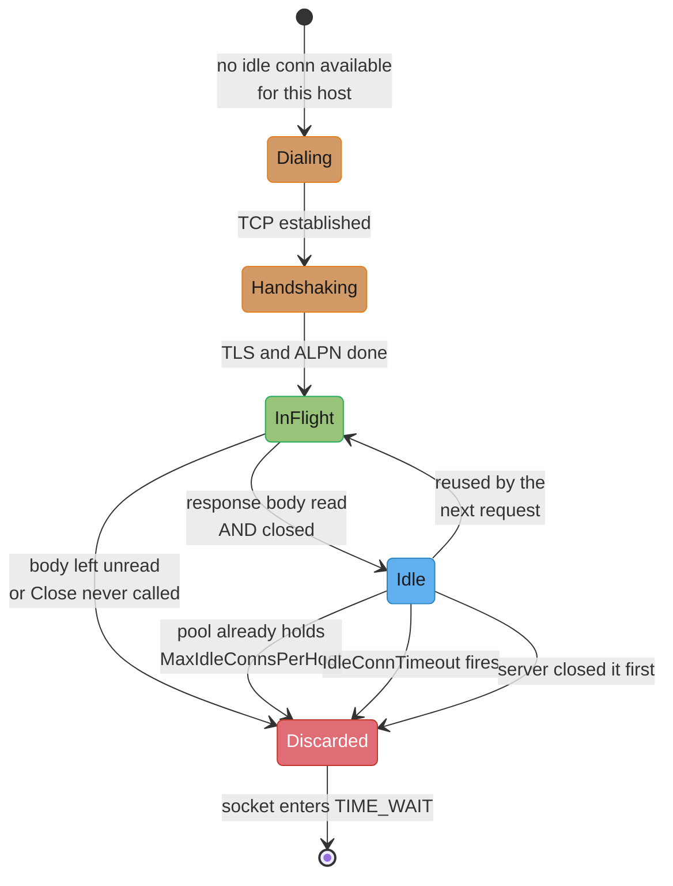
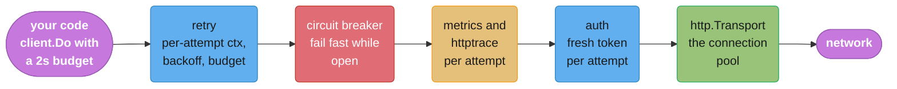
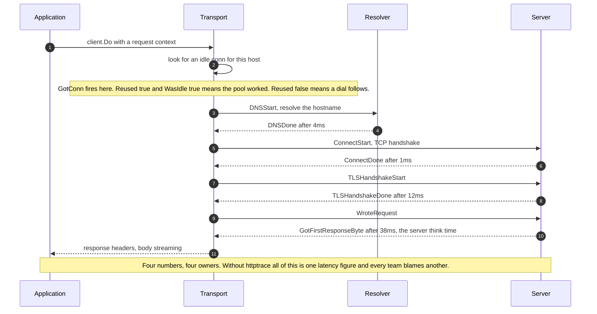

# HTTP Clients and Resilience

## 1. Concept Overview

`http.Client` is a thin policy object: a timeout, a redirect rule, a cookie jar, and a
pointer to a `RoundTripper`. It holds no sockets and no state worth keeping. Everything
expensive lives one layer down, in `http.Transport` — the connection pool, the TLS session
cache, the HTTP/2 connections, the idle-connection reaper. That split is the single most
important thing to understand about the package, because it explains almost every production
failure in this module:

```go
type Client struct {
    Transport     RoundTripper  // the pool lives here
    CheckRedirect func(*Request, []*Request) error
    Jar           CookieJar
    Timeout       time.Duration // whole-request, per Do call
}
```

Construct a `Client` per request and you construct a `Transport` per request, and a
per-request pool is not a pool. Every call dials a fresh TCP connection, performs a fresh TLS
handshake, and — because the old `Transport` is garbage before its idle connections are ever
reused — leaves a socket in `TIME_WAIT` behind. The service works fine in a load test at 10
requests/second and dies at 500 with `dial tcp: cannot assign requested address`, which is
ephemeral port exhaustion, which is a configuration bug wearing a networking bug's costume.

The second surprise is the default that ships in the box. `Transport.MaxIdleConnsPerHost` is
**2**. Not 2 per goroutine, not 2 per core: 2 idle keep-alive connections retained per host,
process-wide. A service talking to one downstream at any real concurrency therefore closes
almost every connection it finishes with and dials almost every connection it starts —
`http.DefaultTransport`'s `MaxIdleConns: 100` does nothing to help, because the per-host cap
bites first. This is the most consequential default in `net/http` and it is invisible: no
error, no warning, just latency and handshake CPU that nobody attributes correctly.

The third is `resp.Body`. It is an `io.ReadCloser` you must close on **every** path —
including the error paths and the non-2xx paths where there is "nothing to read" — or you leak
a file descriptor and a connection. And closing alone is not sufficient for reuse: an
unread body means the connection cannot be handed back to the pool. Since Go `[1.27]` the
`Transport` **drains an unread HTTP/1 body in the background on Close**, for up to 50 ms or
256 KB, so a plain `Close` keeps the connection in the common case. It did not remove the
obligation to close.

This module covers all of that plus what you build on top: the timeout ladder from
`DialContext` up to `Client.Timeout`, what Go's client retries on its own and what it
refuses to, how to add retries without violating idempotency or blowing a caller's budget,
circuit breaking and hedging as `RoundTripper` decorators, `httptrace` for per-phase latency
attribution, HTTP/2 pooling, proxies, and the cgo-versus-pure-Go DNS split.

The *patterns* — why a retry budget exists, what a circuit breaker's half-open state is for,
the maths of hedged requests — belong to
[Fault Tolerance Patterns](../../backend/fault_tolerance_patterns/fault_tolerance_patterns.md)
and [Tail Latency and Fan-Out](../../backend/tail_latency_and_fan_out/tail_latency_and_fan_out.md).
Pool sizing theory belongs to
[Connection Pooling Deep Dive](../../backend/connection_pooling_deep_dive/connection_pooling_deep_dive.md).
This page is Go's implementation of them.

---

## 2. Intuition

> **One-line analogy**: a `Transport` is a **taxi rank**, not a taxi. `Client` is the company
> policy about how long a ride may take. Buying a new company for each ride means the rank
> is always empty.

**Mental model**: imagine a rank that is allowed to keep exactly **2** cabs waiting per
destination. Cabs that return to a full rank are scrapped. If you dispatch 80 rides an hour
to the same destination, 78 of those cabs are built from scratch and scrapped on return. The
rides still complete — that is why nobody notices — but you are paying to manufacture a
vehicle per trip, and the scrapyard (`TIME_WAIT`) eventually fills the whole lot.

**Why it matters**: an HTTP client is where a service's dependence on other people's failures
becomes concrete. Every unbounded timeout is a way for a slow dependency to convert into your
own thread exhaustion. Every naive retry is a way for a struggling dependency to be finished
off by its callers. And a client with no per-phase visibility means "the API is slow" cannot
be resolved into DNS, connect, TLS, or the server's own think time — which are four different
incidents with four different owners.

**Key insight**: the client is not one timeout, it is a **ladder** of them, and they compose
multiplicatively with retries. `Client.Timeout` is per `Do` call, so wrapping three retries
around a client with a 3-second timeout produces a 9-second worst case plus backoff, not a
3-second one. The only structure that holds under load is: one **total budget** from the
caller's context, one **per-attempt** deadline derived from it, and a retry loop that checks
the remaining budget before each attempt rather than after it.

---

## 3. Core Principles

- **Create one `http.Client` per downstream service, at startup, and share it.** It is safe
  for concurrent use by design.
- **The `Transport` owns the pool.** Replacing the `Transport` throws away every warm
  connection; constructing one per request means there is never a warm connection.
- **`MaxIdleConnsPerHost` defaults to 2 and must be raised** for any client with real
  concurrency to one host.
- **`defer resp.Body.Close()` immediately after checking `err`**, on every path, for every
  status code.
- **Do not drain `resp.Body` by hand on Go 1.27+.** The `Transport` drains unread HTTP/1
  bodies itself; a manual `io.Copy` drain blocks the caller and costs more than a new
  connection once the body is large.
- **Never use `http.DefaultClient` or `http.Get` in a service.** They have no timeout, so a
  hung server hangs your goroutine forever.
- **`Client.Timeout` is a whole-request ceiling, per `Do`.** Per-attempt control comes from
  the request's context.
- **Go's client does not retry your requests**, with one narrow exception: a failure on a
  reused idle connection for a replayable request.
- **A retry needs idempotency, a bound, jitter and a budget.** Any three of the four is still
  a way to amplify an outage.
- **Client-side idle timeout must be strictly shorter than the server's**, or you will race a
  server-side close on every long-lived pool.
- **Wrap policy as `RoundTripper` decorators**, not as helper functions your callers must
  remember to use.
- **Measure per phase.** DNS, connect, TLS handshake and time-to-first-byte are four separate
  problems, and `httptrace` is the only thing that separates them.

---

## 4. Types / Architectures / Strategies

### 4.1 The three layers

| Layer | Type | Owns | Lifetime |
|-------|------|------|----------|
| Policy | `*http.Client` | timeout, redirects, cookies | process |
| Mechanism | `http.RoundTripper` (interface) | one request-to-response exchange | n/a |
| Resource | `*http.Transport` | connection pool, TLS cache, HTTP/2 conns, DNS dials | process |

`RoundTripper` is the extension point and it is another one-method interface:

```go
type RoundTripper interface {
    RoundTrip(*Request) (*Response, error)
}
```

Its contract is deliberately narrow: it must not modify the request, must not follow
redirects, must not interpret the response, and must close the request body. That narrowness
is what makes decoration safe — a retry, a circuit breaker, an auth-header injector and a
metrics recorder can each be a `RoundTripper` wrapping the next, in any order, with no
coordination.

```go
base := &http.Transport{ /* pool config */ }

client := &http.Client{
    Transport: &retryRT{next: &breakerRT{next: &metricsRT{next: &authRT{next: base}}}},
    Timeout:   0, // budget comes from the context, not from here
}
```

### 4.2 The pool knobs

| Field | Default in `http.DefaultTransport` | What it bounds |
|-------|-----------------------------------|----------------|
| `MaxIdleConnsPerHost` | **2** (`DefaultMaxIdleConnsPerHost`) | idle keep-alive connections retained **per host** |
| `MaxIdleConns` | 100 | idle connections across **all** hosts |
| `MaxConnsPerHost` | 0, meaning unlimited | total connections per host, idle **and active**; dials block when reached |
| `IdleConnTimeout` | 90s | how long an idle connection is kept before the reaper closes it |
| `DisableKeepAlives` | false | set true to close every connection after one request |
| `DisableCompression` | false | set true to stop the automatic gzip request/response handling |

The per-host cap is the one that matters, and the arithmetic is worth doing explicitly.
By Little's law, a client issuing **2,000 requests/second** to one host with a mean
round-trip of **40 ms** needs `2000 x 0.040` = **80 concurrent connections** at steady state.
With `MaxIdleConnsPerHost` at 2, only 2 of those 80 can be parked when they finish; the other
78 are closed. So the client performs roughly **1,950 fresh TCP plus TLS handshakes per
second** to do work that needs 80 warm connections.

Two costs follow. First, latency: a TCP handshake plus a TLS 1.3 handshake is 2 round trips
before the request byte is sent — about **2 ms** inside one availability zone, and **60 ms or
more** cross-region, added to *every* request. Second, sockets: Linux keeps a closed
connection in `TIME_WAIT` for **60 seconds**, and the default ephemeral port range
(32768–60999) is **28,232 ports**. At 1,950 connections/second that is
`1950 x 60` = **117,000** sockets wanting ports from a pool of 28,232. The client starts
returning `dial tcp: cannot assign requested address` and the incident is filed against the
network team.

The fix is one line and its value is your peak concurrency, not a round number:

```go
tr := http.DefaultTransport.(*http.Transport).Clone()
tr.MaxIdleConnsPerHost = 100 // >= peak concurrent requests to this host
tr.MaxIdleConns = 100        // per-host cap is meaningless if the global cap is lower
tr.IdleConnTimeout = 60 * time.Second // strictly under the server's IdleTimeout
```

`Clone()` matters: it preserves `ForceAttemptHTTP2`, the environment proxy function and the
default dial and handshake timeouts, all of which a hand-written `&http.Transport{...}`
literal silently discards.

### 4.3 The timeout ladder

| Setting | Covers | Typical value |
|---------|--------|--------------|
| `Transport.DialContext` `Timeout` | TCP connect only | 2s intra-region, 5s across the internet |
| `Transport.TLSHandshakeTimeout` | TLS handshake only | 5s |
| `Transport.ExpectContinueTimeout` | waiting for `100 Continue` after sending headers with `Expect: 100-continue` | 1s |
| `Transport.ResponseHeaderTimeout` | request fully written to response **headers** received — the server's think time | 2s for an API |
| Request context deadline | one attempt, end to end, **including reading the body** | your per-attempt budget |
| `Client.Timeout` | one `Do` call: connect, redirects, and body read | an absolute ceiling, or 0 |

`ResponseHeaderTimeout` is the underrated one. It isolates *server think time* from transfer
time, which means you can be strict about a slow API without breaking a large download — a
context deadline cannot make that distinction, because it covers the body read too.

The composition rule: **the earliest deadline wins**. If `Client.Timeout` is 10s and the
request context expires in 800 ms, you get 800 ms. Set `Client.Timeout` as a backstop against
a code path that forgot its context, and drive real budgets from the context.

### 4.4 Resilience layers, in the order they must nest

```
        caller's context deadline  (the total budget)
        └── retry RoundTripper     (per-attempt context, backoff, budget check)
            └── circuit breaker    (fails fast without consuming an attempt slot)
                └── metrics/trace  (records every attempt individually)
                    └── auth       (a fresh token per attempt, not per logical call)
                        └── Transport (the pool)
```

The retry layer must be **outside** the breaker so a tripped breaker fails immediately
instead of being retried into. Metrics must be **inside** the retry so you can see attempt
counts rather than one aggregated call. Auth must be inside everything so a retry after a
401 uses a refreshed token. Get the nesting backwards and each layer still passes its own
unit test.

---

## 5. Architecture Diagrams

### One connection's life in the pool



Three of the four arrows into `Discarded` are configuration, not failure. The default
`MaxIdleConnsPerHost` of 2 makes the second one fire on almost every completion, which is why
a healthy-looking service can be dialing thousands of connections per second.

### The RoundTripper stack



Each box is one `RoundTripper` holding the next. Nothing in the stack knows what wraps it,
which is why you can insert or remove a layer without touching call sites.

### Where the time went, per phase



### The `MaxIdleConnsPerHost` arithmetic, drawn

```
2,000 req/s to one host, mean RTT 40 ms  ->  80 concurrent connections needed

  MaxIdleConnsPerHost = 2 (the default)
  completions/s: 2000        parked: 2        closed: ~1,998
  new dials/s:   ~1,950      TIME_WAIT after 60s: ~117,000 sockets
  ephemeral ports available (32768-60999):        28,232
                                                  ^^^^^^ exhausted

  MaxIdleConnsPerHost = 100
  completions/s: 2000        parked: up to 100    closed: ~0
  new dials/s:   ~0 at steady state
  TIME_WAIT:     negligible
  saved per request: one TCP + one TLS handshake, about 2 ms intra-AZ
```

One field. The difference between it and its default is a connection-churn incident that
presents as a network problem.

---

## 6. How It Works — Detailed Mechanics

### 6.1 One client per dependency, constructed at startup

```go
// BROKEN: a fresh Transport, and therefore a fresh empty pool, per call.
func fetch(ctx context.Context, url string) (*Item, error) {
    c := &http.Client{Timeout: 5 * time.Second} // Transport is nil -> DefaultTransport?
    // No: a nil Transport uses DefaultTransport, so THIS example accidentally works.
    // The real bug is the one below, which people write when they need custom TLS:
    c = &http.Client{Transport: &http.Transport{TLSClientConfig: cfg}, Timeout: 5 * time.Second}
    ...
}

// FIX: build it once, hold it on the struct, share it.
type ItemClient struct{ http *http.Client }

func NewItemClient(cfg *tls.Config) *ItemClient {
    tr := http.DefaultTransport.(*http.Transport).Clone()
    tr.TLSClientConfig = cfg
    tr.MaxIdleConnsPerHost = 100
    tr.MaxIdleConns = 100
    tr.IdleConnTimeout = 60 * time.Second
    tr.ResponseHeaderTimeout = 2 * time.Second
    return &ItemClient{http: &http.Client{Transport: tr, Timeout: 30 * time.Second}}
}
```

The comment in the broken block is the nuance worth internalising: `&http.Client{}` with a
nil `Transport` falls back to the shared `http.DefaultTransport`, so a per-request *Client*
with no custom transport still shares one pool. The disaster case is a per-request
**Transport**, which is what everyone writes the moment they need a custom `TLSClientConfig`,
a proxy, or a custom dialer. That is when each call gets a private, permanently empty pool.

A second reason to prefer `Clone()`: constructing `&http.Transport{TLSClientConfig: cfg}`
from scratch loses `ForceAttemptHTTP2`, so HTTP/2 is silently disabled. Go conservatively
turns HTTP/2 off whenever you supply your own `TLSClientConfig`, `Dial`, `DialTLS` or
`DialContext`, on the theory that your custom code may not expect it. `DefaultTransport` sets
`ForceAttemptHTTP2: true`, and `Clone()` carries that across.

### 6.2 The response body: close everywhere, let the Transport drain

```go
resp, err := c.http.Do(req)
if err != nil {
    return nil, fmt.Errorf("fetch item: %w", err) // resp is nil, nothing to close
}
defer resp.Body.Close()

if resp.StatusCode != http.StatusOK {
    return nil, fmt.Errorf("fetch item: unexpected status %d", resp.StatusCode)
}
```

Three separate rules are packed in here.

**Close on every path.** `resp.Body` is a live `io.ReadCloser` even for a 404, a 500, or a
response with `Content-Length: 0`. Not closing it holds a file descriptor and a connection
until the garbage collector runs a finalizer, which is not a schedule you can plan around. A
`return` inside an `if resp.StatusCode != 200` block placed *before* the `defer` is the most
common shape of this leak, and it only shows up when the downstream starts erroring — that
is, during an incident.

**Close is not the same as drain.** HTTP/1 sends responses back to back on one connection, so
the remaining body bytes have to come off the socket before the next response can be read.
Through Go 1.26, closing a partially read body made the `Transport` drop the connection. Since
Go `[1.27]` the `Transport` **drains an unread HTTP/1 body asynchronously on Close, for up to
50 ms or 256 KB**, and skips the drain when the response carries `Connection: close`. HTTP/2
multiplexes streams, so an unread body there never blocked reuse. The Go blog measured 100
sequential HTTP/1 requests that never read the body at about 710 ms on Go 1.26 and 150 ms on
Go 1.27. Code that had been *benefiting* from connections being thrown away, because it kept
far too many idle connections around, can see a regression; the fix is to size the pool, not
to disable keep-alives.

**Do not drain by hand.** A manual `io.Copy(io.Discard, resp.Body)` blocks the caller on bytes
the `Transport` would drain in the background, and an unbounded one will read a hostile or
buggy server's 4 GB body. Past 256 KB a new connection is cheaper than the download.
`defer resp.Body.Close()` is the whole idiom.

### 6.3 Timeouts, and why retries and `Client.Timeout` compose badly

`Client.Timeout` starts when `Do` is called and covers connecting, following redirects, and
**reading the response body**. The last part surprises people: a 5-second `Client.Timeout` on
a client that streams a 500 MB file will abort the download at 5 seconds regardless of how
healthy the transfer is. That is why streaming clients set `Client.Timeout: 0` and rely on
`ResponseHeaderTimeout` plus a context.

The composition problem:

```go
// BROKEN: three attempts against a client with a 3s timeout is a 9s+ worst case.
c := &http.Client{Timeout: 3 * time.Second}
for i := 0; i < 3; i++ {
    resp, err = c.Do(req) // each Do gets a FRESH 3s
    if err == nil { break }
    time.Sleep(backoff(i)) // plus backoff, outside the timeout entirely
}

// FIX: the total budget lives in the caller's context; each attempt derives from it,
// and the body is consumed inside the attempt so no response outlives its context.
func getWithRetry(ctx context.Context, c *http.Client, mk func(context.Context) *http.Request) ([]byte, error) {
    var lastErr error
    for attempt := 0; attempt < 3; attempt++ {
        if err := ctx.Err(); err != nil {
            return nil, fmt.Errorf("budget exhausted after %d attempts: %w", attempt, err)
        }
        body, err := attemptOnce(ctx, c, mk)
        if err == nil {
            return body, nil
        }
        lastErr = err // always non-nil here: a 5xx became an error inside attemptOnce
        if !sleepWithJitter(ctx, attempt) {
            break
        }
    }
    return nil, lastErr
}

// attemptOnce owns one response start to finish. The deferred cancel fires only after
// the body has been read, which is the guarantee a returned *http.Response cannot give.
func attemptOnce(ctx context.Context, c *http.Client, mk func(context.Context) *http.Request) ([]byte, error) {
    attemptCtx, cancel := context.WithTimeout(ctx, 800*time.Millisecond)
    defer cancel()

    resp, err := c.Do(mk(attemptCtx))
    if err != nil {
        return nil, err
    }
    defer resp.Body.Close()

    if resp.StatusCode >= 500 {
        return nil, fmt.Errorf("upstream returned %s", resp.Status)
    }
    return io.ReadAll(io.LimitReader(resp.Body, 8<<20))
}
```

Two subtleties. `context.WithTimeout(ctx, 800*time.Millisecond)` is a **ceiling**, not a
reset: if the caller's remaining budget is 300 ms, the attempt gets 300 ms, and
`ctx.Err()` at the top of the loop stops you from starting a fourth attempt against a dead
clock. And cancelling an attempt context invalidates its response body: `Body.Read` on a
response whose context is cancelled returns `context.Canceled`, not the bytes. That is why
`attemptOnce` reads the body itself and the helper returns `[]byte` rather than a live
`*http.Response` — a retry helper that hands back a response it has already cancelled
compiles, passes review, and fails on the caller's first `Read`. The same rule applies to a
5xx branch: turn the status into an `error` before assigning to `lastErr`, because assigning
the `nil` from a successful `Do` there is how a retry loop ends up returning `nil, nil`.

### 6.4 What Go's client retries, and what it will not

Go's `Transport` retries a request in exactly one situation: the request failed on a
**reused** (previously idle) connection, and the request is replayable — it has no body, or
it has a `GetBody` function so the body can be regenerated. `http.NewRequest` sets `GetBody`
automatically for `*bytes.Reader`, `*bytes.Buffer` and `*strings.Reader` bodies, and cannot
for an arbitrary `io.Reader`, which is why streaming a body from a pipe quietly opts you out.

That single retry exists to paper over an unavoidable race: the server may have closed an
idle connection microseconds before you wrote a request onto it, and the FIN had not arrived
yet. Everything else — a 500, a 503, a timeout, a connection refused, a DNS failure — is
returned to you unretried, deliberately, because the client cannot know whether your request
is safe to repeat.

**The idle-close race is a configuration problem, not just a race.** If the client's
`IdleConnTimeout` is 90 seconds and the server's `IdleTimeout` is 60, the server closes first
every time, and the client repeatedly picks connections that are about to die. Go's replay
covers most of it, but a non-replayable request — a `POST` with a streamed body — surfaces
as `EOF` or `unexpected EOF` on a request that never reached the handler. Set the client's
idle timeout strictly below the server's:

```
server IdleTimeout:        120s
client IdleConnTimeout:     90s   <- the client always closes first
```

### 6.5 Adding retries safely

Four properties, and all four are required:

**Idempotency.** `GET`, `HEAD`, `PUT` and `DELETE` are idempotent by HTTP semantics; `POST`
is not. Retrying a `POST /payments` that timed out after the server processed it charges the
customer twice. The fix is an **idempotency key** — a client-generated UUID sent as a header,
which the server stores and uses to return the original response instead of re-executing:

```go
key := uuid.New().String() // stdlib uuid [1.27]; generated ONCE, outside the retry loop
req.Header.Set("Idempotency-Key", key)
```

Generating the key inside the loop defeats the entire mechanism, which is a bug that looks
correct in review.

**Exponential backoff with full jitter.** Fixed backoff synchronises every client in the
fleet into a thundering herd against a service that is trying to recover. Full jitter is the
variant that spreads them out best:

```go
func sleepWithJitter(ctx context.Context, attempt int) bool {
    const base, cap = 50 * time.Millisecond, 2 * time.Second
    backoff := min(cap, base<<attempt)              // 50ms, 100ms, 200ms, ... capped at 2s
    d := time.Duration(rand.Int64N(int64(backoff))) // full jitter: uniform in [0, backoff)
    t := time.NewTimer(d)
    defer t.Stop()
    select {
    case <-ctx.Done():
        return false // the budget is gone, do not sleep out the remainder
    case <-t.C:
        return true
    }
}
```

Sleeping on a bare `time.Sleep` rather than a `select` on `ctx.Done()` means a cancelled
request still burns its full backoff before noticing, which is how a 200 ms budget produces a
2-second response.

**A bound.** Three attempts, not "until it works".

**A budget.** A retry budget caps retries as a *fraction of total requests* — typically 10% —
across the whole client, so that a downstream failing 100% of the time produces 1.1x load
rather than 3x. Without one, retries convert a partial outage into a total one: this is
retry amplification, and the mechanism and its arithmetic are in
[Fault Tolerance Patterns](../../backend/fault_tolerance_patterns/fault_tolerance_patterns.md).
Also honour `Retry-After` on a 429 or 503 — a server telling you when to come back is more
information than your backoff formula has.

### 6.6 Circuit breaking and hedging as `RoundTripper`s

```go
type breakerRT struct {
    next http.RoundTripper
    cb   *gobreaker.CircuitBreaker[*http.Response]
}

func (b *breakerRT) RoundTrip(req *http.Request) (*http.Response, error) {
    return b.cb.Execute(func() (*http.Response, error) {
        resp, err := b.next.RoundTrip(req)
        if err != nil {
            return nil, err
        }
        if resp.StatusCode >= 500 {
            // Count it as a failure, but hand the response back so the caller can read it.
            return resp, fmt.Errorf("upstream status %d", resp.StatusCode)
        }
        return resp, nil
    })
}
```

Putting the breaker in the transport stack rather than in a helper function means every call
site is covered, including the ones written next year by someone who never read this file.
The breaker must be **inside** the retry layer, so that an open breaker fails immediately
instead of being retried three times into a wall.

Hedging targets tail latency rather than failure: send a second request if the first has not
answered by roughly the p95, take whichever responds first, cancel the loser.

```go
// Returns the winner's body, never a live *http.Response: the deferred cancel below
// kills the loser's request, and it would kill the winner's body read just as dead.
func hedged(ctx context.Context, c *http.Client, mk func(context.Context) *http.Request, after time.Duration) ([]byte, error) {
    ctx, cancel := context.WithCancel(ctx)
    defer cancel() // cancels the loser's in-flight request

    type result struct {
        body []byte
        err  error
    }
    out := make(chan result, 2) // buffered: the loser must never block on send

    launch := func() {
        resp, err := c.Do(mk(ctx))
        if err != nil {
            out <- result{nil, err}
            return
        }
        defer resp.Body.Close()
        b, err := io.ReadAll(io.LimitReader(resp.Body, 8<<20)) // read before cancel fires
        out <- result{b, err}
    }

    go launch()
    t := time.NewTimer(after)
    defer t.Stop()

    select {
    case r := <-out:
        return r.body, r.err
    case <-t.C:
        go launch() // the hedge
    case <-ctx.Done():
        return nil, ctx.Err()
    }
    r := <-out
    return r.body, r.err
}
```

Hedging is only safe for idempotent requests, and it costs extra load exactly when the system
is already degraded — a p95 trigger adds about 5% traffic, a p50 trigger adds 50%. The
selection maths, and when hedging beats a plain retry, are in
[Tail Latency and Fan-Out](../../backend/tail_latency_and_fan_out/tail_latency_and_fan_out.md).
Note the buffered channel: with an unbuffered one, the losing goroutine blocks forever on its
send and leaks.

### 6.7 `httptrace`: attributing latency to a phase

```go
func timedGet(ctx context.Context, c *http.Client, url string) (*http.Response, error) {
    var (
        start                        = time.Now()
        dnsStart, connStart, tlsStart time.Time
        reused                       bool
    )

    trace := &httptrace.ClientTrace{
        GetConn:  func(string) { /* pool lookup begins */ },
        GotConn: func(i httptrace.GotConnInfo) {
            reused = i.Reused
            slog.Debug("conn", "reused", i.Reused, "was_idle", i.WasIdle,
                "idle_for", i.IdleTime, "at", time.Since(start))
        },
        DNSStart:          func(httptrace.DNSStartInfo) { dnsStart = time.Now() },
        DNSDone:           func(httptrace.DNSDoneInfo) { slog.Debug("dns", "took", time.Since(dnsStart)) },
        ConnectStart:      func(string, string) { connStart = time.Now() },
        ConnectDone:       func(string, string, error) { slog.Debug("tcp", "took", time.Since(connStart)) },
        TLSHandshakeStart: func() { tlsStart = time.Now() },
        TLSHandshakeDone: func(tls.ConnectionState, error) {
            slog.Debug("tls", "took", time.Since(tlsStart))
        },
        WroteRequest:            func(httptrace.WroteRequestInfo) {},
        GotFirstResponseByte:    func() { slog.Debug("ttfb", "at", time.Since(start)) },
    }

    req, _ := http.NewRequestWithContext(
        httptrace.WithClientTrace(ctx, trace), http.MethodGet, url, nil)
    resp, err := c.Do(req)
    if !reused {
        coldConnections.Inc() // the metric that proves your pool is misconfigured
    }
    return resp, err
}
```

The single most valuable field here is `GotConnInfo.Reused`. Export it as a counter and the
`MaxIdleConnsPerHost` problem stops being invisible: a healthy client shows a reuse rate
above 99%, and a client stuck on the default of 2 shows something near zero while every other
metric looks fine. `IdleTime` is the second: if it is consistently close to your
`IdleConnTimeout`, your pool is larger than your traffic needs.

`ClientTrace` hooks run **on the transport's goroutines** and must not block. Do accounting
there, not I/O.

### 6.8 HTTP/2 pooling

HTTP/2 changes the pool's shape completely. One TCP connection carries many concurrent
streams, so `MaxIdleConnsPerHost` largely stops mattering — a single connection can serve
hundreds of in-flight requests. What matters instead is the server's
`SETTINGS_MAX_CONCURRENT_STREAMS`, commonly 100 or 250.

When a connection is at its stream limit, the default behaviour is to queue new requests on
that connection rather than open a second one, which shows up as latency with an idle
network. `HTTP2Config.StrictMaxConcurrentRequests` `[1.26]` controls this: it decides whether
a new connection is opened once an existing HTTP/2 connection has exceeded its stream limit.

```go
tr := http.DefaultTransport.(*http.Transport).Clone()
tr.HTTP2 = &http.HTTP2Config{StrictMaxConcurrentRequests: true}
```

`Transport.NewClientConn` `[1.26]` is the other addition: it returns a client connection
directly, bypassing the pool, for code that manages its own connections. Almost nobody should
use it — `RoundTrip` and its pool are the right answer — but it is what you reach for when you
are building something like a proxy that must pin a client to a specific upstream connection.

The other HTTP/2 gotcha is single-connection head-of-line blocking at the TCP layer: one lost
packet stalls every stream on that connection, which is precisely the problem QUIC exists to
solve. See [HTTP Protocols](../../backend/http_protocols/http_protocols.md).

### 6.9 Proxies

`http.DefaultTransport` sets `Proxy: http.ProxyFromEnvironment`, which reads `HTTP_PROXY`,
`HTTPS_PROXY` and `NO_PROXY` (and their lowercase spellings) to decide per request. Two
behaviours catch people:

- **The environment is read once and cached.** Changing `HTTPS_PROXY` at runtime has no
  effect on a process that has already made a request. Configuration must be read at startup.
- **`http_proxy` in lowercase is ignored when the process looks like a CGI script** (when
  `REQUEST_METHOD` is set in the environment), because in CGI that variable is attacker
  controlled — the `httpoxy` vulnerability.

To force a proxy in code, or to bypass the environment entirely:

```go
tr.Proxy = http.ProxyURL(mustParse("http://egress.internal:3128")) // always this proxy
// or
tr.Proxy = nil // never proxy, ignoring the environment
```

`NO_PROXY` matches suffixes and CIDR ranges but **not** arbitrary wildcards, and it is
matched against the hostname in the URL, not the resolved address — so `NO_PROXY=10.0.0.0/8`
does nothing for a request to a DNS name that happens to resolve inside that range.

### 6.10 The DNS resolver split

Go has two resolvers. The **pure Go resolver** reads `/etc/resolv.conf` and speaks DNS
itself; a blocked lookup costs one parked goroutine. The **cgo resolver** calls the system's
`getaddrinfo`; a blocked lookup costs a whole OS thread, and the runtime therefore limits it
to **500 concurrent lookups**. On Unix the pure Go resolver is preferred for exactly that
reason, but the cgo path is used when the pure Go one cannot do the job — notably on macOS,
and when `/etc/nsswitch.conf` names sources Go does not implement, or when `LOCALDOMAIN` or
`RES_OPTIONS` is set.

You can force either, and the build settles it in containers:

```
GODEBUG=netdns=go     # force the pure Go resolver
GODEBUG=netdns=cgo    # force the system resolver
GODEBUG=netdns=1      # print which one was chosen and why
CGO_ENABLED=0 go build  # pure Go resolver, always -- and the usual choice for scratch images
```

Two places this bites hard. First, a static binary in a `scratch` or `distroless` image has
no libc name-service cache, and **Go itself caches nothing** — every dial performs a fresh
resolution. Second, Kubernetes injects `options ndots:5` into the pod's `resolv.conf`, so a
name with fewer than 5 dots is tried against every search domain first. Resolving
`api.stripe.com` from a pod therefore attempts
`api.stripe.com.<ns>.svc.cluster.local`, `api.stripe.com.svc.cluster.local` and
`api.stripe.com.cluster.local` before the absolute name — 3 wasted lookups, doubled to 6 by
the A and AAAA queries, on every single dial. Fixing it is one character:

```go
// Trailing dot = fully qualified, skip the search list entirely.
req, _ := http.NewRequestWithContext(ctx, http.MethodGet, "https://api.stripe.com./v1/charges", nil)
```

or a `dnsConfig.ndots: 1` in the pod spec, or — better — a warm connection pool, which makes
the number of dials small enough that none of this matters.

---

## 7. Real-World Examples

**The AWS SDK for Go v2** builds its own `http.Transport` with explicit pool sizing rather
than accepting `DefaultTransport`, precisely because a service talking to one S3 endpoint at
high concurrency is the exact workload the default of 2 destroys. It also implements retries
with full jitter, a retry quota that is consumed and refilled — a retry budget — and per-error
classification of what is retryable.

**gRPC-Go** solves the same problems one layer down and shows the contrast: it holds a
long-lived HTTP/2 connection per address with client-side load balancing over subchannels, so
"pool size" becomes "how many streams per connection" instead of "how many connections". Its
deadline propagation is the model the `ctx`-based approach here imitates.

**Kubernetes' `client-go`** sets `MaxIdleConnsPerHost` explicitly, uses a `RoundTripper`
chain for authentication, impersonation, debug logging and rate limiting, and rate-limits
client-side with `golang.org/x/time/rate` before the request ever reaches the transport — a
clean example of the decorator stack in section 4.4.

**Prometheus** scrapes thousands of targets and is the counter-example for pool tuning: with
one connection per target and a 15-second interval, per-host idle limits are irrelevant and
`MaxIdleConns` across all hosts is what needs raising.

**Cloudflare and Stripe's public API guidance** both document idempotency keys for `POST`,
which is the industry acknowledgement that "retry only idempotent methods" is too weak a rule
for a payments API — you make `POST` idempotent rather than refusing to retry it.

---

## 8. Tradeoffs

### Pool sizing

| Setting | Too low | Too high | How to choose |
|---------|---------|----------|---------------|
| `MaxIdleConnsPerHost` | handshake per request, `TIME_WAIT` growth, port exhaustion | idle sockets and server-side memory on the other end | peak concurrent requests to that host |
| `MaxConnsPerHost` | requests block waiting for a connection, adding invisible queueing latency | you can overwhelm a downstream during a retry storm | set it as a deliberate concurrency limit, or leave it unlimited and limit upstream |
| `IdleConnTimeout` | pool churns during traffic troughs | you race the server's own idle close | strictly below the server's `IdleTimeout` |

### Where to put the timeout

| Mechanism | Strength | Weakness |
|-----------|----------|----------|
| `Client.Timeout` | one field, impossible to forget | includes the body read, so it breaks streaming; per `Do`, so it multiplies with retries |
| Request context deadline | composes with the caller's budget, propagates | every call site must build it |
| `ResponseHeaderTimeout` | isolates server think time from transfer time | does not bound a slow body |
| `DialContext` + `TLSHandshakeTimeout` | catches a black-holed host quickly | bounds only the connection setup |

### Retry strategies

| Strategy | Cost when the downstream is healthy | Cost when it is failing |
|----------|-------------------------------------|------------------------|
| No retry | none | transient blips become user errors |
| Fixed backoff | none | synchronised thundering herd |
| Exponential + full jitter | none | 3x load at worst, spread over time |
| Exponential + jitter + budget | none | bounded at roughly 1.1x load |
| Hedge at p95 | about 5% extra requests | extra load exactly when it hurts most |
| Hedge at p50 | about 50% extra requests | usually unacceptable |

---

## 9. When to Use / When NOT to Use

**Tune the pool when:**

- One client sends more than roughly 50 requests/second to a single host — the default of 2
  is already costing you handshakes.
- `httptrace`'s `GotConnInfo.Reused` rate is below 95%.
- You see `TIME_WAIT` counts in the tens of thousands, or
  `cannot assign requested address` anywhere in the logs.

**Add retries when:**

- The operation is idempotent, or you can make it idempotent with a key.
- The caller has a budget you can check, and you have a bound and a cap.
- You have somewhere to enforce a fleet-wide retry budget.

**Add hedging when:**

- The p99 is much worse than the p50 for reasons that are *not* systemic overload — a stray
  slow replica, a GC pause on one server, a cold cache shard.
- The request is idempotent and cheap enough that 5% more of it is affordable.

**Do NOT:**

- Use `http.Get`, `http.Post` or `http.DefaultClient` in a service. No timeout means one hung
  server hangs your goroutines until the process dies.
- Retry a non-idempotent request without an idempotency key. A duplicated payment is worse
  than a failed one.
- Retry a 4xx other than 408 and 429. The request is wrong and it will be wrong next time.
- Retry inside a client-level timeout. The budget is per `Do`, so N retries is N times the
  timeout.
- Hedge a write, a non-idempotent request, or anything during a capacity-driven incident.
- Set `MaxConnsPerHost` without understanding that requests will **block** on it — the
  queueing is invisible unless you instrument `GetConn` to `GotConn`.
- Build a `&http.Transport{}` literal when you only meant to change one field. Clone
  `DefaultTransport` instead, or you silently lose HTTP/2 and the environment proxy.

---

## 10. Common Pitfalls

### Pitfall 1 — a client per request, and the ports ran out

A payments service constructed a client inside its call helper because it needed mutual TLS.

```go
// BROKEN
func (s *Service) charge(ctx context.Context, body []byte) error {
    tr := &http.Transport{TLSClientConfig: s.mtls} // a private, permanently empty pool
    c := &http.Client{Transport: tr, Timeout: 5 * time.Second}
    resp, err := c.Do(req)
    ...
}

// FIX
func NewService(mtls *tls.Config) *Service {
    tr := http.DefaultTransport.(*http.Transport).Clone() // keeps ForceAttemptHTTP2 and Proxy
    tr.TLSClientConfig = mtls
    tr.MaxIdleConnsPerHost = 200
    tr.MaxIdleConns = 200
    return &Service{http: &http.Client{Transport: tr, Timeout: 5 * time.Second}}
}
```

**Quantified impact**: at 1,400 charges/second the service performed 1,400 TCP and 1,400
mutual-TLS handshakes per second. Mutual TLS with RSA-2048 client certificates costs roughly
1.5 ms of CPU per handshake, so 1,400/s consumed about 2.1 CPU-seconds per wall-clock second
— two full cores doing nothing but handshakes, on 4-core pods. p99 latency was 340 ms against
a 60 ms budget. Then the sockets ran out: 1,400/s times 60 seconds of `TIME_WAIT` is 84,000
sockets against 28,232 ephemeral ports, and the service began returning
`dial tcp: cannot assign requested address` for 20 to 40 seconds at a time. Three lines of
change took p99 to 58 ms and handshake rate to under 5/second.

### Pitfall 2 — the leaked body on the error path

An inventory client closed the body only on success.

```go
// BROKEN
resp, err := c.Do(req)
if err != nil {
    return err
}
if resp.StatusCode != http.StatusOK {
    return fmt.Errorf("status %d", resp.StatusCode) // body never closed
}
defer resp.Body.Close()  // too late for the branch above
return json.NewDecoder(resp.Body).Decode(out)

// FIX
resp, err := c.Do(req)
if err != nil {
    return err
}
defer resp.Body.Close()  // FIRST, before any status check
if resp.StatusCode != http.StatusOK {
    return fmt.Errorf("status %d", resp.StatusCode)
}
return json.NewDecoder(resp.Body).Decode(out)
```

**Quantified impact**: invisible for 8 months, because the downstream returned 200 almost
always. During a 22-minute upstream degradation the error rate went to 60%, and at 900
requests/second that leaked roughly 540 file descriptors per second. The pod's limit of
65,536 was reached in under 2 minutes, at which point *every* network operation in the
process failed with `too many open files` — including the health check, the metrics
endpoint, and the database connection the service tried to reopen. A partial dependency
outage became a total outage of a service that had a perfectly good fallback path. The
`defer` moved up three lines.

### Pitfall 3 — retrying a POST without an idempotency key

An orders service added a generic retry `RoundTripper` for "resilience".

```go
// BROKEN: a timeout does not mean the server did not process the request.
for attempt := 0; attempt < 3; attempt++ {
    resp, err := c.Do(req) // POST /v1/payments
    if err == nil && resp.StatusCode < 500 { return resp, nil }
    time.Sleep(backoff(attempt))
}

// FIX: one key per logical operation, generated OUTSIDE the loop.
key := uuid.New().String()
for attempt := 0; attempt < 3; attempt++ {
    req := newPaymentRequest(ctx, body)
    req.Header.Set("Idempotency-Key", key) // same key on every attempt
    resp, err := c.Do(req)
    if err == nil && resp.StatusCode < 500 { return resp, nil }
    if !sleepWithJitter(ctx, attempt) { break }
}
```

**Quantified impact**: a 90-second latency spike at the payment processor pushed responses
past the client's 2-second timeout while the charges themselves succeeded. 1,180 customers
were charged twice and 47 were charged three times, totalling about $214,000 in duplicate
charges, refunded over 6 days with 3 chargebacks and a payment-processor review. The
processor had supported `Idempotency-Key` from day one. The retry code was 6 lines and had
been added in a PR titled "improve reliability".

### Pitfall 4 — `MaxIdleConnsPerHost` raised, `MaxIdleConns` left alone

A team read about the per-host default and fixed it, on a service talking to 40 hosts.

```go
// BROKEN
tr := http.DefaultTransport.(*http.Transport).Clone()
tr.MaxIdleConnsPerHost = 100 // per host
// MaxIdleConns stays at DefaultTransport's 100, ACROSS ALL HOSTS

// FIX
tr.MaxIdleConnsPerHost = 100
tr.MaxIdleConns = 100 * 40 // per-host limit x number of hosts, or 0 for unlimited
```

**Quantified impact**: the global cap of 100 across 40 hosts meant an average of 2.5 idle
connections per host — the change bought nothing, and the reuse rate stayed at 4%. The team
concluded that "connection pooling does not help in Go" and spent a quarter building a
gRPC-based replacement for a problem that was one additional field. The `Reused` counter from
`httptrace`, added later, would have shown the fix had no effect within a minute of deploying
it.

### Pitfall 5 — racing the server's idle close on non-replayable requests

A file-upload client streamed bodies from an `io.Pipe` and saw intermittent `EOF`s.

```go
// BROKEN: client keeps connections idle longer than the server will
tr.IdleConnTimeout = 90 * time.Second // server's IdleTimeout is 60s
req, _ := http.NewRequestWithContext(ctx, "PUT", url, pr) // pipe: GetBody cannot be set

// FIX: close first, and make the body replayable where you can
tr.IdleConnTimeout = 45 * time.Second // strictly below the server's 60s
// and for small bodies, use a *bytes.Reader so NewRequest can set GetBody
req, _ := http.NewRequestWithContext(ctx, "PUT", url, bytes.NewReader(buf))
```

**Quantified impact**: 0.4% of uploads failed with a bare `EOF` and no server-side log entry,
because the request never reached the handler. At 40,000 uploads/day that is 160 daily
failures, each one a user-visible "upload failed, try again". It was investigated as a
network problem for 5 weeks — including a switch replacement — because the failure rate
correlated with traffic troughs, when connections had time to sit idle long enough for the
server's 60-second timer to fire. The two-line fix (shorter client idle timeout, seekable
body where possible) took it to zero.

### Pitfall 6 — the custom `TLSClientConfig` that turned off HTTP/2

A team added a private CA and lost HTTP/2 without noticing.

```go
// BROKEN: a hand-built Transport disables HTTP/2 whenever TLSClientConfig is set.
tr := &http.Transport{TLSClientConfig: &tls.Config{RootCAs: pool}}

// FIX
tr := http.DefaultTransport.(*http.Transport).Clone() // ForceAttemptHTTP2 is already true
tr.TLSClientConfig = &tls.Config{RootCAs: pool}
```

**Quantified impact**: the downstream was a gRPC-gateway service whose capacity assumed HTTP/2
multiplexing. Dropping to HTTP/1.1 meant one request per connection at a time, so the
client's effective concurrency became its pool size instead of its stream limit. Throughput
against that dependency fell from 3,100 to 640 requests/second on the same hardware, and
because the change shipped alongside a certificate rotation it was attributed to the new CA's
"slower validation" for 9 days. `curl --http1.1` versus `curl` against the same endpoint, and
one `GotConn` log line, would have found it in ten minutes.

---

## 11. Technologies & Tools

| Tool | What it is | When you want it |
|------|-----------|------------------|
| `net/http` `Client`/`Transport` | the client and its connection pool | always |
| `net/http/httptrace` | per-phase hooks: DNS, connect, TLS, first byte, connection reuse | latency attribution and proving pool health |
| `net/http/httptest` | in-process servers and `NewTestServer` `[1.27]` | testing client behaviour without a network |
| `testing/synctest` `[1.25]` | virtual clock for deterministic concurrency tests | testing backoff, timeouts and hedging instantly |
| `net.Resolver` | custom DNS resolution, including a custom dial function | DNS caching, split-horizon, or a specific resolver |
| `github.com/hashicorp/go-retryablehttp` | a retrying `http.Client` wrapper | a ready-made retry layer with backoff |
| `github.com/sony/gobreaker` | circuit breaker with closed/open/half-open states | wrapping a `RoundTripper` |
| `github.com/cenkalti/backoff/v5` | backoff strategies including exponential with jitter | when you would otherwise hand-roll it |
| `golang.org/x/time/rate` | token-bucket limiter | client-side rate limiting before the transport |
| `go.opentelemetry.io/contrib/instrumentation/net/http/otelhttp` | a tracing `RoundTripper` | spans and metrics per outbound call |
| `golang.org/x/net/http2` | direct HTTP/2 transport configuration | ping intervals and connection health checks |
| `github.com/prometheus/client_golang` | `InstrumentRoundTripperDuration`, `InstrumentRoundTripperInFlight` | RED metrics per dependency |
| `ss -tan state time-wait` | socket-state inspection | confirming a connection-churn diagnosis |
| `GODEBUG=netdns=1`, `http2debug=1` | runtime diagnostics for resolver choice and HTTP/2 frames | when the layer below your code is the suspect |
| `oha`, `vegeta` | load generators | validating pool and timeout settings under real concurrency |

---

## 12. Interview Questions with Answers

**Q: What goes wrong if you construct an http.Client inside the function that makes the request?**
**Short:** Each call gets a private connection pool that is empty by construction, so every request pays a full TCP and TLS handshake and leaves a socket in TIME_WAIT.

The pool lives on `http.Transport`, not on `Client`, so a per-request `Transport` means there
is never a warm connection to reuse. There is one saving grace worth knowing: a
`&http.Client{}` with a nil `Transport` falls back to the shared `http.DefaultTransport`, so
that particular shape accidentally works. The disaster arrives the moment someone needs a
custom `TLSClientConfig`, a proxy or a dialer and writes `&http.Transport{...}` inline. At
scale the symptom is not slowness but `dial tcp: cannot assign requested address` — Linux
holds a closed socket in `TIME_WAIT` for 60 seconds against roughly 28,000 ephemeral ports,
so a few thousand connections per second exhausts them. Build one client per downstream
service at startup and hold it on a struct.

**Q: MaxIdleConnsPerHost defaults to 2. Walk through what that costs at 2,000 requests per second to one host.**
**Short:** Only two finished connections can be parked, so roughly 1,950 fresh handshakes happen every second and the ephemeral port range runs out inside a minute.

Little's law gives the concurrency first: 2,000 requests/second at a 40 ms mean round trip is
80 connections in flight at steady state. When each of those completes, the pool keeps at
most 2 idle per host and closes the rest, so nearly every completion closes a connection and
nearly every new request dials one. That is about 1,950 TCP plus TLS handshakes per second,
adding roughly 2 ms of setup to every request inside one availability zone and far more
across regions, plus the CPU cost of the handshakes themselves. Then the sockets bite:
1,950/s times 60 seconds of `TIME_WAIT` is about 117,000 sockets against the default 28,232
ephemeral ports. The fix is `MaxIdleConnsPerHost` set to your peak concurrency to that host,
and it must be paired with a `MaxIdleConns` large enough to cover every host, or the global
cap simply moves the same problem one level up.

**Q: Why can an unread resp.Body block connection reuse, and should you drain it before Close?**
**Short:** HTTP/1 frames responses back to back, so unread bytes block reuse; since Go 1.27 the Transport drains up to 256 KB or 50 ms on Close, so just close it.

Closing releases the file descriptor and stops the leak; reuse additionally requires that the
response has been fully read off the wire, because HTTP/1.1 has no way to skip ahead to the
next response on the same connection. Through Go 1.26, closing a partially read body discarded
the connection, which is why `io.Copy(io.Discard, resp.Body)` before `Close` spread as an
idiom. Since Go 1.27 the `Transport` drains an unread HTTP/1 body asynchronously on `Close`,
for up to 50 ms or 256 KB, and skips the drain when the response says `Connection: close`;
HTTP/2 never needed a drain. The Go blog measured 100 sequential requests that ignore the body
at about 710 ms on 1.26 and 150 ms on 1.27. A manual drain adds nothing on 1.27: it blocks
the caller, and past 256 KB a new connection is cheaper than the download. What has not
changed is the obligation to close on every path, including non-2xx and error returns.

**Q: How does Client.Timeout interact with retries, and what should you use instead?**
**Short:** It applies per Do call rather than per logical operation, so three retries against a three-second client is a nine-second worst case plus backoff.

`Client.Timeout` starts when `Do` is called and ends when the body is fully read, covering
connect, redirects and transfer. Because it resets on every call, a retry loop around it
multiplies rather than divides, and the sleep between attempts is outside it entirely — a
caller who was promised 3 seconds can wait 11. The structure that holds is a total budget in
the caller's context, a per-attempt child derived with `context.WithTimeout` (which is a
ceiling, so it can only shorten), and a check of `ctx.Err()` at the top of the loop so you
never begin an attempt against a dead clock. `Client.Timeout` then becomes a generous
backstop against a code path that forgot to set a deadline, or zero for a streaming client
where a whole-request ceiling would abort a healthy download.

**Q: Does Go's http.Client retry failed requests?**
**Short:** Almost never — the one exception is a failure on a reused idle connection for a request whose body can be regenerated.

The transport replays in exactly that situation because the failure is not really a failure:
the server may have closed an idle connection microseconds before the request was written,
and the client had no way to know. Replay requires the request to have no body or to carry a
`GetBody` function, which `http.NewRequest` sets automatically for `*bytes.Reader`,
`*bytes.Buffer` and `*strings.Reader` but cannot set for an arbitrary `io.Reader` such as a
pipe. Everything else — a 500, a 503, a timeout, a refused connection, a DNS failure — is
handed straight back, deliberately, because only the caller knows whether repeating the
request is safe. Anything more is code you write, with idempotency, a bound, jitter and a
budget.

**Q: When is it safe to retry, and what makes a POST retryable?**
**Short:** Safety comes from idempotency, and a POST becomes idempotent when the caller sends a stable idempotency key the server uses to deduplicate.

`GET`, `HEAD`, `PUT` and `DELETE` are idempotent by HTTP semantics, so repeating them is
harmless. `POST` is not, and the dangerous case is a timeout — a timeout says nothing about
whether the server processed the request, only that you stopped waiting for the answer. The
industry answer, used by Stripe, AWS and Cloudflare, is a client-generated key sent as a
header, which the server records so a repeat returns the original response instead of
executing again. The bug that destroys the mechanism is generating the key inside the retry
loop, which makes every attempt a distinct operation and reads as correct in code review. Also
retry only the right statuses: 5xx, 408 and 429, honouring `Retry-After`, and never a plain
4xx, which will be just as wrong on the second attempt.

**Q: Why full jitter rather than plain exponential backoff, and where does the sleep belong?**
**Short:** Deterministic delays synchronise every client into a herd that hits the recovering service at the same instant, and the wait must be interruptible by the caller's context.

Exponential backoff bounds total load, but if a thousand clients all fail at the same moment
they all sleep for the same 50 ms and retry in the same millisecond, so the recovering server
sees a spike rather than a ramp. Full jitter picks the delay uniformly from `[0, backoff)`,
smoothing the retries into the window instead of stacking them at its edge. The second half
matters as much: sleep with `select` on a timer and `ctx.Done()`, never `time.Sleep`, because
a cancelled request that sleeps out a 2-second backoff turns a 200 ms budget into a
2-second response and holds a goroutine for the duration. Cap the backoff too, or the third
attempt of a long chain waits longer than any caller's budget.

**Q: What is a retry budget and why is a maximum attempt count not sufficient?**
**Short:** A cap of three attempts still triples load on a downstream that fails everything, which is exactly when tripling load is fatal.

Per-request bounds are local; amplification is a fleet property. If a dependency starts
failing 100% of requests, every caller retries to its limit and the struggling service
receives three times its normal traffic at precisely the moment it has least capacity to
serve it — the mechanism that turns a partial degradation into a total outage, and turns a
recovery into a second outage. A budget makes retries a fraction of total traffic, commonly
10%, tracked across the whole client rather than per request, so a full outage costs the
downstream 1.1x rather than 3x. Combine it with a circuit breaker so that once failures are
sustained you stop sending attempts at all, and with `Retry-After` so an overloaded server can
tell you when it is ready.

**Q: Where do a circuit breaker and a retry layer go relative to each other?**
**Short:** Retry goes outside so it can back off, and the breaker goes inside so an open circuit fails instantly instead of being retried three times into a wall.

Both are naturally `RoundTripper` decorators, which is the right form because it covers every
call site including ones written later by people who never read your helper package. With the
breaker inside, a tripped circuit returns immediately and the retry layer sees a fast,
cheap failure it can back off from — the desired behaviour. Reverse them and each retry
attempt consults the breaker separately, so a request that should have failed in
microseconds instead burns its full backoff chain. The rest of the stack has an order too:
metrics and tracing inside the retry so you can count attempts rather than logical calls, and
authentication innermost so a retry after a 401 sends a freshly minted token rather than
replaying the expired one.

**Q: What does httptrace give you that a total latency metric cannot?**
**Short:** It splits one number into DNS, TCP connect, TLS handshake and server think time, which are four different problems belonging to four different teams.

`httptrace.ClientTrace` hooks fire at each phase — `DNSStart`/`DNSDone`,
`ConnectStart`/`ConnectDone`, `TLSHandshakeStart`/`TLSHandshakeDone`, `WroteRequest`,
`GotFirstResponseByte` — and attaching it to the request context costs nothing when unused.
The single most valuable field is `GotConnInfo.Reused`: exported as a counter it makes
connection-pool misconfiguration visible, because a correctly sized client shows a reuse rate
above 99% while a client stuck on the default of 2 idle connections shows nearly zero with
every other metric looking healthy. `IdleTime` is the companion signal for an oversized pool.
One constraint: these callbacks run on the transport's own goroutines and must not block, so
do arithmetic there and never I/O.

**Q: How does connection pooling change under HTTP/2, and what does StrictMaxConcurrentRequests control?**
**Short:** One connection carries many concurrent streams, so per-host idle limits stop mattering and the server's stream limit becomes the real constraint.

Under HTTP/1.1 concurrency equals connections, which is why `MaxIdleConnsPerHost` dominates.
Under HTTP/2 a single connection multiplexes hundreds of streams, bounded by the server's
`SETTINGS_MAX_CONCURRENT_STREAMS`, typically 100 or 250. When that limit is reached the
default is to queue new requests on the existing connection rather than dial a second one,
which presents as latency while the network sits idle.
`HTTP2Config.StrictMaxConcurrentRequests`, added in Go 1.26, controls whether a new
connection is opened once an existing one has exceeded its stream limit. The trap that
precedes all of this is silently losing HTTP/2 altogether: Go disables it when you supply
your own `TLSClientConfig` or dialer, so clone `http.DefaultTransport` — which sets
`ForceAttemptHTTP2` — instead of writing a `&http.Transport{}` literal.

**Q: Why should the client's IdleConnTimeout be shorter than the server's IdleTimeout?**
**Short:** Whoever closes second picks up a connection the other side has already killed, and for a non-replayable request that surfaces as a bare EOF the server never logged.

Idle-connection closes are unilateral and unannounced: the server sends a FIN and the client
learns about it whenever the packet arrives, which may be after it has already selected that
connection and written a request onto it. Go's transport replays such failures when it can,
but only when the request has no body or has a `GetBody`, so a `PUT` streaming from an
`io.Pipe` fails outright. Making the client's `IdleConnTimeout` strictly shorter — 90 seconds
against a server's 120, say — means the client always closes first and this race disappears.
The tell that you have it is a small, stubborn error rate of bare `EOF`s with no matching
server-side entry, correlating with traffic troughs rather than peaks, because that is when
connections sit idle long enough for the server's timer to fire.

**Q: What does MaxConnsPerHost do that MaxIdleConnsPerHost does not, and what is its hidden cost?**
**Short:** It limits total connections including active ones, and once the limit is hit new requests block in the dial queue rather than failing.

`MaxIdleConnsPerHost` only bounds how many finished connections are parked for reuse and
never prevents a new dial. `MaxConnsPerHost` is a hard concurrency cap on a per-host basis,
counting in-flight connections too, and it defaults to zero meaning unlimited. Setting it is
a legitimate way to stop your service from overwhelming one downstream during a retry storm,
but the cost is invisible queueing: a request that would have dialed now waits, and that wait
is inside your context deadline while appearing nowhere in a server-side latency metric. If
you set it, instrument the gap between `httptrace`'s `GetConn` and `GotConn` — that interval
is your queue depth expressed as time. Often the better place for the limit is a semaphore or
a rate limiter upstream, where the backpressure is explicit.

**Q: How do proxy settings work, and what surprises people about http.ProxyFromEnvironment?**
**Short:** The environment is read once and cached for the process lifetime, so changing a proxy variable after the first request has no effect at all.

`http.DefaultTransport` sets `Proxy: http.ProxyFromEnvironment`, which consults `HTTP_PROXY`,
`HTTPS_PROXY` and `NO_PROXY` in both cases per request — but resolves the environment a single
time and caches the result, so runtime reconfiguration silently does nothing. The second
surprise is a security measure: the lowercase `http_proxy` is ignored when the process looks
like a CGI script, because in CGI that variable comes from a client-supplied header and would
otherwise let an attacker redirect the process's outbound traffic. Third, `NO_PROXY` matches
on the hostname in the URL, not the resolved address, so a CIDR entry does nothing for a
request made to a DNS name. To bypass all of it use `Transport.Proxy = http.ProxyURL(u)` for
a fixed proxy, or `nil` for none.

**Q: What is the cgo-versus-pure-Go DNS split in Go, and when does it bite?**
**Short:** One resolver parks a goroutine while the other occupies an OS thread and is capped at 500 concurrent lookups, and the build decides which you get.

The pure Go resolver reads `/etc/resolv.conf` and speaks DNS itself, so a blocked lookup
costs a parked goroutine — which is why it is preferred on Unix. The cgo resolver calls the
system `getaddrinfo`, blocking a real thread, and the runtime therefore limits it to 500
concurrent lookups; a fan-out heavier than that queues. Go picks cgo when the pure Go path
cannot do the job — on macOS, when `/etc/nsswitch.conf` names sources Go does not implement,
or when `LOCALDOMAIN` or `RES_OPTIONS` is set — and `CGO_ENABLED=0` forces pure Go always,
which is what a `scratch` or distroless image gets. `GODEBUG=netdns=go`, `netdns=cgo` and
`netdns=1` let you force or inspect the choice. The bite in Kubernetes is unrelated to either:
`ndots:5` in the pod's `resolv.conf` means an external name is tried against three search
domains first, so every dial performs six wasted queries — fixed by a trailing dot on the
hostname, a `dnsConfig` override, or simply by pooling connections so you rarely dial.

**Q: When is hedging the right tool instead of a retry, and what does it cost?**
**Short:** Hedging targets a tail caused by a stray slow server rather than by failure, sending a duplicate request at roughly the p95 and taking whichever answers first.

A retry starts only after the first attempt has failed or timed out, so it cannot help a
request that is merely slow — by the time you know, the latency has already been spent.
Hedging fires the second request while the first is still outstanding and cancels the loser,
which turns a p99 dominated by one unlucky server, one GC pause or one cold cache shard into
something close to the p50. The cost is arithmetic: triggering at the p95 adds about 5%
extra load, at the p50 about 50%, and that load lands exactly when the system is already
struggling. So hedge only idempotent requests, only when the tail is caused by variance
rather than saturation, and disable it during a capacity incident. Implementation detail that
matters: the result channel must be buffered, or the losing goroutine blocks forever on its
send and leaks.

**Q: How do you test client timeout and retry behaviour without slow, flaky tests?**
**Short:** Combine an in-memory test server with a virtual clock so a thirty-second timeout resolves instantly and deterministically.

The naive test starts an `httptest.NewServer` whose handler sleeps, then asserts the client
gave up — which takes real seconds, and becomes flaky on a loaded CI machine where scheduling
jitter crosses the threshold. `httptest.NewTestServer(t, handler)`, added in Go 1.27, uses an
in-memory fake network rather than a loopback socket, and that is precisely what makes it
composable with `testing/synctest` and its virtual clock. Backoff chains, idle-connection
expiry and hedging timers then execute in microseconds with no timing tolerance to tune. For
the pool itself the assertion is different: attach an `httptrace` and assert on
`GotConnInfo.Reused` across a burst of requests, which is a direct test of the configuration
that would otherwise only fail in production.

**Q: A dependency's p99 jumped and its own server-side latency metric is flat. How do you find where the time went?**
**Short:** Attach httptrace and read the phase timings, because a flat server metric means the time is being spent before the request reaches the handler.

The server's metric starts when it begins handling a request, so everything before that is
invisible to it: DNS resolution, the TCP handshake, the TLS handshake, time queued waiting
for a connection under `MaxConnsPerHost`, and time queued behind an HTTP/2 stream limit. An
`httptrace` on the client separates all of them, and the `GetConn`-to-`GotConn` gap plus the
`Reused` flag usually settle it in one deploy — a reuse rate collapsing to near zero points
at pool sizing, a long DNS phase points at `ndots` or a missing cache, a long TLS phase points
at handshake CPU or a certificate chain that grew. Confirm a churn diagnosis from the host
with `ss -tan state time-wait | wc -l`: tens of thousands there is conclusive, and it is a
number you can read before you ship any instrumentation at all.

---

## 13. Best Practices

- **One `*http.Client` per downstream service, built at startup, stored on a struct.** Never
  in a request path, and never `http.DefaultClient`.
- **Clone `http.DefaultTransport` rather than writing a `&http.Transport{}` literal.** You
  keep `ForceAttemptHTTP2`, the environment proxy, and the default dial and handshake
  timeouts for free.
- **Set `MaxIdleConnsPerHost` to your peak concurrency for that host, and raise
  `MaxIdleConns` to cover every host.** Fixing one without the other buys nothing.
- **Keep `IdleConnTimeout` strictly below the server's `IdleTimeout`.** 90 against 120 is a
  reasonable pair.
- **`defer resp.Body.Close()` on the line after the error check**, before any status
  inspection. The `Transport` drains what you leave unread `[1.27]`.
- **Drive budgets from the context, not `Client.Timeout`.** Total budget from the caller,
  per-attempt ceiling derived with `WithTimeout`, `ctx.Err()` checked before each attempt.
- **Use `ResponseHeaderTimeout` to bound server think time** without capping a large
  transfer.
- **Retry only idempotent operations**, or make a `POST` idempotent with a key generated once
  per logical operation, outside the loop.
- **Exponential backoff with full jitter, capped, slept on a `select` with `ctx.Done()`.**
- **Enforce a retry budget** — around 10% of requests — so a total outage downstream costs it
  1.1x load, not 3x.
- **Express policy as `RoundTripper` decorators** in the order retry, breaker, telemetry,
  auth, transport. Call sites then cannot forget it.
- **Export `GotConnInfo.Reused` as a metric.** It is the only cheap early warning for pool
  misconfiguration.
- **Hedge only idempotent, variance-bound requests, at the p95 or later**, with a buffered
  result channel and a cancel for the loser.
- **Test with `httptest.NewTestServer` `[1.27]` plus `testing/synctest`**, so timing tests are
  instant and deterministic.

---

## 14. Case Study

### Rescuing a checkout service from its own HTTP client

**Context.** A checkout service runs on 30 pods and calls three dependencies per order: a
pricing API, an inventory API, and an external payment processor over mutual TLS. Peak is
1,800 orders/second. The product SLO is a 400 ms p99 at the edge. It was meeting 340 ms in
staging at 5% of production traffic and was measured at 2,100 ms p99 on its first
Black-Friday-scale load test.

**The failing version.**

```go
// BROKEN: seven defects, and not one of them is a wrong line of logic.
func (s *Checkout) Place(ctx context.Context, o Order) error {
    // 1. a new Transport per call: a private, permanently empty connection pool
    payTr := &http.Transport{TLSClientConfig: s.mtls}
    // 2. HTTP/2 silently off, because a hand-built Transport with TLSClientConfig disables it
    payClient := &http.Client{Transport: payTr, Timeout: 5 * time.Second}

    price, err := s.priceClient.Get(ctx, o.SKU) // 3. priceClient uses http.DefaultTransport
    if err != nil {                             //    so MaxIdleConnsPerHost is the default 2
        return err
    }

    resp, err := payClient.Post(s.payURL, "application/json", body(o, price))
    if err != nil {
        // 4. a plain retry of a POST with no idempotency key
        for i := 0; i < 3; i++ {
            time.Sleep(200 * time.Millisecond) // 5. fixed backoff, no jitter, ignores ctx
            if resp, err = payClient.Post(s.payURL, "application/json", body(o, price)); err == nil {
                break
            }
        }
        if err != nil {
            return err
        }
    }
    if resp.StatusCode != http.StatusOK {
        return fmt.Errorf("payment failed: %d", resp.StatusCode) // 6. body never closed
    }
    defer resp.Body.Close()
    // 7. ctx is never passed to the payment call at all -- Post takes no context
    return json.NewDecoder(resp.Body).Decode(&o.Receipt)
}
```

What each defect produced, in the order they were diagnosed:

1. **Handshake CPU.** At 1,800 orders/second the payment path performed 1,800 mutual-TLS
   handshakes per second. At roughly 1.5 ms of CPU per RSA-2048 client-certificate handshake
   that is 2.7 CPU-seconds per second — most of two cores on a 4-core pod, spent before any
   request byte was written. Handshake latency alone added 60 ms of the 2,100 ms p99, and the
   CPU contention added far more.

2. **Port exhaustion.** 1,800 connections/second against 60-second `TIME_WAIT` wanted 108,000
   sockets from 28,232 ephemeral ports. From about 12 minutes into every load test, pods
   returned `dial tcp: cannot assign requested address` in bursts of 20 to 40 seconds.

3. **The pricing client's default pool.** `http.DefaultTransport`'s per-host limit of 2 meant
   the pricing path also dialed on nearly every request. Its reuse rate, measured later, was
   3%.

4. **Duplicate charges.** During the load test's induced latency spike the 5-second timeout
   fired on charges the processor had already accepted. 1,180 test accounts were charged
   twice. In the staging environment this was an inconvenience; the same code had been three
   days from production.

5. **Synchronised retries.** All 30 pods used a fixed 200 ms backoff, so every failure
   produced a coordinated burst 200 ms later — a self-inflicted load spike against a
   processor that was already the bottleneck.

6. **File-descriptor exhaustion.** The non-200 path never closed the body. At a 40% error
   rate during the spike, roughly 720 descriptors leaked per second; pods hit the 65,536
   limit in about 90 seconds and then failed *everything*, including health checks.

7. **No cancellation.** `payClient.Post` takes no context, so a client that had already given
   up at the edge still had its payment attempt running for the full 5 seconds, holding a
   connection and a goroutine.

**The fixed version.**

```go
// FIX: all seven defects above, corrected at the construction site rather than the call site.
type Checkout struct {
    pay   *http.Client
    price *http.Client
}

func NewCheckout(mtls *tls.Config, cb *gobreaker.CircuitBreaker[*http.Response]) *Checkout {
    newTransport := func(idlePerHost int, tlsCfg *tls.Config) *http.Transport {
        tr := http.DefaultTransport.(*http.Transport).Clone() // keeps ForceAttemptHTTP2
        tr.TLSClientConfig = tlsCfg
        tr.MaxIdleConnsPerHost = idlePerHost
        tr.MaxIdleConns = idlePerHost * 4
        tr.IdleConnTimeout = 60 * time.Second   // server's IdleTimeout is 120s
        tr.TLSHandshakeTimeout = 5 * time.Second
        tr.ResponseHeaderTimeout = 2 * time.Second
        tr.ExpectContinueTimeout = 1 * time.Second
        return tr
    }

    return &Checkout{
        // Little's law: 1800 orders/s / 30 pods = 60 rps per pod, 80ms mean -> ~5 concurrent.
        // Size for a 4x burst, not for the mean.
        pay: &http.Client{
            Transport: &breakerRT{cb: cb, next: newTransport(24, mtls)},
            Timeout:   0, // the context owns the budget
        },
        price: &http.Client{
            Transport: newTransport(64, nil),
            Timeout:   0,
        },
    }
}

func (s *Checkout) Place(ctx context.Context, o Order) error {
    price, err := s.price.Get(ctx, o.SKU) // shares a warm, correctly sized pool
    if err != nil {
        return fmt.Errorf("price lookup: %w", err)
    }

    // One key per logical payment, generated OUTSIDE the retry loop.
    key := uuid.New().String()
    payload := body(o, price)

    for attempt := 0; attempt < 3; attempt++ {
        if err := ctx.Err(); err != nil {
            return fmt.Errorf("budget exhausted after %d attempts: %w", attempt, err)
        }

        attemptCtx, cancel := context.WithTimeout(ctx, 900*time.Millisecond)
        req, _ := http.NewRequestWithContext(attemptCtx, http.MethodPost, s.payURL,
            bytes.NewReader(payload)) // *bytes.Reader -> GetBody is set, replay is possible
        req.Header.Set("Content-Type", "application/json")
        req.Header.Set("Idempotency-Key", key)

        resp, err := s.pay.Do(req)
        if err == nil {
            func() {
                defer resp.Body.Close() // closed on EVERY path
                if resp.StatusCode == http.StatusOK {
                    err = json.NewDecoder(resp.Body).Decode(&o.Receipt)
                } else if resp.StatusCode < 500 && resp.StatusCode != http.StatusTooManyRequests {
                    err = fmt.Errorf("payment rejected: %d", resp.StatusCode) // do not retry a 4xx
                } else {
                    err = retryable{fmt.Errorf("payment status %d", resp.StatusCode)}
                }
            }()
        }
        cancel()

        if err == nil {
            return nil
        }
        var r retryable
        if !errors.As(err, &r) && !isTransport(err) {
            return err // a 4xx or a decode failure: retrying will not help
        }
        if !sleepWithJitter(ctx, attempt) { // full jitter, capped, cancellable
            break
        }
    }
    return fmt.Errorf("payment failed after 3 attempts")
}
```

**What changed, and what it bought.**

| Change | Result |
|--------|--------|
| One client per dependency, built once, `Clone`d from `DefaultTransport` | mTLS handshakes fell from 1,800/s to under 4/s; two cores of CPU returned |
| `MaxIdleConnsPerHost` 24 and 64, `MaxIdleConns` 4x that | connection reuse rate went from 3% to 99.6% |
| `ForceAttemptHTTP2` preserved by `Clone()` | the pricing dependency negotiated HTTP/2 again; its throughput per pod rose from 640 to 3,100 rps |
| `TIME_WAIT` count per pod | from about 84,000 to under 200; the `cannot assign requested address` errors stopped |
| `Idempotency-Key` generated once per payment | duplicate charges went from 1,180 per load test to 0 |
| Full jitter, capped, cancellable backoff | the coordinated 200 ms retry spike disappeared from the processor's traffic graph |
| Body closed on every path via `defer` inside a closure | descriptor leak eliminated; a 40% error rate no longer becomes a 100% outage |
| Context passed through, per-attempt ceiling of 900 ms | abandoned payments cancel immediately instead of running for 5 seconds |
| Circuit breaker inside the client's transport | during a 6-minute processor outage the service failed fast at 3 ms instead of consuming its full 2.7 s budget per order |
| p99 at Black-Friday load | **2,100 ms to 290 ms**, inside the 400 ms SLO with headroom |

**The lesson.** Every defect above lived in a struct literal or a loop boundary, not in
business logic. There was no incorrect algorithm, no race, no bad SQL — just a `Transport`
built in the wrong place, a default nobody had read, a `defer` three lines too low, and a
UUID generated one scope too deep. That is the characteristic shape of Go HTTP client bugs:
the code reads correctly, passes review, works in staging at 5% of load, and is a capacity
incident at 100%.
