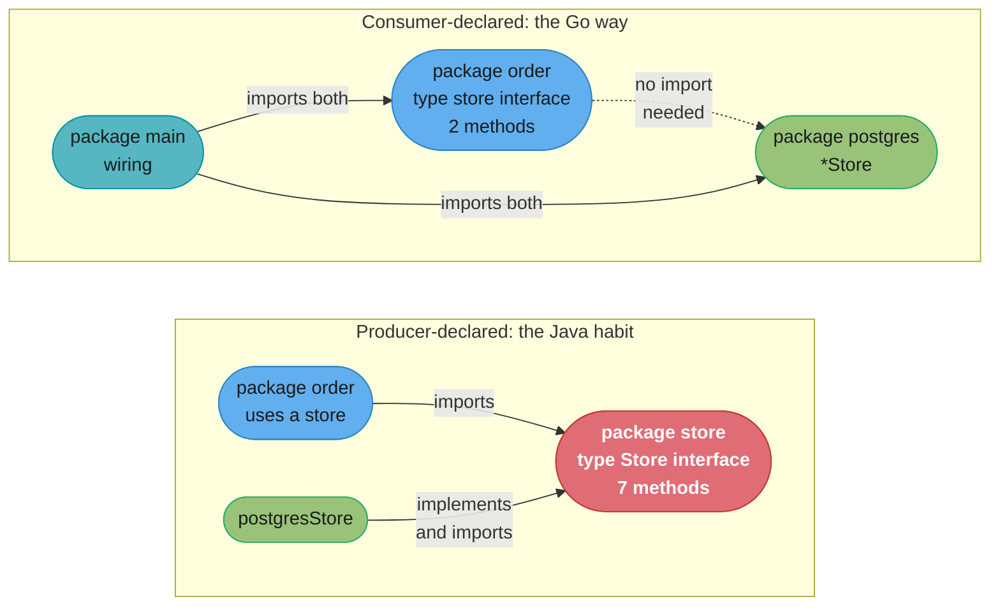
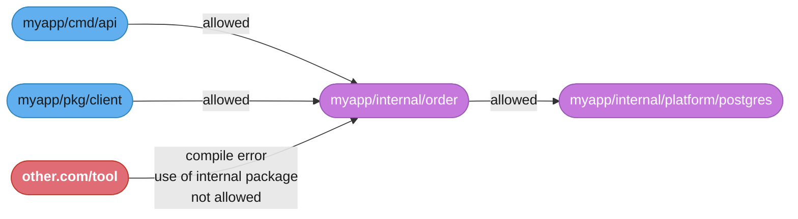

# Idiomatic API and Package Design

## 1. Concept Overview

Every language has a house style. Go's is unusually consequential, because Go removed most
of the mechanisms other languages use to paper over a bad structure. There is no dependency
injection container, no annotation processor, no `partial` class, no way to reopen a type
from another package, and — the decisive one — **no way to declare that a type implements
an interface**. Satisfaction is structural and checked at the assignment site, which means
the *consumer* of a dependency can declare the interface it needs and the producer never
learns of it. That single property inverts the direction of the dependency arrow relative to
Java or C#, and once you internalise it, most of the rest of Go's design guidance stops
being style and starts being mechanics.

This module is the standards-setting one. It is not about syntax; it is about what you
enforce in review and what you tell a team not to do. It covers the interface rules —
accept interfaces and return structs, define them at the consumer, keep them one or two
methods — and the two situations where the first rule is genuinely wrong. It covers package
naming, where the package name is part of every call site so `chi.NewRouter` reads better
than `chirouter.New`, and why `util`, `common`, `helpers` and `base` reliably become
dumping grounds. It covers project layout, what the compiler actually enforces about
`internal/`, the honest argument on both sides of `pkg/`, and why organising by domain beats
organising by layer. It covers construction — functional options against a config struct,
`New` in a package named for the thing, and the zero value that is already useful. It covers
dependency injection without a framework, error contracts across a package boundary, and API
compatibility: Go's own compatibility promise as the model, `/v2` import paths, and why
adding a method to an exported interface breaks every implementor in the world.

The language-agnostic principles behind all of this — SOLID, composition over inheritance,
program to an interface — live in
[Design Principles](../../lld/design_principles/design_principles.md) and
[SOLID Principles](../../lld/solid_principles/solid_principles.md). This module is their
**Go-specific expression**, and in two places Go's mechanics change the advice rather than
merely restating it.

---

## 2. Intuition

> **One-line analogy**: In Java you write a contract, sign it, and then hire someone who
> signed the same contract. In Go you write down what you need on a sticky note, and anyone
> who happens to be able to do it walks in. The sticky note lives on *your* desk.

**Mental model**: think of a Go package as a **shop front on a street**, not a class in a
hierarchy. The name over the door is part of every sentence a customer says — "I'll get that
from `bytes`", "check `time`". A shop called `Utilities` tells nobody anything and ends up
selling shoelaces, batteries and legal advice. A shop called `bakery` cannot absorb a
lawnmower without somebody noticing at the door. Every naming rule in this module is a
consequence of the sign being read aloud at every call site.

**Why it matters**: package structure in Go is enforced by the compiler in ways it is not
elsewhere. Import cycles are a hard error, so a bad layering decision does not degrade
slowly — it stops the build, usually three weeks after the mistake, when the fix is
expensive. `internal/` is a compiler-enforced visibility boundary, which makes it the only
real tool you have for keeping an API surface small. And an exported symbol in a
`v1` module is a promise you cannot retract without a new import path.

**Key insight**: **the interface belongs to the consumer.** Almost everything else follows.
If the consumer owns the interface, it is small by construction, because a consumer only
names the methods it calls. If it is small, mocking is trivial and no framework is needed.
If the producer does not declare it, the producer package does not import the consumer, so
the dependency graph stays acyclic without effort. Java's convention — the implementer
package ships the interface — produces the opposite of all four properties, and it is the
single habit that most reliably identifies a Go codebase written by someone who has not made
the shift.

---

## 3. Core Principles

1. **Accept interfaces, return structs.** A function's parameters should be the smallest
   behaviour it needs; its return should be the concrete thing it built, so callers can
   narrow later without you predicting how.

2. **The consumer declares the interface.** In the package that calls, unexported, naming
   only the methods that package invokes. The implementing package never imports it.

3. **The bigger the interface, the weaker the abstraction.** A one-method interface is
   satisfiable by almost anything; a seven-method one is satisfiable only by the type it
   was reverse-engineered from.

4. **The package name is part of every identifier.** Design the call site, not the
   declaration. `http.Server`, not `http.HTTPServer`.

5. **A useful zero value is worth more than a constructor.** `var buf bytes.Buffer` and
   `var mu sync.Mutex` work immediately. Designing for that removes an entire error path.

6. **Organise by domain, not by layer.** `order/`, `billing/`, `shipping/` — not `models/`,
   `services/`, `controllers/`. Layer-shaped packages guarantee that every feature touches
   every package and that import cycles are one refactor away.

7. **`internal/` is the only real access control you have.** Everything above it is a
   permanent public commitment; everything under it is yours to change.

8. **Exported error identity is API.** A sentinel or a typed error your callers match on is
   as binding as a function signature, and far easier to export by accident.

9. **Compatibility is the default expectation.** Go's own promise — code that compiles under
   1.x keeps compiling — is the bar users hold your library to. Breaking it costs a new
   import path, not a minor bump.

10. **Documentation is part of the API.** A doc comment starting with the identifier is what
    `go doc` and pkg.go.dev render, and an exported symbol without one is unfinished.

---

## 4. Types / Architectures / Strategies

### 4.1 Where an interface should live

| Situation | Who declares it | Why |
|-----------|-----------------|-----|
| One package calls another's behaviour | The **caller**, unexported | Smallest possible surface, no import from producer to consumer, trivial to fake in tests |
| Several interchangeable implementations behind a factory | The **producer**, exported | `New(kind)` must have a common return type, so an interface has to exist somewhere shared |
| The concrete type would leak internals | The **producer**, exported | Returning `*postgresStore` from an exported function exports its fields and methods forever |
| A stdlib-shaped algebra (`io.Reader`, `sort.Interface`) | A **neutral** package both sides import | The interface is the vocabulary, not a dependency of either side |
| A single implementation, exists only for mocking | **Nobody** — do not create it | Test against the real thing or make the seam a function value |

### 4.2 Construction strategies

| Strategy | Shape | Use when |
|----------|-------|----------|
| Useful zero value | `var b bytes.Buffer` | The type can be correct with all fields zero. Always aim here first |
| Plain constructor | `func New(addr string) *Client` | 1–3 required parameters, no optional ones |
| Config struct | `func New(cfg Config) (*Client, error)` | Many parameters, most of them required, callers often build the config elsewhere |
| Functional options | `func New(addr string, opts ...Option) (*Client, error)` | Many *optional* parameters, and you expect to add more without breaking callers |
| Builder | rare in Go | Almost never — options cover it with less machinery |

### 4.3 Package-naming failure modes

| Anti-name | What it becomes in 18 months | Replace with |
|-----------|------------------------------|--------------|
| `util`, `utils` | 4,000 lines, imported by every package, the reason your import graph is a cycle | Split by what the code is *about*: `slug`, `retry`, `moneyfmt` |
| `common`, `shared` | The same, plus nobody can delete anything because "something might use it" | Same fix; if it is truly shared vocabulary, it is a domain type |
| `helpers`, `misc` | Ditto, and impossible to name a function well inside it | Same |
| `base` | An inheritance hierarchy smuggled into a language without inheritance | Composition — an embedded struct or a passed-in dependency |
| `models`, `entities` | Every domain's types in one package, so every package imports every domain | One package per domain, types living with their behaviour |
| `interfaces`, `types` | Producer-declared interfaces, guaranteeing the inverted dependency arrow | Consumer-declared, in the consuming package |

### 4.4 Directory layout conventions

| Directory | Enforced by | Meaning |
|-----------|-------------|---------|
| `cmd/<name>/` | Convention | One `package main` per binary, containing wiring only — flag parsing, config load, constructor calls, `Shutdown` |
| `internal/` | **The compiler** | Importable only by code rooted at the parent of `internal/`. A hard visibility boundary |
| `api/`, `proto/` | Convention | Interface definition files — OpenAPI, `.proto`, JSON schema |
| `pkg/` | Convention, contested | "Deliberately public" library code. See §8.3 for both sides |
| `testdata/` | **The toolchain** | Ignored by the Go build entirely, so fixtures never become a package |
| `<domain>/` at repo root | Convention | The actual application code, one directory per domain concept |

---

## 5. Architecture Diagrams

### The dependency arrow — where the interface lives decides everything


In the top half, `order` and `postgresStore` both depend on a third package, and the
interface is as wide as the widest implementation. In the bottom half nothing imports
anything except `main`, and `order`'s interface is exactly the two methods it calls.

### Choosing a constructor shape

```mermaid
flowchart TD
    classDef q    fill:#61afef,stroke:#2e86c1,color:#1a1a1a
    classDef best fill:#98c379,stroke:#27ae60,color:#1a1a1a,font-weight:bold
    classDef ok   fill:#d19a66,stroke:#e67e22,color:#1a1a1a
    classDef note fill:#56b6c2,stroke:#0097a7,color:#1a1a1a

    q0{"Is the type correct<br/>with every field<br/>at its zero value?"}
    q0 -- "yes" --> zero(["Useful zero value<br/>var b bytes.Buffer<br/>no constructor at all"])
    q0 -- "no" --> q1{"More than 3<br/>parameters?"}
    q1 -- "no" --> plain(["func New&#40;a, b&#41; *T<br/>positional and obvious"])
    q1 -- "yes" --> q2{"Are most of them<br/>optional?"}
    q2 -- "no" --> cfg(["func New&#40;cfg Config&#41;<br/>one struct, validated once"])
    q2 -- "yes" --> q3{"Will you add more<br/>optional params later?"}
    q3 -- "no" --> cfg
    q3 -- "yes" --> opts(["func New&#40;addr, opts ...Option&#41;<br/>additive forever"])
    opts --> note(["Cost: every option<br/>is an exported func<br/>and godoc noise"])

    class q0,q1,q2,q3 q
    class zero best
    class plain,cfg ok
    class opts ok
    class note note
```


Start at the top every time. Most types that reach for functional options would have been
fine with a config struct, and a surprising number would have been fine with nothing.

### Layout by domain versus by layer

```
BY LAYER  (every feature cuts across every package; cycles are one refactor away)

  myapp/
  |-- models/        order.go  invoice.go  shipment.go  customer.go
  |-- services/      order.go  invoice.go  shipment.go  customer.go
  |-- repositories/  order.go  invoice.go  shipment.go  customer.go
  |-- controllers/   order.go  invoice.go  shipment.go  customer.go
                     ^^^^ adding one feature edits four packages
                     ^^^^ services/order needs services/invoice -> cycle risk

BY DOMAIN  (a feature is one directory; internal/ hides the rest of the world)

  myapp/
  |-- cmd/
  |   `-- apiserver/       main.go        <- wiring ONLY: flags, config, New(), Shutdown
  |-- internal/                           <- compiler-enforced: nothing outside myapp/ imports these
  |   |-- order/           order.go  service.go  store.go  http.go
  |   |-- invoice/         invoice.go  service.go  store.go
  |   |-- shipping/        shipment.go  service.go
  |   `-- platform/
  |       |-- postgres/    db.go          <- concrete driver, returns *postgres.Store
  |       `-- kafka/       producer.go
  |-- api/                 openapi.yaml   <- interface definition files
  `-- testdata/                           <- ignored by the go tool entirely

  order/ declares:  type invoicer interface { Issue(context.Context, ID) error }
  order/ does NOT import invoice/. cmd/apiserver wires the real one in.
```
The second tree has one property the first cannot have at any size: you can delete
`internal/shipping/` and the compiler tells you, in one place, exactly what depended on it.

### What `internal/` actually enforces


The rule is purely lexical: an `internal/` directory is importable only by packages rooted
at its parent. It is not a linter and it is not advisory — it is a compile error, which is
why it is the only access control worth relying on.

---

## 6. How It Works — Detailed Mechanics

### 6.1 Accept interfaces, return structs — and the two exceptions

```go
// GOOD. The parameter is the minimum behaviour needed; the return is concrete.
func NewUploader(dst io.Writer) *Uploader { ... }

// BAD. Returning an interface throws away everything the caller might need later.
func NewUploader(dst *os.File) Uploader { ... }
```

Returning a concrete type is strictly more useful. A caller can always assign `*Uploader`
to any interface it satisfies; it cannot recover a method you hid behind an interface. It
also means adding a method to `*Uploader` is a non-breaking change, whereas adding one to
an exported `Uploader` interface breaks every external implementor.

The rule has exactly two legitimate exceptions:

```go
// Exception 1: a factory over several implementations. The common type must exist.
func NewStore(kind string) (Store, error) {
    switch kind {
    case "postgres": return newPostgres()
    case "memory":   return newMemory()
    }
    return nil, fmt.Errorf("unknown store %q", kind)
}

// Exception 2: the concrete type would leak internals you refuse to commit to.
// *rateLimiter has 9 unexported fields and 4 methods that are implementation detail.
func NewLimiter(rps int) Limiter { return &rateLimiter{...} }
```

Both are narrow. If there is one implementation and you are returning an interface "for
flexibility", you have made the API smaller for no gain.

### 6.2 Consumer-defined interfaces in practice

```go
// package order — the CONSUMER. It declares exactly what it calls, unexported.
package order

type store interface {
    Save(ctx context.Context, o Order) error
    ByID(ctx context.Context, id ID) (Order, error)
}

type Service struct {
    store store
    now   func() time.Time   // a function value is a one-method interface without the ceremony
}

func NewService(s store) *Service {
    return &Service{store: s, now: time.Now}
}
```

```go
// package postgres — the PRODUCER. It has never heard of package order.
package postgres

type Store struct{ db *sql.DB }

func New(db *sql.DB) *Store { return &Store{db: db} }

func (s *Store) Save(ctx context.Context, o order.Order) error { ... }
func (s *Store) ByID(ctx context.Context, id order.ID) (order.Order, error) { ... }
```

```go
// package main — the only place that knows both exist.
db, err := sql.Open("pgx", dsn)
svc := order.NewService(postgres.New(db))
```

Three properties fall out for free. The interface has two methods rather than the fifteen a
producer-declared `Store` would grow. A test fake is a ten-line struct in
`order/service_test.go` with no mocking library. And `postgres` does not import `order` for
the interface, so the graph has no cycle to break. Method-set and satisfaction mechanics —
including why a value type may fail to satisfy a pointer-receiver interface — are in
[Interfaces, Methods and Embedding](../interfaces_methods_and_embedding/interfaces_methods_and_embedding.md).

Note `now func() time.Time`. A single-method dependency is often better as a function field
than an interface: it is smaller, it needs no name, and the test substitution is one line.

### 6.3 Functional options

```go
type Client struct {
    addr    string
    timeout time.Duration
    retries int
    hc      *http.Client
    logger  *slog.Logger
}

type Option func(*Client) error

func WithTimeout(d time.Duration) Option {
    return func(c *Client) error {
        if d <= 0 {
            return fmt.Errorf("timeout must be positive, got %v", d)
        }
        c.timeout = d
        return nil
    }
}

func WithRetries(n int) Option {
    return func(c *Client) error {
        if n < 0 || n > 10 {
            return fmt.Errorf("retries must be 0..10, got %d", n)
        }
        c.retries = n
        return nil
    }
}

func New(addr string, opts ...Option) (*Client, error) {
    c := &Client{
        addr:    addr,                       // required, so it is positional
        timeout: 30 * time.Second,           // defaults live here, in one readable place
        retries: 3,
        hc:      http.DefaultClient,
        logger:  slog.Default(),
    }
    for _, opt := range opts {
        if err := opt(c); err != nil {
            return nil, fmt.Errorf("client: %w", err)
        }
    }
    return c, nil
}
```

Four things this buys, and one it costs. It buys required-versus-optional expressed in the
signature; defaults visible in one place; validation at construction rather than at first
use; and additive growth — `WithProxy` next quarter breaks nobody. It costs one exported
function per option, which is real godoc noise. With three options it is elegant; with
twenty-five it is a package of `With*` functions and a config struct would have been kinder.

The `Option func(*Client) error` form is worth the extra `error` over the common
`func(*Client)` shape, because it moves an invalid timeout from a mysterious runtime
behaviour to an error at `New`.

### 6.4 Designing a useful zero value

```go
// bytes.Buffer, sync.Mutex, sync.WaitGroup, strings.Builder and http.Server are all
// usable at their zero value. That is not luck; it is a design constraint.

type Cache struct {
    mu    sync.Mutex          // zero value is an unlocked mutex
    once  sync.Once
    items map[string][]byte   // nil map: reads are legal and return the zero value
}

func (c *Cache) Get(k string) ([]byte, bool) {
    c.mu.Lock()
    defer c.mu.Unlock()
    v, ok := c.items[k]        // reading a nil map is fine
    return v, ok
}

func (c *Cache) Set(k string, v []byte) {
    c.mu.Lock()
    defer c.mu.Unlock()
    c.once.Do(func() { c.items = make(map[string][]byte) })   // lazy init, exactly once
    c.items[k] = v
}
```

The technique is three rules. Pick field types whose zero value is already correct — `nil`
maps read fine, `nil` slices append fine, a zero `sync.Mutex` is unlocked, a zero
`time.Duration` can mean "use the default". Lazily initialise anything that genuinely cannot
be zero. And never require a constructor for correctness if you can avoid it, because
`var c Cache` inside a struct field is a shape users will write whether you support it or
not.

### 6.5 Error contracts across a package boundary

```go
package order

// ErrNotFound is returned when no order exists with the requested ID.
// Callers may test for it with errors.Is. This identity is part of the package's
// public API and will not change without a major version bump.
var ErrNotFound = errors.New("order: not found")

// ValidationError reports a field that failed validation.
type ValidationError struct {
    Field  string
    Reason string
}

func (e *ValidationError) Error() string {
    return fmt.Sprintf("order: %s: %s", e.Field, e.Reason)
}

func (s *Service) ByID(ctx context.Context, id ID) (Order, error) {
    o, err := s.store.ByID(ctx, id)
    if err != nil {
        if errors.Is(err, sql.ErrNoRows) {
            return Order{}, ErrNotFound          // translate at the boundary
        }
        // wrap ONCE, here, with the context the caller lacks
        return Order{}, fmt.Errorf("order: load %s: %w", id, err)
    }
    return o, nil
}
```

Three rules govern this. Translate at the boundary: `sql.ErrNoRows` escaping `order` means
every caller now depends on your storage choice, and swapping Postgres for a cache becomes a
breaking change. Wrap once, at the boundary, not at every level — five layers of
`fmt.Errorf("%w")` produce a log line nobody reads. And treat exported error identity as
permanent: the moment a user writes `errors.Is(err, order.ErrNotFound)`, you cannot stop
returning it. Prefer returning a plain wrapped error until a caller demonstrates they need
to branch. Full mechanics, including `errors.Join` and `errors.AsType` `[1.26]`, are in
[Errors and Panics](../errors_and_panics/errors_and_panics.md).

### 6.6 Compatibility and versioning

Go's own compatibility promise is the model users hold you to: code that builds with a
1.x toolchain keeps building with every later 1.y. Matching that is achievable if you know
what actually breaks.

| Change | Breaking? | Notes |
|--------|-----------|-------|
| Add an exported function or type | No | The safe growth direction |
| Add a method to an exported **struct** type | No | Unless a user embeds it and now has an ambiguity |
| Add a method to an exported **interface** | **Yes** | Every external implementor stops compiling |
| Add a field to an exported struct | Yes, for unkeyed literals | `T{1, 2}` breaks; `T{A: 1, B: 2}` does not |
| Add a parameter to a function | Yes | Use a variadic option or a new function |
| Change a return from concrete to interface | Yes | Callers lose methods |
| Rename anything exported | Yes | Add the new name, keep the old delegating to it |
| Widen an accepted interface parameter | Yes | Existing arguments may no longer satisfy it |

The guard for the interface case:

```go
// Handler is implemented by the transports in this package. It is not implementable
// outside it: the unexported method reserves the right to add methods later.
type Handler interface {
    Handle(context.Context, Request) (Response, error)
    unexported()
}

type baseHandler struct{}
func (baseHandler) unexported() {}
// Implementors embed baseHandler. External packages cannot, so adding a method is safe.
```

`ast.Node` and `driver.Rows`-adjacent types in the standard library use this shape. It is a
deliberate trade: you give up third-party implementations to keep the freedom to extend.
Choose it consciously and say so in the doc comment.

Past `v1`, a breaking change requires **semantic import versioning**: the module path gains
a `/v2` suffix (`module github.com/acme/widget/v2`), and importers write
`github.com/acme/widget/v2`. Because the import path differs, `v1` and `v2` can coexist in
one build — which is the entire point, and what makes a migration incremental instead of
flag-day. Module and `go.mod` mechanics are in
[Packages, Modules and Tooling](../packages_modules_and_tooling/packages_modules_and_tooling.md).

### 6.7 Documentation shape

```go
// Package order implements order lifecycle management: creation, validation,
// state transitions and settlement.
//
// A Service is safe for concurrent use by multiple goroutines.
package order

// Create validates o and persists it, returning the stored order with its
// server-assigned ID and CreatedAt fields populated.
//
// Create returns ErrDuplicate if an order with the same idempotency key already
// exists, and a *ValidationError if any field is malformed.
func (s *Service) Create(ctx context.Context, o Order) (Order, error) { ... }
```

The comment starts with the identifier because `go doc` and pkg.go.dev render it as a
sentence about that symbol; "This function creates..." reads badly in a symbol list and
sorts wrong. Document what a caller cannot see from the signature: which errors are
returned, whether the type is concurrency-safe, whether a returned slice is safe to modify,
and what the zero value means. `go doc ./order` is the fastest API review tool you own —
read your own package that way before you tag a version.

---

## 7. Real-World Examples

| Package | Design decision | What to take from it |
|---------|-----------------|----------------------|
| `io.Reader`, `io.Writer` | One method each | The entire streaming ecosystem — compression, hashing, HTTP bodies, files — composes because the interface is one method |
| `bytes.Buffer` | Zero value ready | `var b bytes.Buffer` needs no constructor and no error path; the highest form of Go API design |
| `net/http.Server` | Config struct with zero-value defaults | Eight optional fields, all meaningful at zero, constructed as a struct literal rather than with options |
| `net/http.Handler` | One method, plus `HandlerFunc` adapter | The func-adapter pattern turns any function into an implementation without a type declaration |
| `google.golang.org/grpc` | Functional options | `grpc.Dial(addr, grpc.WithTransportCredentials(...))` — dozens of options added over a decade without a `v2` |
| `log/slog` `[1.21]` | Consumer-facing `Handler` interface, concrete `*Logger` | Accept the interface for output, return the struct for use — the rule in the standard library |
| `github.com/go-chi/chi/v5` | Package name in the call site | `chi.NewRouter()` reads as English; `chirouter.New()` does not. Also a live `/v5` example |
| `database/sql` | Interfaces in `database/sql/driver`, concrete `*sql.DB` for users | The two-package split when several implementations genuinely exist |
| `context.Context` | First parameter, always | The single most consistently followed convention in the ecosystem |
| Kubernetes `client-go` | Deep `internal/` use, generated typed clients | What a large public API looks like when the maintainers took `internal/` seriously |

---

## 8. Tradeoffs

### 8.1 Consumer-declared versus producer-declared interfaces

| Dimension | Consumer-declared (Go) | Producer-declared (Java habit) |
|-----------|------------------------|-------------------------------|
| Interface width | Exactly what the caller uses — usually 1–3 methods | As wide as the widest implementation, 7–15 methods |
| Import direction | Consumer does not import producer | Both import a third package |
| Cycle risk | Near zero | High as the graph grows |
| Test fakes | A struct literal in the test file | A mocking framework or 300 generated lines |
| Adding a method to the impl | Free | Free |
| Adding a method to the interface | Breaks only that consumer, in your own repo | Breaks every implementor everywhere |
| Discoverability | Lower — no single place lists "the contract" | Higher |
| Duplication | The same 2 methods may be redeclared in 3 consumers | None |

The duplication objection is the real one, and the answer is that it is not duplication —
three consumers needing overlapping methods is three genuinely different contracts that
happen to overlap today.

### 8.2 Functional options versus config struct

| Dimension | Functional options | Config struct |
|-----------|-------------------|---------------|
| Required vs optional | Expressed in the signature | Convention or runtime validation only |
| Adding a parameter | Non-breaking, always | Non-breaking unless callers use unkeyed literals |
| Validation | At construction, per option, with a precise error | One pass in `New`, or scattered |
| Discoverability | `go doc` lists dozens of `With*` functions | One struct, all fields visible together |
| Config from a file or env | Awkward — needs a translation layer | Natural; unmarshal straight into it |
| Exported surface | One function per option | One type |
| Readability at 25 options | Poor | Good |
| Readability at 3 options | Excellent | Fine |

Rule of thumb: under four optional parameters, or any need to load config from YAML, use the
struct. Over four *and* you expect more, use options. A public library that must never break
callers leans options; an internal service leans struct.

### 8.3 `pkg/` — the honest argument on both sides

| For `pkg/` | Against `pkg/` |
|------------|----------------|
| Pairs visually with `internal/`: "public here, private there" | `internal/` is compiler-enforced; `pkg/` enforces nothing, so it is decoration |
| Common enough that newcomers recognise it instantly | Adds a meaningless path segment to every import: `acme/pkg/order` says nothing `acme/order` did not |
| Keeps the repo root uncluttered in a large monorepo | The Go standard library, and most of the standard-library-quality ecosystem, do not use it |
| A clear signal in a repo that also holds non-Go assets | It frequently becomes a second dumping ground, next to `util` |

The defensible position: use `internal/` always, and use `pkg/` only if the repository
genuinely holds a public library alongside non-library content that would otherwise clutter
the root. For a service, put domain packages at the root or under `internal/` and skip
`pkg/`. Do not litigate this in code review twice — pick one, write it in the repo's
`CONTRIBUTING`, and move on.

### 8.4 Return an interface or a struct

| Dimension | Return `*Client` | Return `Client` interface |
|-----------|------------------|---------------------------|
| Caller flexibility | Full — narrow to any interface | Only what you exposed |
| Adding a method later | Non-breaking | Breaks every external implementor |
| Godoc | Shows real methods and fields | Shows the interface, hides the type |
| Hides internals | No — exported fields and methods are public | Yes |
| Multiple implementations | Needs a separate interface | Built in |
| Typed-nil hazard | None | Real, if you return a nil concrete pointer |

---

## 9. When to Use / When NOT to Use

### Declare an interface when

- **Two or more implementations exist today**, not hypothetically. A second one arriving
  next year is a five-minute refactor with consumer-declared interfaces.
- **The dependency crosses a process or network boundary** you must fake in tests — a
  database, an HTTP client, a message broker, a clock.
- **You are writing a library** whose users must supply behaviour: a `Handler`, an
  `Encoder`, a `Logger`.
- **A test would otherwise need a live dependency.** This is the strongest everyday reason.

### Do NOT declare an interface when

- **There is exactly one implementation and no test seam is needed.** Test the real thing.
- **You are wrapping a struct one-for-one** to make it mockable. Extract the one method you
  need as a function field instead.
- **It would live in the producing package** and be as wide as the implementation. That is
  the anti-pattern, not the pattern.
- **You are returning it from a constructor** with a single implementation behind it.

### Use functional options when

- More than four optional parameters, and you expect the list to keep growing.
- Options need validation with a specific error message at construction.
- The package is a public library where breaking callers is expensive.

### Do NOT use functional options when

- Configuration is unmarshalled from YAML, JSON or environment variables — use a struct.
- There are three parameters. `New(addr, timeout, retries)` is clearer than three closures.
- The type has a useful zero value. Then it needs neither.

---

## 10. Common Pitfalls

### 10.1 The `util` package that became an import cycle

A payments team started with one `util/util.go` holding a `FormatMoney` helper. Two years
later it was 4,100 lines across nine files and imported by all 34 packages in the repo.
The failure arrived when someone added a `util.ValidateOrder` that needed the `order` type —
`order` already imported `util` for money formatting, and the build broke with an import
cycle. Untangling it took nine days and touched 180 files, because by then `util` also held
retry logic, a slug generator, three date helpers and a partially-written cache.

```go
// BROKEN: a package named for nothing, so nothing constrains what enters it.
package util

func FormatMoney(cents int64, cur string) string { ... }
func Retry(ctx context.Context, n int, f func() error) error { ... }
func Slugify(s string) string { ... }
func ValidateOrder(o order.Order) error { ... }   // <- the import cycle lands here

// FIX: three packages named for what they are about, plus the validation moved to
// the package that owns the type. Nothing can be dumped into any of them by accident,
// because a badly-fitting function has no plausible name inside them.
package money    // func Format(cents int64, cur Currency) string
package retry    // func Do(ctx context.Context, n int, f func() error) error
package slug     // func Make(s string) string
package order    // func (o Order) Validate() error   <- behaviour lives with its data
```

The diagnostic is one question: *can you name a function that clearly does not belong in
this package?* For `money` the answer is instant. For `util` there is no such function, and
that is the whole defect.

### 10.2 The producer-declared interface that nobody could implement

A platform team shipped an internal `storage.Store` interface with 14 methods so that "any
backend can plug in". Eighteen months later there was still exactly one implementation, the
generated mock was 900 lines, and the test suite spent 40% of its edit time on mock
regeneration. When a genuinely different backend was finally attempted, 9 of the 14 methods
were Postgres-shaped — `BeginTx`, `SetIsolation`, `Explain` — and could not be implemented
at all. The rewrite replaced the one 14-method interface with six consumer-declared
interfaces averaging 2.2 methods, deleted the mocking library, and cut test compile time
from 34 s to 11 s.

### 10.3 The interface method added in a minor release

A widely used logging library added `WithGroup(name string) Handler` to its exported
`Handler` interface in a `v1.7.0` patch-shaped release. Every third-party handler in the
ecosystem stopped compiling on `go get -u`. The maintainers had two options and both were
bad: revert and lose the feature, or ship `/v2` and split the ecosystem. Adding a method to
an exported interface is a **major** change, full stop. The prevention is either the
unexported-method guard from §6.6, or shipping a *new* narrow interface and type-asserting
for it:

```go
// FIX: additive and non-breaking. Old handlers keep working; new ones opt in.
type Grouper interface{ WithGroup(name string) Handler }

if g, ok := h.(Grouper); ok {
    h = g.WithGroup("request")
}
```

### 10.4 The internal error type that leaked into a public contract

An SDK returned `*pgconn.PgError` directly from its exported `Get` method. Users started
writing `errors.As(err, &pgErr)` and branching on `pgErr.Code == "23505"`. When the team
migrated a hot table to a key-value store, those branches silently stopped matching — no
compile error, no test failure, just duplicate-key handling that quietly no longer ran, and
a customer-visible double-charge incident three weeks later. Translate at the boundary:
return `ErrDuplicate` and wrap the driver error underneath, so the identity users match on
is one you control.

### 10.5 Stuttering names nobody can read at the call site

```go
// BROKEN: the package name is already in every reference, so this reads
// user.UserService, user.NewUserService, user.UserID, http.HTTPServer.
package user
type UserService struct{}
func NewUserService() *UserService
type UserID string

// FIX: design the call site. These read user.Service, user.New, user.ID.
package user
type Service struct{}
func New() *Service
type ID string
```

The test is to read the fully qualified name aloud. `user.UserService` fails it. This is not
cosmetic: `golint`-family checkers flag it, and the stutter compounds — a package with 30
stuttering identifiers is measurably harder to skim in `go doc`.

### 10.6 Unkeyed struct literals blocking every future field

A metrics library exported `type Point struct { Name string; Value float64 }` and users
wrote `Point{"cpu", 0.9}`. Adding a `Timestamp` field in the next minor release broke
thousands of call sites across the ecosystem. The library had no way to grow. Two
preventions: document that literals must be keyed, and — for types you truly need to extend
— add an unexported zero-width field, which makes an unkeyed literal a compile error from
day one:

```go
type Point struct {
    Name  string
    Value float64
    _     struct{}   // forces keyed literals; Point{"cpu", 0.9} will not compile
}
```

### 10.7 The layered layout that made every feature a four-package change

A team laid out a 60,000-line service as `models/`, `repositories/`, `services/`,
`handlers/`. Every feature required a change in all four, so every pull request touched four
packages and code review lost all locality. Worse, `services/` became a single package with
mutual dependencies between order, invoice and shipping logic, so it could not be split
without a large refactor — and it could not be tested in isolation because importing any
part imported all of it. Test compile time for a one-line change was 90 s. Reorganising by
domain into `internal/order/`, `internal/invoice/`, `internal/shipping/`, each holding its
own types, storage and HTTP layer, cut the median PR from 4 packages to 1 and incremental
test time to 6 s.

---

## 11. Technologies & Tools

| Tool | What it enforces or reveals |
|------|-----------------------------|
| `go doc ./...` | Renders your package exactly as users will read it. The cheapest API review that exists |
| `go vet` | Ships with the toolchain; catches struct-tag errors, `copylocks`, printf mismatches |
| `golangci-lint` | Meta-linter; enable `revive`, `stylecheck`, `errcheck`, `depguard` |
| `revive` / `stylecheck` | Naming conventions, stuttering, missing doc comments on exported symbols |
| `depguard` | Fails the build when a package imports something the layering forbids — the only automated defence against layer erosion |
| `go-arch-lint`, `import-boss` | Declarative import-graph rules for large repos, beyond what `internal/` expresses |
| `golang.org/x/exp/apidiff` | Reports whether a change to a package is breaking. Run it in CI on every release PR |
| `github.com/google/wire` | Compile-time dependency injection: generates the wiring code, so there is no reflection and no runtime graph |
| `gomock`, `mockery`, `moq` | Mock generators — useful for wide third-party interfaces, and a signal your own interfaces are too wide |
| `go mod graph`, `godepgraph` | Visualise the import graph before the cycle appears |
| `pkg.go.dev` | Where your documentation actually lands; check the rendering of a tagged version |
| `golangci-lint run --enable=godot,misspell` | Small doc-comment hygiene checks that keep godoc readable |

---

## 12. Interview Questions with Answers

**Q: What does "accept interfaces, return structs" mean, and when is it wrong?**
**Short:** Take the narrowest behaviour you need as a parameter and hand back the concrete type, except behind a factory or when the type leaks internals.

Accepting an interface means the caller can pass anything satisfying it, which is how one
function serves a file, a network connection and a `bytes.Buffer`. Returning the concrete
type means the caller keeps every method you built and can narrow to whatever interface they
prefer — they can always widen, never recover what you hid. The two real exceptions are a
factory that must return a single type across several implementations, and a case where the
concrete type would expose fields and methods you refuse to commit to as public API.
Returning an interface with exactly one implementation "for flexibility" buys nothing and
costs every future method you add.

**Q: Why should an interface live in the package that uses it rather than the one that implements it?**
**Short:** Because a consumer names only the methods it calls, which keeps the interface tiny and stops the producer package from being imported for its contract.

This is the largest structural difference from Java, where the implementing package
conventionally ships the interface. In Go, satisfaction is structural, so `package order`
can declare a two-method unexported `store` interface and `package postgres` satisfies it
without ever importing `order`. Three things follow: the interface is minimal by
construction rather than as wide as the widest implementation; a test fake is a small struct
in the consumer's own test file, so no mocking framework is needed; and the import graph
stays acyclic because only `main` imports both sides. A producer-declared interface produces
the exact opposite on all three counts.

**Q: Why is a package named `util` a design failure rather than a convenience?**
**Short:** Because nothing can be excluded from it — there is no function you could name that obviously does not belong, so it absorbs everything and everything imports it.

A good package name is a constraint. `money` rejects a retry loop on sight; `util` rejects
nothing. Over eighteen months it accumulates unrelated code, becomes imported by every other
package, and eventually something inside it needs a domain type from a package that already
imports it, producing an import cycle the compiler refuses. Unwinding that is a multi-day,
hundred-file refactor. `common`, `shared`, `helpers`, `misc` and `base` all fail the same
test. Split by subject matter — `slug`, `retry`, `moneyfmt` — and move behaviour that
operates on a domain type into the package that owns the type.

**Q: What does the compiler actually enforce about an `internal/` directory?**
**Short:** A package under `internal/` may be imported only by code rooted at the directory containing that `internal/`, and violating it is a compile error.

The rule is purely lexical and entirely mechanical. `myapp/internal/order` is importable
from anything under `myapp/`, including `myapp/cmd/api` and `myapp/pkg/client`, and from
nothing else — an external module importing it fails with "use of internal package not
allowed". It is the only real access control in the language and the only reliable way to
keep a module's public surface small. `pkg/`, by contrast, enforces nothing and is purely a
naming convention. Anything you are not ready to support forever belongs under `internal/`,
and moving a package out of it later is a non-breaking change while moving one in is not.

**Q: When do functional options beat a plain configuration struct?**
**Short:** When there are many optional parameters, you expect to add more without breaking callers, and each one deserves validation with its own error at construction.

Options express required versus optional directly in the signature — `New(addr string,
opts ...Option)` says `addr` is mandatory — keep defaults visible in one place inside `New`,
validate per option so an invalid timeout produces a precise error rather than mysterious
runtime behaviour, and grow additively so `WithProxy` next quarter breaks nobody. The costs
are one exported function per option and real godoc clutter. A config struct wins whenever
configuration comes from YAML or environment variables, when most parameters are required,
or when there are fewer than four of them. Past roughly twenty-five options the struct is
kinder again.

**Q: What makes a zero value useful, and why is that the highest form of Go API design?**
**Short:** A type is usable immediately after `var x T` with no constructor, which removes a whole error path and every "did you call New" bug.

`var b bytes.Buffer`, `var mu sync.Mutex`, `var wg sync.WaitGroup` and `var s
strings.Builder` all work as written. Achieving it takes three choices: pick field types
whose zero value is already correct — reading a nil map returns the zero value, appending to
a nil slice allocates — lazily initialise anything that genuinely cannot be zero, typically
with `sync.Once` inside the first mutating method, and never require a constructor for
correctness. The payoff is that the type works as an embedded field, as a struct member and
as a package-level variable without anybody remembering to initialise it, which is exactly
the shape users write whether you supported it or not.

**Q: Why is adding a method to an exported interface a breaking change, and how do you prevent it?**
**Short:** Every external type implementing that interface stops compiling, so it requires a new major version unless you reserved the right with an unexported method.

Because satisfaction is structural, anyone anywhere may have written a type satisfying your
interface without telling you. Add a fifteenth method and every one of them fails to build
on the next `go get -u`. The standard guard is to include an unexported method in the
interface and provide an embeddable base type that implements it — external packages then
cannot implement the interface at all, so you keep the freedom to extend, at the deliberate
cost of third-party implementations. The alternative when you want both is to leave the
original interface alone and add a separate narrow one, type-asserting for it at the call
site so old implementations keep working and new ones opt in.

**Q: What is stuttering in a Go name, and why does it matter beyond aesthetics?**
**Short:** The package name is already in every reference, so `user.UserService` repeats itself; design the call site rather than the declaration.

Every exported identifier is read as `package.Identifier`, which makes `http.HTTPServer`,
`user.UserID` and `order.OrderService` say the same word twice. The correct forms are
`http.Server`, `user.ID` and `order.Service`. This is why `chi.NewRouter` reads better than
a hypothetical `chirouter.New` — the package name carries meaning and the identifier should
not duplicate it. It is enforceable: `revive` and `stylecheck` flag it. It compounds, too,
because a package with thirty stuttering identifiers is measurably harder to skim in `go
doc`, and `go doc` is how users decide whether to adopt your library.

**Q: What are you permanently committing to when you export a sentinel error?**
**Short:** The moment a caller writes `errors.Is` against it, that identity is API and you can never stop returning it without a major version.

An exported `var ErrNotFound = errors.New(...)` or an exported error type is as binding as a
function signature and far easier to create by accident. Two related rules follow. Translate
at the boundary — letting `sql.ErrNoRows` or a driver-specific error escape your package
makes every caller depend on your storage choice, so swapping the backend silently breaks
their branching with no compile error. And wrap once, at the boundary, with the context the
caller lacks, rather than at every level, because five nested `fmt.Errorf` wraps produce a
log line nobody reads. Default to returning a plain wrapped error until a user demonstrates
they need to branch on it.

**Q: Should packages be organised by layer or by domain?**
**Short:** By domain — a layered `models`/`services`/`handlers` split makes every feature a change in every package and invites import cycles.

Layer-shaped packages mean adding one feature edits four directories, so a pull request has
no locality and review quality drops. Worse, a single `services` package accumulates mutual
dependencies between unrelated concerns, which makes it impossible to split later and
impossible to test in isolation, since importing any part imports all of it. Domain packages
— `order/`, `invoice/`, `shipping/`, each holding its own types, storage and transport code
— give you one directory per feature, a deletable unit, and a compiler that tells you in one
place what depended on something. `cmd/<name>/main.go` then holds wiring only: flags, config,
constructor calls and shutdown.

**Q: Is a `pkg/` directory good practice, and what is the argument on each side?**
**Short:** It enforces nothing, unlike `internal/`, so it is convention rather than mechanism — defensible in a mixed repo, pure decoration in a service.

In its favour: it pairs visually with `internal/`, newcomers recognise it instantly, and in
a repository holding Terraform, Helm charts and Go code it keeps the root readable. Against
it: `internal/` is a compile error while `pkg/` is a suggestion, it adds a meaningless
segment to every import path so `acme/pkg/order` says nothing `acme/order` did not, the
standard library and most high-quality Go projects omit it, and it frequently becomes a
second dumping ground next to `util`. The workable position is to use `internal/` always,
use `pkg/` only when a public library genuinely coexists with non-library content, write the
choice down in `CONTRIBUTING`, and stop debating it.

**Q: How do you do dependency injection in Go without a framework?**
**Short:** Constructor injection — pass dependencies as parameters, declare the interfaces at the consumer, and wire everything explicitly in `main`.

A service takes what it needs in `NewService(store store, clock func() time.Time)` and
stores them in unexported fields; `main` constructs the concrete implementations and passes
them down. That is the entire pattern, and it works because consumer-declared interfaces are
already small enough that substitution is trivial. Reflection-based containers are
unidiomatic here because they move a compile error into a runtime panic at startup, defeat
`go vet` and the escape analyser, and solve a problem — deep constructor chains — that Go's
flat package structure does not create. When `main` genuinely gets unwieldy, `google/wire`
generates the wiring code at compile time, which keeps every error a build error.

**Q: Why does a large interface make a weak abstraction?**
**Short:** Because only the type it was reverse-engineered from can satisfy it, so it names one implementation rather than a capability.

`io.Reader` has one method, which is why files, network connections, buffers, HTTP bodies,
gzip streams and `strings.Reader` all satisfy it and the entire streaming ecosystem
composes. A fourteen-method `Store` interface is satisfiable in practice only by the
Postgres implementation it was extracted from, and typically half its methods leak that
origin — `BeginTx`, `SetIsolation` — so the second implementation it was supposedly enabling
cannot be written. The concrete refactor is to delete the wide interface and let each
consumer declare the two or three methods it actually calls; interfaces shrink, generated
mocks disappear, and test compile time drops sharply.

**Q: What is semantic import versioning and when do you need a `/v2` path?**
**Short:** From v2 onward the major version becomes part of the module path, so `v1` and `v2` are different packages that can coexist in one build.

Go modules treat `github.com/acme/widget` and `github.com/acme/widget/v2` as unrelated
import paths. That is deliberate: a dependency graph can contain both simultaneously, so a
large application migrates package by package instead of on a flag day. You need it for any
change that breaks compilation — removing or renaming an exported symbol, adding a method to
an exported interface, adding a parameter, narrowing an accepted type. You do not need it
for additive changes, which is why the discipline of growing an API only additively is worth
real design effort. Run `apidiff` in CI on release pull requests so the answer is mechanical
rather than a judgement call.

**Q: Where does `context.Context` go in a signature and why is the convention so rigid?**
**Short:** Always the first parameter, named `ctx`, and never stored in a struct field — the uniformity is what makes cancellation propagate reliably.

The rule exists because cancellation and deadlines only work if the context threads through
every call in the chain unbroken; one function that drops it silently orphans everything
below. Making the position invariant means a reviewer can spot the break by eye and a linter
can enforce it. Storing a context in a struct is wrong because a context describes one
request's lifetime while a struct usually outlives many, so the stored value is stale
immediately. The narrow exception is a type that genuinely represents one operation, and
even then a `ctx` parameter is clearer. Propagation details are in
[Context and Cancellation](../context_and_cancellation/context_and_cancellation.md).

**Q: Why should callers use a constructor rather than a struct literal for your exported types?**
**Short:** An unkeyed struct literal breaks the moment you add a field, so adding one becomes a breaking change across every user of the type.

`Point{"cpu", 0.9}` compiles only while `Point` has exactly two fields in that order. Add a
`Timestamp` and every unkeyed literal in the ecosystem fails to build, which means the type
can never grow. Two defences exist: document that literals must be keyed, and for types you
intend to extend, add an unexported zero-width field such as `_ struct{}`, which makes an
unkeyed literal a compile error from day one and costs nothing at runtime. Keyed literals
are safe and are the right choice for simple data types like `http.Server`, so this is about
reserving the right to grow, not about banning literals.

**Q: What conventions govern `String()` and `Error()` methods?**
**Short:** `String()` returns a human-readable form for `fmt`, `Error()` must never be capitalised or end with punctuation, and neither may panic.

Implementing `fmt.Stringer` makes `%v` and `%s` use your method everywhere, including in
logs — which is also the trap, since a `String()` method that formats a nil receiver or
recurses through `%v` on itself produces a stack overflow inside a log call. Error strings
are lowercase and unpunctuated because they get concatenated: `fmt.Errorf("load config:
%w", err)` should read as one sentence, and a capitalised inner message reads as broken
English mid-line. Prefix the package name for errors crossing a boundary — `order: not
found` — so a log line identifies its source without a stack trace.

**Q: What must a documentation comment look like for `go doc` and pkg.go.dev?**
**Short:** It starts with the identifier being documented, is a complete sentence, and states what the signature cannot show.

`// Create validates o and persists it...` renders correctly in a symbol list and sorts
sensibly; `// This function creates...` does neither. Every package needs a package comment
starting `// Package order ...` in exactly one file. The content that earns its place is
what a caller cannot infer: which sentinel errors are returned and under what conditions,
whether the type is safe for concurrent use, whether a returned slice may be modified, what
the zero value means, and what happens on the empty or nil input. Reading your own package
through `go doc ./...` before tagging a release is the cheapest and most effective API
review available.

**Q: What would you put on a Go API review checklist a team can actually adopt?**
**Short:** Twelve mechanical checks covering interface placement, naming, construction, errors, context and compatibility — each one a yes-or-no question.

Are interfaces declared at the consumer and under four methods? Does every constructor
return a concrete type unless a factory demands otherwise? Does the package name avoid
stuttering, and is it not `util`, `common`, `helpers` or `models`? Is everything not
intended as permanent public API under `internal/`? Does the type have a useful zero value,
or a documented reason it cannot? Is `ctx context.Context` the first parameter everywhere
and stored nowhere? Are errors translated at the boundary and wrapped exactly once? Is every
newly exported sentinel error one you are willing to support forever? Does every exported
symbol have a doc comment starting with its own name? Would adding a field or a method break
anyone? Does `apidiff` report the change as compatible? Can you name a function that clearly
does not belong in this package — and if not, why not?

---

## 13. Best Practices

- **Declare every interface in the package that calls it**, unexported, listing only the
  methods that package invokes. If it exceeds three methods, ask which consumer really needs
  all of them.
- **Return concrete types from constructors.** `func New(...) *Client`, never
  `func New(...) Clienter` with one implementation behind it.
- **Prefer a function field to a one-method interface** for injectable behaviour like a
  clock or an ID generator. `now func() time.Time` needs no type declaration and no fake.
- **Design the call site, not the declaration.** Read `package.Identifier` aloud before
  committing to a name.
- **Never create `util`, `common`, `helpers`, `misc`, `base`, `models` or `interfaces`.**
  Name packages for subject matter, and put behaviour with the type it operates on.
- **Put everything under `internal/` by default** and promote out only what you intend to
  support permanently. Promoting out is non-breaking; the reverse is not.
- **Organise by domain.** `cmd/<name>/main.go` contains wiring only.
- **Aim for a useful zero value first**, a plain constructor second, a config struct third,
  functional options last.
- **Validate in the constructor and return an error**, rather than panicking at first use.
- **Translate errors at the package boundary** and wrap once with the context the caller
  lacks. Never let a driver or transport error type escape.
- **Treat every exported sentinel error and error type as permanent API.** Add them
  reluctantly and document them in the function's doc comment.
- **Grow APIs additively.** New function, new option, new narrow interface — never a new
  parameter or a new method on an exported interface.
- **Run `apidiff` in CI on release pull requests** so "is this breaking" stops being a
  judgement call.
- **Read your package through `go doc ./...` before tagging.** If the symbol list does not
  read as a coherent API, the package is doing more than one thing.
- **Enable `revive`, `stylecheck` and `depguard` in `golangci-lint`.** `depguard` is the
  only automated defence against layering erosion.
- **Write the layout decision down once** — `pkg/` or not, domain or layer — in
  `CONTRIBUTING`, and stop relitigating it in review.

---

## 14. Case Study

### Restructuring a 90,000-line order-management service

**Context.** A logistics company runs a Go monolith handling orders, invoicing, shipping and
notifications: 90,000 lines, 11 engineers, 34 packages. It was built by a team arriving from
Spring, and it shows. Symptoms after two years: median pull request touched 5 packages, the
incremental test build for a one-line change took 84 s, `go doc` was unreadable, and the
team had abandoned two attempts to extract shipping into its own service because the import
graph would not permit it.

**The starting structure and its four defects.**

```go
// Defect 1 — layer packages. Every feature edits four directories.
//   models/  repositories/  services/  handlers/  util/

// Defect 2 — a producer-declared, 16-method interface in its own package.
package interfaces

type OrderRepository interface {
    Save(context.Context, models.Order) error
    FindByID(context.Context, string) (models.Order, error)
    FindByCustomer(context.Context, string, int, int) ([]models.Order, error)
    BeginTx(context.Context) (*sql.Tx, error)        // Postgres leaking through
    SetIsolationLevel(sql.IsolationLevel) error      // Postgres leaking through
    // ... 11 more
}

// Defect 3 — BROKEN: a util package that everything imports, holding domain logic.
package util

func FormatMoney(cents int64, cur string) string { ... }
func Retry(ctx context.Context, n int, f func() error) error { ... }
func ValidateOrder(o models.Order) error { ... }   // models imports util. Cycle pending.

// Defect 4 — the storage driver's error type is the public contract.
func (s *OrderService) Get(ctx context.Context, id string) (models.Order, error) {
    return s.repo.FindByID(ctx, id)   // returns *pgconn.PgError straight to HTTP handlers
}
```

Consequences, measured before the work started. The generated mock for `OrderRepository`
was 1,140 lines and was regenerated in 38% of pull requests. `services` had become one
package with mutual order/invoice/shipping dependencies and could not be split. Four HTTP
handlers branched on `pgErr.Code == "23505"` for duplicate detection.

**The rewrite, in four moves over six weeks, one domain at a time.**

```go
// FIX 1 — domain packages under internal/, each owning its types, storage and transport.
//   internal/order/     order.go service.go store.go http.go
//   internal/invoice/   internal/shipping/   internal/notify/
//   internal/platform/postgres/   internal/platform/kafka/
//   cmd/apiserver/main.go   <- wiring only

// FIX 2 — consumer-declared interfaces. order/ names the 3 methods it calls.
package order

type store interface {
    Save(ctx context.Context, o Order) error
    ByID(ctx context.Context, id ID) (Order, error)
    ByCustomer(ctx context.Context, c CustomerID, page Page) ([]Order, error)
}

type invoicer interface {
    Issue(ctx context.Context, o Order) (invoice.ID, error)
}

type Service struct {
    store    store
    invoices invoicer
    now      func() time.Time
}

func NewService(s store, inv invoicer, opts ...Option) (*Service, error) { ... }

// FIX 3 — util split by subject; validation moved onto the type that owns the data.
//   internal/platform/money/   Format(cents int64, cur Currency) string
//   internal/platform/retry/   Do(ctx context.Context, n int, f func() error) error
func (o Order) Validate() error { ... }

// FIX 4 — errors translated at the boundary. The driver type never escapes.
var (
    ErrNotFound  = errors.New("order: not found")
    ErrDuplicate = errors.New("order: duplicate idempotency key")
)

func (s *Service) Get(ctx context.Context, id ID) (Order, error) {
    o, err := s.store.ByID(ctx, id)
    switch {
    case errors.Is(err, sql.ErrNoRows):
        return Order{}, ErrNotFound
    case err != nil:
        return Order{}, fmt.Errorf("order: get %s: %w", id, err)
    }
    return o, nil
}
```

The `postgres` package returns `*postgres.Store` and does not import `order`'s interface —
it does not know it exists. `cmd/apiserver/main.go` is the only file importing both.

**Results after the six weeks.**

| Metric | Before | After |
|--------|--------|-------|
| Packages touched by the median PR | 5 | 1 |
| Incremental test build, one-line change | 84 s | 9 s |
| Generated mock lines in the repo | 1,140 | 0 |
| Widest interface | 16 methods | 3 methods |
| Handlers coupled to the storage driver | 4 | 0 |
| Import cycles broken during the work | 3 | — |
| Shipping extractable as a service | No | Yes, `internal/shipping/` had 2 inbound edges |

The last row was the business objective all along. Extracting shipping had been impossible
for two years not because of the code inside it, but because the layered layout meant
shipping logic lived in four packages that everything else also lived in.

**What the team enforces now, in review.** Interfaces at the consumer, three methods or
fewer, or a written justification. Everything under `internal/` until someone argues it out.
No package named for a layer or for nothing. Errors translated at every package boundary,
wrapped exactly once. `depguard` rules in `golangci-lint` fail the build if a domain package
imports another domain package directly instead of through an interface at `main`. And a
single question in every API review: *can you name a function that clearly does not belong
in this package?* If not, split it.

**Related reading**: the method-set and satisfaction mechanics behind consumer-declared
interfaces in
[Interfaces, Methods and Embedding](../interfaces_methods_and_embedding/interfaces_methods_and_embedding.md);
the wrapping and matching machinery in
[Errors and Panics](../errors_and_panics/errors_and_panics.md); module paths, `/v2` and
build tags in
[Packages, Modules and Tooling](../packages_modules_and_tooling/packages_modules_and_tooling.md);
the fake-and-table-test patterns these interfaces enable in
[Testing, Benchmarking and Fuzzing](../testing_benchmarking_and_fuzzing/testing_benchmarking_and_fuzzing.md);
the boundary-package discipline that keeps a C dependency replaceable in
[cgo and FFI](../cgo_and_ffi/cgo_and_ffi.md); the language-agnostic principles in
[Design Principles](../../lld/design_principles/design_principles.md) and
[SOLID Principles](../../lld/solid_principles/solid_principles.md); and the
transport-level counterpart of these rules in
[REST API Design](../../backend/rest_api_design/rest_api_design.md).
