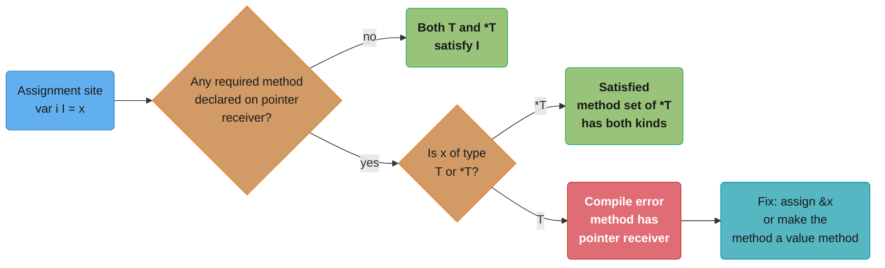
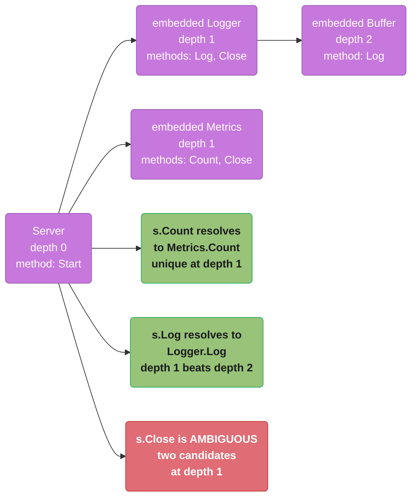
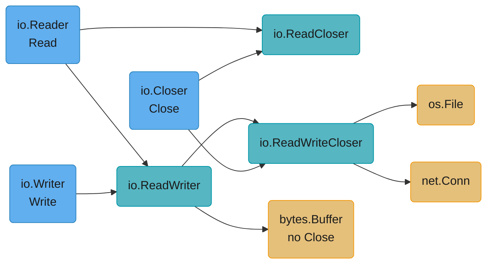

# Interfaces, Methods and Embedding

## 1. Concept Overview

Go has no `implements` keyword, no `extends`, no abstract classes and no virtual method
table attached to a type. What it has instead is one small mechanism reused everywhere: a
**method set** attached to a type, an **interface** that names a set of method signatures,
and a compiler that checks satisfaction **structurally** at the point of assignment. A type
satisfies an interface because its method set is a superset of the interface's method list
— not because anyone wrote it down.

That single design decision cascades into everything a Go engineer is tested on. Interface
ownership inverts: the *consumer* of a dependency declares the interface it needs, in its
own package, and the producer never knows it exists. Method sets — whose exact rule is a
single sentence — decide whether a value compiles into an interface at all, and the
question "value receiver or pointer receiver?" becomes a design decision with a compiler
error attached rather than a style preference. The two-word runtime representation of an
interface value creates the **typed-nil trap**, which is the highest-frequency production
bug in the language and the one most Go interview loops probe first. And **embedding** —
struct composition with automatic method promotion — looks like inheritance in a diff and
behaves nothing like it at runtime, because there is no virtual dispatch back to the outer
type.

This module covers all of that: the method-set rule and the exact compiler error it
produces, the `iface`/`eface`/`itab` layout, the typed-nil trap with its broken→fixed pair,
type assertions and type switches, embedding and promotion, the small-interface design
discipline that produced `io.Reader`, and the measurable cost of dynamic dispatch and
interface boxing.

---

## 2. Intuition

> **One-line analogy**: A Java interface is a club you sign up for; a Go interface is a
> job posting. Nobody applies. A hiring manager reads a résumé, sees the required skills
> listed, and the candidate is hired without ever having heard of the job.

**Mental model**: think of an interface value as a **luggage tag stapled to a suitcase** —
two words wide. The first word says *what kind of thing is inside and what you can do with
it* (the `itab`: interface type, concrete type, and a table of function pointers). The
second word is the suitcase itself (a pointer to the data). Almost every interface
surprise in Go is explained by remembering that the tag and the suitcase are separate: a
tag can be attached to an empty suitcase, and a tagged-but-empty suitcase is not the same
as no suitcase at all. That is the typed-nil trap in one image.

**Why it matters**: implicit satisfaction is what lets you write a `bytes.Buffer` into a
function that was compiled years earlier against `io.Writer`, and what lets you replace a
Postgres client with a fake in a test without either package importing the other. Method
sets are what make `json.Marshal` silently skip your `MarshalJSON` when you pass a value
instead of a pointer. And the typed-nil trap turns a correct-looking `if err != nil` into
a wrong branch that reports success as failure.

**Key insight**: satisfaction is checked at the **assignment site**, not the declaration
site. That is why adding a method to a type can never break a distant package, why deleting
one breaks it at compile time in exactly the places that used it, and why the smallest
useful Go interface — one method — is also the most reusable. A one-method interface is
Go's lambda.

---

## 3. Core Principles

- **Implicit satisfaction**: a type satisfies an interface if its method set contains every
  method the interface names. No declaration, no import, no registration.
- **The consumer declares the interface**: the package that *calls* the method owns the
  interface. Producers export concrete types.
- **The method-set rule**: the method set of `T` is every method declared with receiver
  `T`. The method set of `*T` is every method declared with receiver `T` **or** `*T`.
- **Interface values are two words**: `(type descriptor, data pointer)` — 16 bytes on a
  64-bit platform. A nil interface has both words zero.
- **The zero value of an interface is `nil`**, and it is a distinct state from an interface
  holding a nil pointer.
- **Embedding is composition, not inheritance**: methods are promoted, but the embedded
  value has no reference to the outer value and dispatch never travels outward.
- **Keep interfaces small**: `io.Reader` has one method and is the most-implemented
  interface in the ecosystem. The number of implementations falls off a cliff with each
  method added.
- **Accept interfaces, return structs**: parameters should be as abstract as the function
  actually needs; return values should be as concrete as possible so callers keep options.

---

## 4. Types / Architectures / Strategies

### 4.1 The method-set rule, stated once

| Receiver declared as | In the method set of `T` | In the method set of `*T` |
|----------------------|--------------------------|---------------------------|
| `func (t T) Read()` | Yes | Yes |
| `func (t *T) Write()` | **No** | Yes |

Consequence: if **any** method of a type uses a pointer receiver, only `*T` satisfies an
interface that names that method. A `T` value does not.

```go
type Counter struct{ n int }

func (c *Counter) Inc()     { c.n++ }
func (c Counter) Value() int { return c.n }

type Incrementer interface{ Inc() }

var _ Incrementer = &Counter{}  // compiles
var _ Incrementer = Counter{}   // compile error, see below
```

The error, verbatim from the Go 1.27 compiler:

```
cannot use Counter{} (value of struct type Counter) as Incrementer value in
variable declaration: Counter does not implement Incrementer
(method Inc has pointer receiver)
```

**Why the rule exists — addressability.** `c.Inc()` on a local variable `c Counter`
compiles because the compiler rewrites it to `(&c).Inc()`; a local variable is
*addressable*. Converting `c` to an interface copies the value into interface storage, and
the compiler will not silently take the address of a copy whose mutations nobody would
ever observe. Non-addressable operands make this obvious: `m["k"].Inc()` on a
`map[string]Counter` does not compile at all, because a map element has no address.

### 4.2 Choosing a receiver

| Situation | Receiver | Reason |
|-----------|----------|--------|
| The method mutates the receiver | pointer | a value receiver mutates a copy that is discarded |
| The struct contains a `sync.Mutex`, `sync.WaitGroup`, `atomic.Int64`, or `strings.Builder` | pointer | copying them is a bug; `go vet` reports `copylocks` |
| The struct is large (a rule of thumb: more than 4–5 machine words, so over ~40 bytes) | pointer | avoid copying on every call |
| The type is a small immutable value: `time.Time` (24 bytes), a `type Celsius float64` | value | copying is cheaper than an indirection, and the value stays usable as a map key |
| The type is a slice, map, channel or function header | value | the header is 1–3 words and already points at shared storage |

**The consistency rule outranks all of the above**: pick one receiver kind per type and use
it for every method. A type with `func (t T) A()` and `func (t *T) B()` has two different
method sets, so `T` satisfies some interfaces and `*T` satisfies others — and every reader
now has to check which. `go vet`'s absence of a warning here is not endorsement.

### 4.3 Interface kinds

| Kind | Declaration | Runtime shape | Notes |
|------|-------------|---------------|-------|
| Non-empty interface | `interface{ Read(...) }` | `iface` — `(*itab, data)` | the common case |
| Empty interface | `any` | `eface` — `(*_type, data)` | `any` is an alias for `interface{}`, added in `[1.18]`; identical type, better prose |
| Type-set / constraint | `interface{ ~int \| ~string }` | none | usable only as a generic constraint, never as a variable type |
| `comparable` | built-in constraint | none | satisfied by types whose `==` cannot panic |

### 4.4 Embedding forms

| Form | Written as | Effect |
|------|-----------|--------|
| Struct embedded by value | `type S struct{ Base }` | `Base`'s value-receiver methods promoted to `S`; both receiver kinds promoted to `*S` |
| Struct embedded by pointer | `type S struct{ *Base }` | all `Base` methods promoted to both `S` and `*S`; nil `*Base` panics on call |
| Interface embedded in an interface | `type RW interface{ Reader; Writer }` | union of method sets — the composition algebra |
| Interface embedded in a struct | `type S struct{ io.Writer }` | `S` satisfies `io.Writer` by delegation; a nil field panics only when the method is called |

---

## 5. Architecture Diagrams

### The two-word interface value (alignment matters — read the columns)

```
Non-empty interface: runtime.iface            Empty interface: runtime.eface
+-----------------+------------------+        +----------------+------------------+
| tab   *itab     | data  unsafe.Ptr |        | _type *_type   | data unsafe.Ptr  |
+--------+--------+---------+--------+        +--------+-------+---------+--------+
         |                  |                          |                 |
         v                  v                          v                 v
   +-----------+      +-----------+              +-----------+     +-----------+
   |  itab     |      | *Counter  |              |  _type    |     |  string   |
   |  (below)  |      |  n = 7    |              |  "string" |     |  "hello"  |
   +-----------+      +-----------+              +-----------+     +-----------+

Total width: 2 words = 16 bytes on 64-bit, 8 bytes on 32-bit.

nil interface        : tab = 0x0        data = 0x0     -> err == nil  is TRUE
typed-nil interface  : tab = &itab      data = 0x0     -> err == nil  is FALSE  <-- the trap
```
The whole typed-nil trap is the bottom two rows: `==` compares **both** words, so an
interface carrying a type descriptor is non-nil no matter what the data pointer holds.

### Inside the itab

```
internal/abi.ITab (what the runtime calls an "itab"):

   +----------------------------------------------------------+
   | Inter  *InterfaceType   -> the interface: io.ReadWriter   |
   | Type   *Type            -> the concrete type: *os.File    |
   | Hash   uint32           -> copy of Type.Hash, for switch  |
   | Fun    [N]uintptr       -> method pointers, sorted by name|
   |          Fun[0] -> (*os.File).Read                        |
   |          Fun[1] -> (*os.File).Write                       |
   +----------------------------------------------------------+

One itab exists per (interface, concrete type) PAIR, not per value.
Statically known pairs  -> emitted into read-only data at compile time, zero cost.
Dynamically formed pairs-> built by runtime.getitab and cached in a global hash table.
Fun[0] == 0 is the runtime's marker for "this type does NOT implement this interface".
```

### Does `T` satisfy the interface?


The check happens at the assignment site, so the same type can be legal in one file and
rejected in another purely because one wrote `x` and the other wrote `&x`.

### The typed-nil trap, as a control-flow picture

```mermaid
flowchart LR
    classDef bad  fill:#e06c75,stroke:#c0392b,color:#fff,font-weight:bold
    classDef ok   fill:#98c379,stroke:#27ae60,color:#1a1a1a,font-weight:bold
    classDef step fill:#d19a66,stroke:#e67e22,color:#1a1a1a
    classDef typ  fill:#c678dd,stroke:#9b59b6,color:#fff

    fnBad("func f&#40;&#41; *MyError<br/>returns nil") --> boxBad("assigned to<br/>error variable")
    boxBad --> tagBad("tab = *MyError itab<br/>data = 0x0")
    tagBad --> chkBad("err != nil<br/>evaluates TRUE")
    chkBad --> wrong("Caller reports<br/>a failure that<br/>never happened")

    fnGood("func g&#40;&#41; error<br/>returns nil") --> boxGood("nothing boxed")
    boxGood --> tagGood("tab = 0x0<br/>data = 0x0")
    tagGood --> chkGood("err != nil<br/>evaluates FALSE")
    chkGood --> right("Caller takes the<br/>success path")

    class fnBad,boxBad,tagBad,chkBad,wrong bad
    class fnGood,boxGood ok
    class tagGood,chkGood typ
    class right ok
```


The only structural difference is the declared return type. A function whose success path
can return nil must declare `error`, never a concrete pointer type.

### Embedding: promotion and selector depth


Shallowest depth wins outright. A tie at the same depth is an error only if you actually
write the selector — `Server` simply does not have a `Close` method, so it silently fails
to satisfy `io.Closer` rather than failing to compile.

### The io composition algebra


Three one-method interfaces generate every useful combination by embedding. This is why
the standard library never needed a `FileLike` interface with nine methods.

---

## 6. How It Works — Detailed Mechanics

### 6.1 Implicit satisfaction and who owns the interface

```go
// package storage — the PRODUCER. Exports a concrete type, no interface.
package storage

type S3Client struct{ bucket string }

func (c *S3Client) Get(ctx context.Context, key string) ([]byte, error) { /* ... */ }
func (c *S3Client) Put(ctx context.Context, key string, b []byte) error { /* ... */ }
func (c *S3Client) Delete(ctx context.Context, key string) error        { /* ... */ }

// package report — the CONSUMER. Declares exactly what IT needs: one method.
package report

type blobGetter interface {
    Get(ctx context.Context, key string) ([]byte, error)
}

func Render(ctx context.Context, g blobGetter, key string) (string, error) {
    b, err := g.Get(ctx, key)
    // ...
}
```

`report` does not import an interface from `storage`; it declares a private one-method
interface and `*storage.S3Client` satisfies it for free. The test fake is four lines and
imports nothing:

```go
type fakeGetter map[string][]byte

func (f fakeGetter) Get(_ context.Context, k string) ([]byte, error) {
    b, ok := f[k]
    if !ok {
        return nil, os.ErrNotExist
    }
    return b, nil
}
```

Contrast with the Java shape: `interface BlobGetter` lives in the producer's package, the
producer writes `implements BlobGetter`, and the consumer imports it. Every consumer is
now coupled to a nine-method interface it uses one method of, and mocking requires
stubbing all nine.

### 6.2 Method values, method expressions and the receiver copy

```go
c := Counter{n: 1}

f := c.Value      // METHOD VALUE: the receiver is copied NOW, at bind time
c.n = 99
fmt.Println(f())  // 1, not 99 — f closed over a copy made before the mutation

g := Counter.Value  // METHOD EXPRESSION: an ordinary func(Counter) int
fmt.Println(g(c))   // 99

h := (*Counter).Inc // func(*Counter)
h(&c)               // c.n == 100
```

A method value on a pointer receiver binds the *pointer*, so it sees later mutations. A
method value on a value receiver freezes a snapshot. This is the same evaluation rule that
makes `defer c.report()` capture the receiver at the `defer` statement.

### 6.3 The typed-nil trap in full

```go
type ValidationError struct{ Field string }

func (e *ValidationError) Error() string { return "invalid field " + e.Field }

// BROKEN: the concrete return type is the whole bug.
func validate(u User) *ValidationError {
    if u.Email == "" {
        return &ValidationError{Field: "email"}
    }
    return nil // a nil *ValidationError
}

func handle(u User) {
    var err error = validate(u) // boxing: tab = itab(*ValidationError, error), data = nil
    if err != nil {
        log.Printf("rejecting: %v", err) // ALWAYS taken, even for a valid user
        return
    }
    save(u)
}
```

`log.Printf("%v", err)` then calls `Error()` on a nil `*ValidationError`, dereferences
`e.Field`, and the process panics with a nil pointer dereference — so the visible symptom
is a crash, several frames away from the actual mistake.

```go
// FIX: declare the interface type, and never let a concrete nil pointer be boxed.
func validate(u User) error {
    if u.Email == "" {
        return &ValidationError{Field: "email"}
    }
    return nil // an untyped nil, boxed as the nil interface
}
```

**How `errors.As` interacts.** It does not rescue you:

```go
var ve *ValidationError
errors.As(err, &ve) // returns TRUE for the typed nil, and sets ve = nil
if ve != nil { /* never reached */ }
```

`errors.As` asks "is the dynamic type assignable to the target?", which it is. The caller
then has a nil `*ValidationError` and a boolean claiming success. Detecting a typed nil
after the fact requires `reflect.ValueOf(err).IsNil()` guarded by a `Kind` check — which is
a code smell announcing that some function upstream returned the wrong type. Fix the
signature instead.

### 6.4 Type assertions and type switches

```go
var i any = "hello"

s := i.(string)        // ok
n := i.(int)           // panic: interface conversion: interface {} is string, not int
n, ok := i.(int)       // n == 0, ok == false — no panic

// Asserting to another INTERFACE asks the runtime to build (or look up) an itab:
if rs, ok := r.(io.ReadSeeker); ok {
    rs.Seek(0, io.SeekStart)
}
```

The comma-ok form compiles to a comparison of the interface's type word against the target
type's descriptor — a single pointer compare for a concrete target. An interface-to-
interface assertion calls `runtime.getitab` with `canfail=true`, which either finds a
cached itab or walks the concrete type's method list once and caches the result.

A type switch reads the `Hash` field in the itab to jump, rather than comparing every arm:

```go
switch v := i.(type) {
case nil:            // matches only the NIL INTERFACE, never a typed nil
case error:          // interface arms are allowed and are checked in source order
    log.Print(v)
case fmt.Stringer:
    log.Print(v.String())
default:
    log.Printf("%T", v)
}
```

The `case nil` arm is the only place the language distinguishes a nil interface for you.

### 6.5 Embedding is not inheritance

```go
type Base struct{ name string }

func (b Base) Name() string   { return b.name }
func (b Base) Greet() string  { return "hello, " + b.Name() } // calls Base.Name, always

type Loud struct{ Base }

func (l Loud) Name() string { return strings.ToUpper(l.Base.name) }

func main() {
    l := Loud{Base{name: "ana"}}
    fmt.Println(l.Name())  // "ANA"   — the outer method shadows the promoted one
    fmt.Println(l.Greet()) // "hello, ana"  — NOT "hello, ANA"
}
```

In Java, `Base.greet()` calling `this.name()` dispatches virtually to `Loud.name()`. In Go
there is no `this` that spans the two types: `Base.Greet` has a `Base` receiver, and the
only `Name` in scope is `Base.Name`. Promotion is a **compiler-generated forwarding
method** on the outer type — `func (l Loud) Greet() string { return l.Base.Greet() }` — and
forwarding only travels inward.

There is also no `super`. The explicit field selector `l.Base.Name()` is the whole
mechanism, and it is a plain field access, so it works from any package that can see the
embedded field.

### 6.6 Embedding an interface in a struct

```go
// The partial-implementation idiom: satisfy a wide interface, override one method.
type auditedConn struct {
    net.Conn // embedded INTERFACE — promotes all 8 methods by delegation
    log *slog.Logger
}

func (c *auditedConn) Close() error {
    c.log.Info("conn closed", "remote", c.RemoteAddr())
    return c.Conn.Close()
}
```

`*auditedConn` satisfies `net.Conn` while implementing exactly one method. The danger is
that the embedded field is an interface with a **nil zero value**:

```go
var c auditedConn        // c.Conn == nil
c.Read(buf)              // panic: nil pointer dereference — at CALL time, not construction
```

The compile-time satisfaction check passes because the method set is complete on paper.
The failure surfaces the first time production traffic hits the one method you did not
implement — which is exactly the method your tests did not exercise. Two mitigations:
always construct through a function that requires the field, and in a deliberate
partial-implementation stub, embed the interface and let the panic be the intended "not
implemented yet" signal rather than an accident.

### 6.7 Dynamic dispatch cost and interface boxing

```go
type Shape interface{ Area() float64 }
type Rect struct{ w, h float64 }

func (r Rect) Area() float64 { return r.w * r.h }

func directSum(rs []Rect) float64 {
    var t float64
    for _, r := range rs {
        t += r.Area() // direct call, inlined to r.w*r.h — no call frame at all
    }
    return t
}

func ifaceSum(ss []Shape) float64 {
    var t float64
    for _, s := range ss {
        t += s.Area() // load itab.Fun[0], indirect CALL — the inliner cannot see through it
    }
    return t
}
```

Three costs, in order of importance:

1. **Lost inlining.** The direct loop compiles to two multiplies and an add with no call.
   The interface loop cannot: the callee is unknown at compile time, so the body is never
   inlined and every downstream optimization (bounds-check elimination, constant folding,
   keeping the value in a register) is blocked at the call boundary. On a hot arithmetic
   loop this is usually a larger effect than the call itself.
2. **The indirect call.** A load from `itab.Fun[i]` followed by an indirect `CALL`, on the
   order of a nanosecond and largely hidden by the branch predictor once the loop is
   monomorphic. Profile-guided optimization `[1.21]` can devirtualize a call site whose
   profile shows one dominant concrete type, restoring inlining with a type-check guard.
3. **Boxing allocations.** Putting a non-pointer value into an interface needs somewhere
   for the data word to point. If the compiler cannot prove the interface value stays on
   the stack, the operand is heap-allocated:

```
$ go build -gcflags=-m ./...
./main.go:12:14: r escapes to heap
./main.go:12:14: ... argument does not escape
```

   Two exemptions worth knowing: a value that is already a pointer costs zero extra
   allocation, and the runtime keeps a static table of the 256 single-byte values, so
   boxing a `byte` or a small `int` in that range reuses it. Verify with
   `go test -bench=. -benchmem` and read `B/op`, not intuition.

### 6.8 `comparable` and the comparison panic

Interface values are comparable with `==`: equal if both type words and both data words
compare equal. The catch is that the *data* comparison uses the dynamic type's equality —
and slices, maps and functions have none:

```go
var a any = []int{1, 2}
var b any = []int{1, 2}
_ = a == b // panic: runtime error: comparing uncomparable type []int
```

The compiler cannot catch this: the static type is `any`, which *is* comparable. The
generic constraint `comparable` is stricter — a type argument must be **strictly
comparable**, meaning `==` on it can never panic. Since `[1.20]` an ordinary interface type
*satisfies* `comparable` as a type argument even though it does not *implement* it, which
is why `map[any]struct{}` compiles: the language accepts the risk at that boundary and
panics at runtime if you insert a slice.

---

## 7. Real-World Examples

**`io.Reader` as the universal pipe.** `os.File`, `net.Conn`, `bytes.Buffer`,
`strings.Reader`, `gzip.Reader`, `http.Request.Body`, `tar.Reader` and every third-party
decoder all satisfy one method. That is why `io.Copy(dst, src)` moves bytes from a socket
to a gzip stream to a file with no adapter code, and why `httptest` can hand a handler a
fake body.

**`database/sql` drivers.** `sql.DB` is a concrete struct; the pluggable part is
`driver.Driver`, `driver.Conn` and `driver.Stmt`. `pgx`, `go-sql-driver/mysql` and
`mattn/go-sqlite3` never import each other, and `database/sql` never imports them —
registration happens through a blank import and `sql.Register`. The `driver.RowsColumnScanner`
interface `[1.27]` was added the same way: drivers that implement it get new behaviour,
drivers that do not are unaffected. That is the compatibility payoff of implicit
satisfaction.

**`http.Handler` and middleware.** One method, `ServeHTTP(ResponseWriter, *Request)`.
Middleware is a `func(http.Handler) http.Handler`, and `http.HandlerFunc` is the adapter
that turns a plain function into the interface. Every router in the ecosystem — `chi`,
`gorilla/mux`, the stdlib `ServeMux` with its method and wildcard patterns `[1.22]` — is
interchangeable because they all produce and consume the same one-method interface.

**Kubernetes `client-go` and embedding.** `Clientset` embeds a `DiscoveryClient` plus one
struct per API group, so `clientset.CoreV1().Pods(ns).Get(...)` is promotion doing the
work. `controller-runtime`'s `client.Client` composes `Reader` and `Writer` interfaces the
same way `io.ReadWriter` does. Test doubles use `fake.NewSimpleClientset()` — a different
concrete type satisfying the same interfaces, with no inheritance anywhere.

**`slog.Handler` `[1.21]`.** Four methods: `Enabled`, `Handle`, `WithAttrs`, `WithGroup`.
The stdlib ships `TextHandler` and `JSONHandler`; `NewMultiHandler` `[1.26]` fans one
record out to several. Every third-party handler — OTel bridges, Zap adapters — implements
the same four and drops in.

---

## 8. Tradeoffs

### Implicit vs explicit satisfaction

| Axis | Go (implicit) | Java (`implements`) |
|------|---------------|---------------------|
| Coupling | Consumer declares its own interface; producer never imports it | Consumer imports the producer's interface |
| Retrofitting | Any existing type can satisfy a new interface with no edit | Requires editing the type, impossible for third-party classes |
| Discoverability | "What implements this?" needs tooling (`gopls` implementations) | Listed in the source with `implements` |
| Accidental satisfaction | Possible — a `Close()` that means "close the modal" satisfies `io.Closer` | Impossible |
| Compile-time proof | Only at assignment sites; add `var _ I = (*T)(nil)` for an explicit check | Guaranteed at the class declaration |

### Value vs pointer receiver

| Axis | Value receiver | Pointer receiver |
|------|---------------|------------------|
| Mutation visible to caller | No | Yes |
| Cost per call | copies the struct | copies 8 bytes |
| Satisfies interface from `T` | Yes | No — needs `*T` |
| Safe to copy / use as map key | Yes | The pointer is the key, not the value |
| Nil receiver | Impossible | Legal, and the method may handle it |

### Embedding vs an explicit field

| Axis | Embedding (`struct{ Base }`) | Named field (`struct{ base Base }`) |
|------|------------------------------|-------------------------------------|
| Boilerplate | Zero — methods promoted | One forwarding method each |
| API surface | Every exported method of `Base` leaks into your API forever | Exactly what you choose to expose |
| Ambiguity risk | Two embeds sharing a method name silently drop it | None |
| Renaming `Base`'s methods | Silently changes your public API | Contained |
| Best for | Deliberate "is-a-kind-of" delegation: `sync.Mutex`, `net.Conn` wrappers | Ordinary composition, which is most of the time |

### Interface vs concrete parameter

| Axis | `func f(w io.Writer)` | `func f(w *os.File)` |
|------|----------------------|----------------------|
| Testability | Fake in 3 lines | Needs a real file or a `t.TempDir()` |
| Call cost | Indirect, not inlinable | Direct, inlinable |
| Available operations | Only the named methods | Everything the type offers |
| Right choice when | The function genuinely varies over implementations | There is one implementation and there always will be |

---

## 9. When to Use / When NOT to Use

**Use an interface when:**
- Two or more real implementations exist today, or a test double is a genuine second one.
- You are defining a plugin boundary that outside code must satisfy (`slog.Handler`,
  `driver.Driver`, `http.Handler`).
- A function needs only a narrow capability of a wide type — take `io.Reader`, not `*os.File`.
- You need to store heterogeneous things in one slice or map and dispatch behaviour.

**Do NOT use an interface when:**
- There is exactly one implementation and no test needs to replace it. The `Service` /
  `ServiceImpl` pair is a Java habit that costs Go a call indirection and a file.
- You are declaring it in the *producer* package "so consumers have something to depend
  on". Let them declare their own.
- It has more than about four methods and any implementation would use only some of them.
  Split it.
- The hot path measurably suffers. Confirm with `go test -bench` and `-gcflags=-m` before
  changing anything.

**Use embedding when:**
- You want everything the embedded type does, plus a little more or a little different
  (`auditedConn` above, a struct embedding `sync.Mutex`).
- The embedded type's whole API is genuinely part of your API.

**Do NOT use embedding when:**
- You want inheritance semantics. There is no virtual dispatch, and a base method calling
  an "overridden" one will not see your version.
- You want to expose three of the embedded type's twenty methods. Write three forwarders.
- Two embedded types could ever grow a method with the same name — you would lose it
  silently on the next dependency upgrade.

---

## 10. Common Pitfalls

### Pitfall 1 — the typed-nil error swallowed a payment outage

A payments gateway's `charge()` helper returned `*GatewayError` instead of `error`. The
retry layer read `if err != nil { retry() }`, which was true on every success, so every
successful charge was retried up to the layer's limit of 3 attempts.

```go
// BROKEN
func charge(ctx context.Context, c Card) *GatewayError {
    if resp.Code != 200 {
        return &GatewayError{Code: resp.Code}
    }
    return nil
}

// FIX — the interface type in the signature is the entire fix
func charge(ctx context.Context, c Card) error {
    if resp.Code != 200 {
        return &GatewayError{Code: resp.Code}
    }
    return nil
}
```

**Quantified impact**: 2 duplicate charges per successful charge over the 40 minutes before
rollback, 11,400 duplicate authorizations, and a manual reconciliation job. The guard that
would have caught it in review is a one-line rule: **a function that can fail returns
`error`, never a concrete error type** — enforceable with `golangci-lint`'s `nilnil` and a
`go vet`-adjacent custom check, but mostly by reading signatures.

### Pitfall 2 — `json.Marshal` silently ignored a custom marshaler

A team implemented `func (t *Timestamp) MarshalJSON() ([]byte, error)` with a pointer
receiver, then marshalled a struct containing a `Timestamp` **value** field.
`encoding/json` looks up `MarshalJSON` in the method set of the value it holds; a `T`
inside a non-addressable context does not have it, so the fallback reflection encoder ran
and emitted `{"sec":1712,"nsec":0}` instead of an RFC 3339 string.

**Quantified impact**: 6 days of a downstream analytics pipeline parsing 100% of timestamps
as zero before anyone noticed the dashboards. The fix was a value receiver on
`MarshalJSON`; the durable fix is `var _ json.Marshaler = Timestamp{}` — one line that
fails the build the moment the receiver kind drifts.

### Pitfall 3 — a `sync.Mutex` copied by a value receiver

```go
// BROKEN
type Cache struct {
    mu sync.Mutex
    m  map[string]string
}

func (c Cache) Set(k, v string) { // value receiver copies the mutex AND the struct
    c.mu.Lock()
    defer c.mu.Unlock()
    c.m[k] = v
}
```

Every `Set` locks a private copy of the mutex, so the lock provides no exclusion at all;
the map write races. It "worked" for months because `c.m` is a map header pointing at
shared storage, so writes were visible — the exclusion was the only thing lost.

```go
// FIX
func (c *Cache) Set(k, v string) {
    c.mu.Lock()
    defer c.mu.Unlock()
    c.m[k] = v
}
```

**Quantified impact**: `fatal error: concurrent map writes` killed the process roughly once
per 3 days under load, always at a different stack. `go vet`'s `copylocks` analyzer reports
this ("passes lock by value") and runs by default under `go test` — the team had disabled
vet in CI to speed the pipeline up by 8 seconds.

### Pitfall 4 — an ambiguous promoted method silently removed an interface

A service struct embedded both a vendor `Tracer` and a `Metrics` type. A minor dependency
bump added `Close() error` to `Metrics`, which already existed on `Tracer`. `Server` lost
its promoted `Close`, stopped satisfying `io.Closer`, and the shutdown path — which did a
type assertion `if c, ok := s.(io.Closer); ok` — silently stopped closing anything.

**Quantified impact**: file descriptors climbed ~400 per hour until the pod hit its
`nofile` limit of 65,536 and crash-looped, about every 6 days. The lesson: a **failed
comma-ok type assertion is a silent no-op**, and embedding makes your interface
satisfaction a function of your dependencies' method names. Assert satisfaction explicitly
with `var _ io.Closer = (*Server)(nil)`.

### Pitfall 5 — the empty interface used as a type system

A config loader passed `map[string]any` through five layers, type-asserting at each. A
JSON number arrives as `float64`, so `cfg["max_conns"].(int)` panicked with
`interface conversion: interface {} is float64, not int` on the first deployment that set
the value.

**Quantified impact**: the panic took down all 12 replicas at once because the config was
read at startup, turning a typo into a 9-minute total outage. Fix: decode into a typed
struct, and if you truly need dynamic data, use the comma-ok form and return an error —
`any` moves type errors from compile time to whichever request first touches them.

### Pitfall 6 — an interface in the hot path costing more than the work

A metrics library defined `type Value interface{ Add(float64) }` and boxed a `float64` per
observation. At 1.2 million observations per second, the boxing allocated 16 bytes each,
generating roughly 19 MB/s of garbage and pushing GC assist time to 14% of CPU.

**Quantified impact**: replacing the interface with a concrete `*Counter` in the hot path
and keeping the interface only at the registration boundary dropped allocations to zero on
that path and CPU by 11%. Diagnosis was `go test -bench=. -benchmem` showing `1 allocs/op`,
confirmed with `go build -gcflags=-m` printing `escapes to heap`.

---

## 11. Technologies & Tools

| Tool | What it does for interfaces and methods |
|------|----------------------------------------|
| `go vet` | `copylocks` catches a lock copied by a value receiver; runs automatically under `go test` |
| `gopls` | "Go to implementations" and "go to interface" — the answer to implicit satisfaction's discoverability cost |
| `golangci-lint` | Aggregates `ireturn` (flags returning an interface), `interfacebloat` (default limit: 10 methods), `nilnil`, `errcheck` |
| `go build -gcflags=-m` | Prints escape-analysis decisions, including which interface conversions box to the heap |
| `go test -bench=. -benchmem` | `B/op` and `allocs/op` are the only honest way to judge boxing cost |
| `benchstat` | Compares two benchmark runs with a p-value, so "the interface is slower" becomes a number |
| `mockgen` (`go.uber.org/mock`) | Generates a mock implementing an interface; `//go:generate` keeps it in sync |
| `counterfeiter` | Alternative fake generator; generates a struct with call-recording fields |
| `go doc` | `go doc io.Reader` prints the interface; `package@version` support `[1.27]` makes cross-version checks cheap |
| `delve` | `p iface` on an interface value shows the dynamic type — the fastest way to confirm a typed nil at 3am |
| PGO (`-pgo=default.pgo`) | Devirtualizes hot monomorphic interface call sites, restoring inlining `[1.21]` |

---

## 12. Interview Questions with Answers

**Q: Why does a `Counter` value fail to satisfy an interface whose method has a pointer receiver?**
**Short:** Because the method set of `T` holds only value-receiver methods, while `*T` holds both kinds.

The method set of `T` contains every method declared with receiver `T`. The method set of
`*T` contains those *plus* every method declared with receiver `*T`. So an interface naming
a pointer-receiver method is satisfied only by `*Counter`. The compiler says
`Counter does not implement Incrementer (method Inc has pointer receiver)`. Calling
`c.Inc()` directly still works because the compiler rewrites it to `(&c).Inc()` — but that
rewrite is only legal for an addressable operand, and a value being copied into an
interface is not one. Practically: pass `&c`, or make the method a value method if it does
not mutate.

**Q: What is the typed-nil trap and why does `err != nil` evaluate to true for a nil pointer?**
**Short:** An interface holds a type word and a data word, and `==` compares both, so a non-nil type with a nil data pointer is not nil.

The classic shape is a function declared to return `*MyError` that returns `nil` on
success. Assigning that to an `error` variable boxes it: the type word becomes the
`(*MyError, error)` itab and the data word stays zero. `err == nil` needs *both* words
zero, so the check fails and the caller takes the error branch on every success. The
symptom is usually a crash rather than a wrong branch, because formatting the error calls
`Error()` on the nil pointer. The fix is always in the signature — declare the return as
`error`. `errors.As` does not save you: it matches on dynamic type, returns true, and hands
back a nil pointer.

**Q: When should a method take a pointer receiver instead of a value receiver?**
**Short:** Use a pointer whenever the method mutates, when the struct embeds a lock, or when copying it is expensive.

Three hard cases: the method changes the receiver's fields; the struct contains a
`sync.Mutex`, `sync.WaitGroup`, `atomic.Int64` or `strings.Builder`, all of which are
broken by copying and reported by `go vet`'s `copylocks`; or the struct exceeds roughly
four or five machine words so per-call copying shows up in a profile. Small immutable
value types like `time.Time` (24 bytes) or a `type Celsius float64` are better as value
receivers — they stay usable as map keys and avoid an indirection. Above all, be
consistent within one type: mixing receiver kinds gives `T` and `*T` different method sets
and forces every reader to work out which one satisfies what.

**Q: What are the two words inside an interface value at runtime?**
**Short:** A type descriptor pointer and a data pointer — 16 bytes total on a 64-bit machine.

A non-empty interface is `runtime.iface{tab *itab, data unsafe.Pointer}`; an empty
interface is `runtime.eface{_type *_type, data unsafe.Pointer}`. The first word answers
"what is in here and what can I do with it", the second points at the value. Because
`data` is always a pointer, a non-pointer value stored in an interface must live somewhere
addressable, which is where boxing allocations come from. Every interface surprise — the
typed nil, comparison panics, why `%T` is free — follows from this two-word shape.

**Q: What exactly is an `itab` and when is it built?**
**Short:** It is a per-(interface, concrete-type) record holding both type pointers and a table of method addresses.

The struct is `internal/abi.ITab{Inter, Type, Hash, Fun}`: the interface type, the concrete
type, a copy of the type hash used to dispatch type switches, and a variable-length array
of function pointers sorted by method name. There is one itab per *pair*, shared by every
value of that pair, not one per value. When the compiler knows both types statically it
emits the itab into read-only data, so the conversion is free. When the pair is only known
at runtime — asserting one interface to another — `runtime.getitab` builds it by walking
the concrete type's method list and caches it in a global lock-free hash table.
`Fun[0] == 0` is the runtime's sentinel for "does not implement".

**Q: Why does Go have no `implements` keyword, and who should declare an interface?**
**Short:** Satisfaction is structural and checked at the assignment site, which lets the consumer own the interface instead of the producer.

Because a type never names the interfaces it satisfies, an interface can be declared after
the type, in a package the type has never heard of, and even for a type in a dependency you
cannot edit. That inverts ownership: the package that *calls* a method declares a small
private interface describing only what it needs, and the package that provides the
behaviour exports a concrete struct. The payoff is that the two packages have no import
edge between them and a test fake is a few lines with no dependency. The cost is
discoverability — "what implements this?" needs `gopls`, not grep — and the possibility of
accidental satisfaction from a coincidental method name.

**Q: Is embedding inheritance, and what happens when the outer type shadows a promoted method?**
**Short:** Embedding is delegation with compiler-generated forwarding methods, and dispatch never travels back out to the outer type.

Declaring `type Loud struct{ Base }` promotes `Base`'s methods onto `Loud`, which reads
like `extends` in a diff. It is not. If `Loud` declares its own `Name()`, `Loud.Name` wins
for callers of `Loud` — but a `Base` method that calls `b.Name()` still calls `Base.Name`,
because its receiver is a `Base` and there is no back-pointer to the enclosing struct. Java
would dispatch virtually and reach the subclass version. There is also no `super`; the
explicit field selector `l.Base.Name()` is the whole mechanism. Any design that relies on a
base class calling into an overridden hook has to be restructured, usually by passing the
hook in as a function or an interface field.

**Q: What goes wrong when you embed an interface in a struct and leave the field nil?**
**Short:** The type satisfies the interface at compile time and panics with a nil dereference the first time the unimplemented method runs.

Embedding `net.Conn` in a struct promotes all of its methods by delegating to the field, so
the struct satisfies `net.Conn` while you implement only the one method you want to
intercept. That is the standard wrapper idiom and it is fine when the field is always
populated. The trap is that the zero value of an interface field is nil, so a struct built
with a literal that omits it compiles, passes the satisfaction check, and dies at call
time — on whichever method you never implemented, meaning the one your tests do not cover.
Construct through a function that requires the field, and reserve the deliberately-nil form
for stubs where "not implemented" is the intended behaviour.

**Q: How does Go resolve two embedded types that both provide a method with the same name?**
**Short:** The shallowest depth wins outright, and a tie at the same depth means the outer type simply has no such method.

Selector resolution searches by depth: a method at depth 1 beats an identically named one
at depth 2 with no complaint. Two candidates at the *same* depth are ambiguous, and Go's
resolution is not an error at the type level — the outer struct just does not have that
method. It becomes a compile error only where you write the selector, and it silently
removes the type from any interface that named that method. This is a real upgrade hazard:
a dependency adding a `Close()` to one embedded type can drop your struct out of
`io.Closer` with a green build. Pin satisfaction with `var _ io.Closer = (*Server)(nil)`.

**Q: What is the difference between `v := i.(T)` and `v, ok := i.(T)`?**
**Short:** The one-value form panics on a mismatch, the two-value form returns the zero value and false.

`v := i.(T)` panics with `interface conversion: interface {} is string, not int` when the
dynamic type differs. `v, ok := i.(T)` sets `v` to `T`'s zero value and `ok` to false
instead. Use the comma-ok form everywhere the input is not fully under your control — but
be aware of the flip side: a failed comma-ok assertion is a *silent* no-op, which is how an
optional-capability check like `if c, ok := x.(io.Closer); ok` can quietly stop doing
anything after a refactor. Choose the panicking form only where a mismatch is a programmer
error you want to fail loudly on.

**Q: Why is a type switch on `error` usually a design smell?**
**Short:** It hard-codes a closed list of concrete error types into a caller, which breaks the moment a dependency wraps or adds one.

`switch e := err.(type)` matches only the outermost dynamic type, so it silently stops
matching as soon as anything in the call chain wraps the error with `%w`. It also asserts a
closed set: a new error type from a dependency falls into `default` with no warning. The
mechanism designed for this is `errors.Is` for identity, `errors.As` for extraction, or
`errors.AsType[E]` `[1.26]` for the generic form — all of which walk the wrap tree. A type
switch on error is defensible in exactly one place: the package that *owns* every error
type being matched, at the boundary where it maps them to status codes.

**Q: Can the compiler inline an interface method call?**
**Short:** Not in the general case, because the callee is only known from the itab at runtime.

An interface call compiles to a load of `itab.Fun[i]` followed by an indirect `CALL`. The
indirect call itself is cheap once the branch predictor sees a monomorphic site — on the
order of a nanosecond — but the real cost is the optimization barrier: the body is never
inlined, so bounds-check elimination, constant folding and register allocation all stop at
the call. On a tight arithmetic loop that is usually a bigger effect than the call
overhead. Profile-guided optimization `[1.21]` can devirtualize a call site whose profile
shows one dominant concrete type, emitting a type check plus the inlined body with a
fallback. Measure with `benchstat` before restructuring anything.

**Q: When does converting a value to an interface allocate on the heap?**
**Short:** Whenever the value is not already a pointer and escape analysis cannot keep the interface on the stack.

The data word of an interface is a pointer, so a `struct` or an `int` stored in one needs a
home. If the interface value does not escape the function, the compiler can allocate that
home on the stack; if it is stored, returned, or passed to something like `fmt.Println`
whose parameters escape, the value moves to the heap. Two exemptions: a value that is
already a pointer costs nothing extra, and the runtime keeps a static table of the 256
one-byte values so boxing a small integer reuses it. Check with `go build -gcflags=-m`
looking for `escapes to heap`, and confirm the cost with `-benchmem`'s `allocs/op` rather
than reasoning about it.

**Q: How does `eface` differ from `iface`?**
**Short:** An empty interface stores a raw type descriptor where a non-empty one stores an itab with a method table.

`eface` is `{_type *_type, data unsafe.Pointer}` — there are no methods to dispatch, so it
needs only the type. `iface` is `{tab *itab, data unsafe.Pointer}`, where the itab bundles
the interface type, the concrete type and the method pointers. Both are two words, so
converting between them is cheap in one direction (an iface knows its concrete type) and
requires a lookup in the other (going from `any` to a method interface builds or finds an
itab). This is also why `%T` and a type switch work identically on both: the concrete type
is always reachable from the first word.

**Q: When does comparing two interface values panic?**
**Short:** When both hold the same dynamic type and that type is a slice, map or function, none of which support equality.

`==` on interfaces compares the type words first, then the values using the dynamic type's
equality. If that type has no equality — `[]int`, `map[string]int`, `func()` — the runtime
panics with `comparing uncomparable type []int`. The compiler cannot catch it because the
static type is `any`, which is comparable. Different dynamic types compare false without
ever touching the data, so the panic requires a matching pair. The generic constraint
`comparable` is stricter: a type argument must be strictly comparable, though since
`[1.20]` an ordinary interface type *satisfies* it as a type argument, which is exactly
what makes `map[any]struct{}` legal and exactly why it can still panic on insert.

**Q: What does "accept interfaces, return structs" mean and when does it not apply?**
**Short:** Take the narrowest capability a function actually uses as a parameter, but hand back a concrete type so callers keep every option.

A parameter typed `io.Reader` accepts a file, a socket, a buffer or a test fixture; a
parameter typed `*os.File` accepts one thing. Returning a concrete struct keeps the
caller's choices open: they can use methods you did not think to name, and you can add
methods later without breaking anyone. Returning an interface does the opposite — it
narrows the caller and makes every addition a breaking change to the interface. The
exceptions are real though: a constructor with several implementations behind one contract
(`slog.NewJSONHandler` returning `slog.Handler`), and anything that must return `error`,
which is an interface by definition. `golangci-lint`'s `ireturn` flags the rest.

**Q: Why are `io.Reader`, `io.Writer` and `io.Closer` one method each?**
**Short:** Because the number of types willing to implement an interface collapses with every method it adds, and small ones compose by embedding.

One method is the smallest unit that still names a capability, so almost anything can
provide it — which is why `io.Reader` is the most widely implemented interface in Go. The
combinations you actually need come from embedding: `io.ReadWriter` is `Reader` plus
`Writer`, `io.ReadWriteCloser` adds `Closer`. Three declarations generate the whole lattice
without a single nine-method `FileLike`. The design lesson generalizes: if you are tempted
to add a fifth method, ask whether you are describing one capability or three, and whether
any implementation would leave some of them as stubs returning "not supported".

**Q: What is the addressability rule behind the pointer-receiver error?**
**Short:** Go auto-takes the address of a receiver only for addressable operands, and a value being copied into an interface is not addressable.

Local variables, dereferenced pointers, slice elements and addressable struct fields are
addressable, so `c.Inc()` silently becomes `(&c).Inc()`. Map elements, function return
values, and constants are not — which is why `m["k"].Inc()` on a `map[string]Counter` does
not compile even though `c.Inc()` on the same type does. Interface conversion copies the
value into interface storage, and the language refuses to hand out the address of that
copy, because mutations to it would be invisible to the original. Once you see the
addressability rule, the method-set rule stops looking arbitrary: it is the same principle
applied at the conversion site.

**Q: How do you get a compile-time check that a type satisfies an interface?**
**Short:** Assign a nil typed pointer to a blank identifier of the interface type at package scope.

The idiom is `var _ io.Closer = (*Server)(nil)` — it costs zero bytes at runtime, needs no
instance, and fails the build the moment `Server` loses the method. Use the value form
`var _ json.Marshaler = Timestamp{}` when you specifically mean the value's method set, so
a receiver drifting from value to pointer breaks the build rather than silently changing
`encoding/json`'s behaviour. This is the cheapest defence against the two silent-failure
modes implicit satisfaction allows: an ambiguous promoted method disappearing after a
dependency upgrade, and a receiver kind being "tidied" in review.

**Q: What changes when you embed a struct by pointer instead of by value?**
**Short:** All the embedded type's methods are promoted regardless of receiver kind, and a nil embedded pointer panics on the first promoted call.

`type S struct{ *Base }` promotes both value-receiver and pointer-receiver methods onto
both `S` and `*S`, because the field is already a pointer and no address needs taking.
Embedding by value promotes only value-receiver methods onto `S` itself; `*S` still gets
both. The pointer form also means two `S` values can share one `Base`, which is either the
point or a surprise depending on intent. And like an embedded interface, the zero value is
nil, so a struct literal that forgets the field compiles and panics later — construct
through a function.

**Q: Is `any` different from `interface{}`?**
**Short:** No — it is an alias introduced in Go 1.18, so the two names denote the identical type.

`type any = interface{}` is an alias declaration, not a defined type, which means they are
interchangeable everywhere, including in method signatures and across package boundaries.
Prefer `any` in new code: it reads better in generic constraints, where `[T any]` is the
common case. It has no effect on the runtime representation — an `any` value is still an
`eface`, two words, with the same boxing costs. Nothing about switching names makes dynamic
typing cheaper or safer, so the advice to prefer a concrete or narrow interface type over
`any` is unchanged.

**Q: How do you tell a nil interface apart from an interface holding a nil pointer?**
**Short:** Direct comparison cannot — you need reflection, and needing it means a signature upstream is wrong.

`err == nil` is false for both a real error and a boxed nil pointer, and `errors.As`
returns true for the boxed nil while handing you a nil target. The only runtime
discrimination is
`v := reflect.ValueOf(err); v.Kind() == reflect.Ptr && v.IsNil()`, and a type switch's
`case nil` arm, which matches only the genuinely nil interface. Treat any need for that
reflection as a diagnosis rather than a cure: some function is declared to return a
concrete pointer type where it should return `error`. Fix that signature and the check
becomes unnecessary.

---

## 13. Best Practices

- **Declare interfaces in the consumer package**, unexported, with the minimum methods that
  function actually calls. If the interface has one method, that is a good sign.
- **Return concrete types from constructors.** `func New(...) *Client`, not
  `func New(...) Clienter`. Callers can always narrow; they cannot widen.
- **A function that can fail returns `error`.** Never a concrete error pointer type — this
  one rule eliminates the entire typed-nil class of bug.
- **Pin satisfaction you rely on**: `var _ io.Closer = (*Server)(nil)` at package scope for
  every interface your type is expected to satisfy, especially where embedding is involved.
- **Pick one receiver kind per type** and never mix. When in doubt on a struct with any
  mutable state, use pointer receivers everywhere.
- **Run `go vet` in CI.** `copylocks` alone pays for it; it catches the value-receiver
  mutex bug that costs days to find at runtime.
- **Name one-method interfaces after the method** with an `-er` suffix: `Reader`, `Closer`,
  `Renderer`. If you cannot name it that way, it probably does more than one thing.
- **Do not create an interface for a single implementation** just to make it mockable. Test
  against the real thing, or restructure so the seam is a function value.
- **Prefer a named field to embedding** unless you genuinely want the embedded type's whole
  API to be your API forever.
- **Measure before de-interfacing a hot path.** `go test -bench=. -benchmem`, then
  `benchstat`, then `-gcflags=-m`. Interfaces are rarely the bottleneck they are blamed for.
- **Use `errors.Is` / `errors.As` / `errors.AsType` `[1.26]`** rather than a type switch on
  errors — the details are in
  [Errors and Panics](../errors_and_panics/errors_and_panics.md).
- **Keep `any` at the edges only** — deserialization boundaries and printf-style APIs.
  Anywhere else it moves a compile error into a production panic.

---

## 14. Case Study

### Designing the sink boundary in a metrics forwarding agent

**Context.** A single Go binary tails application metrics from a local Unix socket and
forwards them to several backends: Prometheus remote-write, an internal Kafka topic, and
during a migration, both at once. Steady-state load is 180,000 samples/second on a 4-core
pod with `GOMEMLIMIT=1500MiB`. The team's first version came from a Java background and
shows every mistake this module covers.

**The first design (all four problems).**

```go
// package sink — the PRODUCER declaring a fat interface. Problem 1.
package sink

type Sink interface {
    Name() string
    Start(context.Context) error
    Write([]Sample) error
    Flush() error
    Stats() Stats
    HealthCheck() error
    Close() error
}

// BROKEN: value receivers on a type with a mutex and a buffer. Problem 2.
type KafkaSink struct {
    mu   sync.Mutex
    buf  []Sample
    prod *kafka.Producer
}

func (k KafkaSink) Write(s []Sample) error {
    k.mu.Lock()
    defer k.mu.Unlock()
    k.buf = append(k.buf, s...)   // appends to a COPY, discarded on return
    return nil
}

// BROKEN: a concrete error return. Problem 3.
func (k KafkaSink) Flush() *FlushError {
    if err := k.prod.Flush(5000); err != nil {
        return &FlushError{Wrapped: err}
    }
    return nil
}
```

Three failures in production, in the order they were found:

1. **Silent data loss.** `Write` locked a copy of the mutex and appended to a copy of the
   slice header. Every sample written to the Kafka sink was discarded. Because the
   Prometheus path was healthy, dashboards looked fine and the loss went unnoticed for
   9 days — 140 billion samples.
2. **A retry storm from a typed nil.** The forwarder's flush loop did
   `var err error = k.Flush(); if err != nil { backoff() }`. `*FlushError` boxed to a
   non-nil interface on every success, so every flush entered exponential backoff.
   Throughput collapsed from 180k to 4k samples/second within 90 seconds of deploy.
3. **A fat interface nobody could implement.** The Kafka sink had no meaningful
   `HealthCheck`, so it returned `nil` unconditionally, and the router treated an
   unreachable broker as healthy for the full 30-second connection timeout on every batch.

**The redesign.**

```go
// package forward — the CONSUMER declares what it needs, and only that.
package forward

// One method. Everything that forwards samples satisfies this.
type sampleWriter interface {
    Write(ctx context.Context, s []Sample) error
}

// Optional capabilities are separate one-method interfaces, discovered by assertion.
type flusher interface{ Flush(ctx context.Context) error }
type healthChecker interface{ Healthy() error }

type Router struct {
    sinks []sampleWriter
}

func (r *Router) dispatch(ctx context.Context, s []Sample) error {
    var errs []error
    for _, w := range r.sinks {
        if err := w.Write(ctx, s); err != nil {
            errs = append(errs, fmt.Errorf("sink %T: %w", w, err))
        }
    }
    return errors.Join(errs...)
}

func (r *Router) flushAll(ctx context.Context) error {
    var errs []error
    for _, w := range r.sinks {
        f, ok := w.(flusher) // a sink that cannot flush is simply skipped
        if !ok {
            continue
        }
        if err := f.Flush(ctx); err != nil {
            errs = append(errs, err)
        }
    }
    return errors.Join(errs...)
}
```

```go
// package sink — the producer now exports a concrete type with pointer receivers.
package sink

type Kafka struct {
    mu   sync.Mutex
    buf  []Sample
    prod *kafka.Producer
}

func NewKafka(p *kafka.Producer) *Kafka { return &Kafka{prod: p, buf: make([]Sample, 0, 4096)} }

// FIX: pointer receiver — one mutex, one buffer, shared by every caller.
func (k *Kafka) Write(ctx context.Context, s []Sample) error {
    k.mu.Lock()
    defer k.mu.Unlock()
    k.buf = append(k.buf, s...)
    return nil
}

// FIX: the interface type in the signature, so a nil success is a nil interface.
func (k *Kafka) Flush(ctx context.Context) error {
    if err := k.prod.Flush(ctx); err != nil {
        return fmt.Errorf("kafka flush: %w", err)
    }
    return nil
}
```

**The wrapper that embedding is actually for.** Per-sink instrumentation is a struct that
embeds the interface and overrides one method — no forwarding boilerplate, and it keeps
working if `sampleWriter` ever grows a method:

```go
type instrumented struct {
    sampleWriter // embedded INTERFACE: promotes Write by delegation
    name  string
    calls prometheus.Counter
}

func (i *instrumented) Write(ctx context.Context, s []Sample) error {
    start := time.Now()
    err := i.sampleWriter.Write(ctx, s)
    i.calls.Add(float64(len(s)))
    writeLatency.WithLabelValues(i.name).Observe(time.Since(start).Seconds())
    return err
}

// The nil-field hazard is closed by making the constructor the only way in.
func newInstrumented(w sampleWriter, name string) (*instrumented, error) {
    if w == nil {
        return nil, errors.New("instrumented: nil sampleWriter")
    }
    return &instrumented{sampleWriter: w, name: name, calls: writeTotal.WithLabelValues(name)}, nil
}
```

**Compile-time guards added at the same time**, each of which would have caught one of the
three incidents before it shipped:

```go
var (
    _ sampleWriter  = (*sink.Kafka)(nil)
    _ flusher       = (*sink.Kafka)(nil)
    _ healthChecker = (*sink.Prometheus)(nil)
)
```

**Results after the redesign.**

| Metric | Before | After |
|--------|--------|-------|
| Samples reaching Kafka | 0 (silently) | 180,000/s |
| Flush success path | backoff on every success | correct |
| Throughput under a broker outage | 4,000/s | 174,000/s, one sink degraded |
| `Sink` interface methods | 7 | 1 required, 2 optional |
| Lines in the test fake | 61 (all 7 methods) | 5 |
| Allocations per `Write` batch | 3/op | 0/op |

**What generalizes.** The one-method consumer interface made the fake trivial and made
optional capabilities discoverable by assertion instead of by stub. Pointer receivers were
mandatory the moment a `sync.Mutex` appeared in the struct. Returning `error` rather than
`*FlushError` removed an entire failure mode. And embedding was used exactly where it
belongs — wrapping an interface to add behaviour — rather than as a stand-in for
inheritance. The full list of what a signature promises callers is in
[Idiomatic API and Package Design](../idiomatic_api_and_package_design/idiomatic_api_and_package_design.md);
the escape-analysis half of the allocation result is in
[Escape Analysis and Performance](../escape_analysis_and_performance/escape_analysis_and_performance.md).
