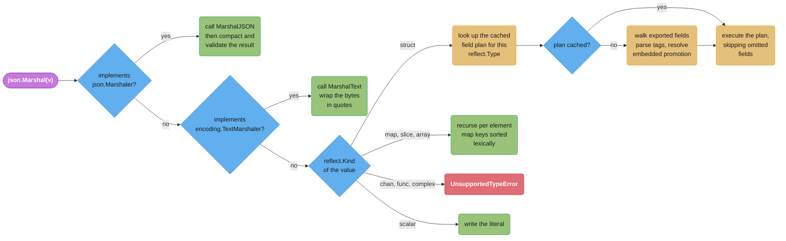
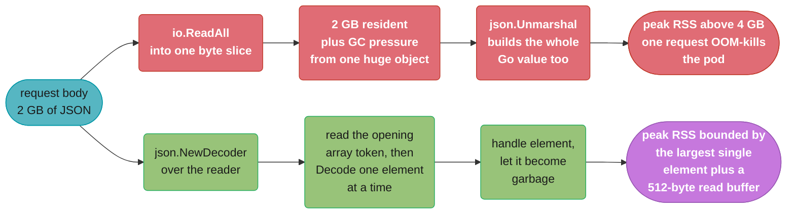

# JSON and Serialization

## 1. Concept Overview

`encoding/json` is the package almost every Go service touches on its first day and almost
every Go service misconfigures. It is a **reflection-driven** codec: at marshal time it
walks a `reflect.Type`, builds an ordered plan of the type's exported fields and their tag
options, caches that plan keyed by type, and then executes the plan against each value. The
cache is why the second call on a type is far cheaper than the first, and the reflection is
why even the cached path never reaches the speed of a marshaller a code generator emitted
for exactly one struct.

Everything a Go engineer gets wrong about JSON follows from three properties of that
design. First, **only exported fields participate** — a lowercase field is invisible to the
encoder and stays at its zero value after a decode, with no error and no warning. Second,
**decoding is lenient by default** — a JSON key with no matching struct field is discarded
silently, which is exactly what you want for forward compatibility and exactly what you do
not want for a config file with a typo in it. Third, **JSON has one number type**, so
decoding into `any` produces `float64` for every number, and an ID above 2^53 comes back
wrong rather than failing.

Go 1.27 shipped **`encoding/json/v2`** and **`encoding/json/jsontext`** as real standard
library packages. `json/v2` replaces the fixed-behaviour API with an options-based one —
`Marshal`, `MarshalWrite`, `MarshalEncode`, `Unmarshal`, `UnmarshalRead`,
`UnmarshalDecode`, each taking variadic `Options` — and tightens the defaults so that
invalid UTF-8 and duplicate object names are rejected instead of quietly repaired.
`jsontext` sits underneath it as the token-and-value layer for code that needs to read or
write JSON syntax without ever building a Go value. The v1 `encoding/json` package now
runs on the v2 engine: marshal and unmarshal behaviour is kept, but error message text can
differ. Building with `GOEXPERIMENT=nojsonv2` restores the original v1 implementation.

This module covers the reflection machinery and its cost, every struct-tag option including
the `omitempty`/`omitzero` distinction that trips up nearly everyone, nil-versus-empty
slice semantics that leak into your public API contract, `json.RawMessage` for deferred and
polymorphic decoding, custom marshallers and the recursion bug they invite, streaming with
`Decoder`/`Encoder` and why a 2 GB request body must never meet `json.Unmarshal`, the
`json/v2` migration, and the point at which you should stop using JSON altogether.

---

## 2. Intuition

> **One-line analogy**: `encoding/json` is a translator who reads your struct definition
> once, writes a phrasebook, and then works from the phrasebook. Fast on the second
> sentence, but always translating — never speaking the language natively the way a
> generated codec does.

**Mental model**: think of a struct type as having a hidden compiled artefact attached to
it — an ordered list of `(json name, field offset, tag flags, encoder function)` entries.
`json.Marshal` on a `User` for the first time builds that list by reflection and stores it
in a package-level cache. Every later `Marshal` of a `User` skips straight to executing
it. What it can never skip is the indirection: each field is reached through a
`reflect.Value`, each string is escaped at runtime, each `omitempty` is a runtime
emptiness test. A generated marshaller has all of that decided at compile time and emits
straight-line append calls.

**Why it matters**: the reflection is invisible until it is 40% of your CPU profile.
A service serialising 50,000 responses a second spends real time in
`encoding/json.(*encodeState).marshal`, and the fix is never "make JSON faster" — it is
either a code-generated JSON codec, or leaving JSON for a binary format on that specific
hop.

**Key insight**: JSON's data model is smaller than Go's. It has one number type, no
distinction between a missing key and a null one, no integers wider than what a `float64`
represents exactly, and no notion of a nil slice as distinct from an empty one. Every
serious `encoding/json` bug is a place where a Go concept fell through one of those gaps
and nobody wrote the code to catch it.

---

## 3. Core Principles

- **Only exported fields are marshalled or unmarshalled.** A lowercase field is not an
  error, it is a silent omission in both directions.
- **The struct tag is the wire contract.** `json:"user_id"` is API surface; renaming the
  Go field is free, renaming the tag is a breaking change.
- **Decoding ignores unknown keys by default.** Strictness is opt-in via
  `Decoder.DisallowUnknownFields`.
- **A missing key leaves the field untouched.** `Unmarshal` does not zero a struct first,
  so decoding into a reused value merges rather than replaces.
- **Every JSON number decoded into `any` is a `float64`.** Integers above 2^53 =
  9,007,199,254,740,992 lose exactness.
- **`nil` slices and maps marshal to `null`; empty non-nil ones marshal to `[]` and `{}`.**
  Your clients can tell the difference even when your handler cannot.
- **`json.Marshaler` beats `encoding.TextMarshaler` beats reflection.** The first interface
  found wins, and once you implement one you own every case the reflection used to handle.
- **Stream anything you did not size.** `json.Decoder` over an `io.Reader` bounds memory;
  `json.Unmarshal` over a `[]byte` does not.
- **`json/v2` `[1.27]` is stricter on purpose.** Invalid UTF-8 and duplicate object names
  are errors, not silent repairs.

---

## 4. Types / Architectures / Strategies

### The four ways to turn bytes into a Go value

| Strategy | API | When it is right |
|----------|-----|-----------------|
| Whole-buffer into a struct | `json.Unmarshal(b, &v)` | You produced or size-bounded `b` yourself; payload under ~1 MB |
| Streaming into a struct | `json.NewDecoder(r).Decode(&v)` | The bytes come from a network reader; one document or many |
| Streaming token by token | `dec.Token()`, `dec.More()` | A multi-gigabyte array you process element by element |
| Deferred / polymorphic | `json.RawMessage` field, decoded later | The shape of a sub-object depends on a discriminator field |

### Struct tag options, complete

| Tag | Effect |
|-----|--------|
| `json:"user_id"` | Renames the wire key. Decoding matches exactly first, then case-insensitively |
| `json:"-"` | Field is skipped entirely in both directions |
| `json:"-,"` | Field's wire key is literally `-` (the trailing comma is the whole trick) |
| `json:",omitempty"` | Omit when the value is empty **for its kind** — false, 0, "", nil, or length-zero |
| `json:",omitzero"` `[1.24]` | Omit when the value equals its type's zero value, or its `IsZero() bool` returns true |
| `json:",string"` | Encode a string, integer, float, or bool field as a JSON *string* |
| `json:",omitempty,string"` | Options compose; order among options does not matter |
| (no tag) | Wire key is the Go field name verbatim, including its capital letter |

### Number representation strategies

| Approach | Decoded type | Exact past 2^53 | Cost |
|----------|-------------|-----------------|------|
| `map[string]any` | `float64` | No | Zero effort, wrong answers |
| `Decoder.UseNumber()` | `json.Number` (a string) | Yes, via `Int64()` | One method call per read |
| Typed struct with `int64` | `int64` | Yes | Requires knowing the schema |
| `json:",string"` on `int64` | `int64`, wire is `"123"` | Yes, and safe for JavaScript clients | Wire format change |

### Custom marshalling, in precedence order

1. `json.Marshaler` — `MarshalJSON() ([]byte, error)`. Returns a complete JSON value.
2. `encoding.TextMarshaler` — `MarshalText() ([]byte, error)`. Result is wrapped in quotes.
3. Reflection over the type's kind.

The same order applies on the way in with `json.Unmarshaler` and
`encoding.TextUnmarshaler`. `TextMarshaler` is also what makes a non-string type usable as
a **map key**, which is the reason to reach for it over `MarshalJSON`.

---

## 5. Architecture Diagrams

### How `Marshal` decides what to do with a value



The two interface checks happen before any reflection over the kind, which is why
implementing `MarshalJSON` on a struct disables every tag on it — the plan is never built.

### Why an ID above 2^53 comes back wrong

```
IEEE-754 float64 layout — what json decodes every number into when the target is `any`

  63     62 ......... 52   51 ................................................ 0
 +---+--------------------+---------------------------------------------------+
 | S |    exponent (11)   |               mantissa (52 bits)                   |
 +---+--------------------+---------------------------------------------------+

The mantissa stores 52 explicit bits plus 1 implicit leading bit = 53 bits of integer
precision. Every integer up to 2^53 is representable exactly. Above it, the spacing
between representable values doubles at each power of two.

  value                        exactly representable?     nearest float64
  ---------------------------  ------------------------   -------------------------
  9007199254740992  (2^53)     yes                        9007199254740992
  9007199254740993  (2^53+1)   NO  -- gap is 2            9007199254740992   <-- off by 1
  9007199254740994  (2^53+2)   yes                        9007199254740994
  18014398509481985 (2^54+1)   NO  -- gap is 4            18014398509481984  <-- off by 1

  A Twitter-era snowflake ID, a Postgres bigint sequence past 9.0e15, and a nanosecond
  Unix timestamp (1.7e18) are all in the broken zone. The JSON text was correct; the
  Go value is not.
```

The bytes on the wire held the right digits. `map[string]any` threw them away before your
code ever saw them, which is why the fix is `UseNumber()` or a typed struct, never a
post-hoc rounding correction.

### `omitempty` vs `omitzero` `[1.24]` — the cases that differ

```
                                  no tag      omitempty     omitzero      both
  ------------------------------  ----------  ------------  ------------  ----------
  int 0                           emitted     OMITTED       OMITTED       OMITTED
  bool false                      emitted     OMITTED       OMITTED       OMITTED
  string ""                       emitted     OMITTED       OMITTED       OMITTED
  []string(nil)                   null        OMITTED       OMITTED       OMITTED
  []string{}   (non-nil, len 0)   []          OMITTED       emitted []    OMITTED   <--
  map[string]int{} (non-nil)      {}          OMITTED       emitted {}    OMITTED   <--
  time.Time{}  (zero instant)     "0001-..."  emitted       OMITTED       OMITTED   <--
  struct{}{}   (zero struct)      {}          emitted       OMITTED       OMITTED   <--
  *int -> 0    (non-nil pointer)  0           emitted       emitted       emitted
  *int(nil)                       null        OMITTED       OMITTED       OMITTED

  The four marked rows are the entire difference. omitempty asks "is this empty for its
  KIND"; omitzero asks "is this the ZERO VALUE of its type" -- and consults IsZero() if
  the type has one, which is exactly why it handles time.Time and omitempty cannot.
```

### Whole-body decode versus streaming decode



---

## 6. How It Works — Detailed Mechanics

### The cached field plan

`encoding/json` computes, once per type, an ordered slice of field descriptors: wire name,
index path (a `[]int` so embedded fields are reachable), tag flags, and whether the field
is a `json.Marshaler`. That slice lives in a package-level `sync.Map` keyed by
`reflect.Type`. The consequences you can observe:

- **The first marshal of a type is the expensive one.** Warm a type on startup if a p99
  matters and the type is large.
- **Field order in the output is source order**, with embedded fields flattened in at the
  position of the embedding, not appended.
- **Map keys are sorted lexically** on output so that marshalling a map is deterministic.
  Struct fields are not sorted; they follow the plan.
- **A conflicting promoted name is dropped from both sides.** If two embedded structs both
  promote a `ID` field at the same depth, neither is marshalled — silently.

```go
type Base struct {
    ID   int64  `json:"id"`
    Kind string `json:"kind"`
}

type Widget struct {
    Base                        // promoted: id and kind appear at the TOP level
    Name  string `json:"name"`
    Notes string `json:"-"`     // never on the wire, either direction
    secret string               // unexported: invisible, no error, ever
}

// {"id":7,"kind":"gear","name":"sprocket"}
```

Embedding a struct with a `json` tag on the embedded field itself changes this: the tag
nests it instead of promoting it.

```go
type Widget struct {
    Base `json:"base"`   // now NESTED: {"base":{"id":7,"kind":"gear"},"name":"sprocket"}
    Name string `json:"name"`
}
```

### `omitempty`, `omitzero`, and the bug they exist to fix

```go
type Event struct {
    ID        int64     `json:"id"`
    Tags      []string  `json:"tags,omitempty"`
    UpdatedAt time.Time `json:"updated_at,omitempty"`   // BROKEN
    Retries   int       `json:"retries,omitzero"`
}

// With a zero UpdatedAt, this emits:
//   {"id":7,"updated_at":"0001-01-01T00:00:00Z"}
// omitempty cannot omit a struct, and time.Time is a struct. Downstream consumers
// that parse the field see the year 1, not "absent".
```

```go
type Event struct {
    ID        int64     `json:"id"`
    Tags      []string  `json:"tags,omitzero"`
    UpdatedAt time.Time `json:"updated_at,omitzero"`    // FIX
    Retries   int       `json:"retries,omitzero"`
}

// {"id":7}
// omitzero [1.24] consults time.Time's IsZero() method and omits the field.
```

The one case where `omitempty` is still the one you want is a **non-nil empty slice you
genuinely mean to hide**: `omitzero` emits `[]` for `[]string{}` because a non-nil slice is
not the zero value. Writing both — `json:"tags,omitempty,omitzero"` — omits in either
condition and is the belt-and-braces choice for an optional collection.

### Nil versus empty, and why your API consumers care

```go
type Resp struct {
    Items []Item `json:"items"`
}

var a Resp                      // Items is nil
b := Resp{Items: []Item{}}      // Items is non-nil, len 0

json.Marshal(a)   // {"items":null}
json.Marshal(b)   // {"items":[]}
```

A JavaScript client writing `resp.items.map(...)` throws a `TypeError` on `null` and works
on `[]`. A Python client writing `for x in resp["items"]` throws on `None`. This is the
single most common "the API broke and nothing changed" incident, and it usually arrives
when a query that used to return rows starts returning zero and a `var items []Item`
never gets appended to.

```go
// FIX: initialise at the boundary, not in the query layer.
items := make([]Item, 0, 32)     // non-nil, zero length, one allocation
rows, err := q.List(ctx)
// ... append into items ...
return Resp{Items: items}, nil
```

### Decoding into `any`, and the type table

```go
var v any
json.Unmarshal([]byte(`{"id":9007199254740993,"ok":true,"n":null,"xs":[1,"a"]}`), &v)

m := v.(map[string]any)
// m["id"]  is float64(9007199254740992)   <-- WRONG, off by one
// m["ok"]  is bool(true)
// m["n"]   is nil (untyped)
// m["xs"]  is []any{float64(1), string("a")}
```

| JSON | Go type when the target is `any` |
|------|----------------------------------|
| object | `map[string]any` |
| array | `[]any` |
| number | `float64` — always |
| string | `string` |
| `true` / `false` | `bool` |
| `null` | `nil` |

The fix, when you truly cannot use a typed struct:

```go
dec := json.NewDecoder(bytes.NewReader(b))
dec.UseNumber()                  // numbers decode to json.Number, a string type
var v any
if err := dec.Decode(&v); err != nil {
    return err
}
id, err := v.(map[string]any)["id"].(json.Number).Int64()
// id == 9007199254740993, exactly
```

### Strictness: unknown fields and duplicate keys

```go
type Config struct {
    Timeout string `json:"timeout"`
}

var c Config
json.Unmarshal([]byte(`{"timeoutt":"30s"}`), &c)
// err == nil, c.Timeout == "" -- the typo is silently accepted

dec := json.NewDecoder(strings.NewReader(`{"timeoutt":"30s"}`))
dec.DisallowUnknownFields()
err := dec.Decode(&c)
// err: json: unknown field "timeoutt"
```

Use `DisallowUnknownFields` for **anything a human typed** — config files, admin API
bodies, CLI input. Do not use it for a public API you version, because it converts every
additive field a client sends into a 400 and destroys forward compatibility.

`encoding/json/v2` `[1.27]` moves the other strictness lever: **duplicate object names are
rejected by default**, where v1 quietly kept the last occurrence. That default matters
because a duplicate key is how request-smuggling and policy-bypass payloads sneak a second
value past a validating proxy that only read the first.

### `json.RawMessage` — deferred and polymorphic decoding

`json.RawMessage` is `[]byte` with pass-through `MarshalJSON`/`UnmarshalJSON`, so the
decoder stores the raw bytes of a sub-document instead of interpreting them.

```go
type Envelope struct {
    Type    string          `json:"type"`
    Version int             `json:"version"`
    Payload json.RawMessage `json:"payload"`   // not parsed yet
}

func handle(b []byte) error {
    var env Envelope
    if err := json.Unmarshal(b, &env); err != nil {
        return fmt.Errorf("envelope: %w", err)
    }
    switch env.Type {
    case "order.created":
        var p OrderCreated
        if err := json.Unmarshal(env.Payload, &p); err != nil {
            return fmt.Errorf("payload %s: %w", env.Type, err)
        }
        return onOrderCreated(p)
    case "order.cancelled":
        var p OrderCancelled
        if err := json.Unmarshal(env.Payload, &p); err != nil {
            return fmt.Errorf("payload %s: %w", env.Type, err)
        }
        return onOrderCancelled(p)
    default:
        return nil // unknown event types are ignored, not an error
    }
}
```

The same type is the answer to "store this blob in Postgres `jsonb` without ever
interpreting it" and "proxy this field through untouched". It costs one copy of the
sub-document's bytes and zero parsing of them.

### Streaming: `Decoder`, `Encoder`, `Token`

```go
// Newline-delimited JSON: one document per line, decoded in a loop.
dec := json.NewDecoder(r)
for {
    var rec Record
    if err := dec.Decode(&rec); err == io.EOF {
        break
    } else if err != nil {
        return fmt.Errorf("record %d: %w", n, err)
    }
    if err := process(rec); err != nil {
        return err
    }
    n++
}
```

```go
// A single top-level array too large to hold in memory: consume it element by element.
dec := json.NewDecoder(r)
if _, err := dec.Token(); err != nil {   // consumes the opening '['
    return err
}
for dec.More() {
    var item Item
    if err := dec.Decode(&item); err != nil {
        return err
    }
    if err := process(item); err != nil {
        return err
    }
}
if _, err := dec.Token(); err != nil {   // consumes the closing ']'
    return err
}
```

On the write side, `json.Encoder` writes straight to an `io.Writer` and appends a newline
after each value, which makes it the natural NDJSON producer and the right way to stream a
response without buffering it:

```go
enc := json.NewEncoder(w)
w.Header().Set("Content-Type", "application/x-ndjson")
for _, row := range rows {
    if err := enc.Encode(row); err != nil {
        return err          // client hung up mid-stream
    }
}
```

`Encoder.SetEscapeHTML(false)` turns off the default escaping of `<`, `>` and `&` into the
Unicode escapes `\u003c`, `\u003e` and `\u0026` — note that these are `\u` escapes, not HTML
entities like `&lt;`, so the decoded string is byte-identical either way and only a raw HTML
context can tell the difference. Turning it off is safe and desirable for
machine-to-machine payloads, and dangerous if the output is ever interpolated into a page.

### Bounding what a server will accept

```go
func handler(w http.ResponseWriter, r *http.Request) {
    r.Body = http.MaxBytesReader(w, r.Body, 1<<20)   // 1 MiB hard ceiling
    dec := json.NewDecoder(r.Body)
    dec.DisallowUnknownFields()

    var req CreateOrder
    if err := dec.Decode(&req); err != nil {
        var mbe *http.MaxBytesError
        if errors.As(err, &mbe) {
            http.Error(w, "request body too large", http.StatusRequestEntityTooLarge)
            return
        }
        http.Error(w, "invalid JSON", http.StatusBadRequest)
        return
    }
    // Reject trailing content: a body of `{}{}` decodes the first and hides the second.
    if dec.More() {
        http.Error(w, "unexpected trailing data", http.StatusBadRequest)
        return
    }
    // ...
}
```

`MaxBytesReader` is the load-bearing line. Without it, a single attacker request of
arbitrary length is an out-of-memory kill, and `Server.ReadTimeout` does not save you
because the attacker is sending data quickly, not slowly.

### Custom marshallers and the recursion trap

```go
type Money struct {
    Cents    int64
    Currency string
}

// BROKEN: infinite recursion. json.Marshal(m) re-enters MarshalJSON, forever,
// until the goroutine's stack hits the 1 GB limit and the process dies.
func (m Money) MarshalJSON() ([]byte, error) {
    return json.Marshal(m)
}
```

```go
// FIX: marshal a DIFFERENT type. A local alias has the same memory layout and
// field set but no methods, so reflection handles it normally.
func (m Money) MarshalJSON() ([]byte, error) {
    type alias Money            // methods are NOT inherited by a defined type
    return json.Marshal(struct {
        alias
        Display string `json:"display"`
    }{
        alias:   alias(m),
        Display: fmt.Sprintf("%s %.2f", m.Currency, float64(m.Cents)/100),
    })
}
```

The alias trick is the standard shape for "the default encoding plus one computed field",
and it works in the decode direction too — declare the alias, unmarshal into it, then run
your extra logic on the result.

`encoding.TextMarshaler` is the lighter option and buys something `MarshalJSON` does not:

```go
type UserID uuid.UUID

func (u UserID) MarshalText() ([]byte, error)  { return uuid.UUID(u).MarshalText() }
func (u *UserID) UnmarshalText(b []byte) error { return (*uuid.UUID)(u).UnmarshalText(b) }

// Now map[UserID]int marshals to {"0f8f...":1}. With MarshalJSON it would be a
// json: unsupported type error, because map keys must be strings or TextMarshalers.
```

### Time, and the custom-format problem

`time.Time` implements both `MarshalJSON` and `MarshalText`, emitting RFC 3339 with
nanoseconds: `"2026-09-02T14:03:05.123456789Z"`. Decoding accepts RFC 3339 and nothing
else. When an upstream sends `"2026-09-02 14:03:05"` or a Unix epoch integer, you need
your own type — not a hand-edit of the string before it reaches the decoder:

```go
type SQLTime time.Time

const sqlLayout = "2006-01-02 15:04:05"

func (t SQLTime) MarshalJSON() ([]byte, error) {
    return []byte(strconv.Quote(time.Time(t).Format(sqlLayout))), nil
}

func (t *SQLTime) UnmarshalJSON(b []byte) error {
    s, err := strconv.Unquote(string(b))
    if err != nil {
        return fmt.Errorf("sqltime: %w", err)
    }
    parsed, err := time.ParseInLocation(sqlLayout, s, time.UTC)
    if err != nil {
        return fmt.Errorf("sqltime %q: %w", s, err)
    }
    *t = SQLTime(parsed)
    return nil
}
```

Note the pointer receiver on `UnmarshalJSON` and the value receiver on `MarshalJSON`.
Getting the marshal side backwards is the second-most-common custom-codec bug, and it
survives testing because it fails *conditionally*. A pointer-receiver `MarshalJSON` is not
in the value's method set, so the encoder installs a `condAddrEncoder`: it calls your method
when the value it reaches is **addressable**, and falls back to ordinary reflection when it
is not. `json.Marshal(&order)` therefore emits your custom format for every `SQLTime` field,
while `json.Marshal(order)` — the same struct, passed by value — emits the underlying struct
with its default encoding and no error. One type, two wire formats, chosen by whether the
caller happened to take an address. `UnmarshalJSON` has to mutate and so must take a pointer
receiver; put `MarshalJSON` on the value receiver and the asymmetry cannot bite.

### `encoding/json/v2` and `jsontext` `[1.27]`

```go
import (
    jsonv2 "encoding/json/v2"
    "encoding/json/jsontext"
)

// The v1 shapes, plus reader/writer and encoder/decoder variants, all with options.
b, err := jsonv2.Marshal(v)                    // to []byte
err = jsonv2.MarshalWrite(w, v)                // straight to an io.Writer
err = jsonv2.MarshalEncode(enc, v)             // into an existing jsontext.Encoder

err = jsonv2.Unmarshal(b, &v)                  // from []byte
err = jsonv2.UnmarshalRead(r, &v)              // straight from an io.Reader
err = jsonv2.UnmarshalDecode(dec, &v)          // from an existing jsontext.Decoder
```

Every one of those takes **variadic `Options`**, which is the structural change: behaviour
that v1 fixed at compile time (HTML escaping, indentation, unknown-field handling,
case-insensitive matching) becomes a value you pass at the call site and can share across a
codebase. Run `go doc encoding/json/v2` on your toolchain for the option set your version
ships — it is the authoritative list.

The stricter defaults are the migration risk worth planning for:

| Input | v1 behaviour | v2 `[1.27]` behaviour |
|-------|-------------|----------------------|
| Invalid UTF-8 in a string | Replaced with U+FFFD, no error | Error |
| Duplicate object name | Last occurrence wins, no error | Error |

Code written against the `GOEXPERIMENT=jsonv2` preview needs these changes for the final
1.27 API (Go 1.27 release notes):

| Preview API | Go 1.27 |
|-------------|---------|
| `inline` tag option | Renamed `embed` |
| `format` tag option | Removed |
| `unknown` tag option | Removed |
| `DiscardUnknownMembers` marshal option | Removed |
| `SkipFunc` sentinel error | Removed |
| `jsontext` numeric `Token` accessors | Also return an error |

`jsontext` is the layer beneath: a `jsontext.Encoder` and `jsontext.Decoder` operating on
`jsontext.Token` and `jsontext.Value`. Reach for it when you are transforming JSON rather
than materialising it — redacting fields in a log pipeline, re-keying a document, or
validating syntax without allocating a Go value per node.

Adoption is incremental. Existing `encoding/json` call sites already run on the v2 engine
with v1 semantics, so the first visible change is error text: a test that compares
`err.Error()` to a string can fail after the toolchain bump. Match on error types or
`errors.As` instead. `GOEXPERIMENT=nojsonv2` at build time restores the original v1
implementation if a dependency breaks. The safe order is: turn strictness on in a test build first,
fix what fails, then migrate call sites package by package — the two import paths coexist
in one binary.

---

## 7. Real-World Examples

- **Kubernetes** encodes and decodes every API object as JSON (and its YAML is converted to
  JSON first). It does not use plain reflection at scale: `k8s.io/apimachinery` ships
  generated deep-copy and conversion code, and `sigs.k8s.io/json` layers case-sensitivity
  and duplicate-key detection on top of `encoding/json` — the same strictness `json/v2`
  now provides in the standard library.
- **Prometheus** returns query results as JSON from `/api/v1/query`, and a range query over
  a wide time window produces an array of samples large enough that the client must stream
  it. The HTTP API is the reason `promtool` reads with a `Decoder` rather than
  `io.ReadAll`.
- **Docker's** Engine API streams build output and `docker events` as newline-delimited
  JSON over a hijacked connection — `Decoder.Decode` in a loop, exactly the NDJSON pattern
  above, with no top-level array to close.
- **Terraform** uses `json.RawMessage`-shaped deferral throughout its plan format: a
  resource's `values` are opaque until the provider schema says how to interpret them.
- **Elasticsearch / OpenSearch bulk APIs** take NDJSON where every odd line is an action
  and every even line is a document, which is a case where `Encoder` (newline-appending,
  streaming) is exactly right and `Marshal` into a joined buffer is exactly wrong.
- **Stripe's API** returns 64-bit IDs as strings, not numbers, precisely because JavaScript
  clients would corrupt them past 2^53 — the wire-format equivalent of Go's
  `json:",string"` tag.

---

## 8. Tradeoffs

### Format comparison — the same record, byte-counted

The record: `user_id=1234567`, `name="Ada Lovelace"`, `active=true`, `score=98.5`,
`tags=["math","eng"]`.

| Format | Bytes | Self-describing | Schema needed to read | Human-readable |
|--------|-------|-----------------|----------------------|----------------|
| JSON | 90 | Yes | No | Yes |
| CBOR | 70 | Yes | No | No |
| MessagePack | 70 | Yes | No | No |
| Protobuf | 40 | No | Yes | No |

Protobuf's 40 bytes come from replacing every key name with a one-byte field tag and every
number with a varint. That is a 2.25x reduction here and grows with the ratio of key-name
length to value length — a record of many short numeric fields compresses far more than
one long text blob.

### Marshalling approach

| Approach | Throughput | Binary size | Schema coupling | Debuggability |
|----------|-----------|-------------|-----------------|---------------|
| `encoding/json` reflection | Baseline | Smallest | None | Best — `curl` shows you everything |
| `encoding/json/v2` `[1.27]` | Marshal at parity with v1, Unmarshal significantly faster (1.27 release notes) | Small | None | Same as v1 |
| Generated JSON codec (`easyjson`, `go-json` style) | 3–6x baseline | Grows with type count | Regenerate on struct change | Same wire format |
| Protobuf + `protoc-gen-go` | Fastest | Largest | Strong, versioned | Needs `protoc --decode` |

Quote those ratios as shapes, not measurements: benchmark your own payloads with `b.Loop`
`[1.24]` and `benchstat` before putting a number in a design doc. The record's field count,
string lengths, and nesting depth move the ratio more than the library choice does.

### Strictness settings

| Setting | Gains | Costs |
|---------|-------|-------|
| `DisallowUnknownFields` | Typos in config become errors | Breaks forward compatibility on a versioned API |
| `UseNumber()` | Exact integers past 2^53 | Every read is a `json.Number` conversion |
| v2 duplicate-name rejection `[1.27]` | Closes a request-smuggling vector | Rejects payloads some sloppy producers emit today |
| v2 invalid-UTF-8 rejection `[1.27]` | Corrupt bytes surface at the boundary | A producer emitting Latin-1 now fails loudly |
| `SetEscapeHTML(false)` | Smaller, readable output | Unsafe if the JSON is interpolated into HTML |

---

## 9. When to Use / When NOT to Use

**Use `encoding/json` when:**

- The payload is a public or partner-facing HTTP API — readability and universal client
  support beat every byte you would save.
- The message is under a few kilobytes and the rate is under roughly 10,000/second per
  process, where serialisation is nowhere near your bottleneck.
- Humans read or write the document: config files, fixtures, `kubectl` output, log lines.
- You need forward compatibility with no schema registry and no build step.

**Use `encoding/json/v2` `[1.27]` when:**

- You want per-call-site control over escaping, unknown fields, or name matching without
  writing a wrapper.
- You want duplicate-name and invalid-UTF-8 rejection as a default rather than a linter.
- You are writing new code today; there is no reason to start on v1.

**Use `jsontext` `[1.27]` when:**

- You transform JSON without materialising it — redaction, re-keying, streaming
  validation, a proxy that rewrites one field in a body it otherwise passes through.

**Do NOT use JSON when:**

- The hop is internal service-to-service at high rate and both ends are yours — use
  protobuf over gRPC ([gRPC and Protobuf in Go](../grpc_and_protobuf_in_go/grpc_and_protobuf_in_go.md)).
- The payload is binary. Base64 in JSON costs 33% size inflation plus an encode and a
  decode on every hop; CBOR carries byte strings natively.
- You need exact decimals for money and cannot control the client. JSON numbers are
  doubles to most consumers, and the workaround is always a string field.
- The schema must be enforced across teams at build time — that is protobuf's job, and
  JSON Schema is a runtime approximation of it.
- The document is a multi-gigabyte archive that will be scanned repeatedly. A columnar
  format reads one field without parsing the other forty.

---

## 10. Common Pitfalls

### The unexported field that silently vanished

A payments team added a `merchantId` field to an internal event struct as `merchantId
string` — lowercase, because it was set inside the package and never read outside it. Six
weeks later the field was needed downstream, a consumer was written against it, and the
consumer's dashboards read zero for 11 days. `encoding/json` had never emitted it and never
errored. The tell in review: the struct's other fields all had tags and this one had none,
because you cannot usefully tag an unexported field.

```go
// BROKEN
type Charge struct {
    Amount     int64  `json:"amount"`
    merchantId string // never marshalled, never unmarshalled, never an error
}

// FIX
type Charge struct {
    Amount     int64  `json:"amount"`
    MerchantID string `json:"merchant_id"`
}
```

Enforce it: `golangci-lint` with `musttag` flags a struct that reaches a marshal call with
untagged fields, and a review rule of "every field in a wire type has a tag" makes the
lowercase one impossible to miss.

### The 2^53 corruption that reconciliation found six weeks late

A ledger service migrated from `int64` order IDs to a snowflake generator producing values
around 1.7e18. One service in the chain decoded the message into `map[string]any` to route
on a single field and re-marshalled the rest. Every ID past 2^53 was rounded to the nearest
representable `float64` on the way through. 214,000 records over six weeks carried an ID
that was off by up to 256, and the collisions only surfaced in a monthly reconciliation
job. The re-marshal made the corrupted value look authoritative downstream.

```go
// BROKEN: decode-modify-remarshal through any is lossy for large integers.
var m map[string]any
json.Unmarshal(body, &m)
m["routed_at"] = time.Now().Unix()
out, _ := json.Marshal(m)
```

```go
// FIX: keep the untouched parts as raw bytes; never round-trip numbers you do not read.
type Routed struct {
    Payload  json.RawMessage `json:"payload"`
    RoutedAt int64           `json:"routed_at"`
}
out, err := json.Marshal(Routed{Payload: body, RoutedAt: time.Now().Unix()})
```

If you must inspect fields, `dec.UseNumber()` keeps every number exact as a `json.Number`
string, and re-marshalling a `json.Number` writes the original digits back.

### The `null` that broke every mobile client at once

An endpoint returned `{"items":[...]}` and had done so for two years. A filter change made
one query legitimately return zero rows, the handler's `var items []Item` stayed nil, and
the response became `{"items":null}`. The iOS and Android clients both crashed on the
force-unwrap. 40 minutes of elevated crash rate across every app version in the field,
fixed by a one-line server change because no client could be patched in that window.

The rule that prevents it: **every slice field on a response type is initialised with
`make([]T, 0)` at construction**, and a contract test marshals the zero value of every
response type and asserts no `null` appears where an array is documented.

### The 2 GB body that OOM-killed the pod

A bulk-import endpoint took `json.Unmarshal(io.ReadAll(r.Body), &req)`. A customer uploaded
a 2.1 GB export. `io.ReadAll` grew a slice to 2.1 GB, `Unmarshal` built a Go value roughly
2.4x that size in live objects, and the pod's 4 GiB limit killed it. Because the request
was retried by the customer's tooling, the same pod died 14 times over 40 minutes and the
crash-loop backoff took the whole deployment's capacity down with it.

```go
// BROKEN
b, _ := io.ReadAll(r.Body)
var req BulkImport
json.Unmarshal(b, &req)
```

```go
// FIX: cap the body, then stream the array element by element.
r.Body = http.MaxBytesReader(w, r.Body, 64<<20)   // 64 MiB
dec := json.NewDecoder(r.Body)
if _, err := dec.Token(); err != nil {            // opening '['
    http.Error(w, "expected a JSON array", http.StatusBadRequest)
    return
}
for dec.More() {
    var rec ImportRecord
    if err := dec.Decode(&rec); err != nil {
        http.Error(w, "invalid record", http.StatusBadRequest)
        return
    }
    if err := insert(ctx, rec); err != nil {
        http.Error(w, "import failed", http.StatusInternalServerError)
        return
    }
}
```

Peak resident memory drops from over 4 GB to the size of one record plus the decoder's
read buffer.

### The recursive `MarshalJSON` that filled the stack

A `Duration` wrapper type got a `MarshalJSON` that called `json.Marshal(d)` on itself. The
first request to touch it grew the goroutine stack to the 1 GB default limit and the
runtime aborted the process with `stack overflow`. There is no recover for this — the
runtime treats stack exhaustion as unrecoverable, so a per-request recover middleware did
not help. It reached production because the type was only marshalled on one rarely-hit
error path, and the unit test asserted on `Error()` rather than on the JSON.

The alias fix is in §6. The test that catches it in one line:
`if _, err := json.Marshal(v); err != nil { t.Fatal(err) }` on every exported wire type,
driven by a table.

### `DisallowUnknownFields` on a versioned public API

A team turned on `DisallowUnknownFields` globally after a config typo incident. It shipped
on the public ingest endpoint too. The next week a client SDK release added an optional
`client_version` field to its request body, every request from the new SDK returned 400,
and the client team spent a day believing their own release was broken. Strictness belongs
where a human types the input, not where a versioned client sends it — the distinction is
the whole point of "be conservative in what you send, liberal in what you accept."

### `time.Time` with `omitempty`, shipped to a partner

An integration contract said `updated_at` was optional. The Go struct used
`json:"updated_at,omitempty"`, `time.Time` is a struct, and `omitempty` cannot omit a
struct — so every record with no update carried `"0001-01-01T00:00:00Z"`. The partner's
warehouse ingested 4.2 million rows dated year 1, which broke their partition pruning and
turned a 30-second query into a 9-minute one. `omitzero` `[1.24]` is the one-word fix, and
a `grep -r 'time.Time.*omitempty'` across a codebase is worth running today.

---

## 11. Technologies & Tools

| Tool | What it does for serialisation |
|------|-------------------------------|
| `encoding/json` | The reflection-based standard codec; `Marshal`, `Unmarshal`, `Decoder`, `Encoder`, `RawMessage`, `Number` |
| `encoding/json/v2` `[1.27]` | Options-based API with stricter defaults; `MarshalWrite`/`UnmarshalRead` avoid the intermediate buffer entirely |
| `encoding/json/jsontext` `[1.27]` | Token and value layer for transforming JSON without materialising Go values |
| `go doc encoding/json/v2` | The authoritative option list for the toolchain you actually have installed |
| `musttag` (in `golangci-lint`) | Fails a build when a struct reaching a marshal call has untagged fields |
| `tagliatelle` (in `golangci-lint`) | Enforces one tag naming convention (`snake_case`, `camelCase`) across a codebase |
| `govet`'s `structtag` analyzer | Catches a malformed tag literal and duplicate JSON names; runs by default under `go test` |
| `github.com/tidwall/gjson` | Reads one path out of a JSON document without unmarshalling it; the right tool for routing on a single field |
| `github.com/mailru/easyjson` | Generates reflection-free `MarshalJSON`/`UnmarshalJSON` per type when a profile says JSON is the bottleneck |
| `google.golang.org/protobuf` | Schema-first binary encoding; the destination when JSON stops paying off |
| `github.com/fxamacker/cbor/v2` | CBOR (RFC 8949) — JSON's data model plus native byte strings and integers |
| `github.com/vmihailenco/msgpack/v5` | MessagePack; similar size to CBOR, widely supported by Redis-adjacent tooling |
| `jq` | The debugging tool that makes a JSON API worth its bytes; `jq -c` for NDJSON pipelines |
| `benchstat` | The only honest way to compare two codecs; run `b.Loop` `[1.24]` benchmarks and compare p-values |

---

## 12. Interview Questions with Answers

**Q: What is the difference between `omitempty` and `omitzero`?**
**Short:** omitempty drops values that are empty for their kind, while omitzero drops values equal to their type's zero value or whose IsZero method returns true.

The four cases that differ are the whole answer. A zero `time.Time` is emitted by
`omitempty` — it is a struct, and a struct is never "empty" for its kind — but omitted by
`omitzero`, which consults `time.Time.IsZero()`. A zero struct behaves the same way. In the
other direction, a non-nil zero-length slice like `[]string{}` is omitted by `omitempty` but
emitted as `[]` by `omitzero`, because the zero value of a slice is nil and an empty slice
is not nil. For scalars they agree completely: 0, false, and `""` are dropped by both.
`omitzero` arrived in `[1.24]` and is what most people meant every time they typed
`omitempty`; writing both is legal and omits under either condition.

**Q: A field is missing from your JSON output but present in the struct. What happened?**
**Short:** The field is unexported, so the encoder cannot see it — there is no error in either direction, just silence.

Reflection cannot read an unexported field's value through `reflect.Value.Interface()`, so
`encoding/json` skips it entirely, and on decode it leaves the field at its zero value while
returning a nil error. This is the most common serialisation bug in Go because the code
compiles, the tests on the Go side pass, and only a consumer notices. The second candidate
is a `json:"-"` tag someone added for a debugging session and forgot, and the third is two
embedded structs promoting the same name at the same depth, which makes the encoder drop
both. The defence is `musttag` in `golangci-lint` plus a marshal round-trip test on every
wire type.

**Q: Why does an ID like 9007199254740993 come back changed after decoding into `map[string]any`?**
**Short:** Every JSON number decoded into an interface becomes a float64, which holds only 53 bits of integer precision.

2^53 is 9,007,199,254,740,992, and above it the gap between representable `float64` values
is 2, then 4, then 8. Your ID is silently snapped to the nearest one. Snowflake IDs,
Postgres bigint sequences past 9.0e15, and nanosecond Unix timestamps all live in that
zone. Nothing errors, because from JSON's point of view a number is a number. Two fixes:
decode into a typed struct with an `int64` field, which parses the digits directly, or call
`Decoder.UseNumber()` so numbers arrive as `json.Number` — a string type with `Int64()` and
`Float64()` methods that preserves the original digits verbatim. The corollary for API
design is Stripe's: send large IDs as JSON strings so JavaScript clients cannot corrupt
them either.

**Q: Why does a slice field sometimes marshal to `null` instead of `[]`?**
**Short:** A nil slice encodes as null and a non-nil zero-length slice encodes as an empty array — the encoder is reporting a distinction your handler probably did not intend.

`var xs []Item` is nil; `xs := []Item{}` or `make([]Item, 0)` is not. Marshalling produces
`null` for the first and `[]` for the second. The bug appears when a query that always
returned rows starts returning zero, the append loop never runs, and the field stays nil.
Clients that iterate the array crash on `null` in JavaScript, Python, Swift, and Kotlin
alike, and it looks like a server outage from their side. Fix it at construction with
`make([]T, 0, n)` rather than at the JSON layer, and add a contract test that marshals the
zero value of every response type and asserts no `null` appears where an array is
documented. The same rule applies to maps: nil maps become `null` too.

**Q: What does the decoder do with a JSON key that has no matching struct field?**
**Short:** It discards the key silently, which is right for a versioned API and wrong for anything a human typed.

Leniency is the default because it gives you forward compatibility for free: a client on a
newer SDK can send fields your server has not learned about yet and nothing breaks.
`Decoder.DisallowUnknownFields()` inverts that, returning an error naming the offending
field. Reach for it on config files, admin endpoints, and CLI input, where an unrecognised
key is almost certainly a typo that would otherwise leave a setting at its default.
Never turn it on for a public API you version — every additive field a client ships becomes
a 400 for everyone on the new SDK. A related default worth knowing: a key absent from the
JSON leaves the struct field untouched rather than zeroing it, so decoding into a reused
value merges.

**Q: Why would a custom `MarshalJSON` crash the process with a stack overflow?**
**Short:** Calling json.Marshal on the receiver inside its own MarshalJSON re-enters the method forever until the 1 GB goroutine stack limit aborts the program.

The encoder checks for `json.Marshaler` before doing anything else, so `json.Marshal(m)`
inside `func (m Money) MarshalJSON()` finds the same method and calls it again. Stack
exhaustion is unrecoverable in Go — a `recover` in your HTTP middleware will not catch it —
so this takes the whole process down, not one request. The standard fix is a local defined
type: `type alias Money` has identical layout and fields but inherits no methods, so
`json.Marshal(alias(m))` uses reflection. Wrap that alias in an anonymous struct to add
computed fields. Test every exported wire type with a table-driven
`json.Marshal` round trip; the recursion shows up on the first call.

**Q: You upgraded to Go 1.27 and changed no code. What changed in your JSON path?**
**Short:** `encoding/json` now runs on the v2 engine with v1 behaviour kept, but error text can differ, so tests matching `err.Error()` may break.

From 1.27 the v1 API runs on the v2 implementation, configured with options that reproduce
v1 semantics, so marshal and unmarshal results are preserved: nil slices still encode as
`null`, and invalid UTF-8 is still repaired rather than rejected. Two things move. Error message text is
not part of the compatibility promise, so a test asserting an exact `err.Error()` string can
fail; assert on `*json.SyntaxError` or `*json.UnmarshalTypeError` with `errors.As`. Unmarshal
gets significantly faster while Marshal stays at parity, per the 1.27 release notes. If a
dependency breaks, build with `GOEXPERIMENT=nojsonv2` to restore the original v1
implementation, and treat that as temporary: the release notes say the opt-out is expected
to go away.

**Q: When should you use `json.RawMessage`?**
**Short:** When you want the decoder to keep a sub-document's bytes without interpreting them — for polymorphic payloads, opaque pass-through, or deferring the parse.

`json.RawMessage` is `[]byte` with pass-through marshal and unmarshal methods, so the
decoder copies the raw bytes of that sub-document and stops. The classic use is an envelope
with a `type` discriminator and a `payload` whose shape depends on it: decode the envelope,
switch on `type`, then unmarshal the payload into the right concrete struct. It is also the
right type for a field you store in a `jsonb` column and never inspect, and for a proxy
that must forward a body unchanged while reading one sibling field. Cost is one copy of the
bytes and no parsing of them, which makes it cheaper than `any`, not more expensive.

**Q: Why is `json.Unmarshal` the wrong call for an HTTP request body?**
**Short:** It needs the whole body in memory as bytes and then again as a Go value, so an unbounded upload becomes an out-of-memory kill.

`io.ReadAll` on a 2 GB body allocates 2 GB, and the decoded Go value is typically larger
still, so peak resident memory can exceed four times the payload before anything is
processed. `Server.ReadTimeout` does not protect you, because a fast attacker is not slow.
The shape that works is three lines: `http.MaxBytesReader(w, r.Body, limit)` to cap it,
`json.NewDecoder(r.Body)` to stream it, and — for a large top-level array — `dec.Token()`
to consume the opening bracket followed by `dec.Decode` per element inside `dec.More()`.
Peak memory then tracks the largest single element rather than the whole document. Check
for `*http.MaxBytesError` with `errors.As` so you can return 413 rather than 400.

**Q: What does `json.Decoder` give you that `json.Unmarshal` does not?**
**Short:** It reads from an io.Reader incrementally and can consume several JSON documents from one stream, which is what makes newline-delimited JSON and huge arrays tractable.

`Decode` reads exactly one JSON value and leaves the reader positioned after it, so calling
it in a loop until `io.EOF` consumes an NDJSON stream — the format Docker's event API,
Elasticsearch's bulk endpoint, and most log pipelines use. `Token()` and `More()` drop a
level lower, letting you step past a top-level `[` and handle elements one at a time. The
`Decoder` also owns the strictness knobs — `DisallowUnknownFields` and `UseNumber` are
methods on it, not options to `Unmarshal`. The symmetric `Encoder` writes straight to an
`io.Writer` and appends a newline after each value, which makes it both the NDJSON producer
and the way to stream a response without buffering it.

**Q: What changed in `encoding/json/v2` `[1.27]` and why does it matter?**
**Short:** The API became options-based and the defaults became strict, rejecting invalid UTF-8 and duplicate object names instead of quietly repairing them.

Every entry point — `Marshal`, `MarshalWrite`, `MarshalEncode`, `Unmarshal`,
`UnmarshalRead`, `UnmarshalDecode` — takes variadic `Options`, so behaviour that v1 fixed
at compile time is now a value you pass at the call site and can share across a codebase.
The `Write`/`Read` variants work directly against an `io.Writer` and `io.Reader`, removing
the intermediate buffer that v1's `Marshal` forced on you. The duplicate-name rejection is
the security-relevant one: a repeated key is how a payload sneaks a second value past a
proxy that validated only the first. Migrate by turning strictness on in tests first, then
moving call sites package by package — both import paths coexist in one binary.

**Q: What is `encoding/json/jsontext` `[1.27]` for?**
**Short:** It is the token-and-value layer under json/v2, for reading or writing JSON syntax without ever building a Go value for it.

`jsontext.Encoder` and `jsontext.Decoder` work in terms of `jsontext.Token` and
`jsontext.Value`, so you can walk a document, transform it, and write it back out without
allocating a struct or a `map[string]any` per node. That makes it the right layer for a log
redactor that blanks one field in an otherwise-opaque payload, a proxy that re-keys a
document, or a validator that only needs to know the syntax is well-formed. `json/v2`'s
`MarshalEncode` and `UnmarshalDecode` are the bridge: they take an existing `jsontext`
encoder or decoder, so you can mix value-level and token-level work over the same stream.

**Q: What does `encoding/json` actually spend its time on, and how does code generation beat it?**
**Short:** It resolves each type's field plan by reflection once, caches it, and then still reaches every field through a reflect.Value at runtime — a generated codec decides all of that at compile time.

On the first marshal of a type, the package walks the `reflect.Type`, parses tags, resolves
embedded promotion, and stores an ordered field plan in a package-level cache keyed by
type. Subsequent calls reuse the plan, which is why a microbenchmark's first iteration is
an outlier. What never goes away is the indirection per field, the runtime emptiness test
for each `omitempty`, and runtime string escaping. A generator like `easyjson` emits
straight-line append calls for one specific struct, typically landing in the 3–6x range on
throughput at the cost of regenerating on every struct change and a larger binary. Reach
for it only after a CPU profile puts `encodeState.marshal` high on the list — the honest
answer in most services is that JSON is not the bottleneck.

**Q: How do you handle a timestamp that is not RFC 3339?**
**Short:** Define your own type over time.Time with MarshalJSON and UnmarshalJSON that use your layout, rather than editing the JSON text before it reaches the decoder.

`time.Time` implements both `json.Marshaler` and `encoding.TextMarshaler`, emitting RFC
3339 with nanoseconds and accepting nothing else on the way in. A wrapper type
`type SQLTime time.Time` with `Format`/`ParseInLocation` against your layout is the
supported shape, and it composes: use `SQLTime` as the field type and the rest of the
struct is untouched. The trap is receiver types — `MarshalJSON` needs a value receiver to be
in the method set of a non-pointer field, while `UnmarshalJSON` must have a pointer receiver
to assign anything. Getting the marshal side wrong fails conditionally rather than always:
the encoder calls a pointer method on any value it can take the address of, so
`json.Marshal(&v)` produces your format while `json.Marshal(v)` falls back to reflection and
silently emits the underlying struct's fields.

**Q: When should you implement `encoding.TextMarshaler` instead of `json.Marshaler`?**
**Short:** When the value is fundamentally a string, because TextMarshaler also makes the type usable as a JSON map key while MarshalJSON does not.

`encoding/json` requires map keys to be strings, integers, or `encoding.TextMarshaler`
implementations. A UUID type with only `MarshalJSON` produces
`json: unsupported type: map[UserID]int`; the same type with `MarshalText` marshals the map
fine. `TextMarshaler` is also simpler to implement correctly — you return the unquoted text
and the encoder handles quoting and escaping, so you cannot emit malformed JSON. Precedence
is `json.Marshaler` first, then `encoding.TextMarshaler`, then reflection, so implementing
both means the JSON one always wins. Use `MarshalJSON` only when the value is genuinely a
JSON object or array, not a scalar.

**Q: What does the `,string` tag option do and when do you need it?**
**Short:** It encodes a number or bool field as a JSON string, which is how you ship a 64-bit ID to a JavaScript client without it being rounded.

`json:"id,string"` on an `int64` writes `{"id":"9007199254740993"}` and reads that form
back into an `int64` exactly. It applies only to string, integer, floating-point, and
boolean fields; on anything else it is ignored. The reason it exists is that a JSON number
is a `double` to most consumers, so any integer above 2^53 is unsafe on the wire regardless
of what your Go code does. It is also the correct representation for a decimal money amount
you refuse to let anyone parse as a float. The cost is a wire-format change, so it belongs
in the API design conversation rather than being added quietly to an existing field.

**Q: Why does `json.Marshal` return an error for some values, and which ones?**
**Short:** Channels, functions, and complex numbers have no JSON representation, and a NaN or infinite float has no valid JSON literal — all four produce an UnsupportedTypeError or UnsupportedValueError.

There is no JSON syntax for a channel, so the encoder refuses rather than inventing one. A
`float64` holding NaN or +Inf is worse: JSON's grammar has no token for either, and the
common workarounds — emitting `NaN` unquoted, or `null` — are respectively invalid JSON and
lossy. Cyclic data structures are a fourth case, and the encoder does catch them: it tracks
the pointers, slices and maps already on the current path and returns an
`UnsupportedValueError` reading `encountered a cycle via *T` instead of blowing the stack.
What is genuinely unrecoverable is a `MarshalJSON` that calls `json.Marshal` on its own
type — that recursion lives in your code, so nothing in the encoder can see it, and it ends
in a stack-exhaustion fatal error rather than an error value. This is why every wire type
deserves a marshal test: the failure is a runtime error on a code path that may only trigger
on the day a division produced NaN.

**Q: How do you make numeric precision safe when you genuinely cannot use a typed struct?**
**Short:** Call UseNumber on the decoder so every number arrives as a json.Number holding the original digits, then convert with Int64 or Float64 at the point of use.

`json.Number` is a defined string type, so nothing is parsed until you ask. `Int64()`
returns an exact `int64` or an error if the literal does not fit; `Float64()` gives you the
lossy conversion explicitly rather than silently. Re-marshalling a `json.Number` writes the
original digits back byte for byte, which makes it the right vehicle for a routing or
enrichment service that must forward a payload it does not fully understand. The
alternative for that use case is `json.RawMessage` on the untouched portion, which avoids
parsing anything at all and is cheaper still.

**Q: When should you stop using JSON and move to protobuf, CBOR, or MessagePack?**
**Short:** When the hop is internal, both ends are yours, and either size or serialisation CPU shows up in a measurement — not before.

Byte-count the same record and the tradeoff is visible: a five-field record is 90 bytes as
JSON, 70 as CBOR or MessagePack, and 40 as protobuf, because protobuf replaces every key
name with a one-byte tag and every number with a varint. Protobuf also buys compile-time
schema enforcement across teams and generated codecs with no reflection, at the cost of a
build step, a schema registry discipline, and payloads you cannot read with `curl`. CBOR
and MessagePack are the middle ground: JSON's self-describing data model with native byte
strings, so binary blobs stop paying the 33% base64 tax. Keep JSON at the edge where
partners and browsers live — universal client support beats every byte you would save
there. The details of the protobuf path are in
[gRPC and Protobuf in Go](../grpc_and_protobuf_in_go/grpc_and_protobuf_in_go.md).

---

## 13. Best Practices

- **Tag every field on a wire type**, even when the tag matches the Go name. It makes the
  intent explicit and makes an untagged field a review signal.
- **Prefer `omitzero` `[1.24]` to `omitempty`** for optional fields, and write both when you
  also want to hide a non-nil empty collection.
- **Initialise slices and maps on response types with `make(..., 0)`** so no client ever
  receives `null` where an array is documented.
- **Never decode into `map[string]any` on a path that re-marshals.** Use `json.RawMessage`
  for the untouched portion, or `UseNumber()` if you must read numbers.
- **Cap every request body with `http.MaxBytesReader`** before the decoder sees it, and
  check for `*http.MaxBytesError` so the client gets a 413.
- **Use `json.Decoder` for anything arriving over a network** and `json.Encoder` for
  anything leaving over one. Reserve `Unmarshal`/`Marshal` for bytes you already hold.
- **Turn on `DisallowUnknownFields` for human input only** — config, admin endpoints,
  CLI — and never on a versioned public API.
- **Write a `json.Marshal` round-trip test for every exported wire type**, table-driven.
  It catches recursion, unsupported types, unexported fields, and `null` slices in one go.
- **Send 64-bit IDs as strings** with `json:",string"` when any consumer might be
  JavaScript.
- **Start new code on `encoding/json/v2` `[1.27]`** and keep its strict defaults; treat a
  duplicate-name or invalid-UTF-8 error as a producer bug to report, not a default to
  disable.
- **Profile before generating code.** `encodeState.marshal` must be visibly hot before
  `easyjson` earns its build step.
- **Keep `SetEscapeHTML(true)`** — the default — unless the output is machine-to-machine
  and you have confirmed it never reaches a template.

---

## 14. Case Study

### A webhook ingest service that corrupted 214,000 order IDs

**Context.** A payments platform runs a Go ingest service that receives webhooks from four
upstream providers, normalises them into an internal envelope, and publishes to Kafka. Peak
is 3,100 webhooks/second across 8 pods, each with a 2 GiB memory limit. Payloads range from
400 bytes to, occasionally, 180 MB when a provider batches a daily reconciliation file into
one POST. Order IDs are 64-bit snowflakes around 1.7e18.

**The version that shipped.**

```go
// BROKEN: four defects in twenty lines.
func (s *Server) webhook(w http.ResponseWriter, r *http.Request) {
    body, err := io.ReadAll(r.Body)          // 1. unbounded read
    if err != nil {
        http.Error(w, "read failed", 500)
        return
    }

    var m map[string]any                     // 2. every number becomes float64
    if err := json.Unmarshal(body, &m); err != nil {
        http.Error(w, "bad json", 400)
        return
    }

    m["received_at"] = time.Now().UTC()
    m["provider"] = r.Header.Get("X-Provider")

    out, _ := json.Marshal(m)                // 3. error ignored; IDs re-emitted lossily
    s.producer.Send(out)

    resp := Ack{Errors: s.recentErrors}      // 4. nil slice -> "errors":null
    json.NewEncoder(w).Encode(resp)
}
```

Three incidents, in the order they hit production:

1. **The 180 MB reconciliation POST.** `io.ReadAll` allocated 180 MB, `Unmarshal` into
   `map[string]any` built roughly 620 MB of live objects (every number a boxed `float64`,
   every key a separate string allocation), and the re-marshal added another buffer. Peak
   RSS crossed the 2 GiB limit and the pod was OOM-killed. The provider retried, hitting a
   different pod each time; 6 of 8 pods died in 4 minutes and the ingest backlog reached
   41 minutes.

2. **The ID corruption.** Order ID 1,700,000,000,000,000,123 decoded into `any` as a
   `float64`, which snapped it to the nearest representable value 256 apart. The re-marshal
   wrote the corrupted digits to Kafka as if they were authoritative. 214,000 records over
   six weeks carried a wrong ID; 38 of them collided with a real order and were applied to
   the wrong account. Discovery came from a monthly reconciliation job, not from any alert.

3. **The `null` ack.** `s.recentErrors` was a nil slice whenever there had been no recent
   errors, so the acknowledgement body was `{"errors":null}`. One provider's client
   iterated that array without a null check and treated the resulting exception as a
   delivery failure, re-sending every webhook. That doubled inbound volume for 90 minutes
   before anyone connected the two.

**The redesign — never materialise what you do not read.**

```go
package ingest

// Envelope keeps the provider payload as opaque bytes. Nothing in the payload is
// parsed, so nothing in the payload can be corrupted on the way through.
type Envelope struct {
    Provider   string          `json:"provider"`
    ReceivedAt time.Time       `json:"received_at"`
    Payload    json.RawMessage `json:"payload"`
}

// Ack is a wire type: every collection field is initialised, never nil.
type Ack struct {
    Accepted int      `json:"accepted"`
    Errors   []string `json:"errors"`
}

const maxBody = 8 << 20 // 8 MiB; batch files go to the presigned-upload endpoint instead

func (s *Server) webhook(w http.ResponseWriter, r *http.Request) {
    // FIX 1: cap the body before a single byte is buffered.
    r.Body = http.MaxBytesReader(w, r.Body, maxBody)

    body, err := io.ReadAll(r.Body)
    if err != nil {
        var mbe *http.MaxBytesError
        if errors.As(err, &mbe) {
            s.writeAck(w, http.StatusRequestEntityTooLarge,
                Ack{Errors: []string{"body exceeds 8 MiB; use the batch upload endpoint"}})
            return
        }
        s.writeAck(w, http.StatusBadRequest, Ack{Errors: []string{"unreadable body"}})
        return
    }

    // FIX 2: validate the syntax without decoding any values. No float64 anywhere.
    if !json.Valid(body) {
        s.writeAck(w, http.StatusBadRequest, Ack{Errors: []string{"malformed json"}})
        return
    }

    // FIX 3: the payload is carried, not interpreted. Digits reach Kafka unchanged.
    env := Envelope{
        Provider:   r.Header.Get("X-Provider"),
        ReceivedAt: time.Now().UTC(),
        Payload:    json.RawMessage(body),
    }

    out, err := json.Marshal(env)
    if err != nil {
        s.writeAck(w, http.StatusInternalServerError,
            Ack{Errors: []string{"encode failed"}})
        return
    }
    if err := s.producer.Send(r.Context(), out); err != nil {
        s.writeAck(w, http.StatusServiceUnavailable,
            Ack{Errors: []string{"queue unavailable"}})
        return
    }

    // FIX 4: Errors is always non-nil, so the ack body is never {"errors":null}.
    s.writeAck(w, http.StatusOK, Ack{Accepted: 1, Errors: []string{}})
}

func (s *Server) writeAck(w http.ResponseWriter, code int, a Ack) {
    if a.Errors == nil {
        a.Errors = []string{} // belt and braces at the single write point
    }
    w.Header().Set("Content-Type", "application/json")
    w.WriteHeader(code)
    _ = json.NewEncoder(w).Encode(a)
}
```

**The batch endpoint, streamed.** The 180 MB reconciliation file moved to its own handler
that never holds the document in memory:

```go
func (s *Server) batch(w http.ResponseWriter, r *http.Request) {
    r.Body = http.MaxBytesReader(w, r.Body, 512<<20) // 512 MiB ceiling
    dec := json.NewDecoder(r.Body)
    dec.UseNumber() // any number we DO read stays exact

    if _, err := dec.Token(); err != nil { // opening '['
        s.writeAck(w, http.StatusBadRequest,
            Ack{Errors: []string{"expected a JSON array"}})
        return
    }

    n := 0
    for dec.More() {
        var rec json.RawMessage
        if err := dec.Decode(&rec); err != nil {
            s.writeAck(w, http.StatusBadRequest,
                Ack{Accepted: n, Errors: []string{fmt.Sprintf("record %d: %v", n, err)}})
            return
        }
        if err := s.producer.Send(r.Context(), rec); err != nil {
            s.writeAck(w, http.StatusServiceUnavailable,
                Ack{Accepted: n, Errors: []string{"queue unavailable"}})
            return
        }
        n++
    }
    s.writeAck(w, http.StatusOK, Ack{Accepted: n, Errors: []string{}})
}
```

**Downstream, where the payload is finally interpreted**, the consumer decodes into a typed
struct with `int64` fields — the one place the digits are parsed, and the only place they
can be got wrong:

```go
type Order struct {
    ID       int64  `json:"id,string"`   // producers now send it as a string too
    Amount   int64  `json:"amount_cents"`
    Currency string `json:"currency"`
}
```

**Results after the change.**

| Metric | Before | After |
|--------|--------|-------|
| Peak pod RSS on the largest payload | 2.1 GiB (OOM-killed) | 41 MiB on the batch endpoint |
| Order IDs corrupted | 214,000 over six weeks | 0 |
| Ingest handler p99 | 34 ms | 6 ms |
| Bytes allocated per webhook | 4.2x the payload size | 1.1x the payload size |
| `{"errors":null}` responses | Every idle-period ack | 0 |

**The transferable lesson.** Every one of the three incidents came from the same root
cause: the service decoded data it had no reason to read. `map[string]any` is the most
expensive way to touch a JSON document and the only one that can corrupt it, and it was
chosen for a handler whose entire job was to add two fields and forward the rest.
`json.RawMessage` for the pass-through, `json.Valid` for the syntax check, a typed struct
at the one place values are actually used, and `http.MaxBytesReader` in front of all of it
is the shape that scales — and it is less code than the version it replaced.
