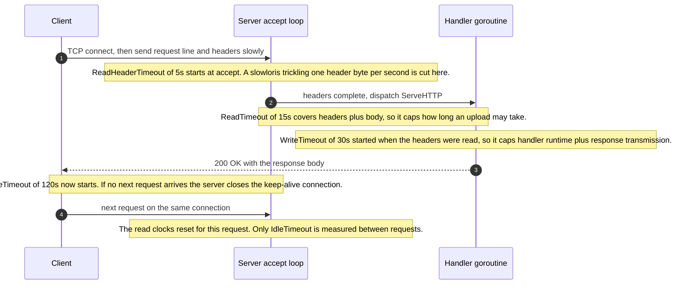
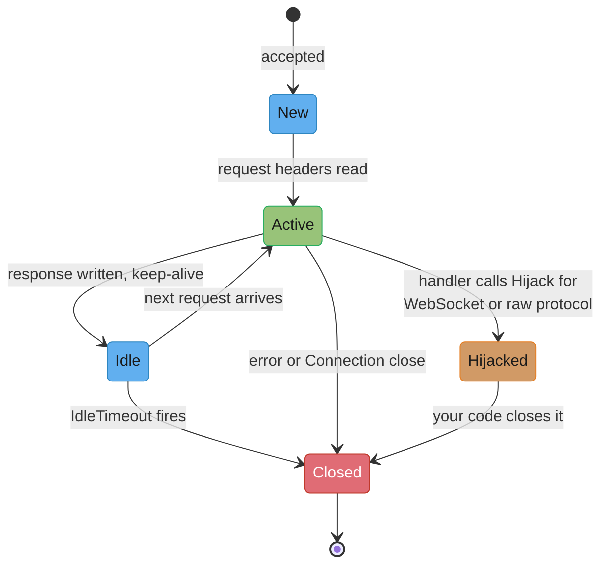

# net/http Server

## 1. Concept Overview

In Java the first question after "we need an HTTP service" is which framework. In Python it
is which ASGI server behind which framework. In Go the honest answer is often **none**:
`net/http` ships a server that terminates TLS, speaks HTTP/1.1 and HTTP/2, multiplexes on
method and path wildcards, enforces four independent timeouts, drains connections on
shutdown, and cancels a request's context when the client hangs up. That is not a toy
reference implementation you outgrow — it is the same server Kubernetes' API machinery,
Prometheus, Consul and Docker's daemon expose their endpoints from.

The whole surface reduces to one interface:

```go
type Handler interface {
    ServeHTTP(ResponseWriter, *Request)
}
```

Everything else in the package is a `Handler`, produces a `Handler`, or wraps one.
`ServeMux` is a `Handler` that dispatches to other `Handler`s. `http.StripPrefix` is a
`Handler` that rewrites and delegates. `httputil.ReverseProxy` is a `Handler` that forwards.
Middleware is a function from `Handler` to `Handler`. There is no filter registry, no
servlet container, no dependency-injected pipeline — a request path is a chain of closures
you can read top to bottom in one file.

That composability is why the framework question is different here. A Go framework is not
buying you a server; the server is already there and it is good. It is buying you a router
with a nicer API, request binding, validation, and a middleware ecosystem. Sometimes that is
worth it. Often, since `[1.22]` gave `ServeMux` method matching and path wildcards, it is
not.

What this module covers: the `Handler`/`HandlerFunc` pair and why the one-method interface
is the cleanest argument in the standard library for small interfaces; middleware as
closures and the ordering rule people get backwards; `ServeMux` patterns, precedence, the
registration-time conflict panic, and the trailing-slash redirect that became a **307** in
`[1.26]`; all four `Server` timeouts and what each one actually bounds; `ResponseController`
for streaming without surrendering those timeouts; graceful shutdown and its drain ordering
against a load balancer; request-body and response-writing semantics that leak or corrupt
when you get them wrong; HTTP/2 including the `[1.27]` RFC 9218 priority handling; testing;
reverse proxying; and an honest look at chi, echo, gin and fiber.

The protocol itself — HTTP/1.1 framing, HTTP/2 multiplexing, HTTP/3 and QUIC — belongs to
[HTTP Protocols](../../backend/http_protocols/http_protocols.md). Resource modelling,
versioning and status-code semantics belong to
[REST API Design](../../backend/rest_api_design/rest_api_design.md). This page is Go's
implementation of a server that speaks them.

---

## 2. Intuition

> **One-line analogy**: `net/http` is a **restaurant kitchen with a pass**, not a meal kit.
> The stoves, the ticket rail and the expeditor already exist and are commercial grade. A
> framework sells you a nicer ticket rail — never the kitchen.

**Mental model**: picture a bouncer, a coat check, a maître d', and a chef, standing in a
line at the door. Each one either turns the guest away or hands them to the next. The chef
is your handler; everyone in front is middleware. A guest walks *in* through the line in
order and walks *out* through it in reverse, which is why the outermost wrapper sees both
the earliest moment and the latest — and is therefore where request logging, panic recovery,
and total-duration metrics belong.

**Why it matters**: the two ways a Go HTTP service dies in production are both configuration
defaults, not code. A `Server` with zero timeouts will hold every socket a misbehaving or
malicious client opens, forever, until the process runs out of file descriptors — the
zero-value struct is a denial-of-service vulnerability. And a service that exits on `SIGTERM`
without draining returns connection resets to every in-flight request on every deploy, which
looks exactly like a bug in a downstream service and gets debugged for weeks.

**Key insight**: `http.Handler` has **one method**, and that single fact is the whole design.
One method means any function with the right shape can be adapted (`HandlerFunc`), any
handler can be wrapped without knowing what it wraps (middleware), and any component — a
router, a proxy, a file server, a test double — is substitutable for any other. Widen that
interface by one method and every one of those properties dies. It is the most
consequential piece of interface design in the standard library, and it is 3 lines long.

---

## 3. Core Principles

- **`http.Handler` is one method, and stays one method.** Everything composes because
  nothing needs to know what it is wrapping.
- **`http.HandlerFunc` is the adapter**, and it is a *type conversion*, not a constructor:
  `http.HandlerFunc(f)` gives a plain function a `ServeHTTP` method.
- **Middleware is `func(http.Handler) http.Handler`.** Nothing else. A middleware type
  belonging to a framework is a framework lock-in, not a middleware.
- **The outermost wrapper runs first on the way in and last on the way out.** Order the
  chain by what must observe the most: recovery and logging outside, authentication and
  business concerns inside.
- **Never run a `Server` with zero timeouts.** All four of `ReadHeaderTimeout`,
  `ReadTimeout`, `WriteTimeout` and `IdleTimeout` must be set explicitly.
- **`WriteTimeout` bounds the entire response**, so it is a ceiling on streaming. Use
  `http.ResponseController` to extend it per request rather than removing it globally.
- **One goroutine per connection.** The server accepts, spawns, and reads requests in a loop
  on that goroutine. Handler code is therefore ordinary blocking code.
- **`r.Context()` is cancelled** when the client disconnects and when `ServeHTTP` returns.
  Every downstream call takes it, or the cancellation is decorative.
- **The handler owns the request body.** Read it or discard it, and never leave it unread on
  a path that expects connection reuse.
- **Headers are only meaningful before `WriteHeader`.** After the first `Write`, the status
  and headers are already on the wire.
- **`Shutdown(ctx)` drains, `Close()` severs.** Neither of them tells your load balancer
  anything — that ordering is yours to arrange.
- **A handler must never panic the process.** The server recovers a handler panic and closes
  that connection, but it logs a stack trace and returns nothing useful, so recover it
  yourself at the outermost layer.

---

## 4. Types / Architectures / Strategies

### 4.1 The four types that matter

| Type | What it is | Why it exists |
|------|-----------|---------------|
| `http.Handler` | interface with `ServeHTTP(ResponseWriter, *Request)` | the universal unit of composition |
| `http.HandlerFunc` | `func(ResponseWriter, *Request)` with a `ServeHTTP` method on it | lets a bare function satisfy `Handler` by conversion |
| `http.ServeMux` | a `Handler` that routes to other `Handler`s by pattern | dispatch, and nothing else |
| `http.Server` | the listener, the accept loop, the timeouts, the protocol | lifecycle and policy |

The adapter is worth reading in full, because it is three lines and it explains a technique
you will reuse in your own packages:

```go
type HandlerFunc func(ResponseWriter, *Request)

func (f HandlerFunc) ServeHTTP(w ResponseWriter, r *Request) {
    f(w, r)
}
```

`HandlerFunc` is a *named function type* with a method. Converting a function to it costs
nothing at runtime and makes it a `Handler`. `http.HandleFunc` is nothing but
`mux.Handle(pattern, HandlerFunc(fn))`. The same pattern appears as `sort.Interface`
helpers, `io.Reader` adapters, and `errgroup`'s `Go(func() error)`.

### 4.2 Middleware, and the shape it must have

```go
type Middleware func(http.Handler) http.Handler

func RequestID(next http.Handler) http.Handler {
    return http.HandlerFunc(func(w http.ResponseWriter, r *http.Request) {
        id := r.Header.Get("X-Request-Id")
        if id == "" {
            id = newID()
        }
        w.Header().Set("X-Request-Id", id)
        ctx := context.WithValue(r.Context(), requestIDKey{}, id)
        next.ServeHTTP(w, r.WithContext(ctx))
    })
}
```

Three properties make this work and are worth naming. The middleware takes and returns
`http.Handler`, so it composes with anything. It mutates nothing global — the modified
context rides on a **new** `*http.Request` from `r.WithContext`, because a `*http.Request` is
shared with the server. And it is applied once at wiring time, not per request, so the
closure allocation happens at startup.

Chaining without a framework is a for-loop:

```go
func Chain(h http.Handler, mws ...Middleware) http.Handler {
    for i := len(mws) - 1; i >= 0; i-- { // apply in reverse so mws[0] ends up outermost
        h = mws[i](h)
    }
    return h
}

handler := Chain(mux, Recover, Logging, RequestID, Timeout(3*time.Second), Auth)
```

The reverse loop is the whole trick. `Chain(h, A, B)` must produce `A(B(h))`, so the last
element is applied first. Get it backwards and your panic-recovery middleware sits *inside*
the handler it is meant to protect, which is a bug you find during an incident rather than
in a test.

### 4.3 `ServeMux` patterns `[1.22]`

A pattern is `[METHOD ][HOST]/[PATH]`:

| Pattern | Matches |
|---------|---------|
| `/items/` | `/items/`, `/items/42`, `/items/a/b/c` — the whole subtree |
| `/items/{$}` | **only** `/items/` — `{$}` anchors the end of the URL |
| `GET /items/{id}` | `GET /items/42`, and `HEAD /items/42`; one segment only |
| `POST /items/{id}` | a different registration entirely from the `GET` one |
| `/files/{path...}` | `/files/a/b/c.txt` — the trailing wildcard eats remaining segments |
| `api.example.com/health` | host-scoped; beats an unhosted `/health` |

Values come back by name: `id := r.PathValue("id")`. There is no positional indexing and no
regexp — a wildcard matches one unescaped path segment (or, with `...`, the rest).

**Precedence is specificity, not registration order.** Pattern P1 beats P2 when the set of
requests P1 matches is a strict subset of P2's. `GET /items/{id}` beats `/items/`; `/items/`
beats `/`. If two patterns overlap and neither is more specific than the other —
`/a/{x}/c` and `/a/b/{y}` both match `/a/b/c` — that is a **conflict**, and `ServeMux`
**panics at registration time**. A routing ambiguity in Go is a crash on the first line of
`main`, not a subtly wrong route in production at 3am.

### 4.4 The four timeouts

| Field | Clock starts | Clock stops | If zero |
|-------|-------------|-------------|---------|
| `ReadHeaderTimeout` | connection accepted, or previous response finished | request headers fully read | falls back to `ReadTimeout` |
| `ReadTimeout` | same as above | entire request **including the body** read | no read deadline at all |
| `WriteTimeout` | request headers read | response fully written | no write deadline at all |
| `IdleTimeout` | response finished on a keep-alive connection | next request's first byte | falls back to `ReadTimeout` |

Two consequences catch everyone. `ReadTimeout` covers the body, so a 5-second `ReadTimeout`
caps how long a client may take to upload — set it against your largest legitimate upload,
not against your handler latency. And `WriteTimeout` starts when the headers are read, not
when your handler writes, so it is effectively **a ceiling on total handler runtime plus
response transmission**. A 30-second `WriteTimeout` means no server-sent-events stream
survives 30 seconds.

A defensible starting point for a JSON API:

```go
srv := &http.Server{
    Addr:              ":8080",
    Handler:           handler,
    ReadHeaderTimeout: 5 * time.Second,
    ReadTimeout:       15 * time.Second,
    WriteTimeout:      30 * time.Second,
    IdleTimeout:       120 * time.Second,
    MaxHeaderBytes:    1 << 20, // 1 MB, the default, stated so it is reviewable
    ErrorLog:          slog.NewLogLogger(logHandler, slog.LevelError),
}
```

`MaxHeaderValueCount` `[1.27]` caps how many header *values* the server will accept, guarding
against a client that sends thousands of repeated headers to inflate per-connection memory.
Unset it and `DefaultMaxHeaderValueCount`, which is **500**, applies.

### 4.5 Routing and framework options

| Option | Router | `http.Handler` native | What it adds | Cost |
|--------|--------|----------------------|--------------|------|
| stdlib `ServeMux` | radix over patterns `[1.22]` | yes | method matching, wildcards, host matching | write your own binding, validation, error mapping |
| chi | trie | **yes** — `chi.Router` is an `http.Handler`, middleware is `func(http.Handler) http.Handler` | sub-routers, `Group`, a middleware library, URL params | one small dependency; router only, no binding |
| echo | trie | no — handlers take `echo.Context` and return `error` | binding, validation, renderers, a large middleware set | your handlers are no longer `http.Handler` |
| gin | radix | no — `*gin.Context` | binding + validator tags, huge ecosystem, fastest of the `net/http` group | `*gin.Context` everywhere, non-standard error handling |
| fiber | trie over **fasthttp** | **no, and not compatible at all** | Express-like API, very low allocation per request | leaves `net/http` entirely: no `http.Handler` middleware, no `httptest`, no HTTP/2 server, no `httputil.ReverseProxy` |

The line worth drawing is between chi and everything below it. chi is additive: its router is
an `http.Handler`, its middleware is the standard signature, and deleting chi from a codebase
is a mechanical change. echo and gin replace the handler signature, so every handler,
middleware and test in the codebase is written against them. fiber replaces the *server*, and
with it the whole `net/http` ecosystem — that is a real choice with real wins on
allocation-bound workloads, but it should be made deliberately and not because a benchmark
chart looked good.

---

## 5. Architecture Diagrams

### The middleware onion — in through the layers, out through them in reverse


`Chain(mux, Recover, Logging, RequestID, Timeout, Auth)` builds exactly this order. Recovery
is outermost so it catches a panic from any layer, including the router. Auth is innermost so
its rejection is still logged and still counted. Move Recover inside Logging and a panicking
handler produces a stack trace with no request line attached to it.

### Where each of the four timeouts bites



The trap encoded in step 4: `WriteTimeout` is *not* a write deadline in the sense a
programmer expects. It is armed before your handler runs, so a handler that spends 29 seconds
computing has 1 second to send its bytes.

### The connection lifecycle, and what `Shutdown` does to each state



`Shutdown(ctx)` closes the listeners, immediately closes every connection in **Idle**, and
then polls until the rest go quiet. A connection in **New** is not closed on sight: `Shutdown`
treats it as idle only once it has sat for **5 seconds** without sending a request header, so a
client mid-handshake gets that grace before being cut. **Active** connections are waited for
until each goes Idle and can be closed. It
does **not** wait for **Hijacked** connections — a WebSocket is invisible to `Shutdown`, and
draining it is entirely your problem via `Server.RegisterOnShutdown`.

### Pattern precedence, resolved

```
Registered patterns:            Request GET /items/42/reviews

  /                             matches  (everything matches /)
  /items/                       matches  (subtree)
  GET /items/{id}/reviews       matches  (one segment for {id})
  GET /items/{id}/{$}           no       ({$} anchors the end)

  Most specific wins  ->  GET /items/{id}/reviews,  PathValue("id") == "42"

Conflict, panics at registration:

  /a/{x}/c   matches /a/b/c ... and also /a/Z/c
  /a/b/{y}   matches /a/b/c ... and also /a/b/Z
  Neither request set contains the other  ->  panic on the second Handle call
```

---

## 6. How It Works — Detailed Mechanics

### 6.1 The accept loop and the per-connection goroutine

`srv.ListenAndServe()` opens a listener and enters `Serve(l)`, which loops on `l.Accept()`.
Every accepted connection gets its own goroutine running `conn.serve(ctx)`, which reads a
request, calls `srv.Handler.ServeHTTP`, writes the response, and loops for the next request
on the same connection until an error, a `Connection: close`, or `IdleTimeout`.

This is why Go handler code looks like 2005-era blocking code and still scales: a goroutine
starts at a **2 KB** stack and the scheduler parks it on I/O without occupying an OS thread.
A server holding 50,000 idle keep-alive connections is holding 50,000 parked goroutines,
which is memory you can compute — not 50,000 OS threads, which is a machine you cannot buy.
See [Goroutines and the Scheduler](../goroutines_and_the_scheduler/goroutines_and_the_scheduler.md)
for what "parked" costs.

`conn.serve` also installs a `defer` that recovers panics from your handler. It logs the
panic and stack, closes that connection, and the process survives. That is a safety net, not
a strategy: the client gets a truncated or empty response with no status code, and nothing
increments an error metric. Recover in your own outermost middleware, where you can write a
500 and record it.

`ErrAbortHandler` is the one panic value the server swallows silently — panic with it when
you deliberately abandon a response and do not want a stack trace in the log.

### 6.2 `ServeMux` matching, and the redirects it performs

`ServeMux` sorts registered patterns and, at request time, walks them to find the most
specific match. Beyond dispatch it performs two automatic redirects, and both surprise
people:

1. **The subtree redirect.** If `/items/` is registered and `/items` is not, a request for
   `/items` is redirected to `/items/`.
2. **The path-cleaning redirect.** A request for `/a//b` or `/a/./b` is redirected to the
   cleaned `/a/b`.

As of `[1.26]` the trailing-slash redirect uses **307 Temporary Redirect**; before that it
was **301 Moved Permanently**. This is a genuine behaviour change for anything that caches
redirects. A browser or CDN that saw the old 301 stored it *permanently* — a 301 is cacheable
forever by default — so a client that once hit `/items` on an old build will keep rewriting
to `/items/` from its own cache even after you change the routes. The 307 is not cached by
default and, unlike a 301, is defined to preserve the method and body, so a redirected `POST`
stays a `POST` instead of being downgraded to `GET` by a permissive client.

If you do not want the redirect at all, register both patterns, or register `/items/{$}` so
only the exact path matches and everything else 404s.

**`DefaultServeMux` deserves one warning.** `http.Handle`, `http.HandleFunc` and
`http.ListenAndServe(addr, nil)` all use the package-global `DefaultServeMux`. Importing
`net/http/pprof` registers `/debug/pprof/*` on it from an `init` function, so a service that
serves `DefaultServeMux` on a public port is serving heap and goroutine profiles to the
internet. Always construct your own `mux := http.NewServeMux()`, and expose pprof on a
separate internal listener.

### 6.3 Request context: the only cancellation signal you get

`r.Context()` is cancelled when either of two things happens: the client's connection goes
away, or `ServeHTTP` returns. That makes it exactly the right parent for every downstream
call, and makes it lethal for anything meant to outlive the request.

```go
func (h *Handler) Get(w http.ResponseWriter, r *http.Request) {
    ctx, cancel := context.WithTimeout(r.Context(), 800*time.Millisecond)
    defer cancel()

    row, err := h.db.QueryRowContext(ctx, "SELECT ... WHERE id = $1", r.PathValue("id"))
    // ...

    // BROKEN: this outlives the response, and its context dies the moment we return.
    // go h.audit.Write(ctx, event)

    // FIX: keep the trace values, drop the dead clock, give it its own bound.
    bg, bgCancel := context.WithTimeout(context.WithoutCancel(ctx), 5*time.Second)
    go func() {
        defer bgCancel()
        h.audit.Write(bg, event)
    }()
}
```

Deriving with `WithTimeout` from `r.Context()` makes 800 ms a **ceiling**, not a reset: if the
client's own deadline leaves 300 ms, the query gets 300 ms. Starting from
`context.Background()` instead is the single most common way a service's timeouts stop
meaning anything — see
[Context and Cancellation](../context_and_cancellation/context_and_cancellation.md).

### 6.4 The request body: read it or discard it

`r.Body` is always non-nil on the server and is closed by the server after `ServeHTTP`
returns, so you will not leak a file descriptor by ignoring it. What you lose is **connection
reuse**: for HTTP/1.1 the server cannot start the next request until the current one's body
has been consumed off the socket, so an unread body forces the connection closed. At high
request rates that turns a keep-alive workload into a connect-per-request workload, with a
TCP handshake and a TLS handshake per call.

```go
// Reject early, cap the size, and always leave the body drained.
func (h *Handler) Create(w http.ResponseWriter, r *http.Request) {
    r.Body = http.MaxBytesReader(w, r.Body, 1<<20) // 1 MB ceiling
    defer io.Copy(io.Discard, r.Body)              // consume whatever the decoder left

    var in CreateRequest
    dec := json.NewDecoder(r.Body)
    dec.DisallowUnknownFields()
    if err := dec.Decode(&in); err != nil {
        var mbe *http.MaxBytesError
        if errors.As(err, &mbe) {
            http.Error(w, "request body too large", http.StatusRequestEntityTooLarge)
            return
        }
        http.Error(w, "malformed JSON", http.StatusBadRequest)
        return
    }
    // ...
}
```

`MaxBytesReader` does two things a plain `io.LimitReader` cannot. It returns a typed
`*http.MaxBytesError` so you can answer 413 instead of a generic 400. And it tells the server
to close the connection after the response, which stops a client from streaming a
multi-gigabyte body that you would otherwise have to read to completion in order to reuse the
connection.

### 6.5 Writing the response, and the two ordering rules

```go
w.Header().Set("Content-Type", "application/json")  // 1. headers first
w.WriteHeader(http.StatusCreated)                   // 2. status, once
_ = json.NewEncoder(w).Encode(out)                  // 3. body
```

Rule one: **every `w.Header().Set` must happen before `WriteHeader`**, because `WriteHeader`
serialises the header block onto the wire. A `Set` afterwards mutates a map nobody will read
again — no error, no panic, just a header the client never sees. This is the single most
common "the header is missing but the code sets it" bug, and it bites hardest in middleware
that tries to set a header *after* calling `next.ServeHTTP`.

Rule two: **the first `Write` implies `WriteHeader(200)`**. So this is a bug:

```go
// BROKEN
if err != nil {
    w.Write([]byte("something went wrong"))   // implicitly commits 200 OK
    w.WriteHeader(http.StatusInternalServerError) // too late, and logs a warning
    return
}

// FIX
if err != nil {
    http.Error(w, "something went wrong", http.StatusInternalServerError)
    return
}
```

The second `WriteHeader` is ignored and the server logs `http: superfluous
response.WriteHeader call from ...`. The client got a 200 with an error message in the body,
which every dashboard, retry policy and alert in your stack will read as success.
`http.Error` sets the content type, writes the status, and writes the message in the right
order — use it.

`http.Error` also does not stop execution. A missing `return` after it is how a handler ends
up writing two bodies.

### 6.6 `ResponseController`: streaming without abandoning timeouts

The naive fix for "my SSE stream is cut at `WriteTimeout`" is to set `WriteTimeout: 0`, which
removes the protection for every endpoint in the service. `http.ResponseController` lets one
handler adjust its own deadlines:

```go
func (h *Handler) Events(w http.ResponseWriter, r *http.Request) {
    rc := http.NewResponseController(w)

    w.Header().Set("Content-Type", "text/event-stream")
    w.Header().Set("Cache-Control", "no-cache")
    w.WriteHeader(http.StatusOK)

    tick := time.NewTicker(2 * time.Second)
    defer tick.Stop()

    for {
        select {
        case <-r.Context().Done(): // client hung up
            return
        case ev := <-h.events:
            // Push the write deadline out 30s for THIS connection only.
            if err := rc.SetWriteDeadline(time.Now().Add(30 * time.Second)); err != nil {
                return // HTTP/2 or a wrapped ResponseWriter that does not support it
            }
            if _, err := fmt.Fprintf(w, "data: %s\n\n", ev.JSON()); err != nil {
                return
            }
            if err := rc.Flush(); err != nil {
                return
            }
        case <-tick.C:
            _, _ = io.WriteString(w, ": keepalive\n\n")
            _ = rc.Flush()
        }
    }
}
```

`ResponseController` replaced the old type-assertion dance (`w.(http.Flusher)`,
`w.(http.Hijacker)`) with methods that return `http.ErrNotSupported` instead of panicking on
a nil assertion, and — crucially — it **unwraps** middleware. A logging middleware that wraps
`ResponseWriter` in a struct to capture the status code breaks a direct `w.(http.Flusher)`
assertion; `ResponseController` finds the underlying writer through any wrapper exposing
`Unwrap() http.ResponseWriter`. If your wrapper does not implement `Unwrap`, add it — that
one missing method is why "flushing stopped working after we added request logging".

`SetReadDeadline` is the mirror image for long uploads. `EnableFullDuplex` lets an HTTP/1
handler read the request body and write the response concurrently, which is otherwise not
allowed.

### 6.7 Graceful shutdown, and the ordering nobody gets right the first time

```go
func main() {
    srv := &http.Server{ /* ... timeouts ... */ }

    // SIGTERM/SIGINT cancel this context, with a cause naming the signal [1.26].
    ctx, stop := signal.NotifyContext(context.Background(), os.Interrupt, syscall.SIGTERM)
    defer stop()

    go func() {
        if err := srv.ListenAndServe(); err != nil && !errors.Is(err, http.ErrServerClosed) {
            slog.Error("listen failed", "err", err)
            os.Exit(1)
        }
    }()

    <-ctx.Done()
    slog.Info("shutdown signalled", "cause", context.Cause(ctx))

    // 1. Fail the readiness probe first, and keep serving.
    health.SetNotReady()
    // 2. Wait longer than the load balancer needs to notice.
    time.Sleep(15 * time.Second)

    // 3. Now drain.
    drainCtx, cancel := context.WithTimeout(context.Background(), 25*time.Second)
    defer cancel()
    if err := srv.Shutdown(drainCtx); err != nil {
        slog.Warn("drain incomplete, forcing close", "err", err)
        _ = srv.Close()
    }
}
```

`ListenAndServe` returns `http.ErrServerClosed` after a `Shutdown` or `Close` — that is the
success path, and treating it as an error is how a clean shutdown produces a non-zero exit
code and a `CrashLoopBackOff`.

`Shutdown(ctx)` versus `Close()`:

| | `Shutdown(ctx)` | `Close()` |
|---|---|---|
| Listeners | closed immediately | closed immediately |
| Idle connections | closed immediately | closed immediately |
| New connections, no header yet | closed once 5s idle | closed immediately |
| Active requests | allowed to finish, up to `ctx` | connection severed mid-response |
| Hijacked connections | **not waited for** | **not waited for** |
| Return on timeout | `ctx.Err()`, connections still open | n/a |
| Correct use | normal shutdown | the last resort after `Shutdown` times out |

**Steps 1 and 2 are the part everyone skips**, and they matter more than the drain itself. A
load balancer or Kubernetes Service routes to your pod based on a readiness probe it polls on
an interval — say every 5 seconds, needing 2 consecutive failures. If you call `Shutdown`
immediately on `SIGTERM`, the listener closes while the LB is still sending you traffic, and
every request it sends for the next ~10 seconds gets a TCP RST. The client sees a connection
reset, not a clean 503, and connection resets are the errors retry logic handles worst. Fail
readiness, keep serving for longer than the probe's detection window, and only then drain.
In Kubernetes the same effect is available declaratively as a `preStop` sleep, and either
way `terminationGracePeriodSeconds` must exceed sleep plus drain — here 15 + 25 = 40, so 60
is a safe grace period.

For hijacked connections — WebSockets, raw TCP upgrades —
`srv.RegisterOnShutdown(func(){ hub.CloseAll() })` gives you a hook that fires when
`Shutdown` starts, so you can send close frames yourself.

### 6.8 HTTP/2, h2c, and the `[1.27]` priority change

Over TLS you get HTTP/2 for free: `ListenAndServeTLS` configures ALPN and negotiates `h2`
automatically, as long as you have not set `TLSNextProto` to a non-nil map. Cleartext HTTP/2
(h2c) is opt-in:

```go
srv := &http.Server{Addr: ":8080", Handler: mux}
srv.Protocols = new(http.Protocols)
srv.Protocols.SetHTTP1(true)
srv.Protocols.SetUnencryptedHTTP2(true) // h2c, no golang.org/x/net needed
```

Two `[1.27]` fields matter for a public-facing server:

- **`Server.DisableClientPriority`**. The HTTP/2 server now honours client priority signals
  per **RFC 9218**, serving higher-priority streams first. That is a win when a browser tells
  you the stylesheet outranks the analytics beacon. Set `DisableClientPriority: true` to
  restore the previous strict round-robin behaviour — worth doing if you have latency SLOs
  measured per stream and a client whose priority hints are wrong, or if you have benchmarked
  the old scheduler as better for your traffic shape.
- **`Server.MaxHeaderValueCount`**, defaulting to `DefaultMaxHeaderValueCount` = **500**.
  `MaxHeaderBytes` (1 MB by default) bounds total header size; this bounds the *count* of
  values, which is the axis a client attacks when it sends ten thousand tiny headers to blow
  up the per-connection map.

`HTTP2Config` on the `Server` carries the rest of the knobs — `MaxConcurrentStreams`,
`MaxReadFrameSize`, `MaxDecoderHeaderTableSize`, ping intervals. Note what HTTP/2 does *to*
your timeouts: `WriteTimeout` and `ReadTimeout` are per-connection deadlines and a single
HTTP/2 connection carries many streams, so they behave far less usefully than on HTTP/1.
Under HTTP/2, per-request bounds must come from the request context, not the `Server` fields.

### 6.9 Testing

```go
// Unit: no network at all.
func TestGetItem(t *testing.T) {
    req := httptest.NewRequest(http.MethodGet, "/items/42", nil)
    req.SetPathValue("id", "42") // when calling the handler directly, not through the mux
    rec := httptest.NewRecorder()

    NewHandler(fakeStore{}).ServeHTTP(rec, req)

    if rec.Code != http.StatusOK {
        t.Fatalf("status = %d, want 200", rec.Code)
    }
}

// Integration: a real listener on 127.0.0.1, real serialization, real client.
func TestRoundTrip(t *testing.T) {
    ts := httptest.NewServer(routes())
    defer ts.Close()

    resp, err := ts.Client().Get(ts.URL + "/items/42")
    // ...
}
```

`httptest.NewRecorder` skips the network entirely and is what you want for handler logic.
`httptest.NewServer` binds a real loopback listener and exercises the actual serialization
path, which is what you want for routing, middleware ordering and content negotiation. Use
`ts.Client()` rather than `http.DefaultClient` — for a TLS server it is preconfigured to
trust the test certificate.

`httptest.NewTestServer(t, handler)` `[1.27]` is the third option and is a different tool:
it takes a `testing.TB` and uses an **in-memory fake network** rather than a loopback socket.
That is what makes it usable with `testing/synctest` `[1.25]`, where a real socket's
scheduling would break the fake clock. A timeout test that would otherwise take 30 real
seconds runs instantly and deterministically.

### 6.10 Reverse proxying

```go
target, _ := url.Parse("http://backend.internal:8080")

proxy := &httputil.ReverseProxy{
    Rewrite: func(pr *httputil.ProxyRequest) {
        pr.SetURL(target)              // scheme, host, and path joining
        pr.Out.Host = pr.In.Host       // forward the original Host, not the target's
        pr.SetXForwarded()             // X-Forwarded-For/-Host/-Proto, replacing any inbound value
        pr.Out.Header.Set("X-Tenant", tenantFrom(pr.In))
    },
    ErrorHandler: func(w http.ResponseWriter, r *http.Request, err error) {
        slog.Error("proxy failure", "url", r.URL.String(), "err", err)
        http.Error(w, "upstream unavailable", http.StatusBadGateway)
    },
    FlushInterval: -1, // flush immediately: required for SSE and streaming responses
}
```

`Rewrite` receives a `*ProxyRequest` holding **both** the inbound request (`In`) and the
outbound one (`Out`), which is what makes `SetXForwarded` safe: it *replaces* any client-sent
`X-Forwarded-For` rather than appending to it, so a client cannot forge its own origin. The
older `Director` hook saw only the outbound request, which meant a malicious client could
strip headers the director had added by listing them as hop-by-hop in `Connection`. If you
are migrating a `Director`, the mechanical translation is `func(r *http.Request)` →
`func(pr *httputil.ProxyRequest)` operating on `pr.Out`, plus an explicit `SetXForwarded()`.

`FlushInterval: -1` means flush after every write. Without it, a proxied
`text/event-stream` is buffered and the client sees nothing for seconds at a time.

---

## 7. Real-World Examples

**Kubernetes' API server and every controller.** `k8s.io/apiserver` builds on `net/http` with
a chain of "filters" that are exactly `func(http.Handler) http.Handler`: panic recovery,
request timeout, authentication, impersonation, audit, authorization, priority-and-fairness.
Reading `DefaultBuildHandlerChain` is the best real-world lesson in ordering — recovery
outermost, authorization after authentication, the actual API dispatch innermost.

**Prometheus.** `promhttp.Handler()` is an `http.Handler` you mount on your own mux. That is
the entire integration surface: one line, no framework, no registry of endpoints. The metrics
*middleware* (`promhttp.InstrumentHandlerDuration`) is likewise a plain handler wrapper.

**Caddy.** A production web server, HTTP/1–3, automatic TLS, written on `net/http`. It is the
proof that the stdlib server is not a starting point you migrate off.

**Docker's daemon and Consul.** Both expose their HTTP APIs from `net/http` with a
hand-written mux (Consul historically) or gorilla-style routing (Docker), and both predate
`[1.22]` wildcards — which is exactly why they carry hand-rolled path parsing that a modern
service does not need.

**Traefik and the Kubernetes ingress controllers.** Built on `httputil.ReverseProxy`
semantics, with the same header-forwarding concerns the `Rewrite` hook exists to solve.

---

## 8. Tradeoffs

### stdlib `ServeMux` versus a router library

| Dimension | stdlib `ServeMux` `[1.22]` | chi | gin / echo |
|-----------|---------------------------|-----|-----------|
| Dependencies | zero | one, no transitive | one, with a large transitive tree |
| Handler type | `http.Handler` | `http.Handler` | framework-specific context |
| Middleware type | `func(http.Handler) http.Handler` | same | framework-specific |
| Route groups / sub-routers | build by hand with `http.StripPrefix` | first class (`Route`, `Group`, `Mount`) | first class |
| Request binding + validation | write it | write it | included, tag-driven |
| Conflicting routes | panic at registration | last registration wins for some overlaps | varies |
| Testability | `httptest`, no adapters | `httptest`, no adapters | framework test helpers |
| Exit cost | n/a | a mechanical refactor | a rewrite of every handler |

### Timeout strategies

| Strategy | Bounds | Fails at |
|----------|--------|----------|
| `Server` timeouts only | connection-level abuse, slowloris | per-endpoint budgets, HTTP/2 streams |
| `http.TimeoutHandler` middleware | handler runtime, writes a 503 | it buffers the whole response in memory, and does not stop the goroutine |
| Context deadline in the handler | the actual downstream work | requires every callee to honour `ctx` |
| `ResponseController` deadlines | one long-lived connection | needs an `Unwrap`-able `ResponseWriter` |

The production answer is all four: `Server` timeouts as the outer envelope, a context
deadline per request derived from `r.Context()`, `ResponseController` on the handful of
streaming endpoints, and `TimeoutHandler` only where a response is small and a hard 503 is
genuinely better than a slow 200.

### One connection per goroutine

| Upside | Downside |
|--------|----------|
| Handlers are plain blocking code — no callbacks, no async colouring | 100k connections means 100k goroutines and their stacks |
| A panic takes one connection, not the process | goroutine-local state does not exist, so everything rides on the context |
| The scheduler multiplexes onto `GOMAXPROCS` threads | a handler that blocks on a mutex blocks a whole connection |

At 2 KB of initial stack, 100,000 idle connections is roughly 200 MB of goroutine stacks
before any per-request allocation — affordable, and the number to reach for when someone
proposes an event loop.

---

## 9. When to Use / When NOT to Use

**Use the stdlib server with no router library when:**

- The service has fewer than roughly 50 routes and a conventional REST shape.
- `[1.22]` patterns cover your routing: method matching, single-segment wildcards, a trailing
  `{path...}`, host matching.
- You care about dependency surface — an internal platform component, a sidecar, an operator,
  anything shipped to other teams.
- You want tests, middleware and instrumentation to be portable across every Go service you
  own.

**Add chi when:**

- You need sub-routers, route groups with per-group middleware, or `Mount` for composing
  independently developed sub-APIs.
- You want `chi/middleware`'s ready-made pieces rather than writing RequestID, RealIP,
  Recoverer and Compress yourself.
- Crucially, you want all of that while staying `http.Handler`-native.

**Reach for gin or echo when:**

- Request binding and validation from struct tags is a large fraction of your handler code,
  and you would otherwise write the same 30 lines of decode-and-validate 80 times.
- The team already knows one of them and consistency beats purity.

**Do NOT:**

- Ship a `http.Server` literal with unset timeouts. This is the one absolute in the module.
- Serve `DefaultServeMux` on a public port if anything in the binary imports
  `net/http/pprof`.
- Choose fiber for a service that must terminate HTTP/2, sit behind an `http.Handler`-based
  middleware library, or be tested with `httptest` — fasthttp is a different ecosystem, and
  the benchmark you chose it for measures a workload you probably do not have.
- Use `TimeoutHandler` in front of a streaming or large-response endpoint. It buffers the
  entire response in memory before deciding whether to send it.
- Write your own graceful-shutdown loop over the connection list. `Shutdown` exists, is
  correct, and the hard part was never the drain — it was the readiness ordering in front of
  it.

---

## 10. Common Pitfalls

### Pitfall 1 — the zero-value `Server` that ran out of file descriptors

A public API was deployed as `http.ListenAndServe(":8080", mux)`, which constructs a
`Server` with every timeout at zero.

```go
// BROKEN
func main() {
    mux := routes()
    log.Fatal(http.ListenAndServe(":8080", mux)) // no timeouts, none, anywhere
}

// FIX
func main() {
    srv := &http.Server{
        Addr:              ":8080",
        Handler:           routes(),
        ReadHeaderTimeout: 5 * time.Second,
        ReadTimeout:       15 * time.Second,
        WriteTimeout:      30 * time.Second,
        IdleTimeout:       120 * time.Second,
    }
    log.Fatal(srv.ListenAndServe())
}
```

**Quantified impact**: a scanner opened 8,000 connections and sent one header byte every 40
seconds on each. With `ReadHeaderTimeout` unset, none of them ever timed out. The pod's
file-descriptor limit of 65,536 was not reached, but the Go runtime's connection goroutines
and their read buffers took RSS from 400 MB to 3.1 GB, and the pod was `OOMKilled` on a 4 GB
limit every 6 to 9 minutes for two days. Total cost of the fix: four lines. The scanner was
not even hostile — it was a security team's own asset-discovery tool with an aggressive
concurrency setting.

### Pitfall 2 — `WriteTimeout` silently truncating every SSE stream at 30 seconds

A notifications service streamed server-sent events. Clients reported the stream "dying after
about half a minute" and reconnecting in a loop.

```go
// BROKEN: WriteTimeout was 30s server-wide; the stream is cut mid-frame at 30s.
func (h *Handler) Events(w http.ResponseWriter, r *http.Request) {
    w.Header().Set("Content-Type", "text/event-stream")
    for ev := range h.events {
        fmt.Fprintf(w, "data: %s\n\n", ev.JSON())
        w.(http.Flusher).Flush()
    }
}

// FIX: extend the deadline for THIS connection only, and keep the server-wide default.
func (h *Handler) Events(w http.ResponseWriter, r *http.Request) {
    rc := http.NewResponseController(w)
    w.Header().Set("Content-Type", "text/event-stream")
    for {
        select {
        case <-r.Context().Done():
            return
        case ev := <-h.events:
            if err := rc.SetWriteDeadline(time.Now().Add(30 * time.Second)); err != nil {
                return
            }
            if _, err := fmt.Fprintf(w, "data: %s\n\n", ev.JSON()); err != nil {
                return
            }
            if err := rc.Flush(); err != nil {
                return
            }
        }
    }
}
```

**Quantified impact**: 24,000 mobile clients reconnected every 30 seconds instead of holding
a connection for the average 14-minute session. That is 48,000 TLS handshakes per minute
against a service sized for 1,700, CPU on the two ingress pods pinned at 95% for three weeks,
and a monthly bill increase of roughly 4x on the ingress tier. The team's first fix was
`WriteTimeout: 0`, which removed slowloris protection from all 61 endpoints; the
`ResponseController` version keeps it everywhere else. Note the broken version's second
defect: `for ev := range h.events` never observes `r.Context().Done()`, so every disconnected
client left a goroutine subscribed to the event fan-out forever.

### Pitfall 3 — the middleware that set a header after the handler ran

An observability middleware added a server-timing header for latency attribution. It never
appeared in any response.

```go
// BROKEN
func ServerTiming(next http.Handler) http.Handler {
    return http.HandlerFunc(func(w http.ResponseWriter, r *http.Request) {
        start := time.Now()
        next.ServeHTTP(w, r)
        // The handler already called WriteHeader. This mutates a map nobody reads.
        w.Header().Set("Server-Timing", fmt.Sprintf("app;dur=%d", time.Since(start).Milliseconds()))
    })
}

// FIX: intercept WriteHeader and set the header before it is serialized.
type timingWriter struct {
    http.ResponseWriter
    start   time.Time
    wroteHeader bool
}

func (tw *timingWriter) Unwrap() http.ResponseWriter { return tw.ResponseWriter }

func (tw *timingWriter) WriteHeader(code int) {
    if !tw.wroteHeader {
        tw.wroteHeader = true
        tw.Header().Set("Server-Timing",
            fmt.Sprintf("app;dur=%d", time.Since(tw.start).Milliseconds()))
    }
    tw.ResponseWriter.WriteHeader(code)
}

func (tw *timingWriter) Write(b []byte) (int, error) {
    if !tw.wroteHeader {
        tw.WriteHeader(http.StatusOK) // the implicit 200 must go through our hook too
    }
    return tw.ResponseWriter.Write(b)
}

func ServerTiming(next http.Handler) http.Handler {
    return http.HandlerFunc(func(w http.ResponseWriter, r *http.Request) {
        next.ServeHTTP(&timingWriter{ResponseWriter: w, start: time.Now()}, r)
    })
}
```

**Quantified impact**: no runtime failure at all — the header was simply absent, and a
six-person team spent 3 weeks attributing p99 latency between the CDN, the ingress and the
app with no server-side timing data, because "the code sets the header, so the CDN must be
stripping it". The `Unwrap` method in the fix is not decoration: without it,
`http.NewResponseController(w).Flush()` inside any downstream streaming handler stops working
the moment this middleware is added.

### Pitfall 4 — `DefaultServeMux` publishing pprof to the internet

A team added `import _ "net/http/pprof"` to debug a memory issue and shipped it.

```go
// BROKEN
import _ "net/http/pprof" // registers /debug/pprof/* on DefaultServeMux from init()

func main() {
    http.HandleFunc("/api/items", itemsHandler) // also DefaultServeMux
    http.ListenAndServe(":8080", nil)           // nil means DefaultServeMux
}

// FIX: your own mux for public traffic, pprof on a separate internal listener.
func main() {
    mux := http.NewServeMux()
    mux.HandleFunc("GET /api/items", itemsHandler)

    debug := http.NewServeMux()
    debug.Handle("/debug/pprof/", http.DefaultServeMux) // pprof registered itself there
    go func() { _ = http.ListenAndServe("127.0.0.1:6060", debug) }()

    srv := &http.Server{Addr: ":8080", Handler: mux /* + timeouts */}
    log.Fatal(srv.ListenAndServe())
}
```

**Quantified impact**: `/debug/pprof/heap` was reachable from the public internet for 11 days.
A heap profile of a service that caches tokens contains those tokens as live string data, and
`/debug/pprof/profile?seconds=300` is additionally a denial-of-service primitive — a
30-second CPU profile from an unauthenticated caller, repeated, adds measurable overhead and
serialises on the profiler lock. The incident review found the same pattern in 9 of the
organisation's 34 Go services.

### Pitfall 5 — the deploy that reset connections because readiness was never failed

A service called `srv.Shutdown` directly from its `SIGTERM` handler and considered itself
graceful.

```go
// BROKEN
<-sigterm
ctx, cancel := context.WithTimeout(context.Background(), 30*time.Second)
defer cancel()
srv.Shutdown(ctx) // the listener closes NOW, while the LB is still routing here

// FIX
<-sigterm
health.SetNotReady()          // 1. start failing readiness
time.Sleep(15 * time.Second)  // 2. outlast the probe's detection window
ctx, cancel := context.WithTimeout(context.Background(), 25*time.Second)
defer cancel()
if err := srv.Shutdown(ctx); err != nil { // 3. now drain in-flight work
    _ = srv.Close()
}
```

**Quantified impact**: with a readiness probe at a 5-second period needing 2 failures, the
load balancer kept routing for up to 10 seconds after the listener closed. Each of the 40
pods in a rolling deploy produced roughly 900 connection resets in that window — about 36,000
errors per deploy, against 6 deploys a day. The client-side symptom was
`connection reset by peer`, which the calling service's retry policy classified as
non-retryable, so it surfaced as user-visible 502s. The team spent two sprints looking for a
network problem before anyone correlated the error spikes with deploy timestamps.

### Pitfall 6 — the route conflict that was actually a good thing

Migrating an old router to `[1.22]` patterns, a team hit a panic on startup and reached for a
`recover()`.

```go
// BROKEN: silencing the panic leaves genuinely ambiguous routing in place.
mux.Handle("GET /users/{id}/posts", h1)
mux.Handle("GET /users/me/{resource}", h2) // panics: neither is more specific

// FIX: make one of them strictly more specific, or split the paths.
mux.Handle("GET /users/{id}/posts", h1)
mux.Handle("GET /users/me/posts", h2Posts)   // exact beats both wildcards
mux.Handle("GET /users/me/{resource}", h2)   // now unambiguous for everything else
```

**Quantified impact**: the panic is the feature. On the previous router the same two routes
had coexisted for 14 months with a first-registration-wins rule, so `GET /users/me/posts`
silently went to the `{id}` handler with `id == "me"`, which resolved to a nil user and
returned an empty list. The bug was reported four times as "my posts sometimes disappear",
closed twice as not reproducible, and only diagnosed when the migration made `ServeMux` refuse
to start.

---

## 11. Technologies & Tools

| Tool | What it is | When you want it |
|------|-----------|------------------|
| `net/http` | the stdlib server, client, and mux | always — everything below builds on it |
| `net/http/httptest` | `NewRecorder`, `NewServer`, `NewTestServer` `[1.27]` | every handler and routing test |
| `net/http/httputil` | `ReverseProxy`, `DumpRequest`, `DumpResponse` | proxies, gateways, debugging wire format |
| `net/http/pprof` | profile endpoints registered on `DefaultServeMux` | production profiling — on a private listener only |
| `testing/synctest` `[1.25]` | deterministic fake clock for concurrency tests | timeout and retry tests, paired with `NewTestServer` |
| chi | `http.Handler`-native router and middleware | sub-routers and groups without leaving the stdlib |
| gin, echo | full frameworks with binding and validation | large CRUD surfaces where binding dominates |
| fiber | fasthttp-based framework | allocation-bound workloads, accepting the ecosystem break |
| `golang.org/x/net/http2/h2c` | h2c handler wrapper | pre-`[1.24]` codebases; `Server.Protocols` replaces it |
| `github.com/rs/cors` | CORS middleware | browser-facing APIs |
| `golang.org/x/time/rate` | token-bucket limiter | per-client rate limiting in middleware |
| `go.opentelemetry.io/contrib/instrumentation/net/http/otelhttp` | tracing/metrics handler wrapper | one-line OTel instrumentation |
| `github.com/prometheus/client_golang/prometheus/promhttp` | metrics handler and instrumentation wrappers | RED metrics per route |
| `oapi-codegen` | OpenAPI to `http.Handler` server stubs | contract-first APIs staying stdlib-native |
| `air` | live reload for local development | tightening the edit-run loop |
| `vegeta`, `k6`, `oha` | HTTP load generators | validating your timeout and pool settings |

---

## 12. Interview Questions with Answers

**Q: What happens if you deploy an http.Server with all four timeouts left at their zero values?**
**Short:** Nothing bounds the connection, so a client trickling one byte at a time holds a socket and its goroutine open forever.

The zero value of every timeout field means "no deadline", which makes a bare
`http.ListenAndServe(addr, mux)` a slowloris vulnerability rather than a shortcut. An attacker
— or, more often, a scanner or a mobile client on a dying radio — opens thousands of
connections and sends headers slowly enough that the server keeps waiting. Each one costs a
goroutine, its stack, and a read buffer. The service does not fail loudly; RSS climbs and the
process is eventually OOM-killed, which reads as a memory leak in application code.
`ReadHeaderTimeout` is the single most important of the four because it is the one that closes
a connection that has not yet become a request. Set all four explicitly, always, and treat
`http.ListenAndServe` as a demo function.

**Q: Why does WriteTimeout break streaming endpoints, and what do you do about it?**
**Short:** It is armed when the request headers are read and covers the entire response, so it caps total handler runtime plus transmission, not just one write.

The name suggests a deadline on each write call. It is not: the server sets a write deadline
on the socket once, before your handler runs, and a stream that is still sending when it
expires is severed mid-frame. Clients see a truncated response with no status information and
usually reconnect immediately, so the symptom is a reconnect storm rather than an error rate.
Setting `WriteTimeout: 0` fixes the stream and removes the protection from every other
endpoint in the process. The correct fix is `http.NewResponseController(w).SetWriteDeadline`,
which extends the deadline for that one connection while the server-wide default keeps
guarding the rest. Under HTTP/2 the field is even less useful, because one connection carries
many streams — there, per-request bounds must come from the context.

**Q: What is the difference between Shutdown and Close, and which connections does neither of them wait for?**
**Short:** Draining lets in-flight requests finish while severing does not, and neither one waits for a hijacked connection such as a WebSocket.

`Shutdown(ctx)` closes the listeners, closes idle connections at once, and then blocks until
every active request completes or `ctx` expires, returning `ctx.Err()` if it
runs out of time. `Close()` closes everything immediately, cutting responses mid-body. The
normal pattern is `Shutdown` with a bounded context, falling back to `Close` if it returns an
error. One detail worth knowing: a connection in `StateNew` that has not yet sent a request
header is only treated as idle after it has sat for 5 seconds, so `Shutdown` does not sever a
client mid-handshake. The gap both share is hijacked connections: once a handler calls `Hijack`, the server
has handed over the socket and no longer tracks it, so WebSocket and raw-upgrade connections
are invisible to the drain. Use `Server.RegisterOnShutdown` to get a callback when shutdown
begins and close those yourself. Also note that `ListenAndServe` returns
`http.ErrServerClosed` on the success path — treating that as a failure turns a clean
shutdown into a non-zero exit and a crash loop.

**Q: Your service drains gracefully but every deploy still produces connection resets. Why?**
**Short:** Draining starts too early — the load balancer is still routing to the pod when the listener closes, because readiness has not failed yet.

`Shutdown` closes the listener immediately, but your load balancer or Kubernetes Service does
not know that. It stops routing only after its readiness probe has failed enough times, which
with a 5-second period and a 2-failure threshold is up to 10 seconds later. Every request it
sends in that window hits a closed listener and the client sees a TCP reset, which most retry
policies treat as non-retryable. The ordering that works is: on `SIGTERM`, first flip
readiness to failing while continuing to serve normally, then sleep longer than the probe's
detection window, and only then call `Shutdown`. In Kubernetes this is a `preStop` sleep plus
a `terminationGracePeriodSeconds` that exceeds the sleep and the drain combined. The drain
itself was never the hard part.

**Q: In a middleware chain, which wrapper runs first, and where does panic recovery belong?**
**Short:** The outermost wrapper runs first on the way in and last on the way out, so recovery and total-duration logging must sit there.

Each middleware calls `next.ServeHTTP` somewhere in its body, so control enters from the
outside in and unwinds from the inside out — the same shape as a stack of `defer`s. A helper
like `Chain(h, A, B, C)` must apply the slice in reverse to make `A` outermost, which is why
its loop counts down. Recovery goes outermost because a panic in any other middleware,
including the router, must still be caught. Request logging goes near the outside because only
there does it measure the whole request. Authentication goes inside logging so rejections are
still recorded, and inside a timeout middleware so an auth check cannot outlive the request
budget. Getting the order backwards produces bugs that no unit test finds, because each layer
works correctly in isolation.

**Q: How does ServeMux decide between two patterns that both match a request?**
**Short:** The more specific pattern wins, meaning the one whose matching request set is a strict subset of the other's, and true ties panic at registration.

Registration order is irrelevant. `GET /items/{id}` beats `/items/` because everything the
first matches the second also matches, and not the reverse. Method and host both add
specificity, so `GET /items/{id}` beats `/items/{id}`. When neither pattern's request set
contains the other's — `/a/{x}/c` versus `/a/b/{y}`, both matching `/a/b/c` — `ServeMux`
panics on the conflicting `Handle` call. That panic is a feature: routers that resolve
ambiguity by registration order route real traffic to the wrong handler silently, and the
resulting bug looks like a data problem rather than a routing problem. The fix is to add an
exact pattern that is strictly more specific than both, not to recover from the panic.

**Q: What does the {$} wildcard do, and when do you need it?**
**Short:** It anchors a pattern to the end of the URL, so `/items/{$}` matches only `/items/` and nothing beneath it.

A pattern ending in a slash is a subtree match: `/items/` catches `/items/`, `/items/42`, and
`/items/a/b/c`. That is usually what you want for a file server and almost never what you want
for an API, because a typo like `/items/42/reviwes` silently lands on the subtree handler
instead of returning 404. Writing `/items/{$}` restricts the match to the exact path. The
related case is `/{$}` for the root: without it, `/` is the catch-all that swallows every
unmatched request in the whole service, so a mistyped path returns your home page with a 200
instead of a 404. Two characters, and they turn a class of silent misroute into a proper
error.

**Q: A ServeMux trailing-slash redirect changed status code recently. What changed and why does it matter?**
**Short:** It is 307 Temporary Redirect as of Go 1.26, where older releases sent 301 Moved Permanently, and a cached 301 outlives the code that sent it.

When `/items/` is registered and `/items` is not, `ServeMux` redirects `/items` to `/items/`.
A 301 is cacheable indefinitely by default, so browsers, CDNs and any client with a redirect
cache stored that rewrite permanently — meaning a client that hit the old build keeps
rewriting `/items` to `/items/` from its own cache even after you register both paths, and
clearing it requires a URL change or a user-side cache purge. A 307 is not cached by default.
The second difference matters more for APIs: a 301 permits a client to downgrade the redirected
request to `GET`, so a redirected `POST` could silently lose its body, while a 307 is defined
to preserve method and body. If you want no redirect at all, register both patterns explicitly
or use `{$}`.

**Q: When exactly is r.Context() cancelled, and what must never use it?**
**Short:** It is cancelled when the client disconnects and again when ServeHTTP returns, so any work outliving the response must not depend on it.

That double trigger is what makes it the correct parent for every downstream call in the
handler — a database query, an RPC, an S3 read — because a client that hangs up stops paying
for all of them immediately. It also makes it lethal for a goroutine you spawn to do
background work such as an audit write or a metric flush: the handler returns, the context is
cancelled, and the background call fails with `context.Canceled` a few microseconds later.
The fix is `context.WithoutCancel(r.Context())`, which keeps the request's trace values while
dropping the dead clock, followed immediately by a fresh `WithTimeout` so the work is still
bounded. Never substitute a bare `context.Background()` there — you keep the lifetime and
throw away the trace correlation.

**Q: What actually breaks if a handler never reads the request body?**
**Short:** Connection reuse breaks, because HTTP/1.1 cannot start the next request until the current body has been consumed off the socket.

You will not leak a file descriptor — the server closes `r.Body` after `ServeHTTP` returns.
What you lose is keep-alive: the unread bytes are still framed on the connection, so the
server closes it instead of reading the next request. At meaningful request rates that turns a
pooled workload into a connect-per-request workload, adding a TCP handshake and a TLS
handshake to every call and multiplying the sockets in `TIME_WAIT`. The case that bites is an
early rejection — an auth failure or a validation error returned before decoding — where
`defer io.Copy(io.Discard, r.Body)` costs one line. Pair it with
`http.MaxBytesReader` so a hostile client cannot make that discard read a gigabyte.

**Q: What does http.MaxBytesReader give you that io.LimitReader does not?**
**Short:** A typed error you can turn into a 413, plus instructions to the server to close the connection instead of reading the oversized body to completion.

`io.LimitReader` simply reports EOF at the limit, which a JSON decoder surfaces as
"unexpected end of input" — indistinguishable from genuinely malformed input, so you answer
400 when the truth is 413. `http.MaxBytesReader` returns a `*http.MaxBytesError` that
`errors.As` recovers, letting you answer `413 Request Entity Too Large` and log the real
cause. It also holds a reference to the `ResponseWriter` and marks the connection for closing
when the limit trips, which is the part that matters under attack: without it, refusing a
10 GB upload still requires reading 10 GB off the socket if you want to reuse the connection.
Set the limit per route against the largest legitimate payload, not once globally.

**Q: Why is a header set after w.Write invisible, and what is the superfluous WriteHeader log?**
**Short:** The first Write commits an implicit 200 and serializes the header block, so everything afterwards mutates a map that will never be read again.

`ResponseWriter.Header()` returns a live map only until the status line goes out. `WriteHeader`
serializes it; if you never call `WriteHeader`, the first `Write` calls it for you with 200.
After that, a `Header().Set` succeeds silently and changes nothing on the wire — no error, no
panic — which is why "the code clearly sets this header" is a bug report that takes weeks. A
second `WriteHeader` is ignored and logs `http: superfluous response.WriteHeader call`, and
the dangerous version of this is writing an error message and *then* the 500: the client
receives a 200 with an error body, and every retry policy and alert downstream reads it as
success. Use `http.Error`, which orders the three steps correctly, and always `return` after
it.

**Q: What does http.ResponseController solve that a type assertion to http.Flusher does not?**
**Short:** It unwraps middleware and returns errors instead of panicking, so flushing and deadline changes keep working through a wrapped ResponseWriter.

The old idiom, `f, ok := w.(http.Flusher)`, breaks the moment any middleware wraps the
`ResponseWriter` — which every logging or metrics middleware does in order to capture the
status code — because the wrapper type does not implement `Flusher`. `ResponseController`
walks the chain via an `Unwrap() http.ResponseWriter` method on each wrapper until it finds a
writer that supports the operation, and returns `http.ErrNotSupported` rather than leaving you
with a nil interface to call. It also exposes `SetReadDeadline` and `SetWriteDeadline`, which
no type assertion ever offered, and that is what lets a single streaming handler opt out of
the server-wide `WriteTimeout`. The obligation it creates: any `ResponseWriter` wrapper you
write must implement `Unwrap`, or you silently break flushing for every handler behind it.

**Q: How do you get HTTP/2 in a Go server, and how do you get it without TLS?**
**Short:** Over TLS it is automatic through ALPN negotiation, and cleartext h2c is opt-in through the Server's Protocols field.

`ListenAndServeTLS` configures ALPN and negotiates `h2` with no code from you, provided you
have not set `TLSNextProto` to a non-nil map — doing so is the usual accidental way people
disable HTTP/2 while trying to customise TLS. Cleartext HTTP/2 is not automatic because it
requires either prior knowledge or an upgrade dance, so you enable it explicitly with
`Protocols.SetUnencryptedHTTP2(true)`, typically alongside `SetHTTP1(true)`. h2c is what you
want between a mesh sidecar and your process, where TLS is already terminated. Remember that
the `Server`'s read and write timeouts are per *connection* while HTTP/2 multiplexes many
streams over one, so once HTTP/2 is on, per-request deadlines must come from the request
context.

**Q: What did Go 1.27 change about HTTP/2 stream scheduling and header limits?**
**Short:** The server now honours RFC 9218 client priority signals, and a new field caps how many header values it will accept, defaulting to 500.

Previously the HTTP/2 server served ready streams round-robin regardless of what the client
asked for. It now reads the client's priority signals and serves higher-priority streams
first, which is a real win for a browser that has told you the stylesheet outranks the
analytics beacon. If you have benchmarked the old behaviour as better for your traffic — or
you have a client whose hints are wrong — set `Server.DisableClientPriority` to true to
restore it. Separately, `Server.MaxHeaderValueCount` bounds the *number* of header values
rather than their total size, closing the gap `MaxHeaderBytes` leaves open: a client sending
ten thousand tiny headers stays under a 1 MB budget while inflating the per-connection map.
Leave it unset and `DefaultMaxHeaderValueCount`, 500, applies.

**Q: When would you use httptest.NewTestServer instead of httptest.NewServer?**
**Short:** When the test needs a fake clock, because NewTestServer uses an in-memory network that works with testing/synctest where a real socket would not.

`httptest.NewServer` binds a real loopback listener, which is exactly right for testing
routing, middleware ordering and serialization end to end. Its limitation appears in timing
tests: real sockets involve the real scheduler and the real clock, so a test of a 30-second
timeout takes 30 seconds and is flaky under load. `httptest.NewTestServer(t, handler)`
replaces the transport with an in-memory fake network and takes a `testing.TB`, which makes it
composable with `testing/synctest`'s virtual clock — a timeout, retry or keep-alive test then
runs deterministically and instantly. For pure handler logic neither is needed:
`httptest.NewRecorder` with `httptest.NewRequest` skips the network entirely and is the
fastest option.

**Q: How do you write a reverse proxy in Go without letting a client forge its own origin header?**
**Short:** Use the ReverseProxy Rewrite hook and call SetXForwarded, which replaces any client-supplied forwarding headers rather than appending to them.

`Rewrite` receives a `*httputil.ProxyRequest` carrying both the inbound request and the
outbound one, and that pairing is what makes safe header handling possible: `SetXForwarded()`
writes `X-Forwarded-For`, `-Host` and `-Proto` from the connection Go actually observed,
discarding whatever the client claimed. You typically pair it with `pr.SetURL(target)` and,
if the upstream does virtual hosting, `pr.Out.Host = pr.In.Host`. Also set an `ErrorHandler`
so an upstream failure becomes a 502 you logged rather than the default bare 502, and
`FlushInterval: -1` if you proxy server-sent events, since the default buffering makes a
stream appear frozen. Migrating older code is a mechanical change from a
`func(*http.Request)` operating on the outbound request to a `func(*httputil.ProxyRequest)`
operating on `pr.Out`.

**Q: Should a Go service use a web framework, and what actually changes if it does?**
**Short:** The server is already production grade, so a framework buys routing ergonomics and request binding — and the real question is whether it replaces the http.Handler contract.

Nothing in gin, echo or fiber gives you a better *server*; the stdlib already does TLS,
HTTP/2, timeouts, draining and connection management, and Caddy and the Kubernetes API server
are built on it. Since Go 1.22 added method matching and path wildcards, `ServeMux` also
covers most routing. The meaningful axis is compatibility: chi's router is an `http.Handler`
and its middleware is `func(http.Handler) http.Handler`, so adopting or removing it is a
mechanical change. gin and echo introduce their own context type, so every handler,
middleware and test in the codebase is written against them. fiber goes further and replaces
`net/http` with fasthttp, which costs you `httptest`, `httputil.ReverseProxy`, HTTP/2 server
support and the entire `http.Handler` middleware ecosystem. Start stdlib, add chi when you
need sub-routers and groups, and treat the other two as decisions about binding ergonomics
rather than performance.

**Q: What happens when a handler panics, and why is the server's built-in recovery not enough?**
**Short:** The server recovers it, logs a stack trace and drops that one connection, but the client gets a truncated response and no metric records the failure.

The per-connection goroutine installs a deferred recover, so a panicking handler cannot take
the process down — a real difference from a language where an unhandled exception on a
request thread might. What the client receives, though, is whatever bytes were already
written followed by a closed connection: no status code if none was written yet, and a
half-written JSON document if one was. Nothing increments an error counter, nothing carries
your request id, and the stack goes to `Server.ErrorLog` in a format your structured logging
pipeline probably drops. So put your own recovery middleware outermost, where it can write a
proper 500, attach the request id and route, and increment a metric. The one value to
special-case is `http.ErrAbortHandler`: re-panic it rather than handling it, since it is the
documented way to abandon a response without a stack trace.

---

## 13. Best Practices

- **Set all four timeouts on every `Server`, in every service, always.** 5s header, 15s read,
  30s write, 120s idle is a defensible default to argue away from, not a value to copy
  blindly.
- **Construct your own `http.NewServeMux()`.** Never serve `DefaultServeMux` on a public
  listener, and put pprof on a loopback-bound port of its own.
- **Write middleware as `func(http.Handler) http.Handler` and nothing else.** It keeps the
  chain portable across services and testable with `httptest` alone.
- **Order the chain recovery, logging, request id, timeout, then auth.** Outermost sees the
  most.
- **Give every `ResponseWriter` wrapper an `Unwrap() http.ResponseWriter` method**, or you
  break flushing and deadline control for everything behind it.
- **Derive the handler's context from `r.Context()`, never `context.Background()`.** A
  `WithTimeout` on top of it is a ceiling, which is what you want.
- **Use `context.WithoutCancel` plus a fresh timeout** for work that must outlive the
  response.
- **Wrap every body in `http.MaxBytesReader` and `defer io.Copy(io.Discard, r.Body)`.** Two
  lines, and they close both a memory-exhaustion vector and a connection-reuse leak.
- **Use `http.Error` for error responses, and `return` immediately after it.** It gets the
  header, status and body ordering right, which hand-written code frequently does not.
- **Prefer `{$}` over an accidental subtree.** `/{$}` for the root especially, or every typo
  in your API returns 200.
- **Never `recover()` a `ServeMux` registration panic.** It is telling you two routes are
  ambiguous, and the alternative is silent misrouting.
- **Fail readiness, sleep past the probe window, then `Shutdown`** — with a hard `Close()`
  fallback and a `terminationGracePeriodSeconds` larger than sleep plus drain.
- **Use `ResponseController` for streaming endpoints** rather than lowering `WriteTimeout` for
  the whole process.
- **Test routing with `httptest.NewServer` and handler logic with `httptest.NewRecorder`**,
  reaching for `httptest.NewTestServer` `[1.27]` plus `testing/synctest` when the assertion is
  about time.

---

## 14. Case Study

### Turning a 3-line demo server into something that survives a deploy

**Context.** An internal document API serves 4,800 requests/second across 24 pods behind an
AWS Network Load Balancer, in Kubernetes. It exposes a JSON CRUD surface, an upload endpoint
accepting files up to 20 MB, and a `/v1/documents/{id}/events` SSE stream that clients hold
open for an average of 11 minutes. It was written in a hackathon and grew.

**The failing version.**

```go
// BROKEN: nine defects, numbered in place.
package main

import (
    _ "net/http/pprof" // 1. registers /debug/pprof on DefaultServeMux
    "net/http"
)

func main() {
    http.HandleFunc("/v1/documents/", documentsHandler)   // 2. subtree catch-all, no method
    http.HandleFunc("/v1/upload", uploadHandler)
    http.HandleFunc("/", indexHandler)                    // 3. swallows every typo as 200

    // 4. no timeouts of any kind
    // 5. DefaultServeMux, so pprof is public
    // 6. no shutdown handling: SIGTERM kills in-flight requests instantly
    http.ListenAndServe(":8080", nil)
}

func uploadHandler(w http.ResponseWriter, r *http.Request) {
    body, _ := io.ReadAll(r.Body) // 7. unbounded read into memory
    if err := store.Put(r.Context(), body); err != nil {
        w.Write([]byte("upload failed"))          // 8. implicit 200
        w.WriteHeader(http.StatusInternalServerError) // 9. ignored, logs a warning
        return
    }
    w.WriteHeader(http.StatusCreated)
}
```

Four incidents, in the order they arrived:

1. **The reconnect storm.** Nothing set `WriteTimeout`, so SSE streams *worked* — until an
   operator added `WriteTimeout: 30 * time.Second` while hardening the service, and every one
   of 24,000 streams began dying at 30 seconds. TLS handshake rate went from 36/second to
   1,600/second and ingress CPU pinned for three weeks before anyone connected the two
   changes.

2. **The OOM loop.** A partner integration retried a 20 MB upload in a tight loop after each
   failure. `io.ReadAll` with no ceiling meant 40 concurrent retries held 800 MB of request
   bodies; the pod's 2 GB limit was hit in 90 seconds, and the restart dropped every other
   in-flight request, which generated more retries.

3. **The silent 200s.** The upload error path wrote a body before the status, so every failed
   upload returned `200 OK` with `upload failed` as the payload. The client's success rate
   dashboard read 99.98% for four months while the partner's ticket queue filled with missing
   documents.

4. **The deploy resets.** No `Shutdown` at all meant `SIGTERM` terminated the process
   immediately. Each rolling deploy produced roughly 1,100 connection resets per pod. Because
   the calling service classified `connection reset by peer` as non-retryable, these became
   user-visible 502s, six times a day.

**The fixed version.**

```go
// FIX: every one of the nine defects above, addressed in place.
package main

func main() {
    mux := http.NewServeMux()

    // Method-and-wildcard patterns: a typo now 404s instead of hitting a subtree handler.
    mux.HandleFunc("GET /v1/documents/{id}", h.Get)
    mux.HandleFunc("PUT /v1/documents/{id}", h.Put)
    mux.HandleFunc("DELETE /v1/documents/{id}", h.Delete)
    mux.HandleFunc("GET /v1/documents/{id}/events", h.Events)
    mux.HandleFunc("POST /v1/upload", h.Upload)
    mux.HandleFunc("GET /healthz", health.Ready)
    mux.HandleFunc("GET /{$}", h.Index) // exact root only

    handler := Chain(mux,
        Recover,                    // outermost: catches everything, writes a real 500
        Logging,                    // measures the whole request
        RequestID,
        otelhttp.NewMiddleware("documents"),
        Timeout(3*time.Second),     // not applied to the SSE route, see below
        Auth,
    )

    srv := &http.Server{
        Addr:              ":8080",
        Handler:           handler,
        ReadHeaderTimeout: 5 * time.Second,
        ReadTimeout:       60 * time.Second,  // sized for a 20 MB upload on a slow link
        WriteTimeout:      30 * time.Second,  // SSE opts out per connection, below
        IdleTimeout:       120 * time.Second,
        MaxHeaderBytes:    1 << 20,
        ErrorLog:          slog.NewLogLogger(logHandler, slog.LevelError),
    }

    // pprof on loopback only, never on the public listener.
    go func() {
        dbg := http.NewServeMux()
        dbg.Handle("/debug/pprof/", http.DefaultServeMux)
        _ = http.ListenAndServe("127.0.0.1:6060", dbg)
    }()

    ctx, stop := signal.NotifyContext(context.Background(), os.Interrupt, syscall.SIGTERM)
    defer stop()

    go func() {
        if err := srv.ListenAndServe(); err != nil && !errors.Is(err, http.ErrServerClosed) {
            slog.Error("listen failed", "err", err)
            os.Exit(1)
        }
    }()

    <-ctx.Done()
    slog.Info("draining", "cause", context.Cause(ctx))

    health.SetNotReady()         // 1. fail readiness while still serving
    time.Sleep(15 * time.Second) // 2. outlast the NLB's 10s detection window

    drainCtx, cancel := context.WithTimeout(context.Background(), 25*time.Second)
    defer cancel()
    if err := srv.Shutdown(drainCtx); err != nil { // 3. drain in-flight work
        slog.Warn("drain timed out", "err", err)
        _ = srv.Close()
    }
}

func (h *Handler) Upload(w http.ResponseWriter, r *http.Request) {
    r.Body = http.MaxBytesReader(w, r.Body, 20<<20) // hard 20 MB ceiling
    defer io.Copy(io.Discard, r.Body)

    if err := h.store.Put(r.Context(), r.Body); err != nil { // stream, never ReadAll
        var mbe *http.MaxBytesError
        if errors.As(err, &mbe) {
            http.Error(w, "file exceeds 20 MB", http.StatusRequestEntityTooLarge)
            return
        }
        http.Error(w, "upload failed", http.StatusInternalServerError) // status BEFORE body
        return
    }
    w.WriteHeader(http.StatusCreated)
}

func (h *Handler) Events(w http.ResponseWriter, r *http.Request) {
    rc := http.NewResponseController(w)
    w.Header().Set("Content-Type", "text/event-stream")
    w.Header().Set("Cache-Control", "no-cache")
    w.WriteHeader(http.StatusOK)

    sub := h.hub.Subscribe(r.PathValue("id"))
    defer h.hub.Unsubscribe(sub) // the missing piece in the old version

    for {
        select {
        case <-r.Context().Done(): // client hung up, or the server is shutting down
            return
        case ev := <-sub.C:
            if err := rc.SetWriteDeadline(time.Now().Add(30 * time.Second)); err != nil {
                return
            }
            if _, err := fmt.Fprintf(w, "data: %s\n\n", ev.JSON()); err != nil {
                return
            }
            if err := rc.Flush(); err != nil {
                return
            }
        }
    }
}
```

**What changed, and what it bought.**

| Change | Result |
|--------|--------|
| Four timeouts set explicitly | slowloris connections closed at 5s; peak connection count fell from 8,200 to 640 per pod |
| `ResponseController.SetWriteDeadline` on the SSE route | median stream lifetime went from 30s back to 11 minutes; TLS handshakes fell from 1,600/s to 38/s |
| `MaxBytesReader` + streaming `Put` | peak upload-path heap fell from 800 MB to under 12 MB; the OOM loop ended |
| `http.Error` instead of write-then-status | failed uploads returned 500; the client's real success rate turned out to be 97.4%, not 99.98% |
| Method and wildcard patterns, `GET /{$}` | 404s for mistyped paths; two ambiguous routes surfaced as a startup panic and were fixed in one commit |
| Own mux, pprof on 127.0.0.1:6060 | profiling endpoints no longer reachable from the internet |
| Readiness-then-sleep-then-`Shutdown` | connection resets per deploy went from ~26,000 to 0 across six deploys a day |
| `Timeout` middleware skipped for the SSE route | a 3-second budget on ordinary requests, unlimited on the stream, without touching the server default |

**The two lessons worth carrying.** First, `http.ListenAndServe(addr, mux)` is a
demonstration function; a production server is an `http.Server` literal you can review in a
diff, and every field you leave out is a policy decision you made by accident. Second, six
of the nine defects — no timeouts, the implicit 200, the ignored `WriteHeader`, the blank
pprof import, the public `DefaultServeMux`, and the missing drain —
were configuration and ordering, not logic. There was nothing to *write*, only something to
*declare*, which is exactly the class of bug that survives code review because there is no
wrong line to point at.
