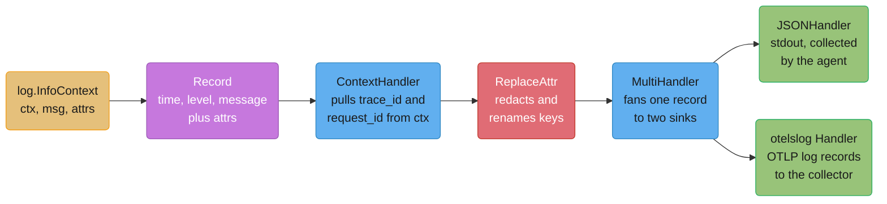
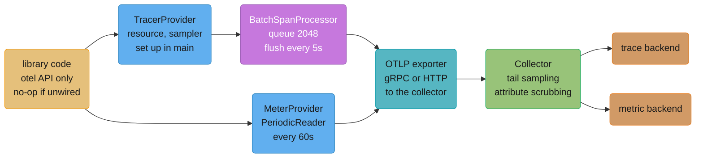
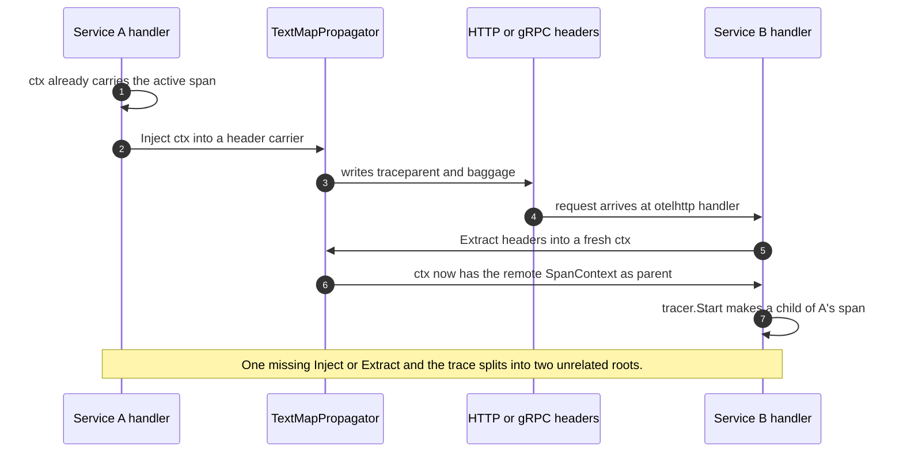

# Observability and OpenTelemetry

---

## 1. Concept Overview

Go arrived at structured logging late and then arrived properly. For a decade the ecosystem
split between `logrus` (reflection-heavy, convenient), `zap` (fast, verbose) and `zerolog`
(faster, stranger), and every library that logged forced its choice onto every program that
imported it. `log/slog` `[1.21]` ended that: a structured logger in the standard library, with
a `Handler` interface narrow enough that every backend can implement it and every library can
target it without importing anything.

This page is about **instrumenting a Go program**. It covers `log/slog` end to end, the
OpenTelemetry Go SDK for traces and metrics, `runtime/metrics` for what the runtime itself
knows, and the part everyone skips: making the three signals point at each other so a slow
p99 leads to a trace leads to the log line that explains it.

It is deliberately **not** about running an observability stack. Collector topology,
sampling strategy at fleet scale, cardinality budgets as an org policy, alerting on SLOs and
error budgets, and choosing a backend are taught in
[Observability, Tracing and OpenTelemetry](../../devops/observability_tracing_and_otel/observability_tracing_and_otel.md)
and [Observability and Monitoring](../../backend/observability_and_monitoring/observability_and_monitoring.md).
Read those for what to build. Read this for what to import.

Versions this page is written against: Go **1.27** (released 2026-08-19),
`go.opentelemetry.io/otel` and its trace, metric and logs SDKs at **v1.47.0** (2026-10-02, the
first release with a stable logs API and SDK; it needs Go 1.26 or later), `otelhttp` and
`otelgrpc` at **v0.72.0**, and `otelslog` at **v0.21.0** (contrib 1.47.0, 2026-10-03).

---

## 2. Intuition

> A log line is a diary entry: what happened, once, in detail. A metric is a bathroom scale:
> one number, checked constantly, that tells you nothing about *why*. A trace is a receipt
> from a trip with four connecting flights, showing exactly where the three hours went. You
> need all three because each is useless at the question the others answer, and the whole
> discipline of instrumentation is making sure the receipt has the diary's page number
> printed on it.

**Mental model:** in Go, every signal rides on `context.Context`. The trace id lives in the
context. The span you are inside lives in the context. The pprof labels that will appear on
your CPU profile live in the context. This is why `ctx` is the first parameter of every
function in idiomatic Go and why a function that takes no `ctx` is a function you cannot
observe. Correlation is not something you bolt on afterwards; it is what `ctx` was for.

**Why it matters:** the two failure modes are symmetric and both expensive. Under-instrument
and a 3am page becomes an archaeology exercise across four services with no shared identifier.
Over-instrument and you put a user id in a metric label, multiply your active series by
200,000, and take down the metrics backend that you were relying on to tell you what was
wrong. One of those is a bad night. The other is a bad night during which you are also blind.

**Key insight:** logs are unbounded-cardinality and expensive per event; metrics are
bounded-cardinality and cheap per event; traces are sampled. Put a high-cardinality value in
the wrong one and you either lose the data or lose the system. **User ids go in log
attributes and span attributes. They never go in metric labels.**

---

## 3. Core Principles

1. **`Handler` is the extension point.** `slog.Logger` is a thin, concrete struct you should
   not try to replace. Everything you want to customize — output format, redaction,
   context-derived attributes, fan-out — is a `Handler`.
2. **Attributes, not formatted strings.** `slog.Info("order placed", "order_id", id)` is
   queryable; `log.Printf("order %s placed", id)` is a grep.
3. **Libraries import the OTel API; only `main` imports the SDK.** A library that pulls in
   `sdk/trace` forces its exporter and its lifecycle on every program that imports it.
4. **Propagation is context in, headers out, headers in, context out.** Nothing else. If a
   trace stops at a process boundary, exactly one of those four steps is missing.
5. **Every metric label is a multiplier.** The series count is the product of every label's
   cardinality. There is no other formula and no exception.
6. **The runtime already knows.** Heap size, GC pauses, scheduler latency and thread count
   are available from `runtime/metrics` at a cost of microseconds. Export them before you
   write your first custom gauge.
7. **Shutdown order is part of correctness.** A batch processor holds up to five seconds of
   spans in memory. A process that exits without flushing loses exactly the spans describing
   why it exited.
8. **A trace id in every log line.** It is one line of handler code and it is the single
   highest-leverage thing on this page.

---

## 4. Types / Architectures / Strategies

### The three signals in Go

| Signal | Package | Cost per event | Cardinality tolerance | Answers |
|--------|---------|---------------|----------------------|---------|
| Logs | `log/slog` | ~1–5 microseconds with `JSONHandler` | unbounded (storage-bound) | "what exactly happened to this one request" |
| Metrics | `go.opentelemetry.io/otel/metric` | ~50–200 nanoseconds per add | strictly bounded | "is the system healthy right now" |
| Traces | `go.opentelemetry.io/otel/trace` | ~1–2 microseconds per span, then sampled | high (per-span attributes) | "where did the 900 milliseconds go" |
| Profiles | `runtime/pprof` | continuous sampling, ~1% CPU | labels only | "which code burned the CPU" |

### `slog`'s four types

| Type | What it is |
|------|-----------|
| `Logger` | The front end. Concrete struct, cheap to copy, `With` returns a new one. |
| `Handler` | The interface: `Enabled`, `Handle`, `WithAttrs`, `WithGroup`. Four methods, and the only thing you implement. |
| `Record` | One log event: `Time`, `Level`, `Message`, `PC`, plus attributes reached through `Attrs(func(Attr) bool)`. |
| `Attr` | A key and a `Value`. `Value` is a tagged union that keeps common types off the heap. |

### Built-in handlers

| Handler | When |
|---------|------|
| `NewTextHandler` | local development, `logfmt`-style key=value, human-readable |
| `NewJSONHandler` | production, one JSON object per line, what every log pipeline wants |
| `NewMultiHandler` `[1.26]` | fan-out: JSON to stdout **and** an OTel log bridge, from one call |
| your own | context attributes, redaction, sampling, ring-buffer-on-error |

### Sampling strategies

| Strategy | Where it runs | Decides on | Use when |
|----------|--------------|-----------|----------|
| `AlwaysSample` | SDK | nothing | development, or very low traffic |
| `TraceIDRatioBased(0.05)` | SDK | trace id hash | uniform 5% baseline, cheap |
| `ParentBased(...)` | SDK | upstream's decision | always — it keeps a trace whole across services |
| Tail sampling | Collector | the completed trace | keep every error and every slow trace; see the devops page |

Head-based sampling in the SDK decides before the request runs, so it cannot preferentially
keep errors. Tail sampling can, but requires the whole trace to reach one collector instance.
The standard production shape is `ParentBased(TraceIDRatioBased(0.05))` in the SDK feeding a
tail-sampling collector.

### Instrumentation strategies

| Strategy | How it attaches | Covers | Cost |
|----------|----------------|--------|------|
| Manual SDK wiring | You import `otelhttp`, `otelgrpc` and friends and wrap each boundary in code | Exactly what you wrap | Code at every boundary; a missed wrapper is a missing span |
| Compile-time injection, `otelc` v1 | `otelc go build` in place of `go build`; hooks the compiler through `-toolexec` | `net/http`, `database/sql`, gRPC, Redis and runtime metrics, in your code, its dependencies and the standard library | Needs a rebuild; the injected code is not in your source tree |
| eBPF, OpenTelemetry eBPF Instrumentation (OBI) | A separate agent attaches eBPF probes to an unmodified binary | Network boundaries (HTTP, gRPC, database calls) and RED metrics, seen from outside the process, in any language | Linux 5.8+ with BTF and root or equivalent capabilities; no rebuild |

The OpenTelemetry decision guide for Go states it is not a ranking: it points to `otelc` when
you own the build pipeline or need in-process spans, to OBI for a mixed-language fleet or a
binary you cannot rebuild, and allows running both together.

### Histogram aggregations

| | Explicit buckets | Base-2 exponential |
|---|---|---|
| Configuration | you choose boundaries up front | `MaxSize` and `MaxScale`, auto-adapting |
| Wrong guess | quantiles are garbage outside the range | self-corrects |
| Series per histogram | one per bucket plus sum and count | one per populated bucket, bounded by `MaxSize` |
| Backend support | universal | OTLP-native backends |
| Default in the Go SDK | yes | opt in with a `View` |

---

## 5. Architecture Diagrams

### The slog pipeline, with context attributes



The custom handler wraps, it does not replace: `ContextHandler` adds attributes and delegates
`Handle` to the handler underneath it. That is why the four-method interface is enough.

### The OpenTelemetry pipeline



Everything left of the collector is your binary's problem and lives on this page. Everything
right of it is the
[devops page](../../devops/observability_tracing_and_otel/observability_tracing_and_otel.md).

### Context propagation across a process boundary



The W3C `traceparent` header is 55 bytes: version, 32-hex trace id, 16-hex span id, and
2-hex flags whose low bit is the sampled decision. `ParentBased` sampling reads that bit,
which is why a downstream service does not re-roll the dice and split a trace in half.

---

## 6. How It Works — Detailed Mechanics

### `slog` basics and what `With` actually saves

```go
opts := &slog.HandlerOptions{
    Level:     levelVar,           // dynamic, see below
    AddSource: true,               // file:line, costs one runtime.CallersFrames per record
}
log := slog.New(slog.NewJSONHandler(os.Stdout, opts))
slog.SetDefault(log)               // makes the package-level slog.Info route here too

log.Info("order placed", "order_id", id, "amount_cents", 4999, "tier", "pro")
```

```json
{"time":"2026-09-02T11:04:22.118Z","level":"INFO","source":{"function":"main.place","file":"order.go","line":88},"msg":"order placed","order_id":"o-8812","amount_cents":4999,"tier":"pro"}
```

`slog.With` pre-binds attributes by calling `Handler.WithAttrs`, and a good handler
**pre-formats them once**:

```go
// BROKEN in the hot path: five attrs re-formatted on every one of 40,000 log calls.
for _, ev := range batch {
    log.Info("processed", "service", svc, "region", region, "shard", shard,
        "version", ver, "event_id", ev.ID)
}

// FIX: bind the four constant attrs once. JSONHandler.WithAttrs appends their
// serialized bytes to a prefix buffer, so each record only formats event_id.
l := log.With("service", svc, "region", region, "shard", shard, "version", ver)
for _, ev := range batch {
    l.Info("processed", "event_id", ev.ID)
}
```

Measured on a 40,000-record loop this is the difference between roughly **9 allocations per
record and 2** — the constant attributes are formatted once at `With` time instead of 40,000
times. Bind request-scoped attributes at the top of a handler, not inside the loop.

Prefer the strongly typed constructors in hot paths: `slog.String("k", v)`,
`slog.Int64`, `slog.Duration`, `slog.Bool` avoid the `any` boxing that the loose
`"key", value` form requires.

### `LogValuer`: lazy and redacted values

```go
type Password string

func (Password) LogValue() slog.Value { return slog.StringValue("REDACTED") }

type User struct {
    ID    string
    Email string
    Pass  Password
}

// The whole struct decides how it appears in logs, once.
func (u User) LogValue() slog.Value {
    return slog.GroupValue(
        slog.String("id", u.ID),
        slog.String("email", maskEmail(u.Email)),
    )
}

log.Info("login", "user", u)
// {"msg":"login","user":{"id":"u-1","email":"a***@example.com"}}
```

Two independent wins. **Redaction happens at the type**, so a new call site cannot forget it —
this is the only redaction scheme that survives a growing codebase, because it does not depend
on anyone remembering. And it is **lazy**: `LogValue` is called only if the record is actually
handled, so an expensive `LogValue` on a debug-level attribute costs nothing when the level is
INFO. That laziness is why you can attach a whole request object to a debug log without paying
for it in production.

### `ReplaceAttr` for renaming and blanket redaction

```go
opts := &slog.HandlerOptions{
    Level: levelVar,
    ReplaceAttr: func(groups []string, a slog.Attr) slog.Attr {
        switch {
        case len(groups) == 0 && a.Key == slog.TimeKey:
            return slog.Attr{Key: "ts", Value: a.Value}       // match the pipeline's schema
        case len(groups) == 0 && a.Key == slog.MessageKey:
            return slog.Attr{Key: "message", Value: a.Value}
        case sensitive[a.Key]:                                 // authorization, ssn, card_number
            return slog.String(a.Key, "REDACTED")
        }
        return a
    },
}
```

`ReplaceAttr` runs for **every attribute of every record**, including the built-in time, level,
message and source. That makes it the right place for schema mapping and a last-resort
redaction backstop, and the wrong place for anything expensive — a map lookup is fine, a regex
over the value is a 3x throughput hit on a busy service. `LogValuer` is the primary redaction
mechanism; `ReplaceAttr` is the net underneath it.

### Context-carried attributes: the trace id in every line

`slog` has no built-in notion of context attributes — `InfoContext` passes the `ctx` to the
handler and does nothing else with it. A handler is what turns that into attributes:

```go
type ContextHandler struct{ slog.Handler }

func (h ContextHandler) Handle(ctx context.Context, r slog.Record) error {
    if sc := trace.SpanContextFromContext(ctx); sc.IsValid() {
        r.AddAttrs(
            slog.String("trace_id", sc.TraceID().String()),
            slog.String("span_id", sc.SpanID().String()),
        )
    }
    if rid, ok := ctx.Value(requestIDKey{}).(string); ok {
        r.AddAttrs(slog.String("request_id", rid))
    }
    return h.Handler.Handle(ctx, r)
}

// WithAttrs and WithGroup must be overridden too, or they return the inner handler
// and every logger derived with With() silently loses the context enrichment.
func (h ContextHandler) WithAttrs(as []slog.Attr) slog.Handler {
    return ContextHandler{h.Handler.WithAttrs(as)}
}
func (h ContextHandler) WithGroup(name string) slog.Handler {
    return ContextHandler{h.Handler.WithGroup(name)}
}

log := slog.New(ContextHandler{slog.NewJSONHandler(os.Stdout, opts)})
```

The embedded-interface shortcut is the trap: embedding `slog.Handler` promotes `WithAttrs` and
`WithGroup`, which return the **inner** handler and quietly drop your wrapper. Every
`log.With(...)` after that logs without a trace id. Override both.

The other half of the contract is that every call site uses the `Context` variants —
`InfoContext`, `ErrorContext`, `DebugContext`, `WarnContext`. A plain `log.Info` inside a
request handler produces a line with no trace id, which is exactly the line you will want at
3am.

### Fan-out with `NewMultiHandler` `[1.26]`

```go
lp := sdklog.NewLoggerProvider(
    sdklog.WithProcessor(sdklog.NewBatchProcessor(logExporter)),
    sdklog.WithResource(res),
)
defer lp.Shutdown(context.Background())

h := slog.NewMultiHandler(
    slog.NewJSONHandler(os.Stdout, opts),          // the file-based pipeline keeps working
    otelslog.NewHandler("orders", otelslog.WithLoggerProvider(lp)),  // OTLP, correlated
)
log := slog.New(ContextHandler{h})
```

`slog.NewMultiHandler(handlers ...Handler) *MultiHandler` `[1.26]` calls every handler's
`Handle` and joins their errors. It is exactly what a migration needs — the existing stdout
pipeline keeps running while OTLP logs are validated in parallel — and it is not free: two
handlers means two serializations of every record. On a service logging 20,000 records per
second that is a measurable CPU line item, so it is a migration tool, not a permanent
architecture.

### Dynamic level changes

```go
var levelVar slog.LevelVar          // zero value is LevelInfo
levelVar.Set(slog.LevelInfo)

opts := &slog.HandlerOptions{Level: &levelVar}   // Leveler, read on every record

// An admin endpoint, or a SIGHUP handler, or a config watcher.
mux.HandleFunc("PUT /debug/loglevel", func(w http.ResponseWriter, r *http.Request) {
    var l slog.Level
    if err := l.UnmarshalText([]byte(r.FormValue("level"))); err != nil {
        http.Error(w, "bad level", http.StatusBadRequest)
        return
    }
    levelVar.Set(l)
    slog.Info("log level changed", "level", l)
})
```

`LevelVar` is atomic internally, so this is safe to call while every goroutine in the process
is logging. Turning on DEBUG for 60 seconds on one pod during an incident, without a restart
that would destroy the state you are investigating, is the point of the whole mechanism.

### Migrating from `log`, `logrus` and `zap`

```go
// Legacy libraries that take a *log.Logger still work, routed through slog.
stdlog := slog.NewLogLogger(log.Handler(), slog.LevelWarn)
srv := &http.Server{ErrorLog: stdlog}    // net/http's own errors now land in your JSON pipeline
```

An honest comparison. `zap`'s "zero allocation" claim is real for its `SugaredLogger`-free
typed API on the fast path, and `slog` does not match it: a `JSONHandler` record with four
typed attributes allocates roughly **2 to 4 times** as much as the equivalent `zap` call,
because `slog.Value` keeps its union small but still boxes some types and the handler
formats into a fresh buffer per record. Concretely, on a modern amd64 core, a `zap` typed
call lands near **100 nanoseconds** and a `slog.JSONHandler` call near **250 to 400
nanoseconds**. That difference matters at 100,000 log lines per second per core and is
invisible at 5,000. What `slog` buys instead is that **libraries can log without choosing your
logger** — the reason it is in the standard library at all — and a handler interface you can
implement in 30 lines. Most services should use `slog` and reach for `zap` behind a
`slog.Handler` if profiling actually shows logging on the flame graph. `zap` ships
`zapslog` for exactly that.

### OpenTelemetry: the API/SDK split

```go
// A LIBRARY. Only the API. If nobody wires an SDK, every call here is a no-op.
package ratelimit

import "go.opentelemetry.io/otel"

var tracer = otel.Tracer("github.com/acme/ratelimit")

func (l *Limiter) Allow(ctx context.Context, key string) bool {
    ctx, span := tracer.Start(ctx, "ratelimit.Allow")
    defer span.End()
    span.SetAttributes(attribute.String("ratelimit.key_class", classify(key)))
    ...
}
```

`otel.Tracer` reads the **global** `TracerProvider`, which defaults to a no-op. A library that
imports `go.opentelemetry.io/otel/sdk/trace` instead forces its exporter, its batching and its
shutdown lifecycle onto every program that imports it, and makes the library untestable
without a collector. The rule is absolute: **libraries depend on `go.opentelemetry.io/otel`
and `go.opentelemetry.io/otel/trace`; `main` depends on `sdk/trace`.**

### Wiring the SDK in `main`

```go
func initOTel(ctx context.Context) (shutdown func(context.Context) error, err error) {
    res, err := resource.Merge(resource.Default(), resource.NewWithAttributes(
        semconv.SchemaURL,
        semconv.ServiceName("orders"),
        semconv.ServiceVersion(buildinfo.Version),
        semconv.DeploymentEnvironmentName(cfg.Env),
    ))
    if err != nil {
        return nil, err
    }

    traceExp, err := otlptracegrpc.New(ctx, otlptracegrpc.WithEndpoint(cfg.OTLPEndpoint))
    if err != nil {
        return nil, err
    }
    tp := sdktrace.NewTracerProvider(
        sdktrace.WithResource(res),
        sdktrace.WithSampler(sdktrace.ParentBased(sdktrace.TraceIDRatioBased(0.05))),
        sdktrace.WithBatcher(traceExp,
            sdktrace.WithMaxQueueSize(2048),
            sdktrace.WithBatchTimeout(5*time.Second),
            sdktrace.WithMaxExportBatchSize(512),
            sdktrace.WithExportTimeout(30*time.Second),
        ),
    )
    otel.SetTracerProvider(tp)

    metricExp, err := otlpmetricgrpc.New(ctx, otlpmetricgrpc.WithEndpoint(cfg.OTLPEndpoint))
    if err != nil {
        return nil, err
    }
    mp := sdkmetric.NewMeterProvider(
        sdkmetric.WithResource(res),
        sdkmetric.WithReader(sdkmetric.NewPeriodicReader(metricExp,
            sdkmetric.WithInterval(60*time.Second))),
    )
    otel.SetMeterProvider(mp)

    otel.SetTextMapPropagator(propagation.NewCompositeTextMapPropagator(
        propagation.TraceContext{},     // W3C traceparent and tracestate
        propagation.Baggage{},          // W3C baggage
    ))

    return func(ctx context.Context) error {
        return errors.Join(tp.Shutdown(ctx), mp.Shutdown(ctx))
    }, nil
}
```

Shutdown ordering is a real bug source:

```go
// BROKEN: defer runs after os.Exit never runs at all, and even without Exit the
// shutdown races the server's last in-flight spans.
func main() {
    shutdown, _ := initOTel(ctx)
    defer shutdown(ctx)
    srv.ListenAndServe()
}

// FIX: stop accepting, drain the server, THEN flush telemetry, with its own budget.
func main() {
    ctx, stop := signal.NotifyContext(context.Background(), os.Interrupt, syscall.SIGTERM)
    defer stop()

    shutdown, err := initOTel(ctx)
    if err != nil {
        log.Error("otel init", "err", err)
        os.Exit(1)
    }

    go func() {
        if err := srv.ListenAndServe(); !errors.Is(err, http.ErrServerClosed) {
            log.Error("serve", "err", err)
        }
    }()

    <-ctx.Done()
    log.Info("shutting down", "cause", context.Cause(ctx))    // [1.26] names the signal

    drain, cancel := context.WithTimeout(context.Background(), 25*time.Second)
    defer cancel()
    _ = srv.Shutdown(drain)      // finish in-flight requests, ending their spans
    _ = shutdown(drain)          // NOW flush: the batch processor holds up to 5s of spans
}
```

The batch span processor holds up to 2,048 spans and flushes every 5 seconds. Exit without
`Shutdown` and you lose up to five seconds of spans — reliably including the ones from the
request that triggered the shutdown, which are the only spans anyone wanted.

`os/signal.NotifyContext` `[1.26]` cancels with a `CancelCauseFunc` naming the signal, so
`context.Cause(ctx)` tells you whether you got SIGTERM from Kubernetes or Ctrl-C from a human.

### Instrumenting the boundaries

```go
// Inbound HTTP: one wrapper around the whole mux. The default span name is
// "{method} {route}" from r.Pattern, e.g. "GET /users/{id}", never the URL.
handler := otelhttp.NewHandler(mux, "orders-api")

// Outbound HTTP: one wrapper around the transport.
client := &http.Client{
    Transport: otelhttp.NewTransport(http.DefaultTransport),
    Timeout:   3 * time.Second,
}

// gRPC, both directions. otelgrpc ships only stats handlers; the interceptors are gone.
srv := grpc.NewServer(grpc.StatsHandler(otelgrpc.NewServerHandler()))
cc, err := grpc.NewClient(target,
    grpc.WithStatsHandler(otelgrpc.NewClientHandler()),
    grpc.WithTransportCredentials(creds))
```

Both `otelhttp` and `otelgrpc` do injection and extraction using the **global** propagator, so
`otel.SetTextMapPropagator` is not optional decoration — omit it and the propagator is a no-op
and every service starts a fresh root trace. That single missing line is the most common cause
of "our traces do not connect".

### Manual spans, attributes, events, and errors

```go
func (s *Service) Place(ctx context.Context, o *Order) error {
    ctx, span := tracer.Start(ctx, "orders.Place",
        trace.WithSpanKind(trace.SpanKindInternal),
        trace.WithAttributes(
            attribute.String("order.id", o.ID),          // high cardinality: FINE on a span
            attribute.Int("order.item_count", len(o.Items)),
            attribute.String("order.tier", o.Tier),
        ))
    defer span.End()

    span.AddEvent("inventory.reserved", trace.WithAttributes(
        attribute.Int("reserved.count", len(o.Items))))   // a timestamped point, not a duration

    if err := s.charge(ctx, o); err != nil {
        span.RecordError(err)                             // an exception event with a stack
        span.SetStatus(codes.Error, "charge failed")      // what makes the backend show it red
        return err
    }
    span.SetStatus(codes.Ok, "")
    return nil
}
```

`RecordError` alone does **not** mark the span failed — it adds an exception event. Backends
colour a trace by `Status`, so `SetStatus(codes.Error, ...)` is the load-bearing call and
omitting it produces traces that look healthy and contain errors. Attributes describe the span
as a whole; events are timestamped points inside it. If you find yourself adding
`step_1_done`, `step_2_done` events, those are child spans.

Span naming: **low cardinality, high information**. `GET /users/{id}` (the route), not
`GET /users/8817` (the URL). A span name is effectively a metric label in every backend's UI.

### Baggage

```go
// Upstream sets it once.
m, _ := baggage.NewMember("tenant.tier", "enterprise")
bag, _ := baggage.New(m)
ctx = baggage.ContextWithBaggage(ctx, bag)

// Any service downstream reads it without an extra RPC.
tier := baggage.FromContext(ctx).Member("tenant.tier").Value()
```

Baggage crosses every process boundary in the `baggage` header, which means it costs bytes on
every request and is visible to every hop including ones you do not control. Keep it to a
handful of small, non-sensitive values. It is not a session store.

### Metrics

```go
var meter = otel.Meter("github.com/acme/orders")

var (
    ordersTotal, _ = meter.Int64Counter("orders.placed",
        metric.WithDescription("orders successfully placed"),
        metric.WithUnit("{order}"))

    orderLatency, _ = meter.Float64Histogram("orders.place.duration",
        metric.WithUnit("s"),
        metric.WithExplicitBucketBoundaries(
            0.005, 0.01, 0.025, 0.05, 0.1, 0.25, 0.5, 1, 2.5, 5, 10))

    queueDepth, _ = meter.Int64ObservableGauge("orders.queue.depth")
)

func init() {
    _, _ = meter.RegisterCallback(func(_ context.Context, o metric.Observer) error {
        o.ObserveInt64(queueDepth, int64(q.Len()))
        return nil
    }, queueDepth)
}

func (s *Service) Place(ctx context.Context, o *Order) error {
    start := time.Now()
    err := s.place(ctx, o)
    attrs := metric.WithAttributes(
        attribute.String("tier", o.Tier),              // 3 values
        attribute.Bool("error", err != nil),           // 2 values
    )
    ordersTotal.Add(ctx, 1, attrs)
    orderLatency.Record(ctx, time.Since(start).Seconds(), attrs)
    return err
}
```

Counters go up. `UpDownCounter` goes both ways. Observable (async) instruments are polled by
the reader — right for a value you can sample, like queue depth or open connections, and
wrong for anything event-driven.

**Exponential histograms** avoid the "I guessed the buckets wrong" failure entirely:

```go
mp := sdkmetric.NewMeterProvider(
    sdkmetric.WithReader(reader),
    sdkmetric.WithView(sdkmetric.NewView(
        sdkmetric.Instrument{Name: "*.duration", Kind: sdkmetric.InstrumentKindHistogram},
        sdkmetric.Stream{Aggregation: sdkmetric.AggregationBase2ExponentialHistogram{
            MaxSize: 160, MaxScale: 20,
        }},
    )),
)
```

An explicit-bucket histogram whose largest boundary is 10 seconds reports every 40-second
request as "greater than 10", so p99 becomes uncomputable exactly when you need it. The
exponential form adapts its scale to the observed range and produces at most `MaxSize`
buckets. Use explicit buckets when the backend is classic Prometheus and you need a fixed
schema; use exponential when the backend speaks OTLP.

### The cardinality trap, with the arithmetic

Series count is the **product** of every label's cardinality, multiplied by the storage cost
of the instrument's shape:

```
http.server.duration, explicit buckets:
  11 buckets + _sum + _count            = 13 series per label combination

Labels:
  method    5 values   (GET, POST, PUT, DELETE, PATCH)
  route    40 values
  status    6 values   (2xx, 3xx, 4xx, 5xx, and two you did not expect)

  5 x 40 x 6 = 1,200 combinations x 13 = 15,600 active series.   Fine.
```

Now add one label:

```
  + user_id  200,000 values

  5 x 40 x 6 x 200,000 = 240,000,000 combinations x 13 = 3.1 BILLION series.
```

At a conservative **2 KB of resident memory per active series** in a Prometheus-class
backend, 3.1 billion series is **6.2 TB of RAM**. The backend does not degrade gracefully; it
OOMs, and it takes with it your ability to see anything at all.

The Go metric SDK puts a ceiling on this inside each process. Since
`go.opentelemetry.io/otel/sdk/metric` v1.44.0 a `MeterProvider` collects at most **2000
attribute sets per instrument per collect cycle** by default. Measurements for any further
set are folded into one series carrying `otel.metric.overflow=true`, so totals stay correct
but per-label detail is gone. `metric.WithCardinalityLimit(n)` changes the cap (zero or
negative means unlimited), and `metric.WithCardinalityLimitSelector` on a reader sets it per
instrument kind. The cap bounds each process, not the fleet: 300 pods each emitting 2000
distinct `user_id` sets on a 13-series histogram still send 7.8 million series to the
backend. And the visible failure moves from an OOM to quietly merged data, which is harder to
notice (see the overflow pitfall in section 10).

```go
// BROKEN: unbounded label. Every distinct user creates a permanent new series.
requestDuration.Record(ctx, elapsed, metric.WithAttributes(
    attribute.String("route", route),
    attribute.String("user_id", u.ID),          // 200,000 values and growing
    attribute.String("path", r.URL.Path),       // /users/8817 — unbounded too
))

// FIX: bounded labels on the metric. The unbounded values go on the span and the log,
// which are sampled and cardinality-tolerant.
requestDuration.Record(ctx, elapsed, metric.WithAttributes(
    attribute.String("route", r.Pattern),        // the ROUTE pattern, ~40 values
    attribute.String("tier", u.Tier),            // 3 values
    attribute.Int("status_class", status/100),   // 5 values
))
span.SetAttributes(attribute.String("user.id", u.ID))
log.InfoContext(ctx, "request served", "user_id", u.ID, "path", r.URL.Path)
```

The rule that prevents every instance of this: **before adding a label, state its cardinality
out loud.** If you cannot bound it with a number, it is not a label. The
[devops page](../../devops/observability_tracing_and_otel/observability_tracing_and_otel.md)
covers enforcing that as a budget across teams; a `View` with an `AttributeFilter` is the
in-process backstop that drops an unapproved attribute before it reaches the exporter.

### `runtime/metrics`

```go
var samples = []metrics.Sample{
    {Name: "/gc/heap/live:bytes"},
    {Name: "/memory/classes/total:bytes"},
    {Name: "/gc/pauses:seconds"},
    {Name: "/sched/latencies:seconds"},
    {Name: "/sched/threads:threads"},              // [1.26]
    {Name: "/sched/goroutines-created:goroutines"},// [1.26]
    {Name: "/gc/cycles/total:gc-cycles"},
    {Name: "/cpu/classes/gc/total:cpu-seconds"},
}

func collectRuntime(_ context.Context, o metric.Observer) error {
    metrics.Read(samples)
    for _, s := range samples {
        switch s.Value.Kind() {
        case metrics.KindUint64:
            o.ObserveInt64(gauges[s.Name], int64(s.Value.Uint64()))
        case metrics.KindFloat64:
            o.ObserveFloat64(fgauges[s.Name], s.Value.Float64())
        case metrics.KindFloat64Histogram:
            h := s.Value.Float64Histogram()
            o.ObserveFloat64(p99[s.Name], quantile(h, 0.99))    // export a quantile, not 50 buckets
        }
    }
    return nil
}
```

`runtime/metrics` supersedes `runtime.ReadMemStats` for three reasons. It is a **stable,
self-describing** interface — `metrics.All()` enumerates every metric with its name, unit and
description, and metrics are added and removed across Go releases without breaking your code.
It exposes things `MemStats` never did, notably **histograms** for GC pauses and scheduler
latency rather than a fixed 256-entry pause circular buffer. And it does not stop the world:
`ReadMemStats` performs a stop-the-world pause to get a consistent snapshot, which on a large
heap under load is a self-inflicted latency spike from your monitoring code.

The ones worth exporting, and what each one tells you:

| Metric | Reads as |
|--------|----------|
| `/gc/heap/live:bytes` | live heap after the last mark. Compare against `GOMEMLIMIT` to see how much headroom is left before the GC starts thrashing. |
| `/memory/classes/total:bytes` | total memory obtained from the OS. This is the number that gets you OOMKilled, not the heap. |
| `/gc/pauses:seconds` | a histogram of stop-the-world pauses. Sub-millisecond is normal; a p99 above 5 ms means something is pinning the GC. |
| `/sched/latencies:seconds` | how long a goroutine sat runnable before getting a CPU. **The earliest saturation signal there is.** |
| `/sched/threads:threads` `[1.26]` | OS threads. A climb here means goroutines are blocking in syscalls or cgo, and each thread costs an 8 MB stack reservation. |
| `/sched/goroutines-created:goroutines` `[1.26]` | cumulative goroutines created. A rate that never falls while goroutine count also climbs is a leak. |
| `/cpu/classes/gc/total:cpu-seconds` | CPU spent on GC. Above 20% of total means tune `GOGC` or reduce allocation. |

Go 1.26 also added a `/sched/goroutines` family that breaks the live goroutine count down by
state; enumerate it with `metrics.All()` on your toolchain rather than hardcoding a name.

**`/sched/latencies:seconds` is the metric to alert on.** It measures the gap between a
goroutine becoming runnable and actually running. When a service is CPU-saturated, when
`GOMAXPROCS` is set below the real limit, or when a noisy neighbour is stealing cycles, this
histogram's p99 climbs **before** request latency does, because it measures the queue rather
than the service time. A p99 scheduler latency above 10 ms on a service whose request budget
is 100 ms means you are already losing 10% of the budget to waiting for a CPU.

### `expvar`

```go
import _ "expvar"     // registers /debug/vars on http.DefaultServeMux

var cacheHits = expvar.NewInt("cache_hits")
expvar.Publish("config_version", expvar.Func(func() any { return cfg.Version() }))
```

`expvar` is 200 lines of standard library that publishes a JSON blob at `/debug/vars`,
including `memstats` and the command line, for free. It has no dimensions, no aggregation and
no history, so it is not a metrics system — but for a debug endpoint that answers "what
config version is this pod running" without a deploy, it is the cheapest thing available.
Note that the blank import registers on `http.DefaultServeMux`, so if you expose that mux
publicly you have published your process's memory statistics.

### pprof labels: attributing CPU to a tenant

```go
func (s *Service) Handle(ctx context.Context, req *Request) error {
    labels := pprof.Labels(
        "tenant", req.TenantID,
        "endpoint", req.Route,
    )
    var err error
    pprof.Do(ctx, labels, func(ctx context.Context) {
        err = s.handle(ctx, req)
    })
    return err
}
```

```bash
go tool pprof -tagfocus='tenant=acme' http://localhost:6060/debug/pprof/profile?seconds=30
go tool pprof -tagshow=tenant http://localhost:6060/debug/pprof/profile?seconds=30
```

Labels attach to the goroutine and are inherited by goroutines it starts, so a fan-out inside
`pprof.Do` stays labelled. They turn "40% of CPU is in JSON marshalling" into "38% of CPU is
in JSON marshalling **for one tenant**", which is a different incident with a different fix.
As of `[1.27]`, panics and other tracebacks also print the goroutine's pprof labels in the
header for modules declaring `go 1.27` or later — so a crash dump now tells you which tenant's
request died (disable with `GODEBUG=tracebacklabels=0`). The full profiling workflow is
[Profiling and Tracing](../profiling_and_tracing/profiling_and_tracing.md).

### Correlating the three signals

Three connections, each one line:

1. **Trace id in every log line** — the `ContextHandler` above. Given a slow trace, its logs
   are one query away.
2. **Exemplars on histograms** — the OTel Go SDK attaches a trace id to a sampled measurement
   inside a histogram bucket when the recording context has a sampled span. Clicking the p99
   bucket in the backend jumps straight to a trace of a request that landed in it. This is the
   only mechanism that gets you from an aggregate to an individual without a text search.
3. **Span attributes carrying the ids you index on** — `user.id`, `order.id`, `tenant.id`.
   Traces tolerate the cardinality that metrics cannot.

```go
// One request, three signals, one identifier.
ctx, span := tracer.Start(ctx, "GET /orders/{id}")
defer span.End()
span.SetAttributes(attribute.String("order.id", id))                  // trace
requestDuration.Record(ctx, elapsed, boundedAttrs)                    // metric + exemplar
log.InfoContext(ctx, "order served", "order_id", id, "ms", elapsed)   // log, with trace_id
```

---

## 7. Real-World Examples

| System | What it does |
|--------|-------------|
| **Kubernetes** | Migrated from `glog` to `klog` to structured logging with `logr`, for the same reason `slog` exists: a component library cannot dictate the binary's logger. Its contextual-logging work is essentially the `ContextHandler` pattern at project scale. |
| **Prometheus** (the server) | A Go program that exports its own `runtime/metrics` through its own client library — `go_sched_latencies_seconds` on a Prometheus server is that histogram. |
| **Grafana Tempo and Loki** | Both are Go services instrumented with OTel, and Grafana's "trace to logs" and "logs to trace" navigation is built on exactly the trace-id-in-log-line contract described above. |
| **Uber** | Wrote `zap` because reflection-based logging was measurably expensive at their request rate, and later published `zapslog` so `zap` can sit behind a `slog.Handler` — the migration path this page recommends. |
| **CockroachDB** | Uses pprof labels to attribute CPU to individual SQL sessions and tenants in a multi-tenant cluster, which is the canonical production use of `pprof.Do`. |
| **The OTel Collector** | Itself a Go binary, and the reason your service can emit unsampled spans cheaply and let a separate process decide what to keep. |

---

## 8. Tradeoffs

### Logging libraries

| | `log/slog` | `zap` | `zerolog` | `logrus` |
|---|---|---|---|---|
| In the standard library | yes | no | no | no |
| Typed-attr call, ns/op (order of magnitude) | 250–400 | ~100 | ~100 | ~2,000 |
| Allocations on the fast path | 2–4 | 0–1 | 0–1 | 15+ |
| Libraries can target it without coupling | yes | no | no | no |
| Custom backend effort | 4 methods | moderate | awkward | hooks |
| Ecosystem in 2026 | growing fast | large, stable | niche | maintenance mode |

### Sampling placement

| | SDK head-based | Collector tail-based |
|---|---|---|
| Cost in the service | one hash per trace | full span export for every trace |
| Can keep all errors | no | yes |
| Can keep all slow traces | no | yes |
| Network cost | proportional to sample rate | 100% of spans leave the process |
| Requires trace-aware routing | no | yes, all spans of a trace to one collector |

### Where a high-cardinality value belongs

| Value | Metric label | Span attribute | Log attribute |
|-------|------------|---------------|--------------|
| HTTP route pattern | yes | yes | yes |
| HTTP status class | yes | yes | yes |
| Tenant tier (3 values) | yes | yes | yes |
| Tenant id (5,000 values) | no | yes | yes |
| User id (200,000 values) | never | yes | yes |
| Full URL with an id in it | never | yes | yes |
| Raw SQL text | never | yes, truncated | yes, truncated |

---

## 9. When to Use / When NOT to Use

**Use full OTel instrumentation when:**

- More than two services participate in a user-visible request. A trace is the only tool that
  shows where the latency went across a boundary.
- You run multi-tenant workloads and need to attribute cost or latency to a tenant.
- You are already paying for a backend that speaks OTLP.
- You need vendor portability — the whole point of OTel is that the instrumentation outlives
  the vendor contract.

**Do not reach for it when:**

- The program is a single binary with no downstream calls. `slog` plus `runtime/metrics` plus
  `net/http/pprof` answers everything a trace would, at a fraction of the setup.
- It is a CLI tool or a batch job. Structured logs and an exit code.
- You have no backend to send traces to. Unconsumed telemetry is pure cost — CPU, memory and
  network for spans nobody will ever open.
- The team has not yet got a trace id into log lines. That single line delivers more debugging
  value than a full tracing rollout, and costs 30 minutes.

**And never:**

- Put an unbounded value in a metric label. There is no scale at which this is acceptable and
  no backend that survives it.
- Log inside a tight loop at INFO. A 40,000-iteration loop logging one line each is 40,000
  serializations and a log bill; log the aggregate once when the loop ends.
- Log a request body or a full struct without a `LogValuer`. That is how credentials, tokens
  and card numbers reach a log index that fifty people can search.

---

## 10. Common Pitfalls

### One label multiplied the series count by 200,000 and OOMed the metrics tier

A team added `user_id` to their HTTP request-duration histogram to answer "which users are
slow". The service had 200,000 monthly active users, 40 routes, 5 methods and 6 status
classes; with 11 buckets plus sum and count, that is 3.1 billion potential active series. The
metrics backend absorbed it for **90 minutes** as the label values accumulated, then the
ingester OOMed at 340 GB resident and the entire org's dashboards went dark — including the
dashboards needed to diagnose it.

```go
// BROKEN: 200,000 label values, permanent, on a 13-series-per-combination histogram.
requestDuration.Record(ctx, elapsed, metric.WithAttributes(
    attribute.String("route", route),
    attribute.String("user_id", u.ID),
))

// FIX: bounded labels only. The user id belongs on the span and in the log,
// which are sampled and built for exactly this cardinality.
requestDuration.Record(ctx, elapsed, metric.WithAttributes(
    attribute.String("route", r.Pattern),
    attribute.String("tier", u.Tier),
))
span.SetAttributes(attribute.String("user.id", u.ID))
log.InfoContext(ctx, "request served", "user_id", u.ID, "route", r.Pattern)
```

The permanent guard is a `View` with an `AttributeFilter` that allowlists attribute keys per
instrument, so an unapproved label is dropped in-process before it can ever reach the
exporter. The cultural guard is stating a label's cardinality as a number in code review.

### Dashboards went flat at 2000 series and nobody got paged

A service on `go.opentelemetry.io/otel/sdk/metric` v1.44.0 or later labels a counter with
`route` and `customer_id`. Below 2000 combinations every series is correct. The day the
2001st combination appears, the SDK folds every new combination into a single series tagged
`otel.metric.overflow=true`. Totals still add up, so the request-rate panel looks normal, but
per-customer panels stop showing new customers and a per-route SLO query can miss a route
that started failing after the cap was hit. Nothing errors and nothing OOMs.

```promql
# Alert when any instrument starts overflowing.
sum by (job, __name__) ({otel_metric_overflow="true"}) > 0
```

The fix is the same bounded-label rule: drop `customer_id` from the metric and keep it on
spans. Raise `metric.WithCardinalityLimit` only for an instrument whose cardinality you can
state as a number, and alert on the overflow series so the cap is never hit silently.

### The wrapper handler was silently bypassed by every `With` call

A service added a `ContextHandler` to inject trace ids, verified it on a test endpoint, and
shipped. Weeks later an incident review found that **roughly 70% of log lines had no
`trace_id`**. The handler embedded `slog.Handler` and did not override `WithAttrs`, so every
`log.With("component", "orders")` returned the plain `JSONHandler` underneath and dropped the
enrichment — and every request handler in the codebase started with a `With` call.

The fix is nine lines (both overrides, shown in §6) and the lesson is general: **embedding an
interface to get a partial implementation means every method you did not override returns the
wrong type.** The test that catches it is asserting on a logger derived with `With`, not on
the base logger.

### `defer shutdown()` lost the spans that explained the crash

A service was configured to send traces on SIGTERM investigation, and every crash produced a
trace that simply stopped. The batch span processor holds up to 2,048 spans and flushes on a
5-second timer; the process was calling `os.Exit(1)` in its error path, which does not run
deferred functions at all. Even in the clean path, `defer shutdown(ctx)` ran with the same
`ctx` that had just been cancelled by the signal, so the exporter's first OTLP call failed
immediately with `context.Canceled`.

Two fixes, both in §6: shut the server down first and flush telemetry second, and give the
flush a **fresh** context with its own 25-second budget rather than the cancelled one. After
the change, the spans covering the final 5 seconds before termination — the interesting ones —
survived.

### `runtime.ReadMemStats` in a 10-second scrape loop caused the latency it measured

A metrics exporter called `runtime.ReadMemStats` every 10 seconds. On a service with a 24 GB
heap this performs a stop-the-world pause; the team saw a **regular 10-second periodicity in
their p99**, spiking to 180 ms, and spent two days chasing GC tuning. The profiler showed
nothing because the time was spent stopped, not running.

`metrics.Read` from `runtime/metrics` does not stop the world, exposes strictly more (GC pause
and scheduler-latency histograms, thread counts) and is a stable interface across Go
releases. Replacing the call removed the periodicity entirely. `ReadMemStats` has one
remaining legitimate use: a one-shot snapshot in a test or a debug endpoint invoked by a
human.

### `slog.Info` instead of `slog.InfoContext` cost a whole incident

During an incident the on-call engineer had a trace showing a 4-second gap inside one service
and went to find the logs for that trace. There were none — the service used
`ContextHandler` correctly, but 80% of its call sites used `log.Info` rather than
`log.InfoContext`, so no `ctx` reached the handler and no trace id was added. The gap stayed
unexplained for **six hours** until someone correlated by timestamp and pod name by hand.

There is no runtime detection for this: a context-free log line is a perfectly valid log line.
The enforcement is a lint rule. `sloglint` (available through `golangci-lint`) has a
`context: all` mode that fails the build on any non-`Context` call, and turning it on found
340 sites in this codebase.

### An explicit-bucket histogram topped out at 10 seconds and hid a 40-second p99

A payment service's latency histogram had boundaries ending at 10 seconds, chosen when p99
was 300 ms. A downstream provider degraded and real latencies moved to 40 seconds; every one
of them landed in the `+Inf` bucket, so the computed p99 pinned at exactly **10 seconds and
stopped moving**. The dashboard looked bad but stable, the alert on "p99 above 15 seconds"
never fired, and the true impact was only discovered from customer reports.

Switching that instrument to `AggregationBase2ExponentialHistogram{MaxSize: 160, MaxScale: 20}`
via a `View` made the range self-adapting. If the backend requires explicit buckets, the rule
is that the top boundary must exceed your **timeout**, not your p99 — a bucket beyond the
point at which you give up is the one that tells you that you are giving up.

---

## 11. Technologies & Tools

| Tool | What it is for |
|------|---------------|
| **`log/slog`** `[1.21]` | Standard-library structured logging: `Logger`, `Handler`, `Record`, `Attr`, `LogValuer`, `LevelVar`, `NewMultiHandler` `[1.26]`. |
| **`go.opentelemetry.io/otel`** | The OTel API: global providers, `Tracer`, `Meter`, propagators. What libraries import. v1.47.0. |
| **`go.opentelemetry.io/otel/sdk`** | The implementation: `TracerProvider`, `MeterProvider`, samplers, batch processors, resources. What `main` imports. |
| **`otlptracegrpc` / `otlpmetricgrpc`** | OTLP exporters over gRPC; HTTP variants exist for environments that block gRPC. |
| **`otelhttp`** | `NewHandler` and `NewTransport` — inbound and outbound `net/http` instrumentation in two lines. |
| **`otelgrpc`** v0.72.0 | `NewServerHandler` / `NewClientHandler`, wired with `grpc.StatsHandler`. |
| **`otelc`** v1 | Compile-time instrumentation: `otelc go build` injects OTel spans and runtime metrics into app code, dependencies and the standard library through `-toolexec`, with no runtime agent. |
| **`otelslog`** v0.21.0 | Bridges `slog` records into the OTel logs pipeline via `NewHandler(name, WithLoggerProvider(lp))`. |
| **`runtime/metrics`** | The stable, self-describing runtime metric interface, with histograms and no stop-the-world. |
| **`runtime/pprof`** | Profiles plus `pprof.Do`/`pprof.Labels` for attributing CPU. Labels appear in tracebacks `[1.27]`. |
| **`expvar`** | `/debug/vars`: a JSON dump of published variables and `memstats`, for near-zero effort. |
| **OpenTelemetry Collector** | The out-of-process pipeline: tail sampling, attribute scrubbing, fan-out to backends. |
| **`sloglint`** (via `golangci-lint`) | Lints `slog` usage: enforces `Context` variants, key style, static messages. |
| **Prometheus / Grafana / Tempo / Loki** | The common open-source backend triple, all OTLP-capable. |
| **`zap` + `zapslog`** | The escape hatch when profiling proves logging is on the critical path. |

---

## 12. Interview Questions with Answers

**Q: A user id label on a histogram took down the metrics backend. What is the arithmetic?**
**Short:** Series count is the product of every label's cardinality, so one 200,000-value label multiplies an entire metric by 200,000.

Take a duration histogram with 11 buckets plus sum and count — 13 series per label
combination — labelled by method (5), route (40) and status class (6): 1,200 combinations,
15,600 series, comfortable. Add `user_id` with 200,000 values and it becomes 240 million
combinations and 3.1 billion series. At roughly 2 KB of resident memory per active series in a
Prometheus-class backend that is 6.2 TB of RAM, and the backend OOMs rather than degrading.
The rule that prevents every instance: state a label's cardinality as a number before adding
it, and if you cannot bound it, it is not a label. High-cardinality identifiers go on span
attributes and log attributes, both of which are sampled or storage-bound rather than
multiplicative. A `View` with an `AttributeFilter` is the in-process backstop. Since
`otel/sdk/metric` v1.44.0 the Go SDK also caps each instrument at 2000 attribute sets by
default and folds the rest into an `otel.metric.overflow=true` series, so in one process the
symptom is merged, wrong-looking data rather than an OOM; across 300 pods the backend still
receives up to 2000 sets per pod.

**Q: slog has no built-in context attributes, so how do you get a trace id onto every log line?**
**Short:** Write a Handler whose Handle pulls the SpanContext out of ctx and adds trace_id and span_id to the Record before delegating.

`InfoContext` passes the `ctx` through to `Handler.Handle` and does nothing else with it, so a
custom handler is the hook. Inside `Handle`, call `trace.SpanContextFromContext(ctx)`, check
`IsValid()`, and `r.AddAttrs(slog.String("trace_id", sc.TraceID().String()))` before calling
the wrapped handler. The trap is that you must **also override `WithAttrs` and `WithGroup`** to
re-wrap the result — embedding `slog.Handler` promotes them, they return the inner handler,
and every logger derived with `log.With(...)` silently loses the enrichment. The other half is
that every call site must use the `Context` variants; enforce it with `sloglint`'s
`context: all` rule, because a context-free log line is not detectable at runtime.

**Q: How do you keep a password out of a log line without remembering to redact at every call site?**
**Short:** Implement LogValuer on the type itself, so the type decides how it appears in logs and no call site can leak it.

`func (Password) LogValue() slog.Value { return slog.StringValue("REDACTED") }` means every
`slog` call that ever touches that type prints the redaction, including one written by someone
who has never heard of the policy. A struct can implement it too, returning a
`slog.GroupValue` of exactly the fields that are safe to emit. The second benefit is
**laziness**: `LogValue` is only invoked when the record is actually handled, so an expensive
representation attached to a debug-level attribute costs nothing when the level is INFO.
`HandlerOptions.ReplaceAttr` is the complementary backstop — it runs for every attribute of
every record and can blanket-redact by key — but it is a net, not the primary mechanism,
because it matches on key names rather than on types.

**Q: What does slog.With actually save?**
**Short:** It calls Handler.WithAttrs once, so a good handler pre-serializes the bound attributes instead of formatting them on every record.

`log.With("service", s, "region", r, "shard", n)` returns a new `*Logger` whose handler has
already appended those attributes' serialized bytes to an internal prefix buffer.
`JSONHandler` then writes that prefix directly on each record rather than re-encoding four
key-value pairs. On a 40,000-iteration loop the difference is roughly 9 allocations per record
versus 2. The practical guidance is to bind request-scoped and process-scoped attributes once
— at the top of a handler, or at startup — and never inside a loop, because calling `With`
inside the loop pays the `WithAttrs` cost every iteration and saves nothing. In hot paths also
prefer typed constructors (`slog.String`, `slog.Int64`, `slog.Duration`) over the loose
`"key", value` form, which boxes through `any`.

**Q: Why do libraries import only the OpenTelemetry API and never the SDK?**
**Short:** The SDK carries exporters, batching and a shutdown lifecycle, and a library importing it forces all three on every program that imports the library.

`otel.Tracer("mylib")` resolves against the **global** `TracerProvider`, which defaults to a
no-op — so an instrumented library costs a few nanoseconds in a program that never wires an
SDK, and produces real spans in one that does. A library importing `sdk/trace` instead drags
in OTLP exporters and gRPC, decides batching parameters for its consumer, and becomes
untestable without a collector. The division is: libraries depend on `go.opentelemetry.io/otel`
and `go.opentelemetry.io/otel/trace`; `main` depends on `sdk/trace`, constructs the provider
with the resource and sampler, and calls `otel.SetTracerProvider`. It is the same reasoning
that put `slog.Handler` in the standard library.

**Q: Your traces stop at every process boundary. What is missing?**
**Short:** Almost always the global TextMapPropagator was never set, so inject and extract are silently no-ops on both sides.

`otelhttp` and `otelgrpc` do injection and extraction through `otel.GetTextMapPropagator()`,
whose default is a no-op propagator. Without
`otel.SetTextMapPropagator(propagation.NewCompositeTextMapPropagator(propagation.TraceContext{}, propagation.Baggage{}))`
in `main`, the outbound request carries no `traceparent`, the inbound handler extracts
nothing, and every service starts a fresh root trace — which looks like tracing working
perfectly on each service in isolation. The other candidates, in order of frequency: the
downstream call does not pass `ctx` (so there is no active span to inject), an intermediate
proxy strips unknown headers, or a client was constructed without
`otelhttp.NewTransport`. Diagnose by dumping the request headers at the receiving end and
looking for `traceparent`.

**Q: Why does a process lose its last spans on shutdown, and what is the fix?**
**Short:** The batch processor buffers up to 2,048 spans and flushes on a 5-second timer, so exiting without a successful Shutdown discards whatever is queued.

Three distinct versions of the bug. `os.Exit` does not run deferred functions at all, so
`defer shutdown(ctx)` never executes. `defer shutdown(ctx)` with the same `ctx` that was just
cancelled by `signal.NotifyContext` fails immediately with `context.Canceled` because the
exporter's first OTLP call is already dead. And flushing before draining the HTTP server ends
spans for in-flight requests after the flush. The correct order is: wait for the signal, call
`srv.Shutdown` with a fresh timeout context so in-flight requests finish and their spans end,
then call the OTel `shutdown` with that same fresh context. `os/signal.NotifyContext` `[1.26]`
cancels with a cause, so `context.Cause(ctx)` also tells you which signal you received.

**Q: What is the difference between head-based and tail-based sampling, and where does each run?**
**Short:** Head-based decides in the SDK before the request runs, tail-based decides in the collector after the whole trace is assembled.

Head-based sampling — `TraceIDRatioBased(0.05)` wrapped in `ParentBased` — hashes the trace id
and decides immediately. It is nearly free and it caps the span volume leaving your process,
but it cannot preferentially keep errors or slow requests because at decision time neither has
happened yet. Tail sampling runs in the collector, buffers all spans of a trace, and applies
policies like "keep 100% of traces containing an error, 100% above 2 seconds, 1% of the rest".
It gives you exactly the traces you want at a fraction of the storage, at the cost of exporting
every span from every process and requiring all spans of a trace to reach the same collector
instance. `ParentBased` is non-negotiable in either shape: it makes a service honour the
upstream sampled bit in `traceparent` instead of re-rolling the dice and splitting a trace in
half.

**Q: Span attributes or span events — when do you use which?**
**Short:** Attributes describe the span as a whole and are indexed for search; events are timestamped points inside it.

`span.SetAttributes(attribute.String("order.id", id))` says something true about the entire
operation and is what backends index, filter and group by. `span.AddEvent("cache.miss")`
records that something happened at a specific instant within the span, with its own optional
attributes. The heuristic: if you would ever want to search for it, it is an attribute; if you
want to see when it happened relative to the rest of the span, it is an event. And if you find
yourself emitting `step_1_started` / `step_1_finished` pairs, those are not events — that is a
child span, which gives you a duration and a place to hang its own attributes. Events are also
the mechanism behind `RecordError`, which adds a structured exception event with a stack
trace.

**Q: How do you record an error on a span so the backend actually shows the trace as failed?**
**Short:** RecordError only adds an exception event; SetStatus with codes.Error is what marks the span failed.

Backends colour a span and roll a trace up as failing based on the span's `Status`, not on the
presence of an exception event. `span.RecordError(err)` gives you the message, type and stack
in the timeline, which is what you read once you have found the trace. `span.SetStatus(codes.Error,
"charge failed")` is what makes the trace findable in the first place, and omitting it produces
the worst outcome available: a dashboard of healthy-looking traces that contain the errors you
are searching for. Note that `codes` here is `go.opentelemetry.io/otel/codes`, not
`google.golang.org/grpc/codes` — a genuinely common import mix-up in a file that does both
gRPC and tracing. Set `Ok` explicitly only when a non-error outcome would otherwise look
ambiguous; `Unset` is the correct default for success.

**Q: Why prefer runtime/metrics over runtime.ReadMemStats?**
**Short:** ReadMemStats stops the world for a consistent snapshot, while runtime/metrics does not and exposes strictly more, including histograms.

`ReadMemStats` performs a stop-the-world pause; called on a 10-second scrape loop against a
large heap it produces a regular, periodic p99 spike that no profiler can explain, because the
time is spent stopped rather than running. `runtime/metrics` reads without stopping the world,
is self-describing (`metrics.All()` enumerates every metric with name, unit and description),
and is versioned so metrics can be added and removed across Go releases without breaking your
exporter. It also exposes things `MemStats` never did: true histograms for `/gc/pauses:seconds`
and `/sched/latencies:seconds` rather than a fixed 256-entry circular buffer, plus
`/sched/threads:threads` and `/sched/goroutines-created:goroutines` `[1.26]`. `ReadMemStats`
retains one use: a one-shot snapshot in a test or a human-invoked debug endpoint.

**Q: Which runtime metric is the earliest saturation signal, and why?**
**Short:** /sched/latencies:seconds, because it measures how long a goroutine waits to get a CPU, which climbs before request latency does.

Scheduler latency is queueing delay: the interval between a goroutine becoming runnable and
actually being run. It rises as soon as runnable goroutines outnumber available Ps — under CPU
saturation, with `GOMAXPROCS` misconfigured against a container's CPU limit, or with a noisy
neighbour on the node — and it rises **before** end-to-end request latency, because request
latency is service time plus this queue and the queue moves first. If your request budget is
100 ms and the p99 of this histogram is 10 ms, you are already spending a tenth of the budget
waiting for a CPU. Export a quantile rather than all the buckets to keep the series count
sane, and pair it with `/cpu/classes/gc/total:cpu-seconds` to tell "genuinely out of CPU" from
"the GC is eating it".

**Q: Explicit-bucket or exponential histograms — which do you pick?**
**Short:** Exponential when the backend speaks OTLP, because it adapts its scale and cannot be defeated by a range you guessed wrong.

An explicit-bucket histogram whose largest boundary is 10 seconds reports every 40-second
request as "greater than 10", so the computed p99 pins at exactly 10 and stops moving — the
dashboard looks bad but stable and the alert threshold above it never fires. A base-2
exponential histogram (`AggregationBase2ExponentialHistogram{MaxSize: 160, MaxScale: 20}`,
applied through a `View`) adapts its scale to the observed range and emits at most `MaxSize`
buckets, so it stays accurate across four orders of magnitude with a bounded series count.
Choose explicit buckets when the backend is classic Prometheus and you need a fixed schema
shared across services; when you must, set the top boundary above your **timeout**, not above
your current p99, because a bucket beyond the point where you give up is what tells you that
you are giving up.

**Q: How do you change a running service's log level without restarting it?**
**Short:** Use a slog.LevelVar as the HandlerOptions Level and call Set from an admin endpoint or a signal handler.

`HandlerOptions.Level` accepts a `Leveler` interface, and `*slog.LevelVar` implements it with
an atomically-read value, so the handler consults it on every record and `levelVar.Set` is safe
to call while every goroutine in the process is logging. Wire it to a `PUT /debug/loglevel`
endpoint (behind auth), a SIGHUP handler, or a config watcher. The reason this matters more
than it sounds: turning on DEBUG during an incident normally means a restart, and a restart
destroys the in-memory state, the connection pool and the goroutine backlog you were trying to
investigate. `LevelVar` gives you 60 seconds of DEBUG on one pod with the evidence intact, and
`Handler.Enabled` short-circuits before the record is ever built, so a disabled DEBUG call
costs a comparison.

**Q: Is zap's zero-allocation claim real, and where does slog actually land?**
**Short:** It is real for zap's typed API, and slog lands roughly 2 to 4 times higher in allocations and 2 to 3 times higher in latency per record.

Order of magnitude on a modern amd64 core: a `zap` typed call is near 100 nanoseconds with
0–1 allocations; `slog` with `JSONHandler` and typed attrs is near 250–400 nanoseconds with
2–4; `logrus` is around 2,000 nanoseconds with 15 or more because it builds a `map` per entry
and reflects over it. That gap is real and it matters at 100,000 log lines per second per
core; it is invisible at 5,000, which is where most services actually sit. What `slog` buys is
the thing no third-party logger can: **libraries can log without imposing a logger on their
consumers**, which is why it is in the standard library. The pragmatic answer is `slog`
everywhere, and if a profile genuinely shows logging on the flame graph, keep the `slog` API
and put `zap` behind it with `zapslog` — you change one line in `main` and no call sites.

**Q: What does slog.NewMultiHandler do and when is it the right tool?**
**Short:** It fans one Record out to several handlers and joins their errors, which makes it a migration tool rather than a permanent architecture.

`slog.NewMultiHandler(handlers ...Handler) *MultiHandler` `[1.26]` calls `Handle` on each
handler in turn. The canonical use is a migration: keep writing JSON to stdout for the existing
file-based pipeline while simultaneously emitting OTLP log records through
`otelslog.NewHandler`, so you can validate the new pipeline against the old one on live
traffic before cutting over. The cost is that every handler serializes the record
independently — two handlers means two full serializations, which on a service logging 20,000
records per second is a measurable CPU line item. It is also the natural place to combine a
human-readable `TextHandler` on a terminal with a `JSONHandler` on a file during local
development.

**Q: How do pprof labels tell you which tenant burned the CPU?**
**Short:** pprof.Do attaches labels to the goroutine and everything it spawns, so the CPU profile can be filtered or grouped by tenant.

Wrap the request in `pprof.Do(ctx, pprof.Labels("tenant", id, "endpoint", route), func(ctx context.Context){ ... })`
and every sample taken while that goroutine — or any goroutine it starts — is running carries
those labels. Then `go tool pprof -tagfocus='tenant=acme'` restricts the profile to one tenant
and `-tagshow=tenant` breaks the whole profile down by it. This converts "40% of CPU is in JSON
marshalling", which is not actionable, into "38% of CPU is in JSON marshalling for one tenant",
which is. As of `[1.27]`, tracebacks also print a goroutine's pprof labels in the header for
modules declaring `go 1.27` or later, so a panic dump names the tenant whose request died
(disable with `GODEBUG=tracebacklabels=0`). Keep label values bounded — they are effectively
profile dimensions.

**Q: What is an exemplar and why does it matter?**
**Short:** An exemplar is a trace id attached to a sampled measurement inside a histogram bucket, letting you jump from an aggregate straight to one example request.

Without exemplars, going from "p99 is 4 seconds" to "here is a trace of a 4-second request"
means a time-range search over sampled traces and hoping one landed in the right bucket. With
them, the SDK stores the trace id of a sampled measurement alongside the bucket it fell into,
and the backend renders it as a clickable point on the histogram. It is the only mechanism
that gets from an aggregate to an individual without a text search, and it is why the metric
recording call must happen with the request's `ctx` — the SDK reads the active `SpanContext`
from it. Combined with a trace id in every log line, the full path is: alert fires on a metric,
click the exemplar, get the trace, click the span, get its logs. Each link is roughly one line
of setup.

**Q: How do you instrument an net/http server and a gRPC client with OTel in Go?**
**Short:** Wrap the mux with otelhttp.NewHandler, the client transport with otelhttp.NewTransport, and pass otelgrpc handlers via grpc.StatsHandler.

Server: `otelhttp.NewHandler(mux, "orders-api")`. Since contrib 1.44.0 the default span name is
`{method} {route}` built from `r.Pattern` `[1.22]`, for example `GET /users/{id}`, so the span
name is the **route pattern**, not the URL with ids in it; a span name is effectively a label in
every backend UI. Outbound HTTP: `&http.Client{Transport: otelhttp.NewTransport(http.DefaultTransport)}`.
gRPC: `grpc.NewServer(grpc.StatsHandler(otelgrpc.NewServerHandler()))` and
`grpc.WithStatsHandler(otelgrpc.NewClientHandler())`. Stats handlers are the only `otelgrpc` API:
the unary and stream interceptors were removed in contrib 1.36.0 to 1.38.0 (2025). Since contrib
1.42.0 (2026-03-06) `otelgrpc` no longer records message-size metrics or `rpc.message` span
events, even with `WithMessageEvents`. All four rely on the global propagator being set, and all four require the request's
`ctx` to be threaded through — a downstream call made with `context.Background()` produces an
orphan trace no matter how the client is wrapped.

**Q: When would you use otelc compile-time instrumentation instead of wiring otelhttp and otelgrpc by hand?**
**Short:** When coverage matters more than visibility: `otelc go build` instruments every supported library with no code, but the spans come from code you cannot read in your repo.

`otelc` v1 wraps the Go toolchain: `otelc go build` uses `-toolexec` to inject instrumentation
into your code, its dependencies and the standard library as they compile, covering
`net/http`, `database/sql`, gRPC, Redis and runtime metrics. That closes the gap that hand
wiring leaves, where one client built without `otelhttp.NewTransport` breaks the trace. The
costs are on the build side. Every build that must emit telemetry has to go through `otelc`,
so CI, `go test` and local builds can disagree about what is instrumented. Span names and
attributes come from injected code that is not in your source tree, so a reviewer cannot see
them in a diff. A span around your own business function needs either the manual API or a
hand-written `*.otelc.yml` function-hook rule. A common split is `otelc` for the library
boundaries plus manual spans for domain work. Use OBI (eBPF) instead when you cannot rebuild
the binary at all.

**Q: Is a log line ever a substitute for a metric?**
**Short:** No. Logs are unbounded and expensive per event while metrics are bounded and cheap, so counting by grepping logs breaks exactly when volume spikes.

They answer different questions and have opposite cost curves. A metric increment is 50–200
nanoseconds and produces one number regardless of traffic; a log line is 1–5 microseconds,
proportional storage, and needs an indexing pipeline to aggregate. Counting errors by querying
logs works in staging and fails in production precisely when it matters, because the log volume
that accompanies an incident is when sampling kicks in, ingestion lags, or the query times out.
The inverse mistake is just as common: trying to answer "what happened to order o-8812" from
metrics, which cannot carry that identifier at all. Emit both — a counter with bounded labels
for the alert, and a log line with the identifiers for the investigation — and connect them
with the trace id.

---

## 13. Best Practices

1. **`ContextHandler` on day one.** Trace id and request id on every line, with `WithAttrs`
   and `WithGroup` overridden. It is 20 lines and it is the highest-value item here.
2. **`sloglint` with `context: all` in `golangci-lint`.** Nothing else catches a `log.Info`
   that should have been `log.InfoContext`.
3. **`LogValuer` on every type that can carry a secret.** Redaction at the type, not at the
   call site.
4. **`JSONHandler` in production, `TextHandler` in development**, selected by one config
   value, never by a build tag.
5. **State a metric label's cardinality as a number before adding it.** No number, no label.
   Back it with a `View` and an `AttributeFilter`.
6. **Route patterns as span names and metric labels**, never URLs. `r.Pattern` `[1.22]` gives
   it to you for free.
7. **`ParentBased(TraceIDRatioBased(r))` as the sampler**, always, so a trace is never split
   across services.
8. **Drain the server, then flush telemetry, both with a fresh context.** Never `os.Exit`
   with unflushed spans.
9. **Export `runtime/metrics` before writing a single custom gauge** — `/gc/heap/live:bytes`,
   `/memory/classes/total:bytes`, `/sched/latencies:seconds`, `/sched/threads:threads`,
   `/gc/pauses:seconds`.
10. **Alert on `/sched/latencies:seconds` p99.** It moves before request latency does.
11. **`SetStatus(codes.Error, ...)` alongside every `RecordError`.** The event is for reading,
    the status is for finding.
12. **A `LevelVar` behind an authenticated admin endpoint.** DEBUG without a restart.
13. **Bind constant attributes with `With` outside loops**, and use typed attr constructors in
    hot paths.
14. **`otelhttp` and `otelgrpc` at every boundary**, and `otel.SetTextMapPropagator` in `main`
     — the wrappers are useless without it.
15. **Never log inside a tight loop at INFO.** Aggregate and log once at the end.

---

## 14. Case Study

### Instrumenting a multi-tenant order service, and the two things that went wrong

**The system.** An order service behind an API gateway: 4,000 requests per second at peak,
serving 5,000 tenants and 200,000 end users, calling three downstream services (inventory over
gRPC, payments over HTTPS, a Postgres primary) with a 400 ms end-to-end budget. 30 pods, Go
1.27, OTLP to a collector, Prometheus-compatible backend, Grafana Tempo for traces.

**The starting point** was 18 months of `logrus` calls with formatted messages, a handful of
counters, and no traces at all. A p99 regression from 180 ms to 620 ms had taken **nine days**
to diagnose the previous quarter.

**Phase 1 — logs, one week.** `logrus` was replaced with `slog` behind a `ContextHandler`,
mechanically, with a codemod for the call sites and `sloglint` in `context: all` mode turned on
in CI to catch the 340 sites that used the non-context form. `LogValuer` was added to the four
types that carried tokens or card data. Result: every log line carried `trace_id`, `tenant_id`
and `route`, and the JSON pipeline's parse-failure rate went from 3% (formatted strings with
embedded quotes) to zero.

**Phase 2 — traces, one week.** `otelhttp.NewHandler` on the mux, `otelhttp.NewTransport` on
the payments client, `otelgrpc.NewClientHandler` on the inventory client,
`otelsql` on the database pool, `ParentBased(TraceIDRatioBased(0.05))` in the SDK, tail
sampling in the collector keeping 100% of errors and 100% of traces above 1 second.

**Phase 3 — metrics, and the incident.** Four instruments went in: a request counter, a
duration histogram, an inventory-call histogram and a queue-depth gauge. A week later someone
added `user_id` to the duration histogram to answer "which users are slow".

```go
// BROKEN: 200,000 users x 40 routes x 5 methods x 6 status classes,
// times 13 series per combination for an 11-bucket histogram.
// 3.1 billion potential active series.
requestDuration.Record(ctx, elapsed, metric.WithAttributes(
    attribute.String("route", route),
    attribute.String("method", method),
    attribute.String("status_class", statusClass),
    attribute.String("user_id", u.ID),
))
```

The backend absorbed it for 90 minutes as label values accumulated, then the ingester OOMed at
340 GB resident and **every dashboard in the organisation went dark for 50 minutes** — including
the ones needed to diagnose it. Recovery required deleting the series by hand from the ingester.

```go
// FIX: bounded labels on the metric, and a View that makes an unapproved
// attribute impossible to ship rather than merely discouraged.
requestDuration.Record(ctx, elapsed, metric.WithAttributes(
    attribute.String("route", r.Pattern),         // ~40 values
    attribute.String("method", r.Method),         // 5 values
    attribute.Int("status_class", status/100),    // 5 values
    attribute.String("tenant_tier", u.Tier),      // 3 values
))
span.SetAttributes(
    attribute.String("user.id", u.ID),            // traces tolerate this
    attribute.String("tenant.id", u.TenantID),
)
log.InfoContext(ctx, "request served", "user_id", u.ID, "tenant_id", u.TenantID)

mp := sdkmetric.NewMeterProvider(
    sdkmetric.WithReader(reader),
    sdkmetric.WithView(sdkmetric.NewView(
        sdkmetric.Instrument{Name: "http.server.*"},
        sdkmetric.Stream{AttributeFilter: attribute.NewAllowKeysFilter(
            "route", "method", "status_class", "tenant_tier")},
    )),
)
```

Post-fix the service holds **3,000 active series** in total. The `AttributeFilter` drops
anything outside the allowlist inside the SDK, before the exporter, so the same pull request
today would ship and simply have no effect.

**The second problem: the histogram that lied.** Two months later the payments provider
degraded and latencies moved to 40 seconds. The duration histogram's top boundary was 10
seconds, so the p99 pinned at exactly 10 and stopped moving; the alert threshold was 15 seconds
and never fired. Impact was discovered from customer reports, four hours in.

The instrument was switched to an exponential aggregation via a `View`
(`AggregationBase2ExponentialHistogram{MaxSize: 160, MaxScale: 20}`), which self-adapts across
four orders of magnitude at a bounded series count. The general rule written into the team's
review checklist: **if you must use explicit buckets, the top boundary exceeds the timeout,
not the p99.**

**Runtime metrics closed a third gap.** Eight `runtime/metrics` samples were exported through
an observable callback: `/gc/heap/live:bytes`, `/memory/classes/total:bytes`,
`/gc/pauses:seconds`, `/sched/latencies:seconds`, `/sched/threads:threads` `[1.26]`,
`/sched/goroutines-created:goroutines` `[1.26]`, `/gc/cycles/total:gc-cycles` and
`/cpu/classes/gc/total:cpu-seconds`. Three weeks later, `/sched/latencies:seconds` p99 crossed
15 ms on six pods while request latency was still nominal; the cause was a `GOMAXPROCS` of 16
against a 4-CPU container limit on a node pool that had been changed underneath them.
Container-aware `GOMAXPROCS` `[1.25]` fixed it, and the signal had fired **11 minutes before**
request p99 moved at all.

**pprof labels closed the last one.** `pprof.Do` with `tenant` and `endpoint` labels was added
around the request handler. During a CPU alert two months later,
`go tool pprof -tagshow=tenant` showed a single tenant consuming **34% of the whole fleet's
CPU** in protobuf unmarshalling — they had begun sending 90 MB batch requests. A per-tenant
request-size limit followed. The unlabelled profile had shown "protobuf unmarshalling is hot",
which is true, unhelpful, and where the previous investigation of this class of problem had
stopped.

**Where the numbers landed.** Mean time to diagnose a p99 regression fell from nine days to
under two hours, and the path is now mechanical: an alert fires on a bounded metric, its
exemplar links to a trace, the trace's slow span names the service, and the span's `trace_id`
pulls the exact log lines for that request. Each of those four links cost about one line of
setup. Total telemetry overhead measured at **2.1% of CPU** — roughly 1.2% logging, 0.6%
tracing at a 5% sample rate, and 0.3% metrics.

---

## See Also

- [Observability, Tracing and OpenTelemetry](../../devops/observability_tracing_and_otel/observability_tracing_and_otel.md)
  — collector topology, tail sampling at scale, backend selection.
- [Observability and Monitoring](../../backend/observability_and_monitoring/observability_and_monitoring.md)
  — SLOs, error budgets, alerting philosophy, cardinality as an org policy.
- [Profiling and Tracing](../profiling_and_tracing/profiling_and_tracing.md) — pprof profile
  types, the `go tool pprof` workflow, and pprof labels in depth.
- [The Runtime and Garbage Collector](../the_runtime_and_garbage_collector/the_runtime_and_garbage_collector.md)
  — what `/gc/heap/live:bytes` and `GOMEMLIMIT` mean to each other.
- [Context and Cancellation](../context_and_cancellation/context_and_cancellation.md) — the
  carrier every signal on this page rides on.
- [gRPC and Protobuf in Go](../grpc_and_protobuf_in_go/grpc_and_protobuf_in_go.md) — wiring
  `otelgrpc` and propagating deadlines alongside trace context.
