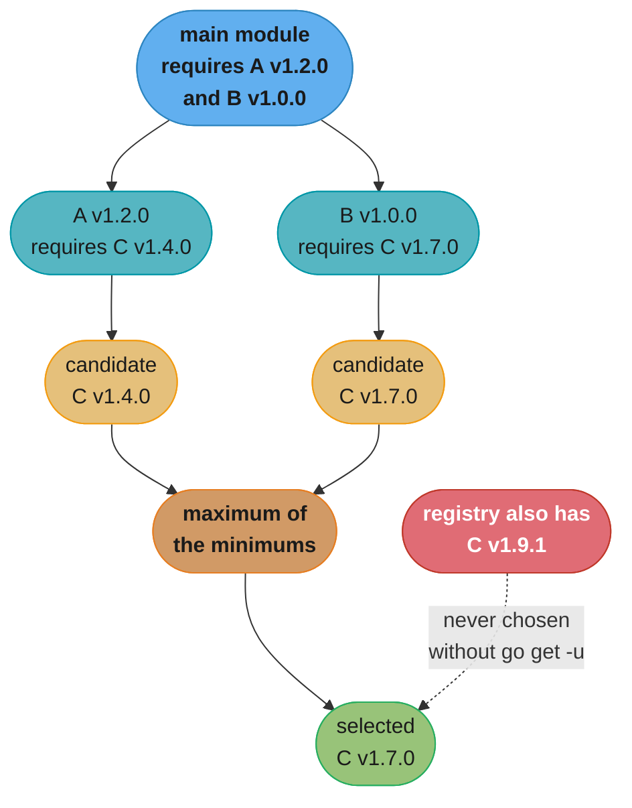
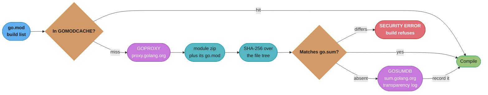
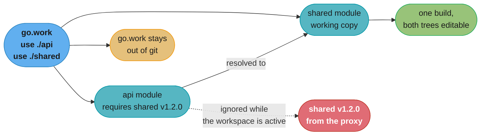

# Packages, Modules and Tooling

## 1. Concept Overview

Go has three units of organization stacked on top of each other, and most confusion
about the build comes from collapsing them.

- A **package** is a directory of `.go` files sharing a namespace. It is the unit of
  **compilation** and the unit of **access control** — an identifier is exported if its
  first letter is upper case, and there is no keyword anywhere in the language that says
  `private`.
- A **module** is a tree of packages with a `go.mod` at its root. It is the unit of
  **versioning** and **dependency**. Its `module` path is the import prefix for every
  package inside it.
- A **workspace** (`go.work`) is a set of modules being developed together. It is the
  unit of **local development**, and it exists so you never again edit a `replace`
  directive to test a change against a sibling repository.

The dependency algorithm sitting under all of it is **minimal version selection** (MVS),
and it is the single most misunderstood thing about Go. Every other mainstream ecosystem
resolves to the *newest* version each constraint allows, which makes the answer a
function of when you ran the command — hence lock files. Go resolves to the *oldest*
version that satisfies every requirement in the graph. The answer is a pure function of
the `go.mod` files, so it is the same today and in three years, and `go.sum` is free to
be what it actually is: a tamper-detection file, not a lock file.

The tooling on top is deliberately one binary. `gofmt` ended formatting arguments in
2009, `go vet` ships with the compiler, `go test` needs no plugin, `go tool` `[1.24]`
pins your code generators to your module, and `go fix` `[1.26]` mechanically upgrades
your source to current idiom.

**Related reading:**
[Python Packaging and Project Tooling](../../python/packaging_and_project_tooling/packaging_and_project_tooling.md)
for the SAT-resolver-plus-lock-file model this was designed against, and
[Build Tools: Maven and Gradle](../../java/build_tools_maven_gradle/build_tools_maven_gradle.md)
for nearest-wins.

---

## 2. Intuition

> **One-line analogy**: MVS is a hiring committee that says "everyone name the *minimum*
> experience you can live with, and we hire the person who clears the highest of those
> bars." Every other resolver says "hire the most experienced candidate available today"
> — and gets a different answer every week.

**Mental model**: `go.mod` is a set of *lower bounds*, never a set of pins. Adding
`require github.com/x/y v1.4.0` does not say "use v1.4.0"; it says "v1.4.0 or later is
needed, and unless something else in the graph demands more, v1.4.0 is what you get."
The build list is the pointwise maximum of every module's lower bound. Nothing upgrades
unless you type `go get`.

**Why it matters**: This is the property that keeps a five-year-old Go service building
on the first try. The same service in a lock-file ecosystem builds only if the lock file
survived, and breaks the moment someone regenerates it. It is also why Go tooling has no
`--frozen`, `--locked` or `--no-update` flag: those flags exist to suppress a resolver
that upgrades by default, and Go's does not.

**Key insight**: Capitalization as access control and MVS as resolution look like two
unrelated design choices, but they come from the same instinct — put the decision in the
source, statically, where a reader can see it, rather than in a tool's runtime behaviour.

---

## 3. Core Principles

- **The package is the compilation unit.** The compiler reads a whole package at once,
  which is why declaration order inside a package does not matter and why a package's
  files cannot disagree about the package name.
- **Exported means capitalized.** `User` is visible outside the package; `user` is not.
  This applies to types, functions, methods, fields, and constants alike.
- **`internal/` is the only structural visibility control.** A package under
  `.../a/b/internal/c` may be imported only by code rooted at `.../a/b`.
- **Import cycles are a compile error**, not a warning and not resolvable by any flag.
- **`go.mod` declares lower bounds; MVS computes the build list.** The selected version
  of a module is the maximum of the minimums required anywhere in the graph.
- **`go.sum` verifies, it does not select.** It records expected hashes; deleting it
  changes no version, it only removes tamper detection.
- **Major version 2 and up lives in the import path.** `example.com/m/v2` is a different
  module from `example.com/m`, and both can be in one build.
- **The `go` directive is a minimum requirement, and the toolchain will satisfy it.**
  If your installed toolchain is older than the `go` line, the go command downloads and
  runs a newer one.
- **`replace` and `exclude` apply only in the main module.** A dependency's `replace` is
  ignored entirely — which is exactly why `go.work` exists.

---

## 4. Types / Architectures / Strategies

### The `go.mod` directives

```go.mod
module github.com/acme/payments

go 1.27

toolchain go1.27.2

require (
    github.com/jackc/pgx/v5 v5.7.2
    google.golang.org/grpc v1.71.0
)

require (
    github.com/jackc/puddle/v2 v2.2.2 // indirect
    golang.org/x/text v0.22.0 // indirect
)

// Only honoured in the MAIN module. Ignored when this module is a dependency.
replace github.com/acme/shared => ../shared

// Refuse one known-bad version; MVS then picks the next satisfying one.
exclude github.com/some/dep v1.4.3

// Tell consumers this module's own v1.3.0 is withdrawn.
retract v1.3.0

// Pin a GODEBUG default for this module's packages.
godebug default=go1.26

// Module-local tools [1.24] — replaces the tools.go blank-import file.
tool golang.org/x/tools/cmd/stringer
```

| Directive | What it does | Applies where |
|-----------|--------------|---------------|
| `module` | Declares the import path prefix for every package in the tree | always |
| `go` | Minimum language and toolchain version; also gates per-version behaviour | always |
| `toolchain` | Names the exact toolchain to run when the local one is older | main module |
| `require` | A lower bound on a dependency's version | always, feeds MVS |
| `exclude` | Removes one version from consideration | main module only |
| `replace` | Redirects a module path or version to another path or local dir | main module only |
| `retract` | Marks *this* module's own published versions as withdrawn | consumers read it |
| `tool` `[1.24]` | Records a module-local executable so `go tool <name>` runs it | main module |

### Version selection strategies compared

| | Go (MVS) | Maven | pip / uv |
|---|---|---|---|
| Picks | maximum of the minimums | nearest declaration to the root | newest satisfying every constraint |
| Search | none — a single graph walk | tree walk, first-wins by depth | backtracking or SAT solving |
| Determinism | total, from the `go.mod` files alone | depends on declaration order | depends on the index at resolve time |
| Lock file | not needed | not used; `dependencyManagement` instead | required for reproducibility |
| Adding a dep | cannot change an unrelated version | can silently downgrade a sibling | can upgrade the whole graph |
| Upgrades | explicit `go get -u` only | explicit version bumps | implicit on re-resolve |

### `GOTOOLCHAIN` modes

| Value | Behaviour |
|-------|-----------|
| `auto` (default) | Download and run a newer toolchain if `go`/`toolchain` demands one |
| `local` | Never download; error out if the local toolchain is too old |
| `go1.27.1` | Always run exactly that toolchain |
| `path` | Use a toolchain found on `PATH` rather than the module cache |
| `go1.26.0+auto` | Use at least 1.26.0, upgrading further if the module demands it |

Set `GOTOOLCHAIN=local` in CI images that must be hermetic and are not permitted to
reach the network mid-build.

---

## 5. Architecture Diagrams

### How MVS picks a version



*C v1.9.1 exists and is compatible with both constraints. Maven's nearest-wins would
pick v1.4.0 or v1.7.0 depending on declaration order; a SAT resolver would pick v1.9.1
today and v1.9.2 tomorrow. MVS picks v1.7.0 forever.*

### Fetch, verify, cache



*`GOPRIVATE` short-circuits both the proxy and the sum database for matching paths, which
is what you set for a corporate repository. Set it once; it supplies the defaults for
`GONOPROXY` and `GONOSUMDB`.*

### What a workspace overlays



*The workspace never edits `go.mod`. That is the whole point: the published module keeps
declaring `shared v1.2.0`, so an accidental commit cannot ship a local path to consumers.*

---

## 6. How It Works — Detailed Mechanics

### Access control has exactly two levels, plus `internal/`

```go
package billing

type Invoice struct {
    ID     string // exported: readable and settable from any package
    total  int64  // unexported: invisible outside package billing
}

func (i *Invoice) Total() int64 { return i.total } // exported accessor
func (i *Invoice) recompute()   { /* ... */ }      // package-private
```

There is no `protected`, no friend declaration, and no per-file visibility. The only
structural control is directory placement:

```
github.com/acme/payments/
├── go.mod                       module github.com/acme/payments
├── cmd/
│   └── payments-api/main.go     package main — the binary
├── internal/
│   ├── ledger/ledger.go         importable ONLY within github.com/acme/payments
│   └── pgstore/pgstore.go       importable ONLY within github.com/acme/payments
└── client/client.go             public API, anyone may import
```

The rule is exact: a package whose path contains an `internal` element is importable
only by packages rooted at `internal`'s **parent** directory. So
`github.com/acme/payments/internal/ledger` is importable from
`github.com/acme/payments/cmd/payments-api` and from `.../client`, and from nowhere
else — not from `github.com/acme/other`, not even from another module in the same
repository if its module path differs. Nesting works too:
`client/internal/retry` is visible only under `client/`.

This is enforced by the `go` command, not the linker. It is a build-time rule with no
runtime component.

### Import cycles and the pressure they create

```go
// package store imports package model — fine.
// package model imports package store — "import cycle not allowed", build fails.
```

There is no flag, no lazy import, and no forward declaration. The three standard
resolutions:

1. **Move the shared type down** into a leaf package that neither imports.
2. **Define the interface at the consumer.** `store` should not import `model` to get a
   `Validator`; it should declare `type Validator interface{ Validate() error }` itself
   and let `model` satisfy it structurally. Go's implicit interface satisfaction exists
   largely to make this work.
3. **Use an external test package.** `package store_test` is compiled separately and may
   import `store` and anything `store` imports, breaking test-only cycles.

The design pressure is real and mostly healthy: it makes a layered architecture the path
of least resistance, because a cycle stops the build the day it is introduced rather
than accumulating for two years the way it does in a language that permits it.

### MVS, worked by hand

```
main    requires  A v1.2.0, B v1.0.0
A v1.2.0 requires C v1.4.0
B v1.0.0 requires C v1.7.0
C v1.9.1 exists in the registry

Rough build list: {A v1.2.0, B v1.0.0, C v1.4.0, C v1.7.0}
Per module, take the maximum: C -> v1.7.0
Final build list: A v1.2.0, B v1.0.0, C v1.7.0
```

Three consequences follow directly:

- **Adding a dependency can only ever raise a version, never lower one.** A new module
  contributes new lower bounds; the maximum operation is monotone. Maven's nearest-wins
  has no such guarantee — inserting a dependency closer to the root silently *downgrades*
  a transitive version.
- **The result does not depend on time.** Re-resolving in 2031 gives C v1.7.0 again,
  because the registry's newer versions were never candidates.
- **Upgrades are typed, not implied.** `go get -u ./...` raises every direct and indirect
  dependency to its latest minor or patch; `go get -u=patch ./...` raises patches only;
  `go get example.com/m@v1.9.1` raises exactly one.

Since Go 1.17 the main module's `go.mod` also lists every **indirect** dependency that
supplies an imported package. That is **module graph pruning**: the go command can build
the list from the main module's own file plus the `go.mod` files of its direct
requirements, without walking the entire transitive graph. It is why `go.mod` files got
longer and `go mod tidy` got dramatically faster. `[1.27]` `go mod tidy` normalizes the
result into exactly two `require` blocks — direct and indirect — for modules declaring
`go 1.27` or later.

### `go.sum` and the checksum database

```
github.com/jackc/pgx/v5 v5.7.2 h1:Xxxxxx...=
github.com/jackc/pgx/v5 v5.7.2/go.mod h1:Yyyyyy...=
```

Two lines per module version: one hash over the module zip's file tree, one over its
`go.mod` alone (the second is needed during graph loading, before the zip is fetched).
The `h1:` prefix names the hash algorithm — SHA-256 over a sorted manifest of file
hashes.

When a version is not yet in `go.sum`, the go command asks `GOSUMDB` (default
`sum.golang.org`), a Merkle-tree **transparency log**. It verifies an inclusion proof
against a cached signed tree head in `$GOMODCACHE/cache/download/sumdb`, so a tampered
answer would require forking the log — which would be detectable by anyone else who has
ever seen a different head. Then it writes the line to `go.sum`.

A **mismatch** is a hard failure with `SECURITY ERROR` in the message, and it means the
bytes you just fetched differ from the bytes recorded for that exact version. There are
exactly three causes, and the order to check them is:

1. **A force-pushed or retagged upstream tag.** By far the most common; the author moved
   `v1.4.0` to a different commit. Verify with the upstream repository, then either pin a
   different version or, if you are certain, delete the two lines and re-add.
2. **A misconfigured proxy or cache** serving a rewritten zip.
3. **An actual supply-chain attack.** Rare, but this is the case the mechanism exists
   for — never "fix" a mismatch with `GOFLAGS=-mod=mod GONOSUMDB=*` and move on.

Never run `go mod tidy` as the fix. It rewrites `go.sum` from what it just downloaded,
which launders the very bytes you were being warned about.

### Private modules

```bash
# One knob. Comma-separated glob patterns, matched against module paths.
export GOPRIVATE='github.com/acme/*,*.corp.example.com'

# It supplies the defaults for these two, which you can also set directly:
#   GONOPROXY  — bypass GOPROXY, fetch straight from the VCS
#   GONOSUMDB  — do not consult the checksum database

# A corporate proxy that serves everything, public and private:
export GOPROXY='https://goproxy.corp.example.com'
export GONOSUMDB='github.com/acme/*'

# Force git over SSH for a private host:
git config --global url."git@github.com:acme/".insteadOf "https://github.com/acme/"
```

`GOPRIVATE` does **not** disable `go.sum` verification — the hashes are still recorded
and checked locally. It only stops the go command from asking a public log about a path
that would leak an internal repository name.

### Build constraints

```go
//go:build linux && (amd64 || arm64) && !purego

package sysinfo
```

The `//go:build` line must appear before the `package` clause with a blank line between
them. File-name suffixes are an independent mechanism that needs no comment at all:

| File name | Built when |
|-----------|-----------|
| `poller_linux.go` | `GOOS=linux` |
| `poller_darwin_arm64.go` | `GOOS=darwin` and `GOARCH=arm64` |
| `poller_test.go` | under `go test` only |
| `_scratch.go` | never — a leading `_` or `.` excludes the file entirely |

The trap is a **stale `// +build` line**. If a file has both forms, `//go:build` wins
and `// +build` is ignored completely — so editing only the old one changes nothing, and
editing only the new one leaves a lie in the file. `gofmt` keeps them in sync when both
are present, and `go vet`'s `buildtag` analyzer reports a mismatch. New files should
carry `//go:build` alone.

### Code generation and module-local tools

```go
//go:generate stringer -type=Status -linecomment

type Status int

const (
    Pending  Status = iota // pending
    Settled                // settled
    Reversed               // reversed
)
```

`go generate ./...` scans for `//go:generate` lines and runs them; `go build` and
`go test` never do. Generated output is committed, so a consumer of your module never
needs the generator installed.

The version of the generator used to matter, badly. Before `[1.24]` the standard hack
was a `tools.go` file with a `//go:build tools` constraint and blank imports, purely to
keep the generator in `go.mod`, plus a `go install` step in a Makefile that installed
whatever version happened to be latest. `[1.24]` replaced all of it:

```bash
# Records: tool golang.org/x/tools/cmd/stringer  in go.mod
go get -tool golang.org/x/tools/cmd/stringer

# Builds and runs it at the version MVS selected for THIS module.
go tool stringer -type=Status

# List every tool this module declares.
go tool
```

Every developer and every CI runner now gets the same generator version with no install
step, because the tool is an ordinary module requirement.

### `go fix` as the modernizer `[1.26]`

```bash
# Rewrite this module's source to current idiom, in place.
go fix ./...

# Preview without writing.
go fix -diff ./...
```

`[1.26]` rebuilt `go fix` on the `go vet` analysis framework and made it the home of
**modernizers** — mechanical rewrites such as replacing an index loop with `for range`,
`interface{}` with `any`, or a manual min/max with the builtins. `[1.27]` adds
`atomictypes`, `embedlit`, `slicesbackward` and `unsafefuncs`, removes `fmtappendf`, and
renames `waitgroup` to `waitgroupgo`.

It also does **source-level inlining** driven by a directive you write yourself:

```go
//go:fix inline
func OldName(v int) int { return NewName(v) }
```

Run `go fix ./...` in a consumer and every `OldName(x)` call becomes `NewName(x)`. That
turns an API rename into something you ship as a one-line directive rather than a
migration guide nobody reads.

### The rest of the tool surface

```bash
gofmt -l -w ./              # format; -l lists files that changed
go vet ./...                # correctness analyzers shipped with the toolchain
go test ./...               # also runs a subset of vet, incl. stdversion [1.27]
staticcheck ./...           # deeper static analysis than vet
golangci-lint run           # aggregator: vet + staticcheck + ~100 more
govulncheck ./...           # CVEs, filtered by reachability
go doc net/http.Server      # docs for one symbol
go doc golang.org/x/text@v0.22.0  # docs for a specific version [1.27]
go doc -ex net/http.Get     # include executable examples [1.27]
go mod tidy                 # add missing requirements, drop unused ones
go mod graph                # print the full module requirement graph
go mod why -m golang.org/x/text   # explain why a module is in the build
go mod vendor               # materialize dependencies into ./vendor
go list -m -u all           # show available upgrades without applying them
```

`govulncheck` is the one worth singling out. A generic CVE scanner reports every advisory
affecting any version in your dependency tree, which on a real service is dozens of
findings a quarter, most of them irrelevant. `govulncheck` builds the call graph and
reports only vulnerabilities whose affected *functions* your code can actually reach,
which typically cuts the list by an order of magnitude and makes it something a team
will act on rather than mute.

`go doc`'s versioned form `[1.27]` is the quiet convenience: you can read the docs for
the version MVS actually selected instead of whatever is currently on the website.

### `golangci-lint` v2 configuration

`golangci-lint` v2.0.0 (2025-03-24) changed the config file format. The v2 binary refuses any
config file that does not declare `version: "2"`, failing with `unsupported version of the
configuration: ""` and a pointer to the migration guide, so a CI job that bumps the binary
without the file goes red on its first run.

The shape that replaced v1's, as a starting point for a service:

```yaml
# .golangci.yml
version: "2"

linters:
  default: standard        # errcheck, govet, ineffassign, staticcheck, unused
  enable:
    - bodyclose
    - errorlint
    - gosec
    - noctx
    - revive
    - sloglint
  settings:
    govet:
      enable: [shadow]
    errcheck:
      exclude-functions:
        - io.Copy(*bytes.Buffer)
  exclusions:
    generated: strict      # only files with the standard "Code generated ... DO NOT EDIT." line
    presets: [std-error-handling]
    rules:
      - path: _test\.go
        linters: [gosec, errcheck]

formatters:
  enable: [gofumpt, goimports]
  settings:
    goimports:
      local-prefixes: [github.com/acme/payments]
```

| v1 key | v2 equivalent |
|--------|---------------|
| `linters.disable-all: true` / `enable-all: true` | `linters.default: none` / `all` (also `standard`, `fast`) |
| `gofmt`, `gofumpt`, `goimports`, `gci` under `linters.enable` | `formatters.enable`; applied with `golangci-lint fmt` |
| `gosimple`, `stylecheck`, `staticcheck` | One linter, `staticcheck` |
| `linters-settings:` | `linters.settings:` and `formatters.settings:` |
| `issues.exclude-rules`, `issues.exclude` | `linters.exclusions.rules` |
| `issues.exclude-use-default: true` | `linters.exclusions.presets` (`comments`, `common-false-positives`, `legacy`, `std-error-handling`) |
| `issues.exclude-dirs`, `exclude-files` | `linters.exclusions.paths` and `formatters.exclusions.paths` |
| `run.timeout` (v1 default `1m`) | Still exists, but defaults to `0` (disabled); `migrate` drops the old value |
| `--fast`, `--out-format`, `-p/--presets` | `--fast-only`, `--output.<format>.path`, explicit `enable` lists |

`golangci-lint migrate` rewrites a v1 file in place and keeps a `.bck` copy. It drops comments
and any option deprecated in v1, and it pins `linters.exclusions.generated: lax` because v1
defaulted to `lax` and v2 defaults to `strict`. Install the binary at a pinned version
(`golangci/golangci-lint-action@v9` with `version: v2.15`, or the release tarball): the project
does not guarantee `go install` or `go tool` builds, because they compile with your local Go
version and module resolution can pull its dependencies to versions it was never tested with.

---

## 7. Real-World Examples

- **Kubernetes** publishes about 30 `k8s.io/*` modules with lockstep versions and uses
  `replace` directives across the staging repositories. It is the standard example of
  what a monorepo of modules costs — and of why `go.work` was added.
- **The `golang.org/x/*` repositories** are the reference for what a well-behaved
  low-level module looks like: no `v2`, no `replace`, careful `retract` lines when a tag
  goes bad.
- **`github.com/jackc/pgx/v5`** is the canonical `/v2`-style path in the wild. Its v4 and
  v5 lines coexist in many builds because semantic import versioning makes them different
  modules rather than a conflict.
- **Athens and JFrog Artifactory** are the two common self-hosted `GOPROXY`
  implementations. Both exist mainly so a build survives an upstream repository being
  deleted — the proxy keeps a copy of every version it has ever served.
- **`sum.golang.org`** is the transparency log; `index.golang.org` is the public feed of
  every module version it has seen, which is what vulnerability databases consume.
- **HashiCorp Terraform** vendors nothing and pins everything through MVS, while many
  Linux distributions repackage Go programs *with* `vendor/` because their build
  environments are network-isolated. Both are correct for their constraints.

---

## 8. Tradeoffs

### Module cache vs vendoring

| | Module cache (default) | `vendor/` committed |
|---|---|---|
| Repository size | small | grows by the full source of every dependency |
| Build without network | after the first fetch, yes | always, from a clean checkout |
| Upstream deletion | survivable via a proxy | immune |
| Diff noise on upgrade | two lines in `go.mod` | thousands of lines |
| Auditing what ships | `go mod download` then read the cache | every byte is in the diff |
| CI cache config | must cache `GOMODCACHE` explicitly | nothing to configure |
| Verification | `go.sum` on every build | `vendor/modules.txt` consistency check |

Vendoring is right for air-gapped builds, for distribution packaging, and for
regulated environments where "show me exactly what shipped" is an audit question. It is
wrong as a default: the diff noise trains reviewers to skip dependency changes, which is
precisely the review you most want them to do.

### `replace` vs `go.work`

| | `replace` in `go.mod` | `go.work` |
|---|---|---|
| Scope | the file everyone commits | a local, gitignored file |
| Risk of shipping | high — a committed local path breaks every consumer | zero — never published |
| Works for a dependency's own `replace` | no, silently ignored | not applicable |
| Multiple modules at once | one line per module, hand-maintained | `go work use ./...` |
| Correct use today | pinning a fork or a security patch for consumers | all local multi-module development |

### Where Go's resolver sits

MVS buys reproducibility and gives up currency. You will run an older transitive
dependency than a `pip`- or `npm`-based project would, sometimes for years, because
nothing raises it until a human does. That is a deliberate trade: silent upgrades are
the mechanism behind both the "works on my machine" class of bug and the entire
dependency-confusion attack family. Go's answer is that upgrading is a change you make
on purpose, review, and commit — with `govulncheck` in CI as the thing that tells you
*when* to make it.

---

## 9. When to Use / When NOT to Use

**Use a separate module when:**

- The code is published for others to import on its own version line.
- Two parts of a repository genuinely need independent version cadences.
- A tool or example needs a heavy dependency you do not want in the main module's graph.

**Do NOT split into a separate module when:**

- The parts always release together. Two modules in lockstep is pure overhead — a
  version bump, a tag, and a `require` edit for every change.
- You only wanted a namespace. Use a package directory; that is what packages are for.
- You are avoiding an import cycle. Splitting modules does not break a cycle; only
  restructuring the dependency direction does.

**Use `internal/` when:**

- A package is an implementation detail that must never become part of your API. Put it
  in `internal/` on day one — moving it there later is a breaking change for anyone who
  already imported it.

**Use vendoring when:**

- Builds run air-gapped, a regulator asks what shipped, or a distribution packages your
  binary. Otherwise rely on `GOMODCACHE` plus a proxy.

**Use `go.work` when:**

- You are editing two or more modules at once. Never use a committed `replace` for this.

**Do NOT create a `pkg/` directory** just because a repository template has one. See §10.

---

## 10. Common Pitfalls

### Pitfall 1 — publishing v2 without the `/v2` path

A team tagged `v2.0.0` on a widely used internal SDK after a breaking API change and
told consumers to run `go get -u`. Nothing happened: MVS kept selecting v1.9.4, because
`v2.0.0` on a module path with no `/v2` suffix is not a candidate for that path at all.
Three teams then pinned `v2.0.0+incompatible`, which the go command allows only for
repositories without a `go.mod` at the v2 tag, and the resulting build had two copies of
the same types that would not interconvert. The incident consumed nine engineer-days
across four teams.

```go.mod
// BROKEN: the module path stayed at v1 while the tag went to v2.
module github.com/acme/sdk

go 1.27
```

```go.mod
// FIX: major version 2 and up belongs in the module path, and in every
// import path consumers write.
module github.com/acme/sdk/v2

go 1.27
```

**Rule:** bumping to v2 means editing the `module` line, every internal import within the
module, and every consumer's imports. If that sounds expensive, that is the point — Go
prices a breaking change honestly.

### Pitfall 2 — a `replace` directive shipped to consumers

A shared library was published with `replace github.com/acme/shared => ../shared` still
in its `go.mod`. Consumers were unaffected — a dependency's `replace` is ignored — so
nobody noticed for four months. The damage landed on the library's own CI, which had
been building against a stale local checkout the whole time and had never once compiled
against the published `shared` module. When the directive was finally removed, 23 tests
failed against an API that had drifted for a third of a year.

**Rule:** `replace` in a committed `go.mod` is for exactly one thing — pinning a fork or
a security patch that consumers must also get. For local development use `go.work`, and
add `go.work` and `go.work.sum` to `.gitignore`.

### Pitfall 3 — "fixing" a checksum mismatch with `go mod tidy`

A `SECURITY ERROR: checksum mismatch` on a transitive dependency reached a team during a
release. The on-call engineer deleted `go.sum` and ran `go mod tidy`, the build went
green, and the release shipped. The cause was an upstream maintainer force-pushing a tag
— benign that time. But the workflow is identical for a real compromise: regenerating
`go.sum` re-records whatever bytes were just served, which is exactly what an attacker
needs.

**Rule:** a mismatch is an incident, not a build failure. Diff the module cache copy
against the upstream tag, confirm with the maintainer, then delete only the two affected
lines. `GONOSUMDB` is never the answer to a mismatch — it disables the check that just
worked.

### Pitfall 4 — the stale `// +build` line

```go
// BROKEN: someone edited the modern line and left the legacy one behind.
//go:build linux && amd64
// +build linux

package sysinfo
```

```go
// FIX: one constraint, the modern form only.
//go:build linux && amd64

package sysinfo
```

The broken file builds *correctly* — `//go:build` wins and `// +build` is ignored — which
is what makes it dangerous. A reader auditing platform coverage reads the stale line and
concludes the file is built on `linux/arm64`. One team spent a full day debugging a
missing symbol on arm64 because of exactly this. `go vet`'s `buildtag` analyzer catches
the mismatch; run it in CI.

### Pitfall 5 — `internal/` at the wrong depth

Placing `internal/` at the repository root when the module path is a subdirectory, or
expecting `internal/` to hide code from *another module in the same repository*, both
fail silently in the sense that the compiler gives an unexpected error rather than the
intended encapsulation. The rule is purely about the import path: `.../a/b/internal/c`
is importable from anything under `.../a/b`, and a second module with a different module
path is not under it, no matter where its files sit on disk.

### Pitfall 6 — an unpinned generator producing a diff on every machine

Before `[1.24]`, `stringer` was installed by a Makefile line reading
`go install golang.org/x/tools/cmd/stringer@latest`. Two developers on different weeks
generated different output for the same enum, producing a 400-line diff with no
semantic change, twice. The fix is `go get -tool` plus `go tool stringer`, which pins
the generator to a version selected by MVS like any other dependency.

### Pitfall 7 — `pkg/` cargo-culted from a template repository

`cmd/` and `internal/` are load-bearing: `cmd/<name>/main.go` is where a `package main`
lives so `go install ./cmd/...` builds every binary, and `internal/` is enforced by the
compiler. `pkg/` is neither. It comes from a community layout repository that is not
maintained by the Go team, it adds one path element to every import for no enforcement,
and the standard library itself removed its own `src/pkg/` directory in Go 1.4. Put
public packages at the module root, where their import path reads
`github.com/acme/payments/client` rather than `github.com/acme/payments/pkg/client`.

### Pitfall 8: a floating `golangci-lint` version meeting a v1 config

A CI job installed `golangci-lint` with `version: latest`. The morning v2 became latest, every
pull request in 14 repositories failed with `unsupported version of the configuration`, and
the quick fix people reached for was deleting the lint step. The first attempted repair added
`version: "2"` by hand and left `linters-settings` and `issues.exclude-rules` in place; v2
ignored those as unknown keys, so the test-file exclusions silently stopped applying, and with
`exclusions.generated` now defaulting to `strict`, 300 `errcheck` findings in generated code
came back.

```yaml
# BROKEN: v1 keys under a v2 header; the exclusions no longer apply
version: "2"
linters-settings:
  govet: {enable: [shadow]}
issues:
  exclude-rules:
    - path: _test\.go
      linters: [errcheck]
```

```yaml
# FIX: produced by `golangci-lint migrate`, then pinned
version: "2"
linters:
  settings:
    govet: {enable: [shadow]}
  exclusions:
    generated: lax
    rules:
      - path: _test\.go
        linters: [errcheck]
```

Run `golangci-lint migrate` rather than editing by hand, add `golangci-lint config verify`
to CI (it checks the file against the v2 JSON schema, which the loader does not), pin the
binary to a minor version, and bump it in its own pull request.

---

## 11. Technologies & Tools

| Tool | Purpose |
|------|---------|
| `gofmt` | Canonical formatting; `-l` lists unformatted files, `-w` rewrites, `-d` diffs |
| `goimports` | `gofmt` plus automatic import add/remove and grouping |
| `go vet` | Correctness analyzers shipped with the toolchain; a subset also runs under `go test` |
| `staticcheck` | Deeper analysis than vet — unused code, dubious conversions, API misuse |
| `golangci-lint` v2 | Runs vet, staticcheck, errcheck, revive and roughly 100 more from one `version: "2"` config; `fmt` applies the formatters, `migrate` converts a v1 file |
| `govulncheck` | Reports only vulnerabilities whose affected functions your code can reach |
| `go fix` `[1.26]` | Modernizers plus `//go:fix inline` source-level inlining |
| `go tool` `[1.24]` | Builds and runs module-local tools recorded by `tool` directives |
| `go work` | `init`, `use`, `sync`, `edit` for multi-module development |
| `go mod` | `tidy`, `graph`, `why`, `vendor`, `download`, `verify`, `edit` |
| `go doc` | Symbol docs; `package@version` and `-ex` for examples `[1.27]` |
| Athens | Self-hosted `GOPROXY`; caches every version it serves |
| JFrog Artifactory | Commercial `GOPROXY` with policy and license scanning |
| `goreleaser` | Cross-compiles the `GOOS`/`GOARCH` matrix and publishes releases |
| `syft` / `cyclonedx-gomod` | SBOM generation from the module graph |
| Renovate / Dependabot | Automated `go get` pull requests, since MVS never upgrades on its own |

---

## 12. Interview Questions with Answers

**Q: Why does a Go module at v2 or above need `/v2` in its import path?**
**Short:** The import compatibility rule requires different major versions to be different modules, so the major version must appear in the path.

Because Go's import compatibility rule says that if an old and a new package share an
import path, the new one must be backward compatible. A major version bump is by
definition not backward compatible, so v2 must live at a different path —
`example.com/m/v2`. This is what lets one build contain both v1 and v2 of the same
library, which is essential when two of your dependencies disagree. If you tag `v2.0.0`
without changing the `module` line, MVS simply never considers it and consumers keep
getting the latest v1 with no error message at all. The only exception is
`+incompatible`, allowed for pre-modules repositories that tagged v2 before having a
`go.mod`.

**Q: Is `go.sum` a lock file?**
**Short:** No — it records expected hashes for tamper detection, while the versions themselves are decided by minimal version selection over the `go.mod` files.

No. A lock file pins versions; `go.sum` pins *bytes*. Deleting `go.sum` changes not one
selected version — it only removes the ability to detect that a module's contents
changed under a tag you already used. Version selection is done entirely by MVS from the
`go.mod` files in the graph, and because MVS takes the maximum of the declared minimums
rather than the newest available, that computation is already deterministic across time.
That is precisely why Go needs no lock file: the property other ecosystems buy with one
falls out of the resolution algorithm.

**Q: What does a `SECURITY ERROR: checksum mismatch` actually mean, and what should you do?**
**Short:** The bytes fetched for that exact version differ from the hash already recorded, which means a retagged upstream, a bad proxy, or tampering.

It means the module zip you just downloaded hashes differently from the value recorded in
`go.sum` or in the checksum database for that same version string. Three causes, in
descending likelihood: an upstream maintainer force-pushed or moved a tag; a proxy or
cache served a rewritten artifact; or the module was actually tampered with. Investigate
by comparing the cached copy against the upstream repository at that tag and asking the
maintainer. The one thing never to do is delete `go.sum` and run `go mod tidy` — that
re-records whatever bytes were just served, laundering exactly the change you were being
warned about.

**Q: Why does a v1 .golangci.yml fail on golangci-lint v2, and how do you migrate it?**
**Short:** v2 requires `version: "2"` and moved keys such as linters-settings and issues.exclude-rules; `golangci-lint migrate` rewrites the file and keeps a backup.

The v2 loader rejects any config file whose `version` is not `"2"`, failing with
`unsupported version of the configuration`. Adding the line by hand is the trap: v1 keys like
`linters-settings`, `issues.exclude-rules` and `issues.exclude-dirs` are then ignored, so
exclusions stop applying without an error. `golangci-lint migrate` maps them to
`linters.settings`, `linters.exclusions.rules` and `linters.exclusions.paths`, converts
`disable-all`/`enable-all` to `linters.default: none`/`all`, merges `gosimple` and
`stylecheck` into `staticcheck`, writes `<name>.bck.<ext>` first, and pins
`exclusions.generated: lax` because the default moved from `lax` to `strict`. It drops
comments and options already deprecated in v1, so review the diff and pin the binary version.

**Q: What exactly does the `internal/` directory forbid?**
**Short:** A package under an `internal` element may be imported only by code rooted at that `internal` directory's parent.

A package whose import path contains an `internal` path element can be imported only by
packages rooted at `internal`'s parent directory. So
`github.com/acme/payments/internal/ledger` is importable from anything under
`github.com/acme/payments` and from nothing else — not from another module, and not from
another module in the same repository if its module path differs. Nesting works at any
depth: `client/internal/retry` is visible only under `client/`. The rule is enforced by
the go command at build time, has no runtime component, and is the only structural
visibility control in the language beyond identifier capitalization.

**Q: How does minimal version selection differ from Maven's nearest-wins and from pip's resolver?**
**Short:** MVS selects the highest of the declared minimums, Maven picks whichever declaration sits nearest the root, and pip and uv search for the newest version satisfying every constraint.

MVS builds the requirement graph and, for each module, selects the maximum of every
minimum version required anywhere in it — no search, no backtracking, one walk. Maven
walks the tree and takes the version whose declaration is nearest the root, breaking ties
by declaration order, so inserting a dependency can silently downgrade a transitive one.
pip and uv run a backtracking or SAT-style search for the *newest* versions satisfying
all constraints, so the answer depends on what the index contains at resolve time — which
is why those ecosystems need lock files. The practical difference: a Go build in 2031
resolves to the same versions as today from the same files, and adding a dependency can
raise a version but never lower one.

**Q: Why does `go get -u` have to be typed explicitly?**
**Short:** Nothing in Go's resolution ever raises a version on its own, so upgrading is a deliberate edit to `go.mod` that you review and commit.

Because MVS never upgrades anything by itself. The build list is a function of the
declared minimums, so a version changes only when a `go.mod` changes. `go get -u ./...`
raises direct and indirect dependencies to their latest minor or patch;
`go get -u=patch ./...` restricts that to patch releases; `go get example.com/m@v1.9.1`
raises exactly one. The design treats an upgrade as a source change that lands in a diff
and gets reviewed. The obligation this creates is that something must tell you *when* to
upgrade, which is what `govulncheck` in CI and a Renovate or Dependabot bot are for.

**Q: What is the difference between the `go` directive, the `toolchain` directive, and `GOTOOLCHAIN`?**
**Short:** The `go` line states the minimum version the module needs, `toolchain` names which one to run, and `GOTOOLCHAIN` decides whether the command may download it.

The `go` directive states the minimum language and toolchain version the module requires,
and it also gates version-sensitive behaviour such as loop-variable semantics. The
`toolchain` directive names the specific toolchain to run when the locally installed one
is older. `GOTOOLCHAIN` is the environment variable that decides policy: `auto`, the
default, downloads and runs a newer toolchain when the module demands one; `local` never
downloads and errors instead; a literal such as `go1.27.1` forces one exactly; `path`
looks on `PATH`. Set `GOTOOLCHAIN=local` in hermetic CI images that must not reach the
network mid-build, and pin the toolchain in the image instead.

**Q: What happens when you introduce an import cycle, and how do you break one?**
**Short:** It is a hard compile error with no override, and the fixes are moving the shared type down, declaring the interface at the consumer, or using an external test package.

The build fails with "import cycle not allowed". There is no flag, no lazy import, and no
forward declaration — the package is the compilation unit, so a cycle is genuinely
unresolvable. Three standard fixes: move the shared type into a leaf package neither side
imports; declare the interface at the *consumer* and let the other package satisfy it
structurally, which is a large part of why Go interfaces are implicit; or, for test-only
cycles, use an external `package foo_test`, which compiles separately and may import
anything. The design pressure is intentional: layering becomes the path of least
resistance because a cycle stops the build the day it appears.

**Q: Which environment variable do you set for private modules, and what does it actually change?**
**Short:** Set `GOPRIVATE` to glob patterns of your internal module paths; it supplies the defaults for bypassing the proxy and the checksum database.

Set `GOPRIVATE` to a comma-separated list of glob patterns matching your internal module
paths, such as `github.com/acme/*,*.corp.example.com`. It supplies the defaults for two
finer-grained variables: `GONOPROXY`, which makes matching paths fetch straight from
version control instead of `GOPROXY`, and `GONOSUMDB`, which stops the go command
consulting the public checksum log for them. It does **not** disable `go.sum` — hashes
are still recorded and verified locally. The reason it exists is leakage: asking
`sum.golang.org` about `github.com/acme/secret-project` publishes the fact that the
repository exists.

**Q: When is vendoring still the right choice?**
**Short:** Vendor when the build must run air-gapped, when an auditor needs every shipped byte in the diff, or when a distribution packages your binary.

Vendor when the build environment has no network and no proxy — air-gapped or regulated
CI, distribution packaging, or an archived release that must build from a single tarball
years later. `go mod vendor` writes `vendor/` plus `vendor/modules.txt`, and the go
command uses it automatically when the directory exists. The cost is real: the repository
grows by the full source of every dependency, and a routine upgrade produces a
several-thousand-line diff that trains reviewers to skip exactly the change they should
scrutinize most. For everything else, a cached `GOMODCACHE` plus a `GOPROXY` such as
Athens gives the same offline resilience without the diff noise.

**Q: What is `go.work` for, and should it be committed?**
**Short:** A workspace lets you build and test several local modules together without editing any `go.mod`, and it is normally gitignored.

`go.work` lists local module directories with `use` lines, and while it is active the go
command resolves imports between them to the working copies instead of published
versions. `go work init ./api ./shared` creates it; `go work use ./newmod` adds one. It
replaced the old dance of adding a `replace` directive during development and remembering
to strip it before commit — a step people forgot, shipping local paths to consumers.
Because it describes one developer's checkout layout, `go.work` and `go.work.sum` are
normally gitignored. The exception is a monorepo where every developer has the identical
layout, in which case committing it removes a setup step.

**Q: A file has both a `//go:build` line and a `// +build` line that disagree. Which wins?**
**Short:** The `//go:build` line wins and the legacy comment is ignored entirely, which is what makes a stale one dangerous rather than merely untidy.

`//go:build` wins; `// +build` is ignored completely when both are present. That is what
makes a stale legacy line worse than a compile error would be — the file builds exactly
as the modern line says, while a reader auditing platform coverage reads the wrong
constraint and draws a wrong conclusion. `gofmt` synchronizes the two when it sees both,
and `go vet`'s `buildtag` analyzer reports a mismatch, so running vet in CI catches it.
New files should carry `//go:build` alone, remembering that it must sit before the
`package` clause with a blank line between them.

**Q: When does `go generate` run, and what should be committed?**
**Short:** It runs only when you invoke it explicitly, never during build or test, and its output is committed so consumers need no generator.

`go generate ./...` scans source files for `//go:generate` directives and runs each
command; `go build` and `go test` never trigger it. That is deliberate — a build must not
execute arbitrary commands from a downloaded module. The generated output is committed to
the repository, so anyone importing your module compiles ordinary Go with no tools
installed. Directives receive `$GOFILE`, `$GOPACKAGE` and `$GOLINE` in the environment.
The standard failure mode is an unpinned generator producing different output on
different machines, which `go tool` `[1.24]` fixes by making the generator a versioned
module dependency.

**Q: What did `go tool` change about managing code generators?**
**Short:** Go 1.24 added a `tool` directive so a generator is a versioned module dependency, replacing the `tools.go` blank-import file and a separate install step.

`[1.24]` added the `tool` directive to `go.mod`. `go get -tool golang.org/x/tools/cmd/stringer`
records the tool, `go tool stringer` builds and runs it at the version MVS selected, and
`go tool` with no arguments lists what the module declares. Before this, the convention
was a `tools.go` file guarded by `//go:build tools` containing blank imports whose only
purpose was to keep the generators in the dependency graph, plus a Makefile running
`go install ...@latest` — which gave different developers different generator versions
and produced spurious diffs. The new mechanism gives every developer and every CI runner
the same tool version with no install step at all.

**Q: What does `go fix` do now, and what is `//go:fix inline`?**
**Short:** Go 1.26 rebuilt `go fix` as the home of modernizers that mechanically rewrite source to current idiom, including inlining functions you mark with a directive.

`[1.26]` rebuilt `go fix` on the `go vet` analysis framework and made it the home of
**modernizers** — mechanical rewrites such as an index loop to `for range`, `interface{}`
to `any`, or a hand-rolled minimum to the `min` builtin. Run `go fix ./...` to apply them
or `go fix -diff ./...` to preview. `[1.27]` adds the `atomictypes`, `embedlit`,
`slicesbackward` and `unsafefuncs` modernizers, removes `fmtappendf`, and renames
`waitgroup` to `waitgroupgo`. Separately, marking your own function with `//go:fix inline`
makes `go fix` rewrite callers to the function's body, so an API rename ships as a
one-line directive that consumers apply mechanically instead of a migration guide.

**Q: What does `govulncheck` do that a generic CVE scanner does not?**
**Short:** It builds the call graph and reports only vulnerabilities in functions your code can actually reach, rather than every advisory touching your dependency tree.

`govulncheck` performs reachability analysis. A generic dependency scanner matches
advisories against the versions in your module graph and reports everything, which on a
real service is dozens of findings per quarter, most of them in code paths you never
call. `govulncheck` builds the call graph from your entry points and reports only
vulnerabilities whose affected *symbols* are reachable, typically an order of magnitude
fewer. That difference decides whether a team acts on the output or mutes it. Run it in
CI on every pull request, and pair it with a bot that opens upgrade pull requests, since
MVS will never raise a version on its own.

**Q: What is module graph pruning and why did `go.mod` files get longer?**
**Short:** Since Go 1.17 the main module lists every indirect dependency supplying an imported package, so the go command need not walk the whole transitive graph.

Since Go 1.17, a module declaring `go 1.17` or later records in its own `go.mod` every
module — direct and indirect — that supplies a package it transitively imports, with
indirect ones marked `// indirect`. That lets the go command compute the build list from
the main module's file plus the `go.mod` files of its direct requirements alone, instead
of loading the entire transitive graph. The visible costs are longer `go.mod` files and
the need to run `go mod tidy` after changing imports; the benefit is dramatically faster
loading on a large graph. `[1.27]` `go mod tidy` normalizes the result into exactly two
`require` blocks, direct and indirect, for modules on `go 1.27` or later.

**Q: What do `replace` and `exclude` do, and why do they not apply transitively?**
**Short:** Both are honoured only in the main module — a dependency's directives are ignored, so a library can never redirect a consumer's build.

`replace` redirects a module path or a specific version to another path, another version,
or a local directory; `exclude` removes one version from MVS's candidate set so the next
satisfying version is chosen. Both are honoured **only** in the main module. A
dependency's `replace` is ignored entirely, which is why a library that ships one to its
consumers silently breaks nothing for them while quietly meaning its own CI never built
against the real dependency. The restriction exists so a transitive dependency cannot
hijack your build by redirecting a module path. For local multi-module development use
`go.work`; keep `replace` for pinning a fork or a security patch that consumers must
also receive.

**Q: What does `go test` check by default in Go 1.27 that it did not before?**
**Short:** It runs the `stdversion` vet analyzer, which flags use of standard library symbols newer than the version your `go.mod` declares.

`[1.27]` added the `stdversion` analyzer to the vet subset that `go test` runs
automatically. It reports references to standard library symbols introduced after the Go
version your module's `go` directive declares — code that compiles on your machine
because your toolchain is new, then fails for anyone building with the older toolchain
your `go.mod` claims to support. That class of bug previously surfaced only in a
consumer's CI. If it fires, either raise the `go` directive or stop using the newer
symbol; suppressing the analyzer defeats the compatibility claim your `go.mod` is making.

**Q: Why is `pkg/` a contested directory while `cmd/` and `internal/` are not?**
**Short:** `cmd/` and `internal/` are meaningful to the go command, while `pkg/` is a community convention that adds a path element and enforces nothing.

`cmd/` is a convention with real leverage: putting each `package main` at
`cmd/<name>/main.go` makes `go build ./cmd/...` build every binary, and the directory
name becomes the binary name. `internal/` is enforced by the go command itself.
`pkg/` is neither — it originates in a community layout repository that the Go team does
not maintain, it adds one element to every import path, and it enforces no visibility.
The standard library removed its own `src/pkg/` directory back in Go 1.4. Put public
packages at the module root so the import path reads
`github.com/acme/payments/client` rather than `.../pkg/client`, and reach for `internal/`
whenever the question is really "should anyone outside import this?"

**Q: In golangci-lint v2, what runs with no linters configured, and where did gofmt and goimports go?**
**Short:** `linters.default: standard` runs errcheck, govet, ineffassign, staticcheck and unused; gofmt, gofumpt, goimports and gci moved to a separate formatters section.

v2 splits checkers that report problems from tools that rewrite layout. `formatters.enable`
lists `gofmt`, `gofumpt`, `goimports`, `gci` or `golines`; `golangci-lint run` reports files
they would change and `golangci-lint fmt` rewrites them, which gives editors and pre-commit
hooks one formatter entry point. `linters.default` picks the base set: `standard` (the five
above), `all`, `none` or `fast`, with `enable` and `disable` adjusting it. Exclusions moved
under `linters.exclusions` with named presets (`comments`, `common-false-positives`,
`legacy`, `std-error-handling`) instead of v1's numbered `EXC0001`-style defaults, and
`exclusions.generated: strict` only skips files carrying the standard
`// Code generated ... DO NOT EDIT.` header.

---

## 13. Best Practices

- **Put implementation packages in `internal/` on day one.** Moving a package there later
  is a breaking change for anyone who already imported it.
- **Name the package for what it provides, not what it contains.** `ledger`, not
  `ledgerutil`; never `util`, `common`, `base` or `helpers` — those names are how a
  package becomes a dumping ground and then a cycle.
- **Let the consumer declare the interface.** It breaks cycles, keeps the producer free
  of a dependency it does not need, and keeps interfaces small.
- **Run `go mod tidy` in CI and fail on a dirty tree.** A `go.mod` that drifts from the
  imports is how a build starts depending on the module cache's contents.
- **Commit `go.sum`; gitignore `go.work` and `go.work.sum`.** The first is a security
  control everyone shares, the second describes one developer's checkout.
- **Set `GOTOOLCHAIN=local` in CI** and pin the toolchain in the image, so no build
  silently downloads a compiler.
- **Run `go vet`, `staticcheck` and `govulncheck` on every pull request**, and let
  `golangci-lint` be the single entry point so the config lives in one file. Pin its
  binary to a minor version (it is the one tool not to install with `go get -tool`).
- **Use `go get -tool` for every generator**, and commit the generated output.
- **Run `go fix ./...` `[1.26]` before a major refactor**, so the modernizers land in
  their own reviewable commit instead of mixed into the change you actually care about.
- **Never bypass a checksum error.** Treat it as an incident with a written cause.
- **Prefer no `pkg/` directory.** Root-level public packages, `internal/` for everything
  else, `cmd/<name>/` for binaries.

---

## 14. Case Study

### Splitting a 180-package monolith into two modules without breaking anyone

A payments platform had one module, `github.com/acme/payments`, containing 180 packages:
the API server, a batch settlement worker, and a client SDK that eleven other services
imported. The SDK could not be released independently, so every SDK fix waited for the
platform's two-week release train, and consumers pulled the entire server dependency
graph — 140 modules including three database drivers — to call four HTTP endpoints.

**Step 1 — measure what the SDK actually needs.**

```bash
# What does the SDK package pull in?
go list -deps ./client | grep -v '^github.com/acme/payments' | wc -l   # 140

# And why is the postgres driver in there at all?
go mod why -m github.com/jackc/pgx/v5
# github.com/acme/payments/client
# github.com/acme/payments/internal/model
# github.com/acme/payments/internal/pgstore
# github.com/jackc/pgx/v5
```

The SDK imported `internal/model` for two request structs, and `internal/model` imported
`internal/pgstore` for a single scan helper. One helper function was dragging a database
driver into eleven consumers.

**Step 2 — the broken first attempt.**

The team created the new module and wired it up locally with a `replace`:

```go.mod
// BROKEN: committed to github.com/acme/payments-sdk/go.mod and released.
module github.com/acme/payments-sdk

go 1.27

require github.com/acme/payments v1.44.0

replace github.com/acme/payments => ../payments
```

Consumers saw nothing wrong — a dependency's `replace` is ignored — so the tag looked
healthy. But the SDK's own CI resolved `github.com/acme/payments` to the local checkout
for six weeks, and never once compiled against the published module. When a field was
renamed on the platform side, the SDK's tests stayed green and the break surfaced in a
consumer's production deploy.

```
// FIX: delete the replace, and use a workspace for local development.
$ go work init ./payments ./payments-sdk
$ cat go.work
go 1.27

use (
    ./payments
    ./payments-sdk
)
$ echo 'go.work' >> .gitignore
$ echo 'go.work.sum' >> .gitignore
```

Both trees stay editable, both `go.mod` files keep declaring real published versions, and
CI — which has no `go.work` — builds against exactly what consumers get.

**Step 3 — break the dependency instead of moving it.**

The real fix was structural. The two request structs moved into the SDK module itself,
and the scan helper moved into `internal/pgstore` where it belonged, reversing the
import direction:

```
before:  client -> internal/model -> internal/pgstore -> pgx
after:   client (owns its own types)
         internal/pgstore -> internal/model
```

`go list -deps ./client` dropped from 140 external modules to 6.

**Step 4 — versioning the split.**

The SDK started at `v0.1.0` deliberately. Under Go's rules a `v0` module carries no
compatibility promise, which gave the team two months to settle the API before tagging
`v1.0.0`. The old `client` package stayed in the platform module for one release with a
directive that migrated callers mechanically:

```go
//go:fix inline
func NewClient(base string) *Client { return sdk.NewClient(base) }
```

Consumers ran `go fix ./...` `[1.26]` and their call sites rewrote themselves to the new
import. Nine of eleven consumers migrated in a single pull request each; the remaining
two stayed on the shim until the following release, which the platform accommodated by
leaving it in place.

**Measured outcome.** SDK release latency fell from the platform's two-week train to
same-day. Consumer `go.sum` files shrank by roughly 190 lines each. The dependency graph
for the SDK went from 140 external modules to 6, which removed three database drivers
from eleven services' vulnerability surface — a change `govulncheck` reflected
immediately as 14 fewer reachable advisories across the fleet.

**What made it safe.** Not the module split, which was mechanical. It was the three
tooling facts: `go mod why` located the one bad import in seconds, `go.work` let both
trees be edited without a committed `replace`, and `//go:fix inline` turned the consumer
migration from eleven negotiations into eleven `go fix` runs.

**Cross-references:** the supply-chain half of this story — SBOMs, signed provenance and
proxy policy — is in
[DevSecOps and Supply Chain Security](../../devops/devsecops_and_supply_chain_security/devsecops_and_supply_chain_security.md);
the package-boundary design question is in
[Design Principles](../../lld/design_principles/design_principles.md); the resolver
contrast is in
[Python Packaging and Project Tooling](../../python/packaging_and_project_tooling/packaging_and_project_tooling.md).
