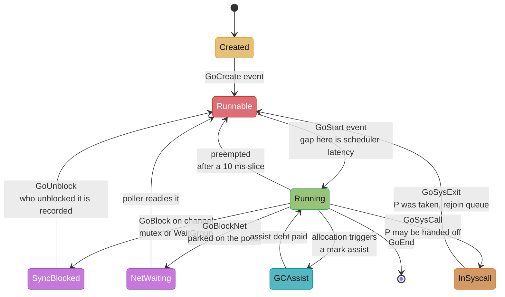
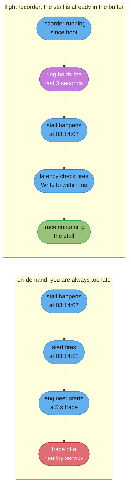
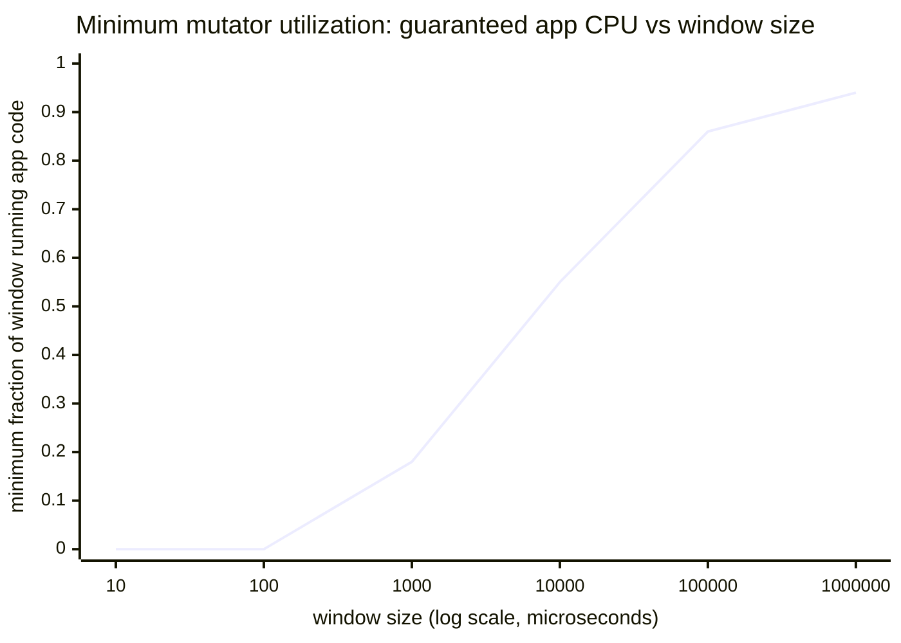

# Execution Tracer and Flight Recorder

---

## 1. Concept Overview

pprof answers "where is CPU spent". This page is about the other question, the one that
wakes people up: **why did this goroutine sit there for 40 milliseconds doing nothing?**

`runtime/trace` is not a sampler. It is an event recorder wired into the scheduler itself,
and while it runs the runtime emits a nanosecond-timestamped record for every goroutine
creation, every block and unblock, every syscall entry and exit, every processor start and
stop, and every garbage-collection phase transition. Where a CPU profile hands you a
statistical summary of what was running, a trace hands you the complete ordered history of
what happened — including all the intervals in which nothing was running, which is precisely
where a latency problem lives.

That difference is the entire reason this page exists as a companion to
[Profiling and Tracing](profiling_and_tracing.md). A service at 3% CPU with a 900 ms p99 has
a profile that is nearly empty and a trace that is full of answers, because the trace records
absence. It will tell you that a goroutine became runnable at t=1.204s, was not scheduled
until t=1.244s, and spent those 40 ms in the run queue behind eleven other goroutines because
`GOMAXPROCS` was 2 in a pod nobody had sized. No sampling profiler can produce that sentence.

The tracer's historical problem was practical rather than conceptual: you have to start it
**before** the thing you want to see, and the incident is always over by the time you know
about it. `[1.25]` solved that with the **flight recorder** — a bounded in-memory ring of
trace events that the runtime keeps continuously, which you snapshot to a file at the moment
something bad happens. The 40 ms stall is already in the buffer when the SLO alert fires.

Target version is **Go 1.27** (released 2026-08-19).

---

## 2. Intuition

> A CPU profile is a security camera set to take one photo every 10 seconds. It reliably tells
> you which rooms in the building are busy. An execution trace is the door-access log: every
> badge-in and badge-out, to the nanosecond, for every person. The camera cannot tell you why
> someone stood outside a locked door for forty seconds. The access log can, because it records
> the moment they arrived and the moment the door opened, and the gap between them is the answer.

**Mental model:** a trace is a **timeline per processor** with a **state machine per
goroutine** overlaid on it. At every instant each `P` is either running a goroutine or idle,
and each goroutine is in exactly one of: running, runnable (wants a P, has not got one),
blocked on a synchronization primitive, blocked in a syscall, waiting on the network poller,
or in a GC phase. Every latency question in Go reduces to *which of those states did my
request's goroutine spend its wall-clock time in*, and the trace is the only tool that
answers it exhaustively.

**Why it matters:** wall-clock latency is a sum, and pprof can only see one term of it.

```
    request latency = on-CPU time            <- pprof sees this
                    + runnable-but-not-run   <- only the tracer sees this
                    + blocked on sync        <- block/mutex profile sees a sampled version
                    + blocked in syscall     <- only the tracer, or eBPF below the runtime
                    + GC assist and pause     <- only the tracer, attributed to your goroutine
```

**Key insight:** the tracer's cost is proportional to how many events your program generates,
not to how long you run it — which is exactly backwards from a sampler, and is why the usual
advice inverts. A profile you take for 30 seconds; a trace you take for **5**. Five seconds
of a busy service is already tens of megabytes and more scheduling detail than a human can
read. If you find yourself asking for 5 minutes, you have not narrowed the question enough.

---

## 3. Core Principles

1. **Take a trace when you have a latency question, not a throughput question.** Throughput
   problems are CPU problems and belong to pprof. Latency problems are usually waiting
   problems, and waiting is what the trace records.

2. **Five seconds, not five minutes.** The trace is exhaustive, so its size grows with event
   rate. Narrow the window before you widen it.

3. **Annotate before you collect.** A raw trace of an unfamiliar service is an unreadable wall
   of goroutines. `trace.NewTask` and `trace.WithRegion` put *your* vocabulary — "checkout",
   "db-query", "render" — onto the same timeline, and the difference between an annotated and
   an unannotated trace is the difference between an hour and a week.

4. **You cannot start a trace after the incident.** Either it was already running or you get
   nothing. That asymmetry is what the flight recorder exists to remove.

5. **Read the goroutine analysis table before the timeline.** The timeline is seductive and
   slow. The per-goroutine breakdown of execution / scheduler wait / sync block / syscall
   block / network wait names the dominant term in one screen.

6. **The tracer is a runtime-level tool with a runtime-level boundary.** It sees a syscall
   enter and exit; it does not see what the kernel did in between. For that you go below,
   to [Off-CPU and eBPF Analysis](../../backend/off_cpu_and_ebpf_analysis/off_cpu_and_ebpf_analysis.md).

7. **A trace is one process on one machine over one window.** It is not distributed tracing
   and does not replace it. It explains the inside of a span, never the shape of a call graph.

---

## 4. Types / Architectures / Strategies

### 4.1 What the tracer records

| Event class | Examples | The question it unlocks |
|-------------|----------|------------------------|
| Goroutine lifecycle | create, start, stop, end | Where did 40,000 goroutines come from? |
| Goroutine blocking | block on chan/select/mutex/`WaitGroup`, unblock | Which primitive stalled the pipeline? |
| Scheduler | proc start/stop, goroutine becomes runnable, goroutine gets a P | Why was a runnable goroutine not run? |
| Syscalls | enter, exit, and whether the P was handed off | Is a file read stalling a worker? |
| Network poller | goroutine parked on and readied by `epoll`/`kqueue` | Is the wait upstream or downstream? |
| Garbage collector | GC start/end, mark-assist, sweep, stop-the-world phases | Did GC eat this request's budget? |
| Heap | heap goal changes, allocation triggering an assist | Is this goroutine paying for someone else's garbage? |
| User annotations | tasks, regions, log messages | What was the *application* doing? |

Every record carries a nanosecond timestamp, the goroutine id, and usually a stack. Nothing is
sampled and nothing is aggregated at collection time.

### 4.2 Two ways to collect

| Mode | Mechanism | Fits |
|------|-----------|------|
| On-demand | `trace.Start(w)` / `trace.Stop()`, or `GET /debug/pprof/trace?seconds=5` | A reproducible problem, a load test, a hypothesis you can trigger |
| Flight recorder `[1.25]` | `trace.NewFlightRecorder(...)`, always running, `WriteTo` on an event | A rare stall, a p99.9 outlier, a panic, anything you cannot reproduce |

The two are mutually exclusive at runtime — only one tracing consumer can be active at a
time — and the flight recorder is a superset in practice: if you are going to run one, run the
recorder and snapshot it on demand.

### 4.3 The views in `go tool trace`

| View | Reads as | Use it for |
|------|----------|-----------|
| **Goroutine analysis** | A table: per goroutine, time in execution / sched wait / sync block / syscall / network / GC | **Start here.** Names the dominant term immediately |
| **View trace** (timeline) | Rows of Ps over time, with goroutine slices, GC bands and flow arrows | Understanding a *specific* stall once you know which one |
| **Network blocking profile** | A pprof-format profile of network wait | "Is my latency downstream?" |
| **Synchronization blocking profile** | A pprof-format profile of channel/mutex waits | Contention, with exact totals rather than samples |
| **Syscall blocking profile** | A pprof-format profile of syscall duration | Disk, DNS, cgo |
| **Scheduler latency profile** | A pprof-format profile of runnable-but-not-running time | Under-provisioned `GOMAXPROCS`, or too many runnable goroutines |
| **User-defined tasks / regions** | Latency distributions for *your* named spans | The view that makes a trace legible |
| **Minimum mutator utilization** | A curve of guaranteed application CPU vs window size | "Can GC alone blow my 10 ms budget?" |

Four of those eight views are pprof-format profiles derived from the trace, and they differ
from the pprof block profile in one important way: they are **exhaustive over the window**,
not sampled, so the totals are exact. That is the practical reason to prefer them when you
have a trace in hand.

### 4.4 Tasks, regions and logs

Three annotation primitives, all in `runtime/trace`:

```go
ctx, task := trace.NewTask(ctx, "checkout")   // a logical unit of work, may span goroutines
defer task.End()

trace.WithRegion(ctx, "validate-cart", func() { ... })   // a span within one goroutine
trace.Log(ctx, "tenant", tenantID)                        // a one-off keyed event
```

A **task** is the request. It carries an id in the `context`, so it survives crossing
goroutines, and `go tool trace` groups by it and shows a latency distribution per task type.
A **region** is a phase inside one goroutine and must begin and end on that goroutine. A
**log** is a labelled point event, which is how you get a request id or tenant onto the
timeline so the trace can be joined to your logs.

### 4.5 The flight recorder `[1.25]`

```go
fr := trace.NewFlightRecorder(trace.FlightRecorderConfig{
    MinAge:   3 * time.Second,     // keep at least this much history
    MaxBytes: 32 << 20,            // hard cap, wins over MinAge
})
if err := fr.Start(); err != nil { ... }
defer fr.Stop()
// ... later, when something bad happens:
n, err := fr.WriteTo(f)
```

The runtime keeps trace events in a bounded ring. Old events fall off the back; `WriteTo`
snapshots whatever is currently in the window into a file `go tool trace` can open. It exists
because the trace format was made **partitioned** when the tracer was rewritten in `[1.22]`,
which is what makes a suffix of the stream a valid standalone trace.

This inverts the collection problem. Instead of "start a trace and hope the stall happens
during it", you run continuously and snapshot on a trigger: an SLO violation, a request that
exceeded its budget, a health-check failure, a `recover`ed panic. Only one recorder may be
active at a time, and `WriteTo` is safe to call concurrently with recording.

---

## 5. Architecture Diagrams

### 5.1 The 40 ms nobody could explain

```
  ONE REQUEST, 43.1 ms wall clock. What pprof sees vs what the trace sees.

  wall clock ->  0ms                                                        43ms
                 |---------------------------------------------------------|

  pprof sample   .        .        .        .        .        .        .   <- 100 Hz
  coverage       ^        ^                                            ^
                 only 3 samples land here, all inside the 2.4 ms of real work

  trace timeline
    RUNNABLE     [########## 24.0 ms ##########]                              <- P starvation
    RUNNING                                    [#]                            2.4 ms
    SYSCALL                                       [##### 11.2 ms #####]       disk read
    GC ASSIST                                                          [## 4.1]
    BLOCKED                                                                [#] 1.4 ms

    on-CPU    2.4 ms   ( 5.6% of latency )   <- the only term pprof can see
    off-CPU  40.7 ms   (94.4% of latency )   <- the answer, invisible to pprof

  A CPU profile of this service reports "buildResponse is 41% of CPU" and is
  perfectly correct. It is also useless: 94% of the latency was never on a CPU.
```

### 5.2 A goroutine's state machine, which is what the trace records



The red state is the one that matters most and the one no other Go tool reports: **Runnable**
means the goroutine has work to do and is waiting for a processor. Time spent there is pure
loss, and the scheduler latency profile in `go tool trace` is a ranked list of exactly it.

### 5.3 On-demand collection versus the flight recorder



### 5.4 Reading a minimum mutator utilization curve



Read one point at a time. At a window of 1 ms (1000 on the x axis) the curve sits at 0.18,
which is a precise and alarming claim: **there exists some 1 ms window in this trace during
which your application code got only 180 microseconds of CPU**. The other 820 microseconds
went to the collector. If your latency budget is 1 ms, GC alone can blow it.

The curve's shape is diagnostic. It reaching 0 at small windows is normal — that is the
stop-the-world pause, and a sub-millisecond one is expected. What matters is where it climbs:
a curve still at 0.2 by 10 ms means sustained collector pressure, not a brief pause, and the
fix is allocation reduction or a `GOMEMLIMIT` change rather than anything to do with pauses.
A curve that plateaus at 0.94 says the collector's steady-state cost is 6% and there is
nothing to win there.

---

## 6. How It Works — Detailed Mechanics

### 6.1 Collecting a trace

Over HTTP, from a service that already runs the admin listener described in
[Profiling and Tracing](profiling_and_tracing.md):

```bash
# Five seconds. Not thirty, not five minutes.
curl -so trace.out 'http://127.0.0.1:6060/debug/pprof/trace?seconds=5'
ls -lh trace.out          # 38M is a completely normal size for 5 s of a busy service
go tool trace trace.out
```

In-process, around a specific operation:

```go
func main() {
    if path := os.Getenv("GOTRACE"); path != "" {
        f, err := os.Create(path)
        if err != nil {
            log.Fatal(err)
        }
        if err := trace.Start(f); err != nil {
            log.Fatal(err)
        }
        defer func() {
            trace.Stop()      // must run before the process exits, or the trace is truncated
            f.Close()
        }()
    }
    run()
}
```

`trace.Stop()` blocks until every buffered write has completed, which is why it must actually
run — a `log.Fatal` or an `os.Exit` past a deferred `Stop` leaves a truncated file.

For benchmarks: `go test -bench=X -trace=trace.out`.

### 6.2 Overhead, and why five seconds

The tracer was rewritten in `[1.22]` and the cost fell from the 10–20% the old implementation
charged to low single-digit percent for typical services. Measure it on yours before deciding
it is free — the cost is per *event*, so a program doing millions of channel operations per
second pays far more than one doing thousands.

Size is the harder constraint. A busy service generates single-digit megabytes of trace per
second, so:

| Duration | Typical size | Practical experience |
|----------|-------------|---------------------|
| 1 s | ~5 MB | Often too short to contain the stall |
| **5 s** | ~30 MB | **The right default.** Opens instantly, contains a p99 event |
| 30 s | ~200 MB | `go tool trace` becomes sluggish, the timeline unreadable |
| 5 min | ~2 GB | You will not open this file, and collecting it perturbed the service |

The instinct to widen the window comes from profiling, where more samples means more
confidence. It is exactly wrong here: a trace is exhaustive, so five seconds already contains
every event, and more time buys you only more scrolling.

### 6.3 The goroutine analysis view — read this first

`go tool trace` opens a page of links. Ignore the timeline on the first pass and click
**Goroutine analysis**. It gives a table per goroutine-creating call site:

```
Goroutines:
  api/handler.(*Server).serveOrder N=41204

  Total       Execution   Network wait   Sync block   Blocking syscall   Scheduler wait   GC
  43.1ms      2.4ms       0ms            1.4ms        11.2ms             24.0ms           4.1ms
```

That single row is the whole answer to the diagram in §5.1: 24 ms of **scheduler wait** means
the goroutine was runnable and could not get a processor, and 11.2 ms of **blocking syscall**
means a file or DNS call. Execution — the only column a CPU profile can see — is 2.4 ms of 43.

The columns map directly to the state machine in §5.2, and each one implies a different fix:

| Dominant column | Meaning | Where to look |
|-----------------|---------|---------------|
| Execution | You are genuinely CPU-bound | Go back to the [CPU profile](profiling_and_tracing.md) |
| Scheduler wait | Runnable, no P available | `GOMAXPROCS`, CPU limits, too many runnable goroutines |
| Sync block | Waiting on a channel, mutex or `WaitGroup` | Synchronization blocking profile, then the code |
| Blocking syscall | File I/O, DNS through cgo, a cgo call | Bound the concurrency, or go to eBPF for the kernel side |
| Network wait | Waiting on a peer | It is not your service. Look downstream |
| GC | Mark assist and pause charged to this goroutine | Allocation rate, `GOGC`, `GOMEMLIMIT`, the MMU curve |

### 6.4 The timeline, and the flow arrows

Once the table names the term, open **View trace** to see the specific instance. The rows are
processors; each coloured slice is a goroutine running on one; the bands across the top are
GC phases and the goroutine-count and heap-size graphs.

Two features do all the work. Clicking a slice shows the goroutine's stack at that moment and
its **incoming flow arrow** — the event that made it runnable, drawn from the goroutine that
unblocked it. That arrow is how you answer "who woke this up, and when", which is the
question at the heart of every pipeline stall. And selecting a time range gives per-state
totals for the selection, so you can quantify a specific 40 ms rather than the whole window.

Keyboard: `w`/`s` zoom, `a`/`d` pan, `m` marks the selection.

### 6.5 The four blocking profiles

Each of these is a pprof-format profile derived from the trace, so `go tool pprof` can open
the download and you get `top`, `list` and flame graphs over it:

```bash
# From the go tool trace UI, download e.g. the syscall blocking profile,
# then treat it like any other pprof file.
go tool pprof -http=:8080 syscall.pprof
```

They differ from the equivalent pprof block/mutex profiles in two ways that matter. They are
**exhaustive**, so the totals are real rather than scaled from a sampling rate — no
`SetBlockProfileRate` to configure and no sampling error. And the **scheduler latency
profile** has no pprof equivalent at all: nothing in `runtime/pprof` reports time spent
runnable-but-not-running, because from the CPU profiler's point of view that time does not
exist.

### 6.6 Annotating with tasks and regions

An unannotated trace of an unfamiliar service is 40,000 anonymous goroutines. The fix is a
dozen lines:

```go
func (s *Server) serveOrder(w http.ResponseWriter, r *http.Request) {
    ctx, task := trace.NewTask(r.Context(), "order.submit")
    defer task.End()
    trace.Log(ctx, "tenant", tenantFromCtx(ctx))
    trace.Log(ctx, "request_id", middleware.RequestID(ctx))

    var cart Cart
    trace.WithRegion(ctx, "load-cart", func() {
        cart = s.carts.Load(ctx, orderID(r))
    })

    // StartRegion when the phase does not fit a closure. End on the SAME goroutine.
    reg := trace.StartRegion(ctx, "price")
    total := s.pricing.Compute(ctx, cart)
    reg.End()

    trace.WithRegion(ctx, "persist", func() {
        s.db.Insert(ctx, cart, total)
    })
}
```

`go tool trace` then offers **User-defined tasks** with a latency distribution per task type
and a clickable list of the slowest instances, and **User-defined regions** with the same
breakdown per phase. Clicking the slowest `order.submit` jumps the timeline to that exact
request, with `load-cart`, `price` and `persist` drawn as labelled spans.

Two rules. A region must end on the goroutine that started it — `trace.WithRegion` enforces
this by construction, which is why it is the form to prefer. And the task's `context` is what
carries the id across goroutine boundaries, so a helper goroutine must receive the derived
`ctx` to appear under the same task.

The overhead when tracing is off is a check of an atomic flag; `trace.IsEnabled()` lets you
skip expensive label construction entirely. Leave the annotations in production code.

### 6.7 Wiring the flight recorder

The full pattern: record continuously, snapshot on a trigger, rate-limit the snapshots.

```go
type Recorder struct {
    fr      *trace.FlightRecorder
    dir     string
    mu      sync.Mutex
    lastAt  time.Time
}

func NewRecorder(dir string) (*Recorder, error) {
    fr := trace.NewFlightRecorder(trace.FlightRecorderConfig{
        MinAge:   3 * time.Second,   // keep at least 3 s of history
        MaxBytes: 32 << 20,          // hard 32 MB cap, takes precedence over MinAge
    })
    if err := fr.Start(); err != nil {
        return nil, fmt.Errorf("flight recorder: %w", err)
    }
    return &Recorder{fr: fr, dir: dir}, nil
}

// Snapshot writes the current window. It is rate-limited to once every 60 s,
// because a latency regression fires the trigger on every request and 200
// concurrent WriteTo calls would turn a slow service into a dead one.
func (r *Recorder) Snapshot(reason string) {
    r.mu.Lock()
    if time.Since(r.lastAt) < 60*time.Second {
        r.mu.Unlock()
        return
    }
    r.lastAt = time.Now()
    r.mu.Unlock()

    name := filepath.Join(r.dir, fmt.Sprintf("trace-%s-%d.out", reason, time.Now().Unix()))
    f, err := os.Create(name)
    if err != nil {
        slog.Error("flight recorder snapshot", "err", err)
        return
    }
    defer f.Close()
    n, err := r.fr.WriteTo(f)
    slog.Warn("execution trace captured", "reason", reason, "path", name, "bytes", n, "err", err)
}
```

Trigger it from the places that already know something went wrong:

```go
// 1. An SLO violation, from middleware.
func (r *Recorder) SLOMiddleware(budget time.Duration, next http.Handler) http.Handler {
    return http.HandlerFunc(func(w http.ResponseWriter, req *http.Request) {
        start := time.Now()
        next.ServeHTTP(w, req)
        if d := time.Since(start); d > budget {
            r.Snapshot("slo")     // the stall is still inside the ring
        }
    })
}

// 2. A recovered panic.
defer func() {
    if v := recover(); v != nil {
        rec.Snapshot("panic")
        panic(v)
    }
}()

// 3. A health check that just failed, or a queue depth that crossed a threshold.
if depth := q.Len(); depth > 10_000 {
    rec.Snapshot("queue-depth")
}
```

The `MinAge` value is the design decision. It must exceed the duration of the thing you want
to see plus the delay before your trigger fires, and it is a lower bound the runtime honours
only within `MaxBytes` — on a very busy service the byte cap wins and the real window is
shorter than `MinAge` asked for. Three seconds with a 32 MB cap is a sane starting point for
an HTTP service with a sub-second budget; verify by taking a snapshot on a healthy pod and
checking the timeline actually spans what you expected.

### 6.8 `go tool trace` and the network `[1.27]`

```bash
go tool trace trace.out                 # random port on localhost, opens a browser
go tool trace -http=:6060 trace.out     # [1.27] binds 127.0.0.1:6060 only
go tool trace -http=0.0.0.0:6060 trace.out   # explicitly all interfaces
```

`[1.27]` changed `-http=:6060` to bind **localhost only**. The practical effect is that the
old habit of running `go tool trace -http=:6060` on a remote box and pointing a laptop
browser at it now fails, silently looking like a firewall problem. The two correct responses
are to copy the trace file to your workstation and open it there — which is what you should
have been doing, since the trace viewer is a local tool and the file is the artefact — or to
pass `-http=0.0.0.0:6060` deliberately, having decided that an unauthenticated viewer serving
your service's complete internal timeline on a public interface is acceptable. It usually is
not.

---

## 7. Real-World Examples

**The Go team's own scheduler work** is validated with traces: the case for asynchronous
preemption, for the `runnext` slot, and for the `[1.22]` tracer rewrite itself were all made
with execution traces showing goroutines starved of processors.

**Cloudflare** published an analysis using execution traces to show that a latency spike in a
Go proxy was GC mark-assist charged to request goroutines rather than a stop-the-world pause,
which is a distinction visible in no other tool — the MMU curve and the per-goroutine GC
column are what separate "the collector paused everything" from "the collector made *this*
request help".

**Kubernetes' `kube-apiserver`** exposes `/debug/pprof/trace` behind the same authorization as
its other debug endpoints, and traces have been the tool of record for watch-cache and
informer stalls where CPU was low and latency was not.

**Grafana's Go services** were the driver for much of the flight-recorder design discussion:
the recurring complaint that produced it was that every interesting stall was over before
anyone could type `curl`.

**Any Go program with an unexplained tail** is the general case. The trace's reputation is
that it is the tool you use twice a year and it saves a week each time.

---

## 8. Tradeoffs

### Execution trace vs CPU profile

| | Execution trace | CPU profile |
|---|---|---|
| Method | Every event, nanosecond timestamps | Sampled at 100 Hz per thread |
| Sees off-CPU time | Yes, exhaustively | No |
| Sees which goroutine | Yes, individually | No, aggregated |
| Overhead | Low single-digit percent `[1.22]` | ~1–5% |
| Output size for 5 s | ~30 MB | ~300 KB |
| Analysis effort | Minutes to hours | Seconds |
| Continuous collection | Only via the flight recorder | Routine |

### Flight recorder vs on-demand tracing

| | Flight recorder | On-demand |
|---|---|---|
| Catches a rare event | Yes — the history is already there | Only by luck |
| Memory cost | `MaxBytes` resident, permanently | None when idle |
| Runtime cost | Tracing is always on | Only while collecting |
| Window you get | The last `MinAge` seconds | Exactly what you asked for |
| Right for | Production, p99.9, panics | Load tests, reproducible bugs |

### Trace blocking profiles vs pprof block/mutex profiles

| | From the trace | From `runtime/pprof` |
|---|---|---|
| Sampling | Exhaustive over the window | Sampled by rate/fraction |
| Setup | None beyond taking a trace | `SetBlockProfileRate`, `SetMutexProfileFraction` |
| Scheduler-latency profile | Yes | **Does not exist** |
| Window | 5 seconds | Whatever you leave enabled |
| Continuous collection | No | Yes |

### Tracer vs eBPF off-CPU analysis

| | `runtime/trace` | eBPF off-CPU |
|---|---|---|
| Boundary | Sees syscall enter and exit | Sees what the kernel did in between |
| Attribution | Per goroutine | Per OS thread |
| Deployment | Import a package | Kernel access, privileges, tooling |
| Scope | One process | The whole machine, all processes |
| Verdict | First tool for a Go latency question | The escalation when the wait is below the runtime — see [Off-CPU and eBPF Analysis](../../backend/off_cpu_and_ebpf_analysis/off_cpu_and_ebpf_analysis.md) |

---

## 9. When to Use / When NOT to Use

### Take a trace when

- Latency is bad and CPU is not — the defining case.
- A p99 is many multiples of the p50 and you need to know what the outliers were doing.
- A pipeline throughput is far below what the arithmetic says it should be.
- You suspect GC is eating a latency budget and want the MMU curve to prove or refute it.
- You need to know whether `GOMAXPROCS` is genuinely saturated or whether goroutines are
  queueing behind an artificial limit.
- Goroutine count is stable but work is not progressing — someone is blocked on someone.

### Run the flight recorder when

- The interesting event is rare, brief, and cannot be reproduced on demand.
- You have an SLO, a panic handler, or a queue-depth alarm that can pull the trigger.
- You have already accepted the standing memory cost of `MaxBytes` and the tracer's overhead.

### Do NOT reach for the tracer when

- **The service is CPU-saturated.** Use the [CPU profile](profiling_and_tracing.md); the trace
  will show you a lot of goroutines running, which you already knew.
- **You want to know why one request across five services was slow.** That is distributed
  tracing. `runtime/trace` explains the inside of a span, never the shape of the call graph.
- **The wait is in the kernel.** The tracer times a syscall, it does not explain it. Go to
  [Off-CPU and eBPF Analysis](../../backend/off_cpu_and_ebpf_analysis/off_cpu_and_ebpf_analysis.md).
- **You have not annotated anything and the service is unfamiliar.** Add tasks and regions
  first; a raw trace of 40,000 anonymous goroutines costs more time than it saves.

### Caution

- Enabling the flight recorder is a production change with a permanent memory cost. Roll it
  like one.
- A `WriteTo` triggered per-request during a latency regression is a self-inflicted outage.
  Rate-limit it.
- Traces contain stack traces, function names and any string you passed to `trace.Log`. Treat
  a trace file as sensitive and never serve the viewer on a public interface.

---

## 10. Common Pitfalls

**1. Untriggerable snapshots — a flight recorder that never fired for four months.**

A payments team deployed the flight recorder, configured `MinAge: 3s`, and wired `WriteTo` to
a manual admin endpoint. Over four months of chasing a p99.9 spike, not one snapshot contained
the spike: by the time an engineer read the alert, opened a terminal and hit the endpoint, the
window had rolled over dozens of times. The recorder had been running, costing memory and
tracer overhead, and had produced nothing.

```go
// BROKEN: a human is the trigger, and a human is 60 seconds too slow.
mux.HandleFunc("/admin/trace-snapshot", func(w http.ResponseWriter, r *http.Request) {
    rec.Snapshot("manual")
})
```

```go
// FIX: the code that already knows the request was slow pulls the trigger,
// microseconds after the fact, while the stall is still in the ring.
func (rec *Recorder) SLOMiddleware(budget time.Duration, next http.Handler) http.Handler {
    return http.HandlerFunc(func(w http.ResponseWriter, r *http.Request) {
        start := time.Now()
        next.ServeHTTP(w, r)
        if time.Since(start) > budget {
            rec.Snapshot("slo")
        }
    })
}
```

The first snapshot after the fix contained the stall. The rule: a flight recorder with no
automatic trigger is a memory leak with a good story.

**2. `WriteTo` on every slow request — a 40-second outage caused by the diagnostic.**

The same team, one week later. A downstream dependency degraded, every request exceeded the
budget, and the middleware called `WriteTo` on all of them. Roughly 900 concurrent snapshots
of a 32 MB window wrote 28 GB to a container filesystem in 40 seconds, the disk filled, and
the pod was evicted. Rate-limit to one snapshot per minute and cap the number of files kept.

**3. Taking a 5-minute trace.**

An engineer investigating a stall requested `?seconds=300`. The trace was 2.1 GB, `go tool
trace` took 11 minutes to parse it and then made the browser unusable, the service's p99 rose
18% for the whole five minutes because of the event volume, and the stall — which lasted
80 ms — was one invisible pixel on a five-minute timeline. Take 5 seconds. If the event is
rare, that is what the flight recorder is for.

**4. Reading the timeline before the goroutine analysis table.**

The timeline is visual and therefore feels like the main view. It is not: it is the drill-down.
Teams routinely spend two hours scrolling and zooming, form a theory from one screenshot, and
act on it. The goroutine analysis table gives the dominant term in one screen, and in the case
in §5.1 it said "24 ms scheduler wait" immediately — which was the answer, and which nobody
would ever have derived from staring at a timeline where the goroutine simply was not drawn.

**5. Regions ended on the wrong goroutine.**

`trace.StartRegion` returns a `*Region` whose `End` must be called on the same goroutine.
Passing it into a helper goroutine, or ending it in a deferred function that runs after a
`go` statement moved the work, produces a corrupt or missing region in the output rather than
a clear error. Prefer `trace.WithRegion(ctx, name, fn)`, which cannot be misused this way,
and reserve `StartRegion` for phases that genuinely do not fit a closure.

**6. Truncated traces from `os.Exit`.**

`trace.Stop()` blocks until buffered writes flush. A `log.Fatal` in an error path, or an
`os.Exit` in a signal handler, skips deferred calls, and the resulting file either fails to
open or is missing its last seconds — which are the seconds you wanted. Stop the trace
explicitly in your shutdown path, before anything that can exit.

**7. Serving the trace viewer on a public interface.**

Before `[1.27]`, `go tool trace -http=:6060` on a production box bound all interfaces, and the
viewer serves the complete internal timeline of the process — every function name, every
`trace.Log` string, every request id — with no authentication. One team found their staging
viewer indexed by a search engine. `[1.27]`'s localhost-only default fixes the accident; the
discipline is to copy the trace file to a workstation and open it there.

---

## 11. Technologies & Tools

| Tool | Role |
|------|------|
| `runtime/trace` | The stdlib tracer: `Start`, `Stop`, `NewTask`, `WithRegion`, `Log`, `IsEnabled` |
| `trace.FlightRecorder` `[1.25]` | Continuous bounded in-memory tracing with `WriteTo` snapshots |
| `net/http/pprof` | Serves `/debug/pprof/trace?seconds=N` from a running service |
| `go tool trace` | The analyser: timeline, goroutine analysis, four blocking profiles, MMU, user tasks |
| `go tool pprof` | Opens the pprof-format profiles that `go tool trace` exports |
| `go test -trace` | Collects a trace from a benchmark or test run |
| `runtime/metrics` | The cheap counters — `/sched/goroutines`, `/sched/latencies` — that tell you *when* a trace is worth taking |
| `gotraceui` | A third-party trace viewer, faster than the built-in timeline on large traces |
| OpenTelemetry Go SDK | Distributed tracing — the complementary tool for cross-service latency |
| `perf` / `bpftrace` / `offcputime` | The escalation below the runtime boundary |
| Grafana Pyroscope, Parca | Continuous profiling stores, the pprof-side counterpart to the flight recorder |

---

## 12. Interview Questions with Answers

**Q: What does the execution tracer record that a CPU profile cannot?**
**Short:** Every scheduling event with a nanosecond timestamp, including all the intervals in which a goroutine was not running at all.

A CPU profile is a statistical summary of what was executing, built by sampling at 100 Hz per
thread, so a goroutine that is parked contributes nothing to it. The tracer instruments the
runtime itself and emits an ordered record for goroutine create, block, unblock, start and
stop, syscall entry and exit, processor start and stop, and every GC phase transition. That
means it captures the terms of the latency sum a profiler is structurally blind to: time
spent runnable but unscheduled, time blocked on a channel, time inside a syscall, time paying
a GC mark assist. It also attributes all of it **per goroutine** rather than aggregating by
function, which is why it can answer "why was this specific request slow" and a profile can
only answer "what is this service generally busy doing".

**Q: A request took 43 ms but the CPU profile shows the handler using 2 ms. Where do you look?**
**Short:** Take a trace and read the goroutine analysis table, which splits that 43 ms into execution, scheduler wait, sync block, syscall and GC columns.

The gap means 41 of the 43 ms were spent off-CPU, and each possible reason has its own column
in one table. Scheduler wait means the goroutine was runnable and no processor was free —
suspect `GOMAXPROCS`, a container CPU limit, or simply more runnable goroutines than
processors. Blocking syscall means file I/O, DNS through the C resolver, or a cgo call.
Network wait means the delay is in a peer, not in you. Sync block means a channel or mutex.
GC means the collector charged this goroutine a mark assist. One screen gives the dominant
term, and only then is it worth opening the timeline to look at a specific instance of it.

**Q: How long should a trace run, and why is that the opposite of profiling advice?**
**Short:** Five seconds, because the tracer is exhaustive rather than statistical, so a longer window buys detail you cannot read instead of confidence you need.

A profiler needs duration because it needs samples: 3 seconds of CPU profiling yields too few
to trust the tail, so 30 seconds is the sensible default. A trace records every event, so 5
seconds of a busy service already contains every stall, every GC cycle and tens of megabytes
of data. Widening the window multiplies file size, makes `go tool trace` slow to parse and the
timeline impossible to navigate, and increases the tracer's perturbation of the service during
collection. A 5-minute trace runs to gigabytes, takes many minutes to open, and reduces an
80 ms stall to a sub-pixel sliver. If the event you want is too rare to appear in 5 seconds,
the answer is not a longer trace, it is the flight recorder.

**Q: What is the flight recorder and what problem does it solve?**
**Short:** It keeps a bounded in-memory ring of trace events continuously so you can snapshot the recent past at the moment something goes wrong, rather than starting a trace afterwards.

The fundamental limitation of on-demand tracing is causal: you must begin recording before the
event, and you learn about the event afterwards. For a p99.9 stall that happens twice a day
and lasts 80 ms, that is not a workflow. `trace.NewFlightRecorder` `[1.25]` runs the tracer
continuously into a ring bounded by `MinAge` and `MaxBytes`, discarding old events, and
`WriteTo` dumps whatever is currently in the window to a file `go tool trace` can open. It
became possible because the `[1.22]` tracer rewrite made the trace format partitioned, so a
suffix of the stream is a valid standalone trace. The cost is permanent: the tracer is always
on and `MaxBytes` is always resident.

**Q: How do you decide when the flight recorder should snapshot?**
**Short:** Wire the trigger to code that already knows something went wrong — an exceeded latency budget, a recovered panic, a queue-depth threshold — and rate-limit it hard.

A snapshot triggered by a human typing a command is useless, because the window rolls over
many times before anyone reads an alert. The right triggers are in-process and immediate: an
HTTP middleware comparing elapsed time against the endpoint's budget, a deferred `recover`
that snapshots before re-panicking, a background check on queue depth or connection-pool
saturation. The rate limit is not optional — during a real regression every request trips the
trigger, and hundreds of concurrent `WriteTo` calls each writing a 32 MB window will fill a
container filesystem in under a minute and turn a latency problem into an eviction. One
snapshot per minute, a bounded number of retained files, and log the path so it can be
collected.

**Q: What is the minimum mutator utilization curve and how do you read it?**
**Short:** It plots, for each window size, the smallest fraction of any window of that size during which application code rather than the collector was running.

Pick a window size on the x axis and read the y value as a guarantee about the worst case: an
MMU of 0.18 at a 1 ms window means there exists some 1 ms interval in the trace where your
code got only 180 microseconds and the collector took the rest. Compare that directly against
your latency budget — if the budget is 1 ms and the MMU at 1 ms is 0.18, garbage collection
alone can blow it, and no amount of application optimisation will fix that. The shape
matters as much as any point: dipping to zero at very small windows is just the
stop-the-world pause and is expected, while a curve still low at 10 ms means sustained
collector pressure, which is an allocation-rate or `GOMEMLIMIT` problem rather than a pause
problem. The plateau at large windows is the collector's steady-state overhead.

**Q: What do user tasks and regions add, and why bother annotating?**
**Short:** They put your application's vocabulary onto the runtime's timeline, turning 40,000 anonymous goroutines into named spans you can filter and rank by latency.

`trace.NewTask(ctx, "order.submit")` creates a logical unit of work whose id rides in the
`context`, so it follows the request across goroutine boundaries, and
`trace.WithRegion(ctx, "load-cart", fn)` marks a phase within one goroutine. `go tool trace`
then offers a latency distribution per task type and per region, plus a clickable list of the
slowest instances that jumps the timeline straight to that request with its phases drawn as
labelled bars. Without them you are looking at goroutine ids and stack traces and must
reconstruct what the program was doing; with them the trace reads like your architecture
diagram. `trace.Log(ctx, "request_id", id)` completes the picture by joining the trace to your
logs. Prefer `WithRegion` over `StartRegion`, since a region must end on the goroutine that
started it and the closure form makes that impossible to get wrong.

**Q: How much overhead does tracing add?**
**Short:** Low single-digit percent for typical services since the Go 1.22 rewrite, down from the 10 to 20 percent the previous implementation cost.

The important property is that the cost is per **event**, not per unit of time, so it depends
entirely on what your program does. A service doing thousands of channel operations per second
barely notices it; one doing millions per second pays substantially more, and that is the case
to measure before enabling a flight recorder permanently. Size is usually the binding
constraint rather than CPU: a busy service produces single-digit megabytes of trace per
second, which is what makes 5 seconds the right collection window and what makes `MaxBytes`
the parameter that actually governs a flight recorder's window rather than `MinAge`.

**Q: How do you tell from a trace whether GOMAXPROCS is actually saturated?**
**Short:** Look at the scheduler latency profile and the processor rows in the timeline — real saturation shows every P busy with a queue of runnable goroutines behind it.

The timeline draws one row per processor, so an under-provisioned service is visually obvious:
all `GOMAXPROCS` rows solidly filled with no gaps, while the goroutine analysis table shows
large scheduler-wait figures. The scheduler latency profile then ranks the call sites whose
goroutines waited longest for a processor, which is the actionable form. The opposite finding
is just as valuable and more common than people expect: processor rows with visible idle gaps
while requests are still slow means you are **not** CPU-limited and raising `GOMAXPROCS` or
adding replicas will change nothing — the time is going to syscalls, network waits or lock
contention, and the same table says which. Note that container CPU limits produce the first
pattern for a reason that has nothing to do with your code, so check the pod's limit against
`GOMAXPROCS` before optimising anything.

**Q: How do you distinguish a GC pause from a scheduling delay in a trace?**
**Short:** The GC bands across the top of the timeline mark collector phases, and the goroutine analysis table charges GC assist time to individual goroutines separately from scheduler wait.

They look identical from outside the process — a request took 40 ms longer than usual — and
they have completely different fixes. The timeline draws GC phases as bands spanning all
processors, so a stall aligned with a band is collector-related and one that is not, is not.
Within the collector-related case there is a second distinction
worth making: a **stop-the-world pause** halts every goroutine and is sub-millisecond in
modern Go, while a **mark assist** charges an individual allocating goroutine with collector
work and can be tens of milliseconds for an allocation-heavy request. The per-goroutine GC column shows assists;
the MMU curve quantifies the aggregate. If instead the stall sits between a `GoUnblock` event
and the following `GoStart` with no GC band in sight, it is scheduler latency and the fix is
processors, not allocation.

**Q: `go tool trace -http=:6060` on a remote server is unreachable from your laptop. Why?**
**Short:** As of Go 1.27 that flag binds 127.0.0.1 only, so the viewer is running correctly and simply is not listening on an externally reachable address.

The change is deliberate hardening. The trace viewer serves the complete internal timeline of
a process — function names, goroutine stacks, and every string passed to `trace.Log`, which
routinely includes request ids and tenant identifiers — with no authentication whatsoever, and
binding all interfaces by default meant a debugging session on a production box briefly
published all of it. The right response is to copy the trace file to your workstation and run
`go tool trace` there, since the file is the artefact and the viewer is a local tool. If you
genuinely need remote access, `-http=0.0.0.0:6060` restores the old behaviour explicitly, and
making that an explicit choice is the whole point of the change.

**Q: How do the blocking profiles inside `go tool trace` differ from the pprof block and mutex profiles?**
**Short:** The trace-derived ones are exhaustive over the window rather than sampled, need no configuration, and include a scheduler latency profile that pprof has no equivalent of.

`runtime/pprof`'s block and mutex profiles must be enabled with `SetBlockProfileRate` and
`SetMutexProfileFraction`, sample events probabilistically, and return empty if nobody turned
them on — but they can run continuously at low cost. The trace exports four profiles in the
same pprof format — network blocking, synchronization blocking, syscall blocking and scheduler
latency — computed from every event in the window, so the totals are exact and there is no
sampling rate to reason about. The scheduler latency profile is the one with no counterpart at
all: nothing in `runtime/pprof` reports time a goroutine spent runnable but unscheduled,
because from a CPU sampler's perspective that time simply does not exist. Download them from
the trace UI and open them with `go tool pprof` like any other profile.

**Q: How do you find where a pipeline stalls using a trace?**
**Short:** Follow the flow arrows backwards from the stage that finished late to the goroutine that unblocked it, and read the timestamp gap between them.

A Go pipeline is stages connected by channels, and a stall is always one of two things: a
stage that had nothing to do, or a stage that could not hand its output on. The trace
distinguishes them because it records the **unblock edge** — the timeline draws an arrow from
the goroutine that sent on a channel to the goroutine that was waiting to receive. Click the
slice where the slow stage finally started running, follow its incoming arrow, and the arrow's
origin timestamp tells you when the data actually became available. If the gap between the
unblock and the start is large, the stage was starved of a processor. If the unblock itself
came late, the problem is upstream and you repeat the walk one stage back. The
synchronization blocking profile gives the same information aggregated, which is where to look
first when you do not yet know which stage to suspect.

**Q: What can the execution tracer not tell you?**
**Short:** What happened inside a syscall, what other processes on the machine were doing, and anything about a request once it left this binary.

Three boundaries. The tracer marks syscall entry and exit and so gives you the duration, but
the kernel side is opaque — whether an 11 ms read was disk seek, page-cache miss, cgroup I/O
throttling or a slow NFS mount requires
[off-CPU and eBPF analysis](../../backend/off_cpu_and_ebpf_analysis/off_cpu_and_ebpf_analysis.md).
It is scoped to one process, so a noisy neighbour stealing CPU appears only as unexplained
scheduler latency with no cause attached. And it stops at the network boundary: a 200 ms
network wait is a fact about a peer, and understanding it is distributed tracing's job.
Knowing these three edges is what stops an engineer spending a day in the trace viewer looking
for something that was never recorded.

**Q: What is the trap with `trace.StartRegion` that `trace.WithRegion` avoids?**
**Short:** A region must be ended on the goroutine that started it, and violating that produces a corrupt or missing region rather than an error.

`StartRegion` returns a `*Region` whose `End` method is only valid on the starting goroutine,
which is easy to break: capturing the region in a closure passed to `go`, or deferring `End`
in a function whose work has been moved onto a worker, both compile fine and both produce
garbage in the trace output. `trace.WithRegion(ctx, name, fn)` runs `fn` inline and ends the
region itself, so the constraint is satisfied by construction and there is nothing to get
wrong. Use `StartRegion` only for a phase that genuinely cannot be expressed as a closure —
one that begins in one branch and ends in another — and keep the two calls visibly adjacent in
the same function when you do. Tasks are the primitive that legitimately crosses goroutines,
via the `context`, and regions are deliberately not.

**Q: Your trace file will not open, or is missing its last seconds. What happened?**
**Short:** `trace.Stop` did not run, because a `log.Fatal` or `os.Exit` skipped the deferred call before the runtime flushed its buffers.

`trace.Stop()` returns only after every buffered write has completed, and the trace file is
not self-terminating without it. Any exit path that bypasses deferred functions — `log.Fatal`
in an error branch, `os.Exit` from a signal handler, a panic that is not recovered — leaves
the file truncated at whatever had been flushed, which is exactly the final seconds you
collected the trace to see. Structure shutdown so the trace stops explicitly before anything
can exit: stop it in the same place you drain the HTTP server, and if you use
`signal.NotifyContext` `[1.26]` to get a cancelled context on SIGTERM, stop the trace in that
path rather than trusting a `defer` in `main`. The flight recorder does not have this problem,
because `WriteTo` produces a complete file at the moment it is called.

**Q: What memory does the flight recorder cost, and how do you size it?**
**Short:** It holds up to MaxBytes of trace data resident permanently, and MaxBytes wins over MinAge whenever the event rate is high.

`MinAge` states how much history you *want* — it must exceed the duration of the stall you are
hunting plus the delay before your trigger fires — while `MaxBytes` is the hard cap on the
ring. On a busy service producing several megabytes of trace per second, a 3-second `MinAge`
against a 32 MB cap means the byte limit binds first and the real window is shorter than
requested, which is a silent failure if you never check. Verify by taking a snapshot on a
healthy pod and confirming the timeline spans what you expected before you rely on it during
an incident. Budget the bytes against the container's memory limit the same way you budget the
heap, remember the tracer's own CPU overhead is running permanently, and treat enabling it as
a production change rather than a debugging convenience.

---

## 13. Best Practices

- **Annotate first.** Wrap request handling in `trace.NewTask` and each phase in
  `trace.WithRegion`, and add `trace.Log` for request id and tenant. Leave them in production
  code — when tracing is off they cost an atomic flag check.
- **Take 5 seconds.** Never 30, never 300. If 5 seconds does not contain the event, switch to
  the flight recorder rather than widening the window.
- **Read the goroutine analysis table before opening the timeline.** One screen names the
  dominant term; the timeline is the drill-down, not the entry point.
- **Run the flight recorder with an automatic trigger or not at all.** A manual endpoint means
  the window has always rolled over by the time a human reaches it.
- **Rate-limit `WriteTo` to once a minute and cap retained files.** A regression trips every
  request's trigger simultaneously.
- **Size `MinAge` above stall duration plus trigger delay, then verify against `MaxBytes`.**
  The byte cap wins, silently.
- **Copy the trace to your workstation to view it.** The file is the artefact; `[1.27]`'s
  localhost-only `-http` default is telling you the same thing.
- **Prefer `trace.WithRegion` over `StartRegion`** so a region cannot end on the wrong
  goroutine.
- **Stop the trace explicitly in your shutdown path**, before any code that can `os.Exit`.
- **Check `GOMAXPROCS` against the container's CPU limit before blaming your code** — most
  scheduler-latency findings are a sizing bug, not an algorithm bug.
- **Escalate deliberately.** CPU high goes to the [CPU profile](profiling_and_tracing.md);
  syscall time that the tracer cannot explain goes to
  [off-CPU and eBPF analysis](../../backend/off_cpu_and_ebpf_analysis/off_cpu_and_ebpf_analysis.md);
  cross-service latency goes to distributed tracing.
- **Treat trace files as sensitive.** They contain function names, stacks, and every string
  you logged into them.

---

## 14. Case Study

### The image service whose p99 was 40x its p50, at 11% CPU

A media platform's thumbnail service ran 30 replicas, each a 2-CPU Kubernetes pod. p50 latency
was 22 ms; p99 was 890 ms. CPU sat at 11% of the limit fleet-wide. Three weeks of work had
produced a 30% faster JPEG decode path and no change to p99 at all — the expected outcome when
you optimise on-CPU work for a problem that is 96% off-CPU.

**Step 1 — establish that pprof is the wrong tool.**

```
Type: cpu
Duration: 30s, Total samples = 6.71s (22.37%)
```

0.22 cores against a 2-core limit. The service was not CPU-bound, which meant every hour spent
in the CPU profile was an hour spent on 4% of the latency. This is the boundary case described
in [Profiling and Tracing](profiling_and_tracing.md): the profile is not wrong, it is
answering a question nobody asked.

**Step 2 — the on-demand trace found nothing, twice.**

Two 5-second traces, taken by hand after a p99 alert, both showed a completely healthy
service. The stalls lasted under 200 ms and occurred perhaps forty times an hour; the odds of
a manually-triggered 5-second window landing on one were poor and the two attempts confirmed
it.

**Step 3 — flight recorder with an SLO trigger.**

```go
func main() {
    rec, err := NewRecorder("/var/log/traces")   // MinAge 3s, MaxBytes 32MB
    if err != nil {
        log.Fatal(err)
    }
    defer rec.fr.Stop()

    mux := http.NewServeMux()
    mux.Handle("/thumb/{id}", rec.SLOMiddleware(150*time.Millisecond, thumbHandler()))
    log.Fatal(http.ListenAndServe(":8080", mux))
}
```

Deployed to three canary pods at 14:00. By 14:20 there were four snapshots on disk, one per
minute as the rate limiter allowed, each containing a real stall.

**Step 4 — goroutine analysis named the term in one screen.**

```
Goroutines:
  media/thumb.decode N=1841

  Total     Execution   Network wait   Sync block   Blocking syscall   Scheduler wait   GC
  612ms     19ms        4ms            2ms          584ms              3ms              0ms
```

584 ms of **blocking syscall** against 19 ms of execution. Not GC, not scheduling, not the
network — the goroutine was in the kernel. The syscall blocking profile from the same trace
ranked the call sites:

```
(pprof) top5
      flat  flat%
   541.2ms 88.42%  os.(*File).Read
    31.0ms  5.07%  net.(*netFD).Read
```

**Step 5 — the timeline said how many at once.**

Selecting the stall window and looking at the processor rows showed something the aggregate
had hidden: **both processors idle**, and 340 goroutines simultaneously inside `os.File.Read`.
The service was reading source images from a network filesystem mount, and it was doing so
with completely unbounded concurrency.

```go
// BROKEN: one goroutine per request, each doing a blocking file read from an
// NFS mount. Every blocking syscall detaches its P and forces the runtime to
// create a fresh OS thread, so 340 concurrent requests meant 340 threads and
// 340 simultaneous reads against a mount that served roughly 40 in parallel
// before its queue latency went superlinear. The reads did not fail, they just
// each took 600 ms instead of 15 ms -- which is invisible to every tool except
// a trace, because nothing was on CPU and nothing errored.
func thumbHandler() http.Handler {
    return http.HandlerFunc(func(w http.ResponseWriter, r *http.Request) {
        src, err := os.ReadFile(sourcePath(r.PathValue("id")))
        if err != nil {
            http.Error(w, err.Error(), http.StatusNotFound)
            return
        }
        img, _ := jpeg.Decode(bytes.NewReader(src))
        writeThumb(w, resize(img))
    })
}
```

```go
// FIX: bound the concurrent syscalls to what the mount can actually serve, and
// make the wait for a slot honour the request's deadline instead of queueing
// forever. 32 was measured, not guessed: read latency stayed flat to 40 and
// rose sharply past 48, so 32 leaves headroom.
var ioSem = semaphore.NewWeighted(32)

func thumbHandler() http.Handler {
    return http.HandlerFunc(func(w http.ResponseWriter, r *http.Request) {
        ctx := r.Context()

        ctx, task := trace.NewTask(ctx, "thumb.serve")
        defer task.End()

        var src []byte
        var err error
        trace.WithRegion(ctx, "read-source", func() {
            if err = ioSem.Acquire(ctx, 1); err != nil {
                return      // client gave up, or the deadline passed. Shed, do not queue.
            }
            defer ioSem.Release(1)
            src, err = os.ReadFile(sourcePath(r.PathValue("id")))
        })
        if err != nil {
            http.Error(w, "source unavailable", http.StatusServiceUnavailable)
            return
        }

        var img image.Image
        trace.WithRegion(ctx, "decode", func() {
            img, err = jpeg.Decode(bytes.NewReader(src))
        })
        if err != nil {
            http.Error(w, "bad source image", http.StatusUnprocessableEntity)
            return
        }
        trace.WithRegion(ctx, "resize", func() {
            writeThumb(w, resize(img))
        })
    })
}
```

**Step 6 — verify with the same tool.**

A snapshot taken after the fix, forced manually on a healthy pod, showed the goroutine
analysis for `thumb.serve` at 19 ms execution, 21 ms blocking syscall, 6 ms waiting on the
semaphore. The user-defined regions view now gave a per-phase latency distribution directly:
`read-source` p99 at 24 ms, `decode` p99 at 14 ms, `resize` p99 at 9 ms — a breakdown the team
had never had before and which became a dashboard.

**Outcome.**

| Metric | Before | After |
|--------|--------|-------|
| p50 latency | 22 ms | 24 ms |
| p99 latency | 890 ms | 61 ms |
| p99 / p50 ratio | 40x | 2.5x |
| Peak OS threads per pod | 380 | 41 |
| Concurrent reads against the mount | Unbounded, observed 340 | 32 |
| Engineer-weeks spent on the CPU profile first | 3 (wasted) | — |
| Time from flight-recorder deploy to root cause | — | 35 minutes |

**What the team changed permanently.** The flight recorder stayed on in production with the
SLO trigger and a 60-second rate limit, and snapshots are uploaded to object storage by the
log shipper. The regions stayed in the code, so every future trace of this service is readable
by someone who has never seen it. And the runbook gained one line at the top: *if CPU is below
30% of the limit, do not open a CPU profile* — because the three wasted weeks were not caused
by a lack of skill, they were caused by reaching for the tool everybody knows instead of the
tool that records the thing that was actually happening, which was nothing.
