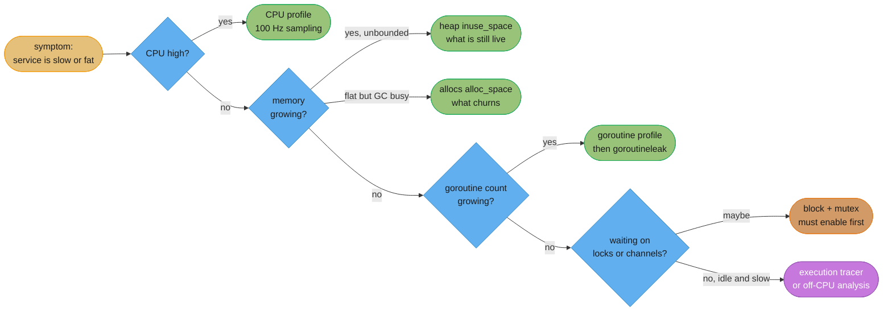
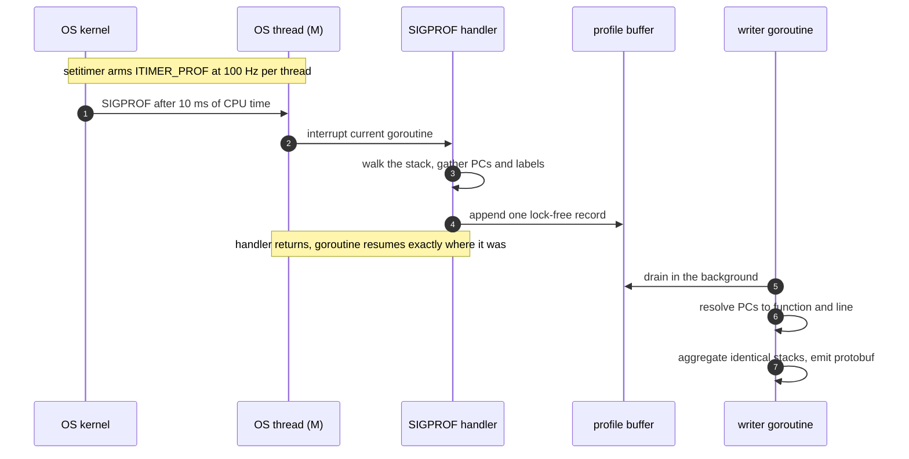
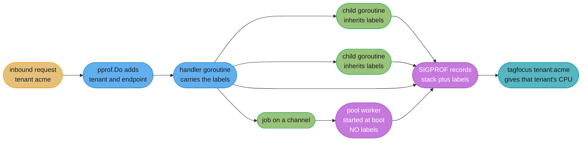

# Profiling and Tracing

---

## 1. Concept Overview

Go ships a production profiler in its standard library, and that single fact changes how Go
services are debugged. There is no agent to install, no JVM flag to restart into, no
sampling daemon to deploy. `import _ "net/http/pprof"` and any running binary will hand you
a CPU profile, a heap profile, a dump of every goroutine's stack, and a lock-contention
profile, over HTTP, from a process that is currently serving traffic.

This module is about **pprof** — the sampling profilers that answer *where is my program
spending CPU and memory*. It covers the seven profile types the runtime exposes, the two
that are switched off until you switch them on, the `go tool pprof` workflow, and the one
feature almost nobody uses that turns a flat unreadable profile into an answer: **pprof
labels**.

It deliberately does **not** cover the execution tracer. `runtime/trace` answers a
different question — not *where is CPU spent* but *why did this goroutine sit runnable for
40 milliseconds* — and it works by recording every scheduling event rather than by
sampling. That is
[Execution Tracer and Flight Recorder](execution_tracer_and_flight_recorder.md), the
companion page, and it is the tool you reach for when pprof says your service is 3% busy
and your p99 is 900 ms.

The other boundary worth naming up front: this page teaches Go's tooling, not profiling
theory. Flame-graph anatomy, differential flame graphs, safepoint bias, and the economics
of always-on profiling are taught once in
[Continuous Profiling](../../hld/observability/continuous_profiling.md); benchmark
statistics — A/A tests, confidence intervals, steady state — are taught once in
[Benchmarking Methodology](../../backend/benchmarking_methodology/benchmarking_methodology.md);
and blocked-time analysis below the runtime is
[Off-CPU and eBPF Analysis](../../backend/off_cpu_and_ebpf_analysis/off_cpu_and_ebpf_analysis.md).
Read those for the method. Read this for the buttons.

Target version is **Go 1.27** (released 2026-08-19).

---

## 2. Intuition

> A CPU profile is a photographer with a very fast shutter standing in a factory, taking one
> picture every 10 milliseconds and writing down which machine was running. After an hour you
> have 360,000 photographs. You never watched any single widget travel through the factory,
> but you know precisely which machines were busy — because busy machines appear in more
> photographs. A heap profile is the same photographer pointed at the warehouse instead.

**Mental model:** every pprof profile is a bag of **stack traces with a number attached**.
The CPU profile's number is nanoseconds of CPU; the heap profile's is bytes; the goroutine
profile's is a count of goroutines; the block profile's is nanoseconds spent blocked. `go
tool pprof` is a program that groups that bag by function and sorts it. Everything else —
flame graphs, `list`, `web`, `-diff_base` — is a different rendering of one bag of counted
stacks.

**Why it matters:** the two hardest mistakes in Go performance work are both category
errors, and both are cured by knowing which bag you are holding. Reaching for a CPU profile
when the service is idle and slow finds nothing, because there is nothing on-CPU to find.
Reaching for `alloc_space` when you are hunting a leak finds the busiest allocation site in
the program, which is almost never the leaking one, because a leak is about what is *still
alive*, not about what was *ever allocated*.

**Key insight:** pprof is cheap enough to leave on. The CPU profiler samples at **100 Hz per
thread** and the heap profiler samples **one allocation per 512 KB** — both are designed to
run against production traffic, which is why continuous profiling exists as a product
category at all. The profiles that are genuinely expensive, **block** and **mutex**, are the
two the runtime ships switched off. That default is the documentation: everything else is
safe, these two you must opt into and budget for.

---

## 3. Core Principles

1. **Profile production, not a synthetic load.** A profile of your load generator is a
   profile of your load generator. Real traffic has a real key distribution, a real cache
   hit rate, and a real tenant mix, and all three move the hot path.

2. **Know which question each profile answers before you collect one.** CPU for "what burns
   cycles", `inuse_space` for "what is still alive", `alloc_space` for "what churns",
   goroutine for "what is stuck", block for "what waits", mutex for "what contends". A
   profile that does not match the question produces a confident wrong answer.

3. **Sampling profiles are unbiased in aggregate and unreliable per-call.** The CPU profile's
   totals converge; the claim "this function ran 41 times" does not. Never read a sampled
   count as an exact count.

4. **`/debug/pprof` is an administrative interface, and administrative interfaces do not go
   on the public listener.** `/debug/pprof/cmdline` prints your argv. `goroutine?debug=2`
   prints every stack in the process. `profile` burns 30 seconds of CPU on demand. Any one
   of those is a finding in a penetration test.

5. **Attribution beats aggregation.** A profile grouped only by function tells you *what*
   code is hot. A profile with **labels** tells you *whose request* made it hot, which is the
   question your incident channel is actually asking.

6. **A flat profile is a result, not a failure.** If nothing exceeds 4% you do not have a hot
   function, you have either a distributed cost (allocation, GC, syscalls) or an off-CPU
   problem. Both have their own tools.

7. **Two profiles are worth more than one.** A single profile shows a shape. A profile
   against a known-good baseline (`-diff_base`) shows a *change*, and a change is what you
   can act on.

---

## 4. Types / Architectures / Strategies

### 4.1 The seven profiles the runtime exposes

| Profile | Question it answers | Cost | On by default |
|---------|--------------------|------|---------------|
| `profile` (CPU) | Which code burns CPU cycles | ~1–5% while collecting | Collected on request |
| `heap` | What memory is live, and what allocates most | Effectively free | Yes |
| `allocs` | Same samples as `heap`, defaulting to the cumulative view | Effectively free | Yes |
| `goroutine` | How many goroutines exist, and where each is parked | Stops the world briefly | Yes |
| `goroutineleak` `[1.27]` | Which goroutines are blocked on a primitive that can never fire | Higher than `goroutine` | Yes |
| `block` | Where goroutines wait on channels, mutexes and `WaitGroup`s | Real, tunable | **No** |
| `mutex` | Which lock is contended, and who holds it | Real, tunable | **No** |
| `threadcreate` | Why the process has 12,000 OS threads | Effectively free | Yes |

### 4.2 The four heap views, and why picking the wrong one wastes a week

`heap` and `allocs` are the same underlying sample set — one stack per ~512 KB allocated,
recording bytes and object counts both at allocation time and (for objects still reachable
after the last GC) at snapshot time. `go tool pprof` chooses which of four numbers to show:

| View | Meaning | Use for |
|------|---------|---------|
| `inuse_space` | Bytes reachable at the last GC | **Leaks.** The default for `heap` |
| `inuse_objects` | Live object count | Leaks of many small objects, and GC scan cost |
| `alloc_space` | Bytes ever allocated since process start | **Allocation pressure**, GC frequency. The default for `allocs` |
| `alloc_objects` | Objects ever allocated | Allocation-rate tuning, escape-analysis work |

`inuse_*` is a photograph of the warehouse right now. `alloc_*` is the delivery log since
the doors opened. A leak is visible only in the first; GC pressure is visible only in the
second; and a team that reads the delivery log while hunting a leak will spend days
optimising the busiest allocation site in the program, which the garbage collector was
already handling perfectly well.

### 4.3 The two opt-in profiles

Block and mutex are off because they instrument events rather than sampling a timer, so
their cost scales with how often your program does the thing.

```go
// Block: rate is in nanoseconds. An event that blocks for t ns is recorded with
// probability t/rate, and always recorded if t >= rate. 0 disables.
runtime.SetBlockProfileRate(10_000_000)  // one guaranteed sample per 10 ms blocked

// Mutex: report 1 in every n contention events. 0 disables, 1 records everything.
runtime.SetMutexProfileFraction(100)
```

`SetBlockProfileRate(1)` records **every** blocking event, including every channel send in a
hot pipeline, and adds two `nanotime` calls plus a full stack walk to each one. It is a
debugging setting, not a production setting.

### 4.4 pprof labels — attribution instead of aggregation

Labels attach key/value pairs to a goroutine, and the CPU and goroutine profilers record
them alongside each stack. That turns one flat profile into a profile you can slice:

```go
pprof.Do(ctx, pprof.Labels("endpoint", r.Pattern, "tenant", tenantID), func(ctx context.Context) {
    handle(ctx, w, r)
})
```

Now `go tool pprof -tagfocus=tenant:acme` shows only the CPU that tenant burned. There is no
other way to get that number out of a Go process. It is the single most underused feature in
the toolchain.

Two rules make labels work in practice. Keep cardinality bounded — label by route pattern
(`/orders/{id}`) and never by the raw path, or the profile grows a tag set the size of your
traffic. And know the propagation rule: a goroutine started **inside** `pprof.Do` inherits
the labels, so fan-out within a request keeps its attribution, but a job pushed onto a
channel and picked up by a **pre-existing** worker-pool goroutine does not — that goroutine
was born unlabelled and stays that way.

### 4.5 Collection strategies

| Strategy | How | When |
|----------|-----|------|
| On-demand HTTP | `go tool pprof http://host:6060/debug/pprof/profile?seconds=30` | Incident, one box, right now |
| In-process to a file | `pprof.StartCPUProfile(f)` / `pprof.WriteHeapProfile(f)` | Batch jobs, CLIs, anything with no HTTP server |
| Benchmark flags | `go test -bench=. -cpuprofile=cpu.out -memprofile=mem.out` | Microbenchmarks |
| Continuous | An agent scraping `/debug/pprof/*` on every replica, storing to a profile database | Always-on, retrospective, cross-fleet |

Continuous profiling is the productionised form: a small agent takes a short profile from
every replica on a fixed cycle and ships it to a store you can query by service, version and
time range, so the profile from the incident already exists when the incident ends. The
economics, retention model and differential-comparison workflow are covered in
[Continuous Profiling](../../hld/observability/continuous_profiling.md) and are not repeated
here — the Go-specific part is only that the endpoints an agent scrapes are the ones this
page describes, and that adding `pprof.Labels` makes every stored profile sliceable by
tenant forever after.

---

## 5. Architecture Diagrams

### 5.1 Which profile answers which question



The rightmost leaf is the important one: three of the five branches end somewhere pprof
cannot go. A slow, idle service is the case pprof is structurally blind to — see
[the execution tracer page](execution_tracer_and_flight_recorder.md) and
[Off-CPU and eBPF Analysis](../../backend/off_cpu_and_ebpf_analysis/off_cpu_and_ebpf_analysis.md).

### 5.2 How one CPU sample is taken



Three consequences fall out of this picture. The timer counts **CPU time, not wall time**, so
a goroutine parked on a channel generates no samples at all. The counter is **per thread**,
so a program saturating 8 cores produces roughly 800 samples per wall-clock second, not 100.
And the handler runs **on the interrupted thread**, which is why the profile costs a few
percent rather than requiring a stop-the-world.

### 5.3 The four heap views as one grid

```
                    OBJECT COUNT              BYTES
                 (how many things)      (how much memory)

  STILL LIVE     inuse_objects          inuse_space          <-- LEAK LIVES HERE
  (after GC)     "3.1M live strings"    "4.2 GB retained"        heap default

  EVER MADE      alloc_objects          alloc_space          <-- GC PRESSURE HERE
  (cumulative)   "980M allocations"     "1.4 TB churned"         allocs default

  The two rows answer different questions and cannot substitute for each other.
  A cache that never evicts:      inuse_space grows,  alloc_space also grows.
  A hot loop allocating garbage:  inuse_space FLAT,   alloc_space grows fast.
  Reading the bottom row while hunting the top row is the classic wasted week.
```

### 5.4 What labels do to a flat profile



The unlabelled pool worker is the whole practical lesson: labels propagate at goroutine
**creation**, not across a channel. Work handed to a long-lived worker loses its attribution
unless the job carries the label set and the worker re-applies it with
`pprof.SetGoroutineLabels`.

---

## 6. How It Works — Detailed Mechanics

### 6.1 What the blank import actually does

`net/http/pprof` has an `init` function. That is the entire mechanism, and it is why the
blank import works:

```go
func init() {
    http.HandleFunc("/debug/pprof/", Index)
    http.HandleFunc("/debug/pprof/cmdline", Cmdline)
    http.HandleFunc("/debug/pprof/profile", Profile)
    http.HandleFunc("/debug/pprof/symbol", Symbol)
    http.HandleFunc("/debug/pprof/trace", Trace)
}
```

`http.HandleFunc` with no mux registers on **`http.DefaultServeMux`**. Five routes appear on
a global mux that your program shares with every library it links. `Index` handles everything
under `/debug/pprof/` by name, so `heap`, `allocs`, `goroutine`, `goroutineleak`, `block`,
`mutex` and `threadcreate` all resolve through that one prefix registration.

The danger is the second half: `http.ListenAndServe(addr, nil)` also means
`DefaultServeMux`. A `nil` handler anywhere in your program, combined with a blank import
anywhere in your dependency tree, publishes your profiler. Find out which you have:

```bash
go list -deps ./... | grep 'net/http/pprof'      # is it linked at all?
grep -rn 'ListenAndServe(.*, *nil)' --include='*.go' .
```

The correct shape is an explicit mux on a private listener:

```go
package main

import (
    "log"
    "net/http"
    "net/http/pprof"     // NOT a blank import
    "runtime"
)

func adminMux() *http.ServeMux {
    m := http.NewServeMux()
    m.HandleFunc("/debug/pprof/", pprof.Index)
    m.HandleFunc("/debug/pprof/cmdline", pprof.Cmdline)
    m.HandleFunc("/debug/pprof/profile", pprof.Profile)
    m.HandleFunc("/debug/pprof/symbol", pprof.Symbol)
    m.HandleFunc("/debug/pprof/trace", pprof.Trace)
    return m
}

func main() {
    runtime.SetBlockProfileRate(10_000_000)
    runtime.SetMutexProfileFraction(100)

    go func() {
        // Bound to loopback: reachable via kubectl port-forward, not from the internet.
        log.Fatal(http.ListenAndServe("127.0.0.1:6060", adminMux()))
    }()

    api := http.NewServeMux()
    api.HandleFunc("/orders/{id}", ordersHandler)
    log.Fatal(http.ListenAndServe(":8080", api))
}
```

Loopback plus `kubectl port-forward pod/api-7f9 6060:6060` gives every engineer access
through the same RBAC that already governs the cluster, and gives an internet scanner none.
If the profiler must be reachable off-box, put it behind the same authenticating middleware
as the rest of your admin surface — never behind nothing.

### 6.2 Collecting each profile

```bash
# CPU: 30 seconds is the default and a good default. Under 10 s and the sample
# count is too small for the tail to mean anything.
go tool pprof http://127.0.0.1:6060/debug/pprof/profile?seconds=30

# Live heap. gc=1 runs a GC first, so inuse_* reflects reality rather than
# whatever happened to be uncollected when you asked.
go tool pprof http://127.0.0.1:6060/debug/pprof/heap?gc=1

# Cumulative allocation, for GC-pressure work.
go tool pprof http://127.0.0.1:6060/debug/pprof/allocs

# Every goroutine's stack as readable text. The first thing to grab in a leak.
curl -s 'http://127.0.0.1:6060/debug/pprof/goroutine?debug=2' > goroutines.txt
wc -l goroutines.txt

# Just the counts, aggregated by stack.
curl -s 'http://127.0.0.1:6060/debug/pprof/goroutine?debug=1' | head -30

# Goroutines blocked on something that can never fire.  [1.27]
curl -s 'http://127.0.0.1:6060/debug/pprof/goroutineleak?debug=2' > leaks.txt

# Contention. Both return empty until you have called the Set* functions.
go tool pprof http://127.0.0.1:6060/debug/pprof/block
go tool pprof http://127.0.0.1:6060/debug/pprof/mutex
```

For a batch job or a CLI with no server, drive `runtime/pprof` directly:

```go
func main() {
    if path := os.Getenv("CPUPROFILE"); path != "" {
        f, err := os.Create(path)
        if err != nil {
            log.Fatal(err)
        }
        if err := pprof.StartCPUProfile(f); err != nil {
            log.Fatal(err)
        }
        defer func() {
            pprof.StopCPUProfile()
            f.Close()
        }()
    }
    run()
    // Heap profile at the END, when the interesting memory is live.
    if path := os.Getenv("MEMPROFILE"); path != "" {
        f, _ := os.Create(path)
        runtime.GC()                     // make inuse_* honest
        pprof.WriteHeapProfile(f)
        f.Close()
    }
}
```

### 6.3 The `go tool pprof` workflow

```
$ go tool pprof http://127.0.0.1:6060/debug/pprof/profile?seconds=30
Fetching profile over HTTP from http://127.0.0.1:6060/debug/pprof/profile?seconds=30
Saved profile in /home/eng/pprof/pprof.api.samples.cpu.004.pb.gz
Type: cpu
Duration: 30s, Total samples = 94.31s (314.37%)
Entering interactive mode (type "help" for commands)
(pprof) top10
Showing nodes accounting for 71.02s, 75.31% of 94.31s total
      flat  flat%   sum%        cum   cum%
    23.88s 25.32% 25.32%     23.88s 25.32%  regexp.(*Regexp).backtrack
    14.05s 14.90% 40.22%     41.60s 44.11%  regexp.MustCompile
     9.71s 10.30% 50.52%      9.71s 10.30%  runtime.memmove
     8.02s  8.50% 59.02%     12.44s 13.19%  encoding/json.(*decodeState).object
```

`Total samples = 94.31s (314.37%)` is the first thing to read: 94 CPU-seconds inside 30
wall-seconds means the process averaged **3.14 cores**. If that percentage is near 100% on a
machine with 16 cores, your problem is not CPU.

| Command | What it gives you |
|---------|-------------------|
| `top` / `top20` | Ranked functions. `flat` = time *in* the function, `cum` = time in it and everything it called |
| `top -cum` | Ranked by cumulative — finds the expensive *subtree* rather than the expensive leaf |
| `list regexp.MustCompile` | The function's source with per-line cost. The single most useful command |
| `peek encoding/json` | Callers and callees of a function with their share — answers "who is calling this?" |
| `web` | Call graph as SVG via graphviz |
| `traces` | Individual sampled stacks, unaggregated |
| `granularity=lines` | Regroup everything by source line instead of function |
| `-focus` / `-ignore` / `-hide` | Regex filters applied before aggregation |
| `-tagfocus=tenant:acme` | Restrict to samples carrying that pprof label |

`list` is where a profile becomes a fix:

```
(pprof) list buildQuery
Total: 94.31s
ROUTINE ================ api/search.buildQuery
     1.2s     41.60s (flat, cum) 44.11% of Total
         .          .     88:   func buildQuery(f Filter) (*Query, error) {
         .     41.60s     89:       re := regexp.MustCompile(`^[a-z0-9_-]{1,64}$`)
      80ms          .     90:       if !re.MatchString(f.Key) {
```

Line 89 compiles a regular expression on every call. That is the fix, and no amount of
staring at `top` would have named the line.

### 6.4 Comparing two profiles

A single profile shows a shape; two profiles show a change, and a change is actionable.

```bash
# Baseline before deploying, then again after.
curl -so before.pb.gz 'http://127.0.0.1:6060/debug/pprof/profile?seconds=60'
# ... deploy ...
curl -so after.pb.gz  'http://127.0.0.1:6060/debug/pprof/profile?seconds=60'

go tool pprof -diff_base=before.pb.gz after.pb.gz
(pprof) top20
```

`-diff_base` subtracts and **keeps the sign**, so a function that got cheaper appears with a
negative value. That is what you want when comparing two independent snapshots: you need to
see both what grew and what shrank, and the totals need not match. `-base` also subtracts but
is intended for cumulative counters where the second profile genuinely contains the first —
comparing two `allocs` profiles from the same process at two points in time, where the
difference is "what was allocated in between".

Rendered as a differential flame graph, the same subtraction becomes the fastest regression
triage tool there is; the reading technique is covered in
[Continuous Profiling](../../hld/observability/continuous_profiling.md).

For **benchmarks** rather than profiles, the comparison tool is `benchstat`:

```bash
go test -run='^$' -bench=BenchmarkEncode -count=10 > old.txt
# ... change the code ...
go test -run='^$' -bench=BenchmarkEncode -count=10 > new.txt
benchstat old.txt new.txt
```

`-count=10` is not optional: `benchstat` needs repetitions to say anything about
significance, and a single pair of runs cannot distinguish a real 4% win from noise. The
statistics — why `-count=1` is worthless, what the reported interval means, and how to run an
A/A test before believing any A/B result — belong to
[Benchmarking Methodology](../../backend/benchmarking_methodology/benchmarking_methodology.md).

### 6.5 The web UI

```bash
go tool pprof -http=:8080 cpu.pb.gz
```

As of `[1.26]` this opens on the **flame graph**. The call graph is at `/ui/graph`, and the
other views are `/ui/top`, `/ui/peek`, `/ui/source` and `/ui/flamegraph?si=alloc_space` style
sample-index switches. The view selector in the UI navigates between them.

The flame graph is the right default. Width is time; the vertical axis is stack depth and
carries no ordering meaning; a wide plateau is where the CPU went. The full reading technique
is in [Continuous Profiling](../../hld/observability/continuous_profiling.md).

### 6.6 Symbolization, stripping, and `-trimpath`

Go profiles are largely self-symbolizing, and this is where intuition carried over from C
profiling misleads people. The Go linker emits a **pcln table** mapping program counters to
function names and line numbers, and it cannot remove it — the runtime needs it for panics
and stack traces. So `-ldflags="-s -w"`, which strips the DWARF debug information and the ELF
symbol table, does **not** blind `go tool pprof` to Go functions.

What stripping does cost you:

- **cgo and C frames.** Those resolve through the ELF symbol table, so `-s` turns them into
  hex addresses. A profile of a program that spends its time in a C library becomes unreadable.
- **Delve.** `-w` removes DWARF, and the debugger needs it. Strip release builds, not the
  binary you are about to attach to.

The failure people actually hit is different and has nothing to do with stripping:

```
(pprof) list buildQuery
Total: 94.31s
ROUTINE ================ api/search.buildQuery
No source information for api/search.buildQuery
```

`list` needs the **source file**, at the path recorded in the profile. `-trimpath` rewrites
those paths to module-relative form and your container has no source tree anyway. Fix it by
running pprof where the source is:

```bash
# Copy the profile out of the container, analyse it in the repo checkout.
kubectl cp api-7f9:/tmp/cpu.pb.gz ./cpu.pb.gz
go tool pprof -http=:8080 ./cpu.pb.gz          # run from the module root
```

If your build is not `-trimpath`ed and the source lived at `/build/...` in the image, point
pprof at the real tree with `-source_path=$PWD` and `-trim_path=/build`.

### 6.7 Goroutine profiles and the `goroutineleak` profile `[1.27]`

The plain `goroutine` profile is a stack walk of every live goroutine. `?debug=2` prints them
as readable text, which is the fastest possible leak diagnosis: take two dumps ten minutes
apart, and the stack whose count grew is the leak.

```bash
curl -s 'http://127.0.0.1:6060/debug/pprof/goroutine?debug=1' | head -20
# goroutine profile: total 41207
# 40883 @ 0x43e2ce 0x44e5a5 0x7b3211 ...
# #   0x7b3210  api/notify.(*Fanout).send+0x90   /src/notify/fanout.go:74
```

40,883 goroutines parked at one line of `fanout.go` is a leak with an address.

`[1.27]` adds the **`goroutineleak` profile**, promoted to general availability from the
`GOEXPERIMENT=goroutineleakprofile` it was in `[1.26]`. It reports goroutines blocked on
concurrency primitives that **can never be unblocked** — a receive on a channel nothing holds
a send end of, a `WaitGroup` nobody will `Done`. That is a stronger statement than "this
goroutine is currently blocked", which is the only thing the plain goroutine profile can say,
and it removes the judgement call that used to make leak triage slow. It costs more than a
plain stack walk, so treat it as an on-demand diagnostic rather than something a metrics
agent scrapes every 15 seconds.

`[1.27]` also puts `runtime/pprof` goroutine labels into **panic tracebacks** for modules
declaring `go 1.27` or later, so a crash dump now tells you which tenant's request was on the
goroutine that died. `GODEBUG=tracebacklabels=0` turns it off.

The goroutine-leak *patterns* — the abandoned producer, the unbuffered send with no receiver,
the `ctx` that is never cancelled — are covered in
[Concurrency Patterns and Pitfalls](../concurrency_patterns_and_pitfalls/concurrency_patterns_and_pitfalls.md).

---

## 7. Real-World Examples

**Kubernetes** exposes `/debug/pprof` on the kubelet and on `kube-apiserver`, gated behind
the same authentication and authorization as every other API path, and `kubectl get
--raw /debug/pprof/heap` is the documented way to pull one. It is the reference example of
the rule in this page: ship the profiler, never ship it unauthenticated.

**Cloudflare** publicised the pattern of leaving CPU profiling on continuously across the
edge fleet and diffing profiles between releases, on the argument that a few percent of CPU
is cheaper than an engineer bisecting a regression by hand.

**Grafana Pyroscope**, **Datadog Continuous Profiler**, **Google Cloud Profiler** and
**Parca** are all, on the Go side, agents that call the same endpoints this page describes on
a timer and store the resulting protobufs with service, version and time labels. There is no
Go-specific magic in any of them; the magic is the storage and the query layer.

**CockroachDB** ships an admin UI page that renders `go tool pprof` output in-product,
because a distributed database with a 40-node cluster cannot ask an operator to find the
right node first.

**The `encoding/json` rewrite that became `encoding/json/v2` `[1.27]`** was driven by
allocation profiles: `alloc_objects` on the reflection-based decoder was the number that
made the case, not a CPU profile.

---

## 8. Tradeoffs

### CPU profile vs execution trace

| | CPU profile | Execution trace |
|---|---|---|
| Method | Samples at 100 Hz per thread | Records every scheduling event |
| Answers | Where CPU went | Why a goroutine did not run |
| Blind to | Everything off-CPU | Nothing, but drowns you in detail |
| Overhead | ~1–5% | Higher, and the file grows fast |
| Duration | 30 s comfortably | 5 s |
| Output size | Hundreds of KB | Tens to hundreds of MB |

### `inuse_space` vs `alloc_space`

| | `inuse_space` | `alloc_space` |
|---|---|---|
| Shows | Live bytes after the last GC | Cumulative bytes since start |
| Finds | Leaks, retention, cache growth | GC pressure, allocation churn |
| Misleads when | The leak is in objects the GC just freed | You mistake churn for retention |
| Fix it suggests | Drop a reference, bound a cache | Pool, reuse, keep it on the stack |

### Sampled vs exhaustive profiling

| | Sampled (pprof default) | Exhaustive (`MemProfileRate = 1`, `SetBlockProfileRate(1)`) |
|---|---|---|
| Overhead | Percent | Multiples |
| Accuracy | Unbiased totals, unreliable per-site detail | Exact |
| Safe in production | Yes | No |
| Use for | Everything | A local reproduction of a rare allocation |

### Blank import vs explicit registration

| | `import _ "net/http/pprof"` | Explicit handlers on an admin mux |
|---|---|---|
| Lines of code | 1 | 8 |
| Where it lands | `http.DefaultServeMux`, globally | Exactly where you put it |
| Exposure risk | Any `ListenAndServe(addr, nil)` publishes it | None |
| Verdict | Fine in a local `main` you will delete | The only acceptable production form |

---

## 9. When to Use / When NOT to Use

### Reach for pprof when

- A service is burning more CPU than its throughput justifies, and you want the function.
- RSS climbs monotonically across a week — go straight to `heap` with `inuse_space`.
- GC is running constantly and `GOGC` tuning is a band-aid — `allocs` with `alloc_space`.
- Goroutine count grows without bound — `goroutine?debug=2`, then `goroutineleak` `[1.27]`.
- You need to know which tenant, route or request class owns the cost — labels.
- You are comparing two builds and want the delta, not the absolute — `-diff_base`.

### Do NOT reach for pprof when

- **The service is idle and slow.** 3% CPU and a 900 ms p99 means the time is spent waiting,
  and a CPU profile of waiting is an empty profile. Use
  [the execution tracer](execution_tracer_and_flight_recorder.md) for in-runtime waiting, or
  [Off-CPU and eBPF Analysis](../../backend/off_cpu_and_ebpf_analysis/off_cpu_and_ebpf_analysis.md)
  for waiting below it.
- **You are chasing one slow request.** Profiles are aggregates. One request is a job for
  distributed tracing.
- **The cost is in another process.** A profile of your service will not show you the
  database's sequential scan.
- **You have not confirmed there is a problem.** Profiling a service comfortably inside its
  latency budget produces a list of things you could optimise and no reason to.

### Caution

- Enabling block profiling at rate 1 on a hot pipeline is a production change; roll it like
  one.
- A profile taken in the first seconds after start profiles initialization, not steady state.
- On a `GOMAXPROCS`-limited container, read the sample percentage against the limit, not
  against host cores.

---

## 10. Common Pitfalls

**1. pprof on the public listener — a live remote DoS and a credential leak.**

A payments gateway ran one `http.ListenAndServe(":8080", nil)` with a blank pprof import
three layers down in a vendored metrics library. Nobody had written the import; a dependency
had. An internet-wide scanner found `/debug/pprof/profile` and requested it once a minute.
Each request pinned a 30-second CPU profile, and `/debug/pprof/cmdline` returned the argv,
which contained a Postgres DSN with the password in it. The gateway's p99 moved from 90 ms to
610 ms during scanning, and the credential rotation was a Sev-1.

```go
// BROKEN: two independent mistakes that only combine into an incident together.
import _ "net/http/pprof"        // registers on http.DefaultServeMux

func main() {
    http.HandleFunc("/pay", payHandler)
    log.Fatal(http.ListenAndServe(":8080", nil))   // nil == DefaultServeMux
}
```

```go
// FIX: an explicit mux for traffic, a loopback listener for the profiler.
import "net/http/pprof"          // NOT blank

func main() {
    go func() {
        log.Fatal(http.ListenAndServe("127.0.0.1:6060", adminMux()))
    }()
    api := http.NewServeMux()
    api.HandleFunc("/pay", payHandler)
    log.Fatal(http.ListenAndServe(":8080", api))   // explicit mux, no pprof on it
}
```

Add `go list -deps ./... | grep -q net/http/pprof && grep -rn 'ListenAndServe(.*, *nil)'` to
CI. The dangerous combination is mechanical to detect and nobody detects it by reading code.

**2. Hunting a leak in `alloc_space` — three engineer-days on the wrong number.**

An ingest service grew from 1.2 GB to 6 GB RSS over 36 hours. The team pulled `allocs`,
found `encoding/json.Unmarshal` at 62% of `alloc_space`, and spent three days replacing it
with a code-generated decoder. Allocation rate dropped 40%. RSS still reached 6 GB in 36
hours. The `heap` `inuse_space` profile, pulled on day four, put 94% of live bytes in a
`map[string]*Session` that was written on every request and never deleted. Twelve lines of
eviction fixed it. The JSON work was real but irrelevant: the GC was already reclaiming every
one of those allocations.

**3. `SetBlockProfileRate(1)` shipped to production — 22% throughput loss.**

Left in after a debugging session in a service doing 400k channel operations per second. Rate
1 stack-walks every one of them. Throughput fell 22% and the cause was invisible in the CPU
profile because the cost was spread across `runtime.blockevent` at every call site. Set the
rate from configuration, default it to 0, and let an operator raise it during an
investigation.

**4. Profiling for 3 seconds and believing the tail.**

A 3-second CPU profile at 100 Hz on a 2-core-average process yields roughly 600 samples. A
function at 1.5% of the profile is nine samples, and nine samples has an enormous relative
error. A team shipped a "fix" for a function that was noise. Take 30 seconds. If the process
is nearly idle, take 120.

**5. Unbounded label cardinality.**

A team labelled by `pprof.Labels("path", r.URL.Path)` on an API with UUIDs in the path. Every
profile carried a tag set the size of the traffic in the window; profiles grew from 400 KB to
70 MB, the continuous-profiling agent started timing out, and the profile store's ingest bill
tripled. Label by `r.Pattern` — the route template — never by the resolved path.

**6. Reading a sampled heap profile as an exact one.**

`MemProfileRate` is 512 KB. A site allocating 40-byte objects a million times is well
represented (40 MB total), but a site allocating one 200-byte object per request may not
appear at all in a short window. The totals are unbiased; the presence of any individual
small site is not. When you need exactness, set `runtime.MemProfileRate = 1` in a **local**
reproduction and never in production.

**7. `heap` without `?gc=1` during a leak investigation.**

`inuse_space` reports what was live at the **last** GC. On a service with a large
`GOMEMLIMIT` and a low allocation rate, that GC may have been minutes ago, and the profile
showed 2.1 GB while the process held 5.4 GB. `?gc=1` forces a collection first. It costs one
GC cycle and removes an entire class of confusion.

**8. Diffing profiles across the Go 1.27 toolchain bump.**

Go 1.27 names function literals the same way whether or not the enclosing function was
inlined. Before it, a closure inlined into a caller carried a long name built from that
inlining chain. A `-diff_base` between a 1.26 build and a 1.27 build therefore shows closures
vanishing under the old names and reappearing under new ones, which reads as a large
regression and a matching improvement that cancel out. The compiler can also merge copies of
one closure from several inlined call sites into a single symbol, so per-call-site cost that
used to be split now sums into one node. Take the before and after profiles on the same
toolchain when measuring a code change, and when measuring the toolchain bump itself compare
by enclosing function (`-focus` on the parent, or `top -cum`) rather than by closure name.
Any test or alert that matches a `func1` symbol name needs updating.

---

## 11. Technologies & Tools

| Tool | Role |
|------|------|
| `runtime/pprof` | The stdlib profile collection API — `StartCPUProfile`, `WriteHeapProfile`, `Lookup`, `Do`, `Labels` |
| `net/http/pprof` | HTTP handlers exposing every profile over an admin listener |
| `go tool pprof` | The analyser: interactive `top`/`list`/`peek`/`web`, `-http` UI, `-diff_base` |
| `runtime/metrics` | Cheap numeric counters — GC cycles, goroutine counts, heap targets — for the dashboards that tell you *when* to profile |
| `benchstat` | `golang.org/x/perf/cmd/benchstat`, statistical comparison of `go test -bench` runs |
| Grafana Pyroscope | Open-source continuous profiling store and UI, with a Go SDK and an agent |
| Parca | Open-source continuous profiling, eBPF-based whole-machine plus pprof scraping |
| Datadog Continuous Profiler | Commercial always-on profiling with per-endpoint attribution |
| Google Cloud Profiler | Managed continuous profiling, Go agent library |
| speedscope | Standalone flame-graph viewer that reads pprof protobufs |
| Graphviz | Required by `go tool pprof`'s `web` and `-http` graph view |
| Delve | The Go debugger — needs the DWARF that `-w` strips |
| `perf` / eBPF profilers | Whole-machine profiling that sees the kernel side Go's profiler cannot |
| `govulncheck` | Not a profiler, but the other thing to run before exposing an admin endpoint |

---

## 12. Interview Questions with Answers

**Q: What does importing `net/http/pprof` for its side effect actually do, and why is it a security problem?**
**Short:** Its init function registers five handlers on http.DefaultServeMux, so any listener served with a nil handler publishes the profiler to whoever can reach it.

The blank import exists purely to run `init`, which calls `http.HandleFunc` without a mux —
and that means `http.DefaultServeMux`. The routes are `/debug/pprof/`, `cmdline`, `profile`,
`symbol` and `trace`, with the prefix handler resolving `heap`, `goroutine`, `block`, `mutex`,
`allocs`, `threadcreate` and `goroutineleak` by name. It becomes an exposure the moment any
code path calls `http.ListenAndServe(addr, nil)`, because `nil` also means `DefaultServeMux`.
The consequences are concrete: `cmdline` returns your argv including any credential passed as
a flag, `goroutine?debug=2` dumps every stack in the process, and `profile` burns 30 seconds
of CPU per request, which is a remote denial of service anyone can trigger. Register the
handlers explicitly on a mux bound to `127.0.0.1` and reach it through `kubectl port-forward`.

**Q: Which heap profile view finds a memory leak, and which finds allocation pressure?**
**Short:** Use inuse_space for a leak because it counts bytes still reachable after the last GC, and alloc_space for pressure because it counts bytes ever allocated.

They are two readings of the same sample set and they answer opposite questions. A leak is
about **retention** — something is still holding a reference — so only the live view can see
it, and `heap` defaults to `inuse_space` for exactly that reason. Allocation pressure is
about **churn**: a hot loop that allocates and immediately drops a megabyte per second makes
the GC work hard while `inuse_space` stays perfectly flat, and only `alloc_space` (the
default view of the `allocs` endpoint) shows it. The classic wasted week is pulling `allocs`
during a leak hunt, finding `json.Unmarshal` at the top because it is the busiest allocator
in almost every service, and optimising memory the garbage collector was already reclaiming
correctly. Ask "is RSS growing?" first: if yes, `inuse_space`; if RSS is flat but GC CPU is
high, `alloc_space`.

**Q: Why are the block and mutex profiles disabled by default?**
**Short:** They instrument every blocking or contention event rather than sampling a timer, so their cost scales with how often the program blocks.

CPU and heap profiling are sampled against a fixed clock and a fixed byte interval, so their
overhead is bounded no matter what the program does. Block profiling hooks the runtime's park
path and mutex profiling hooks the slow path of `sync.Mutex`, adding two `nanotime` calls and
a full stack walk per recorded event — in a pipeline doing 400k channel operations a second
that is 400k stack walks a second. You opt in with `runtime.SetBlockProfileRate(n)`, where
`n` is nanoseconds and an event blocking for `t` is recorded with probability `t/n`, and with
`runtime.SetMutexProfileFraction(n)`, which reports one in every `n` contention events. Start
at `SetBlockProfileRate(10_000_000)` and `SetMutexProfileFraction(100)`, which are safe
enough to leave on permanently, and make both settings runtime-configurable so an operator
can tighten them during an incident instead of redeploying.

**Q: At what rate does Go's CPU profiler sample, and what does the sample percentage in the header mean?**
**Short:** It samples at 100 Hz per thread of CPU time, so the reported percentage is the average number of cores the process was burning.

The runtime arms `ITIMER_PROF`, which fires a `SIGPROF` after every 10 ms of CPU time
consumed by a thread, and the signal handler walks the interrupted goroutine's stack. Because
the timer counts CPU rather than wall time and does so per thread, a process saturating eight
cores generates about 800 samples per wall-clock second, not 100. That is why the header line
`Duration: 30s, Total samples = 94.31s (314.37%)` reads as "this process averaged 3.14
cores": 94 CPU-seconds inside 30 wall-seconds. Read that number before anything else, because
if it is small — say 12% on a 16-core box — you have proven the problem is not CPU and the
whole profile below it is a distraction.

**Q: A service has a 900 ms p99 and sits at 3% CPU. Is a CPU profile going to help?**
**Short:** No, because a profile of a process that is not running records almost nothing, and the time is being spent waiting somewhere.

The CPU profiler only fires while a thread is executing, so a goroutine parked on a channel,
a mutex, a network read or a database call contributes zero samples. Profiling an idle-and-slow
service returns a thin profile of whatever little work it does, and teams routinely optimise
that thin slice for a week with no latency change. The correct sequence is to find out what
kind of waiting it is: enable the block and mutex profiles if you suspect in-process
contention, take an execution trace if you suspect scheduling or GC — see
[the execution tracer page](execution_tracer_and_flight_recorder.md), which answers "why did
this goroutine sit runnable for 40 ms" — and drop to
[off-CPU and eBPF analysis](../../backend/off_cpu_and_ebpf_analysis/off_cpu_and_ebpf_analysis.md)
if the wait is in the kernel or another process.

**Q: What are pprof labels and what do they let you measure that nothing else can?**
**Short:** They attach key-value tags to a goroutine that the CPU and goroutine profilers record with each stack, letting you split one profile by tenant, route or request class.

You wrap work in `pprof.Do(ctx, pprof.Labels("tenant", id, "endpoint", r.Pattern), fn)` and
every sample taken inside carries those tags. Then `go tool pprof -tagfocus=tenant:acme`
restricts the whole analysis to one tenant's CPU, and there is no other mechanism in the Go
toolchain that will give you that number — metrics tell you request counts and latencies,
tracing tells you one request's path, and only a labelled profile tells you what fraction of
your CPU bill a customer generates. It is the difference between "`regexp.backtrack` is 25%
of CPU" and "one tenant's report endpoint is 71% of CPU", and only the second sentence tells
you what to do on Monday. Keep the cardinality bounded by labelling with the route pattern
rather than the resolved path.

**Q: Do pprof labels follow work handed to a worker pool?**
**Short:** No — labels are inherited at goroutine creation, so a job sent over a channel to a pre-existing worker arrives with no attribution at all.

A goroutine started **inside** `pprof.Do` inherits the label set, so fan-out within a request
keeps its attribution and a handler that spawns three helpers gets all four labelled. But a
worker-pool goroutine was created at process start, long before any request existed, so it
carries whatever labels were in force then — usually none — and every job it processes is
attributed to nobody. The consequence is that in the architecture where labels would be most
valuable, a shared pool serving many tenants, they silently do nothing. The fix is to carry
the label set inside the job struct and have the worker call
`pprof.SetGoroutineLabels(pprof.WithLabels(ctx, job.Labels))` before processing and reset it
after, which re-establishes the attribution across the channel boundary.

**Q: What is the difference between `go tool pprof -base` and `-diff_base`?**
**Short:** Both subtract one profile from another, but diff_base keeps negative values so you can see what got cheaper as well as what got more expensive.

Use `-diff_base` when comparing two independent snapshots — before and after a deploy, one
replica against another — because you need both directions of the change and the two profiles
have no containment relationship. Use `-base` when the second profile genuinely includes the
first, which is the case for cumulative counters like `alloc_space` sampled twice from the
same long-running process, where the subtraction means "what was allocated between these two
moments". The practical value of either is that a single profile shows you the shape of your
program, which is mostly unsurprising, while a differential shows you the change, which is
the thing you introduced. Rendered as a differential flame graph it is the fastest regression
triage available.

**Q: How expensive is CPU profiling, and can you leave it on in production?**
**Short:** It costs a few percent at the default 100 Hz, which is cheap enough that continuous profiling across an entire fleet is a normal production practice.

The cost is one signal delivery and one stack walk per 10 ms of CPU per thread, executed on
the interrupted thread with no stop-the-world, and it lands in the low single-digit percent
for typical services — measure it on yours rather than quoting a number. That is the whole
premise of the continuous-profiling product category: taking a short profile from every
replica on a fixed cycle costs less than the engineer-hours spent reproducing a regression by
hand, and it means the profile from the incident already exists when the incident is over.
The economics and retention model are in
[Continuous Profiling](../../hld/observability/continuous_profiling.md). What you should not
leave on is exhaustive collection — `MemProfileRate = 1` or `SetBlockProfileRate(1)` — which
is a debugging setting whose cost is measured in multiples, not percent.

**Q: You suspect a goroutine leak. What exactly do you collect and how do you read it?**
**Short:** Take two goroutine dumps ten minutes apart and diff the per-stack counts — the stack whose count grew is the leak, with a file and line attached.

`curl '/debug/pprof/goroutine?debug=1'` gives counts aggregated by stack, which is the
compact form you want for the diff, and `?debug=2` gives every goroutine's full stack as
readable text, which is what you read once you know which stack to look at. A line reading
`40883 @ ...` followed by `api/notify.(*Fanout).send+0x90 /src/notify/fanout.go:74` is a leak
with an address, and the shape of the stack usually names the bug: a receive on a channel
nobody sends to, a send on an unbuffered channel whose reader returned early, a goroutine
holding a `context` that is never cancelled. `[1.27]` adds the `goroutineleak` profile, which
reports specifically those goroutines blocked on a primitive that can **never** be unblocked
rather than merely blocked right now, removing the judgement call — it costs more than a
plain stack walk, so pull it on demand rather than scraping it.

**Q: Does building with `-ldflags "-s -w"` break Go profiling?**
**Short:** Not for Go frames — the linker keeps the pcln table that maps addresses to functions because panics need it, so pprof still names your functions.

This is where C intuition misleads. Go's runtime requires a program-counter-to-line table to
print a stack trace on panic, so it survives stripping, and profiles of pure Go code
symbolize fine from a `-s -w` binary. What stripping genuinely costs is DWARF, which Delve
needs, and the ELF symbol table, which is how **cgo and C frames** are resolved — so a
program spending its time in a linked C library does produce a profile full of hex addresses.
The failure teams actually hit is unrelated to stripping: `list myFunc` prints "no source
information" because `list` needs the source file at the path recorded in the profile, and
`-trimpath` rewrote those paths while the container has no source tree at all. Copy the
profile out and run `go tool pprof` from your repository checkout.

**Q: What does `?gc=1` on the heap endpoint do, and when do you need it?**
**Short:** It forces a garbage collection before the snapshot, so inuse_space reflects what is live now instead of what was live at the last collection.

`inuse_space` is computed against the last completed GC cycle, and on a service with a
generous `GOMEMLIMIT` and a modest allocation rate that cycle may have run minutes ago. The
resulting profile can show 2 GB while the process is holding 5 GB, and the missing 3 GB is
simply garbage that has not been collected yet — which sends you hunting a leak that is not
there, or worse, hides one that is. `?gc=1` costs one GC cycle at the moment you ask, which
is a sub-millisecond stop-the-world plus a concurrent mark, and it removes the ambiguity
entirely. Always use it during a leak investigation; skip it for a continuous-profiling
agent, where forcing a GC on every scrape would distort the very GC behaviour you are
observing.

**Q: The pprof web UI opens on a flame graph now. How do you get the call graph?**
**Short:** Navigate to /ui/graph — as of Go 1.26 the flame graph is the default landing view and the Graphviz call graph moved behind that path.

`go tool pprof -http=:8080 cpu.pb.gz` starts the UI, and `[1.26]` changed which view it opens
on, because the flame graph is the better default for the common question of where time went.
The other views sit alongside it at `/ui/top`, `/ui/peek` and `/ui/source`, all reachable from
the view menu, and the sample-index selector switches a heap profile between `inuse_space`,
`inuse_objects`, `alloc_space` and `alloc_objects` without re-fetching. The call graph is
still the better tool for one specific job — understanding an unfamiliar codebase's call
structure, where the edges matter more than the widths — so knowing the path is worth
remembering. Graphviz must be installed for either the graph view or the interactive `web`
command to render.

**Q: Your CPU profile is flat — nothing exceeds 4%. What now?**
**Short:** A flat profile is a finding: the cost is distributed, so re-aggregate by something other than the leaf function before concluding there is nothing to fix.

Four moves, in order. Run `top -cum` instead of `top`, because an expensive subtree spread
across forty leaf functions is invisible in the flat column and obvious in the cumulative
one. Check the runtime frames — if `runtime.mallocgc`, `runtime.gcDrain` and
`runtime.scanobject` together add up to 30%, your problem is allocation and the real profile
to read is `allocs`. Add pprof labels and slice by tenant or endpoint, because a genuinely
flat profile per-function is often extremely concentrated per-caller. And check the sample
percentage in the header: if the process was averaging 0.4 cores, the profile is flat because
there was nothing to profile, and you are on the wrong page entirely.

**Q: How does the heap profiler's sampling rate distort what you see?**
**Short:** It records one stack per 512 KB allocated on average, so totals are statistically unbiased but any individual low-volume allocation site can be entirely absent.

`runtime.MemProfileRate` defaults to 512 KB, and the profiler scales each recorded sample up
by the sampling interval, which makes the aggregate byte and object totals correct in
expectation. What it does not make correct is the presence of rare sites: a path allocating
one 200-byte object per request may generate no samples at all in a 30-second window, so its
absence from the profile proves nothing. The practical rule is to trust the shape and the
big numbers, distrust the long tail, and never quote a sampled profile as an exact
allocation count in a design document. When you truly need exactness, set
`runtime.MemProfileRate = 1` at the very top of `main` in a local reproduction — it must be
set before any allocation you care about — and accept a large slowdown.

**Q: What does `peek` give you that `top` and `list` do not?**
**Short:** It shows a function's callers and callees with each one's share of the cost, answering who is responsible rather than what is expensive.

`top` ranks functions and `list` annotates one function's source lines, but neither answers
the question that usually blocks a fix: `runtime.memmove` is 10% of CPU, so who is calling
it? `peek runtime.memmove` prints the calling functions with the fraction of that cost each
contributes, which turns an unactionable runtime frame into "82% of it comes from
`append` inside `buildBatch`". It is the fastest way to attribute cost in shared code —
`encoding/json`, `sync.(*Pool).Get`, a serialization helper called from thirty places — and
it is the command most people never learn because `top` and `web` are more discoverable.

**Q: How do you profile a batch job or a CLI that has no HTTP server?**
**Short:** Drive runtime/pprof directly from main, writing a CPU profile around the work and a heap profile after it, both gated on an environment variable.

`pprof.StartCPUProfile(f)` with a deferred `pprof.StopCPUProfile()` covers CPU, and
`pprof.WriteHeapProfile(f)` covers memory — but call `runtime.GC()` immediately before the
heap write so `inuse_*` reflects reality, and place the write at the **end** of the run when
the interesting memory is live rather than at the start when nothing is. Gate both on
something like `CPUPROFILE=/tmp/cpu.out` so the instrumentation ships in the binary and costs
nothing when unset, which means you can profile a production batch run by setting one
variable instead of building a special binary. For a job you cannot restart, the other option
is to run the admin listener in the batch process too — the profiler does not care whether
your program is a server.

**Q: What is the `threadcreate` profile for?**
**Short:** It records the stacks that caused the runtime to create new OS threads, which is how you diagnose a process holding thousands of threads.

Goroutines are cheap and threads are not: each OS thread carries kernel bookkeeping and a
real stack, and a Go process with 12,000 of them is usually not the intended design. The
runtime creates a thread when a goroutine enters a blocking syscall and its P is handed to
another thread, so an explosion of threads means an explosion of *simultaneous blocking
syscalls* — unbounded parallel file I/O, cgo calls that block, DNS resolution through the C
resolver. `threadcreate` names the stacks responsible. It is the least reliable of the seven
profiles and the least often needed, but when thread count is the symptom it is the only
profile that points anywhere useful; the durable fix is almost always a semaphore bounding
concurrent syscalls rather than a runtime setting.

**Q: How do you compare two benchmark runs so the result means something?**
**Short:** Run each with -count=10 or more and feed both files to benchstat, which reports the change with a confidence interval instead of a single misleading ratio.

`go test -run='^$' -bench=X -count=10 > old.txt`, change the code, produce `new.txt`, then
`benchstat old.txt new.txt`. The `-run='^$'` skips the unit tests so their cost does not
contaminate the run, and the repetitions are what let the tool distinguish a real change from
machine noise — a single pair of runs cannot, and a reported "8% faster" from `-count=1` is
frequently zero. `benchstat` prints `~` when the difference is not statistically significant,
which is a genuine answer and the one people most often ignore. Everything about *why* this
works — running an A/A test to establish your noise floor, what the confidence interval
actually claims, why you interleave rather than run in sequence — is in
[Benchmarking Methodology](../../backend/benchmarking_methodology/benchmarking_methodology.md).

**Q: How long should a CPU profile run, and what goes wrong if it is too short?**
**Short:** Thirty seconds is the right default because a shorter window yields too few samples for anything below the top few entries to be trustworthy.

At 100 Hz per thread, a 3-second profile of a process averaging 2 cores collects roughly 600
samples, and a function sitting at 1.5% of that is nine samples — a figure with enormous
relative error that will move by a factor of two on the next run. Teams have shipped
"optimisations" for functions that were pure sampling noise. Thirty seconds on a 2-core
process gives about 6,000 samples, which supports reading down to a percent or so; a nearly
idle process needs 120 seconds or more to say anything at all. The counterweight is that a
long profile averages over changing behaviour, so if the symptom is a periodic spike, take
several short profiles timed to the spike rather than one long one that blends the spike into
the baseline.

**Q: What does a pprof profile fundamentally not tell you?**
**Short:** It cannot tell you about time spent not running, about any single request, or about work happening in another process.

Three blind spots, and each has a different tool. Off-CPU time is invisible because the
sampler only fires on a running thread, so waiting on a lock, a disk, a socket or a
downstream service produces no samples — that is what the block and mutex profiles partially
cover inside the runtime, what
[the execution tracer](execution_tracer_and_flight_recorder.md) covers completely for
scheduling, and what
[off-CPU analysis](../../backend/off_cpu_and_ebpf_analysis/off_cpu_and_ebpf_analysis.md)
covers below the runtime. Individual requests are invisible because a profile is an
aggregate over a window, which is distributed tracing's job. And other processes are
invisible, so a profile will never show you the database doing a sequential scan on your
behalf. Knowing these three boundaries is what stops a team from profiling for a week and
finding nothing.

---

## 13. Best Practices

- **Register pprof handlers explicitly on an admin mux bound to `127.0.0.1`.** Never blank-import
  in production code, never serve `DefaultServeMux`, and add a CI check for
  `ListenAndServe(..., nil)`.
- **Set `SetBlockProfileRate(10_000_000)` and `SetMutexProfileFraction(100)` at startup, from
  configuration.** Safe enough to leave on, and having them already on when an incident starts
  is worth more than the fraction of a percent they cost.
- **Ask which question you are answering before you collect.** RSS growing means
  `inuse_space`; GC CPU high with flat RSS means `alloc_space`; goroutine count growing means
  `goroutine?debug=2`.
- **Always pass `?gc=1` when investigating a leak.** One GC cycle in exchange for a profile
  that describes the present.
- **Profile for 30 seconds, not 3.** And read `Total samples = Xs (Y%)` before reading
  anything below it.
- **Wrap request handling in `pprof.Do` with a bounded label set** — route pattern and tenant,
  never a raw path — and re-apply labels in worker pools from the job struct.
- **Keep a baseline profile per release.** `-diff_base` against last week's profile answers
  regression questions in minutes; without a baseline the same question takes days.
- **Analyse profiles from your repository checkout**, not inside the container, so `list` has
  source to show.
- **Take a `goroutineleak` profile `[1.27]` before concluding a goroutine dump is healthy.**
  "Currently blocked" and "can never unblock" are different claims.
- **Run `benchstat` over `-count=10` runs**, never eyeball two single benchmark outputs.
- **Deploy continuous profiling before you need it.** The profile you want is the one from
  the incident, and you cannot collect that afterwards.
- **When pprof shows nothing, believe it and change tools** —
  [the execution tracer](execution_tracer_and_flight_recorder.md) and off-CPU analysis exist
  precisely for the case pprof is blind to.

---

## 14. Case Study

### The flat profile that hid one tenant at 71% of CPU

A B2B analytics API served 340 tenants from one Go service, 24 replicas on Kubernetes, each
capped at 4 CPU. Over six weeks p99 latency drifted from 180 ms to 910 ms while request volume
grew only 12%. Autoscaling had taken the fleet from 24 to 61 replicas and the cloud bill with
it.

**Step 1 — confirm it is CPU at all.**

```
Type: cpu
Duration: 30s, Total samples = 108.4s (361.33%)
```

3.6 cores of a 4-core limit. The pods were genuinely CPU-saturated, and the CFS throttling
metric agreed. So a CPU profile was the right tool — this is the case where the answer to
"3% CPU and slow" is a firm no.

**Step 2 — the profile was useless.**

```
(pprof) top10
      flat  flat%   sum%        cum   cum%
     4.21s  3.88%  3.88%      4.21s  3.88%  runtime.memmove
     3.94s  3.63%  7.51%     11.02s 10.16%  encoding/json.(*decodeState).object
     3.10s  2.86% 10.37%      3.10s  2.86%  runtime.mapaccess2_faststr
     2.88s  2.66% 13.03%      2.88s  2.66%  syscall.Syscall
```

Nothing above 4%. Two engineers spent four days making JSON decoding 20% faster, which moved
p99 from 910 ms to 880 ms. The profile was flat because the cost was flat — across tenants.

**Step 3 — labels.**

```go
func withProfileLabels(next http.Handler) http.Handler {
    return http.HandlerFunc(func(w http.ResponseWriter, r *http.Request) {
        labels := pprof.Labels(
            "endpoint", r.Pattern,          // route template, never r.URL.Path
            "tenant", tenantFromCtx(r.Context()),
        )
        pprof.Do(r.Context(), labels, func(ctx context.Context) {
            next.ServeHTTP(w, r.WithContext(ctx))
        })
    })
}
```

One middleware, deployed to two canary pods. Thirty minutes later:

```
$ go tool pprof -tagshow=tenant cpu.pb.gz
(pprof) tags
 tenant: Total 108.4s
          77.1s (71.13%): t_9f31c8
           6.2s ( 5.72%): t_04ab19
           4.8s ( 4.43%): t_77de02
          ... 337 more tenants, none above 1.1%
```

One tenant out of 340 was 71% of the fleet's CPU.

**Step 4 — find the line.**

```
$ go tool pprof -tagfocus='tenant:t_9f31c8' cpu.pb.gz
(pprof) top5
      flat  flat%   sum%        cum   cum%
    24.11s 31.27% 31.27%     24.11s 31.27%  regexp.(*machine).backtrack
    11.62s 15.07% 46.34%     52.90s 68.61%  regexp.MustCompile
     6.03s  7.82% 54.16%      6.03s  7.82%  regexp/syntax.parse

(pprof) list applyFilter
ROUTINE ================ analytics/query.applyFilter
     140ms     52.90s (flat, cum) 68.61% of Total
         .          .    212:   for _, row := range rows {
         .     52.90s    213:       re := regexp.MustCompile(f.Pattern)
      90ms          .    214:       if re.MatchString(row.Label) {
```

```go
// BROKEN: compiles the pattern once per row. This tenant's saved reports
// matched 400k-row datasets, so one request compiled the same regexp 400,000
// times. Every other tenant ran under 500 rows, which is why 339 of them
// never made it above 1% of the profile and the aggregate looked flat.
func applyFilter(rows []Row, f Filter) []Row {
    var out []Row
    for _, row := range rows {
        re := regexp.MustCompile(f.Pattern)
        if re.MatchString(row.Label) {
            out = append(out, row)
        }
    }
    return out
}
```

```go
// FIX: compile once per filter, and cache across requests because the same
// saved reports run on a schedule. sync.Map is the right call here -- the
// two-case exception applies: a cache written once and read many times.
var reCache sync.Map // map[string]*regexp.Regexp

func compiled(pattern string) (*regexp.Regexp, error) {
    if v, ok := reCache.Load(pattern); ok {
        return v.(*regexp.Regexp), nil
    }
    re, err := regexp.Compile(pattern)   // Compile, not MustCompile: user input
    if err != nil {
        return nil, fmt.Errorf("filter pattern %q: %w", pattern, err)
    }
    reCache.Store(pattern, re)
    return re, nil
}

func applyFilter(rows []Row, f Filter) ([]Row, error) {
    re, err := compiled(f.Pattern)
    if err != nil {
        return nil, err
    }
    out := make([]Row, 0, len(rows)/4)   // preallocate: measured 22% hit rate
    for _, row := range rows {
        if re.MatchString(row.Label) {
            out = append(out, row)
        }
    }
    return out, nil
}
```

**Step 5 — verify with a differential.**

```
$ go tool pprof -diff_base=before.pb.gz after.pb.gz
(pprof) top5
      flat  flat%
   -24.02s 31.16%  regexp.(*machine).backtrack
   -11.58s 15.03%  regexp.MustCompile
    -5.98s  7.76%  regexp/syntax.parse
     0.31s  0.40%  sync.(*Map).Load
```

The negatives are the point: `-diff_base` showed the regexp work gone and the cache's own
cost at 0.4%, which is the entire evidence needed for the change review.

**Outcome.**

| Metric | Before | After |
|--------|--------|-------|
| p99 latency | 910 ms | 134 ms |
| Fleet size | 61 replicas | 22 replicas |
| Average CPU per pod | 3.6 of 4 cores | 0.9 of 4 cores |
| Largest tenant's share of CPU | 71.1% | 6.4% |
| Engineer-days on the flat profile | 4 (wasted) | — |
| Engineer-hours after adding labels | — | 3 |

**What the team changed permanently.** The label middleware stayed in production on all
replicas. A weekly job now runs `go tool pprof -tagshow=tenant` across the fleet's stored
profiles and alerts when any single tenant exceeds 15% of total CPU, which has since caught
two more instances of the same class of bug before they reached a latency alert. And the
first question in the performance runbook became "have you sliced the profile by tenant?"
rather than "what is at the top of `top`" — because the four wasted days were not caused by
a bad tool, they were caused by aggregating away the only dimension that mattered.
