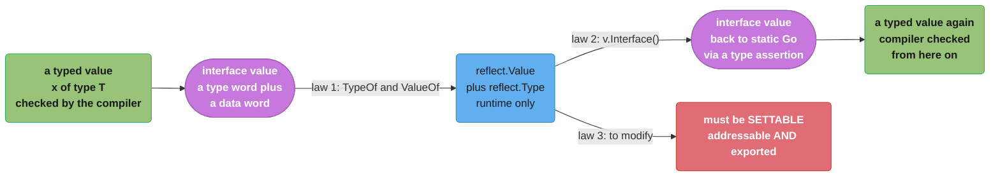
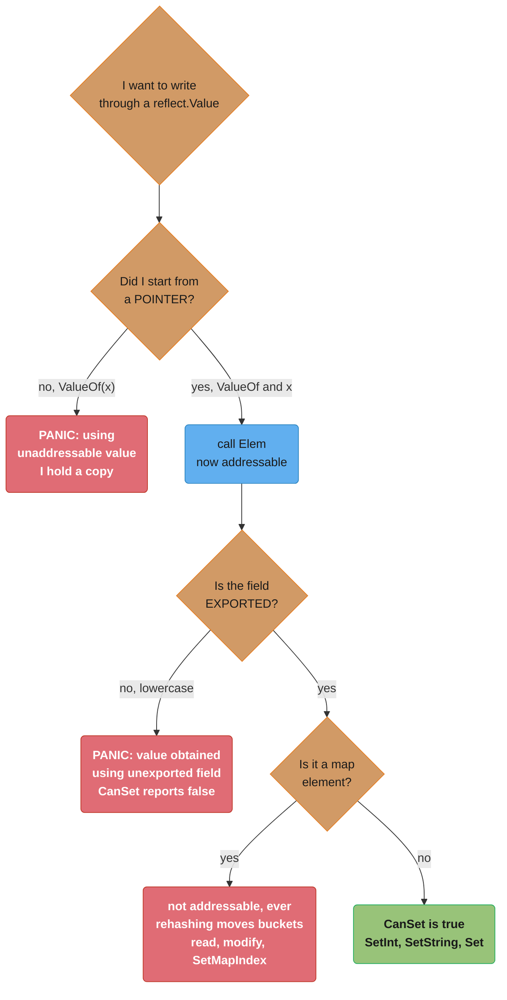
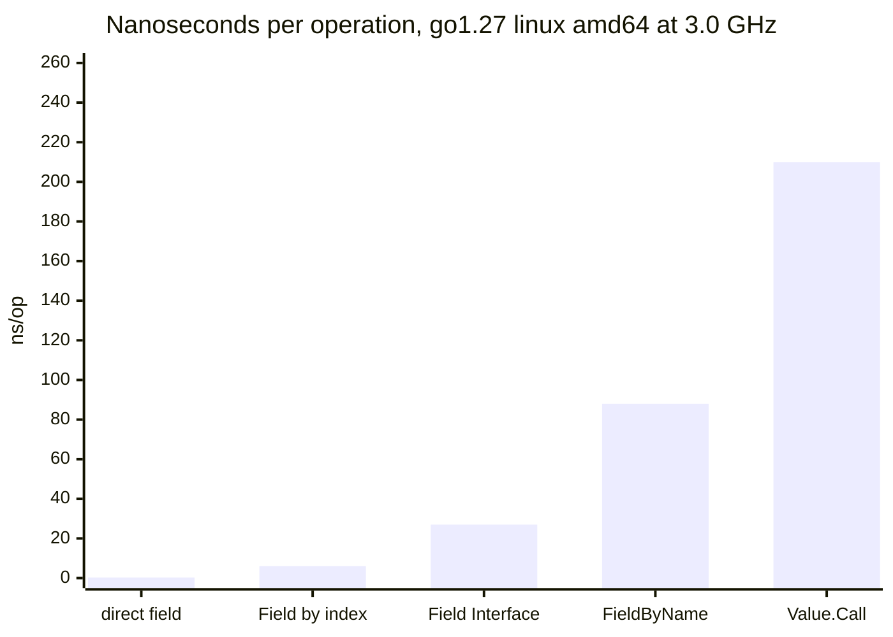

# Reflection and Unsafe

## 1. Concept Overview

Go is a statically typed language with two documented escape hatches from static typing, and
they escape in opposite directions.

**`reflect`** escapes *upward*, into the runtime. Every interface value in Go is a
`(type, value)` pair — a pointer to type metadata and a pointer to data — and `reflect` is
nothing more than a public API over that pair. `reflect.TypeOf` hands you the first word,
`reflect.ValueOf` hands you both. Everything the package can do follows from that: it can
tell you a struct's fields because the type descriptor lists them, it can read a field
because it knows the offset, and it can *write* a field only when the `Value` it holds is
backed by memory it is allowed to address. `encoding/json` marshalling an arbitrary struct,
`database/sql` scanning into `**string`, a dependency-injection container wiring a graph
from constructor signatures, `testify`'s assertions — all of it is that one mechanism.

**`unsafe`** escapes *downward*, past the type system to raw addresses. `unsafe.Pointer` is a
pointer the compiler will convert to or from any other pointer type; `uintptr` is a plain
integer that happens to hold an address and that **the garbage collector does not track**.
That one distinction is the source of essentially every unsafe bug ever written in Go: a
`uintptr` is not a reference, so the object it names can be collected or moved out from
under it, and the failure mode is memory corruption on a machine under load rather than a
panic in your test.

The two get one module because they answer the same question — *how do I write code that
does not know its types at compile time* — and because they share one discipline. Both are
**last resorts with real costs and no compiler help**. Reflection costs you an order of
magnitude of speed, all your compile-time safety, and every optimisation the compiler would
otherwise apply. `unsafe` costs you the Go 1 compatibility promise outright: the package's
own documentation says programs using it may break when the implementation changes, and
that is not a hypothetical, it is what happened to every codebase that reached into
`reflect.SliceHeader` when the runtime changed.

The practical shape of this module is therefore a decision procedure. Before reflection, ask
whether a type parameter or an interface would do — they usually would, and the compiler
checks them. Before `unsafe`, ask whether you have a benchmark showing the win, and whether
the code can be sealed behind a tested boundary of perhaps forty lines that the rest of the
program never sees. If the answer to either is no, you are not making the program faster,
you are making it fragile.

---

## 2. Intuition

> **One-line analogy**: `reflect` is a mirror — you can see your program's shape and even
> reach through and rearrange it, but everything you do costs a round trip and nothing is
> checked before you do it. `unsafe` is removing the guard rail — the road is the same road,
> right up until it isn't.

**Mental model**: think of an interface value as a **luggage tag stapled to a suitcase**.
The tag is the type descriptor, the suitcase is the data. Ordinary Go code reads the tag at
compile time and never looks again. `reflect.ValueOf` un-staples the pair and hands you both
halves at runtime: now you can ask the tag what is inside, and — if and only if the suitcase
is one you own rather than a photocopy of one — you can change the contents. The whole
settability rule is that sentence. `reflect.ValueOf(x)` gives you a *photocopy*;
`reflect.ValueOf(&x).Elem()` gives you the original.

For `unsafe`, the mental model is a **forwarding address**. An `unsafe.Pointer` is a real
forwarding address the post office knows about: if the resident moves, the address is
updated. A `uintptr` is that address written on a napkin. It is the same string of
characters and it is completely useless the moment anyone moves, because nobody knows the
napkin exists.

**Why it matters**: reflection appears in code that had no business using it, because it
looks like the easy way to write something generic. A validation helper, a struct-to-map
converter, a "generic" cache — every one of them is usually a type parameter or an interface
with two extra lines. The cost is not just speed; it is that a typo in a field name becomes
a runtime panic in production instead of a compile error on your laptop. And `unsafe`
appears in code chasing a benchmark, where the measured win is 4% and the eventual cost is
a corrupted heap that reproduces once a week on one machine.

**Key insight**: **reflection is fast enough if you do the expensive part once.** Almost all
of reflection's cost is *inspection* — walking a type's fields, resolving names, allocating
the boxed `interface{}` values. Almost none of it is the actual read or write. So the
standard mitigation is always the same: at first use, walk the type once and build a plan —
a slice of field offsets and encoder functions — cache it by `reflect.Type`, and on every
subsequent call execute the plan instead of re-deriving it. That is exactly what
`encoding/json` does, and it is why a reflection-based encoder is 5x slower than generated
code rather than 100x.

---

## 3. Core Principles

- **An interface value is a `(type, value)` pair, and `reflect` is the API over it.** There
  is no other magic; every capability and every limit follows from that one fact.
- **The three laws:** reflection goes from an interface value to a reflection object; back
  from a reflection object to an interface value; and to modify a reflection object, the
  value it holds must be **settable**.
- **Settable means addressable and exported.** You get addressability by starting from a
  pointer and calling `Elem()`. Nothing else grants it.
- **Switch on `Kind`, not on `Type`.** `Kind` is the small closed set the runtime uses;
  `Type` is open and includes every named type anyone will ever declare.
- **Reflection is roughly an order of magnitude slower** than direct access and allocates on
  every boxing. Build the plan once per type, cache it, execute it many times.
- **Reflection defeats inlining and escape analysis.** A value passed through `interface{}`
  into `reflect` heap-allocates, and the compiler can no longer see what the code does.
- **If a type parameter or an interface would do, use that.** Reflection is for when the set
  of types is genuinely open at compile time.
- **`unsafe.Pointer` is tracked by the garbage collector; `uintptr` is not.** Every unsafe
  bug is a `uintptr` that outlived the thing it pointed at.
- **The six documented conversion patterns are the whole contract.** Anything outside them
  is undefined behaviour that happens to work today.
- **`unsafe.Sizeof`, `Alignof` and `Offsetof` are compile-time constants** — no runtime cost,
  usable in array bounds and `const` blocks.
- **`unsafe.String` and `unsafe.Slice` alias, they do not copy.** The bytes behind a string
  must never be mutated, because every other package assumes strings are immutable.
- **`unsafe` voids the compatibility promise.** Measure the win first, then isolate it behind
  a boundary with tests, a benchmark, and a comment saying why.

---

## 4. Types / Architectures / Strategies

### 4.1 The two reflect entry points and what they give you

| Call | Returns | Can read? | Can write? |
|------|---------|-----------|-----------|
| `reflect.TypeOf(x)` | `reflect.Type` | metadata only — names, kinds, tags, method sets | no |
| `reflect.ValueOf(x)` | `reflect.Value` | yes, a copy | **no** — unaddressable |
| `reflect.ValueOf(&x).Elem()` | `reflect.Value` | yes | yes, if the field is exported |
| `reflect.New(t)` | `reflect.Value` of `*T` | after `.Elem()` | yes |
| `v.Field(i)` on an addressable struct | `reflect.Value` | yes | yes, if exported |
| `v.MapIndex(k)` | `reflect.Value` | yes | **no** — map elements are never addressable |

Map elements being unaddressable is the same rule as `m[k].field = v` failing to compile in
ordinary Go, for the same reason: a map may rehash and move its buckets, so there is no
stable address to hand out.

### 4.2 `Kind` versus `Type`

| | `Kind` | `Type` |
|---|--------|--------|
| Cardinality | 26 values, fixed by the language | unbounded — every declared type |
| `type UserID int` reports | `reflect.Int` | `main.UserID` |
| Use for | dispatch: "is this a struct, a slice, a pointer?" | identity: "is this exactly `time.Time`?" |
| Comparison | `v.Kind() == reflect.Slice` | `t == reflect.TypeOf(time.Time{})` |

Almost every `switch` in reflection code is a `Kind` switch, because the interesting question
is structural. `Type` comparison shows up in the special cases — a marshaller that treats
`time.Time` differently from every other struct is comparing types.

### 4.3 Where reflection genuinely belongs

| Use | Why nothing else works | Example |
|-----|----------------------|---------|
| Serializers | The set of types is open — every user struct ever written | `encoding/json`, `gob`, protobuf's dynamic API |
| ORMs and row scanners | Column names are known only at runtime | `sqlx.StructScan`, `pgx.RowToStructByName` |
| DI containers | The graph is built from constructor signatures | `uber-go/dig`, `google/wire`'s runtime mode |
| Test helpers | Deep structural comparison over arbitrary types | `go-cmp`, `testify.ObjectsAreEqual` |
| Config and validation | Rules live in struct tags | `go-playground/validator`, `mapstructure` |

### 4.4 Where it is a smell

| Smell | The replacement |
|-------|-----------------|
| A "generic" container built on `interface{}` plus reflection | A type parameter — see [Generics and Type Parameters](../generics_and_type_parameters/generics_and_type_parameters.md) |
| Dispatching on concrete type to call a method | An interface with that method |
| Copying between two structs field-by-field by name | Explicit assignment, or code generation |
| Checking a field exists before reading it | A method on the type, checked by the compiler |
| `reflect.DeepEqual` in production code paths | An `Equal` method, or `go-cmp` in tests only |

### 4.5 `unsafe.Pointer` versus `uintptr`

| | `unsafe.Pointer` | `uintptr` |
|---|------------------|-----------|
| What it is | a pointer the compiler will convert to or from any pointer type | an unsigned integer wide enough to hold an address |
| Tracked by the GC | **yes** — keeps the object alive | **no** — the object may be freed |
| Survives a stack copy | **yes** — the runtime rewrites it | **no** — it holds the old address |
| Arithmetic | not directly; use `unsafe.Add` | yes, it is an integer |
| Safe to store in a struct field | yes | only as an opaque token you never dereference |

### 4.6 The sanctioned zero-copy conversions

| Direction | Call | Copies? |
|-----------|------|---------|
| `[]byte` → `string` | `unsafe.String(unsafe.SliceData(b), len(b))` | no |
| `string` → `[]byte` | `unsafe.Slice(unsafe.StringData(s), len(s))` | no |
| `[]byte` → `string`, safe | `string(b)` | yes, always |
| `string` → `[]byte`, safe | `[]byte(s)` | yes, unless the compiler proves it escapes nowhere |

---

## 5. Architecture Diagrams

### The three laws as a round trip



Laws one and two are a lossless round trip: any value goes to a `reflect.Value` and comes
back. Law three is the gate, and it is red because it is where every beginner's panic comes
from. Note that the round trip through `Interface()` returns `any` — you still need a type
assertion to get back to static typing, and that assertion is the moment your runtime
guesses become compile-checked again.

### Settability: the decision that causes every panic



Every one of the three failure paths is a runtime panic with no compile-time warning, which
is the price of reflection in one picture. `v.CanSet()` answers the whole question in one
call and is what library code checks before every write.

### The `unsafe.Pointer` conversion contract

```
The six VALID unsafe.Pointer patterns, from the package documentation

  (1) *T1 -> Pointer -> *T2
      Reinterpret memory as another type. T2 must be no larger than T1 and the
      two must share an equivalent memory layout. This is math.Float64bits.

  (2) Pointer -> uintptr   (but NOT back to Pointer)
      For printing an address or using it as an opaque token. The result is a
      number. It does not keep anything alive.

  (3) Pointer -> uintptr -> Pointer, WITH ARITHMETIC
      Field and element addressing:  unsafe.Pointer(uintptr(p) + offset)
      MUST be one expression. The moment the uintptr lands in a variable,
      the pattern is broken.  unsafe.Add(p, offset) expresses it safely.

  (4) Pointer -> uintptr when calling syscall.Syscall
      The runtime and compiler have a special arrangement that keeps the
      object alive across the call. Only inside the call expression itself.

  (5) uintptr from reflect.Value.Pointer or .UnsafeAddr -> Pointer
      Same one-expression rule: convert in the SAME statement that produced it.

  (6) reflect.SliceHeader / reflect.StringHeader Data field <-> Pointer
      Only when the header describes a slice or string that is genuinely live.
      Modern code expresses this with unsafe.Slice / unsafe.String instead.

The INVALID pattern that looks identical to (3)

  // BROKEN: two statements. The uintptr is not a reference.
  addr := uintptr(unsafe.Pointer(&s.Field))
  // ... any statement here: a call, an allocation, a GC, a stack growth ...
  p := (*int)(unsafe.Pointer(addr))          // addr may name freed or moved memory

  // FIX: one expression, no intermediate variable.
  p := (*int)(unsafe.Add(unsafe.Pointer(&s), unsafe.Offsetof(s.Field)))

Why the statement boundary matters: a goroutine's stack GROWS BY COPYING. The
runtime rewrites every real pointer it finds in the old stack. It cannot rewrite
an integer, because it cannot know an integer is an address.
```

The rule collapses to a single sentence you can carry: **a `uintptr` may exist only inside
the expression that consumes it**. Everything valid is one expression; everything invalid
has a semicolon in the middle.

### What reflection actually costs



Direct access is effectively free because the compiler inlines it away. Indexed field access
through `reflect` costs about 20x that and still does not allocate. `Interface()` boxes the
result and allocates, which is where the order-of-magnitude jump comes from.
`FieldByName` does a string comparison across every field on every call — that is the one to
cache, and caching it is most of what a "fast" reflection library does. Measure on your own
hardware before quoting any of these; the shape of the curve is the durable fact, not the
absolute numbers.

---

## 6. How It Works — Detailed Mechanics

### 6.1 `Type` and `Value` are the two halves of an interface

An interface value is two words: a pointer to type metadata and a pointer to data. Passing
anything to a function taking `any` builds that pair, and `reflect` reads it back.

```go
var x float64 = 3.4

t := reflect.TypeOf(x)     // the type word:  float64
v := reflect.ValueOf(x)    // both words

fmt.Println(t.Name(), t.Kind())          // float64 float64
fmt.Println(v.Kind(), v.Float())         // float64 3.4
fmt.Println(v.Type() == t)               // true
```

`reflect.TypeOf` and `reflect.ValueOf` both take `any`, so calling them **boxes** their
argument. For a value larger than a word that means a heap allocation, and it happens before
`reflect` does anything at all — the cost is in the call, not in the package.

`v.Interface()` is the reverse: it packs the pair back into an `any`, which you then type
assert. That is law two, and it is how a reflection-based decoder hands a decoded value back
to statically typed code.

```go
back := v.Interface().(float64)   // law 2, then a type assertion
```

`Interface()` panics on a `Value` obtained through an unexported field. `CanInterface()`
reports whether it is allowed, and library code checks it rather than recovering from the
panic.

### 6.2 `Kind` versus `Type`, and why you switch on `Kind`

```go
type UserID int

var id UserID = 7
v := reflect.ValueOf(id)

v.Kind()          // reflect.Int      -- the underlying representation
v.Type().Name()   // "UserID"         -- the declared identity
v.Type().String() // "main.UserID"
```

There are 26 kinds and they never change; there are unboundedly many types. So a general
walker dispatches on kind:

```go
func walk(v reflect.Value, depth int) {
    switch v.Kind() {
    case reflect.Ptr, reflect.Interface:
        if v.IsNil() {
            return
        }
        walk(v.Elem(), depth+1)
    case reflect.Struct:
        for i := 0; i < v.NumField(); i++ {
            walk(v.Field(i), depth+1)
        }
    case reflect.Slice, reflect.Array:
        for i := 0; i < v.Len(); i++ {
            walk(v.Index(i), depth+1)
        }
    case reflect.Map:
        for _, k := range v.MapKeys() {
            walk(v.MapIndex(k), depth+1)
        }
    default:
        emit(v)
    }
}
```

Two traps in that shape. `v.IsNil()` panics on kinds that cannot be nil, so it must sit
inside a case that guarantees the kind. And `v.IsValid()` is a distinct question — the zero
`reflect.Value` is what `reflect.ValueOf(nil)` and a missing `FieldByName` return, and every
method on it panics. Library code checks `IsValid` first, then `Kind`, then `IsNil`.

### 6.3 The three laws, stated exactly

1. **Reflection goes from an interface value to a reflection object.** `TypeOf` and
   `ValueOf` take `any`, so anything can enter.
2. **Reflection goes from a reflection object back to an interface value.** `v.Interface()`
   returns `any`; a type assertion returns you to static typing.
3. **To modify a reflection object, the value must be settable.** Settability requires that
   the `Value` refer to the original memory, not a copy — and that means addressability.

Law three is the one with teeth, and the reason is ordinary Go semantics rather than
anything exotic: `reflect.ValueOf(x)` receives `x` **by value** through an `any` parameter.
It holds a copy. Writing to a copy would compile, do nothing observable, and be a far worse
API than panicking, so `reflect` panics.

### 6.4 Settability, addressability, and `Elem()`

```go
var x float64 = 3.4

v := reflect.ValueOf(x)
fmt.Println(v.CanAddr(), v.CanSet())   // false false
// v.SetFloat(7.1)
// panic: reflect: reflect.Value.SetFloat using unaddressable value

p := reflect.ValueOf(&x)     // Kind is Ptr; the POINTER is still a copy, but
e := p.Elem()                // Elem dereferences it: e refers to x itself
fmt.Println(e.CanAddr(), e.CanSet())   // true true
e.SetFloat(7.1)
fmt.Println(x)                          // 7.1
```

The chain is always the same: **pointer in, `Elem()`, then fields are addressable too.**

```go
type Config struct {
    Addr    string
    Timeout time.Duration
    secret  string          // unexported
}

func setField(cfg *Config, name, value string) error {
    v := reflect.ValueOf(cfg).Elem()      // addressable struct
    f := v.FieldByName(name)
    if !f.IsValid() {
        return fmt.Errorf("no field %q", name)
    }
    if !f.CanSet() {
        return fmt.Errorf("field %q is not settable", name)   // unexported
    }
    switch f.Kind() {
    case reflect.String:
        f.SetString(value)
    case reflect.Int64:
        d, err := time.ParseDuration(value)
        if err != nil {
            return err
        }
        f.SetInt(int64(d))
    default:
        return fmt.Errorf("unsupported kind %s", f.Kind())
    }
    return nil
}
```

Three checks before the write, each guarding a distinct panic: `IsValid` for a field name
that does not exist, `CanSet` for an unexported field
(`reflect: reflect.Value.SetString using value obtained using unexported field`), and the
`Kind` switch for a type mismatch (`reflect.Value.SetString of non-string type`). Library
code that skips them ships panics to its users.

**Map elements are never addressable.** `v.MapIndex(k)` returns a copy, because a map may
rehash and relocate its buckets. To modify one you read it out, change the copy, and write
it back with `SetMapIndex` — the same read-modify-write that ordinary Go forces with
`m[k] = f(m[k])`.

**Slice elements are addressable** when the slice itself is, because a slice's backing array
does not move under you: `v.Index(i).SetInt(3)` works on a slice reached through a pointer.
The distinction between the two is exactly the slice-header versus map-bucket distinction in
[Data Structures and Memory Layout](../data_structures_and_memory_layout/data_structures_and_memory_layout.md).

### 6.5 Struct tags

A struct tag is a string literal after a field, conventionally a space-separated list of
`key:"value"` pairs. The compiler stores it and does nothing else with it.

```go
type User struct {
    ID    int    `json:"id" db:"user_id"`
    Email string `json:"email,omitempty" validate:"required,email"`
    Hash  string `json:"-"`
}

t := reflect.TypeOf(User{})
f, _ := t.FieldByName("Email")

f.Tag.Get("json")            // "email,omitempty"  -- "" if absent
v, ok := f.Tag.Lookup("db")  // "", false          -- distinguishes absent from empty
```

`Get` and `Lookup` differ in exactly one case that matters: `json:""` and no `json` tag at
all both make `Get` return `""`, and only `Lookup` tells them apart. A marshaller needs the
distinction, because an explicitly empty tag and an absent tag can mean different things.

How `encoding/json` uses it: on the first marshal of a type it walks the fields, parses each
`json` tag into a name plus options (`omitempty`, `omitzero` `[1.24]`, `string`), skips
unexported fields and any field tagged `-`, flattens embedded structs, sorts the result, and
**caches the whole plan keyed by `reflect.Type`**. Every later marshal of that type executes
the cached plan. That cache is the reason `encoding/json` is 5x slower than generated code
rather than 100x.

Tags are strings, so a typo is silent. `go vet`'s `structtag` check catches malformed syntax
and duplicate keys, which is the only automated protection there is — write
`json:"id,omitempty"` and not `json:"id, omitempty"`, because the space becomes part of an
option name that nothing recognises.

### 6.6 Iterating with the `[1.26]` iterator methods

`[1.26]` added six range-over-func iterators that replace the index loops:

```go
Type.Fields()   iter.Seq[StructField]        // struct fields
Type.Methods()  iter.Seq[Method]             // the type's method set
Type.Ins()      iter.Seq[Type]               // a func type's parameters
Type.Outs()     iter.Seq[Type]               // a func type's results
Value.Fields()  iter.Seq2[StructField, Value]
Value.Methods() iter.Seq2[Method, Value]     // method values with the receiver bound
```

The index loop and its replacement:

```go
// Before: two calls per iteration and an index you must keep in step.
t := v.Type()
for i := 0; i < v.NumField(); i++ {
    sf := t.Field(i)
    fv := v.Field(i)
    if sf.PkgPath != "" {          // unexported
        continue
    }
    encode(sf.Tag.Get("json"), fv)
}

// [1.26]: the type info and the value arrive together.
for sf, fv := range v.Fields() {
    if !sf.IsExported() {
        continue
    }
    encode(sf.Tag.Get("json"), fv)
}
```

The win is not performance — it is that `Value.Fields()` yields the `StructField` and the
`Value` **as a pair**, which removes the single most common reflection bug in a walker:
indexing `t.Field(i)` and `v.Field(j)` with different variables after a `continue` or a
nested loop. `Type.Ins()` and `Type.Outs()` do the same for function signatures, which is
what a DI container spends its time reading.

### 6.7 Calling methods dynamically

```go
type Service struct{ base string }

func (s *Service) Fetch(ctx context.Context, id int) (string, error) {
    return s.base + strconv.Itoa(id), nil
}

func invoke(target any, method string, args ...any) ([]reflect.Value, error) {
    v := reflect.ValueOf(target)
    m := v.MethodByName(method)
    if !m.IsValid() {
        return nil, fmt.Errorf("no method %q on %T", method, target)
    }
    mt := m.Type()
    if mt.NumIn() != len(args) {
        return nil, fmt.Errorf("%s wants %d args, got %d", method, mt.NumIn(), len(args))
    }
    in := make([]reflect.Value, len(args))
    for i, a := range args {
        av := reflect.ValueOf(a)
        if !av.Type().AssignableTo(mt.In(i)) {
            return nil, fmt.Errorf("arg %d: %s not assignable to %s",
                i, av.Type(), mt.In(i))
        }
        in[i] = av
    }
    return m.Call(in), nil
}
```

Every line after `MethodByName` is a check that the compiler would have done for free. Skip
one and `Call` panics: wrong arity, wrong types, a nil `Value` in the slice, or an
unexported method (which `MethodByName` will not even find — the method set exposed through
reflection contains only exported methods).

Note the receiver rule: `Fetch` has a pointer receiver, so it is in the method set of
`*Service` and not of `Service`. `reflect.ValueOf(Service{}).MethodByName("Fetch")` returns
an invalid `Value`. This is the same method-set rule as ordinary Go, described in
[Interfaces, Methods and Embedding](../interfaces_methods_and_embedding/interfaces_methods_and_embedding.md)
— reflection does not relax it, it just reports the violation at runtime instead of at
compile time.

`Call` allocates: a `[]reflect.Value` for the arguments, a `[]reflect.Value` for the
results, and a boxed value per argument. At roughly 210 ns per call on a 3.0 GHz amd64 box
it is fine for wiring a dependency graph at startup and wrong for a per-request hot path.

### 6.8 The cost, measured

Figures from `go test -bench` with `b.Loop()` `[1.24]` on go1.27, linux/amd64, a 3.0 GHz
core, over a 5-field struct. Treat the ratios as the durable fact and re-measure the
absolutes on your own hardware — see
[Testing, Benchmarking and Fuzzing](../testing_benchmarking_and_fuzzing/testing_benchmarking_and_fuzzing.md).

| Operation | ns/op | B/op | allocs/op |
|-----------|-------|------|-----------|
| `u.Email` — direct field read | 0.3 | 0 | 0 |
| `v.Field(1).String()` | 6 | 0 | 0 |
| `v.Field(1).Interface()` | 27 | 16 | 1 |
| `v.FieldByName("Email")` | 88 | 0 | 0 |
| `m.Call(args)` — one arg, two results | 210 | 152 | 4 |
| `json.Marshal` — 5-field struct | 640 | 288 | 3 |
| a generated marshaller for the same struct | 120 | 112 | 1 |
| `reflect.DeepEqual` on two 5-field structs | 340 | 48 | 2 |

Three separate costs hide in that table:

1. **Indirection.** `v.Field(1)` cannot be inlined and cannot have its bounds check
   eliminated, because the index is a runtime value into a runtime-described layout. 20x
   over a direct read, and no allocation.
2. **Boxing.** `Interface()` puts the value in an `interface{}`, which heap-allocates for
   anything that does not fit in a pointer word. That is the 16 B and the one alloc, and it
   is what makes the jump to 27 ns.
3. **Name resolution.** `FieldByName` compares strings across the field list on every call.
   88 ns for a 5-field struct, and it grows with field count.

Two further costs do not appear as a row because they are compiler effects:

- **Escape analysis is defeated.** Passing a value to `reflect.ValueOf(any)` means the
  compiler must assume the callee keeps it, so the value escapes to the heap even when a
  human can see it does not. `-gcflags=-m` reports it, and the details are in
  [Escape Analysis and Performance](../escape_analysis_and_performance/escape_analysis_and_performance.md).
- **Inlining stops.** `reflect.Value` methods are far over the inlining budget, so a hot
  loop that was one fused instruction sequence becomes a chain of real calls.

### 6.9 The mitigation: build the plan once, cache it by type

This is the pattern behind every fast reflection-based library.

```go
type fieldPlan struct {
    index []int          // Value.FieldByIndex path, handles embedding
    name  string         // resolved from the tag once
    omit  bool
    enc   func(*bytes.Buffer, reflect.Value)
}

var planCache sync.Map   // map[reflect.Type][]fieldPlan

func planFor(t reflect.Type) []fieldPlan {
    if p, ok := planCache.Load(t); ok {
        return p.([]fieldPlan)
    }
    var plan []fieldPlan
    for sf := range t.Fields() {          // [1.26] iterator
        if !sf.IsExported() {
            continue
        }
        tag, ok := sf.Tag.Lookup("json")
        if tag == "-" {
            continue
        }
        name, opts, _ := strings.Cut(tag, ",")
        if !ok || name == "" {
            name = sf.Name
        }
        plan = append(plan, fieldPlan{
            index: sf.Index,
            name:  name,
            omit:  strings.Contains(opts, "omitempty"),
            enc:   encoderFor(sf.Type),   // resolved ONCE, per type
        })
    }
    actual, _ := planCache.LoadOrStore(t, plan)
    return actual.([]fieldPlan)
}

func Marshal(v any) []byte {
    rv := reflect.ValueOf(v)
    var buf bytes.Buffer
    for _, f := range planFor(rv.Type()) {
        fv := rv.FieldByIndex(f.index)     // indexed, not by name
        if f.omit && fv.IsZero() {
            continue
        }
        buf.WriteString(f.name)
        f.enc(&buf, fv)                    // a direct call, no kind switch
    }
    return buf.Bytes()
}
```

Everything expensive happens once per type, for the life of the process: the field walk, the
tag parse, the name resolution, and the per-kind dispatch that becomes a stored function
pointer. The steady-state path is an indexed field access and a direct call. `sync.Map` is
the right cache here for once — this is exactly its documented case, a key set that stabilises
after warm-up and is then read-only.

The measured effect on the table above: the `FieldByName` row disappears entirely, the kind
switch disappears, and a naive walker's ~1,400 ns per struct drops to the ~640 ns that
`encoding/json` actually achieves.

### 6.10 `unsafe.Pointer` and `uintptr`

```go
p := unsafe.Pointer(&x)   // a real pointer: the GC sees it, keeps x alive,
                          // and rewrites it if the stack is copied
n := uintptr(p)           // an integer: the GC does not see it, x may die
```

Go's garbage collector is precise: it knows, for every word of every stack frame and every
heap object, whether that word is a pointer. It uses that to decide what is live and — for
stacks, which **grow by copying** — to rewrite pointers when the frame moves. A `uintptr`
holds the same bits as a pointer, but the type system says it is a number, so the collector
neither keeps its target alive nor updates it.

Both failure modes are silent and load-dependent:

- **Collection.** The last real pointer to an object goes away, only a `uintptr` remains, the
  object is freed, and the next dereference reads whatever now occupies that memory.
- **Movement.** A goroutine's 2 KB stack fills, the runtime allocates a larger one and copies
  the frames, rewriting every pointer it can identify. A `uintptr` still holds the old
  address, which is now unmapped or reused.

Neither reproduces on an idle test machine, because both need a GC cycle or a stack growth
at exactly the wrong moment. Both reproduce under production load.

### 6.11 The six valid patterns, in code

```go
// (1) *T1 -> Pointer -> *T2. Same size, equivalent layout.
func float64bits(f float64) uint64 {
    return *(*uint64)(unsafe.Pointer(&f))
}

// (2) Pointer -> uintptr, and NOT back. An opaque identity token.
func addrOf(v any) uintptr { return uintptr(reflect.ValueOf(v).Pointer()) }

// (3) Pointer -> uintptr -> Pointer with arithmetic, in ONE expression.
type Header struct {
    Magic uint32
    Len   uint32
    Flags uint64
}
func lenField(h *Header) *uint32 {
    return (*uint32)(unsafe.Add(unsafe.Pointer(h), unsafe.Offsetof(h.Len)))
}

// (4) Pointer -> uintptr inside a syscall call expression.
_, _, errno := syscall.Syscall(syscall.SYS_READ, uintptr(fd),
    uintptr(unsafe.Pointer(&buf[0])), uintptr(len(buf)))

// (5) reflect.Value.Pointer / UnsafeAddr -> Pointer, in the SAME statement.
p := unsafe.Pointer(reflect.ValueOf(&x).Elem().UnsafeAddr())

// (6) The slice/string header case, expressed the modern way.
b := unsafe.Slice(unsafe.StringData(s), len(s))
```

Pattern 3 is the one worth internalising, because it is the one you will write. `unsafe.Add`
exists precisely so you do not have to spell out the `uintptr` round trip, and using it makes
the one-expression rule structural rather than a thing you have to remember.

Pattern 4 is a compiler-and-runtime special case: the compiler recognises
`uintptr(unsafe.Pointer(x))` appearing **directly in the argument list** of a `syscall.Syscall`
family call and arranges for `x` to stay alive and unmoved across it. Hoist that conversion
into a local variable and the arrangement is gone.

### 6.12 The invalid pattern, and why it passes review

```go
// BROKEN: the uintptr survives a statement boundary.
func brokenFieldPtr(s *Record) *int64 {
    base := uintptr(unsafe.Pointer(s))        // s is now unreferenced as a pointer
    off := unsafe.Offsetof(s.Count)
    // If the GC runs here, or this goroutine's stack grows, base is stale.
    return (*int64)(unsafe.Pointer(base + off))
}

// FIX: never let the address exist as an integer between statements.
func fieldPtr(s *Record) *int64 {
    return (*int64)(unsafe.Add(unsafe.Pointer(s), unsafe.Offsetof(s.Count)))
}
```

The broken version is *more readable*. It has a named base, a named offset, and a clear
final line — it is exactly what a careful engineer writes and exactly what a reviewer
approves. It is also undefined behaviour, and it will work perfectly in every test you run,
because a test does not allocate hard enough between those three lines to trigger a
collection or a stack copy.

The one tool that catches it is `checkptr`, which the compiler enables automatically under
`-race` and `-msan`. It instruments unsafe conversions and reports "checkptr: pointer
arithmetic result points to invalid allocation" at the moment it happens. Running the race
detector in CI is therefore not only a concurrency measure — it is the only routine defence
against this bug class.

### 6.13 `Sizeof`, `Alignof`, `Offsetof` are compile-time constants

```go
type Entry struct {
    Key   uint64
    Value uint64
}

const entrySize = unsafe.Sizeof(Entry{})     // legal in a const block: 16
var _ [entrySize]byte                        // legal as an array bound

fmt.Println(unsafe.Alignof(Entry{}))         // 8
fmt.Println(unsafe.Offsetof(Entry{}.Value))  // 8
```

These three do not read memory and cost nothing at runtime — the compiler folds them to
constants, which is why they may appear in `const` declarations and array bounds. Their most
valuable use has nothing to do with unsafe code at all: pinning a layout in a test so that a
future field insertion fails loudly.

```go
func TestEntryLayout(t *testing.T) {
    if got := unsafe.Sizeof(Entry{}); got != 16 {
        t.Fatalf("Entry grew to %d bytes: the mmap format is now incompatible", got)
    }
}
```

Struct padding and alignment themselves belong to
[Data Structures and Memory Layout](../data_structures_and_memory_layout/data_structures_and_memory_layout.md).

### 6.14 `unsafe.Slice`, `unsafe.String`, and the data accessors

```go
func Slice(ptr *ArbitraryType, len IntegerType) []ArbitraryType   // [1.17]
func SliceData(slice []ArbitraryType) *ArbitraryType              // [1.20]
func String(ptr *byte, len IntegerType) string                    // [1.20]
func StringData(str string) *byte                                 // [1.20]
```

These four are the sanctioned, GC-visible way to convert between `[]byte` and `string`
without copying:

```go
// []byte -> string, zero copy. The string ALIASES b.
func b2s(b []byte) string {
    if len(b) == 0 {
        return ""                       // SliceData on an empty slice may be nil
    }
    return unsafe.String(unsafe.SliceData(b), len(b))
}

// string -> []byte, zero copy. The slice ALIASES s. NEVER write to it.
func s2b(s string) []byte {
    return unsafe.Slice(unsafe.StringData(s), len(s))
}
```

They are safe in the narrow sense that the compiler and GC understand them: the resulting
string or slice keeps the underlying array alive and survives a stack copy, which a
hand-rolled header cast does not. What they cannot enforce is the **aliasing contract**.

Before reaching for either, check whether the compiler already elides the copy. `string(b)`
used as a map key — `m[string(b)]` — is a recognised pattern the compiler optimises to a
non-allocating lookup, as is `switch string(b)` and a comparison against a string literal.
Those cover a large share of the cases people write `b2s` for.

### 6.15 The aliasing contract, and what breaks when you violate it

Go strings are immutable, and every package in existence relies on it. Strings are used as
map keys with their hashes cached in the bucket; they are shared freely because sharing is
safe; `strings.Builder` hands out a string that aliases its own buffer on the promise that
nobody writes to it.

```go
// BROKEN: mutating the array behind a string.
s := "hello"
b := unsafe.Slice(unsafe.StringData(s), len(s))
b[0] = 'H'                       // corrupts a read-only page, or corrupts a constant

// BROKEN, subtler: a []byte that is reused after being aliased as a map key.
buf := make([]byte, 0, 64)
for scanner.Scan() {
    buf = append(buf[:0], scanner.Bytes()...)
    counts[b2s(buf)]++           // the key aliases buf, which the next iteration overwrites
}

// FIX: copy for anything retained. Alias only for a lookup that does not store.
for scanner.Scan() {
    buf = append(buf[:0], scanner.Bytes()...)
    if _, ok := counts[b2s(buf)]; !ok {   // lookup: alias is fine, nothing retained
        counts[string(buf)]++             // insert: the key must own its bytes
        continue
    }
    counts[b2s(buf)]++
}
```

The first case is the classic demonstration: string constants live in a read-only section of
the binary, so writing through the alias either segfaults or, if the string came from the
heap, silently changes it everywhere it is shared.

The second is the one that reaches production. The map stores a key that points into a buffer
the loop overwrites on the next iteration, so every key in the map ends up being the last
line read — a map with 40,000 entries that are all the same string, and a lookup that finds
nothing. The rule is short: **alias for a read that does not outlive the buffer; copy for
anything the program keeps.**

### 6.16 `//go:linkname`

`//go:linkname localname importpath.name` tells the linker to bind a local declaration to a
symbol in another package, including unexported runtime internals. It requires
`import _ "unsafe"` and a file that either has a body or is accompanied by an empty `.s`
file.

```go
import _ "unsafe"

//go:linkname nanotime runtime.nanotime
func nanotime() int64
```

`[1.23]` restricted it. The linker now **disallows a `//go:linkname` reference to a
standard-library or runtime internal symbol that is not itself marked with a `//go:linkname`
on its definition** — that is, the referenced package must "push" the symbol before you may
"pull" it. Assembly references to such symbols are disallowed for the same reason. Existing
usages found in a large open-source corpus were grandfathered in; new ones are not.
`-ldflags=-checklinkname=0` disables the check for debugging, and shipping with it set is a
decision to depend on an internal symbol that may vanish in the next release.

The practical consequence: `//go:linkname` is no longer an available technique for reaching
into the runtime. If you find yourself wanting it, the answer is nearly always an exported
API that appeared since the trick was written — `runtime/metrics` for scheduler internals,
`internal/sync` exposures via the public `sync` package, `testing/synctest` `[1.25]` for
fake time.

### 6.17 Tooling that catches unsafe mistakes

| Tool | Invocation | What it finds |
|------|-----------|---------------|
| `go vet` `unsafeptr` | `go vet ./...`, on by default | A `uintptr` converted to `unsafe.Pointer` outside the valid patterns — the statement-boundary bug |
| `checkptr` | automatic under `go test -race` or `-msan` | At runtime: pointer arithmetic landing outside an allocation, and misaligned conversions |
| `go vet` `structtag` | on by default | Malformed or duplicated struct tags, the silent reflection failure |
| `go fix` `unsafefuncs` `[1.27]` | `go fix ./...` | A modernizer for `unsafe` usage; run `go tool fix help` for exactly what it rewrites |
| `-gcflags=all=-d=checkptr=2` | explicit build flag | Stricter checkptr, including conversions the default mode allows |
| `gosec` | `gosec ./...` | Flags every `unsafe` import, which is the right default for a security review |

The two that matter most are the cheapest: `go vet` runs in every `go test` invocation
already, and `-race` in CI turns the statement-boundary bug from undefined behaviour into a
failing test with a stack trace.

---

## 7. Real-World Examples

**`encoding/json`** is the reference implementation of the cached-plan pattern. Its
`typeFields` walk resolves names, tag options and embedding once per type into a sorted
`structFields` value stored in a `sync.Map`, and every subsequent marshal executes it. Read
it before writing any reflection-heavy code — it is the version of this technique that has
been reviewed the most times.

**`database/sql` and `sqlx`** use reflection for the one thing that is genuinely unknowable
at compile time: mapping result-set column names onto struct fields. `pgx`'s
`RowToStructByName` does the same. This is the canonical justified use — the schema exists
outside the program.

**`uber-go/dig` and the runtime half of `google/wire`** read constructor signatures with
`Type.Ins()` and `Type.Outs()` to build a dependency graph. `wire`'s compile-time mode exists
precisely because the same job can be done by code generation, and the two modes side by side
are a good illustration of the tradeoff.

**`go-cmp`** replaced `reflect.DeepEqual` in tests across the ecosystem because `DeepEqual`
has no notion of options: it cannot ignore a field, cannot use an `Equal` method, cannot
compare floats with a tolerance, and reports differences as "not equal" with no diff.

**`bytedance/sonic` and `goccy/go-json`** are the other direction — they beat
`encoding/json` by replacing reflection with a JIT or with generated per-type code, and by
using `unsafe` throughout. They are also a fair illustration of the cost: both have shipped
correctness bugs that `encoding/json` structurally cannot have.

**`strings.Builder`** uses the aliasing conversion in the standard library itself: `String()`
returns a string that points at the builder's own buffer, with no copy, on the strict promise
that the builder never writes to it again. That promise is enforced by a copy-check on the
builder's own pointer, not by the type system.

**Protobuf's dynamic messages** (`protoreflect`) exist because a proxy or a schema registry
must handle message types it was never compiled against. That is reflection over a
descriptor rather than over Go types, and it is the same reasoning one level up.

---

## 8. Tradeoffs

### 8.1 Reflection versus the alternatives

| | Reflection | Type parameters | Interfaces | Code generation |
|---|-----------|-----------------|-----------|-----------------|
| Type set known at compile time | no | yes | yes, by method | yes |
| Errors surface | at runtime, as a panic | at compile time | at compile time | at compile time |
| Speed relative to direct | ~10x slower, ~100x for name lookup | same as direct after stenciling | one indirect call | same as hand-written |
| Allocations | on every boxing | none inherent | boxing on conversion | none inherent |
| Works on a type you do not control | yes | yes, if it satisfies the constraint | only if it has the method | yes, with a generator run |
| Build-step cost | none | none | none | a generator in the build |
| Readable stack traces | poor | good | good | good |

### 8.2 `unsafe` conversion versus a copy

| | `unsafe.String`/`Slice` | `string(b)` / `[]byte(s)` |
|---|------------------------|---------------------------|
| Cost | 0 ns, 0 allocs | ~15 ns and one allocation for a 64-byte value |
| Aliases the source | yes — mutation is a bug | no, independent memory |
| Safe as a retained map key | no | yes |
| Survives the source being reused | no | yes |
| Compatibility promise | void | intact |
| Compiler may already elide it | n/a | yes, for `m[string(b)]`, `switch string(b)`, literal comparison |

### 8.3 Where the reflection cost actually lands

| Cost | Magnitude | Mitigation |
|------|----------|-----------|
| Boxing into `any` | 1 alloc, ~16–32 B | Cache the `reflect.Value` if the target is stable |
| `FieldByName` | ~88 ns, grows with field count | Resolve to a `[]int` index path once, cache by type |
| Kind switch per field per call | ~5–15 ns each | Resolve to a function pointer once, store in the plan |
| Lost inlining | whole-loop effect, unmeasurable in isolation | Keep reflection out of the innermost loop entirely |
| Lost escape analysis | one heap allocation per escaped value | Confirm with `-gcflags=-m`, restructure the boundary |

---

## 9. When to Use / When NOT to Use

**Use reflection** when the set of types is genuinely open at compile time: a serializer, a
row scanner, a validation engine driven by struct tags, a DI container, a deep-comparison
test helper. In every one of those the program is compiled without knowing the types it will
handle, and nothing else can express that.

**Do not use reflection** when a type parameter would do. "I want this to work for any
numeric type" is `[T Number]`, checked by the compiler, and stenciled to direct code — see
[Generics and Type Parameters](../generics_and_type_parameters/generics_and_type_parameters.md).
"I want this to work for anything with a `Close` method" is `io.Closer`.

**Do not use reflection in a hot path**, even when it is justified elsewhere. Build the plan
at startup or on first use and execute the plan afterwards; the difference between the two is
the difference between 640 ns and 1,400 ns per struct.

**Do not use `reflect.DeepEqual` outside tests**, and prefer `go-cmp` inside them.
`DeepEqual` compares unexported fields, has no options, treats a nil slice and an empty slice
as different, and gives you a bare `false` when it fails.

**Use `unsafe`** when you have a benchmark showing a material win, the code is isolated
behind a small tested boundary, and you have read the six patterns that morning. The
realistic cases are narrow: a zero-copy `[]byte`/`string` conversion on a genuinely hot path,
a fixed-layout binary format read directly from an mmap, and a syscall wrapper.

**Do not use `unsafe`** to reach an unexported field of somebody else's struct, to build a
"generic" container, or to avoid a copy you have not measured. Do not use it at all in a
library other people depend on unless the boundary is airtight — you are spending their
compatibility promise, not yours.

**Do not keep a `uintptr` in a variable.** If your code has one that is not being passed
straight into a syscall in the same expression, it is a bug regardless of whether it has
fired yet.

---

## 10. Common Pitfalls

### Pitfall 1 — the config loader that silently ignored half the file

A service loaded configuration by walking a `map[string]string` and setting struct fields by
name.

```go
// BROKEN: ValueOf receives a COPY, so every Set panics; the recover hides it.
func Load(cfg Config, kv map[string]string) Config {
    v := reflect.ValueOf(cfg)
    for k, val := range kv {
        defer func() { recover() }()           // "handles" the panic
        v.FieldByName(k).SetString(val)
    }
    return cfg
}

// FIX: take a pointer, Elem to get addressability, and check before writing.
func Load(cfg *Config, kv map[string]string) error {
    v := reflect.ValueOf(cfg).Elem()
    for k, val := range kv {
        f := v.FieldByName(k)
        if !f.IsValid() {
            return fmt.Errorf("unknown config key %q", k)
        }
        if !f.CanSet() {
            return fmt.Errorf("config key %q is not settable", k)
        }
        f.SetString(val)
    }
    return nil
}
```

**Impact.** Every field written by this loader kept its zero value. The service ran on
compiled-in defaults for **five months**: a 30-second timeout instead of the configured 5
seconds, and a connection pool of 0 that silently meant "unlimited" in the driver. It
surfaced when a downstream outage let 4,000 connections open against a database configured
for 500, taking down four other services. The blanket `recover` is what made it invisible —
without it, the first panic would have crashed the process on the first deploy.

### Pitfall 2 — the unexported field that worked in tests and panicked in production

An audit library recorded every field of every struct it was given.

```go
// BROKEN: Interface() panics on a value read through an unexported field.
for i := 0; i < v.NumField(); i++ {
    record(t.Field(i).Name, v.Field(i).Interface())
}

// FIX: skip what reflection is not allowed to export.
for sf, fv := range v.Fields() {          // [1.26]
    if !sf.IsExported() {
        continue
    }
    record(sf.Name, fv.Interface())
}
```

**Impact.** Every struct in the test suite had only exported fields, so coverage was 100%
and green. In production the library was handed a `*http.Request`, whose `ctx` field is
unexported, and panicked with "cannot return value obtained from unexported field or method"
inside a middleware — which meant it panicked on **every request**, on all 22 pods, 40
seconds after the deploy went to 100%. The rollback took 6 minutes; the incident was 6
minutes of total outage on the public API.

### Pitfall 3 — the `uintptr` that corrupted the heap once a week

A metrics library read a counter out of a fixed-layout struct by computing its address.

```go
// BROKEN: the address exists as an integer across two statements.
func counterAddr(s *shard) *uint64 {
    base := uintptr(unsafe.Pointer(s))
    return (*uint64)(unsafe.Pointer(base + unsafe.Offsetof(s.hits)))
}

// FIX: one expression, and unsafe.Add says so structurally.
func counterAddr(s *shard) *uint64 {
    return (*uint64)(unsafe.Add(unsafe.Pointer(s), unsafe.Offsetof(s.hits)))
}
```

**Impact.** The shard was heap-allocated and the function was called from a deep call chain,
so a stack growth between the two statements was possible but rare. The result was a write
through a stale address roughly once every **4 to 9 days** under production load, corrupting
whatever object had since been placed there. The symptoms were four distinct panics in four
unrelated packages — a map iteration failure, two nil dereferences, and one "runtime: bad
pointer" — which is why it was chased as four separate bugs for **seven weeks**. Enabling
`-race` in the integration suite reproduced it in 90 seconds with a `checkptr` report naming
the exact line.

### Pitfall 4 — the map whose 40,000 keys were all the same string

An analytics job counted distinct user agents from a log file using a zero-copy conversion to
avoid an allocation per line.

```go
// BROKEN: the map key aliases a buffer the next iteration overwrites.
buf := make([]byte, 0, 4096)
for sc.Scan() {
    buf = append(buf[:0], extractUA(sc.Bytes())...)
    counts[unsafe.String(unsafe.SliceData(buf), len(buf))]++
}

// FIX: a retained key must own its bytes. The copy is the point, not the waste.
for sc.Scan() {
    ua := extractUA(sc.Bytes())
    counts[string(ua)]++
}
```

**Impact.** Insert hashes the key at insert time but stores the pointer, so every entry ended
up pointing at the same buffer. The map reported **40,000 entries whose keys were all the
last user agent read**, lookups for any earlier value found nothing, and the resulting report
claimed one browser had 99.7% market share. The number was published in a quarterly deck
before anyone questioned it. The `unsafe` conversion was saving about **14 ns per line on a
job that ran for 40 minutes** — roughly 3 seconds of total wall time.

### Pitfall 5 — the struct tag typo nothing caught

An API response omitted a field for eight weeks.

```go
// BROKEN: a space after the comma makes " omitempty" an unrecognised option,
// and the field name silently becomes the Go name.
type Response struct {
    RequestID string `json:"request_id, omitempty"`
}

// FIX
type Response struct {
    RequestID string `json:"request_id,omitempty"`
}
```

**Impact.** Tags are strings and the compiler does not read them, so the typo was invisible.
The field marshalled under a name with a leading space, which every JSON client treated as an
unknown key and dropped. Client-side request tracing was silently unavailable for **eight
weeks**, and the support team resolved 60 tickets without the correlation ID that would have
made each of them a two-minute lookup. `go vet`'s `structtag` check reports this and had been
disabled in the repo's lint config to silence an unrelated warning.

### Pitfall 6 — `reflect.DeepEqual` in a request path

A cache invalidated entries by deep-comparing the stored value with a freshly fetched one.

```go
// BROKEN: 340 ns per comparison, and it compares unexported fields nobody
// intended to be part of identity.
if !reflect.DeepEqual(cached, fresh) {
    c.store(key, fresh)
}

// FIX: an Equal method the compiler checks, comparing the fields that matter.
if !cached.Equal(fresh) {
    c.store(key, fresh)
}
```

**Impact.** Two problems at once. The comparison ran on every cache hit at 340 ns, which was
**31% of the handler's CPU time** at 90,000 requests/second. And the compared struct embedded
a `time.Time` carrying a monotonic reading, which differs between two otherwise identical
values, so `DeepEqual` reported "changed" **every single time** — the cache had a 0% effective
hit rate while reporting a 94% hit rate on the metric that counted lookups rather than
invalidations.

---

## 11. Technologies & Tools

| Tool | What it is | Why it matters here |
|------|-----------|---------------------|
| `go vet` | The bundled analyzer suite, run by `go test` | `unsafeptr` catches the statement-boundary bug and `structtag` catches silent tag typos |
| `-race` / `checkptr` | The race detector, which enables pointer checking | The only routine way to turn undefined unsafe behaviour into a failing test |
| `go fix` `[1.26]` | The modernizer driver | Ships an `unsafefuncs` modernizer `[1.27]`; run `go tool fix help` for the current list |
| `gosec` | Security-focused static analysis | Flags every `unsafe` import, which is the correct default for review |
| `golangci-lint` | Meta-linter | Bundles `govet`, `gosec` and `structcheck`; the place to enforce an `unsafe` policy |
| `google/go-cmp` | Structural comparison for tests | The replacement for `reflect.DeepEqual`: options, custom equality, and a readable diff |
| `mitchellh/mapstructure` | Map-to-struct decoding via reflection | The canonical example of justified reflection, and readable enough to learn from |
| `go-playground/validator` | Struct-tag validation engine | Shows the cached-plan pattern applied to tags rather than to encoding |
| `jmoiron/sqlx` | Reflection-based row scanning over `database/sql` | Column-to-field mapping, the use case nothing else can serve |
| `uber-go/dig` | Runtime dependency injection | Built entirely on `Type.Ins()` and `Type.Outs()` |
| `google/wire` | Compile-time dependency injection | The code-generation answer to the same problem, for the comparison |
| `bytedance/sonic` | JIT JSON codec | What replacing reflection with generated code buys, and what it costs in trust |
| `goccy/go-json` | Drop-in JSON replacement | Same tradeoff with a different implementation strategy |
| `benchstat` | Statistical benchmark comparison | Mandatory before any `unsafe` change: prove the win, with a p-value |

---

## 12. Interview Questions with Answers

**Q: What are the three laws of reflection?**
**Short:** Reflection goes from an interface value to a reflection object, back again, and can only modify a value that is settable.

The first law is that `TypeOf` and `ValueOf` take `any`, so any value can enter reflection —
which is really the observation that reflection is just an API over the type and data words
every interface value already carries. The second is that `Value.Interface()` packs the pair
back into an `any`, and a type assertion returns you to statically typed code. The third is
the one with consequences: modification requires a `Value` that refers to the original
memory rather than a copy, which in practice means you started from a pointer and called
`Elem()`. The three together explain every panic the package produces.

**Q: Why does SetInt panic with "using unaddressable value", and how do you fix it?**
**Short:** Because ValueOf received its argument by value through an interface, so it holds a copy and writing to a copy would be silently useless.

`reflect.ValueOf(x)` takes `any`, and passing `x` to an `any` parameter copies it. A `Value`
over that copy is not addressable, so `CanSet` reports false and any `Set` method panics —
which is a better API than silently modifying a temporary nobody can observe. The fix is to
pass a pointer and dereference through reflection: `reflect.ValueOf(&x).Elem()` refers to
`x` itself, and fields reached from there are addressable too. Library code calls
`v.CanSet()` before writing rather than relying on the panic, because a nice error beats a
stack trace in someone else's service.

**Q: Why do you switch on Kind rather than on Type?**
**Short:** Kind is a fixed set of 26 structural categories, while Type is unbounded because every declared type in every package is one.

`type UserID int` has kind `reflect.Int` and type `main.UserID`. A walker asking "is this
something I can iterate" wants the structural question, and there are only 26 possible
answers, so a `Kind` switch is exhaustive and stays correct when someone declares a new named
type. `Type` comparison is for identity — a marshaller special-casing `time.Time` compares
`t == reflect.TypeOf(time.Time{})`, because there the specific named type is the whole point.
Writing a `Type` switch where a `Kind` switch belongs produces code that silently ignores
every user-defined type.

**Q: How much slower is reflection than direct field access, and where does the cost go?**
**Short:** Roughly 20x for an indexed field read and about 300x for a lookup by name, split between indirection, boxing and string comparison.

Measured on go1.27 linux/amd64 at 3.0 GHz over a 5-field struct: a direct field read is about
0.3 ns because it inlines to nothing, `v.Field(1).String()` is about 6 ns with no allocation,
`v.Field(1).Interface()` is about 27 ns with one 16-byte allocation for the boxing, and
`v.FieldByName("Email")` is about 88 ns because it compares strings across the field list on
every call. Two more costs never show up as a number: passing a value into `reflect` defeats
escape analysis so it heap-allocates, and `reflect.Value` methods are far past the inlining
budget so the enclosing loop stops being optimised. Re-measure on your own hardware — the
ratios are the durable fact.

**Q: How do you make a reflection-based serializer fast?**
**Short:** Walk each type once, cache a plan of field indexes and encoder functions keyed by reflect.Type, and execute the plan on every later call.

Almost all of reflection's cost is inspection rather than access, so the fix is to pay it
once per type for the life of the process. The plan holds a `[]int` index path per field —
which handles embedding and is far cheaper than `FieldByName` — the name already resolved
from the tag, the `omitempty` decision already made, and a function pointer chosen once per
field type instead of a kind switch per call. Store it in a `sync.Map` keyed by
`reflect.Type`, which is one of the two cases `sync.Map` is actually designed for: a key set
that stabilises after warm-up and is then read-mostly. This is exactly what `encoding/json`
does and it is why it is 5x slower than generated code rather than 100x.

**Q: What do the 1.26 reflect iterator methods replace, and what do they fix?**
**Short:** They replace NumField and Field index loops with range-over-func iterators that yield the type information and the value as one pair.

`Type.Fields()`, `Type.Methods()`, `Type.Ins()` and `Type.Outs()` return `iter.Seq` over a
struct's fields, a method set, and a function type's parameters and results;
`Value.Fields()` and `Value.Methods()` return `iter.Seq2` yielding the `StructField` or
`Method` together with its `Value`. The performance is the same — the win is correctness.
Pairing the two halves eliminates the most common walker bug, which is indexing `t.Field(i)`
and `v.Field(j)` with variables that drift apart after a `continue` or inside a nested loop.
It also makes the exported-field check read naturally, since `sf.IsExported()` is right there
next to the value you were about to box.

**Q: What is the difference between unsafe.Pointer and uintptr?**
**Short:** One is a real pointer the collector tracks and updates, and the other is an integer the collector cannot see at all.

Go's garbage collector is precise: it knows which words are pointers, uses that to decide
liveness, and rewrites them when a goroutine's stack grows by copying. An `unsafe.Pointer`
participates in all of that, so the object it names stays alive and the pointer stays valid
across a stack move. A `uintptr` holds the same bits but is typed as a number, so the object
can be freed and the address can become stale while the integer sits there looking correct.
That single distinction is the source of essentially every unsafe bug, and both of its
failure modes need a collection or a stack growth at the wrong instant, which is why they
never reproduce on an idle test machine.

**Q: What are the six valid unsafe.Pointer conversion patterns?**
**Short:** Reinterpreting a pointer type, a pointer to uintptr one way only, arithmetic in a single expression, a syscall argument, a reflect address, and a slice or string header.

Stated as the package documents them: convert `*T1` to `*T2` through `Pointer` when the
layouts are equivalent and `T2` is no larger; convert `Pointer` to `uintptr` but not back;
convert `Pointer` to `uintptr` and back with arithmetic, entirely within one expression;
convert `Pointer` to `uintptr` inside a `syscall.Syscall` argument list, where the compiler
and runtime keep the object alive; convert the `uintptr` from `reflect.Value.Pointer` or
`UnsafeAddr` back to `Pointer` in the same statement that produced it; and convert a slice or
string header's `Data` field, which modern code expresses with `unsafe.Slice` and
`unsafe.String` instead. Anything outside those six is undefined behaviour that happens to
work today.

**Q: Why is storing a uintptr in a variable and converting it back later a bug?**
**Short:** A goroutine stack grows by copying, and the runtime rewrites every pointer it can identify but cannot rewrite an integer.

`base := uintptr(unsafe.Pointer(s))` followed on a later line by
`unsafe.Pointer(base + offset)` reads as careful code and is undefined behaviour. Between the
two statements the collector may free `s`, because the only remaining reference is an integer
it cannot see, or the stack may grow and relocate the frame, leaving `base` naming the old
address. The valid form is one expression with no intermediate variable, which
`unsafe.Add(unsafe.Pointer(s), unsafe.Offsetof(s.Field))` expresses structurally. `go vet`'s
`unsafeptr` check flags the broken form statically, and `checkptr` — enabled automatically
under `-race` — catches it at runtime with the offending line.

**Q: How do you convert between []byte and string without copying, and what must you not do?**
**Short:** unsafe.String over SliceData and unsafe.Slice over StringData, after which the two share memory and neither may be mutated.

`unsafe.String(unsafe.SliceData(b), len(b))` produces a string aliasing `b`'s array, and
`unsafe.Slice(unsafe.StringData(s), len(s))` produces a slice aliasing `s`. Both are
GC-visible, so the backing array stays alive and survives a stack copy, which a hand-rolled
header cast does not. The contract you must keep is that the bytes are never written after
the conversion — Go strings are immutable and every other package relies on it, from map
key hashing to `strings.Builder` handing out its own buffer. Guard the empty case as well,
since `SliceData` on a zero-length slice may return nil. Before reaching for any of it, check
whether the compiler already elides the copy: `m[string(b)]`, `switch string(b)` and a
comparison against a literal are all recognised non-allocating patterns.

**Q: What actually breaks if you mutate the bytes behind a string?**
**Short:** Map keys stop matching their stored hashes, shared strings change everywhere at once, and a string constant lives on a read-only page so the write faults.

A string literal is placed in a read-only section of the binary, so writing through an alias
to it segfaults outright — that is the lucky case, because it fails immediately. The
dangerous case is a heap string, where the write succeeds and silently changes the value
everywhere it is shared, since strings are copied by header and never by content. The version
that reaches production is a map: a key inserted via a zero-copy alias points into a buffer
the loop then reuses, so a map with 40,000 entries ends up with 40,000 identical keys and
every lookup for an earlier value fails. Alias for a lookup that retains nothing, copy for
anything the program keeps.

**Q: When is reflection the right tool and when is it a code smell?**
**Short:** Right when the set of types is genuinely open at compile time, wrong whenever a type parameter or an interface would express the same thing.

Serializers, row scanners, tag-driven validators, DI containers and deep-comparison test
helpers are all compiled without knowing the types they will handle, and nothing else can
express that — the schema or the user's struct lives outside the program. Everything else is
usually reaching for reflection to avoid writing a constraint: "works for any numeric type"
is `[T Number]`, stenciled to direct code and checked by the compiler, and "works for
anything with a Close method" is `io.Closer`. The test is whether the compiler could have
known. If it could, reflection is trading a compile error on your laptop for a panic in
production, and buying an order of magnitude of slowdown with it.

**Q: What are unsafe.Sizeof, Alignof and Offsetof, and when are they evaluated?**
**Short:** Compile-time constants describing layout, which is why they are legal in const declarations and array bounds and cost nothing at runtime.

They read no memory; the compiler folds each to a constant, so `const n = unsafe.Sizeof(T{})`
compiles and `var _ [n]byte` is a valid array. `Sizeof` includes the struct's alignment
padding, `Alignof` gives the required alignment, and `Offsetof` gives a field's byte offset
from the start of its struct. Their best use has nothing to do with unsafe code: asserting a
layout in a test so that inserting a field into a struct backing an mmap'd file or a wire
format fails loudly at build time rather than corrupting data at runtime. The padding rules
themselves belong to the memory-layout module.

**Q: What is go:linkname and what changed in Go 1.23?**
**Short:** A directive binding a local declaration to another package's symbol, now refused by the linker unless the defining package marks that symbol too.

`//go:linkname localname importpath.name` with a blank `unsafe` import used to let any
package reach an unexported runtime function. `[1.23]` the linker disallows a reference to a
standard-library or runtime internal symbol that does not itself carry a `//go:linkname` on
its definition — a "pull" now requires a matching "push" — and the same restriction applies
to assembly references. Existing usages found across a large open-source corpus were
grandfathered; new ones are rejected. `-ldflags=-checklinkname=0` disables the check, and
shipping with it is a decision to depend on an internal that may vanish next release. In
practice the technique is closed: reach for `runtime/metrics`, `testing/synctest` `[1.25]` or
whatever public API appeared since the trick was written.

**Q: What tooling catches unsafe misuse?**
**Short:** go vet's unsafeptr check statically, and checkptr at runtime, which the compiler enables automatically whenever you build with -race or -msan.

`unsafeptr` is on by default in `go vet`, which `go test` already runs, and it flags a
`uintptr` converted to `unsafe.Pointer` outside the documented patterns — the
statement-boundary bug specifically. `checkptr` instruments conversions and reports pointer
arithmetic that lands outside a real allocation, along with misaligned conversions, at the
moment it happens; `-gcflags=all=-d=checkptr=2` tightens it further. That makes `-race` in CI
the single highest-value control, since it turns undefined behaviour into a failing test with
a stack trace. `go vet`'s `structtag` check covers the reflection half, `gosec` flags every
`unsafe` import for review, and `go fix` `[1.27]` ships an `unsafefuncs` modernizer.

**Q: How do you call a method dynamically and what can go wrong?**
**Short:** MethodByName then Call with a slice of reflect.Values, where every check the compiler would have done is now yours to write.

`v.MethodByName("Fetch")` returns a bound method value, or an invalid `Value` if the name is
wrong or the method is unexported — reflection exposes only the exported method set.
`m.Call(in)` then panics on wrong arity, on an argument not assignable to the parameter type,
and on an invalid `Value` in the slice, so production code checks `IsValid`, compares
`NumIn`, and tests `AssignableTo` for every argument first. The receiver rule is unchanged
from ordinary Go: a pointer-receiver method is not in the value type's method set, so
`reflect.ValueOf(Service{}).MethodByName("Fetch")` finds nothing while
`reflect.ValueOf(&Service{})` does. At roughly 210 ns and four allocations per call it is
right for wiring a graph at startup and wrong per request.

**Q: Why does reflect.DeepEqual belong in tests and not in production code?**
**Short:** It has no options, compares unexported fields, distinguishes nil from empty slices, and tells you only that two things differ.

`DeepEqual` cannot ignore a field, cannot use a type's own `Equal` method, cannot apply a
float tolerance, and returns a bare boolean with no diff, which makes a failure expensive to
diagnose. It also compares unexported state nobody intended as part of identity — a struct
embedding a `time.Time` with a monotonic reading compares unequal to an otherwise identical
copy, which silently gives a cache a 0% effective hit rate. And it is slow: about 340 ns for
two 5-field structs, which becomes real CPU at any serious request rate. Write an `Equal`
method the compiler checks, and use `google/go-cmp` in tests where you want options and a
readable diff.

**Q: What is the zero reflect.Value and why does it matter?**
**Short:** It represents no value at all, every method on it panics, and it is what a failed field or method lookup returns.

`reflect.ValueOf(nil)`, `v.FieldByName` on a name that does not exist, and
`v.MethodByName` on a missing method all return the zero `Value`, whose `Kind` is
`reflect.Invalid`. Calling anything else on it panics, so `IsValid()` is the first check in
any lookup path. It is distinct from the two other nil-shaped questions: `IsNil()` asks
whether a pointer, map, slice, channel, func or interface is nil and itself panics on other
kinds, and `IsZero()` asks whether a value equals its type's zero value and works on
everything. Confusing the three is how a walker crashes on the first `nil` field it meets.

**Q: What does using unsafe cost you beyond the risk of a bug?**
**Short:** The Go 1 compatibility promise, because the package's own documentation says such programs may break when the implementation changes.

Everything else in the language is guaranteed to keep compiling and behaving across
releases; `unsafe` is explicitly outside that guarantee, and the guarantee is what lets you
upgrade a toolchain without reading a migration guide. That has been collected on: code
reaching into `reflect.SliceHeader` broke when the runtime's representation shifted, and
`//go:linkname` users hit the `[1.23]` restriction. So the bar is a measured win, not a
believed one — benchmark it with `benchstat` and a p-value — plus isolation behind a small
boundary with its own tests, a comment saying which of the six patterns applies, and `-race`
in CI. If you cannot state the number the change bought, you have not made the program
faster, only harder to upgrade.

---

## 13. Best Practices

- **Ask whether a type parameter or an interface would do, first.** Reflection is the answer
  only when the type set is genuinely open at compile time.
- **Start from a pointer.** `reflect.ValueOf(&x).Elem()` is the only route to a settable
  `Value`; anything else holds a copy.
- **Check `IsValid`, then `Kind`, then `CanSet` or `IsNil`** — in that order. Each guards a
  different panic, and the zero `Value` panics on everything.
- **Switch on `Kind`, compare on `Type`.** A `Type` switch where a `Kind` switch belongs
  silently ignores every named type.
- **Build the plan once per type, cache it by `reflect.Type` in a `sync.Map`.** Resolve names
  to `[]int` index paths, and per-kind dispatch to stored function pointers.
- **Never call `FieldByName` in a loop.** Resolve it once; it is the single most expensive
  operation in the package.
- **Use the `[1.26]` iterators** — `Value.Fields()` pairs the `StructField` with its `Value`
  and removes the index-drift bug that index loops invite.
- **Validate struct tags with `go vet`'s `structtag` check**, and never disable it. A tag
  typo is otherwise completely silent.
- **Keep reflection out of the innermost loop** even when it is justified elsewhere, because
  it also costs you inlining and escape analysis in the code around it.
- **Prefer `go-cmp` to `reflect.DeepEqual`, and keep both out of production paths.**
- **Treat `unsafe` as needing a benchmark, a boundary and a comment.** No measured win, no
  `unsafe`.
- **Never let a `uintptr` live in a variable.** If it is not being consumed inside the
  expression that produced it, it is a bug that has not fired yet.
- **Use `unsafe.Add` rather than spelling out the `uintptr` arithmetic** — it makes the
  one-expression rule structural instead of a thing you have to remember.
- **Copy anything you retain.** `unsafe.String` and `unsafe.Slice` alias; a retained map key,
  a stored struct field or anything outliving the buffer must own its bytes.
- **Run `-race` in CI.** `checkptr` rides along with it and is the only routine defence
  against the statement-boundary bug.
- **Assert layouts with `unsafe.Sizeof` in a test** whenever a struct backs an mmap or a wire
  format, so a future field insertion fails at build time.
- **Isolate every `unsafe` call in one small file** with its own tests and benchmark, so the
  next toolchain upgrade has exactly one place to check.

---

## 14. Case Study

### Replacing a reflection hot path in a 90,000 req/s metrics ingester

**Context.** A metrics ingester accepts batches of measurement structs over HTTP, validates
them against rules declared in struct tags, converts each to a flat `map[string]any` for the
downstream sink, and emits a hash for deduplication. Steady-state load is 90,000
measurements/second per pod across 24 pods, with a p99 latency budget of 15 ms and a
GOMEMLIMIT of 1.5 GiB against a 2 GiB container limit. The first implementation used
reflection everywhere and, in one place, `unsafe` to avoid an allocation.

**The failing version.**

```go
// BROKEN: five defects in thirty lines.
func Flatten(v any) (map[string]any, error) {
    rv := reflect.ValueOf(v)
    t := rv.Type()
    out := make(map[string]any)

    for i := 0; i < t.NumField(); i++ {
        sf := t.Field(i)

        // 1. FieldByName inside the loop, on every field, of every record.
        fv := rv.FieldByName(sf.Name)

        // 2. Interface() boxes every field: one allocation each.
        val := fv.Interface()

        // 3. tag parsed on every call rather than once per type.
        name := strings.Split(sf.Tag.Get("json"), ",")[0]
        if name == "" {
            name = sf.Name
        }

        // 4. no IsExported check: panics on the first unexported field.
        out[name] = val

        // 5. the dedup key aliases a buffer the caller reuses.
        if sf.Name == "Series" {
            keyBuf = append(keyBuf[:0], fv.String()...)
            seen[unsafe.String(unsafe.SliceData(keyBuf), len(keyBuf))] = struct{}{}
        }
    }
    return out, nil
}
```

Four incidents, in the order they arrived:

1. **Reflection was 61% of the CPU profile.** `FieldByName` over an 11-field struct ran 11
   times per record at roughly 140 ns each, plus 11 boxing allocations and a `strings.Split`
   allocating a slice per field per call. Measured cost was **4.9 microseconds per record**,
   which at 90,000 records/second is 44% of one core spent entirely on re-deriving facts
   about a type that never changes. The pod needed 3 cores to serve a workload that fit in
   1.2, and the fleet ran at 24 pods instead of 10.

2. **A panic on every request, 40 seconds after a deploy.** A new field `internalSeq` was
   added to the measurement struct — lowercase, because it was internal. `fv.Interface()` on
   an unexported field panics with "cannot return value obtained from unexported field or
   method", and there was no `IsExported` check. Every request panicked. Because the field
   compiled cleanly and every existing test used the old struct, it reached production
   directly. **7 minutes of total API outage** before the rollback completed.

3. **The deduplicator silently stopped deduplicating.** The `unsafe.String` key aliased
   `keyBuf`, which the caller reused per record, so every key in `seen` pointed at the same
   bytes. The set reported growing membership while every lookup for an earlier series missed.
   **Duplicate suppression fell from 34% to 0%**, downstream storage grew by 51% over six
   weeks, and the storage cost increase — about $9,400/month — was attributed to organic
   growth for two of those weeks.

4. **GC pressure pushed p99 through the budget.** 11 boxing allocations plus a `strings.Split`
   slice per field meant roughly **23 allocations and 1.1 KB per record**. At 90,000
   records/second that is 99 MB/s of garbage, which drove the GC to run every 1.4 seconds
   against `GOMEMLIMIT`. p99 latency was 34 ms against a 15 ms budget, and the assist time
   showed up in the CPU profile as a second, invisible copy of the same cost.

**The fixed version.**

```go
// FIX: one plan per type, indexed access, no aliasing of retained keys.

type fieldPlan struct {
    index []int                       // FieldByIndex path: handles embedding
    name  string                      // tag-resolved once
    omit  bool
    get   func(reflect.Value) any     // per-type extractor, chosen once
}

var planCache sync.Map // map[reflect.Type][]fieldPlan

func planFor(t reflect.Type) []fieldPlan {
    if p, ok := planCache.Load(t); ok {
        return p.([]fieldPlan)
    }
    var plan []fieldPlan
    for sf := range t.Fields() {                    // [1.26] iterator
        if !sf.IsExported() {                       // fixes incident 2
            continue
        }
        tag, _ := sf.Tag.Lookup("json")
        name, opts, _ := strings.Cut(tag, ",")      // no allocation
        if name == "-" {
            continue
        }
        if name == "" {
            name = sf.Name
        }
        plan = append(plan, fieldPlan{
            index: sf.Index,
            name:  name,
            omit:  strings.Contains(opts, "omitempty"),
            get:   getterFor(sf.Type),              // resolved ONCE per type
        })
    }
    actual, _ := planCache.LoadOrStore(t, plan)
    return actual.([]fieldPlan)
}

// getterFor returns a typed extractor, so the steady-state path has no kind switch
// and no boxing for the common scalar cases.
func getterFor(t reflect.Type) func(reflect.Value) any {
    switch t.Kind() {
    case reflect.String:
        return func(v reflect.Value) any { return v.String() }
    case reflect.Int64:
        return func(v reflect.Value) any { return v.Int() }
    case reflect.Float64:
        return func(v reflect.Value) any { return v.Float() }
    default:
        return func(v reflect.Value) any { return v.Interface() }
    }
}

func Flatten(v any, out map[string]any) error {
    rv := reflect.ValueOf(v)
    if rv.Kind() != reflect.Struct {
        return fmt.Errorf("flatten: want struct, got %s", rv.Kind())
    }
    for _, f := range planFor(rv.Type()) {
        fv := rv.FieldByIndex(f.index)              // indexed, never by name
        if f.omit && fv.IsZero() {
            continue
        }
        out[f.name] = f.get(fv)
    }
    return nil
}

// The dedup key OWNS its bytes: it is retained in the set.
func (d *Deduper) seen(series string) bool {
    if _, ok := d.set[series]; ok {
        return true
    }
    d.set[series] = struct{}{}   // string(…) semantics: the map key is immutable
    return false
}
```

And a layout assertion, so the next person to add a field to the on-disk record finds out at
build time rather than from corrupted data:

```go
func TestRecordLayoutUnchanged(t *testing.T) {
    // The batch file format writes Record structs directly. A new field,
    // or a reordering that changes padding, silently breaks every existing file.
    if got := unsafe.Sizeof(Record{}); got != 48 {
        t.Fatalf("Record is now %d bytes, was 48: the batch file format changed", got)
    }
    if got := unsafe.Offsetof(Record{}.Timestamp); got != 8 {
        t.Fatalf("Timestamp moved to offset %d, was 8", got)
    }
}
```

**Results after the rewrite.**

| Metric | Before | After |
|--------|--------|-------|
| Time per record in `Flatten` | 4.9 µs | 0.42 µs |
| Allocations per record | 23 | 4 |
| Bytes allocated per record | 1.1 KB | 190 B |
| Garbage produced | 99 MB/s | 17 MB/s |
| GC cycles | one every 1.4 s | one every 9 s |
| p99 request latency | 34 ms | 6 ms |
| Pods required | 24 | 9 |
| Duplicate suppression rate | 0% (silently) | 34% |
| Panics on an unexported field | every request | none — skipped by plan |

**What the rewrite is not.** It is not a removal of reflection: `Flatten` still reflects,
because the ingester genuinely accepts struct types it was not compiled against, and that is
the case reflection exists for. It is not `unsafe` either — the one `unsafe` call in the
original was removed, because it was saving roughly 14 ns per record on a path that then
spent 4,900, and it was the cause of the most expensive incident of the four.

What changed is *when* the reflection happens. The expensive part — walking the type, parsing
tags, resolving names, choosing a per-kind extractor — now runs once per struct type for the
life of the process, and the steady-state path is an indexed field access and a direct call
through a stored function pointer. That is a 12x improvement from moving work, not from
removing it, and it is the same transformation `encoding/json` applies internally.

**Cross-references.** The type-parameter alternative that would have removed reflection
entirely, had the type set been closed, is in
[Generics and Type Parameters](../generics_and_type_parameters/generics_and_type_parameters.md).
The struct-layout facts behind `unsafe.Sizeof` and the aliasing rules behind
`unsafe.String` are in
[Data Structures and Memory Layout](../data_structures_and_memory_layout/data_structures_and_memory_layout.md).
The allocation and escape-analysis effects are developed in
[Escape Analysis and Performance](../escape_analysis_and_performance/escape_analysis_and_performance.md),
and the GC pacing arithmetic behind the `GOMEMLIMIT` figures is in
[The Runtime and Garbage Collector](../the_runtime_and_garbage_collector/the_runtime_and_garbage_collector.md).
