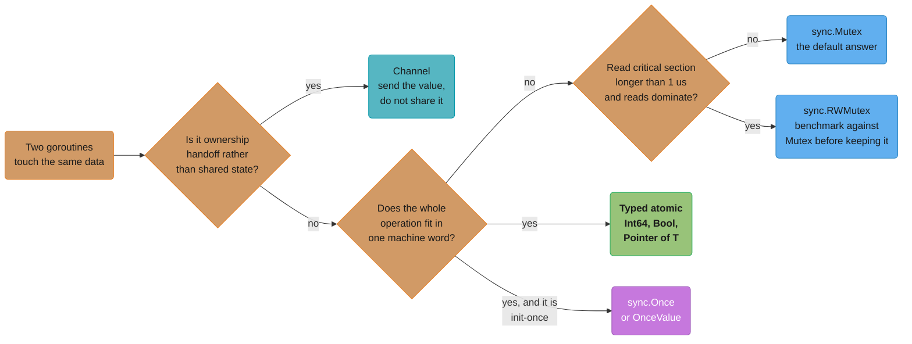
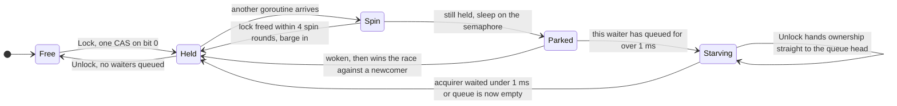
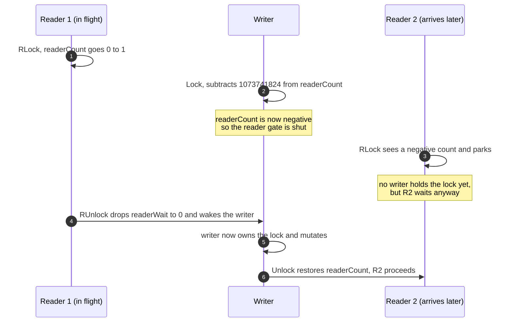
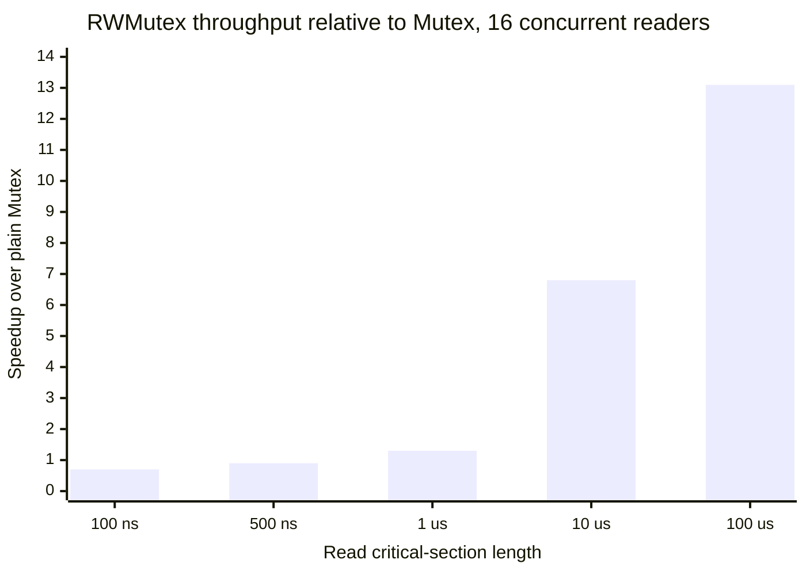

# Sync Primitives and the Memory Model

## 1. Concept Overview

Go's headline concurrency story is "share memory by communicating", but every real Go
program eventually shares memory directly. A request counter, an LRU cache, a connection
pool, a lazily-built configuration object — none of these want a channel in front of them.
The `sync` and `sync/atomic` packages are what you reach for instead, and they are small
enough to learn completely: seven exported types in `sync`, six typed values in
`sync/atomic`, and one command-line flag that finds the bugs you make with them.

This page is the practitioner's surface: which primitive to call, what each one costs, and
the specific ways each is misused in production. `sync.Mutex` gets the most space because
it is the one you will use hundreds of times and because its two operating modes — normal
and starvation, separated by a **1 ms** wait threshold — explain almost every surprising
latency profile a Go service shows under lock contention.

What this page deliberately does **not** cover is the formal question underneath all of it:
*what does the language actually guarantee about the order in which one goroutine sees
another goroutine's writes?* That is the Go memory model, and it lives in
[The Go Memory Model](the_go_memory_model.md). Read this page to write correct code with
the primitives; read that one to know why the primitives are the only thing that makes code
correct, and what happens to a program that skips them.

Everything here targets **Go 1.27**.

---

## 2. Intuition

> **One-line analogy**: `sync` is a small box of hand tools where each tool has exactly one
> job and a sharp edge. The mutex is the hammer you will use for 90% of the work; the
> atomics are the precision screwdriver; `sync.Pool` is a scrap bin that a janitor
> periodically empties without telling you.

**Mental model**: think of every shared variable as sitting behind a door. A `Mutex` is a
door with one key. An `RWMutex` is a door that lets any number of people read the notice
board inside simultaneously, but empties the room before anyone may rewrite it. An atomic
is not a door at all — it is a single indivisible action performed on the variable itself,
useful only when the whole operation fits in one machine word. The moment your invariant
spans two variables, atomics stop being an option and you are back to a door.

**Why it matters**: the failure mode of getting this wrong is not a crash. It is a counter
that reads 9,997 instead of 10,000 under load, a cache that occasionally returns another
tenant's object, a config pointer that is briefly `nil` on exactly one machine in the fleet.
These bugs pass code review, pass unit tests, and surface as a support ticket six weeks
later. The `-race` detector is the only automated defence, and it is a partial one.

**Key insight**: the choice among Go's primitives is almost never about correctness — a
plain `Mutex` is correct everywhere an `RWMutex`, an atomic, or a `sync.Map` is correct. The
choice is about *cost*, and the cost only diverges once the lock is genuinely contended.
Which means the honest default is: **use `sync.Mutex`, measure, and only then reach for
something cleverer**. Every other primitive on this page is an optimisation with a
correctness footgun attached.

---

## 3. Core Principles

- **Mutual exclusion is a property of the data, not the code.** Document which mutex guards
  which fields, physically adjacent in the struct. A lock with no written owner grows
  ambiguous within two quarters.
- **A zero-value `sync` type is ready to use.** `var mu sync.Mutex`, `var wg sync.WaitGroup`,
  `var once sync.Once` all work with no constructor. That is a deliberate design property,
  and it means embedding by value is the idiom.
- **Nothing in `sync` may be copied after first use.** Every type embeds a `noCopy` marker
  that `go vet`'s `copylocks` analyser reads. A copied mutex is two independent locks that
  both believe they guard the same data.
- **Locks are not reentrant.** Go has no recursive mutex, deliberately. `Lock` on a mutex
  you already hold deadlocks the goroutine forever.
- **Atomics are for one word.** A counter, a flag, a pointer swap. The instant correctness
  depends on two values agreeing, a single atomic cannot express it.
- **`sync.Pool` is a GC-cleared cache, not a resource pool.** It has no capacity, no
  lifetime, and no guarantee that `Get` returns anything you ever put in.
- **The race detector is a *witness*, not a *prover*.** It reports races on interleavings
  that actually ran. It says nothing about the ones that did not.

---

## 4. Types / Architectures / Strategies

### 4.1 The whole `sync` surface, and when each earns its place

| Primitive | Use it for | Do not use it for |
|-----------|-----------|-------------------|
| `sync.Mutex` | Any shared mutable state. The default. | Nothing — it is never *wrong*, only sometimes slower |
| `sync.RWMutex` | Long read critical sections (over roughly 1 µs) with a read:write ratio above 10:1 | Short reads — the extra bookkeeping loses to a plain `Mutex` |
| `sync.WaitGroup` | Waiting for a known set of goroutines to finish | Signalling readiness, or as a semaphore |
| `sync.Once` | Exactly-once lazy initialisation | Anything that can fail and should be retried |
| `sync.Map` | Append-mostly caches, or disjoint key sets per goroutine | A general concurrent map — a `map` behind an `RWMutex` beats it |
| `sync.Pool` | Recycling short-lived, uniformly-sized buffers | Connections, files, anything with a lifecycle |
| `sync.Cond` | Multi-waiter signalling that genuinely cannot be a channel | Almost everything — it has no cancellation story |
| `sync/atomic` typed values | Counters, flags, whole-pointer swaps | Any invariant spanning two variables |

### 4.2 `sync.Mutex` — two modes, one word

A `Mutex` is two 32-bit fields: a `state` word and a `sema` word used to park goroutines.
The state word packs four things:

| Bits | Name | Meaning |
|------|------|---------|
| bit 0 | `mutexLocked` | The lock is held |
| bit 1 | `mutexWoken` | A goroutine has been woken and is on its way to acquire — suppresses redundant wakeups |
| bit 2 | `mutexStarving` | The mutex is in **starvation mode** |
| bits 3-31 | waiter count | How many goroutines are parked on `sema` |

An uncontended `Lock` is a single compare-and-swap of bit 0 from 0 to 1 — no function call
into the runtime, no scheduler involvement. That fast path is the entire reason `Mutex` is
cheap enough to be the default. Everything below is the slow path.

**Normal mode** is barge-in FIFO-ish. A goroutine that finds the lock held will spin
briefly, then park. When the holder unlocks, it wakes the waiter at the head of the queue —
but that waiter must still *compete* with any goroutine that happened to call `Lock` in the
same instant. The newcomer is already running on a CPU with a warm cache; the woken waiter
has to be scheduled first. The newcomer usually wins. This is good for throughput and awful
for the loser.

**Starvation mode** is strict FIFO handoff. Once any waiter has been queued for more than
**1 ms** (`starvationThresholdNs = 1e6`), it flips `mutexStarving`. From that point `Unlock`
does not release the lock at all — it hands ownership directly to the goroutine at the head
of the queue, which wakes up already owning it. New arrivals do not spin and do not attempt
a CAS; they go straight to the back of the queue. The mode clears when a waiter acquires and
finds either that it waited under 1 ms or that it was the last one in the queue.

The tradeoff is explicit in the runtime's own comment: normal mode has better throughput
because a spinning goroutine can acquire a lock that is released dozens of times before the
scheduler ever runs a parked one; starvation mode caps the tail at roughly one queue
traversal. **A Go service whose p50 lock wait is 200 ns and whose p99.9 is 4 ms is not
broken — it is a mutex oscillating into and out of starvation mode**, and the fix is to
shorten the critical section, not to swap the primitive.

### 4.3 `sync.RWMutex` — and the trap of reaching for it

`RWMutex` adds a `readerCount` and a `readerWait` counter over an internal `Mutex` that
writers hold. `rwmutexMaxReaders` is `1 << 30` — **1,073,741,824** concurrent readers, which
is the number a writer subtracts from `readerCount` to announce itself.

That subtraction is the whole design. Once `readerCount` goes negative:

- every reader already inside finishes and decrements `readerWait`;
- every reader *arriving* sees a negative count and blocks, even though no writer holds
  anything yet.

That second point is **writer starvation avoidance**, and it is the behaviour people
misread as a bug. A continuous stream of readers cannot lock a writer out forever, because
the first pending writer freezes the reader gate. The price is that a reader can block
behind a writer that is itself still waiting — so `RLock` is not "always fast".

The performance trap is subtler. `RLock`/`RUnlock` is two atomic operations on a single
shared `readerCount` word. Sixteen cores taking a read lock are sixteen cores writing the
same cache line, and that line ping-pongs between them exactly as hard as a plain `Mutex`
would. `RWMutex` buys you parallelism *inside* the critical section only. If the critical
section is a map lookup taking 40 ns, there is no parallelism to buy and you have paid
double the atomic traffic for it.

### 4.4 The atomic surface

Use the typed values. They are structs with methods:

| Type | Replaces |
|------|----------|
| `atomic.Bool` | `atomic.LoadUint32` / `StoreUint32` on a 0/1 int |
| `atomic.Int32`, `atomic.Int64`, `atomic.Uint32`, `atomic.Uint64` | the loose `Add*`/`Load*`/`Store*`/`CompareAndSwap*` functions |
| `atomic.Pointer[T]` | `atomic.LoadPointer` with `unsafe.Pointer` conversions |
| `atomic.Value` | ad-hoc `interface{}` publication |

Two concrete reasons the typed forms exist:

1. **Alignment.** On 32-bit platforms the loose 64-bit functions require the operand to be
   8-byte aligned, and the only alignment the language guarantees is that the first word of
   an allocated struct is aligned. A 64-bit counter placed second in a struct crashes with
   `unaligned 64-bit atomic operation` on `linux/386` and `linux/arm` while working
   perfectly on amd64. `atomic.Int64` embeds an `align64` field, so the compiler handles it.
2. **You cannot mix access modes by accident.** `atomic.Int64` has no `+=`. With a plain
   `int64`, one non-atomic `c.hits++` somewhere in the file silently reintroduces the race
   the other 30 call sites were preventing. The type makes that a compile error.

`go fix`'s `atomictypes` modernizer `[1.27]` rewrites the loose calls to typed values
mechanically.

### 4.5 Decision path



The one rule this diagram encodes that people skip: `sync.RWMutex` is reached only after a
benchmark says a plain `Mutex` is the bottleneck. It is an optimisation, and it is the
optimisation most often applied without measurement.

---

## 5. Architecture Diagrams

### Mutex mode machine



A goroutine spins at most **4 rounds of 30 `PAUSE` instructions** before parking, and only
when `GOMAXPROCS > 1` with at least one other runnable P — spinning on a single-core
container is pure waste, so the runtime does not do it. The `Parked --> Starving` edge is the
one that changes your latency histogram: it converts a barge-in lock into a queue.

### Reader blocking behind a waiting writer



This is the concrete shape of writer-starvation avoidance. Reader 2's wait is not a bug and
not contention on the data — it is the gate that stops a steady read stream from locking
writers out forever.

### Where `RWMutex` starts to pay



The shape, not the exact bars, is the lesson: below roughly **1 µs** of work inside the lock
the extra atomic traffic makes `RWMutex` *slower* than `Mutex`, and only past about 10 µs
does it approach the core count. Reproduce it on your own hardware with the benchmark in
§6.5 — the crossover moves with core count, NUMA layout, and how hot the guarded data is in
cache.

---

## 6. How It Works — Detailed Mechanics

### 6.1 The mutex fast path, in the shape the compiler sees

```go
// Conceptually what sync.Mutex.Lock does. The real code is in sync/mutex.go.
func (m *Mutex) Lock() {
    // Fast path: the lock is free, take it with one atomic op.
    if atomic.CompareAndSwapInt32(&m.state, 0, mutexLocked) {
        return
    }
    m.lockSlow() // spin, then queue on the semaphore, then maybe flip to starving
}
```

The fast path is inlined into the caller. Measured on a modern x86-64 server, an
uncontended `Lock`/`Unlock` pair costs roughly **15-25 ns**; a contended one that parks and
is woken costs **1-3 µs**, because it round-trips through the OS futex and the scheduler.
That two-order-of-magnitude cliff is why "how long is the critical section" is the only
lock-tuning question that matters — benchmark both on your own box before quoting either
number in a design review.

### 6.2 The four `WaitGroup` shapes

```go
// BROKEN: Add inside the goroutine. Wait may run before any Add lands
// and return immediately, so main proceeds with zero results.
var wg sync.WaitGroup
for _, u := range urls {
    go func() {
        wg.Add(1)          // races with wg.Wait below
        defer wg.Done()
        fetch(u)
    }()
}
wg.Wait()

// CORRECT, pre-1.25 idiom: Add before the go statement.
var wg sync.WaitGroup
for _, u := range urls {
    wg.Add(1)
    go func() {
        defer wg.Done()
        fetch(u)
    }()
}
wg.Wait()

// CURRENT: WaitGroup.Go does the Add, the go, and the deferred Done. [1.25]
var wg sync.WaitGroup
for _, u := range urls {
    wg.Go(func() { fetch(u) })
}
wg.Wait()
```

`wg.Go` removes the whole class of `Add`/`Done` mismatch bugs: an unbalanced `Add(1)` hangs
`Wait` forever, an extra `Done` panics with `sync: negative WaitGroup counter`, and both are
easy to introduce when an early `return` skips the `Done`. Since the deferred `Done` is
inside the runtime's wrapper, it also fires when the function panics. `go fix`'s
`waitgroupgo` modernizer `[1.27]` performs the rewrite for you.

The **reuse rule**: a `WaitGroup` may be reused, but a new round of `Add` calls that raise the
counter from zero must not overlap a `Wait` from the previous round. In practice: let every
`Wait` return before starting the next batch, or use a fresh `WaitGroup` per batch. Overlap
panics with `sync: WaitGroup misuse: Add called concurrently with Wait` — when it is
detected at all.

### 6.3 `sync.Once` and its three derived helpers

```go
var (
    once   sync.Once
    client *http.Client
)

func Client() *http.Client {
    once.Do(func() { client = buildClient() })
    return client
}

// Same thing, less ceremony, and the variable cannot be read before init. [1.21]
var Client = sync.OnceValue(func() *http.Client { return buildClient() })

// Two results, e.g. a value and an error.
var Config = sync.OnceValues(func() (*Config, error) { return loadConfig() })

// No result, just a side effect that must happen once.
var registerMetrics = sync.OnceFunc(func() { prometheus.MustRegister(collectors...) })
```

Three properties worth knowing:

1. `Do` returns only after `f` has *returned*, for every caller — including the ones that
   did not run `f`. That is what makes it a correct publication mechanism.
2. If `f` panics, `Once` still considers itself done. The initialisation never happens, and
   every subsequent `Do` returns immediately having done nothing. `OnceFunc` and `OnceValue`
   improve on this: they capture the panic and re-panic with the same value on every later
   call, so the failure stays visible instead of degrading into a silent `nil`.
3. `Once` cannot be reset. If the thing you are initialising can fail and should be retried,
   `Once` is the wrong primitive — use a mutex and a `loaded bool`, or an
   `atomic.Pointer[T]` with a CAS.

### 6.4 Compare-and-swap loops

```go
// Track the maximum latency ever observed, without a lock.
type MaxTracker struct{ v atomic.Int64 }

func (m *MaxTracker) Observe(ns int64) {
    for {
        cur := m.v.Load()
        if ns <= cur {
            return // nothing to do
        }
        if m.v.CompareAndSwap(cur, ns) {
            return
        }
        // Someone else won the race. Re-read and try again.
    }
}
```

This is the one shape where a CAS loop is clearly right: the operation is read-modify-write
on a single word, and it is not expressible as `Add`. Note the exit conditions — a CAS loop
with no early return under contention burns CPU proportional to the number of competing
goroutines, and at 16 contending writers a mutex usually wins because the losers *sleep*
instead of spinning. Benchmark before assuming lock-free means faster.

### 6.5 The benchmark that decides `Mutex` vs `RWMutex`

```go
func BenchmarkMutex(b *testing.B) {
    var mu sync.Mutex
    data := make(map[string]int, 1024)
    b.RunParallel(func(pb *testing.PB) {
        for pb.Next() {
            mu.Lock()
            _ = data["key"]
            work(readNanos) // simulate the real critical section
            mu.Unlock()
        }
    })
}

func BenchmarkRWMutex(b *testing.B) {
    var mu sync.RWMutex
    data := make(map[string]int, 1024)
    b.RunParallel(func(pb *testing.PB) {
        for pb.Next() {
            mu.RLock()
            _ = data["key"]
            work(readNanos)
            mu.RUnlock()
        }
    })
}
```

Run both across a sweep of `readNanos`, feed the output to `benchstat`, and keep whichever
wins at your real critical-section length. `b.RunParallel` is essential — a single-goroutine
benchmark makes `RWMutex` look strictly worse, because it never exercises the parallelism
that is the entire point.

### 6.6 `sync.Pool` mechanics

Each P gets a private slot and a shared queue. `Get` checks the private slot first (no
atomics at all), then the local shared queue, then steals from other Ps' shared queues, then
calls `New`. `Put` fills the private slot or pushes to the local shared queue.

The GC interaction is the part people misjudge. At the start of every GC cycle, the current
contents move to a **victim cache** and the victim cache from the previous cycle is dropped.
So an object survives at most two GC cycles with no further use. With `GOGC=100` on a busy
service that is well under a second. `sync.Pool` therefore smooths allocation rate within a
burst; it does not retain anything across an idle period, and it can never be used to bound
a resource.

```go
var bufPool = sync.Pool{
    New: func() any { return new(bytes.Buffer) }, // pointer, never a value
}

func render(w io.Writer, v any) error {
    buf := bufPool.Get().(*bytes.Buffer)
    defer func() {
        // Do not hand back a buffer that grew enormous for one outlier request.
        if buf.Cap() > 64<<10 {
            return // let the GC have it
        }
        buf.Reset()
        bufPool.Put(buf)
    }()
    if err := json.NewEncoder(buf).Encode(v); err != nil {
        return err
    }
    _, err := w.Write(buf.Bytes())
    return err
}
```

Two disciplines in eight lines: `Reset` before `Put`, and a capacity ceiling so one 40 MB
request does not permanently install a 40 MB buffer in the pool. Note also that `New`
returns a **pointer**. Putting a non-pointer value into a `sync.Pool` boxes it into an
`any`, which allocates — exactly what the pool exists to avoid.

### 6.7 What the race detector actually does

Build with `-race` and every memory access in your program is instrumented. The runtime
maintains **shadow memory**: for each 8-byte word of application memory it keeps four shadow
words, each recording a recent access — its goroutine, its clock, whether it was a read or a
write. Every goroutine carries a vector clock, updated at each synchronisation point
(channel operations, mutex operations, `WaitGroup`, `Once`, atomics). On each access the
detector compares the new access against the stored shadow words: if two accesses to the
same address, at least one a write, come from goroutines whose vector clocks are unordered,
it prints a race report.

Costs from the official documentation: **memory usage increases by 5-10x and execution time
by 2-20x** — for typical server code both land near 5-10x. It requires cgo on most
platforms, and it supports `linux/amd64`, `linux/arm64`, `linux/ppc64le`, `linux/s390x`,
`linux/riscv64` `[1.26]`, `freebsd/amd64`, `netbsd/amd64`, `darwin/amd64`, `darwin/arm64`,
and `windows/amd64`.

The limitation that matters more than the cost: **the detector only sees interleavings that
occurred**. It is a witness to executed history, not an analysis of possible histories. A
clean `-race` run over a test suite that never scheduled two goroutines into the dangerous
window proves nothing at all. What that means formally, and why it changes your testing
strategy, is [The Go Memory Model](the_go_memory_model.md) §6.

---

## 7. Real-World Examples

| System | Primitive | What it is doing |
|--------|-----------|-----------------|
| `net/http` | `sync.Pool` | `Transport` pools `bufio.Reader`/`bufio.Writer` per connection; the server pools 4 KB read buffers, which is why a Go HTTP server's allocation rate is nearly flat with request rate |
| `fmt` | `sync.Pool` | A pool of `pp` printer structs — every `fmt.Sprintf` in the standard library takes one and returns it, which is why formatting is 1 allocation and not 4 |
| `encoding/json` | `sync.Map` | The struct-field encoder cache, keyed by `reflect.Type`. This is the textbook `sync.Map` case: written once per type at startup, read on every marshal forever |
| `database/sql` | `sync.Mutex` + `sync.Cond` | The connection pool's free list. One of the few places `Cond` is genuinely right, because a waiter must be woken when a connection returns, and the wakeup is not a value handoff |
| `go.opentelemetry.io/otel` | `atomic.Pointer[T]` | The global `TracerProvider` is swapped atomically at init, so instrumented packages read it with no lock on every span |
| `prometheus/client_golang` | typed atomics | Counters and gauges are `atomic.Uint64`; the scrape path takes a lock, the increment path does not — the exact read:write asymmetry that justifies atomics |
| Kubernetes `client-go` | `sync.RWMutex` | The informer cache store. Reads are whole-object list/filter operations well past the 1 µs crossover, and writes only arrive on watch events |

---

## 8. Tradeoffs

### Primitive against primitive

| | `sync.Mutex` | `sync.RWMutex` | Typed atomic | Channel |
|---|---|---|---|---|
| Uncontended cost | ~15-25 ns per pair | ~2x a `Mutex` pair | 1 atomic op | ~60-100 ns per unbuffered handoff |
| Scales with cores | No | Only if critical section > ~1 µs | No — same cache line | No |
| Cancellable | No | No | N/A | Yes, via `select` with a context |
| Guards multiple fields | Yes | Yes | No | Yes, by owning them |
| Deadlock risk | Yes | Yes, plus reader-writer inversions | No | Yes |
| `go vet` support | `copylocks` | `copylocks` | `copylocks`, `atomictypes` | `lostcancel` for the context |

### `sync.Map` against `map` + `RWMutex`

| Workload | Winner | Why |
|----------|--------|-----|
| Write once at startup, read forever | `sync.Map` | Reads hit a read-only snapshot with a single atomic load and no lock at all |
| Each goroutine touches a disjoint key set | `sync.Map` | No shared cache line between goroutines working on different keys |
| Steady mixed read/write on a shared key set | `map` + `RWMutex` | Every `sync.Map` write may promote the dirty map, an O(n) copy of the whole key set |
| Needs `len()`, iteration order, or bulk ops | `map` + `RWMutex` | `sync.Map` has no `Len`, and `Range` gives no snapshot guarantee |
| Value type known at compile time | `map` + `RWMutex` | `sync.Map` stores `any`, so every value is boxed and every read is a type assertion |

### Mutex modes

| | Normal mode | Starvation mode |
|---|---|---|
| Acquisition | Barge-in — a newcomer may beat a woken waiter | Strict FIFO handoff from `Unlock` |
| Throughput | Higher — the running goroutine keeps a warm cache | Lower — every acquisition pays a context switch |
| Tail latency | Unbounded in theory; a waiter can be starved | Bounded by one queue traversal |
| Entered when | Default | Some waiter has queued for over 1 ms |
| Left when | N/A | An acquirer waited under 1 ms, or was the last waiter |

---

## 9. When to Use / When NOT to Use

**Use `sync.Mutex` when** state is shared and mutable, full stop. It is the default and
needs no justification in review.

**Use `sync.RWMutex` when** you have *measured* a plain `Mutex` as the bottleneck, the read
critical section is over roughly 1 µs, and reads outnumber writes by more than 10:1. The
informer-cache shape — whole-object reads, rare watch-driven writes — is the archetype.

**Do NOT use `sync.RWMutex` when** the critical section is a map lookup or a struct field
read. The atomic traffic on `readerCount` costs more than the parallelism is worth, and you
have also added a reader-writer deadlock shape that a plain `Mutex` cannot have.

**Use `sync/atomic` when** the entire operation is one word and you can state the invariant
in one sentence. A hit counter. A `closed` flag. A whole-config pointer swapped at reload.

**Do NOT use `sync/atomic` when** two variables must agree. `atomic.Int64` for `count` and
another for `sum` gives you a consistent `count` and a consistent `sum` and never a
consistent *mean*.

**Use `sync.Map` when** the access pattern is append-mostly (a `reflect.Type` cache, a
compiled-regex cache) or when goroutines own disjoint key ranges. Two cases, and they are
narrow.

**Do NOT use `sync.Map` as a general concurrent map.** For a shared, actively-mutated key
set, a plain map behind an `RWMutex` is faster, type-safe, supports `len`, and is far easier
to reason about.

**Use `sync.Pool` when** profiling shows allocation of short-lived, similarly-sized objects
is a measurable fraction of your CPU or GC time — buffers, encoders, scratch slices.

**Do NOT use `sync.Pool` for** database connections, file handles, goroutine slots, or
anything else where the count matters. The GC empties it without asking. Use a buffered
channel or `golang.org/x/sync/semaphore` for those.

**Use `sync.Cond` when** multiple waiters must be woken on a state change that carries no
value, and a channel genuinely cannot express it — the `database/sql` free list is the case.

**Do NOT use `sync.Cond`** anywhere a channel fits, which is nearly everywhere. `Cond` has
no `select`, no context, and no timeout, so a goroutine waiting on one cannot be cancelled.

---

## 10. Common Pitfalls

### 10.1 The copied mutex — a lock that guards nothing

A metrics registry was defined with a value receiver. Every method call copied the struct,
including its mutex, so each call locked a fresh, uncontended lock. The service ran for
eight months before a counter drift of about 0.3% under peak load was traced back to it —
the racy increments had been silently lost the whole time.

```go
// BROKEN: value receiver copies the Mutex on every call.
type Registry struct {
    mu     sync.Mutex
    counts map[string]int64
}

func (r Registry) Inc(name string) { // <- value receiver
    r.mu.Lock()
    defer r.mu.Unlock()
    r.counts[name]++ // the map is shared, the lock is not
}

// FIX: pointer receiver, and let go vet enforce it everywhere.
func (r *Registry) Inc(name string) {
    r.mu.Lock()
    defer r.mu.Unlock()
    r.counts[name]++
}
```

`go vet` reports `Inc passes lock by value: Registry contains sync.Mutex`. It runs by
default under `go test`, which means this bug is caught by *any* test in the package — the
team had none for that file. **Impact: 0.3% of every counter, for eight months.**

### 10.2 The `RWMutex` that made a service slower

A team replaced a `Mutex` around a hot in-memory session lookup with an `RWMutex`, reasoning
that the workload was 98% reads. The critical section was a single map lookup — about 45 ns.
Throughput dropped 18% and p99 rose from 3 ms to 5 ms. The reads had never been the
bottleneck; the additional atomic operations on the shared `readerCount` word were. Rolling
back the "optimisation" restored both numbers.

The lesson is the crossover: below roughly 1 µs of work under the lock, `RWMutex` is a
regression. Measure with `b.RunParallel` before and after, never reason from the read ratio
alone.

### 10.3 `sync.Pool` leaking capacity

A JSON API pooled `*bytes.Buffer` with no ceiling. One customer endpoint occasionally
serialised a 30 MB response. Each such request left a 30 MB buffer in the pool, and with 64
Ps the steady-state RSS climbed by close to 2 GB and stayed there until a GC cycle happened
to drop that victim generation. The container hit its limit and was `OOMKilled` roughly
twice a week, always minutes after that endpoint was hit.

The fix is the capacity check in §6.6: refuse to `Put` a buffer over 64 KB. **Impact: RSS
fell from a 2.4 GB peak to a stable 380 MB.**

### 10.4 `Add` inside the goroutine

The §6.2 `BROKEN` example. `Wait` sees a counter of zero and returns before any goroutine has
run, so the caller proceeds with an empty result set. The symptom is not a hang — it is
*silently missing data*, which is worse, and it is load-dependent: on a fast machine the
scheduler often runs the first goroutine before `Wait`, so it passes locally and fails in
production. Migrating to `wg.Go` `[1.25]` removes the possibility.

### 10.5 Forgetting `defer` on the unlock, then adding an early return

```go
// BROKEN: the error path never unlocks. The next Lock deadlocks forever.
func (c *Cache) Fetch(k string) (V, error) {
    c.mu.Lock()
    v, ok := c.m[k]
    if !ok {
        return zero, ErrMissing // <- lock still held
    }
    c.mu.Unlock()
    return v, nil
}

// FIX: defer immediately after Lock, before any branch exists.
func (c *Cache) Fetch(k string) (V, error) {
    c.mu.Lock()
    defer c.mu.Unlock()
    v, ok := c.m[k]
    if !ok {
        return zero, ErrMissing
    }
    return v, nil
}
```

A deadlocked goroutine holding a hot lock takes the whole service down within seconds. The
`goroutineleak` profile `[1.27]` names it precisely — see §11. The discipline is absolute:
`defer` the unlock on the line after the lock, and only unlock manually when you have
measured the `defer` overhead and can point at the benchmark.

### 10.6 A `sync.Once` that swallowed a failure

Config loading was wrapped in `once.Do`. On one deployment the config server was briefly
unreachable, the loader panicked, and `Once` marked itself done. Every subsequent request
read a `nil` config and returned 500s until the pod was restarted — 40 minutes, because the
health check only pinged a static endpoint. `sync.OnceValues` re-panics with the same value
on every later call, which would have crash-looped the pod in seconds and let Kubernetes
reschedule it. **A loud failure that restarts is better than a quiet one that serves errors.**

---

## 11. Technologies & Tools

| Tool | What it is for |
|------|---------------|
| `go build -race` / `go test -race` | ThreadSanitizer-based dynamic race detection. Run the full test suite under it in CI, not just on a developer laptop |
| `go vet` (`copylocks`) | Catches a `sync` type copied by assignment, by value receiver, or into a closure. Runs by default under `go test` |
| `go vet` (`atomictypes`) `[1.27]` | Flags loose `sync/atomic` function calls; `go fix` rewrites them to typed values |
| `go vet` (`loopclosure`, `lostcancel`) | The two adjacent concurrency analysers you want on in the same CI step |
| `golangci-lint` | Aggregates the above plus `govet`, `staticcheck` SA-series concurrency checks, and `errcheck` |
| `runtime/pprof` mutex profile (`-mutexprofile`) | Attributes *contention* — which lock, which stack, how much cumulative blocked time. `runtime.SetMutexProfileFraction(5)` in production |
| `runtime/pprof` block profile (`-blockprofile`) | Attributes goroutine blocking on channels, `WaitGroup.Wait`, and `select` as well as locks |
| `goroutineleak` profile `[1.27]` | GA in Go 1.27: detects goroutines blocked on a concurrency primitive that can never be unblocked. `/debug/pprof/goroutineleak` |
| `testing/synctest` `[1.25]` | Deterministic scheduling for concurrency tests — makes an interleaving reproducible instead of hoping it appears |
| `golang.org/x/sync/errgroup` | The right wrapper when the goroutines you are waiting on can fail; `SetLimit` bounds concurrency |
| `golang.org/x/sync/semaphore` | Weighted semaphore with context cancellation, for the resource-count job `sync.Pool` cannot do |
| `go tool trace` | Shows scheduler latency and where goroutines sat blocked, when a mutex profile says "contended" but not "why" |

---

## 12. Interview Questions with Answers

**Q: Why does a mutex sometimes hand the lock to a queued goroutine instead of letting a newly arriving one grab it?**
**Short:** Because a waiter that has been queued for over 1 ms flips the lock into starvation mode, which trades throughput for a bounded tail.

In normal mode acquisition is barge-in: `Unlock` wakes the head of the queue, but that
goroutine still has to be scheduled while a goroutine already running on a CPU can take the
lock immediately. The newcomer usually wins, which is great for throughput and can starve
the waiter indefinitely. When any waiter crosses `starvationThresholdNs = 1e6`, it sets the
`mutexStarving` bit and `Unlock` stops releasing the lock at all — it transfers ownership
directly to the head of the queue, and newcomers go straight to the back without spinning.
The mode clears when an acquirer finds it waited under 1 ms or was the last waiter. If your
service shows a p50 lock wait of 200 ns and a p99.9 of 4 ms, that oscillation is what you
are looking at, and the fix is a shorter critical section rather than a different primitive.

**Q: What actually breaks when a struct containing a mutex is copied?**
**Short:** You end up with two independent locks that both believe they protect the same data, so mutual exclusion silently stops existing.

The copy duplicates the `state` word, so two goroutines can hold "the" lock simultaneously —
each holding its own. Nothing panics and nothing logs; you just lose updates. The three
ways it happens are a value receiver on a method, passing the struct to a function by value,
and capturing it by value in a closure or a range variable. `go vet`'s `copylocks` analyser
catches all three by looking for the `noCopy` marker every `sync` type embeds, and it runs
by default as part of `go test`. The rule that follows is mechanical: any type containing a
`sync` field gets pointer receivers on every method, without exception, so the question
never has to be asked per method.

**Q: When does an RWMutex actually beat a plain Mutex?**
**Short:** Only when the read critical section runs longer than roughly a microsecond and reads outnumber writes by more than ten to one.

`RLock` and `RUnlock` are two atomic operations on one shared `readerCount` word, so sixteen
readers are sixteen cores writing the same cache line — exactly the contention a plain
`Mutex` has. The parallelism `RWMutex` buys exists only *inside* the critical section, so
there has to be enough work in there to amortise the doubled atomic traffic. A map lookup at
45 ns has none; a full object copy, a JSON encode, or a filtered list walk at 50 µs has
plenty. That is why `client-go`'s informer store is right to use one and why a session-map
lookup is not. Decide with `b.RunParallel` across a sweep of critical-section lengths and
`benchstat`, never from the read ratio alone.

**Q: Why must `wg.Add(1)` happen before the `go` statement rather than as the goroutine's first line?**
**Short:** Because `Wait` can observe a counter of zero and return before any goroutine has started, leaving the caller with empty results.

There is no ordering between the `go` statement and the goroutine's first instruction — the
new goroutine may not be scheduled for microseconds. If the `Add` lives inside it, `Wait`
runs against a counter still at zero and proceeds immediately. The symptom is not a hang but
silently missing data, and it is timing-dependent, so it passes on a developer laptop where
the scheduler happens to run the goroutine first. The modern form removes the trap entirely:
`wg.Go(func(){ ... })` `[1.25]` performs the `Add`, the `go`, and the deferred `Done` inside
the runtime, so the counter is raised on the calling goroutine before anything is spawned.
`go fix`'s `waitgroupgo` modernizer `[1.27]` will rewrite the old shape for you.

**Q: What are the two workloads where `sync.Map` is the right choice?**
**Short:** Append-mostly caches whose keys are written once and read forever, and workloads where each goroutine owns a disjoint set of keys.

The type is built from a read-only snapshot plus a dirty map behind a mutex. A key written
once and then read millions of times is served from the snapshot with a single atomic load
and no locking at all — that is `encoding/json`'s per-`reflect.Type` encoder cache, and it is
the archetype. The disjoint-keys case wins for a different reason: goroutines touching
different keys never share a cache line. Everything else loses. A steadily mutated shared
key set forces repeated promotion of the dirty map, an O(n) copy of every key; and you also
give up `len`, compile-time value types, and any snapshot semantics for `Range`. For those,
a plain `map` behind an `RWMutex` is faster and far easier to reason about.

**Q: Why is `sync.Pool` described as a cache rather than a pool?**
**Short:** The garbage collector empties it on its own schedule, so nothing you put in is guaranteed to still be there, and it enforces no upper bound.

At the start of each GC cycle the pool's contents move to a victim cache and the previous
victim generation is discarded, so an unused object survives at most two cycles — well under
a second on a busy service at `GOGC=100`. That makes it excellent at smoothing allocation
rate within a burst and useless as a resource limiter: it has no capacity, `Get` can always
call `New`, and you cannot ask how many objects exist. Using one for database connections or
file handles gives you an unbounded number of them, created and dropped at the GC's whim.
When the count is the thing you care about, use a buffered channel or
`golang.org/x/sync/semaphore` instead.

**Q: What is the capacity leak that pooled buffers cause, and how do you stop it?**
**Short:** One outlier request grows a buffer to its size and returning it installs that capacity in the pool permanently, so resident memory ratchets upward and never falls.

`bytes.Buffer` never shrinks its backing array. If a single 30 MB response is serialised
into a pooled buffer and the buffer goes back, every later `Get` that finds it holds 30 MB of
live memory for a 2 KB response. With one such buffer per P on a 64-core box that is close to
2 GB of RSS that only disappears if a GC cycle happens to drop that victim generation. The
fix is a ceiling on the way back in: check `buf.Cap()` before `Put` and simply let the
garbage collector take anything over, say, 64 KB. Pair that with `buf.Reset()` on every
return so the next user never observes the previous request's bytes.

**Q: What does the race detector cost, and what can a clean run never tell you?**
**Short:** It multiplies memory by five to ten and runtime by roughly the same, and it only ever reports races on interleavings that actually executed.

Under `-race` every memory access is instrumented against shadow memory — four shadow words
per eight bytes of application memory recording recent accesses — and each goroutine carries
a vector clock updated at every synchronisation point. Two accesses to one address, at least
one a write, from goroutines with unordered clocks produce a report. The official figures
are 5-10x memory and 2-20x execution time. The crucial property is that this is a *witness*
to executed history, not an analysis of possible histories: if the test suite never
scheduled the two goroutines into the dangerous window, the run is clean and the bug ships.
So `-race` proves a bug exists and never proves one absent — the reasoning behind that, and
what it implies for test design, is in [The Go Memory Model](the_go_memory_model.md).

**Q: Why did the typed atomic values replace the loose `sync/atomic` functions?**
**Short:** They guarantee 64-bit alignment on 32-bit platforms and make it impossible to mix atomic and plain access to the same variable.

The loose 64-bit functions require their operand to be 8-byte aligned, and the only thing
Go guarantees is that the first word of an allocated struct is aligned. A 64-bit counter
declared as the second field crashes with `unaligned 64-bit atomic operation` on
`linux/386` and `linux/arm` while working perfectly on amd64 — a bug you find in a customer's
Raspberry Pi deployment, not in CI. `atomic.Int64` embeds an alignment field so the compiler
handles it. The second reason matters more day to day: `atomic.Int64` has no `+=`, so a
single plain `c.hits++` cannot silently reintroduce the race that thirty other call sites
were preventing. `go fix`'s `atomictypes` modernizer `[1.27]` performs the conversion.

**Q: Can a goroutine block on `RLock` when no writer holds the lock?**
**Short:** Yes — a writer that has merely announced its intent shuts the reader gate before it owns anything, which is how writers avoid being starved.

`Lock` subtracts `rwmutexMaxReaders`, which is 1,073,741,824, from `readerCount` as its first
act. Readers already inside are unaffected and drain normally, but any reader arriving after
that subtraction sees a negative count and parks — even though the writer is still waiting
for the in-flight readers to finish. Without that gate, a continuous stream of readers on a
busy service would keep `readerCount` above zero forever and no write would ever land. The
practical consequence is that `RLock` is not unconditionally cheap: under a write-heavy
period read latency inherits the length of the longest read critical section, so a slow
reader holding `RLock` for 200 ms stalls every other reader behind the writer it blocked.

**Q: How long does a mutex spin before it parks the goroutine?**
**Short:** At most four rounds of thirty PAUSE instructions, and only on a multiprocessor with another runnable P.

Spinning is a bet that the current holder will release within a few hundred cycles, making
it cheaper to burn CPU than to pay a park-and-wake round trip of 1-3 µs. The bet is only
sensible if another core can actually be making progress, so the runtime checks
`GOMAXPROCS > 1` and that at least one other P is running before spinning at all — on a
single-core container it goes straight to the semaphore. The bounded spin count is why a
`Mutex` behaves well both for a 50 ns critical section and a 5 ms one without any tuning
knob: short holds are absorbed by spinning, long ones fall through to parking. Note that a
goroutine in starvation mode never spins, because spinning is exactly what would let a
newcomer barge past the queue.

**Q: What happens if the function passed to `Once.Do` panics?**
**Short:** The Once still marks itself complete, so the initialisation never runs again and every later call returns immediately having done nothing.

That is a genuinely dangerous default: a transient failure during lazy init leaves a `nil`
value that every subsequent request reads without any error, producing a stream of 500s that
survives until the process restarts. `sync.OnceFunc`, `sync.OnceValue` and `sync.OnceValues`
fix it by capturing the panic and re-panicking with the same value on every later call, so
the failure stays loud and a supervisor can restart the process. The deeper point is that
`Once` is the wrong primitive for anything retryable — it cannot be reset. If the operation
can fail and should be attempted again, use a mutex with a `loaded bool`, or an
`atomic.Pointer[T]` swapped by CAS once the value is genuinely built.

**Q: Is a compare-and-swap loop faster than a mutex?**
**Short:** Only at low contention — the losers of a CAS race burn CPU retrying, while the losers of a mutex race sleep and let the winner finish.

A CAS loop is unambiguously right when the operation is read-modify-write on one word and is
not expressible as `Add` — tracking a maximum, or flipping a state machine between named
values. With two or three contending goroutines it beats a mutex easily because it never
touches the scheduler. Past roughly eight contending writers the retry storm inverts the
result: every failed CAS re-reads a cache line that is being invalidated by the winner, so
aggregate throughput falls as you add cores. A mutex degrades gracefully instead, because a
parked goroutine consumes nothing. Write the benchmark with `b.RunParallel` at your real
concurrency before assuming lock-free means fast.

**Q: Can a mutex be unlocked by a different goroutine than the one that locked it?**
**Short:** Yes, and that is a documented property — Go's mutex has no owner field, unlike a pthread mutex or a Java monitor.

`Unlock` simply clears the locked bit and wakes a waiter, so a lock acquired in one goroutine
can legally be released in another. That enables handoff patterns such as `sync.Cond`'s
internals and lock-per-item schemes, but it also means the runtime cannot detect the common
mistakes for you: unlocking a mutex that is not held panics with `sync: unlock of unlocked
mutex`, but unlocking one that a *different* goroutine is relying on does not. The absence
of an owner is also why the mutex is not reentrant — with no owner recorded, a second `Lock`
from the same goroutine is indistinguishable from a competing one and deadlocks. If you want
reentrancy you want a different design, usually splitting the function into a public locking
wrapper and a private already-locked implementation.

**Q: What does the `goroutineleak` profile give you that the goroutine profile does not?**
**Short:** It reports only goroutines blocked on a primitive that can never be unblocked, rather than every goroutine currently parked.

A standard goroutine dump on a busy server lists thousands of goroutines legitimately waiting
on channels, network reads, and locks — the leaked ones are indistinguishable in that noise.
The `goroutineleak` profile, GA in Go 1.27 and available at `/debug/pprof/goroutineleak`,
analyses reachability of the concurrency primitives themselves: a goroutine blocked on a
channel no live goroutine can send to, or on a mutex no live goroutine can unlock, is
provably stuck. That turns leak-hunting from a diffing exercise across two dumps into a
direct answer. It is the tool for the §10.5 shape — an early `return` that skipped an
`Unlock` and left the next `Lock` permanently parked.

**Q: What is the reuse rule for a WaitGroup?**
**Short:** A new round of increments from zero must not overlap a Wait left over from the previous round, or the counter's state is undefined.

The type is reusable, but only between generations. Once `Wait` returns, the group is back
at zero and safe to `Add` to again; while a `Wait` is still outstanding, an `Add` that raises
the counter from zero races with it. The runtime detects some of these and panics with
`sync: WaitGroup misuse: Add called concurrently with Wait`, but detection is not
guaranteed, so the discipline has to come from your code shape. The safe pattern is one
`WaitGroup` per batch, declared inside the loop body that owns the batch, so no generation
can overlap the next. If several rounds genuinely run concurrently, you want a different
structure — usually `errgroup.Group` with `SetLimit`, or a counting semaphore.

**Q: Why does `atomic.Value` panic with "store of inconsistently typed value"?**
**Short:** It stores an interface and requires every write to use the exact same dynamic type, because it swaps the type word and data word without a lock.

An interface value is two words. `atomic.Value` can only make the pair appear atomic if the
type word never changes, so it records the first type stored and rejects any later store of
a different one. Storing a `*Config` and later a `Config`, or a concrete type and later
`nil`, both panic. Storing an untyped `nil` panics unconditionally. In modern code the
answer is usually to skip the type entirely: `atomic.Pointer[T]` gives the same
publish-a-whole-object behaviour with compile-time typing, no boxing, and no panic surface.
Keep `atomic.Value` only where the stored type genuinely varies at runtime and you have a
reason it must.

**Q: Is `sync.Cond` ever the right answer in Go?**
**Short:** Rarely — it fits multi-waiter signalling with no value to hand over, and it is disqualified anywhere a waiter needs to be cancellable.

The genuine case is `database/sql`'s free list: connections return at unpredictable times,
several goroutines may be waiting, and there is no value being transferred that a channel
could carry. Everything else a `Cond` is reached for — one-shot signals, fan-out
notification, bounded queues — is better as a channel, because a channel composes with
`select` and therefore with `context`. That is the disqualifier: a goroutine sitting in
`cond.Wait()` cannot be woken by a deadline, a cancellation, or a shutdown signal, so a
service that uses `Cond` on a request path cannot shed load. If you do use one, always wait
in a `for !condition { c.Wait() }` loop, because `Broadcast` wakes everyone and the condition
may already have been consumed.

**Q: Can a goroutine that holds an `RLock` take another `RLock`?**
**Short:** Not safely — if a writer queues between the two acquisitions, the second one blocks behind a writer that is waiting on the first, and the goroutine deadlocks with itself.

The documentation states it directly: recursive read locking is forbidden. The mechanism is
the writer gate from the earlier question. Goroutine G holds `RLock` number one; a writer
calls `Lock` and shuts the reader gate; G calls `RLock` again, sees the negative
`readerCount`, and parks; the writer is waiting for G's first `RLock` to be released. Neither
can proceed. It never reproduces without a concurrent writer, which is why it survives
testing and appears in production the first time a config reload lands mid-request. The fix
is structural: acquire once at the top of the call chain and pass the already-read data down,
or split into a public locking function and a private one that assumes the lock is held.

**Q: How do you find which lock in a large service is actually contended?**
**Short:** Enable the mutex profile with `runtime.SetMutexProfileFraction` and read the cumulative blocked time per acquisition stack, not the lock's call count.

`SetMutexProfileFraction(5)` samples one in five contention events with negligible overhead
and is safe to leave on in production. `go tool pprof` then attributes total goroutine-time
spent blocked to the stack that *unlocked* the mutex, which is the stack you need to shorten.
Pair it with the block profile, which additionally covers channel operations and
`WaitGroup.Wait`, so you can tell a lock problem from a channel-backpressure problem. The
trap is optimising the wrong lock: a mutex taken a million times per second with zero wait
appears nowhere in the mutex profile and is genuinely fine, while one taken forty times per
second and held for 8 ms dominates it. Contention time, never acquisition count, is the
metric.

**Q: What is the practical rule for choosing between a channel and a mutex?**
**Short:** Use a channel when ownership of a value moves between goroutines, and a mutex when several goroutines need concurrent access to state that stays put.

A work queue, a pipeline stage, a result being handed to a collector — those are transfers,
and a channel expresses them with cancellation and backpressure built in. A cache, a
counter, a registry, a connection pool's bookkeeping — those are shared state that nobody
hands off, and wrapping them in a channel-based "owner goroutine" costs a context switch per
access and turns a 20 ns operation into a 200 ns one. The Go proverb about sharing memory by
communicating is guidance for structuring a program's *flow*, not a ban on `sync`. The
standard library itself uses mutexes in dozens of places for exactly this reason.

---

## 13. Best Practices

- **Default to `sync.Mutex`.** Reach for anything else only after a mutex profile or a
  `b.RunParallel` benchmark says it is the bottleneck.
- **Put the mutex immediately above the fields it guards, with a comment naming them.**
  `// guarded by mu` on each field costs nothing and survives refactors that a package-level
  comment does not.
- **Pointer receivers on every method of any type containing a `sync` field.** No exceptions,
  so the question never has to be asked case by case.
- **`defer mu.Unlock()` on the line after `mu.Lock()`.** Manual unlocking is permitted only
  when you have a benchmark showing the `defer` matters.
- **Keep critical sections free of I/O, RPCs, channel sends, and logging.** Anything that can
  block for a millisecond under the lock will push the mutex into starvation mode.
- **Use `wg.Go` `[1.25]`** rather than the `Add`/`defer Done` pair, and `errgroup.Group` when
  the goroutines can fail.
- **Prefer `sync.OnceValue` over a bare `sync.Once` plus a package variable** — the value
  cannot be read before initialisation, and a panicking initialiser stays loud.
- **Use typed atomics only.** Run `go fix` with the `atomictypes` modernizer `[1.27]` on any
  code still using the loose functions.
- **Cap what goes back into a `sync.Pool`**, and always `Reset` first.
- **Run the entire test suite under `-race` in CI**, not a subset, and do not gate it behind
  a nightly job — races found six hours after the merge are races found in production.
- **Turn on `runtime.SetMutexProfileFraction(5)` and `SetBlockProfileRate` in production**
  behind your pprof endpoint. The overhead is negligible and it is the only way to answer
  "which lock" at 3am.
- **When in doubt about visibility rather than exclusion, read
  [The Go Memory Model](the_go_memory_model.md)** — the primitives on this page are correct
  only because of the happens-before edges specified there.

---

## 14. Case Study

### Rate limiter under a mutex — from 4 ms p99.9 to 300 µs

A payments gateway ran a per-tenant token-bucket limiter in front of every request. At about
40,000 requests per second across 12,000 tenants, p50 latency was 1.2 ms and p99.9 was
41 ms. CPU sat at 45%, so it was not saturation. The mutex profile named a single lock
holding 78% of all blocked goroutine time.

**The original design.**

```go
// BROKEN: one lock for every tenant, and refill work done inside it.
type Limiter struct {
    mu      sync.Mutex
    buckets map[string]*bucket
}

func (l *Limiter) Allow(tenant string) bool {
    l.mu.Lock()
    defer l.mu.Unlock()

    b, ok := l.buckets[tenant]
    if !ok {
        b = &bucket{tokens: burst, last: time.Now()}
        l.buckets[tenant] = b
    }
    now := time.Now()                    // ~25 ns, and a syscall-adjacent read
    b.tokens += now.Sub(b.last).Seconds() * rate
    b.last = now
    if b.tokens > burst {
        b.tokens = burst
    }
    if b.tokens < 1 {
        metrics.Throttled.WithLabelValues(tenant).Inc() // <- 900 ns, under the lock
        return false
    }
    b.tokens--
    return true
}
```

Three faults, in order of impact:

1. **A Prometheus label lookup inside the critical section.** `WithLabelValues` hashes the
   label set and takes its own internal lock — roughly 900 ns. On the throttled path the
   critical section jumped from 60 ns to nearly 1 µs, and throttling is exactly when traffic
   is heaviest. That is a sixteenfold increase in hold time on the busiest path.
2. **One global lock for 12,000 independent tenants.** Tenant A's bucket update serialised
   against tenant B's despite touching disjoint data.
3. **Consequence of the first two: sustained starvation mode.** With hold times near 1 µs and
   64 cores contending, waiters routinely crossed the 1 ms threshold, flipping the mutex to
   FIFO handoff. Every acquisition then cost a full park-and-wake — which is the 41 ms tail.

**The fix.**

```go
// FIX 1: shard the lock. 256 shards over 12,000 tenants means a
// tenant contends with roughly 47 others rather than all of them.
const shards = 256

type Limiter struct {
    shard [shards]struct {
        mu      sync.Mutex
        buckets map[string]*bucket
        _       [40]byte // pad the struct out past a 64-byte cache line
    }
}

func (l *Limiter) shardFor(tenant string) *bucket { /* fnv hash, mod shards */ }

// FIX 2: nothing but arithmetic under the lock. The metric moves out.
func (l *Limiter) Allow(tenant string) bool {
    s := &l.shard[hash(tenant)%shards]
    now := time.Now() // read the clock BEFORE taking the lock

    s.mu.Lock()
    b, ok := s.buckets[tenant]
    if !ok {
        b = &bucket{tokens: burst, last: now}
        s.buckets[tenant] = b
    }
    b.tokens = min(burst, b.tokens+now.Sub(b.last).Seconds()*rate)
    b.last = now
    allowed := b.tokens >= 1
    if allowed {
        b.tokens--
    }
    s.mu.Unlock() // deliberately not deferred: measured at 8 ns here, and this
                  // function is called 40,000 times a second on every core

    if !allowed {
        throttled.Add(1) // FIX 3: an atomic.Uint64, aggregated by a background
                         // goroutine into the labelled Prometheus counter
    }
    return allowed
}
```

**Why each change mattered.**

- Moving `time.Now()` and the metric out of the critical section cut the hold time from
  ~960 ns to ~55 ns. That alone dropped the observed wait below the 1 ms starvation
  threshold, so the lock stopped flipping modes — and that mode change is where most of the
  tail lived.
- Sharding cut contention by a further factor of about 47. The 40-byte pad matters: without
  it, two shards' mutexes share a 64-byte cache line and the cores contending on shard 3
  invalidate shard 4's line for free. The padding was worth 11% throughput on its own.
- Replacing the labelled counter with an `atomic.Uint64` per shard, drained every second by
  one background goroutine, kept per-tenant throttle metrics without paying for the label
  lookup on the hot path.

**Result:** p50 fell from 1.2 ms to 180 µs, p99.9 from 41 ms to 300 µs, and CPU dropped from
45% to 31% because the scheduler stopped parking and waking goroutines tens of thousands of
times a second.

**What was deliberately not done.** The team's first instinct was an `RWMutex`, on the theory
that most `Allow` calls "just read" the bucket. They do not — every call writes `b.tokens` and
`b.last`. Even if reads had dominated, a 55 ns critical section sits far below the ~1 µs
crossover from §5, so an `RWMutex` would have been slower. The second rejected idea was a
lock-free CAS loop over a packed 64-bit bucket state; a prototype was 9% faster at four
contending goroutines and 40% slower at sixty-four, for the retry-storm reason in §12.

**Where the memory model comes in.** The `atomic.Uint64` drain in FIX 3 is only correct
because atomic operations in Go are sequentially consistent and the background goroutine's
read is therefore ordered against the writers' `Add`. Nothing about that is obvious from
`sync/atomic`'s documentation of the *operations*; it comes from the language's memory model
specification. If you want to know exactly which guarantee is being cashed in there — and
which ones Go pointedly does not offer — that is
[The Go Memory Model](the_go_memory_model.md).

---

## Related / See Also

- [The Go Memory Model](the_go_memory_model.md) — the formal happens-before specification
  underneath every primitive on this page
- [Goroutines and the Scheduler](../goroutines_and_the_scheduler/goroutines_and_the_scheduler.md)
  — what "park" and "wake" cost, and why spinning is bounded at 4 rounds
- [Channels and Select](../channels_and_select/channels_and_select.md) — the other half of the
  choice in §4.5
- [Concurrency Patterns and Pitfalls](../concurrency_patterns_and_pitfalls/concurrency_patterns_and_pitfalls.md)
  — worker pools, `errgroup`, and goroutine-leak hunting
- [Context and Cancellation](../context_and_cancellation/context_and_cancellation.md) — why
  `sync.Cond` loses to a channel on any request path
- [Profiling and Tracing](../profiling_and_tracing/profiling_and_tracing.md) — reading a mutex
  and block profile properly
- [Java Memory Model](../../java/java_memory_model/java_memory_model.md) — the specification
  Go's is deliberately smaller than
- [Memory Models and Concurrency Theory](../../cs_fundamentals/memory_models_and_concurrency_theory/memory_models_and_concurrency_theory.md)
  — sequential consistency and TSO from first principles
- [Channels, Atomics and Shared State](../../rust/channels_atomics_and_shared_state/channels_atomics_and_shared_state.md): typed atomics and shared state in Rust
