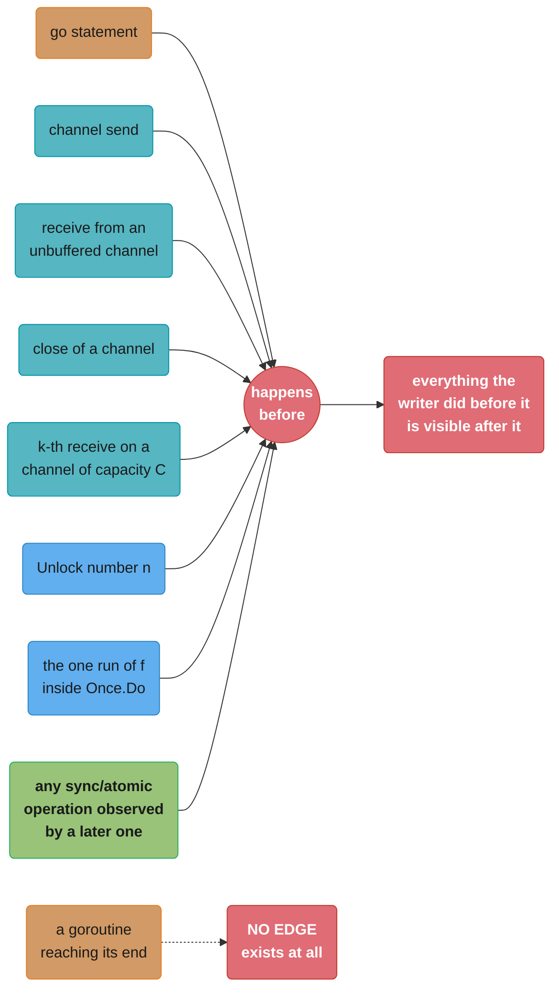
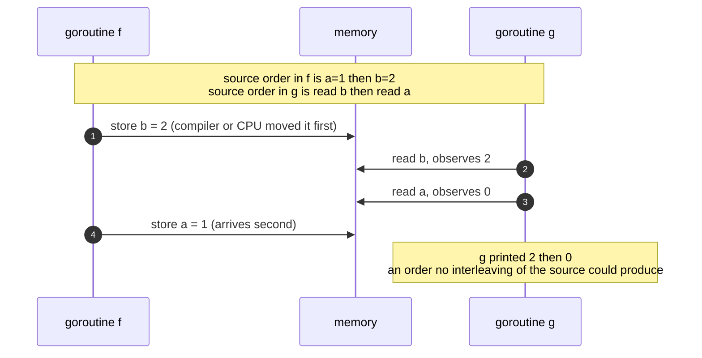
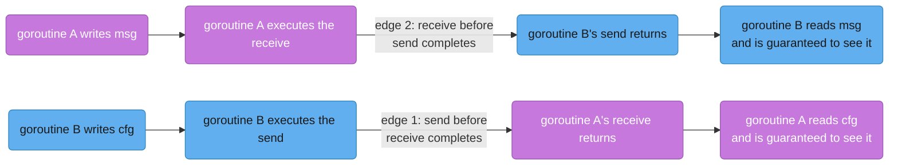

# The Go Memory Model

## 1. Concept Overview

The Go memory model is the specification that answers one question: **under what conditions
is a read of a variable in one goroutine guaranteed to observe a write to that variable
performed by a different goroutine?** It is roughly 3,000 words long, it is the shortest
memory model of any mainstream language, and every `sync` primitive is correct only because
of it.

The parent page, [Sync Primitives and the Memory Model](sync_primitives_and_memory_model.md),
covers the API surface — which primitive to call, what each costs, how each is misused. This
page covers what the language *guarantees*. The two are separable in practice: you can write
correct Go for years by mechanically wrapping shared state in a mutex without ever reading
the specification. You cannot review a lock-free algorithm, argue about whether an
`atomic.Bool` flag is sufficient, or explain why a service that ran clean on Intel started
corrupting data on Graviton, without it.

Three things make Go's model worth studying on its own rather than as a footnote to Java's
or C++'s. It offers **only sequentially consistent atomics** — there is no acquire, no
release, no relaxed, and that is a deliberate refusal rather than an omission. It has **no
equivalent of Java's `final`-field freeze**, so safe publication in Go has exactly one
mechanism where Java has several. And its treatment of racy programs is **more precisely
bounded than C++'s undefined behavior and yet more dangerous than most Go programmers
assume**, because Go's multiword values — interfaces, slices, strings, maps — are exactly
where the bound stops applying.

Everything here targets **Go 1.27**, and the model itself has been stable since its 2022
revision.

---

## 2. Intuition

> **One-line analogy**: a memory model is the contract that says which of your program's
> lines the compiler and the CPU are allowed to shuffle behind your back. Without it, "the
> order I wrote them in" is not a property your program has.

**Mental model**: your source code is a *description of a result*, not a script of machine
operations. Between what you wrote and what executes sit two independent reorderers. The
compiler rearranges instructions for register pressure, hoists loop-invariant loads, and
eliminates reads it can prove redundant. The CPU then rearranges again — buffering stores,
executing loads out of order, and letting each core observe other cores' writes in an order
that need not agree with any other core's view. Each reorderer preserves the behaviour a
*single* goroutine would observe. Neither preserves anything a second goroutine might see.

The memory model is the list of constructs that make the reorderers stop. Everywhere else,
they are free.

**Why it matters**: the failures this governs are the ones that survive every test you have.
They are architecture-dependent, timing-dependent, and often optimisation-level dependent, so
they appear when you change cloud instance families, when Go's compiler improves, or when
traffic doubles. A colleague's "it can't be a memory-model bug, the field is just a `bool`"
is the sentence that costs the next three days.

**Key insight**: the model does not say "you may share memory if you are careful". It says
the *only* way two goroutines may touch the same variable, with at least one of them writing,
is through a synchronisation edge that the specification names. There are about ten such
edges. Learn the list, and every concurrency argument becomes a question of whether an edge
exists between two points — a question with a yes-or-no answer rather than a feeling.

---

## 3. Core Principles

- **Sequenced before** — the order of evaluations within a single goroutine, as defined by
  the language spec. This is the ordering a single goroutine can observe in itself.
- **Synchronized before** — a partial order over *synchronising* memory operations
  (channel operations, lock operations, `Once`, atomics, goroutine creation). This is the
  primitive the current specification defines; it is what a `sync` primitive actually
  provides.
- **Happens before** — the transitive closure of the union of sequenced-before and
  synchronized-before. This is the relation you reason with.
- **Data race** — a write to a memory location concurrent with another read or write to that
  same location, where "concurrent" means unordered by happens-before, and where not all the
  accesses are `sync/atomic` operations.
- **The DRF-SC contract** — a data-race-free program executes with sequential consistency:
  as if all goroutines' operations were interleaved into one global order consistent with
  each goroutine's program order.
- **Bounded misbehaviour, not unbounded** — Go declines to say racy programs have C++-style
  undefined behavior. It bounds racy word-sized reads and forbids out-of-thin-air values. It
  bounds nothing for multiword values.
- **Atomics are sequentially consistent, always** — there is one ordering mode and you
  cannot select a weaker one.

---

## 4. Types / Architectures / Strategies

### 4.1 Every happens-before edge Go actually gives you

| Edge | Precise statement | The trap |
|------|------------------|----------|
| Program order | Within one goroutine, evaluations are sequenced in source order | Only *within* one goroutine. Says nothing to any other |
| Package init | If `p` imports `q`, `q`'s `init` functions complete before `p`'s begin; all `init` complete before `main.main` starts | This is why package-level `var` initialisation needs no locking |
| `go` statement | The `go` statement is synchronized before the new goroutine's first action | The reverse is not true and there is no ordering on the *start time* |
| Goroutine exit | **No edge at all.** A goroutine's exit is not synchronized before any event in the program | The single most-assumed non-guarantee in Go |
| Channel send | A send is synchronized before the corresponding receive *completes* | Applies to buffered and unbuffered alike |
| Unbuffered receive | A receive from an unbuffered channel is synchronized before the corresponding send *completes* | The reverse edge. This is how a bare `<-done` publishes the receiver's prior writes to the sender |
| Channel close | `close` is synchronized before a receive that returns the zero value because the channel is closed | Makes `close` a correct broadcast for arbitrarily many receivers |
| Buffered channel capacity | The k-th receive on a channel of capacity C is synchronized before the (k+C)-th send completes | The rule that makes a buffered channel a correct counting semaphore |
| Mutex | For `n < m`, the n-th `Unlock` is synchronized before the m-th `Lock` **returns** | The edge lands on the *return*, not on the call |
| RWMutex | For any `RLock`, some n-th `Unlock` is synchronized before that `RLock` returns, and its matching `RUnlock` is synchronized before the (n+1)-th `Lock` returns | Readers and writers interleave as whole generations |
| `sync.Once` | The single execution of `f` is synchronized before the return of **every** `once.Do(f)` call | Including the calls that did not run `f` — this is what makes it a publication mechanism |
| `sync/atomic` | If atomic operation B observes the effect of atomic operation A, then A is synchronized before B. All atomic operations behave as if executed in one sequentially consistent order | There is no weaker mode to select |
| `WaitGroup` | The `Done` calls that unblock a `Wait` are synchronized before that `Wait` returns | The `Add` must be sequenced before the `go`, or there is nothing to order |
| `runtime.SetFinalizer` | The `SetFinalizer` call is synchronized before the finalizer runs | Rarely load-bearing, but it is in the spec |

That is the whole list. `sync.Cond`, `sync.Map`, `sync.Pool`, `errgroup`, `semaphore` and
`singleflight` each document their own edges, but every one is built from the primitives
above rather than adding a new kind of ordering.

### 4.2 What a program with a data race is promised

Go deliberately does not adopt C++'s position that a data race makes the entire program
meaningless. The specification instead makes four statements:

1. An implementation **may** detect the race and halt the program. That is precisely what
   `-race` does — it is a licensed behaviour, not an extension.
2. Otherwise, a read of a memory location **no larger than a machine word** must observe some
   write that does not happen *after* it, with no intervening write ordered between them. In
   plain terms: a racy `int` read gives you a value that some goroutine actually wrote,
   before or concurrently.
3. **Out-of-thin-air and acausal values are forbidden.** A racy `int` cannot yield 7 if no
   goroutine ever wrote 7.
4. Reads of locations **larger than a machine word** are *encouraged but not required* to
   behave the same way. An implementation may treat them as a set of word-sized operations in
   unspecified order.

Statement 4 is where the bound disappears, and Go's type system makes it a much bigger
category than it is in C. An `interface{}` is a `(type, data)` pair. A slice is a
`(pointer, len, cap)` triple. A string is a `(pointer, len)` pair. A map value is a pointer,
but the map's internal structure is not. So a racy write to an `any` field can leave a reader
holding the *type word* of one value and the *data word* of another — at which point the
runtime will interpret an arbitrary address as an object of an unrelated type. The
specification's own words for this outcome are **"arbitrary memory corruption"**.

The practical translation for a reviewer: the bounded guarantees apply to `bool`, `int`,
`int64`, `float64`, and pointers. They do not apply to `interface{}`, `error`, `string`,
`[]byte`, `map`, `time.Time`, or any struct wider than one word. A race on the second list is
as dangerous as a race in C.

### 4.3 Where Go sits among the three models

| | Go | Java (JMM) | C++11 |
|---|---|---|---|
| DRF-SC contract | Yes | Yes | Yes |
| Racy word-sized read | Bounded — some real write, no out-of-thin-air | Bounded — some real write, no out-of-thin-air | Undefined behavior |
| Racy multiword read | Unbounded — "arbitrary memory corruption" | `long`/`double` may tear; references never do | Undefined behavior |
| Atomic ordering modes | Sequentially consistent only | `volatile` is SC; `VarHandle` adds acquire/release/opaque/plain | Six `memory_order` values |
| Safe publication without synchronisation | **None** | `final` field freeze | None |
| Cheapest correct flag | `atomic.Bool` | `volatile boolean` | `atomic<bool>` with `memory_order_relaxed` if only the flag matters |
| Model length | ~3,000 words | ~15,000 words (JSR-133) | A chapter of the standard |

The row that most surprises people arriving from Java is *safe publication without
synchronisation*. In Java, an object whose fields are all `final` is safe to publish through
a data race: the constructor's freeze action guarantees any thread that sees the reference
sees fully-initialised final fields. Go has no such rule. A `struct` full of never-mutated
fields, published by a racy pointer write, gives the reader no guarantee about the contents.
This is not a gap Go forgot; it is a consequence of having no constructors and therefore no
freeze point. The compensation is that Go's publication mechanisms — channel, mutex, `Once`,
`atomic.Pointer` — are all one line.

### 4.4 Why Go offers no acquire/release/relaxed

Russ Cox's stated rationale when the model was revised: sequentially consistent atomics are
the only ones most programmers can reason about correctly, and the performance difference is
small relative to the frequency with which weaker orderings are used incorrectly.

**What it costs.** On x86-64, nothing measurable: TSO already gives acquire semantics on every
load and release semantics on every store, so a sequentially consistent load is a plain `MOV`
and only a sequentially consistent *store* needs an `XCHG` or `MFENCE`. On arm64 the cost is
real but small: an SC load is `LDAR` rather than `LDR`, an SC store is `STLR` rather than
`STR`, and a read-modify-write uses the acquire-release form `LDADDAL` rather than the plain
`LDADD`. For a pure statistics counter — a value nothing else is ordered against — that
ordering is pure overhead, and C++ would let you say `memory_order_relaxed` and skip it. The
measured gap on a hot counter is worth benchmarking before you care about it; it is a
fraction of a nanosecond per operation, not a factor.

**What it buys.** Three things, and they are worth more than the nanoseconds. Every atomic in
a Go program is a synchronisation edge, so the race detector's vector clocks can treat them
uniformly. There is no `memory_order` argument for a reviewer to check, so the entire class
of "we used relaxed and it was fine on x86" bugs cannot exist. And the model stays short
enough to read in one sitting, which is the property that makes it usable at all.

---

## 5. Architecture Diagrams

### The edge catalogue



Eight edges in, one non-edge dotted off to the side. Goroutine *exit* is the missing arrow
people assume exists — it is why a bare `go f()` followed by reading what `f` wrote is
always a race, no matter how long you sleep first.

### A legal reordering that breaks intuitively-correct code



```go
var a, b int

func f() {
    a = 1
    b = 2
}

func g() {
    print(b) // may print 2
    print(a) // may then print 0
}

func main() {
    go f()
    g()
}
```

No sequentially consistent interleaving of `f` and `g` can print `2` then `0` — `b = 2` is
sequenced after `a = 1`, so seeing `b == 2` should imply `a == 1`. The program has a data
race, so sequential consistency does not apply to it, and both the compiler and the CPU are
free to produce that output. This is the canonical example from the specification itself.

### The unbuffered channel's two edges



An unbuffered channel is the only construct in Go that publishes in **both** directions from
one operation. Edge 1 is the one everybody knows. Edge 2 — the receive being ordered before
the send *completes* — is what makes `<-done` a valid way for a worker to publish its results
to whoever is sending on `done`, and it is the edge that disappears the moment somebody
"optimises" the channel to `make(chan struct{}, 1)`.

---

## 6. How It Works — Detailed Mechanics

### 6.1 The two reorderers, in order

```go
// What you wrote                What the compiler may emit
// -----------------------      ----------------------------
// x := cfg.Timeout              (cfg.Timeout hoisted out of a loop and
// for !stop {                    kept in a register for the loop's life)
//     doWork(x)                 (the load of stop may be hoisted too,
// }                              turning this into an infinite loop)
```

The compiler's licence is: it may perform any transformation that no *single-goroutine*
observer could detect. Under that rule, hoisting a non-atomic load of `stop` out of a loop
with no synchronisation inside is entirely legal — nothing in that goroutine writes `stop`,
so the load is loop-invariant. The specification's own broken example depends on exactly
this:

```go
var a string
var done bool

func setup() {
    a = "hello, world"
    done = true
}

func main() {
    go setup()
    for !done { // BROKEN: may never terminate, and may print "" if it does
    }
    print(a)
}
```

Two independent failures. The loop may spin forever because the compiler kept `done` in a
register. And even if it does observe `done == true`, there is no edge from `setup`'s write of
`a` to `main`'s read of it, so `print(a)` may print the empty string.

The CPU then reorders again. On x86-64 (Total Store Order) three of the four reorderings are
forbidden by the hardware: loads are never reordered with loads, stores never with stores,
loads never with later stores. Only StoreLoad is permitted. On arm64 **none** of the four is
forbidden. So the same source, compiled the same way, produces:

```
  goroutine 1:  data = 42        goroutine 2:  for !ready {}
                ready = true                   use(data)

  x86-64:  the two stores become visible in program order.
           Broken code frequently appears to work.
           It still breaks if the COMPILER reorders, which it may.

  arm64:   store-store reordering is allowed. goroutine 2 can observe
           ready == true while data is still 0. It also may reorder its
           own two loads, reading data before ready.
           The same binary fails within minutes under load.
```

This asymmetry is the single most common way a memory-model bug reaches production: the code
is written and tested on x86, then a fleet moves to arm64 for cost, and a bug that was always
present becomes reproducible.

### 6.2 Why an unsynchronised `bool` is broken even though a `bool` cannot tear

This is the argument to have ready, because "it's just a bool, it can't tear" is the most
common defence of a broken flag.

Tearing is not the problem, and Go's §4.2 bound confirms it: a racy read of a word-sized
value returns some value that was really written. There are three other problems.

1. **Visibility is not promised.** Nothing requires the write to `stop` ever to become
   observable to the reader. The reader may spin forever.
2. **Ordering is not implied.** Observing `stop == true` tells you nothing about any other
   write the setter performed. This is the failure that corrupts data, and it is the one the
   `bool`-cannot-tear argument does not address at all.
3. **The compiler may delete the load.** A loop-invariant non-atomic read can be hoisted, so
   the value is read once and never again.

```go
// BROKEN: plain bool as a stop flag.
type Worker struct {
    stop    bool
    results []Result // written by run, read by the caller after stop
}

func (w *Worker) run() {
    for !w.stop {
        w.results = append(w.results, compute())
    }
}
func (w *Worker) Stop() { w.stop = true }

// FIX: atomic.Bool for the flag, and a real edge for the results.
type Worker struct {
    stop    atomic.Bool
    mu      sync.Mutex
    results []Result
}

func (w *Worker) run() {
    for !w.stop.Load() {
        r := compute()
        w.mu.Lock()
        w.results = append(w.results, r)
        w.mu.Unlock()
    }
}
func (w *Worker) Stop() { w.stop.Store(true) }
```

Note that fixing only the flag would leave `results` racy — and `results` is a slice, so
under §4.2 that race is in the unbounded category. The `atomic.Bool` fixes the loop; the
mutex is what makes the data safe.

### 6.3 Double-checked locking in Go, and why `Once` is the answer

The specification includes this as an example of incorrect synchronisation:

```go
var a string
var done bool
var once sync.Once

func setup() {
    a = "hello, world"
    done = true
}

func doprint() {
    if !done {        // BROKEN: unsynchronised read of the guard
        once.Do(setup)
    }
    print(a)          // may print ""
}

func twoprint() {
    go doprint()
    go doprint()
}
```

The `sync.Once` is present and correct. The bug is the `if !done` check *outside* it. A
goroutine that reads `done == true` has taken no synchronising action, so there is no
happens-before edge from `setup`'s write of `a` to its read of `a`. It skips the `once.Do`
entirely and prints the empty string.

This is the identical shape to Java's classic double-checked locking bug, with one difference
worth noting for anyone carrying JMM habits over: in Java the accepted fix is to declare the
guard `volatile`, which creates the edge. Go has no `volatile`, so the fix is not to
strengthen the guard but to **delete it**:

```go
// FIX: no guard at all. Once.Do's fast path is a single atomic load,
// so the "optimisation" the guard was attempting is already inside it.
func doprint() {
    once.Do(setup)
    print(a)
}
```

`Once.Do` is specified so that the single run of `f` is synchronized before the return of
*every* `Do` call, including the ones that observed the operation already complete. That is
precisely the edge the hand-written guard lacked, and `Do`'s fast path is one `atomic.Uint32`
load — cheaper than the branch that was trying to avoid it.

For a value rather than a side effect, `sync.OnceValue` `[1.21]` removes even the possibility
of reading the variable before initialisation, because there is no variable to read.

### 6.4 Reading a happens-before argument out loud

The specification's unbuffered-channel example, walked edge by edge — this is the shape every
correctness argument should take:

```go
var c = make(chan int)
var a string

func f() {
    a = "hello, world" // (1)
    <-c                // (2)
}

func main() {
    go f()
    c <- 0             // (3)
    print(a)           // (4)
}
```

1. `(1)` is sequenced before `(2)` — program order within `f`.
2. `(2)` is synchronized before `(3)` completes — the unbuffered receive-before-send edge.
3. `(3)` is sequenced before `(4)` — program order within `main`.
4. Happens-before is transitive, so `(1)` happens before `(4)`.

Therefore `print(a)` is guaranteed to print `hello, world`. Change `c` to
`make(chan int, 1)` and step 2 evaporates: on a buffered channel the send completes without
waiting for a receiver, so there is no edge, and the program becomes a race that prints the
empty string on any machine where the scheduler cooperates.

### 6.5 The capacity rule as a semaphore

```go
var sem = make(chan struct{}, 3) // at most 3 concurrent

func handle(w work) {
    sem <- struct{}{}
    defer func() { <-sem }()
    w.run()
}
```

The k-th receive on a channel of capacity C being synchronized before the (k+C)-th send
*completes* is what makes this correct rather than merely plausible. The 4th send cannot
complete until the 1st receive has happened, so at most 3 goroutines are ever inside `w.run()`
— and each entering goroutine has a happens-before edge to the goroutine whose exit released
its slot. Without that edge the count would still be right but any state handed between them
would not be.

### 6.6 What `-race` proves, and what it cannot

The detector maintains a vector clock per goroutine and shadow words per 8-byte region of
memory. Every operation the model names as synchronising updates the clocks; every ordinary
load and store is checked against the shadow words. A report is issued when two accesses to
one address, at least one a write, come from goroutines whose clocks are unordered.

Read that mechanism carefully and the limitation is immediate: **the clocks record what
happened, so the detector can only compare accesses that both occurred.** It follows that:

- A clean `-race` run proves the *specific interleavings that executed* were race-free. It
  proves nothing about the program.
- The detector has no false positives worth arguing with. A report is a real unordered pair
  of accesses. Do not dismiss one because the code "looks fine".
- Increasing the *number* of test runs helps far less than increasing the *diversity* of
  interleavings. A thousand runs of a test whose goroutines always execute in the same order
  explore one interleaving a thousand times.

The strategy that follows has three parts, and only the third is Go-specific:

1. **Run the whole suite under `-race` in CI**, not a subset, and not nightly. And add stress:
   `go test -race -count=20 -cpu=1,4,16` explores substantially more orderings than a single
   default run, because varying `GOMAXPROCS` changes preemption points.
2. **Make the dangerous interleaving deterministic rather than hoping for it.** `testing/synctest`
   `[1.25]` runs a test's goroutines inside a *bubble* with a fake clock. `synctest.Wait`
   blocks until every goroutine in the bubble is durably blocked, so you can advance to a
   precise point and assert on it; `synctest.Sleep` `[1.27]` advances the fake clock. A test
   that used to be "start two goroutines and hope" becomes an exact statement. See
   [Testing, Benchmarking and Fuzzing](../testing_benchmarking_and_fuzzing/testing_benchmarking_and_fuzzing.md).
3. **Review for the absence of edges, not for the presence of bugs.** The list in §4.1 is
   short enough to check exhaustively. For every shared variable, name the edge. If you cannot
   name one, there is a race whether or not `-race` has found it.

---

## 7. Real-World Examples

| Case | What the memory model decided |
|------|-------------------------------|
| Go's own `sync.Once` fast path | `Do` reads an `atomic.Uint32` before touching the mutex. That is legal precisely because atomics are synchronising operations — the same read on a plain `uint32` would be the §6.3 bug |
| `sync.Map`'s read-only snapshot | Reads take no lock at all, relying on an `atomic.Pointer` to the snapshot. Every one of its documented guarantees is an application of the atomic edge |
| `net/http` `Server.Shutdown` | Signals in-flight handlers through a closed channel rather than a flag, because the close edge publishes everything the shutting-down goroutine did |
| OpenTelemetry Go's global `TracerProvider` | Swapped with `atomic.Pointer[T]` at init; instrumented packages load it on every span with no lock. Correct only because Go's atomics are sequentially consistent |
| The 2015 `runtime` map-iteration crashes on ARM | Racy writes to map headers producing inconsistent multiword state — the §4.2 unbounded category, and the reason Go's runtime added the concurrent-map-writes fatal error |
| Any Graviton or Ampere migration | Latent store-store reordering bugs that x86's TSO had been masking. The most common single trigger for a first encounter with this page |
| `golang.org/x/sync/singleflight` | Publishes the shared result through a channel close, giving every duplicate caller an edge to the one goroutine that did the work |

---

## 8. Tradeoffs

### Publication mechanism against publication mechanism

| Mechanism | Cost per publish | Cost per read | Publishes | Cancellable read |
|-----------|-----------------|---------------|-----------|------------------|
| `sync.Mutex` | ~15-25 ns uncontended | ~15-25 ns | Any amount of state | No |
| `atomic.Pointer[T]` | 1 atomic store | 1 atomic load | One whole object, swapped | No |
| Channel send | ~60-100 ns unbuffered | Same | The value plus everything before it | Yes, via `select` |
| `close(ch)` | 1 close | 1 receive | Everything before the close, to every receiver | Yes |
| `sync.Once` | Once, then 1 atomic load | 1 atomic load | The initialised value | No |
| Nothing (racy) | 0 | 0 | Nothing at all | N/A |

### Ordering models

| | SC-only (Go) | Full `memory_order` (C++) | `volatile` plus `VarHandle` (Java) |
|---|---|---|---|
| Reviewer burden | One question: is there an edge? | Two: is there an edge, and is its mode strong enough? | Two, and the modes are less familiar |
| Cost on x86-64 | Zero for loads, one fenced store | Same at SC, marginally cheaper relaxed | Same as Go for `volatile` |
| Cost on arm64 | `LDAR`/`STLR` on every atomic | Relaxed skips the barriers entirely | Same as Go for `volatile` |
| Failure mode of getting it wrong | You forgot an edge — usually visible in review | The edge exists but is too weak — invisible on x86, wrong on arm64 | As C++ for `VarHandle`, safe for `volatile` |
| Verdict for a services language | Correct trade | Correct for a kernel or a database engine | Correct, but the surface is larger than needed |

### Testing strategies against race classes

| Strategy | Finds | Misses |
|----------|-------|--------|
| `-race` on the default suite | Races on interleavings your tests happen to produce | Everything rare |
| `-race -count=20 -cpu=1,4,16` | Substantially more, at ~20x the CI minutes | Interleavings requiring a specific external timing |
| `testing/synctest` `[1.25]` | The exact interleaving you name, deterministically | The ones you did not think to name |
| Reviewing for missing edges | All of them, in principle | Whatever the reviewer overlooks |
| Production | The rest, expensively | Nothing |

---

## 9. When to Use / When NOT to Use

**Reach for this specification when** you are reviewing a lock-free algorithm, deciding
whether an `atomic.Bool` is sufficient on its own, explaining a bug that only reproduces on
arm64, or arguing about whether a "read-only after init" field needs synchronisation.

**Reach for it when** somebody proposes removing a mutex "because the field is only written
once at startup". That claim is either backed by a package-`init` edge or it is a race; the
model tells you which.

**Do NOT reach for it** to justify writing racy code that you believe is harmless. The
specification's own advice section is blunt: *if you must read this document to understand
your program's behaviour, you are being too clever.* The bounded guarantees of §4.2 exist to
constrain implementations, not to license programs.

**Do NOT use atomics** to build a data structure whose invariant spans more than one word
without writing the happens-before argument down. If you cannot write it as a chain of named
edges the way §6.4 does, the algorithm is not finished.

**Use a channel** when a value moves between goroutines. **Use a mutex** when state stays put
and several goroutines need it. **Use an atomic** for a counter or a flag whose entire meaning
fits in one word and whose ordering you have reasoned about explicitly. Those three sentences
cover essentially every correct Go program, and the rest of this page exists to tell you why.

---

## 10. Common Pitfalls

### 10.1 The x86-tested service that corrupted data on Graviton

A feature-flag cache was refreshed by a background goroutine writing a `map[string]bool` and
setting a plain `bool` to signal readiness. It ran without incident on `c5` instances for two
years. Within four hours of a fleet migration to `c7g` (arm64), the service began returning
flag lookups for a partially-populated map, and roughly 1 in 40,000 requests took the wrong
code path. The `-race` suite had been green the entire time, because no test ever ran the
refresh concurrently with a lookup.

```go
// BROKEN: no edge between the writer's map build and the reader's lookup.
type Flags struct {
    m     map[string]bool
    ready bool
}

func (f *Flags) refresh() {
    m := fetchFlags()
    f.m = m       // multiword write: (pointer, hmap state)
    f.ready = true
}

func (f *Flags) Enabled(k string) bool {
    if !f.ready {
        return false
    }
    return f.m[k]  // may read a map header the writer had not finished publishing
}

// FIX: publish the whole snapshot through one atomic pointer swap.
type Flags struct {
    m atomic.Pointer[map[string]bool]
}

func (f *Flags) refresh() {
    m := fetchFlags()
    f.m.Store(&m) // one atomic store publishes everything sequenced before it
}

func (f *Flags) Enabled(k string) bool {
    m := f.m.Load()
    if m == nil {
        return false
    }
    return (*m)[k]
}
```

Note that the fix is not "make `ready` atomic". The map assignment is a multiword write, so it
sits in the unbounded category of §4.2 — a torn map header is not a stale answer, it is a
segfault waiting for the right key. Swapping the whole snapshot through one
`atomic.Pointer[T]` gives the reader an edge to everything the writer did.
**Impact: 1 in 40,000 requests wrong for six hours, and two `fatal error: concurrent map read
and map write` crashes before rollback.**

### 10.2 Waiting for a goroutine by sleeping

```go
go loadCache()
time.Sleep(500 * time.Millisecond) // BROKEN: sleeping is not a happens-before edge
serve()
```

There is no edge from a goroutine's exit to anything, and there is no edge created by the
passage of time. The code is a data race regardless of the sleep duration. It usually
*appears* to work, which is why it survives review, and it fails when the loaded machine takes
600 ms. The fix is a `sync.WaitGroup`, a channel, or `errgroup` — all one line and all
actually specified.

### 10.3 Assuming a mutex publishes state it never guarded

A team protected a config struct with a mutex, then added a `Version int` field that was
written during startup *before* any locking existed and read from handlers *without* the lock,
"because it never changes". Under Go's model the write is ordered against the reader only if
the reader takes the same lock, and it did not. The field read as `0` on approximately one
pod per deploy, which routed those pods to the wrong schema migration path. **Impact: three
incidents over five months, each requiring a manual data repair.**

The general rule: a mutex creates an edge between an `Unlock` and a later `Lock` *on that
mutex*. It publishes whatever was written before the `Unlock` to whoever takes the `Lock`. A
field read outside the lock has no edge, however immutable you believe it to be. The only
things safe to read without synchronisation are package-level variables initialised in `init`
or a package-level `var` declaration, because package initialisation is an edge to
`main.main`.

### 10.4 Treating a `-race` report as a false positive

The detector reports an unordered pair of real accesses. It does not guess. Every "that can't
happen, the writer only runs at startup" dismissal in this section's war stories was wrong.
The correct response to a race report is to name the missing edge, not to argue about
likelihood.

### 10.5 Buffering a channel used only for signalling

Changing `make(chan struct{})` to `make(chan struct{}, 1)` to "avoid blocking" silently
deletes the receive-before-send edge from §5. If any code relied on the sender observing what
the receiver wrote — the §6.4 shape — that reliance is now a race with no compiler warning and
no test failure. Channel capacity is part of a synchronisation contract, not a performance
knob.

---

## 11. Technologies & Tools

| Tool | What it does for the memory model |
|------|----------------------------------|
| `go build -race` / `go test -race` | ThreadSanitizer with vector clocks over exactly the edges §4.1 names. The only automated race finder Go ships |
| `go test -race -count=N -cpu=1,4,16` | Varies `GOMAXPROCS` and repetition to broaden the set of interleavings actually explored |
| `testing/synctest` `[1.25]` | Deterministic bubble with a fake clock, so a named interleaving becomes a repeatable assertion rather than a hope |
| `go vet` (`copylocks`, `loopclosure`) | Catches the two structural mistakes that manufacture races: a copied lock and a shared loop variable |
| `staticcheck` SA-series | `SA2000` and neighbours flag `WaitGroup.Add` inside a goroutine and similar edge-deleting patterns |
| `goroutineleak` profile `[1.27]` | Finds goroutines permanently blocked on a primitive nothing can unblock — the failure mode of a *missing* edge rather than an absent one |
| `go tool compile -m` | Shows what escaped and what was inlined; useful when arguing about whether a load could have been hoisted |
| `GOARCH=arm64 go test` under emulation | Does not reproduce hardware reordering, but it does catch build-tag and alignment assumptions before the migration |
| The specification itself, `go.dev/ref/mem` | 3,000 words. Read it once end to end; it is shorter than this page |

---

## 12. Interview Questions with Answers

**Q: What exactly does Go promise a program that contains a data race?**
**Short:** Far less than most people expect and slightly more than C++ does: word-sized racy reads are bounded, while a racy multiword read can corrupt memory arbitrarily.

The specification makes four statements. An implementation may detect the race and halt,
which is exactly what `-race` does. A racy read of a location no larger than a machine word
must observe some write that does not happen after it, so a racy `int` returns a value some
goroutine really wrote. Out-of-thin-air and acausal values are forbidden. But reads of
locations *larger* than a word are only encouraged to behave that way — an implementation may
treat them as several word-sized operations in unspecified order. In Go that fourth statement
covers interfaces, slices, strings, and map headers, so a racy write to an `any` field can
leave a reader holding one value's type word and another's data word. The specification's own
term for the result is arbitrary memory corruption.

**Q: Which happens-before edge does an unbuffered channel give you that people consistently miss?**
**Short:** The receive is ordered before the corresponding send completes, so a bare receive publishes the receiver's earlier writes to the sender.

Everyone knows a send is ordered before the receive completes. The reverse edge exists only on
unbuffered channels and is what makes `<-done` a valid way for a worker to hand its results
back to whoever is sending on `done`: the worker's writes are sequenced before its receive,
the receive is synchronized before the sender's send returns, and the sender's read is
sequenced after that. The reason this matters practically is that it vanishes the instant
somebody changes `make(chan struct{})` to `make(chan struct{}, 1)` to avoid blocking. On a
buffered channel the send completes without a receiver, so there is no edge, no compiler
warning, and no test failure — just a new race.

**Q: Does a goroutine finishing establish any ordering with the goroutine that started it?**
**Short:** No. Goroutine exit is explicitly not synchronized before any event in the program, which is why sleeping to wait for one is always a race.

The `go` statement gives you an edge in one direction only: everything sequenced before it is
visible to the new goroutine's first action. Nothing comes back. So `go load(); time.Sleep(time.Second); use(data)`
is a data race no matter how long the sleep, and it usually appears to work, which is exactly
why it survives review and fails on a loaded machine. The specification is explicit about this
non-guarantee because it is the assumption people import from languages where thread join is
implicit. Every legitimate way to wait — `WaitGroup.Wait`, a channel receive, `errgroup.Wait`
— is specified as an edge; the passage of time never is.

**Q: A stop flag is a single bool and a bool cannot tear. Why is it still broken without synchronisation?**
**Short:** Tearing was never the problem — the write may never become visible, observing it implies nothing about any other write, and the compiler may hoist the load out of the loop.

Go's bound on word-sized racy reads does guarantee the reader sees a real value, so the
tearing objection is genuinely answered. Three problems remain. Nothing requires the write ever
to be observed, so `for !stop {}` may spin forever. Observing `stop == true` carries no
ordering with anything else the setter wrote, which is the failure that corrupts data rather
than merely delaying shutdown. And a non-atomic load with no synchronisation inside the loop
is loop-invariant, so the compiler may read it once into a register and never look again. An
`atomic.Bool` fixes all three at the cost of one instruction, and any *data* the two
goroutines share still needs its own edge on top.

**Q: Why does Go offer no acquire, release, or relaxed atomics the way C++ and Java's VarHandle do?**
**Short:** Because sequentially consistent atomics are the only ones most engineers reason about correctly, and the performance difference is small next to how often weaker modes are used wrongly.

Every `sync/atomic` operation in Go behaves as though all atomics executed in one globally
consistent order — the same semantics as a Java `volatile` or a C++ `seq_cst` atomic. The cost
is nothing measurable on x86-64, where TSO already provides acquire on loads and release on
stores, and small but real on arm64, where an atomic load becomes `LDAR` rather than `LDR` and
a read-modify-write uses the acquire-release form. What it buys is a reviewer's checklist with
one question on it instead of two: is there an edge, rather than is there an edge and is its
mode strong enough. It also removes the whole class of bugs where a relaxed atomic behaves
correctly on x86 and incorrectly on the ARM instance you migrate to next quarter.

**Q: What does closing a channel guarantee, and why is that useful for broadcast?**
**Short:** The close is ordered before every receive that returns the zero value, so it publishes everything the closing goroutine did to arbitrarily many receivers at once.

A send publishes to exactly one receiver, which makes a channel a poor broadcast mechanism.
`close` inverts that: every goroutine blocked on the channel wakes, every one of them gets an
edge back to the close, and therefore to everything sequenced before the close in the closing
goroutine. That is why `net/http`'s `Server.Shutdown` and every idiomatic cancellation
signal — including `context.Context.Done()` — are built on a closed channel rather than a
flag. It also explains why closing is the only correct way to signal N waiters with one
action, and why the who-closes rule matters: a second close panics, and there is no
"unclose".

**Q: What is the k-th receive and (k+C)-th send rule actually for?**
**Short:** It is what makes a buffered channel a correct counting semaphore rather than merely a plausible one.

The rule states that the k-th receive on a channel of capacity C is synchronized before the
(k+C)-th send *completes*. Read it as: a sender cannot get more than C ahead of the receivers.
For the semaphore idiom — send to acquire, receive to release — that means the (C+1)-th
acquirer blocks until the first releaser has released, which gives you the count. The edge
half is the part that is easy to overlook: the entering goroutine has a happens-before
relationship with whichever goroutine freed its slot, so any state handed between them is
safely published. Without the rule the count would still be right and the data would not be.

**Q: Why does racy code that runs correctly on x86-64 start failing on arm64?**
**Short:** x86-64's Total Store Order forbids three of the four possible memory reorderings for free, while arm64 forbids none of them.

On x86 loads are never reordered with loads, stores never with stores, and loads never with
later stores — only the store-load case is permitted. So the classic broken pattern of writing
data then setting a ready flag frequently *appears* correct: the two stores become visible in
program order. On arm64 store-store reordering is allowed, and the reader's two loads may be
reordered too, so the reader can observe the flag set while the data is still zero. The
practical consequence is that a fleet migration to Graviton or Ampere turns a latent bug into
a reproducible incident within hours. The compiler caveat matters as much: even on x86 the
compiler may reorder or hoist the accesses before the hardware ever sees them, so "it works on
x86" was never a correctness argument in the first place.

**Q: Why does double-checked locking fail in Go, and what is the fix?**
**Short:** Reading the guard outside the lock creates no ordering with the initialiser's writes, and the fix is to delete the guard rather than strengthen it.

The specification's own example wraps `once.Do(setup)` in an `if !done` check, where `done` is
a plain bool set by `setup`. A goroutine that observes `done == true` has performed no
synchronising action, so there is no edge from `setup`'s other writes to its subsequent reads,
and it prints an empty string. Java's accepted fix is to make the guard `volatile`, which
manufactures the edge. Go has no `volatile`, and it does not need one: `Once.Do` is specified
so the single execution of `f` is synchronized before the return of every `Do` call, including
the ones that found the work already done. Its fast path is a single atomic load, which is
cheaper than the branch the hand-written guard was trying to save.

**Q: If `-race` runs clean across the whole test suite, what have you proved?**
**Short:** Only that no race occurred on the interleavings that actually executed, which is a claim about history rather than about the program.

The detector maintains vector clocks per goroutine and shadow words per eight bytes of memory,
comparing each access against recent ones. That mechanism can only relate two accesses that
both happened, so an interleaving your tests never produced is entirely invisible to it. The
corollaries run in both directions: a clean run is weak evidence, and a report is strong
evidence, because the detector does not guess — it observed a genuinely unordered pair. The
strategy that follows is to broaden the explored orderings with `-count` and varying `-cpu`,
to make specific dangerous interleavings deterministic with `testing/synctest` `[1.25]`, and
above all to review for missing edges, since the list of edges is short enough to check
exhaustively.

**Q: How does Go's happens-before relation differ from the Java memory model's?**
**Short:** Both are transitive orders built from program order plus synchronisation edges, but Go has no volatile fields, no final-field freeze, and only one atomic ordering mode.

Structurally they agree: both promise sequential consistency to data-race-free programs and
both define visibility through a transitive relation. The differences are in the edge
catalogue. Java gives ordering to `volatile` field access, to monitor enter and exit, to
`Thread.start` and `Thread.join`, and to the freeze action at the end of a constructor. Go
gives it to channel operations, lock operations, `Once`, atomics, the `go` statement, and
package initialisation — and pointedly *not* to a goroutine ending, which is Java's `join`
edge with nothing standing in for it. Go also has no field-level annotation at all: there is
no `volatile`, so a variable is either accessed through `sync/atomic` or it is ordinary, with
nothing in between.

**Q: Is there a Go equivalent of Java's final-field guarantee for safe publication?**
**Short:** No. Publishing a pointer through a data race gives you no guarantee about the object it points at, however immutable that object is.

Java's freeze action means a thread that obtains a reference to a correctly-constructed object
sees fully-initialised `final` fields even if the reference itself was published racily. That
is the one place Java tolerates a benign-looking race. Go has no constructors and therefore no
freeze point, so a struct assembled and then published by an unsynchronised pointer write is a
plain data race — the reader may see the pointer and stale zero fields behind it. The practical
consequence is that Go has exactly one publication strategy where Java has several: create an
edge. A channel send, a mutex `Unlock`, an `atomic.Pointer[T].Store`, or `Once.Do` all do it in
one line, so the missing feature costs nothing in practice as long as nobody assumes it exists.

**Q: What reorderings is the Go compiler allowed to perform inside a single goroutine?**
**Short:** Any transformation no single-goroutine observer could detect, which includes swapping two independent writes and hoisting an invariant load out of a loop.

The licence is stated in terms of the observer, not in terms of a list of permitted moves. So
writing `a = 1` then `b = 2` may be emitted in either order, because no code in that goroutine
distinguishes them. A non-atomic read of a variable the goroutine never writes is loop
invariant, so `for !stop {}` may be compiled to a single load and an infinite loop. The
restrictions that do exist are narrow and aimed at not making things worse: the compiler must
not introduce a write where the source had none, must not allow a single read to observe two
different values, and must not introduce a race the source did not have. Everything a
concurrent observer could notice is fair game, which is precisely what happens-before edges
exist to constrain.

**Q: Can a racy read return a value that no goroutine ever wrote?**
**Short:** For a word-sized variable no, but for an interface, slice, string, or map a racy read can fuse halves of two different writes into something nobody wrote.

Go explicitly forbids out-of-thin-air values and requires a racy word-sized read to observe
some write that does not happen after it. So a racy `int64` counter gives a real, possibly
stale, value. The guarantee stops at one machine word, and Go's most common types are wider
than that: an interface is a type word plus a data word, a slice is pointer, length and
capacity, a string is pointer and length. A reader can therefore take the pointer from one
write and the length from another, producing a slice that indexes past its allocation, or the
type word of one value with the data word of another, causing the runtime to interpret an
arbitrary address as the wrong type. That is the difference between a stale answer and a
segfault.

**Q: What does `testing/synctest` give you that `-race` cannot?**
**Short:** Determinism — it runs a test's goroutines in a bubble on a fake clock so a chosen interleaving becomes a repeatable assertion instead of an accident.

`-race` observes whatever ordering the scheduler happened to produce, so a rare interleaving
is found only by luck. The `testing/synctest` package `[1.25]` inverts that: goroutines started
inside the bubble share a fake clock that only advances when every one of them is blocked, and
`synctest.Wait` blocks until all of them are durably blocked. That lets a test advance to an
exact point, assert on state, and step forward again, which turns "start two goroutines and
hope the race shows up" into an exact statement about a named ordering. `synctest.Sleep`
`[1.27]` advances the fake clock directly. It complements `-race` rather than replacing it:
`synctest` verifies the orderings you thought of, `-race` watches the ones you did not.

**Q: Does `Once.Do` create an edge for the callers that did not run the function?**
**Short:** Yes, and that property is what makes it a publication mechanism rather than merely a deduplication mechanism.

The specification says the single execution of `f` is synchronized before the return of *any*
call to `once.Do(f)`. So a goroutine arriving after initialisation completed, which observes
the done flag on the fast path and returns immediately, still has a happens-before edge to
everything `f` wrote. Without that clause `Once` would guarantee only that `f` ran once, and
every caller would still need its own synchronisation to see the result — which is exactly the
§6.3 double-checked-locking bug, and exactly what a hand-rolled `if !initialised` guard
reintroduces. It is also why `Do` blocks concurrent callers until `f` returns rather than
letting them proceed optimistically.

**Q: Is a mutex's `Unlock` ordered before the next `Lock`, or before the next `Lock` returns?**
**Short:** Before it returns — the specification places the edge on the return of the m-th Lock relative to the n-th Unlock for n less than m.

The distinction sounds pedantic and is not. Placing the edge on the *call* would say nothing
useful, since a `Lock` call that has not returned has not acquired anything. Placing it on the
return means that once `Lock` has given you the mutex, everything sequenced before every prior
`Unlock` of that mutex is visible to you. The counting is also worth reading precisely: it is
the n-th `Unlock` before the m-th `Lock` for `n < m`, a statement about the sequence of
operations on that specific mutex, not about goroutines. That is why unlocking from a
different goroutine than the one that locked is legal, and why a copied mutex is catastrophic
— the two copies have independent sequences and therefore no shared edges at all.

**Q: How do you argue that a piece of lock-free code is correct?**
**Short:** By writing the chain of named edges from each write to each read that must observe it, and refusing to accept the code until every link has a name from the specification.

The argument has a fixed shape. For every variable two goroutines touch, identify the write and
the read, then produce a chain: sequenced-before within the writer, one named synchronized-before
edge from §4.1, sequenced-before within the reader, closed by transitivity. If any link is
"and then it's obviously visible", there is no argument and there is a race. This is why the
practical rule that ends this page is what it is: synchronize with a channel or a mutex, use
atomics only for counters and flags whose ordering you have reasoned about explicitly, and
never invent a lock-free algorithm without writing that chain down. Reviewers cannot check a
feeling, and `-race` cannot check an interleaving nobody ran.

---

## 13. Best Practices

- **Name the edge.** For every variable two goroutines touch, be able to state which of the
  §4.1 edges orders them. If you cannot, it is a race regardless of what testing says.
- **Default to a channel or a mutex.** They are the two constructs whose edges are obvious to
  every reviewer, which is a correctness property and not a stylistic one.
- **Use atomics only for a counter or a flag whose whole meaning fits in one word**, and pair
  them with a real edge for any data they gate.
- **Never publish a multiword value racily.** Interfaces, slices, strings, maps and wide structs
  are in the unbounded category — a race there is memory corruption, not a stale read.
- **Publish whole snapshots through one `atomic.Pointer[T]`** rather than mutating shared state
  in place. One store, one load, and the edge is unmistakable in review.
- **Do not buffer a channel used purely for signalling.** Capacity is part of the
  synchronisation contract; adding it deletes the receive-before-send edge.
- **Treat every `-race` report as real.** The detector observes rather than infers, and every
  "that can't happen" in §10 was wrong.
- **Run `go test -race -count=20 -cpu=1,4,16` in CI**, not a single default-configuration pass.
- **Make the interleaving you fear deterministic** with `testing/synctest` `[1.25]` rather than
  running the same ordering a thousand times.
- **Never write a lock-free algorithm without the written argument.** If the chain of edges does
  not fit in a comment above the function, the function is not finished.
- **Read `go.dev/ref/mem` once, end to end.** It takes twenty minutes and it is the only
  primary source; everything on this page is downstream of it.
- **Then follow its own advice**: if you need this page to understand your program, the program
  is too clever. Rewrite it around a mutex and move on.

---

## 14. Case Study

### A lock-free metrics ring buffer that lost 4% of samples for a year

A latency-histogram library used inside a payments platform buffered samples in a fixed ring
and let a background goroutine drain them once a second. It was written lock-free to keep the
hot path under 20 ns. It shipped on `linux/amd64`, ran for fourteen months, and produced
histograms that were quietly wrong: p99 readings sat about 4% below the values a parallel
sampling system reported. Nobody noticed until the platform added `linux/arm64` workers and
the discrepancy jumped to 19% on those nodes.

**The original hot path.**

```go
// BROKEN: the write index is atomic, the slot contents are not.
type Ring struct {
    buf  [4096]sample
    head atomic.Uint64
}

type sample struct {
    ns    int64
    route string // multiword: pointer + length
}

func (r *Ring) Observe(ns int64, route string) {
    i := r.head.Add(1) - 1
    r.buf[i%4096] = sample{ns: ns, route: route} // plain write, no edge to the drainer
}

func (r *Ring) Drain() []sample {
    n := r.head.Load()
    lo := uint64(0)
    if n > 4096 { // head is a uint64: n-4096 wraps before the ring has filled
        lo = n - 4096
    }
    out := make([]sample, 0, n-lo)
    for i := lo; i < n; i++ {
        out = append(out, r.buf[i%4096]) // plain read, no edge to the writer
    }
    return out
}
```

The author's reasoning was that `head` is atomic, so the drainer reads a consistent index, and
each producer owns a distinct slot, so there is no contention. Both statements are true and
neither is the question the memory model asks.

**What the model actually says.** The atomic `Add` on `head` orders the *index* between
producer and drainer. It orders nothing about `buf`, because the drainer's read of `buf[i]` is
a plain read and the producer's write is a plain write, with no edge between them. So:

- The drainer may read a slot the producer has claimed but not yet filled, yielding a zero
  `ns`. Roughly 4% of samples on amd64 — the observed loss — arriving as zeros that dragged
  every percentile down.
- `route` is a string, which is a `(pointer, len)` pair. Under §4.2 that read is in the
  unbounded category: the drainer could take the pointer of one route and the length of
  another. It never crashed on amd64 because TSO kept the two halves in order in practice; on
  arm64 it produced garbage route labels, which is how the bug was finally caught.
- The producer's write and the drainer's read were also free to be reordered by the compiler
  relative to the atomic `Add`, since only the atomic itself is ordered.

**The fix.**

```go
// FIX: give every slot its own publication edge with a sequence counter.
// Even sequence means "stable and readable"; odd means "a writer is inside".
type slot struct {
    seq   atomic.Uint64
    ns    int64
    route string
}

type Ring struct {
    buf  [4096]slot
    head atomic.Uint64
}

func (r *Ring) Observe(ns int64, route string) {
    i := r.head.Add(1) - 1
    s := &r.buf[i%4096]
    s.seq.Add(1)              // now odd: writer inside. Publishes nothing yet.
    s.ns = ns
    s.route = route
    s.seq.Add(1)              // now even: everything above is ordered before this store
}

func (r *Ring) Drain() []sample {
    n := r.head.Load()
    lo := uint64(0)
    if n > 4096 { // head is a uint64: n-4096 wraps before the ring has filled
        lo = n - 4096
    }
    out := make([]sample, 0, n-lo)
    for i := lo; i < n; i++ {
        s := &r.buf[i%4096]
        before := s.seq.Load()
        if before%2 == 1 {
            continue          // a writer is inside; skip rather than read torn state
        }
        v := sample{ns: s.ns, route: s.route}
        if s.seq.Load() != before {
            continue          // a writer arrived mid-read; discard
        }
        out = append(out, v)
    }
    return out
}
```

**The happens-before argument, written out**, because §12's last answer demands one:

1. The producer's writes to `s.ns` and `s.route` are sequenced before its second `s.seq.Add(1)`.
2. That `Add` is an atomic operation. The drainer's second `s.seq.Load()` observes its effect,
   so by the atomic edge the `Add` is synchronized before that `Load`.
3. The drainer's reads of `s.ns` and `s.route` are sequenced before that `Load` — but that is
   the wrong direction, which is exactly why the *first* `Load` exists.
4. The first `Load` reads an even sequence, meaning some `Add` completing a write is
   synchronized before it, and therefore the writes preceding that `Add` are visible.
5. The second `Load` returning the same value establishes that no new writer entered between
   the two loads, so the values read in step 3 came from the generation step 4 ordered.

This is the standard seqlock, and the point of writing it out is that the argument is five
steps long for eleven lines of code. That ratio is the honest cost of lock-free programming
and the reason the practical rule is what it is.

**Result.** Sample loss went from 4% to zero, the arm64 garbage-label failures stopped, and
the hot path went from 18 ns to 31 ns per `Observe` — a cost the team accepted immediately once
the histograms were correct.

**What should have been done instead.** A `sync.Mutex` around a per-P sharded buffer was
benchmarked afterwards at 24 ns per `Observe` — *faster* than the corrected lock-free version,
because the corrected version pays two atomic RMWs per sample where the mutex pays one CAS. The
lock-free design was never a win; it only looked like one while it was incorrect. That is the
most common shape this failure takes, and it is why the rule that closes this page is to reach
for a channel or a mutex first, use atomics only for counters and flags whose ordering you can
state, and never invent a lock-free algorithm without writing the argument down.

---

## Related / See Also

- [Sync Primitives and the Memory Model](sync_primitives_and_memory_model.md) — the parent
  page: which primitive to call, what each costs, and how each is misused
- [Channels and Select](../channels_and_select/channels_and_select.md) — the `hchan`
  implementation behind the four channel edges in §4.1
- [Testing, Benchmarking and Fuzzing](../testing_benchmarking_and_fuzzing/testing_benchmarking_and_fuzzing.md)
  — `testing/synctest` `[1.25]`, stress configuration, and race-detection in CI
- [Goroutines and the Scheduler](../goroutines_and_the_scheduler/goroutines_and_the_scheduler.md)
  — why preemption points change which interleavings your tests explore
- [Java Memory Model](../../java/java_memory_model/java_memory_model.md) — `volatile`, the
  final-field freeze, and the barrier vocabulary Go's model deliberately omits
- [Memory Models and Concurrency Theory](../../cs_fundamentals/memory_models_and_concurrency_theory/memory_models_and_concurrency_theory.md)
  — sequential consistency, TSO, and weak ordering from first principles
- [Go vs Java and Python](../go_vs_java_and_python/go_vs_java_and_python.md) — the three
  languages' concurrency models compared end to end
