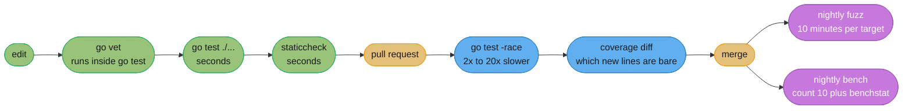
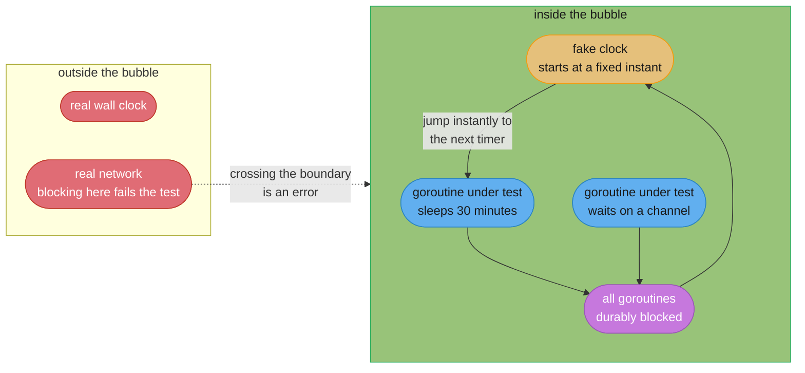
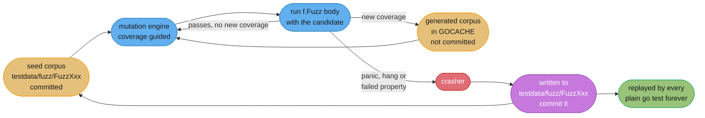

# Testing, Benchmarking and Fuzzing

---

## 1. Concept Overview

Go's `testing` package is the most opinionated thing in the standard library, and its
opinions are almost all subtractive. There is no assertion library. There is no test-runner
DSL, no `@Before`, no mocking framework, no fixture inheritance. A test is a function whose
name starts with `Test`, takes a `*testing.T`, and calls `t.Errorf` when something is wrong.
That is the entire API surface you need to know before writing your first test, and it is
the same surface a ten-year-old Go codebase uses.

What Go spends its complexity budget on instead is the **tooling around** the test function:
one command that compiles, runs, races, covers, benchmarks and fuzzes, with no configuration
file. `go test ./...` runs the suite. `go test -race ./...` runs it under a dynamic race
detector built into the toolchain. `go test -bench=. -benchmem` runs microbenchmarks with
allocation accounting. `go test -fuzz=FuzzParse` runs a coverage-guided fuzzer that writes
any crasher it finds into your repository as a permanent regression test. None of that needs
a dependency.

Two additions changed what is testable rather than how tests are written.
**`testing/synctest`** `[1.25]` runs concurrent code inside a *bubble* with a virtualized
clock, so a test of a five-minute exponential backoff finishes in microseconds and is
deterministic — which retired an entire genre of slow, flaky, `time.Sleep`-riddled tests.
And **`b.Loop`** `[1.24]` fixed the oldest benchmark footgun in the language, a loop whose
body the compiler deletes because nothing observes the result.

This module covers all of it: the house idioms (table-driven tests, subtests, `t.Cleanup`),
the tooling flags that matter, what coverage honestly measures, what fuzzing is and is not
good at, and the discipline that outlasts all of them — testing behaviour rather than
implementation. It does **not** re-teach benchmark statistics; A/A tests, confidence
intervals, effect size and steady state live in
[Benchmarking Methodology](../../backend/benchmarking_methodology/benchmarking_methodology.md),
and the Go-specific part here is which flags produce data worth handing to that method.

Target version is **Go 1.27** (released 2026-08-19).

---

## 2. Intuition

> A test suite is a tripwire, not a proof. Its value is not that it passed today — it is that
> it will fail on the specific day someone breaks something, loudly enough to stop them, and
> point at the right line. Every property of a good test follows from that: it must fail for a
> real reason (not flakiness), fail fast (not in 19 minutes), and its failure message must name
> the cause (not "expected true, got false").

**Mental model:** Go gives you four instruments, each answering a different question, and
the common mistake is to use one for another's question.

| Instrument | Question |
|-----------|----------|
| Tests | Does this behave correctly for the cases I thought of? |
| The race detector | Did that behaviour depend on an unsynchronized memory access? |
| Fuzzing | Does it survive the cases I did **not** think of? |
| Benchmarks | Is this fast, and did my change make it faster? |

**Why it matters:** the four have wildly different failure modes when misapplied. Coverage
mistaken for correctness produces a suite that executes every line and asserts nothing.
Benchmarks without `-count` and `benchstat` produce confident numbers that are noise.
Fuzzing without a property to check finds only panics. And a race-free test run proves
nothing about the interleavings that did not happen to occur.

**Key insight:** the largest single lever on a Go test suite is **determinism**, not speed —
and speed usually follows it. A flaky test is worse than no test, because it trains an
entire team to re-run CI instead of reading failures. Almost every Go flake traces to one of
three roots: real time (`time.Sleep`), shared mutable state between parallel tests, or an
unsynchronized read. `testing/synctest` `[1.25]` kills the first, `t.Cleanup` with per-test
fixtures kills the second, and `-race` finds the third.

---

## 3. Core Principles

1. **Test behaviour, not implementation.** A test that breaks when you rename a private
   method is a maintenance tax with no safety return. Assert on what a caller can observe.

2. **Table-driven by default.** One test function, a slice of cases, `t.Run(tc.name, ...)`.
   Adding a case is one line, every case is independently filterable, and a failure names
   itself.

3. **The failure message is the deliverable.** `got 3, want 4` in a subtest called
   `negative_offset` is a bug report. `assertion failed` is a scavenger hunt.

4. **Determinism above all.** No `time.Sleep` to "let the goroutine finish", no reliance on
   map iteration order, no shared global state between parallel tests, no network.

5. **Fast enough to run on save.** A suite that takes 19 minutes is a suite people run once
   a day. Parallelize, virtualize time, and push genuinely slow things behind a build tag.

6. **A crasher becomes a test, permanently.** Fuzzing's real product is not the bug it found,
   it is the corpus entry checked into `testdata/` that will re-run forever.

7. **Never trust a single benchmark run.** `-count=10` and `benchstat`, or say nothing —
   see [Benchmarking Methodology](../../backend/benchmarking_methodology/benchmarking_methodology.md).

8. **Coverage is a floor detector, not a quality metric.** It reliably tells you which code
   has *no* test. It says nothing at all about whether the tests that ran asserted anything.

---

## 4. Types / Architectures / Strategies

### 4.1 The test function families

| Signature | Runs when | Purpose |
|-----------|----------|---------|
| `func TestXxx(t *testing.T)` | `go test` | Correctness |
| `func BenchmarkXxx(b *testing.B)` | `go test -bench` | Speed and allocations |
| `func FuzzXxx(f *testing.F)` | `go test` as a seed replay, `-fuzz` to generate | Robustness against untrusted input |
| `func ExampleXxx()` | `go test`, compared against the `// Output:` comment | Documentation that cannot rot |
| `func TestMain(m *testing.M)` | Once per package | Suite-wide setup and teardown |

`Example` functions are underrated: they appear in `go doc` output and on pkg.go.dev, and the
`// Output:` comment makes them executable, so the documentation for your package is verified
by CI.

### 4.2 Table-driven tests and subtests

The house idiom, and the reason Go needs no parameterized-test framework:

```go
func TestParseDuration(t *testing.T) {
    tests := []struct {
        name    string
        in      string
        want    time.Duration
        wantErr bool
    }{
        {name: "seconds", in: "30s", want: 30 * time.Second},
        {name: "compound", in: "1h30m", want: 90 * time.Minute},
        {name: "negative", in: "-5m", want: -5 * time.Minute},
        {name: "empty", in: "", wantErr: true},
        {name: "no unit", in: "42", wantErr: true},
    }

    for _, tt := range tests {
        t.Run(tt.name, func(t *testing.T) {
            t.Parallel()
            got, err := ParseDuration(tt.in)
            if (err != nil) != tt.wantErr {
                t.Fatalf("ParseDuration(%q) error = %v, wantErr %v", tt.in, err, tt.wantErr)
            }
            if err == nil && got != tt.want {
                t.Errorf("ParseDuration(%q) = %v, want %v", tt.in, got, tt.want)
            }
        })
    }
}
```

`t.Run` is not cosmetic grouping. It buys four things for free: each case becomes an
independently addressable test (`go test -run 'TestParseDuration/no_unit'`), each gets its own
`*testing.T` so `t.Fatal` in one case does not abort the others, each can call `t.Parallel()`
independently, and the failure output names the case. Spaces in a subtest name become
underscores in the `-run` pattern.

Since `[1.22]` loop variables are per-iteration, so the `tt := tt` line that used to be
mandatory before a parallel subtest is gone.

### 4.3 Parallelism, cleanup, and helpers

| Tool | Semantics | The trap |
|------|-----------|----------|
| `t.Parallel()` | Pauses this subtest, resumes it after the parent test function returns | A `defer` in the parent runs **before** the parallel subtests do |
| `t.Cleanup(fn)` | Runs `fn` after the test **and all its subtests**, in LIFO order | None — this is the fix for the above |
| `t.Helper()` | Marks the function as a helper, so failures report the **caller's** line | Forgetting it points every failure at the assert helper |
| `t.TempDir()` | A per-test directory, removed automatically | None |
| `t.Setenv(k, v)` | Sets an env var, restores it after | **Panics** in a parallel test or one with a parallel ancestor |
| `t.Context()` `[1.24]` | A context cancelled just before cleanups run | Do not use it for something that must outlive cleanup |
| `t.ArtifactDir()` `[1.26]` | A directory for output files, preserved under `-artifacts` | Temporary and deleted without that flag |

The `defer`-versus-`Cleanup` distinction is the one that bites:

```go
func TestOrders(t *testing.T) {
    db := openTestDB(t)
    defer db.Close()          // BROKEN with parallel subtests: runs when TestOrders
                              // returns, which is BEFORE the subtests resume.
    for _, tt := range cases {
        t.Run(tt.name, func(t *testing.T) {
            t.Parallel()
            query(db)         // db is already closed
        })
    }
}
```

`t.Cleanup(func() { db.Close() })` runs after every subtest completes, parallel or not. Make
it a rule: in a test that has parallel subtests, `t.Cleanup` and never `defer`.

### 4.4 The `httptest` package

Three tools for three altitudes:

| Tool | What it gives you | Use for |
|------|------------------|---------|
| `httptest.NewRecorder()` | A `ResponseWriter` that captures status, headers and body — no network at all | Unit-testing one handler |
| `httptest.NewServer(h)` | A real server on a loopback port, with `.URL` and `.Client()` | Testing a **client** against a controllable server |
| `httptest.NewTestServer(t, h)` `[1.27]` | Same, but tied to the test and on an **in-memory** network by default | Everything `NewServer` was used for |
| `httptest.NewTLSServer(h)` | TLS with a self-signed cert, `.Client()` trusts it | TLS-specific client behaviour |
| `httptest.NewRequest(m, url, body)` | A `*http.Request` suitable for passing to a handler | Feeding `NewRecorder` tests |

`NewTestServer(t testing.TB, handler http.Handler) *Server` `[1.27]` is the one to reach for
now. It takes the `testing.TB` so the server is shut down by the test framework rather than by
a `defer` you have to remember; it defaults to an **in-memory network implementation** rather
than a real TCP loopback port, which removes port-exhaustion failures in large parallel
suites and works in sandboxes with no networking; it serves 500s if the handler is nil; and it
never touches `http.DefaultServeMux`.

### 4.5 `testing/synctest` `[1.25]` — the bubble

The package that changed what is testable. `synctest.Test(t, fn)` runs `fn` in an isolated
**bubble** with its own fake clock. The clock starts at a fixed instant and **advances
instantly** whenever every goroutine in the bubble is durably blocked — so a test of a
30-minute backoff schedule completes in microseconds and does so identically on every run.

| Function | Signature | Meaning |
|----------|-----------|---------|
| `synctest.Test` | `func(t *testing.T, f func(*testing.T))` | Run `f` in a new bubble, wait for its goroutines to exit |
| `synctest.Wait` | `func()` | Block until every other goroutine in the bubble is durably blocked |
| `synctest.Sleep` `[1.27]` | `func(d time.Duration)` | Advance the bubble clock by `d`, then wait for the bubble to settle |

`synctest.Sleep(d)` is exactly `time.Sleep(d)` followed by `synctest.Wait()`, which is the
pair every synctest test was writing by hand — sleep to move the clock, then wait for the code
under test to react before asserting.

The bubble's boundary is real: a goroutine that blocks on something **outside** it — a real
network read, a channel shared with a goroutine created before the bubble — is not durably
blocked, so the clock will not advance and the test will fail rather than silently pass.

### 4.6 Benchmarks

```go
func BenchmarkEncode(b *testing.B) {
    payload := makePayload(1024)     // setup, excluded from timing
    b.ReportAllocs()
    for b.Loop() {
        _ = Encode(payload)
    }
}
```

`b.Loop()` `[1.24]` is the current form and it fixed two long-standing problems at once. It
manages the timer itself, resetting on the first call and stopping when it returns false, so
setup above the loop is excluded without a `b.ResetTimer()`. And it keeps the loop body's
inputs and results alive through runtime intrinsics, so the compiler cannot delete the work
you are trying to measure.

That second property is the whole reason for the migration, and this is the one place a
before/after belongs, because the migration **is** the lesson:

```go
// The old pattern, and why it broke. Encode's result is unused, Encode is
// inlinable and pure, so the optimizer removed the call. This benchmark
// reported 0.31 ns/op -- the cost of an empty loop -- and a team acted on it.
func BenchmarkEncodeOld(b *testing.B) {
    payload := makePayload(1024)
    b.ResetTimer()
    for i := 0; i < b.N; i++ {
        Encode(payload)
    }
}
```

The old workaround was a package-level sink (`var sink []byte` and `sink = Encode(payload)`),
which worked but had to be remembered at every benchmark. `b.Loop` makes it structural.

`[1.26]` removed `b.Loop`'s remaining wart: it no longer prevents inlining of the calls in its
body, so the number you measure now reflects what the optimizer actually does at a real call
site rather than including call overhead production would not pay.

Reading the output:

```
BenchmarkEncode-8      1284372      918.4 ns/op      312 B/op       4 allocs/op
                 ^         ^            ^              ^                ^
          GOMAXPROCS  iterations   time/op      bytes/op        allocations/op
```

`-benchmem` adds the last two columns globally; `b.ReportAllocs()` opts one benchmark in.
`b.ReportMetric(v, "unit")` adds your own — throughput, cache hit rate, anything.

For **comparing** two runs, produce repetitions and hand them to `benchstat`:

```bash
go test -run='^$' -bench=BenchmarkEncode -count=10 > old.txt
# change the code
go test -run='^$' -bench=BenchmarkEncode -count=10 > new.txt
benchstat old.txt new.txt
```

Why `-count=10` and not `-count=1`, what the reported interval claims, why you interleave
runs, and how to establish your machine's noise floor with an A/A test are all in
[Benchmarking Methodology](../../backend/benchmarking_methodology/benchmarking_methodology.md).
This page's contribution is only the flags.

### 4.7 Native fuzzing `[1.18]`

```go
func FuzzParseHeader(f *testing.F) {
    f.Add([]byte("Content-Type: application/json\r\n\r\n"))   // seed corpus
    f.Add([]byte("\r\n"))
    f.Fuzz(func(t *testing.T, data []byte) {
        h, err := ParseHeader(data)
        if err != nil {
            return                      // rejecting bad input is correct behaviour
        }
        out := h.Encode()               // the PROPERTY: round-trip must be stable
        h2, err := ParseHeader(out)
        if err != nil {
            t.Fatalf("re-parse of own output failed: %v", err)
        }
        if !reflect.DeepEqual(h, h2) {
            t.Errorf("round-trip mismatch:\n got %#v\nwant %#v", h2, h)
        }
    })
}
```

The fuzzing engine is coverage-guided: it mutates inputs, keeps the mutations that reach new
code paths, and grows a corpus. Two corpora exist and the distinction matters:

| Corpus | Location | Committed | Role |
|--------|----------|-----------|------|
| Seed | `testdata/fuzz/FuzzXxx/` | **Yes** | Runs on every plain `go test`. Where crashers land |
| Generated | `$GOCACHE/fuzz` | No | The engine's working set, grown during `-fuzz` runs |

The argument types are limited to `[]byte`, `string`, `bool`, the sized integers and floats,
`byte` and `rune`. There is no struct fuzzing, so a structured target needs a decoder from
`[]byte` at the top of the fuzz function.

```bash
go test -fuzz=FuzzParseHeader -fuzztime=5m ./header      # one target at a time
go clean -fuzzcache                                       # discard the generated corpus
```

When the engine finds a failing input it writes it to `testdata/fuzz/FuzzParseHeader/<hash>`
and prints the path. That file is a normal seed from then on, so a plain `go test ./...`
replays it forever. Commit it in the same change as the fix — the regression test costs zero
lines of code and cannot be forgotten.

**Good fuzz targets:** anything that takes untrusted bytes — parsers, decoders, tokenizers,
protocol framers, decompressors, path and URL handling, template escaping. Anything with a
round-trip or a reference implementation to compare against.

**Bad fuzz targets:** business logic with a small structured input space (a table test is
better and faster), anything requiring network or database state, anything whose "correct"
answer the test cannot compute independently. Fuzzing finds panics, hangs and property
violations. It does not find "this returns the wrong discount for gold-tier customers".

### 4.8 Coverage, honestly

```bash
go test -cover ./...                                   # a number per package
go test -coverprofile=c.out -covermode=atomic ./...    # atomic is required with -race
go tool cover -html=c.out                              # the view that is actually useful
go test -coverpkg=./... ./...                          # count coverage of OTHER packages too
```

For **integration** coverage — coverage of a compiled binary exercised by an end-to-end
suite rather than by `go test`:

```bash
go build -cover -o ./bin/api ./cmd/api
GOCOVERDIR=/tmp/cov ./bin/api &                 # run the real binary against real traffic
# ... exercise it ...
go tool covdata percent -i=/tmp/cov
go tool covdata textfmt -i=/tmp/cov -o=integration.out   # merge with unit coverage
```

What the number means: coverage records which **statements executed**. It does not record
which were asserted on, so a test suite that calls every function and checks nothing reports
100%. It does not record branch or condition coverage. And it counts a line executed by an
`Example` that asserts nothing exactly the same as a line executed by a thorough table test.
Use it the way it works: as a **floor detector** that reliably finds the packages nobody has
tested at all, and as a diff view (`-html`) that shows which lines of *this change* are
unexercised. Never as a gate expressed as a single number, which teams reliably game by
testing getters.

---

## 5. Architecture Diagrams

### 5.1 The Go test loop, and what each stage catches



The ordering is by cost per finding. `go vet` is free and catches a printf verb mismatch
before the compiler even matters. `-race` costs 2x to 20x and belongs on the pull request, not
on every save. Fuzzing and benchmarking are nightly because their value accrues over hours of
running, not seconds.

### 5.2 Inside a `synctest` bubble



The rule that makes it deterministic: the clock moves **only** when nothing can run. There is
no race between the test's assertions and the code under test, because the test's own
`synctest.Wait()` (or `synctest.Sleep`) is itself a blocking point that the scheduler must
resolve before time advances.

### 5.3 What a benchmark actually measures

```
  BROKEN: for i := 0; i < b.N; i++ { Encode(payload) }

    source            after inlining        after dead-code elimination
    ------            --------------        ---------------------------
    Encode(p)   -->   buf := alloc()   -->  (nothing)
                      fill(buf, p)          (nothing)
                      return buf            (nothing)
                                            ^ result unused, function pure,
                                              so the whole body is deleted

    reported: 0.3122 ns/op       <-- this is the cost of an empty loop counter
                                     on a 3.2 GHz core, one increment


  FIXED:  for b.Loop() { _ = Encode(payload) }

    b.Loop keeps the body's inputs and results alive through runtime
    intrinsics, so nothing can be eliminated.

    reported: 918.4 ns/op   312 B/op   4 allocs/op      <-- the real cost

    delta: 2,942x.  A benchmark measuring nothing does not report zero and
    does not report an error. It reports a small, plausible, exciting number.
```

### 5.4 The fuzzing loop and where a crasher goes



The cycle back into the seed corpus is the point. Fuzzing's durable product is not the bug
report, it is the file — a permanent regression test written by the machine, costing zero
maintenance.

---

## 6. How It Works — Detailed Mechanics

### 6.1 What `go test` actually runs

`go test` generates a `main` package that imports your test files, builds a list of
`InternalTest` entries by name, and runs them through `testing.MainStart`. Three consequences
follow:

- **Test functions are found by name and signature**, in files ending `_test.go`. There is no
  registration and no reflection over annotations.
- **A package's tests are one binary**, so package-level state is shared across every test in
  it, which is exactly why parallel tests need per-test fixtures.
- **`go test` also runs a subset of `go vet`** before compiling — `atomic`, `bool`,
  `buildtags`, `errorsas`, `ifaceassert`, `nilfunc`, `printf`, `stringintconv`, and
  `stdversion` as of `[1.27]`. A `printf` verb mismatch fails your test run, not your code
  review.

`TestMain` takes over the entry point when present:

```go
func TestMain(m *testing.M) {
    pool, cleanup := startPostgresContainer()   // once for the whole package
    dbPool = pool
    code := m.Run()
    cleanup()
    os.Exit(code)
}
```

Since `[1.15]` you may simply `return` instead of calling `os.Exit`, which lets deferred
functions run — the wrapper exits with `m.Run()`'s result. Reserve `TestMain` for things that
genuinely must be shared by the whole package (one container, one schema migration); anything
per-test belongs in a helper returning a value plus a `t.Cleanup`.

### 6.2 The fixture helper pattern

Go's answer to fixtures is a function that takes `*testing.T`, registers its own cleanup, and
returns the thing. No framework, no inheritance, and it composes:

```go
// testDB returns a database scoped to this one test, with its own schema,
// dropped when the test (and all its subtests) finish.
func testDB(t *testing.T) *sql.DB {
    t.Helper()

    schema := "test_" + strings.ReplaceAll(t.Name(), "/", "_")
    if _, err := dbPool.Exec("CREATE SCHEMA " + pq.QuoteIdentifier(schema)); err != nil {
        t.Fatalf("create schema: %v", err)
    }
    t.Cleanup(func() {
        if _, err := dbPool.Exec("DROP SCHEMA " + pq.QuoteIdentifier(schema) + " CASCADE"); err != nil {
            t.Errorf("drop schema: %v", err)
        }
    })

    db := openSchema(t, schema)
    t.Cleanup(func() { db.Close() })
    migrate(t, db)
    return db
}

func TestOrderLifecycle(t *testing.T) {
    t.Parallel()
    db := testDB(t)      // isolated: safe to run in parallel with every other test
    // ...
}
```

`t.Helper()` at the top is what makes a failure inside `testDB` report the *caller's* line —
without it every fixture failure points at the same line of `testDB` and you cannot tell which
test broke.

### 6.3 Parallelism mechanics

`t.Parallel()` signals to the framework that this test may run concurrently with other
parallel tests. Mechanically the test **pauses** at that call and resumes only after its
parent test function has returned, which is the source of the `defer` trap in §4.3 and of a
second, subtler surprise: code above `t.Parallel()` runs serially, code below runs
concurrently. Put per-test setup below it.

Concurrency is capped by `-parallel n`, defaulting to `GOMAXPROCS`. Packages themselves run in
parallel too, capped by `-p n`, which is why a suite with a shared external database can pass
locally and deadlock in CI.

Two hard incompatibilities: `t.Setenv` and `t.Chdir` panic in a parallel test or one with a
parallel ancestor, because both mutate process-wide state. If a test needs an environment
variable, either drop `t.Parallel()` from it or, better, refactor the code under test to take
configuration as a parameter — which is the real fix and improves the design.

### 6.4 A `synctest` test, end to end

The genre this replaced: a retry-with-backoff test that slept for real.

```go
func TestRetryBackoff(t *testing.T) {
    synctest.Test(t, func(t *testing.T) {
        var attempts int
        var attemptAt []time.Duration
        start := time.Now()

        client := &Client{
            MaxAttempts: 4,
            BaseDelay:   1 * time.Second,     // 1s, 2s, 4s: 7 seconds of real waiting
            Do: func(context.Context) error {
                attempts++
                attemptAt = append(attemptAt, time.Since(start))
                return errors.New("upstream unavailable")
            },
        }

        errCh := make(chan error, 1)
        go func() { errCh <- client.Run(context.Background()) }()

        synctest.Wait()          // let the first attempt happen and the retry timer be set

        // Advance the fake clock past each backoff and let the code react.
        synctest.Sleep(1 * time.Second)   // [1.27]: sleep then settle, in one call
        synctest.Sleep(2 * time.Second)
        synctest.Sleep(4 * time.Second)

        if err := <-errCh; err == nil {
            t.Fatal("expected failure after exhausting attempts")
        }
        if attempts != 4 {
            t.Errorf("attempts = %d, want 4", attempts)
        }
        want := []time.Duration{0, 1 * time.Second, 3 * time.Second, 7 * time.Second}
        if !slices.Equal(attemptAt, want) {
            t.Errorf("attempt times = %v, want %v", attemptAt, want)
        }
    })
}
```

Three things this gets that the sleeping version could not. It runs in **microseconds** rather
than seven seconds. It asserts the **exact** backoff schedule, because the fake clock has no
jitter — the sleeping version could only assert "roughly 7 seconds elapsed" with a tolerance,
which is what made it flaky on a loaded CI box. And it cannot pass by accident: if the client
never sets its retry timer, the bubble has no timer to advance to, `synctest.Sleep` finds
nothing, and the assertion fails deterministically rather than intermittently.

The boundary rule in practice: everything the test touches must be created inside the bubble.
A `*sql.DB` opened in `TestMain` and used inside a bubble blocks on a real socket, which is
not durable blocking, so the clock stalls. Fake the dependency, or do not use synctest for
that test.

### 6.5 Golden files

For anything whose expected output is large — rendered templates, formatted reports,
serialized structures, CLI help text — inline expectations are unreadable and unmaintainable.
Golden files put the expectation in `testdata/` and give you one flag to regenerate them:

```go
var update = flag.Bool("update", false, "rewrite testdata golden files")

func TestRenderInvoice(t *testing.T) {
    for _, name := range []string{"simple", "multi_currency", "credit_note"} {
        t.Run(name, func(t *testing.T) {
            in := loadFixture(t, filepath.Join("testdata", name+".json"))
            got := RenderInvoice(in)

            golden := filepath.Join("testdata", name+".golden")
            if *update {
                if err := os.WriteFile(golden, got, 0o644); err != nil {
                    t.Fatal(err)
                }
                return
            }
            want, err := os.ReadFile(golden)
            if err != nil {
                t.Fatalf("read golden (run with -update to create): %v", err)
            }
            if diff := cmp.Diff(string(want), string(got)); diff != "" {
                t.Errorf("RenderInvoice mismatch (-want +got):\n%s", diff)
            }
        })
    }
}
```

`go test ./billing -update` rewrites every golden file; `git diff` then shows exactly what
your change did to every output, which is the real value — the golden file turns an invisible
behaviour change into a reviewable diff. The discipline that makes it work is reviewing that
diff rather than reflexively running `-update` to make CI green, which is the failure mode
that turns golden files into no tests at all.

`testdata/` is ignored by the Go tool, so anything in it is invisible to the build.

### 6.6 The race detector

```bash
go test -race ./...
go test -race -covermode=atomic -coverprofile=c.out ./...   # atomic, not set/count
```

The detector is a dynamic happens-before analyzer built on ThreadSanitizer. It instruments
every memory access, maintains vector clocks per goroutine, and reports when two goroutines
access the same address, at least one write, with no synchronization edge between them.

What that costs, from the official documentation: **memory usage typically 5–10x** and
**execution time 2–20x**. It also requires cgo, so a `CGO_ENABLED=0` build environment cannot
run `-race` — a common surprise in minimal CI containers.

What it proves and does not prove is the single most misunderstood thing about it. A reported
race is a **real** race, always: there are no false positives. But a clean run proves only
that the interleavings that occurred were race-free. A race in an error path your test never
took, or one that requires a specific ordering the scheduler did not produce, is simply not
detected. The consequences and the formal happens-before rules are in
[The Go Memory Model](../sync_primitives_and_memory_model/the_go_memory_model.md).

Practically: run `-race` on the whole suite in CI on every pull request, run it locally on the
package you are changing, and treat a race report as a release blocker rather than a flake.

### 6.7 Hunting a flaky test

Flakes have a small number of causes and each has a probe:

```bash
# 1. Does it fail in isolation, or only alongside others? (shared state)
go test -run 'TestThing$' -count=100 ./pkg

# 2. Does it fail under the race detector? (unsynchronized access)
go test -race -run 'TestThing$' -count=50 ./pkg

# 3. Does it fail when tests run in a different order or with more concurrency?
go test -shuffle=on -count=20 ./pkg
go test -parallel=32 -count=20 ./pkg

# 4. Does it fail when the machine is loaded? (real-time dependence)
go test -run 'TestThing$' -count=50 -cpu=1 ./pkg   # starve it deliberately
```

| Symptom | Cause | Fix |
|---------|-------|-----|
| Passes alone, fails in the suite | Shared package state or a shared external resource | Per-test fixture plus `t.Cleanup` |
| Fails under `-shuffle=on` | Tests depend on execution order | Same |
| Fails only on a loaded machine | `time.Sleep`, or a timeout tuned to a fast box | `testing/synctest` `[1.25]` |
| Fails under `-race` only | A genuine data race | Fix the race, not the test |
| Fails once in 500 runs, everywhere | A real concurrency bug in the code under test | Fix the code — the test is doing its job |

`-shuffle=on` is the cheapest of these to adopt: turn it on permanently in CI and order
dependence stops accumulating.

The rule that matters more than any technique: **a flaky test is quarantined or fixed within
one day, never retried**. A CI system with automatic retries trains a team to stop reading
failures, and after that the suite is decoration.

### 6.8 `go vet`, `staticcheck` and the rest of the loop

`go test` runs a subset of vet automatically. Run the full set separately, plus a real static
analyzer:

```bash
go vet ./...
staticcheck ./...              # honnef.co/go/tools
golangci-lint run              # aggregates staticcheck, errcheck, ineffassign and others
govulncheck ./...              # known vulnerabilities in your actual call graph
```

`staticcheck` catches the class of bug tests structurally cannot: unused writes, impossible
type assertions, a `defer` inside a loop, a `sync.Mutex` copied by value, a formatting verb
mismatch on a custom type. It is roughly as valuable per minute as the entire unit suite and
runs in seconds. Wire it into the same pre-merge gate.

For CI output, `go test -json` gives machine-readable results, with an `"OutputType"` field
`[1.27]` distinguishing error output from ordinary frames, which is what test-reporting tools
consume.

---

## 7. Real-World Examples

**The Go standard library** is the reference table-driven codebase. `net/http`'s test suite
uses `httptest` throughout, `strconv` and `time` are almost entirely tables, and
`encoding/json` has been fuzzed continuously since `[1.18]` — several of the crashers found
are still in its `testdata/fuzz` directory as permanent seeds.

**Kubernetes** ships an enormous suite split by cost: unit tests, integration tests against a
real `etcd`, and end-to-end tests against a live cluster, with build tags and separate CI
lanes for each. Its coverage story is the honest one — the number is not the gate, the
e2e conformance suite is.

**CockroachDB** runs its own randomized-testing infrastructure on top of Go's, generating SQL
statements and comparing results against PostgreSQL — a differential fuzzing property applied
at a scale the built-in engine is not designed for, but built on the same idea.

**`golang.org/x/tools`** and the compiler itself use golden files heavily, because the output
of a formatter or a code generator is exactly the case inline expectations cannot express.

**OSS-Fuzz** runs Go fuzz targets continuously for many popular open-source Go projects, which
is the pattern to copy: fuzzing pays off in hours of machine time, not minutes, so it belongs
on a schedule rather than in a pull-request gate.

---

## 8. Tradeoffs

### Stdlib `testing` vs `testify`

| | Stdlib only | With `testify` |
|---|---|---|
| Dependencies | Zero | One, in every package's test surface |
| Boilerplate | `if got != want { t.Errorf(...) }` | `assert.Equal(t, want, got)` |
| Failure output | Exactly what you wrote | Structured, with a diff |
| Argument order | Explicit in your message | `(t, expected, actual)` — reversed constantly |
| Deep comparison | `google/go-cmp`'s `cmp.Diff` | `assert.Equal` via reflection |
| Mocks | Hand-written, or a small interface | `testify/mock`, which encourages over-mocking |
| Common middle ground | Stdlib assertions plus `go-cmp` for diffs — no assertion DSL, excellent output | — |

The honest position: `testify` is not wrong and huge codebases use it well. But its
`assert`/`require` split is a real footgun (`assert` continues after a failure, so a nil
dereference on the next line masks the actual error), and its presence tends to pull
`testify/mock` in behind it. Most teams that start with stdlib plus `go-cmp` do not later want
`testify`; many that start with `testify` later want less of it.

### `httptest.NewRecorder` vs a test server

| | `NewRecorder` | `NewTestServer` `[1.27]` |
|---|---|---|
| Network | None | In-memory by default |
| Tests | One handler in isolation | A client, or the full server stack |
| Exercises middleware, routing, timeouts | No | Yes |
| Speed | Fastest possible | Nearly as fast, no port allocation |
| Use for | Handler logic, status codes, response bodies | Client retry logic, TLS, redirects, streaming |

### Table-driven tests vs one test per case

| | Table-driven | One function per case |
|---|---|---|
| Adding a case | One line | One function |
| Shared setup | Written once | Duplicated or extracted |
| Divergent cases | Grows a `wantErr`, then a `skip`, then a `setup func` — a smell | Naturally accommodated |
| Debugging | `-run 'TestX/case_name'` | `-run 'TestXCaseName'` |
| Verdict | Default. Split out a case when its table row needs its own fields | For genuinely different scenarios |

### Fuzzing vs property testing vs example tests

| | Example / table tests | Fuzzing | Property testing (`gopter`, `rapid`) |
|---|---|---|---|
| Input space | What you thought of | Bytes, mutated toward new coverage | Structured values from generators |
| Finds | Regressions in known behaviour | Panics, hangs, property violations on hostile input | Logic errors across structured inputs |
| Cost | Milliseconds | Minutes to hours, best on a schedule | Seconds to minutes |
| Regression capture | Manual | **Automatic**, into `testdata/` | Manual (shrunk counterexample) |
| Best for | Everything, as a base | Parsers, decoders, anything untrusted | Invariants over your own types |

---

## 9. When to Use / When NOT to Use

### Reach for each tool when

- **Table-driven test** — always, as the default shape.
- **`t.Parallel()`** — the test has no shared mutable state and takes more than a millisecond.
- **`testing/synctest`** `[1.25]` — the code under test involves timers, timeouts, retries,
  backoff, rate limiting, or any goroutine coordination you would otherwise sleep for.
- **`httptest.NewTestServer`** `[1.27]` — testing a client, middleware chain, or anything
  above one handler.
- **Golden files** — the expected output is longer than about ten lines.
- **Fuzzing** — the function takes bytes, a string, or anything from outside your trust
  boundary, and you can state a property.
- **`-race`** — every pull request, whole suite.
- **Benchmarks** — you are about to make a performance claim, or defend one.

### Do NOT reach for them when

- **Do not fuzz business logic** with a small, structured input space. A table test is faster,
  clearer, and actually checks the answer.
- **Do not benchmark** without `-count` and `benchstat`. A single run is a number, not a
  result.
- **Do not use `t.Parallel()`** in a test touching `os.Setenv`, the working directory, or a
  shared fixture — it will panic or corrupt a sibling.
- **Do not set a coverage percentage gate.** It is gamed within one sprint by testing getters.
- **Do not mock what you own and can construct.** A real struct is a better test double than a
  generated mock of its interface.
- **Do not use synctest** for a test that touches a real network, database or filesystem
  socket — those block outside the bubble and the clock will not advance.

### Caution

- `-race` needs cgo. A `CGO_ENABLED=0` CI image cannot run it.
- `-covermode=atomic` is required alongside `-race`, or the counters race.
- Nightly fuzzing needs a corpus-persistence story, or every run starts from zero.
- `TestMain` runs once per **package**, so a container started there is shared by every test
  in it — which is fine, and is exactly why per-test isolation must be a schema or a prefix.

---

## 10. Common Pitfalls

**1. The benchmark that measured an empty loop — a 3-week rewrite for 0% gain.**

A team replaced their serialization layer on the strength of a benchmark showing 0.31 ns/op
against the old code's 1,240 ns/op — a claimed 4,000x win. Three engineer-weeks later,
production p99 was unchanged. The new benchmark's result was unused and the function was
inlinable and pure, so the optimizer deleted the entire loop body; 0.31 ns/op was the cost of
incrementing a counter.

```go
// BROKEN: nothing observes the result, so the compiler removes the work.
func BenchmarkEncode(b *testing.B) {
    payload := makePayload(1024)
    b.ResetTimer()
    for i := 0; i < b.N; i++ {
        Encode(payload)
    }
}
```

```go
// FIX: b.Loop keeps the body's inputs and results alive through runtime
// intrinsics, so there is nothing for dead-code elimination to remove.
func BenchmarkEncode(b *testing.B) {
    payload := makePayload(1024)
    b.ReportAllocs()
    for b.Loop() {
        _ = Encode(payload)
    }
}
// Reported after the fix: 918.4 ns/op, 312 B/op, 4 allocs/op.
// The old serializer, benchmarked the same way: 1,102 ns/op. A 17% win,
// which was real and which nobody would have rewritten a subsystem for.
```

The diagnostic to remember: any `ns/op` under about 1 ns is one machine instruction, and no
function that allocates can run that fast. Treat a suspiciously good benchmark as broken until
`-benchmem` shows allocations consistent with what the code does.

**2. `defer db.Close()` with parallel subtests — a suite that failed only in CI.**

A team added `t.Parallel()` to 140 subtests and every one began failing with "sql: database is
closed", but only in CI, because locally `-parallel` was 1 on their configured runner.
`t.Parallel()` pauses the subtest until the parent returns, and the parent's `defer` fires on
that return — before the subtests resume. Replacing `defer db.Close()` with
`t.Cleanup(func() { db.Close() })` fixed all 140. In a test with parallel subtests, `defer` in
the parent is always wrong.

**3. Missing `t.Helper()` — every failure pointing at line 41.**

A shared `assertJSONEqual` helper without `t.Helper()` reported every one of 300 test failures
at the same line inside itself. Engineers had to add print statements to find out which test
failed. One line at the top of the helper made the output name the caller. Add `t.Helper()` to
every function that takes a `*testing.T` and can call `t.Error`/`t.Fatal`.

**4. Retries in CI hiding a real bug for five months.**

A 1-in-40 flake was handled by a CI plugin that retried failed tests three times, taking the
observed failure rate to 1 in 64,000. Five months later a customer hit the same race in
production: a map read concurrent with a write, which `-race` would have found in one run. The
retry configuration had converted a caught bug into a shipped one. Quarantine flakes with
`t.Skip` and a linked issue, never with an automatic retry.

**5. A coverage gate reaching 85% while assertions fell.**

A mandated 85% line-coverage gate was met inside two sprints. Reviewing what was added: 240
tests calling getters and setters and asserting the value came back, plus several that invoked
a function and checked only that `err == nil`. Coverage rose from 61% to 86%; escaped-defect
rate did not move. Coverage finds untested packages, which is genuinely useful. It cannot
distinguish a line that was executed from a line that was verified, so it cannot be a target.

**6. Fuzzing with no property — three days of finding nothing.**

A fuzz target that called `Parse(data)` and returned unless `err != nil` ran for three days
and found one panic, then found nothing more, because the only property it checked was "does
not crash". Adding the round-trip property — `Parse(Encode(Parse(x))) == Parse(x)` — surfaced
four correctness bugs in the first twenty minutes, including a header-continuation case that
silently dropped a field. Fuzzing is only as good as the invariant you assert inside it.

**7. `t.Setenv` in a parallel test — a panic that read like a framework bug.**

`panic: testing: t.Setenv called after t.Parallel` appeared after someone added `t.Parallel()`
to a table loop where one case needed an environment variable. `Setenv` mutates process-wide
state and cannot be made per-test, so the framework refuses rather than corrupting siblings.
The tempting fix is to drop `t.Parallel()`; the real fix is to make the code under test take
configuration as a parameter, at which point the test needs no environment variable and can be
parallel again.

**8. Golden files regenerated to make CI green.**

A CLI's help-text golden file was regenerated with `-update` seventeen times over four months.
The eleventh regeneration silently accepted a change that dropped an entire flag from the help
output, and the flag went undocumented for three releases. `-update` is a tool for *reviewing*
a diff, not for producing one — if you cannot explain every line of the resulting `git diff`,
the change is a bug and not an update.

---

## 11. Technologies & Tools

| Tool | Role |
|------|------|
| `testing` | The stdlib package: `T`, `B`, `F`, `M`, `Run`, `Parallel`, `Cleanup`, `Helper`, `Loop`, `TempDir`, `Setenv`, `Context` |
| `testing/synctest` `[1.25]` | Deterministic concurrency tests in a bubble with a virtualized clock — `Test`, `Wait`, `Sleep` `[1.27]` |
| `net/http/httptest` | `NewRecorder`, `NewServer`, `NewTLSServer`, `NewRequest`, `NewTestServer` `[1.27]` |
| `go test` | The runner: `-run`, `-race`, `-cover`, `-bench`, `-fuzz`, `-shuffle`, `-count`, `-parallel`, `-json`, `-artifacts` `[1.26]` |
| `go tool cover` | Renders a coverage profile as HTML or a per-function summary |
| `go tool covdata` | Merges and reports coverage from `go build -cover` binaries via `GOCOVERDIR` |
| `benchstat` | `golang.org/x/perf/cmd/benchstat` — statistical comparison of benchmark runs |
| `google/go-cmp` | `cmp.Diff` for readable deep-equality failures, with `cmpopts` for tolerances |
| `go vet` | Correctness analyses, a subset of which `go test` runs automatically |
| `staticcheck` | `honnef.co/go/tools` — the analyzer that finds what tests cannot |
| `golangci-lint` | Aggregates staticcheck, errcheck, ineffassign, revive and others behind one config |
| `govulncheck` | Reports known vulnerabilities reachable from your actual call graph |
| `testify` | Third-party assertions and mocks — widely used, and worth adopting deliberately rather than by default |
| `testcontainers-go` | Real dependencies in Docker for integration tests, wired to `TestMain` |
| `gotestsum` | Human-readable and JUnit output over `go test -json` for CI |
| `mockgen` / `moq` | Interface mock generation, for the cases where a real implementation genuinely is not available |
| OSS-Fuzz | Continuous fuzzing infrastructure for open-source Go projects |

---

## 12. Interview Questions with Answers

**Q: Why does Go's standard library ship no assertion library, and should you add testify?**
**Short:** Because an assertion DSL hides which values were compared and encourages one assertion per line instead of a table of cases, so the stdlib makes you write the comparison you mean.

The stdlib position is that `if got != want { t.Errorf("Parse(%q) = %v, want %v", in, got, want) }`
is three lines that produce a failure message you designed, in a language everyone already
reads, with no dependency. The counter-argument is real: that boilerplate repeated 400 times is
tedious, and `assert.Equal` gives a structured diff for free. The middle ground most Go teams
converge on is stdlib assertions plus `google/go-cmp` for deep comparison, which gives excellent
diffs (`cmp.Diff(want, got)`) without an assertion DSL. If you do take testify, know its two
liabilities: `assert` continues after a failure so the next line frequently nil-panics and hides
the actual error — prefer `require` — and `testify/mock` tends to arrive behind it and pull a
codebase toward mocking things it owns.

**Q: What does `t.Run` give you beyond visual grouping?**
**Short:** Independent addressing, independent failure isolation, independent parallelism, and a failure message that names the case — four things a bare loop over a table gives you none of.

Each subtest gets its own `*testing.T`, so `t.Fatal` in one case aborts that case and lets the
rest run, where a bare loop would abandon the whole table at the first failure. Each becomes
separately runnable with `go test -run 'TestParse/no_unit'`, which is how you iterate on one
case without waiting for the others, with spaces in the name mapping to underscores in the
pattern. Each can call `t.Parallel()` on its own, so a table of 200 cases parallelizes with one
line. And the test output names the failing case, which turns "TestParse failed" into a bug
report. That combination is why Go needs no parameterized-test framework.

**Q: What is the trap with `t.Parallel()` and cleanup in the parent test?**
**Short:** A parallel subtest pauses and resumes only after the parent function returns, so a `defer` in the parent tears down the fixture before the subtests ever use it.

`t.Parallel()` signals that the subtest may run concurrently and immediately suspends it; the
framework resumes it once the parent test function has returned. That means the parent's
deferred `db.Close()` — which fires exactly on that return — closes the database before a
single parallel subtest has touched it, and every one fails with "database is closed". Use
`t.Cleanup(func() { db.Close() })` instead, which the framework runs after the test **and all
its subtests** have finished. The rule is simple enough to apply without thinking: in any test
that has parallel subtests, `t.Cleanup` and never `defer`. Note also that code above
`t.Parallel()` runs serially and code below runs concurrently, so per-test setup belongs below
it.

**Q: What does `t.Helper()` actually change and why does it matter so much?**
**Short:** It marks the function as a test helper so reported failures point at the caller's line rather than at the line inside the helper.

Without it, a shared assertion or fixture helper reports every failure across the whole package
at the same line — its own — and you cannot tell from the output which test broke or with what
input. With it, `go test` walks past the helper frame and names the calling test's line, so the
failure is a bug report again. Add it as the first statement of every function that takes a
`*testing.T` (or `testing.TB`) and can call `t.Error`, `t.Fatal` or `t.Skip`, including fixture
constructors that only fail on setup errors. It is one line, it is invisible when things pass,
and its absence is discovered at exactly the worst moment — when 300 tests are red and none of
them will say why.

**Q: What is `TestMain` for, and what should not go in it?**
**Short:** It replaces the package's test entry point for setup shared by every test in the package, such as starting one container or running migrations once.

`func TestMain(m *testing.M)` runs instead of the generated main, does its setup, calls
`m.Run()`, tears down, and since `[1.15]` may simply return rather than calling `os.Exit` —
which lets deferred functions actually run. Legitimate uses are genuinely package-wide and
expensive: one Postgres container, one schema migration, one flag registration. What does not
belong there is per-test state, because `TestMain` runs once per package and every test in that
package shares whatever it created, which silently couples tests and breaks parallelism. The
per-test pattern instead is a helper taking `*testing.T` that registers its own `t.Cleanup` and
returns an isolated resource — a schema named after `t.Name()`, a temp directory from
`t.TempDir()` — so isolation is structural rather than a convention people remember.

**Q: When do you use `httptest.NewRecorder` and when do you need a test server?**
**Short:** Use a recorder to test one handler's logic with no network at all, and a test server when the thing under test is a client or the full middleware and routing stack.

`httptest.NewRecorder()` gives you a `ResponseWriter` that captures status, headers and body,
and you call your handler directly with it plus an `httptest.NewRequest` — the fastest possible
test, and the right one for asserting what a handler returns for a given input. It cannot test
anything the `http.Server` does: routing, middleware ordering, timeouts, redirects, streaming,
TLS. For those, and for testing a *client* against a server you control,
`httptest.NewTestServer(t, handler)` `[1.27]` is the current form — it takes the `testing.TB`
so the server is closed by the framework rather than a `defer` you must remember, and it runs
on an in-memory network by default rather than a real loopback port, which removes port
exhaustion in large parallel suites and works where sandboxing forbids listening sockets.

**Q: How does the golden-file pattern work and what is its failure mode?**
**Short:** The expected output lives in testdata and a `-update` flag rewrites it, so a behaviour change becomes a reviewable diff instead of an unreadable inline string.

You declare `var update = flag.Bool("update", false, ...)`, compare the produced output against
`testdata/<case>.golden` normally, and write the file instead when the flag is set. Running
`go test ./pkg -update` then makes `git diff` show precisely what your change did to every
rendered template, formatted report or CLI help text — which is a far better review artefact
than a 200-line string literal in a test file. The failure mode is entirely social: `-update`
becomes the reflex for making CI green, and a regeneration silently accepts a real regression.
One team's help-text golden was regenerated seventeen times in four months and one of those
regenerations dropped a documented flag for three releases. The discipline is that if you
cannot explain every line of the resulting diff, it is a bug and not an update.

**Q: What does `testing/synctest` make testable that was not, and how does its clock work?**
**Short:** It runs code in a bubble whose fake clock jumps forward whenever every goroutine inside is durably blocked, so timer-driven code becomes fast and deterministic.

`synctest.Test(t, fn)` `[1.25]` starts a bubble; time inside begins at a fixed instant and
advances instantly to the next timer the moment nothing in the bubble can run. A test of a
four-attempt exponential backoff that really waited 1s, 2s and 4s now completes in microseconds
and — crucially — can assert the **exact** schedule, because there is no jitter to tolerate.
That removes the two properties that made this whole genre of test bad: it was slow, and it was
flaky on a loaded CI box where a real sleep overshot. `synctest.Wait()` blocks until every other
goroutine in the bubble is durably blocked, and `synctest.Sleep(d)` `[1.27]` is the
sleep-then-settle pair every such test was open-coding. The boundary is strict and that is a
feature: a goroutine blocking on something outside the bubble is not durably blocked, so the
clock stalls and the test fails rather than passing by accident.

**Q: Why did `b.Loop` replace the `b.N` loop?**
**Short:** Because it keeps the loop body's inputs and results alive so the optimizer cannot delete the work, and it manages the timer itself so setup above it is excluded automatically.

The old pattern's failure was silent and expensive: if the benchmarked call's result was unused
and the function was inlinable and free of side effects, dead-code elimination removed it
entirely and the benchmark reported the cost of an empty counter — a small, plausible, exciting
number that has driven real rewrites for zero gain. The workaround was a package-level sink
variable, which had to be remembered at every single benchmark. `b.Loop()` `[1.24]` makes it
structural, using runtime intrinsics to keep the body observable, and it resets the timer on
its first call and stops it when it returns false, which is why `b.ResetTimer()` above the loop
is now redundant. `[1.26]` removed its last wart: it no longer prevents inlining of calls in
its body, so the measurement reflects what the optimizer really does at a production call site.

**Q: A benchmark reports 0.31 ns/op. What happened?**
**Short:** Nothing was measured — sub-nanosecond means roughly one machine instruction, so the loop body was optimized away or the work is not what you think.

At a few gigahertz, 0.31 ns is one clock cycle, which no function that allocates or touches
memory can achieve. The overwhelmingly likely cause is dead-code elimination of an unused,
inlinable, pure call, and the fix is `for b.Loop()`. Two other causes are worth checking if
`b.Loop` does not change the number: the work may have been hoisted **out** of the loop because
it is loop-invariant, which a sink cannot prevent and which needs the input varied per
iteration; or the function may genuinely be trivial and you are benchmarking the wrong thing.
Confirm with `-benchmem` — if the code allocates and the benchmark reports `0 allocs/op`, the
call is definitely not happening. The general habit is to sanity-check every benchmark result
against what the code physically has to do before believing it.

**Q: What is Go's fuzzer good at, and what is it not?**
**Short:** It excels at code taking untrusted bytes — parsers, decoders, framers — and is a poor fit for structured business logic whose correct answer the test cannot independently compute.

The engine is coverage-guided: it mutates inputs, keeps mutations reaching new code paths, and
grows a corpus, so it explores exactly the malformed-input space a human would not enumerate.
That makes it outstanding for anything crossing a trust boundary. It is weak where the input
space is small and structured — a table test covers that faster and actually checks the answer
— and where "correct" cannot be verified without reimplementing the function. Its argument
types are limited to `[]byte`, `string`, `bool`, the sized integers and floats, `byte` and
`rune`, so a structured target needs a decoder from bytes at the top of the fuzz function. And
it only finds what you assert: with no property beyond "does not panic" it will find one panic
and then nothing. Give it a round-trip, a differential comparison against a reference
implementation, or a stated invariant.

**Q: How does a fuzzing crash become a permanent regression test?**
**Short:** The engine writes the failing input into testdata/fuzz/FuzzXxx, which is the seed corpus that a plain `go test` replays on every future run.

There are two corpora and only one is committed. The **generated** corpus lives in
`$GOCACHE/fuzz`, is the engine's working set during a `-fuzz` run, and is disposable — `go clean
-fuzzcache` throws it away. The **seed** corpus is `testdata/fuzz/FuzzXxx/` inside your package,
is checked into version control, and is executed by every ordinary `go test ./...` with no
`-fuzz` flag at all. When the engine finds a crasher it writes it into the seed directory and
prints the path, so committing that file in the same change as the fix gives you a regression
test that cost zero lines of code, can never be forgotten, and is written in the machine's
vocabulary rather than yours. This automatic capture is the most valuable thing about Go's
fuzzer and the part teams most often fail to exploit, by running fuzzing in CI without
persisting what it produces.

**Q: Should `-race` run in CI, and what does it cost?**
**Short:** Yes, on every pull request across the whole suite — it costs roughly 5 to 10 times the memory and 2 to 20 times the runtime, which is cheap against a shipped data race.

The detector is a dynamic happens-before analyzer on ThreadSanitizer: it instruments every
memory access, keeps vector clocks per goroutine, and reports two accesses to the same address
with at least one write and no synchronization edge between them. The official cost figures are
5–10x memory and 2–20x execution time, which usually turns a 40-second suite into a few
minutes — entirely affordable pre-merge, and too slow to run on every file save. Two practical
gotchas: it requires cgo, so a `CGO_ENABLED=0` CI image cannot run it at all, and it needs
`-covermode=atomic` if you are also collecting coverage, or the coverage counters themselves
race. Treat any race report as a release blocker: there are no false positives.

**Q: What does a clean `-race` run prove?**
**Short:** Only that the specific interleavings that occurred during that run were race-free — it is evidence, never a proof of absence.

The detector observes actual execution. A race on an error path your tests never take, or one
requiring an ordering the scheduler happened not to produce, is simply not seen. That is why a
green race run is not a correctness argument for concurrent code and why increasing the odds
matters: run with `-count=10`, vary `-cpu`, run under load, and make sure the tests actually
exercise the concurrent paths rather than driving one goroutine at a time. The complementary
discipline is reasoning from the memory model rather than from test results — knowing which
operations establish a happens-before edge, so you can argue the code is correct instead of
observing that it did not fail. That reasoning is in
[The Go Memory Model](../sync_primitives_and_memory_model/the_go_memory_model.md).

**Q: How do you hunt a flaky test?**
**Short:** Bisect the cause with four probes — run it alone with -count, run it under -race, run the suite with -shuffle=on, and run it on a deliberately loaded machine.

Each probe isolates one cause. `go test -run 'TestThing$' -count=100 ./pkg` passing while the
full suite fails means shared state between tests, and the fix is a per-test fixture with
`t.Cleanup`. Failing under `-race` means a genuine data race, and you fix the code rather than
the test. Failing under `-shuffle=on` means order dependence, which is the same shared-state
problem seen from another angle — turn shuffling on permanently in CI so it stops accumulating.
Failing only on a loaded box or with `-cpu=1` means a real-time dependency, which is
`testing/synctest`'s entire purpose. The rule that outweighs all four techniques: fix or
quarantine a flake within a day and never configure automatic retries, because a suite that
retries trains a team to stop reading failures, and after that it protects nothing.

**Q: What does a coverage number honestly tell you, and how do you cover integration tests?**
**Short:** It tells you which statements executed, not which were verified, so it is a reliable floor detector and a useless quality target.

A suite that calls every function and asserts nothing reports 100%, and a mandated percentage
gate is reliably met within a sprint by testing getters. What coverage does well is find code
nobody has touched — a package at 4% is a real finding — and, via `go tool cover -html`, show
which lines of *this change* are unexercised, which is a genuinely good review artefact. For
coverage of a **binary** exercised by end-to-end tests rather than by `go test`, build it with
`go build -cover`, run it with `GOCOVERDIR` pointing at a directory, and then use `go tool
covdata percent -i=<dir>` or `covdata textfmt` to merge that with your unit profile. Use
`-covermode=atomic` whenever `-race` is also on, and `-coverpkg=./...` when you want a test in
one package to count coverage it produces in another.

**Q: What does "test behaviour, not implementation" mean concretely, and how do you know you got it wrong?**
**Short:** Assert only on what a caller can observe, and take a test that breaks during a pure refactor as proof the test was coupled to internals.

The concrete test is the refactor test: change the implementation without changing any
observable behaviour — extract a method, rename a private field, replace a slice with a map, swap
a library — and count how many tests go red. Zero is correct. A test that asserted a private
method was called, or that a mock received exactly three calls in a specific order, breaks on
every one of those changes and has therefore made refactoring more expensive while catching
nothing. Practically that means preferring real collaborators over mocks where you can
construct one (an in-memory implementation of your own interface, `httptest` rather than a
mocked transport), asserting on returned values and observable side effects rather than on
interaction patterns, and treating "I had to change the test to make my refactor compile" as a
signal about the test rather than about the refactor.

**Q: Where do `go vet` and `staticcheck` fit in the test loop?**
**Short:** They catch defects tests structurally cannot see, in seconds, so they belong before the test run rather than after it.

`go test` already runs a subset of `go vet` before compiling — `printf`, `atomic`, `errorsas`,
`ifaceassert`, `stringintconv` and others, plus `stdversion` as of `[1.27]` — so a format-verb
mismatch fails your test run rather than reaching review. Run the full `go vet ./...` and then
`staticcheck ./...` separately, because staticcheck finds a class of bug no test will ever
exercise: a `sync.Mutex` copied by value, a `defer` inside a loop that never fires, an
impossible type assertion, a value assigned and never read. Both complete in seconds on a large
codebase, which makes them the cheapest quality per second in the whole loop.
`golangci-lint` aggregates them plus errcheck and others behind one config if you prefer a
single command, and `govulncheck ./...` belongs in the same gate for known vulnerabilities
reachable from your actual call graph.

**Q: How do you make a benchmark result you can defend in a review?**
**Short:** Run each side with -count=10 or more, compare with benchstat rather than by eye, and state the machine and the Go version alongside the numbers.

`go test -run='^$' -bench=BenchmarkX -count=10 > old.txt`, make the change, produce `new.txt`,
and run `benchstat old.txt new.txt`. The `-run='^$'` stops unit tests contaminating the run, the
repetitions are what let the tool distinguish a real change from machine noise, and `benchstat`
prints `~` when the difference is not statistically significant — which is a real answer and the
one people most often talk past. Add `-benchmem` so allocation changes are visible, since an
`allocs/op` reduction is often the durable win while `ns/op` moves with the machine. Everything
about *why* this procedure works — establishing a noise floor with an A/A test, what the
reported interval claims, why you interleave rather than run sequentially, how many repetitions
you actually need — is in
[Benchmarking Methodology](../../backend/benchmarking_methodology/benchmarking_methodology.md),
and a performance claim made without it is a number rather than a result.

---

## 13. Best Practices

- **Table-driven with `t.Run` subtests as the default shape.** Reach for separate functions
  only when a case genuinely needs different fields.
- **`t.Cleanup`, never `defer`, in any test with parallel subtests.** The parent returns before
  the subtests resume.
- **`t.Helper()` as the first line of every helper that can fail the test.** One line, and it
  is the difference between a bug report and a scavenger hunt.
- **Fixtures are functions taking `*testing.T` that register their own cleanup.** Isolation by
  construction — a schema named for `t.Name()`, a `t.TempDir()` — not by convention.
- **`t.Parallel()` on anything with no shared state**, and configuration as a parameter rather
  than an environment variable so `t.Setenv` never forces you to give it up.
- **`testing/synctest` `[1.25]` for anything with a timer.** Never `time.Sleep` to let a
  goroutine finish.
- **`httptest.NewTestServer(t, h)` `[1.27]` for server-level tests**, `NewRecorder` for one
  handler.
- **`for b.Loop()` in every benchmark**, with `b.ReportAllocs()`, and `benchstat` over
  `-count=10` before making any claim.
- **Fuzz every parser and decoder, with a property**, on a nightly schedule, and commit every
  crasher it writes into `testdata/`.
- **`-race` on the whole suite in every pull request**, `-covermode=atomic` alongside it.
- **`-shuffle=on` permanently in CI** so order dependence cannot accumulate.
- **`go vet` plus `staticcheck` plus `govulncheck` in the same gate as the tests.**
- **Fix or quarantine a flake within a day. Never configure a retry.**
- **Use coverage as a floor detector and a diff view; never as a percentage gate.**
- **Review the `-update` diff.** If you cannot explain every changed line, it is a regression.

---

## 14. Case Study

### The 19-minute suite with a 3% flake rate

A logistics platform's Go monorepo had 4,100 tests across 84 packages. CI took 19 minutes,
roughly 3% of runs failed for reasons unrelated to the change, and the team had responded by
configuring three automatic retries — which took the observed failure rate to under 0.1% and
meant nobody had read a test failure in months. Two production incidents in one quarter were
later traced to races that a single clean `-race` run would have caught.

**Step 1 — measure where the 19 minutes actually go.**

```bash
go test -json ./... | gotestsum --format testname > run.json
# then rank packages by elapsed time
jq -r 'select(.Action=="pass" and .Test==null) | "\(.Elapsed)\t\(.Package)"' run.json \
  | sort -rn | head -10
```

```
412.8   platform/retry
288.1   platform/ratelimit
201.4   platform/scheduler
187.9   platform/httpclient
 96.2   platform/circuitbreaker
```

Five packages were 20 minutes of the 19 — they overlapped — and all five had one thing in
common: they tested timing behaviour by actually waiting.

**Step 2 — the representative broken test.**

```go
// BROKEN. Three separate defects in eleven lines.
//
// 1. It sleeps for 7 real seconds, and there are 340 tests like it.
// 2. It asserts elapsed time with a 500 ms tolerance, which fails on a loaded
//    CI runner roughly once in 30 runs -- this single test was 1.1% of the
//    suite's entire flake rate.
// 3. The tolerance means it cannot assert the actual backoff SCHEDULE, so a bug
//    that made the delays 1s/1s/1s instead of 1s/2s/4s would still pass.
func TestRetryBackoff(t *testing.T) {
    var attempts int
    c := &Client{MaxAttempts: 4, BaseDelay: time.Second,
        Do: func(context.Context) error { attempts++; return errUpstream }}

    start := time.Now()
    err := c.Run(context.Background())
    elapsed := time.Since(start)

    if err == nil {
        t.Fatal("want error")
    }
    if attempts != 4 {
        t.Errorf("attempts = %d, want 4", attempts)
    }
    if elapsed < 6500*time.Millisecond || elapsed > 7500*time.Millisecond {
        t.Errorf("elapsed = %v, want ~7s", elapsed)
    }
}
```

```go
// FIX. Same coverage, microseconds instead of seven seconds, and a STRONGER
// assertion: the exact schedule, not a tolerance band. The fake clock has no
// jitter, so there is nothing to tolerate.
func TestRetryBackoff(t *testing.T) {
    t.Parallel()
    synctest.Test(t, func(t *testing.T) {
        var attemptAt []time.Duration
        start := time.Now()

        c := &Client{MaxAttempts: 4, BaseDelay: time.Second,
            Do: func(context.Context) error {
                attemptAt = append(attemptAt, time.Since(start))
                return errUpstream
            }}

        errCh := make(chan error, 1)
        go func() { errCh <- c.Run(context.Background()) }()

        synctest.Wait()                    // first attempt runs, retry timer is armed
        synctest.Sleep(1 * time.Second)    // [1.27]: advance, then let the bubble settle
        synctest.Sleep(2 * time.Second)
        synctest.Sleep(4 * time.Second)

        if err := <-errCh; err == nil {
            t.Fatal("want error after exhausting attempts")
        }
        want := []time.Duration{0, 1 * time.Second, 3 * time.Second, 7 * time.Second}
        if !slices.Equal(attemptAt, want) {
            t.Errorf("attempt times = %v, want %v", attemptAt, want)
        }
    })
}
```

The migration was mechanical across 340 tests in the five packages, and it caught two real
bugs on the way: the rate limiter's refill was off by one tick, and the scheduler's jittered
backoff could produce a negative delay for `MaxAttempts > 12`. Neither was findable with a
500 ms tolerance.

**Step 3 — the shared fixtures.**

Twenty-two integration tests shared one Postgres schema created in `TestMain`, so none of them
could be parallel and a failure in one left rows that broke the next. The replacement was the
per-test fixture from §6.2 — a schema named for `t.Name()`, dropped by `t.Cleanup` — which made
all twenty-two parallel and removed a second flake class.

**Step 4 — turn the retries off, and turn `-shuffle` on.**

```yaml
# .github/workflows/ci.yml  (the whole change)
- run: go vet ./... && staticcheck ./...
- run: go test -race -covermode=atomic -coverprofile=c.out -shuffle=on ./...
# retries: 3          <-- deleted
```

`-shuffle=on` immediately failed nine tests that had been depending on execution order — nine
latent bugs that the fixed order had been hiding, all of them shared-state issues fixed by the
same `t.Cleanup` pattern. Deleting the retry configuration was the change the team resisted
most and the one that mattered most: within two weeks the suite was trusted again, because a
red build meant something.

**Step 5 — move fuzzing and benchmarking off the critical path.**

The pull-request lane got vet, staticcheck, and the race-enabled suite. A nightly lane got
`go test -fuzz` for ten minutes per target across the six parsers, with the generated corpus
cached between runs, and `-bench=. -count=10` piped to `benchstat` against the previous
night's numbers. The first week of fuzzing found three panics in the EDI parser, all on
truncated segment terminators, all now permanent seeds in `testdata/fuzz/`.

**Outcome.**

| Metric | Before | After |
|--------|--------|-------|
| CI wall time | 19 min | 2 min 40 s |
| Flake rate (unrelated failures) | 3.1% | 0.04% |
| Automatic retries configured | 3 | 0 |
| `-race` on every pull request | No (nightly only) | Yes |
| Tests that could run in parallel | 61% | 97% |
| Real bugs found during the migration | — | 5 (2 backoff, 3 fuzzing) |
| Data-race incidents in production, next 2 quarters | 2 | 0 |

**What the team changed permanently.** `time.Sleep` in a `_test.go` file became a lint error
with `synctest` named in the message. `-shuffle=on` and `-race` are unconditional in CI, and
retries are forbidden by policy rather than by convention. The five timing packages are now
the *fastest* in the repository. And the thing that made all of it possible was the one thing
they nearly skipped: measuring where the 19 minutes went before changing anything, which is
the same discipline the rest of this section applies to production code and which is exactly
as load-bearing when the system under investigation is your own test suite.
