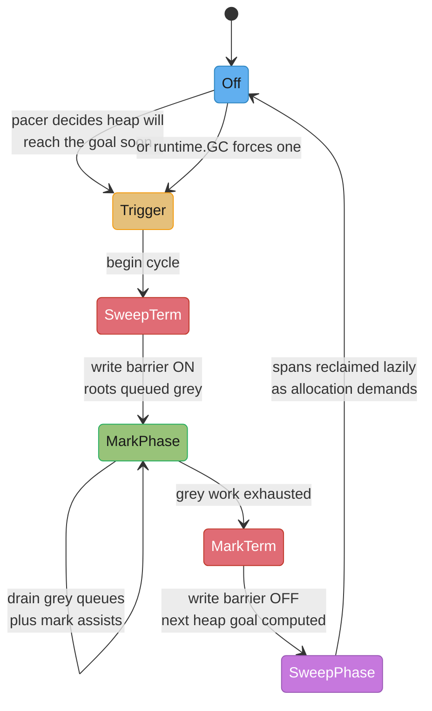
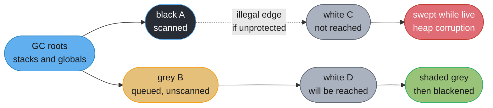
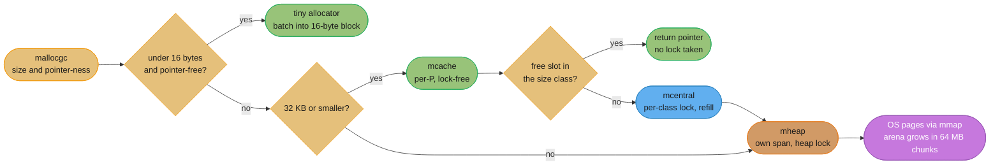
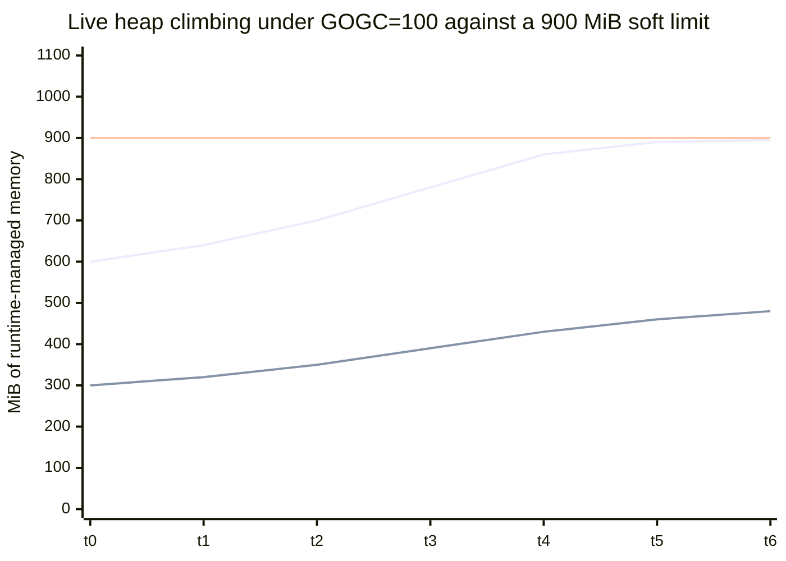
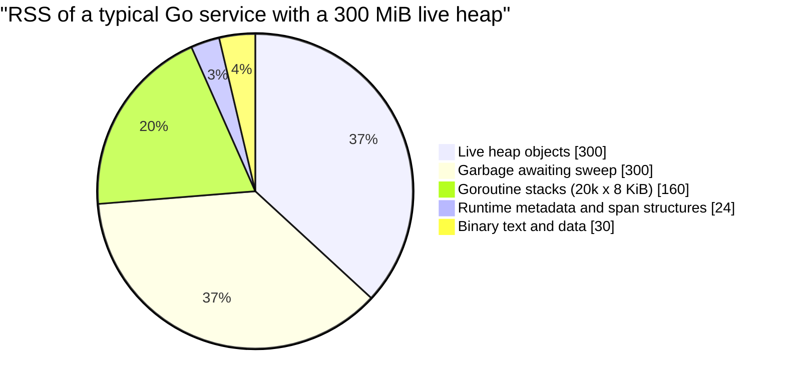
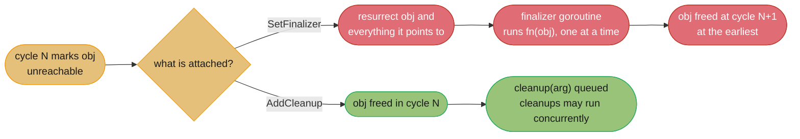

# The Runtime and Garbage Collector

---

## 1. Concept Overview

Go's collector is a **concurrent, tricolor, mark-sweep collector that is neither generational nor
compacting**. Every word of that sentence is a deliberate trade, and every production question you
will ever be asked about Go memory follows from one of them.

*Concurrent* means the marking phase runs alongside your goroutines, so the collector's cost shows up
as CPU stolen from the application rather than as a wall-clock freeze. The two stop-the-world pauses
that remain — sweep termination at the head of a cycle and mark termination at its tail — are
**sub-millisecond** and, crucially, their duration does not scale with heap size. A 4 GB heap and a
40 GB heap pause for about the same time.

*Non-compacting* means the collector never moves an object. That single decision is why Go needs no
read barrier, why `unsafe.Pointer` arithmetic and interior pointers stay valid, and why the collector
has no pointer-fixup phase to stop the world for. It is also why Go cannot use bump-pointer
allocation: free memory is not one contiguous frontier, so allocation goes through a **size-class
allocator** (mcache to mcentral to mheap) and fragmentation is bounded by rounding every object up to
one of about 68 size classes rather than by relocation.

*Non-generational* means there is no nursery and no promotion. Go's compiler already applies
[escape analysis](../escape_analysis_and_performance/escape_analysis_and_performance.md) so that most
short-lived values never reach the heap at all — the generational hypothesis' best customers are
filtered out before the collector sees them. What Go does instead is improve *locality* of the mark
phase: **Green Tea GC** `[1.26]`, on by default, scans memory a span at a time rather than chasing
individual objects, cutting total GC overhead by **10–40%** (a further ~10% on newer amd64 —
Intel Ice Lake, AMD Zen 4 and later).

The operational surface is two environment variables and one incident shape. `GOGC` (default **100**)
sets how much the heap grows before the next cycle. `GOMEMLIMIT` `[1.19]` sets a **soft** ceiling on
all runtime-managed memory and is the single most important knob in a container. The incident is
`OOMKilled` on a process whose heap graph looks healthy, because a container limit was set from the
heap number and Go's resident set is heap *plus* goroutine stacks *plus* runtime metadata *plus*
freed-but-unreturned spans.

Target version is **Go 1.27** (released 2026-08-19).

For memory budgets in a language without a GC, see [Memory Budgets Without a GC](../../rust/case_studies/cross_cutting/memory_budgets_without_a_gc.md) in `rust/`.

---

## 2. Intuition

> The collector is a night-shift cleaner in an office that never closes. It cannot lock the doors, so
> it works while people are still moving papers around. Its one rule with the staff: *if you take a
> document off a desk I have already cleared, hand me a copy first.* That rule is the write barrier,
> and it is the entire reason the cleaner can finish without a floor-wide freeze.

**Mental model:** think of GC cost as a **tax rate on allocation**, not as an event. The runtime
targets **25% of `GOMAXPROCS`** for marking, and a goroutine that allocates while a cycle is running
is charged **mark assist** work proportional to what it allocated. You do not pay the collector in
milliseconds of freeze; you pay it in CPU, and the bill is itemised to whichever goroutine generated
the garbage.

**Why it matters:** a Go service's memory failure is almost never "a leak". It is one of three
arithmetic mistakes — a container limit set from the live-heap graph, a `GOGC` of 100 doubling a heap
that had no room to double, or a `GOMEMLIMIT` pinned so close to the live heap that the collector runs
continuously and burns half the CPU it was supposed to save. All three are solved with a calculator,
not with a profiler.

**Key insight:** `GOGC` is a *throughput* knob and `GOMEMLIMIT` is a *safety* knob, and they answer
different questions. `GOGC` says "how much garbage may accumulate relative to live data" — a
proportional control that has no idea how much RAM the machine has. `GOMEMLIMIT` says "never mean to
exceed this many bytes" — an absolute control that has no idea whether you are wasting CPU. Setting
only the first is how services get `OOMKilled`; setting only the second, too tight, is how they
death-spiral.

---

## 3. Core Principles

**1. The tricolor invariant is the correctness contract.** Every heap object is conceptually white
(not yet reached), grey (reached, children not yet scanned), or black (reached and fully scanned). The
**strong invariant** is: *no black object holds a pointer to a white object.* If that ever held false
at the end of marking, a live object would be swept as garbage — silent memory corruption, the worst
class of bug a runtime can have. Go's barrier actually maintains the **weak invariant**: a black
object may point to a white object provided that white object is also reachable from some grey object,
which is a strictly cheaper contract to enforce.

**2. The write barrier is what makes concurrency safe, and it is not free.** During marking, every
pointer write in your program goes through a compiler-inserted hook. That is a real per-write cost on
the mutator, paid so the collector never has to freeze the world to re-establish the invariant.

**3. Pauses are bounded by root count, not by heap size.** The two stop-the-world phases scan
goroutine stacks' roots and finish bookkeeping. Nothing in them walks the heap. This is why Go's
latency story survives a large heap and why "we grew the heap and pauses stayed flat" is the expected
result, not a surprise.

**4. Nothing moves, so nothing needs fixing up.** No relocation means no forwarding pointers, no read
barrier, no `unsafe` invalidation, and no pause to update every reference to a moved object. The
price is paid in the allocator instead.

**5. The pacer aims, it does not enforce.** The runtime starts a cycle *early enough* that marking
finishes near the heap goal, based on the previous cycle's measured mark rate and the current
allocation rate. It is a feedback controller. A sudden allocation-rate step change will overshoot the
goal for one cycle before the controller catches up.

**6. `GOMEMLIMIT` is soft, deliberately.** When honouring the limit would require more than **50%** of
CPU to spend on GC, the runtime's GC CPU limiter engages and lets the limit be exceeded rather than
killing throughput to zero. A soft limit that degrades is more useful than a hard one that livelocks —
but it means `GOMEMLIMIT` alone is not an OOM guarantee.

**7. The application's own allocations pay for the application's own garbage.** Mark assist charges an
allocating goroutine GC work proportional to its allocation rate. A goroutine allocating hard during a
cycle slows itself down, which is the runtime applying backpressure exactly where it belongs.

---

## 4. Types / Architectures / Strategies

### The four GC phases

| Phase | Concurrent? | Duration | What happens |
|-------|-------------|----------|--------------|
| Sweep termination | Stop-the-world | Sub-millisecond | Finish sweeping any spans left from the previous cycle; enable the write barrier |
| Mark | Concurrent | Milliseconds to seconds | Scan roots, drain the grey work queues, run mark assists; targets 25% of `GOMAXPROCS` |
| Mark termination | Stop-the-world | Sub-millisecond | Drain remaining work, disable the write barrier, compute the next heap goal |
| Sweep | Concurrent and lazy | Spread over the next cycle | Reclaim white spans as allocation demands them |

The sweep is *lazy* on purpose: spans are swept on demand as the allocator needs them, so the cost is
amortised into allocation rather than paid as a separate pass.

### Allocation strategies inside the runtime

| Path | Sizes | Lock | Where it lives |
|------|-------|------|----------------|
| Tiny allocator | Under 16 bytes, **no pointers** | None | Per-P `mcache`; several tiny objects batched into one 16-byte block |
| Small | 16 bytes to 32 KB | None on the fast path | Per-P `mcache` free list for the size class |
| Small, cache miss | 16 bytes to 32 KB | `mcentral` mutex | Per-size-class central list, refills the `mcache` |
| Large | Over 32 KB | `mheap` lock | Allocated directly as its own span from the heap |

Size-specialized allocation routines `[1.27]` generate a dedicated code path per size class, making
allocations **under 80 bytes up to 30% faster** at a cost of about **60 KB** of binary size and around
1% overall improvement in allocation-heavy programs. Disable with
`GOEXPERIMENT=nosizespecializedmalloc`.

### Tuning strategies, in the order you should try them

| Strategy | Set | Use when |
|----------|-----|----------|
| Defaults | Nothing | Almost always the right first answer |
| Memory-limited | `GOMEMLIMIT` at ~85% of the container limit, `GOGC` left at 100 | Any containerised service. This is the default recommendation |
| Throughput-tuned | `GOGC=200` or higher, `GOMEMLIMIT` still set | Batch/analytics work with RAM to spare and a measured GC CPU cost above 10% |
| Latency-tuned | `GOGC=50`, `GOMEMLIMIT` set | Small live heaps where a lower peak matters more than CPU |
| Fully limit-driven | `GOGC=off` plus a hard `GOMEMLIMIT` | Single-tenant process with an exclusive, known memory budget and a live heap comfortably below it |

### Green Tea GC `[1.26]`

Enabled by default. It changes the *granularity* of marking: instead of tracking and scanning
individual objects, it scans at span granularity, which turns a pointer-chasing workload into a much
more cache-friendly and more parallelisable one. Reported result is a **10–40% reduction in GC
overhead**, with a further ~10% on newer amd64 hardware. `GOEXPERIMENT=nogreenteagc` reverts to the
previous algorithm — worth having in your pocket as an A/B lever, not as a default.

---

## 5. Architecture Diagrams

### The GC cycle as a state machine



`SweepTerm` and `MarkTerm` are the only stop-the-world states, and both are sub-millisecond. Everything
expensive lives in `MarkPhase`, which runs while your goroutines do.

### Tricolor marking and what the barrier protects



The dotted edge is the only thing that can go wrong. The hybrid write barrier makes it impossible for
that edge to exist without `C` also being reachable from a grey object.

### Allocation fast path



### Heap over time: what `GOGC` and `GOMEMLIMIT` each control



The lower line is the live heap, the upper line is the peak the pacer aims for, and the flat line is
`GOMEMLIMIT`. Up to `t3` the peak is simply `2 x live`, exactly what `GOGC=100` prescribes. From `t4`
onward the limit binds: the pacer stops doubling and starts collecting more often, trading CPU for
bytes. Past `t5` the two curves nearly touch, which is the death-spiral warning sign in §10.

### Where resident memory actually goes



The heap graph in your dashboard shows only the first slice. The container limit has to cover all five.

---

## 6. How It Works — Detailed Mechanics

### The hybrid write barrier

Before Go 1.8 the collector used a Dijkstra insertion barrier that could not keep goroutine stacks
black, which forced a stop-the-world **re-scan of every stack** at mark termination. That re-scan was
the dominant term in the pause and grew with goroutine count. The hybrid barrier — Yuasa deletion plus
Dijkstra insertion — removed it, and pause times dropped from tens of milliseconds to sub-millisecond.

```go
// Conceptually, what the compiler inserts for every pointer write during marking.
// Real code is runtime.gcWriteBarrier, written in assembly for speed.
func writePointer(slot *unsafe.Pointer, ptr unsafe.Pointer) {
    shade(*slot)                    // Yuasa: preserve what is being overwritten
    if currentStackIsGrey() {       // Dijkstra half, only while this stack is unscanned
        shade(ptr)
    }
    *slot = ptr
}
```

Read that as two separate guarantees. The **deletion** half means a pointer can never be "hidden" from
the collector by being overwritten — if the mutator removes the last reference to a white object mid
cycle, the barrier shades it, so it survives to the next cycle instead of being lost. The **insertion**
half covers the window where a goroutine's stack has not yet been scanned. Once a stack is scanned it
is black permanently for that cycle, and the insertion half switches off for it. **No stack is ever
scanned twice in one cycle** — that is the whole win.

The barrier is only active during marking. Outside a cycle, pointer writes are plain stores.

### The pacer and mark assists

The heap goal for the next cycle:

```
heap_goal = live_heap + (live_heap + roots) * GOGC / 100
```

where `roots` is goroutine stacks plus globals. With `GOGC=100` and a 300 MiB live heap and 12 MiB of
roots, the goal is `300 + (300 + 12) * 1 = 612 MiB`. The pacer does not *start* the cycle at 612; it
starts early enough that marking is projected to finish just as the heap reaches 612, using the
previous cycle's measured mark throughput.

When `GOMEMLIMIT` is set, the goal becomes the **minimum** of the `GOGC`-derived goal and a
limit-derived goal computed as the limit minus everything else the runtime owns (stacks, metadata,
free-but-unreturned spans). That is why the two knobs compose rather than conflict: `GOGC` is the
normal driver, and `GOMEMLIMIT` is a ceiling that clamps it.

Mark assist is the enforcement arm. Each cycle the pacer computes an **assist ratio** — bytes of mark
work owed per byte allocated. A goroutine that allocates while a cycle is in flight accrues assist
debt and must do that much marking before its allocation returns. In `gctrace` you see this as the
first number in the mark-CPU triple.

### Reading `GODEBUG=gctrace=1` line by line

```
GODEBUG=gctrace=1 ./server 2>&1 | head
```

```
gc 21 @14.203s 3%: 0.048+18+0.072 ms clock, 0.38+4.1/35/0+0.57 ms cpu, 412->419->208 MB, 416 MB goal, 12 MB stacks, 3 MB globals, 8 P
```

| Field | Value here | Meaning |
|-------|-----------|---------|
| `gc 21` | 21 | Cycle number since process start |
| `@14.203s` | 14.203 s | Time since program start |
| `3%` | 3% | Cumulative share of wall time spent in GC since start. Healthy is under 5% |
| `0.048+18+0.072 ms clock` | 0.048 / 18 / 0.072 | STW sweep termination, concurrent mark, STW mark termination. **Both STW numbers are the pause you actually feel** |
| `0.38+4.1/35/0+0.57 ms cpu` | see below | CPU time, not wall time, across all cores |
| `4.1/35/0` | assist / dedicated / idle | 4.1 ms burned by mark assists (application goroutines paying their own bill), 35 ms by dedicated mark workers, 0 ms by idle workers |
| `412->419->208 MB` | start / end / live | Heap at mark start, heap at mark end, live heap after sweeping |
| `416 MB goal` | 416 | What the pacer was aiming for — it overshot to 419, a 0.7% miss, which is normal |
| `12 MB stacks` | 12 | Goroutine stacks. Rising here with a flat heap means a goroutine leak |
| `3 MB globals` | 3 | Package-level variables |
| `8 P` | 8 | `GOMAXPROCS` during the cycle |

Three diagnostics fall straight out of this line:

- **Assist CPU dominating the triple** (say `40/8/0`) means the application is allocating faster than
  the collector can keep up. Raise `GOGC`, or cut allocations.
- **`live` climbing monotonically across cycles** is a genuine leak. `live` is the only field that is
  a leak signal; the first two heap numbers move with allocation rate.
- **`goal` pinned at a constant while cycle numbers race** is the `GOMEMLIMIT` death spiral.

### Where memory goes back to the OS

Sweeping makes spans reusable by the Go allocator; it does not return them to the kernel. A background
**scavenger** goroutine returns free pages with `MADV_DONTNEED` on Linux, which drops RSS immediately
for those pages at the cost of a page fault when they are next touched. Two consequences you will be
asked about:

- **RSS lags the heap graph.** The scavenger paces itself to about 1% of CPU, so after a big drop in
  live heap, RSS falls over seconds to minutes, not instantly.
- **Fragmentation is not returnable.** A page holding one live 32-byte object cannot be given back, no
  matter how much of it is free — this is exactly the cost of the no-compaction decision.

```go
import "runtime/debug"

// Force a collection and aggressively return free memory to the OS.
// Blocking, and it stops the world more than a normal cycle would.
// Legitimate use: right after a one-off bulk-load phase ends.
debug.FreeOSMemory()

// Programmatic equivalents of the environment variables.
debug.SetGCPercent(200)                      // GOGC=200; returns the previous value
debug.SetGCPercent(-1)                       // GOGC=off
debug.SetMemoryLimit(900 << 20)              // GOMEMLIMIT=900MiB
debug.SetMemoryLimit(math.MaxInt64)          // no limit
```

`runtime.GC()` forces a full cycle and blocks until it completes. It belongs in tests and in benchmark
setup, essentially never in a request path.

### Goroutine stacks and scan time

A goroutine starts with a **2 KB** stack. When a function prologue finds insufficient room, the runtime
allocates a stack twice as large, copies the old one, and rewrites every pointer into it — legal
precisely because the runtime knows the stack's pointer map. Stacks **shrink** during GC when a
goroutine is using less than a quarter of its stack.

The GC implication is direct: every goroutine's stack is a root, and roots are scanned during the
cycle. A million goroutines is a million stacks to scan, and if their stacks have grown to 8 KB each
that is 8 GB of roots. This is why "one goroutine per connection" scales beautifully to a million
*idle* connections and badly to a million connections each holding deep call stacks full of pointers.

### Cleanups and weak pointers `[1.24]`

The collector exposes two hooks to user code: run something after an object dies
(`runtime.AddCleanup`), and hold a pointer that does not keep its target alive (`weak.Pointer`).
Both shipped in Go 1.24 alongside `maphash.Comparable`. `runtime.SetFinalizer` still exists, and the
Go GC guide recommends cleanups for every use except structures with a strict destruction order.

```go
func AddCleanup[T, S any](ptr *T, cleanup func(S), arg S) Cleanup
func (c Cleanup) Stop()

func Make[T any](ptr *T) weak.Pointer[T]
func (p weak.Pointer[T]) Value() *T // nil once the target is unreachable
```

The difference from a finalizer is what the callback receives. A finalizer is called with the object
itself, so the runtime must **resurrect** it: the object and everything it points to are marked live
again, survive the current cycle, and can be freed no earlier than the next one. A cleanup is called
with a separate `arg` (typically the file descriptor or C pointer the object wraps), so the object is
freed in the cycle that found it unreachable.



| Property | `runtime.SetFinalizer` | `runtime.AddCleanup` `[1.24]` |
|----------|------------------------|--------------------------------|
| Callback receives | The object, which is resurrected | A separate `arg`; the object is already gone |
| Callbacks per object | One; must point at the start of the allocation | Many; interior pointers allowed |
| Object in a reference cycle | Not guaranteed to be collected, finalizer may never run | Collected; cleanups run in unspecified order |
| Chain of 10 finalized nodes | At least 10 cycles to free | All freed in one cycle |
| Execution | One goroutine, sequential, ordered | Concurrent with each other; long ones should spawn a goroutine |
| Cancel | `SetFinalizer(obj, nil)` | `Cleanup.Stop()` |

Neither is guaranteed to run, including at program exit, and neither runs reliably for objects under
16 bytes with no pointers, because the tiny allocator batches those into one 16-byte block that stays
alive while any neighbour is live. `runtime.GC()` waits only until cleanups are queued, not until they
have run, so a test must poll or synchronise on a channel the cleanup closes.

`weak.Pointer` is the other half. `weak.Make(p)` records the target without marking it; once the
target is unreachable, `Value()` returns nil, and it may do so as early as the cycle that found it
dead. Two weak pointers compare equal only if the strong pointers they came from were equal, which
makes them usable as map keys after the target is gone. The `unique` package `[1.23]` is built on the
same mechanism. The standard combination is a canonicalising map: values live as long as some caller
holds them, and a cleanup deletes the stale entry.

```go
type Cache[K comparable, V any] struct {
    mu sync.Mutex
    m  map[K]weak.Pointer[V]
}

func (c *Cache[K, V]) Get(k K, load func() *V) *V {
    c.mu.Lock()
    defer c.mu.Unlock()
    if v := c.m[k].Value(); v != nil {
        return v
    }
    v := load()
    if c.m == nil {
        c.m = make(map[K]weak.Pointer[V]) // the zero Cache is usable
    }
    c.m[k] = weak.Make(v)
    // The closure captures only c and gets the key as arg; capturing v would keep it alive forever.
    runtime.AddCleanup(v, func(k K) {
        c.mu.Lock()
        defer c.mu.Unlock()
        if c.m[k].Value() == nil { // a later Get may have stored a fresh value
            delete(c.m, k)
        }
    }, k)
    return v
}
```

A missing key returns the zero `weak.Pointer`, whose `Value()` is nil, so the lookup needs no
`ok` check. The map holds no strong reference, so an entry nobody else holds is dropped at the next
cycle: this deduplicates live values, it does not retain hot ones. A retention cache still needs a
size bound and an eviction policy.

### Runtime metrics worth exporting

```go
import "runtime/metrics"

// Prefer runtime/metrics over runtime.MemStats: no stop-the-world, and the
// names are stable across releases.
samples := []metrics.Sample{
    {Name: "/gc/heap/live:bytes"},              // the leak signal
    {Name: "/gc/heap/goal:bytes"},              // what the pacer is aiming for
    {Name: "/gc/cycles/total:gc-cycles"},       // rate of this is the spiral signal
    {Name: "/memory/classes/total:bytes"},      // everything the runtime maps
    {Name: "/memory/classes/heap/free:bytes"},  // swept, not yet returned
    {Name: "/sched/goroutines:goroutines"},     // stack-root growth
    {Name: "/gc/limiter/last-enabled:gc-cycle"},// non-zero means the 50% CPU limiter fired
}
metrics.Read(samples)
```

Alert on the *rate* of `/gc/cycles/total:gc-cycles`, not its value. A service that normally runs 2
cycles per second and starts running 40 is in trouble long before any memory alarm fires.

---

## 7. Real-World Examples

**Kubernetes control plane.** `kube-apiserver` holds a large in-memory watch cache of every object in
the cluster — hundreds of thousands of live pointers, exactly the shape that makes mark work expensive.
Large clusters routinely set `GOMEMLIMIT` on the apiserver so that a `LIST` storm against a big
resource type degrades into more GC rather than into an `OOMKilled` control plane.

**Prometheus.** The TSDB head block is a live heap that grows with active series and is trimmed on
compaction. `GOGC` tuning is well-trodden here: operators lower `GOGC` to cap peak RSS during head
compaction and pair it with `GOMEMLIMIT` so that a cardinality explosion produces a slow, visible
degradation instead of a hard kill.

**CockroachDB.** Keeps its block cache and SQL memory accounting deliberately **off the Go heap**,
because a multi-gigabyte cache of live pointers would make every mark phase scan it. The lesson
generalises: large, long-lived, pointer-free data is cheaper as one big `[]byte` (or off-heap) than as
a map of small structs, because the collector's cost tracks *pointers*, not bytes.

**Discord's well-known Go-to-Rust migration.** The precipitating symptom was not pause length; it was
that a large read-states cache produced a GC every two minutes regardless of tuning, and each one
cost a latency spike. The reusable lesson is that a huge, mostly-live, pointer-dense cache is the
workload Go's collector is least suited to — not that Go is slow.

**Any HTTP service behind a sidecar.** The most common real-world configuration error in this whole
module: the container memory limit covers *the pod*, the Go process is one container in it, and nobody
subtracted the sidecar's 128 MiB before computing `GOMEMLIMIT`.

---

## 8. Tradeoffs

### Go's collector against the other runtimes this repo covers

| Property | Go (concurrent mark-sweep) | JVM G1 | JVM ZGC | CPython refcounting |
|----------|---------------------------|--------|---------|---------------------|
| Pause time | Sub-millisecond, flat in heap size | 10–200 ms, tracks live data evacuated | Sub-millisecond, flat in heap size | No pauses, but cycle detector stops the world briefly |
| Pause scaling | Root count | Grows with heap | Root count | Container size at collection |
| Moves objects | No | Yes, evacuating | Yes, concurrently relocating | No |
| Barrier cost | Write barrier during marking only | Write barrier, always on | **Load** barrier on every reference read, always on | Refcount increment/decrement on every reference operation |
| Generational | No | Yes | Yes | No, plus a generational cycle detector |
| Memory overhead | Roughly `1 + GOGC/100` times live heap | Region overhead plus remembered sets | Similar plus coloured-pointer metadata | Very low peak, but ~16 bytes of header per object |
| Tuning surface | 2 knobs (`GOGC`, `GOMEMLIMIT`) | Dozens of `-XX:` flags | Handful of `-XX:` flags | Effectively none |
| Best at | Predictable low latency at modest heap sizes | Balanced throughput and latency | Very large heaps with a latency SLO | Deterministic prompt destruction |
| Worst at | Huge pointer-dense live sets; no compaction to reclaim fragmentation | Long tail on humongous objects | Throughput — the load barrier taxes every read | Multi-core throughput; reference cycles need the tracer |

See [JVM Internals](../../java/jvm_internals/jvm_internals.md) for the G1 region model and ZGC's
coloured-pointer bit budget, and
[CPython Memory Model](../../python/cpython_memory_model/cpython_memory_model.md) for refcounting's
prompt-destruction guarantee.

### The internal trades Go made

| Decision | Buys | Costs |
|----------|------|-------|
| Non-compacting | No read barrier, no relocation pause, valid interior pointers, workable `unsafe` and cgo | No bump-pointer allocation; fragmentation is permanent within a span |
| Non-generational | No card tables, no remembered sets, one simple mark algorithm | Every cycle rescans the whole live set; escape analysis has to carry the load |
| Concurrent marking | Sub-millisecond pauses independent of heap size | Write-barrier cost on the mutator; 25% of CPU during a cycle |
| Lazy sweeping | No separate sweep pause | RSS stays high until spans are reused or scavenged |
| Size classes | Bounded internal fragmentation, lock-free per-P fast path | A 33-byte object occupies the 48-byte class — 31% waste on that object |
| Soft `GOMEMLIMIT` | Degrades gracefully instead of livelocking at 100% GC CPU | Not an OOM guarantee; the 50% limiter lets the limit be exceeded |

### `GOGC` values and what they cost

| `GOGC` | Peak heap vs live | GC frequency | When |
|--------|-------------------|--------------|------|
| 50 | 1.5x | Roughly 2x default | Memory-tight, CPU to spare |
| 100 (default) | 2x | Baseline | Start here |
| 200 | 3x | Roughly half | Measured GC CPU over 10% and RAM available |
| 400 | 5x | Roughly a quarter | Batch jobs with a known bounded live set |
| `off` | Unbounded | None until `GOMEMLIMIT` binds | Only with a hard `GOMEMLIMIT` set |

---

## 9. When to Use / When NOT to Use

**Leave the defaults alone when:**
- The service is not memory-constrained and `gctrace` reports GC under 5% of wall time.
- You have not measured. Tuning `GOGC` from a dashboard's shape rather than from a profile is how
  services get slower.

**Set `GOMEMLIMIT` when:**
- The process runs in a container with a memory limit. This is essentially always — set it at roughly
  85% of the container limit, minus any non-Go memory in the same container.
- The live heap has a spiky component (a cache, a batch import) whose peak you cannot predict.
- You would rather burn CPU than be killed. That is the trade, stated plainly.

**Raise `GOGC` when:**
- `gctrace` shows GC above 10–15% of wall time, *and* peak RSS has headroom under `GOMEMLIMIT`.
- The workload is throughput-bound batch processing, not latency-bound serving.

**Use `GOGC=off` with a hard `GOMEMLIMIT` when:**
- The process owns its memory budget exclusively (a dedicated VM or a single-container pod).
- The live heap is comfortably below the limit — say under 50% — so the limit-driven pacer has room.
- You want GC to happen as rarely as physically possible. A batch converter that allocates 40 GiB of
  transient garbage while holding 2 GiB live and finishes in 90 seconds is the archetype.

**Do NOT:**
- Set `GOGC=off` without `GOMEMLIMIT`. That is not tuning, it is disabling the collector.
- Call `runtime.GC()` on a timer to "keep memory low". It stops the world, defeats the pacer's
  feedback loop, and reliably makes p99 worse.
- Reach for `debug.FreeOSMemory()` on a request path. It is a phase-transition tool.
- Set `GOMEMLIMIT` equal to the container limit. You need headroom for the binary, for any cgo
  allocations, and for the 50% limiter's overshoot.
- Tune anything before reading `gctrace`. Two lines of output answer most of these questions.

---

## 10. Common Pitfalls

### Pitfall 1: `OOMKilled` with a heap graph that never went above 45%

A payments API ran in a pod with `resources.limits.memory: 1Gi`. The Grafana heap panel — sourced from
`/gc/heap/live:bytes` — sat at 300 MiB steady state and peaked at 450 MiB during the evening batch.
Nobody could explain the restarts.

```go
// BROKEN: container limit derived from the live-heap graph. Nothing sets GOMEMLIMIT,
// so the pacer happily targets 2x live regardless of how much RAM exists.
//   limits.memory: 1Gi
//   env: (nothing)
//
// The arithmetic nobody did:
//   live heap at the evening peak        450 MiB
//   peak heap at GOGC=100 (2x live)      900 MiB
//   goroutine stacks, 20k x 8 KiB        160 MiB
//   runtime metadata, ~2% of heap         18 MiB
//   binary text and data                  30 MiB
//   ---------------------------------------------
//   total resident                      1108 MiB   >  1024 MiB limit  ->  OOMKilled

// FIX: tell the runtime how much room it actually has. GOMEMLIMIT covers the heap,
// stacks and runtime metadata, but NOT the binary, so subtract that plus headroom.
//   limits.memory: 1Gi
//   env:
//     - name: GOMEMLIMIT
//       value: "850MiB"
```

Better still, derive it from the limit at startup so the two can never drift apart:

```go
import (
    "runtime/debug"
    "go.uber.org/automaxprocs/maxprocs" // container-aware GOMAXPROCS is also [1.25] built in
)

func init() {
    // Read the cgroup limit, reserve 15% for the binary, cgo and overshoot.
    if limit, ok := cgroupMemoryLimit(); ok {
        debug.SetMemoryLimit(int64(float64(limit) * 0.85))
    }
}
```

**Impact:** restarts every 40–90 minutes under evening load, each dropping in-flight payments onto the
retry path. After the fix, zero `OOMKilled` events in six months; steady-state GC CPU rose from 3% to
4.5%, which is what the trade costs.

### Pitfall 2: the `GOMEMLIMIT` death spiral

The same team, six months later, grew the live heap to 780 MiB against that 850 MiB limit. The pod
stopped being killed and started being *useless*: p99 latency went from 40 ms to 2.6 seconds, CPU
pinned at the pod's limit, and throughput dropped by roughly half.

```
gc 4102 @611.20s 47%: 0.031+140+0.055 ms clock, ...  832->846->781 MB, 850 MB goal, 41 MB stacks, ...
gc 4103 @611.36s 47%: 0.029+138+0.061 ms clock, ...  834->847->782 MB, 850 MB goal, 41 MB stacks, ...
gc 4104 @611.51s 47%: 0.034+141+0.058 ms clock, ...  833->848->781 MB, 850 MB goal, 41 MB stacks, ...
```

The three signatures, all visible in three consecutive lines: **cycle numbers advancing 6+ times per
second**, the **`goal` frozen exactly at the limit**, and the **cumulative GC percentage at 47%** —
brushing the 50% ceiling where the GC CPU limiter engages and lets the limit be exceeded anyway.

The fix is never "raise the limit a bit". A limit that binds continuously is telling you the live set
does not fit, and the answer is to make the live set smaller or the box bigger:

- Alert on `/gc/limiter/last-enabled:gc-cycle` becoming non-zero, and on cycles-per-second crossing 5.
- Keep live heap under **60–70%** of `GOMEMLIMIT` as a design rule. Above that the pacer has no room
  to work with.
- In this incident the live set was an unbounded in-process response cache. Capping it at 200 MiB with
  an LRU returned p99 to 45 ms and GC CPU to 6%.

**Impact:** two weeks of "the service is slow but not down" — the worst kind of incident, because
nothing alerts.

### Pitfall 3: `runtime.GC()` on a ticker

An ingest service ran `runtime.GC()` every 30 seconds "to keep memory flat". It did keep memory flat.
It also produced a reliable 90 ms p99 spike every 30 seconds, because a forced cycle stops the world at
both ends and, worse, resets the pacer's feedback so the *next* natural cycle was mistimed. Deleting
the ticker removed the spike and changed steady-state RSS by 4%.

### Pitfall 4: reading RSS immediately after a drop and concluding there is a leak

A batch job freed 6 GiB of intermediate state; RSS stayed at 7.4 GiB for four minutes. The scavenger
returns pages at roughly 1% of CPU, deliberately, so it takes time. `debug.FreeOSMemory()` at the phase
boundary is the correct tool here — this is one of the few places it belongs — and it dropped RSS to
1.4 GiB in one call.

### Pitfall 5: a million small pointer-ful objects instead of one big slab

A metrics aggregator held `map[string]*sample` with 12 million entries. Live heap was only 1.9 GiB but
mark phase took 340 ms of CPU per cycle, because cost tracks *pointers to trace*, not bytes. Replacing
it with a `[]sample` plus an index map — one pointer-free backing array instead of 12 million
individually-traced objects — cut mark CPU to 22 ms per cycle, a **15x** reduction, with the live heap
essentially unchanged.

### Pitfall 6: assuming `GOMEMLIMIT` covers cgo

`GOMEMLIMIT` accounts for memory the **Go runtime** manages. Memory allocated by C code through cgo,
memory-mapped files, and the binary's own text and data segments are invisible to it. A service using
a cgo image library was killed at 2 GiB with `GOMEMLIMIT=1800MiB` and a 900 MiB Go heap: the missing
gigabyte was `malloc`'d inside C. Budget cgo separately and lower `GOMEMLIMIT` by that amount.

### Pitfall 7: `GOMAXPROCS` from the host, `GOMEMLIMIT` from the pod

A binary in a 2-CPU pod on a 64-core node created 64 Ps before container-aware `GOMAXPROCS` `[1.25]`,
so the GC's "25% of `GOMAXPROCS`" target meant 16 dedicated mark workers competing for 2 cores' worth
of CFS quota. Marking took 8x longer than the pacer projected, so every cycle overshot its goal. On
Go 1.25 and later the runtime reads the cgroup CPU limit itself; on anything older, set `GOMAXPROCS`
explicitly. See [OS and I/O Performance](../../backend/os_and_io_performance/os_and_io_performance.md)
for how CFS quota accounting produces this class of surprise.

### Pitfall 8: a cleanup that keeps its own object alive

A wrapper around a C image buffer kept its decoder state in a separate struct with a back-pointer
(`img.dec.img == img`) and registered its release with
`runtime.AddCleanup(img, func(d *decoder) { C.free(d.buf) }, img.dec)`. The `arg` reached `img`
through that back-pointer, so `img` was reachable from the cleanup the runtime itself holds, was never
collected, and the cleanup never ran. Every decoded image leaked its C buffer, invisible to
`GOMEMLIMIT` and to the heap profile, until the pod hit its limit after about 40,000 images. The fix
passes only the C pointer: `runtime.AddCleanup(img, func(p unsafe.Pointer) { C.free(p) }, img.dec.buf)`.
Since Go 1.26 `AddCleanup` panics when `arg` equals or points into the object, or when the closure
captures a pointer into it, but it checks only those direct pointers, so a path through a second
object passes silently.

---

## 11. Technologies & Tools

| Tool | What it answers |
|------|-----------------|
| `GODEBUG=gctrace=1` | One line per cycle: pauses, CPU split, heap sizes, goal. First thing to reach for, zero setup |
| `GODEBUG=scavtrace=1` | What the background scavenger is returning to the OS, and how fast |
| `runtime/metrics` | Stable, pause-free metric names for dashboards. Preferred over `runtime.MemStats` |
| `net/http/pprof` heap profile | Which call sites allocate. `-alloc_space` for total churn, `-inuse_space` for what is live |
| `go tool pprof -http=:8080` | Flame-graph web UI by default `[1.26]`; graph view at `/ui/graph` |
| `runtime/trace` and `go tool trace` | Where GC phases fall relative to your goroutines; why a request waited |
| `runtime/debug` | `SetGCPercent`, `SetMemoryLimit`, `FreeOSMemory`, `ReadGCStats` — the programmatic knobs |
| `runtime.AddCleanup`, `weak`, `unique` | Post-collection cleanup and non-retaining references `[1.24]`; `unique` interns comparable values `[1.23]` |
| `GOEXPERIMENT=nogreenteagc` | A/B the `[1.26]` collector against the previous one on your own workload |
| `GOEXPERIMENT=nosizespecializedmalloc` | A/B the `[1.27]` small-allocation fast paths |
| `GOEXPERIMENT=norandomizedheapbase64` | Disable heap base address randomization `[1.26]`; only relevant if a test depends on address layout |
| `github.com/KimMachineGun/automemlimit` | Derives `GOMEMLIMIT` from the cgroup limit at startup so it cannot drift from the manifest |
| `go.uber.org/automaxprocs` | Cgroup-aware `GOMAXPROCS` for pre-`[1.25]` binaries |
| Pyroscope / Grafana continuous profiling | Heap profiles over time, so you can diff last week's allocation profile against today's |

---

## 12. Interview Questions with Answers

**Q: Why does a Go service get OOMKilled when its heap graph shows plenty of headroom?**
**Short:** Because resident memory is heap plus goroutine stacks plus runtime metadata plus unreturned spans, while the graph usually plots only the live heap.

The live heap is the smallest of five numbers that share the container limit. With `GOGC=100` the heap
alone peaks at roughly twice live before a cycle runs, so a 450 MiB live heap already implies a 900 MiB
peak; add 160 MiB of goroutine stacks, about 2% of heap in runtime metadata, and 30 MiB of binary text
and you are over 1 GiB. The dashboard showed 450 MiB the whole time. Fix it by setting `GOMEMLIMIT` to
about 85% of the container limit so the pacer knows the real budget, and verify with
`/memory/classes/total:bytes` rather than a heap-only panel.

**Q: What is the difference between GOGC and GOMEMLIMIT, and which one should a containerised service set?**
**Short:** GOGC is a proportional throughput knob with no idea how much RAM exists; GOMEMLIMIT is an absolute soft ceiling, and a container should set it.

`GOGC=100` means "let the heap grow to about twice the live set before collecting" — a ratio that
behaves identically on a 512 MiB pod and a 512 GiB machine, which is exactly its weakness. `GOMEMLIMIT`
`[1.19]` names a byte count, and the pacer takes the minimum of the two goals, so they compose rather
than fight: `GOGC` drives normal operation and the limit clamps the tail. The right default for a
container is `GOGC` untouched at 100 plus `GOMEMLIMIT` at roughly 85% of the memory limit. Set only
`GOGC` and you are guessing at RAM you cannot see.

**Q: Why is GOMEMLIMIT called a soft limit, and what happens when the program tries to exceed it?**
**Short:** Honouring it never takes more than 50% of CPU — past that the runtime's GC limiter engages and lets memory grow instead of livelocking.

Enforcing a hard limit would mean collecting arbitrarily often as the live set approaches it, which
converges on 100% of CPU spent marking and 0% doing work. Instead the runtime caps GC at 50% of CPU;
when that cap binds, the limit is exceeded rather than throughput reaching zero. The practical
consequence is that `GOMEMLIMIT` is not an OOM guarantee — it is a strong hint that degrades visibly,
which is why you still want headroom under the container limit and an alert on
`/gc/limiter/last-enabled:gc-cycle`.

**Q: What does the GOMEMLIMIT death spiral look like and how do you detect it?**
**Short:** Cycle numbers advance several times per second with the heap goal frozen at the limit and cumulative GC time near 47%.

It happens when the live set grows close to the limit: every cycle reclaims almost nothing, so the
pacer immediately starts another, and the program spends nearly half its CPU marking. Three signatures
appear together in `gctrace` — cycles per second above 5, `N MB goal` identical on every line and equal
to the limit, and the leading percentage climbing toward 50. Raising the limit slightly only buys days;
the real fix is to shrink the live set (usually an unbounded in-process cache) or move to a bigger box,
and the design rule is to keep live heap under 60–70% of `GOMEMLIMIT`.

**Q: Why might a cleanup registered with runtime.AddCleanup never run?**
**Short:** The object is still reachable through the cleanup closure or its arg, it is a tiny pointer-free object batched with live ones, or the program exits first.

The runtime holds the cleanup function and its argument, so anything they reference is a root. A
closure that mentions the object, or an `arg` that points back to it, keeps it alive forever. Since
Go 1.26 the runtime panics when `arg` or a captured pointer points directly into the object, but a
path through another object goes unnoticed. Objects of 16 bytes or less with no pointers
share a tiny-allocator block, and the block survives while any neighbour is live. Cleanups are also
not run at exit, and `runtime.GC()` returns once they are queued rather than run. Pass the underlying
resource (fd, C pointer) as `arg`, capture nothing from the wrapper, and keep a deterministic `Close`
as the primary path with the cleanup as a backstop.

**Q: Why does Go not use a generational collector?**
**Short:** Escape analysis already keeps most short-lived values off the heap, so the population a nursery would target is largely filtered out before allocation.

The generational hypothesis says most objects die young, and a nursery exploits that by collecting a
small region cheaply. In Go, the compiler proves at build time that a value's lifetime does not outlive
its frame and puts it on the stack, so a large share of the "dies young" population never becomes heap
garbage at all. A generational design would also require write barriers to maintain remembered sets for
old-to-young pointers, and the Go team judged that ongoing mutator cost against the remaining benefit
and declined. Green Tea GC `[1.26]` took the alternative route of improving mark locality instead,
cutting overhead 10–40%.

**Q: What does it cost Go that its collector never moves objects?**
**Short:** It forfeits bump-pointer allocation and can never defragment, so a page holding one live object stays resident forever.

No relocation means no read barrier, no forwarding pointers, no pause to fix up references, and
`unsafe.Pointer` arithmetic and interior pointers that stay valid — an enormous simplification, and a
prerequisite for Go's cgo pointer rules. What it gives up is that free memory is never one contiguous
frontier, so allocation goes through a size-class free-list allocator rather than incrementing a
pointer, and internal fragmentation (a 33-byte object in a 48-byte class) is permanent. A long-running
process with a badly shaped allocation history can hold RSS that no collection will ever release.

**Q: Explain the tricolor invariant and what would break if it were violated.**
**Short:** Objects are white, grey or black; if a black object ever pointed to a white one with no grey path, a live object would be freed.

White means unreached, grey means reached but with children not yet scanned, black means fully scanned.
The strong invariant forbids any black-to-white pointer. Go actually enforces the cheaper weak
invariant: a black object may point to a white object provided that white object is also reachable from
some grey object, which preserves the same guarantee — nothing reachable is left white when the grey
queues drain. A violation would sweep a live object, producing use-after-free style corruption, which
is why the write barrier is inserted unconditionally on every pointer write during marking rather than
being an optimisation the compiler may skip.

**Q: What is the hybrid write barrier and what problem did it solve?**
**Short:** It combines Yuasa deletion with Dijkstra insertion so a scanned stack stays black, which eliminated the stop-the-world stack re-scan.

The deletion half shades whatever pointer is being overwritten, so the mutator cannot hide a white
object by removing its last reference mid-cycle. The insertion half shades the newly stored pointer,
but only while the writing goroutine's own stack has not yet been scanned. Together they guarantee a
stack, once scanned, needs no second look, which removed the mark-termination re-scan whose cost grew
with goroutine count and dominated pauses before Go 1.8. That is the change that took pauses from tens
of milliseconds to sub-millisecond, and it is why pause time is now a function of root count rather
than of heap size.

**Q: Where exactly do the stop-the-world pauses fall in a GC cycle?**
**Short:** At sweep termination, which turns the write barrier on, and at mark termination, which turns it off — both under a millisecond.

Sweep termination finishes any spans left unswept from the previous cycle and enables the barrier
before roots are queued. Mark termination drains the last grey work, disables the barrier, and computes
the next heap goal. The long concurrent mark phase between them runs alongside application goroutines,
and the sweep after mark termination is lazy — spans are reclaimed as the allocator needs them, so
there is no third pause. Neither STW phase walks the heap, which is precisely why growing the heap does
not grow the pause.

**Q: How does the pacer decide when to start a collection?**
**Short:** It projects the current allocation rate against the previous cycle's measured mark rate and starts early enough to finish near the heap goal.

The goal itself is `live + (live + roots) * GOGC / 100`, so with a 300 MiB live heap, 12 MiB of roots
and `GOGC=100` it is 612 MiB. The cycle does not begin at 612; it begins at whatever point makes
marking land there, which makes the pacer a feedback controller rather than a threshold. A step change
in allocation rate therefore overshoots for one cycle before the controller re-converges, and you see
that in `gctrace` as a heap-at-end slightly above the stated goal — a 1% miss is normal, a 30% miss
means the rate changed abruptly.

**Q: What is a mark assist and why would you see it dominating gctrace?**
**Short:** An allocating goroutine is charged marking work proportional to its allocation, so heavy allocators pay their own collection bill inline.

Each cycle the pacer computes an assist ratio in bytes of mark work owed per byte allocated; a goroutine
that allocates during a cycle must do that work before its allocation returns. In the CPU triple of a
`gctrace` line — `assist/dedicated/idle` — a healthy service shows dedicated workers doing most of it,
say `4.1/35/0`. When assist dominates, say `40/8/0`, the application is out-allocating the collector,
and the answers are to raise `GOGC` so cycles are rarer or to cut the allocation rate itself. Assist is
backpressure applied exactly where the garbage is being made.

**Q: Read this gctrace line: what is wrong with it? `gc 812 @95s 31%: 0.03+210+0.04 ms clock, 190/22/0 ms cpu, 780->810->760 MB, 800 MB goal`**
**Short:** GC is taking 31% of wall time and assist CPU is nine times dedicated CPU, so allocation is badly outrunning the collector.

Break it down: the two STW numbers (0.03 and 0.04 ms) are fine, so this is not a pause problem. The
mark phase is 210 ms, the cumulative GC share is 31% against a healthy target under 5%, and the CPU
triple `190/22/0` shows mark assists burning nine times what the dedicated workers do. The heap numbers
say live is 760 MiB against an 800 MiB goal, meaning almost nothing was reclaimed — the live set has
grown into the goal. This is either an unbounded cache or a genuine leak; raise `GOGC` only as a
stopgap and take a `-inuse_space` heap profile to find what is retained.

**Q: Why does RSS stay high after a large drop in live heap?**
**Short:** Sweeping only makes spans reusable by the allocator; a background scavenger returns pages to the kernel gradually at about 1% of CPU.

The collector's job ends at making memory available to Go, not to the operating system. The scavenger
then releases free pages with `MADV_DONTNEED` on Linux, deliberately paced so it never competes with
the application, so RSS falls over seconds to minutes rather than instantly. Two things it can never
release: a page holding even one live object, which is the fragmentation cost of not compacting, and
memory Go still considers likely to be reused. At a genuine phase boundary — a bulk load finishing —
`debug.FreeOSMemory()` forces the issue in one call, and that is one of the very few places it belongs.

**Q: What is Green Tea GC and what did it change?**
**Short:** It is the `[1.26]` default collector algorithm that scans memory span-by-span rather than object-by-object, cutting GC overhead by 10–40%.

Marking a pointer-dense heap object by object is a cache-hostile pointer chase; scanning at span
granularity turns much of that into contiguous work with far better locality and more parallelism.
Measured reduction in total GC overhead is 10–40%, with roughly a further 10% on newer amd64 hardware
(Intel Ice Lake, AMD Zen 4 and later). It is on by default with no code change required, and
`GOEXPERIMENT=nogreenteagc` reverts to the previous algorithm — useful as an A/B lever on your own
workload if you are investigating a regression, not as a setting to ship.

**Q: How does the runtime allocate a small object, and what makes the fast path fast?**
**Short:** Objects up to 32 KB come from a per-P mcache free list for their size class, which needs no lock and no atomic.

Every allocation is rounded up to one of about 68 size classes. The `mcache` is owned by a P, so the
common path — pop a free slot from the right class's list — is a load and a store with no
synchronisation at all. When the class is empty the `mcache` refills from the `mcentral` for that class
under a per-class lock, and the `mcentral` in turn takes spans from the global `mheap`. Objects under
16 bytes with no pointers go through the tiny allocator, which packs several into one 16-byte block, and
size-specialized routines `[1.27]` make sub-80-byte allocations up to 30% faster at a cost of about
60 KB of binary.

**Q: How do a million goroutines interact with GC scan time?**
**Short:** Every goroutine stack is a GC root, so a million of them means a million stacks to scan during each cycle.

A goroutine starts at 2 KB and grows by allocating a larger stack, copying, and rewriting pointers into
it, and shrinks during GC when using under a quarter of its stack. Idle goroutines with shallow stacks
are genuinely cheap — a million connections parked in a network read is the workload Go was designed
for. A million goroutines each holding an 8 KB stack full of live pointers is a different program: that
is 8 GB of roots, the `N MB stacks` field in `gctrace` climbs, and mark time climbs with it. Watch that
field alongside `/sched/goroutines:goroutines`; a rising stacks number with a flat live heap is a
goroutine leak, and the `goroutineleak` profile `[1.27]` will name it.

**Q: When is GOGC=off with a hard GOMEMLIMIT the right configuration?**
**Short:** When one process owns a known memory budget exclusively and its live set sits well under it, so collections should happen as rarely as physically possible.

Turning `GOGC` off removes the proportional trigger entirely, so nothing schedules a cycle until the
limit-derived goal binds. For a batch converter holding 2 GiB live while churning 40 GiB of transient
garbage on a dedicated 16 GiB box, that means a handful of collections instead of thousands, and the
memory is used rather than left idle. The preconditions matter: the process must not share the box, and
the live set should stay under roughly half the limit, or you have configured a death spiral with the
brakes removed. Never set `GOGC=off` without a limit — that is not tuning, that is disabling the
collector.

**Q: Compare Go's collector with the JVM's ZGC.**
**Short:** Both hit sub-millisecond pauses that are flat in heap size, but ZGC relocates objects behind a load barrier while Go relocates nothing.

ZGC spends spare bits of every 64-bit pointer on GC state and puts a **load** barrier on every reference
read, which buys concurrent compaction — so it defragments, scales to multi-terabyte heaps, and pays a
low-single-digit throughput tax on every read. Go's write barrier is active only during marking, so
outside a cycle pointer writes are plain stores and reads are free, but nothing is ever compacted, so
fragmentation is permanent. The practical split: ZGC for very large heaps where fragmentation and
scale-out matter, Go for modest heaps where you want a two-knob tuning surface and no read-side cost.
See [JVM Internals](../../java/jvm_internals/jvm_internals.md) for ZGC's coloured-pointer bit budget.

**Q: Why can heap base address randomization matter, and how do you turn it off?**
**Short:** It randomizes where the 64-bit heap arena starts as a hardening measure `[1.26]`; `GOEXPERIMENT=norandomizedheapbase64` disables it.

Predictable heap addresses make certain memory-corruption exploits easier to write, so the runtime now
varies the arena base on 64-bit platforms. It is invisible to correct Go code. It becomes visible to
code that was already wrong — a test asserting on printed pointer values, a hash function keyed on an
address, or a `unsafe` trick that assumed a fixed layout. The disable knob exists for bisecting such a
failure, not for shipping; if turning it off fixes your test, the test was depending on an address it
had no right to depend on.

**Q: Your service's p99 has a 90 ms spike every 30 seconds. GC pauses are sub-millisecond. What is happening?**
**Short:** Something is forcing a full collection on a timer — the pause is not the cost, the stopped world at both ends plus the wrecked pacer feedback is.

A forced `runtime.GC()` or `debug.FreeOSMemory()` on a ticker is the usual culprit, often added to
"keep memory flat". Each call stops the world twice and, worse, resets the pacer's model of allocation
rate so the following natural cycle is mistimed too. Confirm it with `GODEBUG=gctrace=1` — a forced
cycle prints `(forced)` — or by grepping for `runtime.GC` and `FreeOSMemory` outside test files.
Deleting the ticker is almost always the whole fix; if you genuinely need memory bounded, that is what
`GOMEMLIMIT` is for.

**Q: How much CPU is the collector allowed to take, and how is that budget divided?**
**Short:** Marking targets 25% of GOMAXPROCS through dedicated workers, with a separate hard ceiling at 50% enforced by the GC CPU limiter.

With `GOMAXPROCS=8` the runtime runs 2 dedicated mark workers during a cycle, plus a fractional worker
when the quarter does not divide evenly, plus idle workers that mop up on otherwise-empty Ps. Mark
assists sit on top of that, charged to allocating goroutines, which is how the real cost can exceed 25%
when allocation is heavy. The 50% limiter is the backstop: it is what makes `GOMEMLIMIT` soft, and its
engagement is worth an alert. Note the interaction with CFS quota — before container-aware
`GOMAXPROCS` `[1.25]`, a 2-CPU pod on a 64-core node sized this budget from 64 Ps and made every cycle
overshoot.

**Q: Why should new code prefer runtime.AddCleanup over runtime.SetFinalizer?**
**Short:** A finalizer resurrects its object for one more cycle and blocks collection of cycles; a cleanup gets a separate arg, so the object is freed at once.

`SetFinalizer` passes the object to the callback, so the collector must mark it and everything it
references live again; the memory is reusable no earlier than the next cycle, a chain of 10 finalized
nodes takes at least 10 cycles, and a cycle containing a finalized object may never be collected.
It also allows one finalizer per object, attached at the start of the allocation, run sequentially on
a single goroutine. `AddCleanup` `[1.24]` takes `(ptr, func(S), arg S)`, frees `ptr` in the cycle
that finds it dead, permits several cleanups per object and interior pointers, collects cycles, and
returns a `Cleanup` handle with `Stop()`. The one case left for finalizers is a structure that needs
a defined destruction order, since cleanups run in no particular order and concurrently.

**Q: What does weak.Pointer give you, and why is a weak-keyed cache not a replacement for an LRU?**
**Short:** It references an object without keeping it alive, so a weak map deduplicates values that callers already hold but drops anything unreferenced at the next GC.

`weak.Make(p)` `[1.24]` returns a `weak.Pointer[T]` whose `Value()` is the original pointer while
the target is reachable and nil afterwards, possibly as early as the cycle that found it dead. Two
weak pointers compare equal exactly when their source pointers did, even after collection, which is
what lets a canonicalisation map (the pattern `unique` `[1.23]` is built on) key or value by them
and pair each entry with an `AddCleanup` that deletes it. Retention is the gap: with no strong
reference anywhere, a hot entry is gone after the next cycle, which under `GOGC=100` arrives
whenever the heap has grown by the size of the live set. Use weak maps to share one copy of values that are already live, and a
size-bounded LRU when the point is to keep values nobody holds.

---

## 13. Best Practices

1. **Set `GOMEMLIMIT` on every containerised binary**, at roughly 85% of the container limit minus any
   non-Go memory sharing that container. Derive it from the cgroup at startup rather than hard-coding
   it in a manifest that will drift.
2. **Leave `GOGC` at 100 until `gctrace` says otherwise.** Below 5% of wall time in GC there is nothing
   to win.
3. **Read `gctrace` before you tune.** Two lines answer "is this a pause problem, an allocation-rate
   problem, or a live-set problem", and the three have completely different fixes.
4. **Alert on `/gc/heap/live:bytes` trending up, not on RSS.** Live heap is the only leak signal; RSS
   moves for scavenger and fragmentation reasons that are not bugs.
5. **Alert on GC cycles per second, not just on memory.** A death spiral shows up there first and
   never trips a memory alarm.
6. **Keep the live heap under 60–70% of `GOMEMLIMIT`.** Above that the pacer has no room and every
   cycle reclaims nothing.
7. **Prefer one large pointer-free allocation to many small pointer-ful ones.** Mark cost tracks
   pointers to trace, not bytes held — this is usually the single biggest GC win available.
8. **Use `runtime/metrics`, not `runtime.MemStats`.** `ReadMemStats` stops the world; the metrics
   package does not, and its names are stable.
9. **Never call `runtime.GC()` outside tests and phase boundaries.** `debug.FreeOSMemory()` follows the
   same rule.
10. **Budget cgo memory separately.** `GOMEMLIMIT` cannot see a C `malloc`, an mmapped file, or the
    binary's own text segment.
11. **Cap every in-process cache.** An unbounded cache is a live-heap growth curve with a friendly
    name, and it is the most common root cause behind both incidents in §10.
12. **A/B the collector experiments on your own workload** rather than trusting the headline numbers.
    `GOEXPERIMENT=nogreenteagc` and `GOEXPERIMENT=nosizespecializedmalloc` exist for exactly that, and
    the answer for your allocation shape may differ from the published 10–40%.
13. **Watch the `N MB stacks` field.** Growth there with a flat live heap is a goroutine leak, and it
    is cheaper to spot in `gctrace` than in a profile.
14. **Release resources with `Close`, back it with `runtime.AddCleanup`.** Cleanup timing follows
    `GOGC`, not your fd limit; pass the raw resource as `arg` and never capture the wrapper.

---

## 14. Case Study

### An event-ingest service that was OOMKilled twice a day, then went slow instead

**The system.** A Go 1.27 ingest service consuming from Kafka, decoding protobuf, enriching against an
in-process reference-data cache, and writing batches to ClickHouse. 12 replicas, each in a pod with
`limits.memory: 2Gi` and `limits.cpu: 4`. Steady state: 45,000 events/second per replica.

**Symptom one.** Between two and four replicas per day restarted with exit code 137. The heap panel
showed live heap oscillating between 520 MiB and 700 MiB — 34% of the limit at its worst. Nobody could
correlate the restarts with anything.

**Investigation.** `GODEBUG=gctrace=1` on one replica, captured for ten minutes:

```
gc 118 @302.10s 4%: 0.041+31+0.062 ms clock, 0.33+6.2/61/0+0.49 ms cpu, 1284->1301->688 MB, 1394 MB goal, 96 MB stacks, 4 MB globals, 4 P
```

The line contains the whole answer. Live heap is 688 MiB, exactly what the dashboard showed. But the
heap at end of mark is **1301 MiB**, because `GOGC=100` targets roughly twice live. And `96 MB stacks`
is the second surprise — 96 MiB of goroutine stacks meant something was spawning far more goroutines
than the 400-worker pool suggested.

```go
// BROKEN: the manifest sets a memory limit; nothing tells the runtime about it.
// One goroutine per message, and enrichment is a blocking network call, so the
// goroutine count tracks Kafka lag rather than worker-pool size.
func (c *Consumer) run(ctx context.Context) {
    for msg := range c.messages {
        go func(m *kafka.Message) {          // unbounded fan-out
            ev := decode(m.Value)            // ~4 KiB of live objects per event
            ev.Ref = c.enrich(ctx, ev.Key)   // blocking RPC, holds the stack alive
            c.batcher.Add(ev)
        }(msg)
    }
}

//   live heap at peak                       688 MiB
//   peak heap at GOGC=100                  1301 MiB   (measured, not estimated)
//   goroutine stacks                         96 MiB
//   runtime metadata, ~2% of heap            26 MiB
//   binary text and data                     41 MiB
//   ----------------------------------------------
//   total resident                         1464 MiB   against a 2048 MiB limit
//
// That fits — until a broker hiccup adds 90 seconds of lag. Goroutine count went
// from 12,000 to 210,000, stacks from 96 MiB to 780 MiB, and the peak heap with
// them.  2048 MiB exceeded.  Exit 137.
```

```go
// FIX 1 — bound the fan-out so goroutine count is a constant, not a function of lag.
func (c *Consumer) run(ctx context.Context) error {
    g, ctx := errgroup.WithContext(ctx)
    g.SetLimit(400)                          // stacks now bounded at ~400 x 8 KiB
    for msg := range c.messages {
        m := msg
        g.Go(func() error {
            ev := decode(m.Value)
            ref, err := c.enrich(ctx, ev.Key)
            if err != nil {
                return err
            }
            ev.Ref = ref
            c.batcher.Add(ev)
            return nil
        })
    }
    return g.Wait()
}

// FIX 2 — tell the runtime its real budget, derived from the cgroup so it cannot
// drift away from the manifest.
func init() {
    limit, err := cgroupMemoryLimitBytes()
    if err != nil {
        return                                // defaults are fine if we cannot read it
    }
    // 15% reserved for binary text, cgo in the protobuf codec, and limiter overshoot.
    debug.SetMemoryLimit(int64(float64(limit) * 0.85))   // 1740 MiB on a 2Gi pod
}
```

**Result of round one.** Zero `OOMKilled` events in the following three weeks. Goroutine count flat at
roughly 400. GC CPU rose from 4% to 6% — the cost of the limit occasionally binding during lag spikes,
which is exactly the trade the fix bought.

**Symptom two, five months later.** No restarts, but p99 ingest latency drifted from 60 ms to 1.9
seconds over a fortnight, and throughput per replica fell from 45,000 to 26,000 events/second. Nothing
alerted, because nothing was down.

```
gc 9871 @1102.44s 44%: 0.036+156+0.058 ms clock, ...  1712->1729->1651 MB, 1740 MB goal, 3 MB stacks, ...
gc 9872 @1102.61s 44%: 0.038+159+0.061 ms clock, ...  1714->1731->1653 MB, 1740 MB goal, 3 MB stacks, ...
```

Six cycles per second, the goal frozen at 1740 MiB — the exact `GOMEMLIMIT` — and 44% of wall time in
GC, approaching the 50% ceiling where the limiter would start letting the limit slide. The live heap
was 1651 MiB against a 1740 MiB limit: **95%**, far past the 60–70% design rule.

The cause was the reference-data cache. It had been written as an unbounded `map[string]*Reference`
and the reference dataset had grown from 400,000 to 4.1 million entries. Two problems at once: the
live set no longer fit, and 4.1 million individually-traced pointer-ful objects made every mark phase
expensive on top of that.

**Fix.** Cap the cache with an LRU at 250 MiB, and change its shape so the collector has far less to
trace:

```go
// Before: 4.1M separately-allocated entries, each a GC root to chase.
//   type cache struct{ m map[string]*Reference }
//
// After: one pointer-free backing slab plus an index. The collector traces the
// slice header and the map, not 4.1M objects.
type cache struct {
    mu    sync.RWMutex
    index map[string]int32        // key -> offset into refs
    refs  []Reference             // Reference has no pointer fields: fixed arrays and ints
    lru   *list.List
}
```

**Result of round two.** Live heap 240 MiB. GC share of wall time 5%. Mark phase per cycle dropped
from 156 ms to 11 ms — a **14x** reduction — because pointer count, not byte count, is what mark work
tracks. p99 returned to 55 ms and throughput to 47,000 events/second, slightly better than the original
baseline.

**What the team changed permanently.**

| Change | Why |
|--------|-----|
| `GOMEMLIMIT` derived from the cgroup in `init()` on every service | The manifest and the runtime can never disagree again |
| Alert: GC cycles/second above 5 for 5 minutes | Catches the death spiral, which no memory alarm sees |
| Alert: `/gc/heap/live:bytes` above 65% of `GOMEMLIMIT` | The design rule, enforced |
| Alert: `N MB stacks` from `gctrace` above 200 MiB | Goroutine leaks, spotted before they cost memory |
| Every in-process cache must declare a byte bound in review | The root cause of both incidents |
| Pointer-free slab plus index for any collection over 100k entries | Mark cost tracks pointers, not bytes |

**The two lessons, stated once.** First, the container limit and the Go runtime must be told about each
other, or the pacer will cheerfully target twice a live heap that has no room to double. Second, when
the limit is set and the service stops dying, the failure mode does not disappear — it turns into a
slow, silent, unalerted CPU burn, and you have to instrument for that separately.

**Related reading:** [Escape Analysis and Performance](../escape_analysis_and_performance/escape_analysis_and_performance.md)
for keeping allocations off the heap in the first place,
[Goroutines and the Scheduler](../goroutines_and_the_scheduler/goroutines_and_the_scheduler.md) for why
goroutine count is a memory decision, and
[JVM Internals](../../java/jvm_internals/jvm_internals.md) for the G1 and ZGC comparison in §8.
