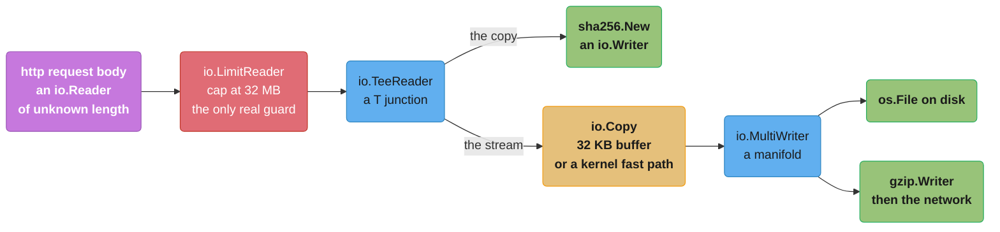
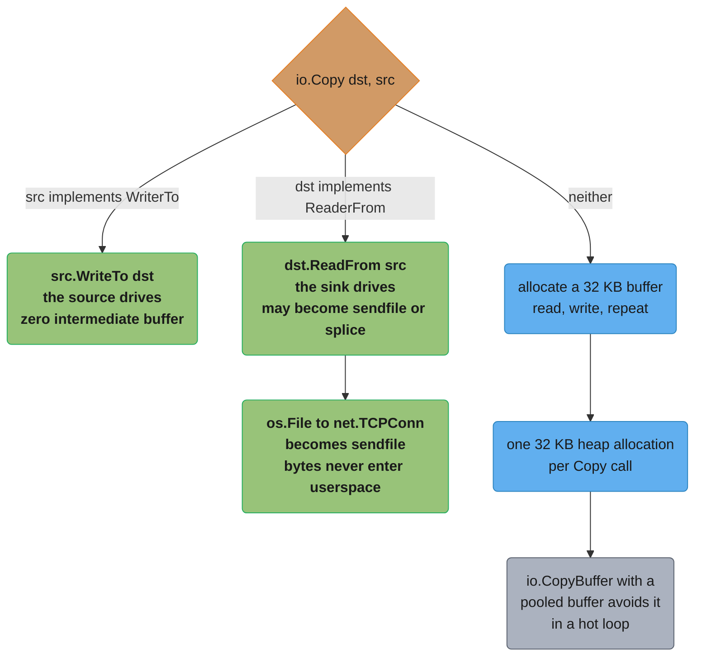
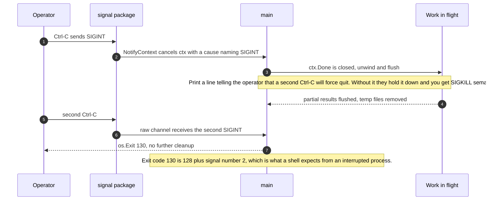
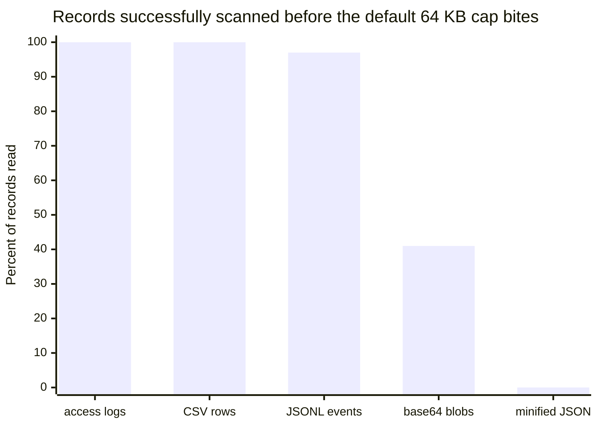

# Time, I/O and Standard Library Essentials

## 1. Concept Overview

Every Go service you will ever write measures an elapsed duration, reads a stream it did
not produce, writes a stream someone else consumes, catches a SIGTERM, and shells out to
something. None of that is a "topic" — there is no chapter called *elapsed time* the way
there is a chapter called *the scheduler* — and that is exactly why it is where the bugs
live. Nobody reviews a `time.Since`. Nobody questions a `bufio.NewScanner`. They ship, and
eighteen months later a duration is negative, a 400 MB import file stops at line 90,412
with no error, and a deploy leaves an orphaned `ffmpeg` pinning a core.

This module is the standard-library surface a working Go engineer touches daily and that
has no other home. Four packages carry most of it:

- **`time`** is not one clock, it is two. A `time.Time` carries a **wall-clock** reading
  that NTP can move and a **monotonic** reading that only ever goes forward. Which of the
  two answers your question depends on the operation you call, and the moment you
  serialize a `Time` the monotonic half is gone. Every "negative latency" bug in every Go
  codebase is that sentence.
- **`io`** is not a package of helpers, it is an **algebra**. Four one-method interfaces —
  `Reader`, `Writer`, `Closer`, `Seeker` — and a dozen combinators that take readers and
  return readers. Once you see `TeeReader`, `MultiReader`, `LimitReader` and `io.Pipe` as
  operators rather than utilities, half the "how do I stream this while also hashing it"
  questions answer themselves in one line.
- **`bufio`** is where the two most expensive silent failures in the standard library
  live: a `Scanner` that stops at 64 KB without an error you will notice, and a `Writer`
  whose `Flush` you deferred without checking its error, which is how a file ends up
  truncated on disk while your process exits 0.
- **`os`** and **`os/exec`** are the boundary with the operating system, where Go's
  friendly abstractions stop and process groups, signal dispositions and file modes start
  mattering the way they do in C.

The unifying idea is that all of this is **plumbing you compose, not framework you
configure**. `io.Copy(dst, src)` is four words that will, given the right pair of
arguments, become a `sendfile(2)` and never touch a byte in userspace. `signal.NotifyContext`
turns an operating-system concept into a `context.Context` you already know how to pass
around. Learning this module is mostly learning which four words to write.

---

## 2. Intuition

> **One-line analogy**: a wall clock tells you *what time it is* and a stopwatch tells you
> *how long that took*. `time.Time` is a wall clock with a stopwatch glued to the back, and
> the glue does not survive being put in an envelope.

**Mental model**: think of `io` as **pipe fittings**, not appliances. A `Reader` is a male
thread, a `Writer` is a female thread, and every combinator in the package is an adapter:
`TeeReader` is a T-junction, `MultiReader` is a manifold, `LimitReader` is a flow
restrictor, `io.Pipe` is a length of hose that connects a producer to a consumer with no
tank in between. You do not ask "does the library have a function that hashes a file while
uploading it" — you ask "what shape do I need", and the shape is a T-junction.

**Why it matters**: these are the failures that survive code review because the code looks
correct. A `Scanner` reading 64 KB and then quietly stopping does not panic, does not log,
and does not return an error unless you call `scanner.Err()` — which most code does not,
because the loop already ended. An unchecked `defer w.Flush()` returns an error into the
void; the last 3,900 bytes of your report never reach the disk and the process exits
successfully. A `time.Time` that went through JSON and came back has a wall reading and no
monotonic reading, so a subtraction that was rock-solid in a unit test goes negative in
production the one night NTP steps the clock backwards by 40 ms.

**Key insight**: the standard library's most dangerous APIs are the ones that **fail by
returning a smaller correct-looking answer**. A crash is cheap — you find it in staging. A
`Scanner` that gives you the first 90,412 rows of a 118,000-row file, or a `Duration` that
is -0.04 seconds instead of 12.3, is expensive, because everything downstream keeps working
and nothing tells you the input was truncated. Learn where those are, and this module has
paid for itself.

---

## 3. Core Principles

- **A `time.Time` carries two clocks.** `Sub`, `Since`, `Until`, `After`, `Before`, `Equal`
  and `Compare` use the monotonic reading — and are immune to NTP — *whenever both operands
  carry one*; the moment either side lost its monotonic half they fall back to the wall
  reading. `Format`, `Unix`, marshalling and everything that crosses a process boundary use
  the wall reading unconditionally.
- **Serialization strips the monotonic reading.** Marshal, unmarshal, `Round`, `Truncate`,
  `UTC`, `Local` and `In` all return a `Time` with no monotonic part. Never subtract across
  one of those.
- **Store instants in UTC, format in a location.** A stored local time is a stored
  ambiguity, because the same wall-clock string occurs twice during a DST fall-back.
- **Every `Ticker` must be stopped.** Unreferenced timers and tickers are collectable
  `[1.23]`, but a `Ticker` you still hold a reference to keeps firing forever, and its
  goroutine is the runtime's, not yours to reason about.
- **Time channels are unbuffered** `[1.27]`. A tick you are not ready to receive is
  dropped, not queued.
- **`io.Copy` before a loop.** It picks the fastest available path, including kernel-level
  ones you cannot write by hand, and it is one line.
- **`io.ReadAll` is a decision about memory, not a convenience.** On input you did not
  produce, wrap it in `io.LimitReader` first.
- **`io.EOF` is a value, not a failure.** Compare it with `==` after a `Read`, and treat
  `io.ErrUnexpectedEOF` — EOF in the middle of a structure — as a genuine error.
- **`Scanner` has a 64 KB line limit.** Raise it with `Buffer` or use `bufio.Reader` for
  data whose record size you do not control.
- **A deferred `Flush` whose error you drop is a data-loss bug**, not a lint warning.
- **Match on error values, never on error strings.** `errors.Is(err, fs.ErrNotExist)`, not
  `strings.Contains(err.Error(), "no such file")`.
- **Killing a process does not kill its children.** A `CommandContext` kill signals one
  pid; the grandchildren keep your file descriptors and your CPU.

---

## 4. Types / Architectures / Strategies

### 4.1 The `time` types and what each is for

| Type | What it is | The trap |
|------|-----------|----------|
| `time.Time` | An instant: wall reading, optional monotonic reading, and a `*Location` | 24 bytes, contains a pointer — never a map key without `.UTC().UnixNano()` |
| `time.Duration` | An `int64` count of nanoseconds | Max span is 292.47 years; multiplying an `int` variable by `time.Second` does not compile |
| `time.Location` | A timezone database entry | `time.Local` depends on the container's `/etc/localtime`, which is usually UTC and sometimes not |
| `time.Timer` | Fires once on `C` after a duration | Reset with `Stop` then `Reset`; the old drain `if !t.Stop() { <-t.C }` deadlocks since `[1.23]` |
| `time.Ticker` | Fires repeatedly on `C` | Must be `Stop`ped while referenced; drops ticks you are not ready for |
| `time.AfterFunc` | Runs a function in its own goroutine after a duration | The function runs even during shutdown unless you `Stop` and check the return |

### 4.2 The `io` interface algebra

| Combinator | Signature shape | What it composes |
|-----------|-----------------|------------------|
| `io.TeeReader(r, w)` | `Reader` → `Reader` | Every byte read from the result is also written to `w`. Hash while streaming |
| `io.MultiReader(r...)` | `Reader...` → `Reader` | Concatenation. Prepend a sniffed header back onto a stream |
| `io.MultiWriter(w...)` | `Writer...` → `Writer` | Fan-out. Write to a file and a checksum and stdout at once |
| `io.LimitReader(r, n)` | `Reader` → `Reader` | Truncation at `n` bytes. The one guard against a hostile body |
| `io.NewSectionReader(r, off, n)` | `ReaderAt` → `ReadSeeker` | A window into a file. Range requests, zip members |
| `io.Pipe()` | → `(*PipeReader, *PipeWriter)` | An in-memory synchronous pipe. Turn a writer-shaped producer into a reader |
| `io.CopyN(dst, src, n)` | — | Copy exactly `n`, returning `io.EOF` if the source ran short |
| `io.ReadFull(r, buf)` | — | Fill the buffer or fail with `ErrUnexpectedEOF` |

### 4.3 Choosing a reader for line-shaped input

| Approach | Max record | Allocations per record | Use when |
|----------|-----------|------------------------|----------|
| `bufio.Scanner` default | **64 KB** | 0 — the token aliases the internal buffer | Lines you control: logs, config, well-formed CSV |
| `bufio.Scanner` + `Buffer(make([]byte, 0, 1<<20), 1<<20)` | 1 MB | 0 | Known-large records, bounded by you |
| `bufio.Reader.ReadString('\n')` | unbounded | 1 string per line | Records of unknown size, and you accept the memory |
| `bufio.Reader.ReadSlice('\n')` | buffer size | 0, but the slice is invalidated by the next read | Hot paths where you parse before reading on |
| `encoding/csv` over a `bufio.Reader` | unbounded | 1 slice per row, reusable with `ReuseRecord` | Actual CSV, including quoted embedded newlines |

`Scanner` is the default in every tutorial and it is the right default — right up until the
input is a minified JSON line, a base64 blob or a stack trace, at which point it stops
without telling you.

### 4.4 Signal handling shapes

| Shape | Code | When |
|-------|------|------|
| Context cancellation | `signal.NotifyContext(ctx, syscall.SIGINT, syscall.SIGTERM)` | Almost always. It hands you a `context.Context` your whole program already accepts, and `[1.26]` the cancellation cause names the signal |
| Raw channel | `signal.Notify(ch, ...)` with a buffered `ch` | You need the second signal (force-quit), or you must distinguish SIGHUP from SIGTERM |
| Ignore | `signal.Ignore(syscall.SIGPIPE)` | A CLI writing to a closed pipe |
| Reset | `signal.Reset(sig)` then re-raise | You want the default disposition, e.g. to die with the right exit status |

### 4.5 `os/exec` execution modes

| Call | Waits? | Captures? | Deadlock risk |
|------|--------|-----------|---------------|
| `cmd.Run()` | yes | no, unless you set `Stdout`/`Stderr` | none |
| `cmd.Output()` | yes | stdout into a buffer, stderr into `ExitError.Stderr` | none, but it buffers the whole output in memory |
| `cmd.CombinedOutput()` | yes | both, interleaved | none |
| `cmd.Start()` + `cmd.Wait()` | you control | you wire the pipes | **high** — `Wait` closes the pipes, so read them fully *before* calling it |

---

## 5. Architecture Diagrams

### The two clocks inside a `time.Time`

```
time.Time - one struct, two independent readings

    t := time.Now()
    +-------------------------------+-------------------------------+
    |  WALL reading                 |  MONOTONIC reading            |
    |  2026-09-02 14:03:11.412 UTC  |  +412738.119s since boot      |
    |  NTP can step it, forward     |  never steps, never goes back |
    |  or BACKWARD                  |  meaningless across processes |
    +-------------------------------+-------------------------------+
              |                                     |
              | used by                             | used by
              v                                     v
      Format  MarshalJSON  Unix           Sub  Since  Until  After  Before
      (a point on a calendar)             Equal  Compare
      always, no matter what the          only when BOTH operands still carry
      Time still carries                  a monotonic reading; otherwise these
                                          fall back to the wall reading too

    Operations that RETURN a Time with the monotonic half STRIPPED:
      .UTC()  .Local()  .In(loc)  .Round(d)  .Truncate(d)  .AddDate()
      MarshalJSON / UnmarshalJSON / gob / any wire format

    start := time.Now()                     // wall + monotonic
    json.Marshal(start) -> unmarshal -> s2  // wall ONLY
    time.Since(start)   // safe: monotonic minus monotonic
    time.Since(s2)      // UNSAFE: wall minus wall, NTP can make it negative
```

The rule reduces to one sentence: a `Time` that has been anywhere near a wire is a
calendar point, not a stopwatch reading. Subtract only `Time` values that never left the
process.

### The `io` algebra as fittings



Reading it left to right gives you the whole handler in four lines of Go: limit, tee into a
hash, copy into a multiwriter. No temporary file, no full body in memory, and the checksum
is finished the instant the copy is. The `LimitReader` is red because it is the only node
that is a safety control rather than a transformation — remove it and this pipeline
happily streams a 40 GB body.

### Where `io.Copy` actually copies



This is why `io.Copy` beats a hand-written loop and why the advice is never "write your own
for performance". The fast paths are interface assertions inside the standard library, and
you get them free by using the standard call. `io.CopyBuffer` exists for the one case the
diagram ends on: a hot loop where the 32 KB allocation per call actually shows in a heap
profile.

### Graceful shutdown of a CLI on the second signal



`NotifyContext` handles the first signal and the ordinary path. The second signal needs a
plain `signal.Notify` channel alongside it, because the context is already cancelled and
cannot tell you anything a second time. The full ordering rules for draining a server
during shutdown live in
[Concurrency Patterns and Pitfalls](../concurrency_patterns_and_pitfalls/concurrency_patterns_and_pitfalls.md).

### What the 64 KB scanner limit costs on real data



Nothing here errors. The loop simply ends and the program reports success on 41% of the
file. The single-line minified-JSON case reads zero records and prints "processed 0 rows"
with exit status 0, which is the version of this bug that reaches production, because a
0-row import looks like an empty input file.

---

## 6. How It Works — Detailed Mechanics

### 6.1 A `time.Time` is two clocks in 24 bytes

`time.Now()` makes one call into the runtime that returns both a wall-clock nanosecond
count and a monotonic nanosecond count since an arbitrary origin (usually process or
machine start). Both are packed into the same struct.

```go
start := time.Now()
doWork()
elapsed := time.Since(start)   // monotonic minus monotonic. NTP cannot touch this.
```

If the machine's clock is stepped backwards by 40 ms in the middle of `doWork` — a routine
NTP correction, not an exotic failure — `elapsed` is still correct, because neither operand
consulted the wall clock. That is the entire reason the monotonic reading exists.

The moment a `Time` is serialized, the monotonic half is dropped, because it is meaningless
outside the process that produced it:

```go
type Job struct {
    Started time.Time `json:"started"`
}

func (s *Server) handle(w http.ResponseWriter, r *http.Request) {
    var j Job
    json.NewDecoder(r.Body).Decode(&j)   // j.Started has NO monotonic reading
    latency := time.Since(j.Started)     // wall minus wall: can be negative
}
```

`time.Since(j.Started)` here compares the local wall clock against a wall clock on another
machine. Two machines 60 ms apart in NTP sync — well within normal — produce a negative
latency for every request travelling in one direction. Reported to a histogram, negative
values land in the first bucket and your p99 quietly reads as excellent.

The fix is to never subtract a deserialized `Time` from a local one. Send an explicit
duration or a monotonic-free pair of timestamps and be honest that clock skew is in the
number:

```go
type Job struct {
    Started    time.Time     `json:"started"`
    ClientTook time.Duration `json:"client_took"`  // measured on ONE machine
}
```

`String()` shows you which readings a `Time` has. A `Time` with a monotonic part prints
with an `m=+...` suffix:

```go
fmt.Println(time.Now())           // 2026-09-02 14:03:11.4127 +0000 UTC m=+0.000123456
fmt.Println(time.Now().UTC())     // 2026-09-02 14:03:11.4127 +0000 UTC   <- no m=
fmt.Println(time.Now().Round(0))  // deliberately strips monotonic, same as above
```

`t.Round(0)` is the documented idiom for stripping it on purpose, which you want before
storing a `Time` in a struct that will be compared with `==` or used as a map key.

### 6.2 `Duration` is an `int64` of nanoseconds, and that is a typing trap

```go
type Duration int64   // nanoseconds
```

Constants compose naturally because they are untyped:

```go
timeout := 5 * time.Second        // fine: untyped constant 5
backoff := 250 * time.Millisecond // fine
```

A *variable* does not:

```go
retries := 3
// wait := retries * time.Second
// invalid operation: mismatched types int and time.Duration
wait := time.Duration(retries) * time.Second   // correct
```

The dangerous version of this compiles:

```go
// BROKEN: seconds is an int read from config. This is 30 NANOSECONDS.
seconds := cfg.TimeoutSeconds        // 30
ctx, cancel := context.WithTimeout(ctx, time.Duration(seconds))

// FIX: multiply by the unit, do not convert into it.
ctx, cancel := context.WithTimeout(ctx, time.Duration(seconds)*time.Second)
```

`time.Duration(30)` is a legal conversion producing 30 ns. Every context built this way
expires before the first packet leaves, and the symptom is a 100% `context deadline
exceeded` rate that looks like a network problem. Prefer parsing durations as strings in
configuration — `"30s"` through `time.ParseDuration` — so the unit is in the value and the
conversion cannot be written wrong.

An `int64` of nanoseconds tops out at 9,223,372,036,854,775,807 ns, which is **292.47
years**. `time.Duration` cannot express "a century and a half" plus "a century and a half",
and `t.Sub(u)` saturates at those bounds rather than wrapping.

### 6.3 `Timer`, `Ticker`, `AfterFunc`, and who must stop what

```go
tk := time.NewTicker(30 * time.Second)
defer tk.Stop()                        // mandatory while you hold tk
for {
    select {
    case <-ctx.Done():
        return ctx.Err()
    case <-tk.C:
        flush()
    }
}
```

Two changes shape modern usage:

- `[1.23]` A `Timer` or `Ticker` no longer referenced by the program becomes eligible for
  garbage collection immediately, even if `Stop` was never called. Before that, an
  unstopped `Ticker` was **never** collected — the classic leak.
- `[1.27]` The channel is unbuffered, always. The `asynctimerchan` GODEBUG that reverted to
  the old one-element buffer has been permanently removed. `len(tk.C)` and `cap(tk.C)` are
  both 0, and after a `Stop` or `Reset` no stale value prepared before the call can arrive.

The `[1.23]` change does **not** mean you can drop `defer tk.Stop()`. Collection requires
that nothing references the ticker; a ticker stored in a struct field on a live object is
referenced, keeps firing, and keeps waking the runtime's timer goroutine every period. The
rule stays: stop what you hold.

The unbuffered channel is what makes `Reset` finally safe to write:

```go
timer := time.NewTimer(idleTimeout)
defer timer.Stop()
for msg := range in {
    handle(msg)
    timer.Stop()
    timer.Reset(idleTimeout)
}
```

Two lines, no drain. `Stop`'s contract since `[1.23]` is that any receive from `timer.C`
after `Stop` returns **blocks**, because a value prepared before the call can no longer be
delivered — so there is nothing left to drain. The old
`if !t.Stop() { <-t.C }` idiom is now a **deadlock**: `Stop` returns false for a timer that
already fired, the bare receive then blocks forever on a channel guaranteed to stay empty,
and the goroutine is gone. Delete the drain rather than wrapping it in a non-blocking
`select` — a `select` with a `default` does not hang, but its `case` is unreachable and it
only hides the fact that the idiom no longer means anything. What you must not do is create
a fresh timer per iteration inside a hot `select` — that
pattern and its measured cost belong to
[Concurrency Patterns and Pitfalls](../concurrency_patterns_and_pitfalls/concurrency_patterns_and_pitfalls.md).

`AfterFunc` runs its function on a **new goroutine** owned by the runtime:

```go
t := time.AfterFunc(5*time.Second, func() {
    log.Warn("request still running")
})
defer t.Stop()   // returns false if the func already fired or was already stopped
```

`Stop` returning false does not mean the function finished — it may be running right now.
If the callback touches state you are tearing down, you need your own synchronization; the
timer gives you no join point.

### 6.4 The reference layout is a design choice, not a joke

```go
const layout = "2006-01-02 15:04:05 MST"
t, err := time.Parse(layout, "2026-09-02 14:03:11 UTC")
s := t.Format(time.RFC3339)   // "2026-09-02T14:03:11Z"
```

The reference instant is `Mon Jan 2 15:04:05 MST 2006` — read as the ordinals
`01/02 03:04:05PM '06 -0700`, i.e. month 1, day 2, hour 3, minute 4, second 5, year 6,
zone -7. That is the whole mnemonic.

Why this beats `%Y-%m-%d`: the layout **is an example of the output**, so it is
self-checking. You can see at a glance that `"2006-01-02"` yields `2026-09-02` and that
`"01/02/2006"` is US order. With `strftime`-style codes you cannot tell `%m/%d` from
`%d/%m` without knowing the convention, and the mistake produces valid-looking dates that
are wrong for eleven days a month. The cost is that you must memorise one string; the
benefit is that every format bug is visible in the source.

Prefer the named constants where they fit — `time.RFC3339`, `time.RFC3339Nano`,
`time.DateOnly`, `time.TimeOnly`, `time.DateTime`. `time.RFC3339` is the one to store and
transmit: unambiguous, sortable as a string, and understood by every other language.

`Parse` with no zone in the layout returns a `Time` in **UTC**. `ParseInLocation` returns
one in the location you name. Mixing them up shifts every timestamp by your offset, which
is invisible in a UTC-configured container and appears the day someone runs the job on a
laptop.

### 6.5 UTC discipline

```go
// Store and compute in UTC.
now := time.Now().UTC()
_, err := db.Exec(`INSERT INTO events(at) VALUES ($1)`, now)

// Format for a human in their location, at the very edge of the system.
loc, _ := time.LoadLocation("Asia/Kolkata")
fmt.Println(now.In(loc).Format("2006-01-02 15:04 MST"))
```

A stored local wall-clock time is a stored ambiguity. During a DST fall-back the wall clock
reads 01:30 twice, an hour apart; a stored `2026-11-01 01:30:00` in `America/New_York`
identifies two distinct instants and there is no information anywhere to say which. During
spring-forward the same string identifies *no* instant. Storing UTC removes both cases.
Store the user's timezone as a separate IANA name column when you need to render for them —
never as a fixed offset, because offsets change when governments change DST rules.

`time.Local` is whatever `/etc/localtime` says inside the container. Scratch and distroless
images typically have no zoneinfo at all, so `time.LoadLocation("Asia/Kolkata")` fails with
"unknown time zone" — the fix is `import _ "time/tzdata"`, which embeds the database into
the binary at a cost of about 450 KB.

### 6.6 `io` as an algebra

The four interfaces are one method each:

```go
type Reader interface { Read(p []byte) (n int, err error) }
type Writer interface { Write(p []byte) (n int, err error) }
type Closer interface { Close() error }
type Seeker interface { Seek(offset int64, whence int) (int64, error) }
```

`Read`'s contract is the part people get wrong: it may return `0 < n < len(p)` and it may
return a non-zero `n` **together with** `io.EOF`. Code that checks the error before
processing `p[:n]` loses the last chunk of every stream that returns them together.

```go
// BROKEN: drops the final bytes whenever a reader returns n > 0 with io.EOF.
for {
    n, err := r.Read(buf)
    if err != nil {
        break
    }
    process(buf[:n])
}

// FIX: process what you got, then decide about the error.
for {
    n, err := r.Read(buf)
    if n > 0 {
        process(buf[:n])
    }
    if err == io.EOF {
        break
    }
    if err != nil {
        return err
    }
}
```

Better still: do not write this loop. `io.Copy`, `io.ReadFull`, `bufio.Reader` and
`io.ReadAll` all handle it correctly, and one of them almost always fits.

The combinators compose in one line each:

```go
// Hash a body while streaming it to disk, never buffering it.
h := sha256.New()
limited := io.LimitReader(r.Body, 32<<20)          // 32 MB ceiling
tee := io.TeeReader(limited, h)
f, err := os.CreateTemp("", "upload-*")
if err != nil {
    return err
}
defer f.Close()
if _, err := io.Copy(f, tee); err != nil {
    return err
}
sum := hex.EncodeToString(h.Sum(nil))

// Put a sniffed header back on the front of a stream.
head := make([]byte, 512)
n, _ := io.ReadFull(r, head)
kind := http.DetectContentType(head[:n])
whole := io.MultiReader(bytes.NewReader(head[:n]), r)

// Serve one member of a zip without reading the rest.
section := io.NewSectionReader(f, entry.Offset, entry.Size)
http.ServeContent(w, req, entry.Name, entry.ModTime, section)
```

`io.Pipe` is the adapter for the shape mismatch you hit most: a producer that wants a
`Writer` and a consumer that wants a `Reader`, with no buffer between them.

```go
pr, pw := io.Pipe()
go func() {
    // json.Encoder wants an io.Writer; http.NewRequest wants an io.Reader.
    err := json.NewEncoder(pw).Encode(bigPayload)
    pw.CloseWithError(err)      // propagates the error to the reader side
}()
req, _ := http.NewRequestWithContext(ctx, "POST", url, pr)
```

`CloseWithError` is the whole point: without it, an encoder failure leaves the reader
blocked forever and the request hangs. Every `io.Pipe` writer goroutine must close on every
exit path.

### 6.7 `io.Copy` and its fast paths

`io.Copy(dst, src)` checks, in order: does `src` implement `io.WriterTo`? Then does `dst`
implement `io.ReaderFrom`? Only if neither does it allocate a 32 KB buffer and loop.

That matters concretely. `*os.File` implements `ReadFrom` and `*net.TCPConn` implements
`ReadFrom`, so on Linux `io.Copy(tcpConn, osFile)` becomes a `sendfile(2)` and the file's
bytes go from page cache to socket without ever entering your process. A hand-rolled loop
cannot do that. `bytes.Buffer`, `strings.Reader` and `bytes.Reader` all implement `WriteTo`,
so copying from them never allocates an intermediate buffer either.

In a hot loop the 32 KB allocation per `Copy` call is real. `io.CopyBuffer` takes the
buffer, which you pool:

```go
var bufPool = sync.Pool{New: func() any { b := make([]byte, 32*1024); return &b }}

func relay(dst io.Writer, src io.Reader) (int64, error) {
    p := bufPool.Get().(*[]byte)
    defer bufPool.Put(p)
    return io.CopyBuffer(dst, src, *p)
}
```

Note the subtlety: `CopyBuffer` still prefers `WriterTo`/`ReaderFrom` if either side
implements it, and then your buffer is unused. Measure before adding the pool — see
[Escape Analysis and Performance](../escape_analysis_and_performance/escape_analysis_and_performance.md).

### 6.8 `io.ReadAll` and when it is a memory bomb

`[1.26]` `io.ReadAll` allocates less intermediate memory and returns a minimally sized final
slice; it is often about **two times faster while allocating roughly half as much total
memory**, with more benefit on larger inputs. It grows a slice by reading into it and
reallocating, so the old behaviour peaked at roughly 2.5x the final size in live bytes
during the last growth.

None of that makes it safe on input you do not control. A faster way to allocate 4 GB is
still a way to allocate 4 GB:

```go
// BROKEN: one client with a large body OOMs the pod.
body, err := io.ReadAll(r.Body)

// FIX: a ceiling, and an error the client can act on.
const maxBody = 8 << 20   // 8 MB
body, err := io.ReadAll(io.LimitReader(r.Body, maxBody+1))
if err != nil {
    return err
}
if len(body) > maxBody {
    http.Error(w, "request body too large", http.StatusRequestEntityTooLarge)
    return
}
```

For an HTTP server there is a purpose-built version — `http.MaxBytesReader(w, r.Body, max)`
— which additionally tells the server to close the connection and returns a typed
`*http.MaxBytesError`. Use it in handlers; use `io.LimitReader` everywhere else.

The deeper point: prefer never materialising the stream. `json.NewDecoder(r.Body).Decode(&v)`
streams; `json.Unmarshal(mustReadAll(r.Body), &v)` does not. The decoder form is the one to
reach for by default.

### 6.9 `io.EOF` is a sentinel, not a failure

```go
if err == io.EOF        { /* clean end of stream */ }
if err == io.ErrUnexpectedEOF { /* stream ended INSIDE a structure: a real error */ }
```

`io.EOF` is compared with `==` rather than `errors.Is` by long-standing convention, because
`Read` implementations are required to return the sentinel itself and not a wrapped form.
`errors.Is(err, io.EOF)` also works and is what you want once the error has passed through
your own `%w` wrapping.

`io.ErrUnexpectedEOF` is the one that matters for correctness: `io.ReadFull` and every
binary decoder return it when the stream ends mid-record. Treating it as a normal EOF turns
a truncated file into a silently short parse. Conversely, treating a clean `io.EOF` as an
error is how you get spurious alerts at the end of every successful stream.

`net.UnixConn` reads now return `io.EOF` directly rather than wrapping it in a
`*net.OpError` `[1.27]`, which removes one place where an `err == io.EOF` check used to
fail surprisingly.

### 6.10 `bufio.Scanner` and the 64 KB wall

`bufio.MaxScanTokenSize` is `64 * 1024`. A `Scanner` that meets a longer token stops,
`Scan()` returns false, the loop ends, and the error is available **only** from
`scanner.Err()`, which returns `bufio.ErrTooLong`.

```go
// BROKEN: reports success on a truncated read.
sc := bufio.NewScanner(f)
for sc.Scan() {
    ingest(sc.Bytes())
}
log.Printf("imported %d rows", count)   // "imported 90412 rows" out of 118000

// FIX: raise the ceiling deliberately AND check the error.
sc := bufio.NewScanner(f)
sc.Buffer(make([]byte, 0, 64*1024), 4*1024*1024)   // 4 MB max token
for sc.Scan() {
    ingest(sc.Bytes())
}
if err := sc.Err(); err != nil {
    return fmt.Errorf("scan %s: %w", f.Name(), err)   // bufio.ErrTooLong surfaces here
}
```

`Buffer(buf, max)` takes an initial buffer and a maximum. Passing a max still bounds memory
— which is the reason `Scanner` has a limit at all: it is the API that refuses to let one
malicious line allocate unbounded memory. If the record size is genuinely unbounded, do not
raise the limit to a huge number, switch to `bufio.Reader`:

```go
br := bufio.NewReaderSize(f, 64*1024)
for {
    line, err := br.ReadString('\n')
    if len(line) > 0 {
        ingest(line)
    }
    if err == io.EOF {
        break
    }
    if err != nil {
        return err
    }
}
```

One more `Scanner` trap: `sc.Bytes()` returns a slice that **aliases the scanner's internal
buffer** and is invalidated by the next `Scan()`. Appending it to a slice you keep produces
a slice of identical garbage. `sc.Text()` allocates a fresh string and is safe; if you need
bytes, copy them with `append([]byte(nil), sc.Bytes()...)`.

`bufio.Reader.Peek(n)` looks ahead without consuming, which is how you sniff a magic number
or decide between two parsers. `bytes.Buffer.Peek` `[1.26]` gives the same operation on an
in-memory buffer.

### 6.11 `bufio.Writer` and the `Flush` contract

A `bufio.Writer` holds up to its buffer size (4096 bytes by default) in memory. Nothing is
guaranteed on the underlying writer until `Flush` succeeds.

```go
// BROKEN: the last partial buffer is lost silently, and the process exits 0.
func writeReport(path string, rows []Row) error {
    f, err := os.Create(path)
    if err != nil {
        return err
    }
    defer f.Close()
    w := bufio.NewWriter(f)
    defer w.Flush()          // error discarded
    for _, r := range rows {
        fmt.Fprintf(w, "%s,%d\n", r.Name, r.Count)
    }
    return nil
}

// FIX: flush before returning, check both errors, and let Close report too.
func writeReport(path string, rows []Row) (err error) {
    f, err := os.Create(path)
    if err != nil {
        return err
    }
    defer func() {
        if cerr := f.Close(); err == nil {
            err = cerr
        }
    }()
    w := bufio.NewWriter(f)
    for _, r := range rows {
        if _, err = fmt.Fprintf(w, "%s,%d\n", r.Name, r.Count); err != nil {
            return err
        }
    }
    return w.Flush()
}
```

Two independent bugs in the broken version. `defer w.Flush()` drops the error, so a full
disk produces a truncated file and a successful exit. And `defer f.Close()` runs *after*
the flush in LIFO order, which is correct here, but its own error — the one that reports a
failed `fsync`-adjacent writeback on some filesystems — is also discarded. The named-return
close pattern is the idiom for any function that writes a file it cares about.

For a file that must be complete or absent, write to a temporary file in the same directory
and `os.Rename` it into place. Rename within a filesystem is atomic, so a reader sees either
the old file or the whole new one, never a half-written one.

### 6.12 `os`: files, modes, confinement

```go
b, err := os.ReadFile("config.yaml")                  // whole file, one call
err = os.WriteFile("out.json", b, 0o644)              // create or truncate, mode 0644
```

`os.ReadFile` stats the file to size the buffer, so it is a single allocation for a regular
file. Both are the right call for configuration and small artefacts and the wrong call for
anything user-supplied and unbounded.

Modes are Unix permission bits and are masked by the process umask on creation. `0o600` for
secrets, `0o644` for readable data, `0o755` for directories and executables. Writing a
credential file as `0o644` inside a shared container image is a finding in every security
review that looks.

Error handling matches on values:

```go
// BROKEN: breaks under any locale, any wrapped error, any OS.
if strings.Contains(err.Error(), "no such file") { ... }

// FIX
if errors.Is(err, fs.ErrNotExist) { ... }
if errors.Is(err, fs.ErrPermission) { ... }
```

`os.IsNotExist` still exists but does not unwrap; `errors.Is(err, fs.ErrNotExist)` is the
form that survives your own `%w` wrapping.

`os.OpenRoot` `[1.24]` returns an `*os.Root` — a directory handle whose operations cannot
escape it, enforced by the kernel where possible rather than by string inspection:

```go
root, err := os.OpenRoot("/srv/uploads")
if err != nil {
    return err
}
defer root.Close()

f, err := root.Open(userSuppliedName)   // "../../etc/passwd" fails here
```

This is the correct answer to path traversal, and it is strictly stronger than the
`filepath.Clean` plus `strings.HasPrefix` dance everyone writes. That dance is defeated by a
symlink: `Clean` resolves `..` lexically, decides the path is inside your directory, and
then the open follows a symlink that points anywhere. `*os.Root` refuses to traverse a
symlink out of the root, and carries `Open`, `Create`, `OpenFile`, `Mkdir`, `MkdirAll`,
`ReadFile`, `WriteFile`, `Stat`, `Lstat`, `Remove`, `RemoveAll`, `Rename`, `Symlink`,
`Readlink`, `Chmod`, `Chown`, `Chtimes` and `FS`.

Temporary files go in the right place with the right permissions automatically:

```go
f, err := os.CreateTemp("", "export-*.csv")   // mode 0600, unique name, TMPDIR-aware
defer os.Remove(f.Name())
defer f.Close()

dir, err := os.MkdirTemp("", "build-")
defer os.RemoveAll(dir)
```

In tests, `t.TempDir()` does all of this and removes the directory in `t.Cleanup`.

### 6.13 `os/signal`

```go
func main() {
    ctx, stop := signal.NotifyContext(context.Background(),
        syscall.SIGINT, syscall.SIGTERM)
    defer stop()

    if err := run(ctx); err != nil {
        // [1.26] the cancellation cause names the signal that arrived
        if cause := context.Cause(ctx); cause != nil && cause != ctx.Err() {
            log.Printf("shutting down: %v", cause)
        }
        os.Exit(1)
    }
}
```

`[1.26]` `NotifyContext` cancels the returned context with a `context.CancelCauseFunc` and
an error naming the signal received. Before that, everything downstream saw an
undifferentiated `context.Canceled` and you needed a parallel channel just to log *which*
signal arrived. Now `context.Cause(ctx)` tells you, which matters when SIGINT means "the
operator is at a keyboard, print a summary" and SIGTERM means "the orchestrator is
counting, get out".

Calling `stop()` restores the default disposition, so a second SIGTERM after `stop()` kills
the process outright. That is usually what you want, and it is why `defer stop()` belongs at
the top of `main`.

The raw form, when you need the second signal or a signal `NotifyContext` does not model:

```go
sigs := make(chan os.Signal, 1)          // MUST be buffered
signal.Notify(sigs, syscall.SIGHUP)
for range sigs {
    reloadConfig()
}
```

The buffer is not optional. `signal.Notify` sends non-blocking: if the channel is
unbuffered and nobody is in a receive at that instant, the signal is **dropped silently**.
Capacity 1 per distinct signal you care about is the standard.

**SIGKILL (9) and SIGSTOP (19) cannot be caught, blocked or ignored** — the kernel does not
deliver them to the process, it acts on the process. That is why a Kubernetes grace period
matters: you get SIGTERM, you get the grace period (30 s by default), and then you get
SIGKILL and no further code of yours runs. SIGPIPE has special handling in Go: on a write
to a broken pipe on fd 1 or 2 the runtime dies with the signal so that `yourprog | head`
behaves like every other Unix tool, and on any other fd the write simply returns `EPIPE` as
an ordinary error.

### 6.14 `flag`, and why real CLIs outgrow it

```go
var (
    addr    = flag.String("addr", ":8080", "listen address")
    verbose = flag.Bool("v", false, "verbose logging")
    timeout = flag.Duration("timeout", 30*time.Second, "request timeout")
)
func main() {
    flag.Parse()
    ...
}
```

`flag` is excellent for a single-purpose binary. `flag.Duration` parsing `"1m30s"` for free
is exactly the kind of thing that makes the standard library good.

It runs out at four specific points, all structural rather than stylistic:

1. **No subcommands.** `git commit -m` needs a command tree. `flag.NewFlagSet` per
   subcommand plus hand-written dispatch is the workaround, and it is fifty lines you now
   maintain.
2. **No combined short flags.** `-abc` is one flag named `abc`, not three. GNU-style
   `--long` is accepted only because `flag` treats `-` and `--` identically.
3. **Flags must precede positional arguments.** `mytool file.txt -v` leaves `-v` in
   `flag.Args()` unparsed, which surprises every user who has ever used `ls`.
4. **No config-file or environment layering.** Precedence — flag beats environment beats
   file beats default — is yours to build.

At that point reach for `spf13/cobra` (command trees, generated completions and man pages;
what `kubectl` and `docker` use), `urfave/cli` (lighter), or `alecthomas/kong` (struct tags
instead of imperative registration). Do not reach for one on day one — a binary with six
flags and no subcommands is better served by `flag` and no dependency.

### 6.15 `embed`

```go
import "embed"

//go:embed templates/*.html
var templateFS embed.FS

//go:embed migrations
var migrationsFS embed.FS

//go:embed version.txt
var version string   // a single file can embed straight into a string or []byte
```

The directive must be immediately above the variable with no blank line, the package must
import `embed` (blank import `_ "embed"` if you only use the string form), and the paths are
relative to the source file's directory. `//go:embed` cannot reach outside the module, cannot
follow symlinks, and by default skips files beginning with `.` or `_` — use the `all:`
prefix (`//go:embed all:static`) when you genuinely need those.

What it buys is a deployment property: one binary, no companion directory, no "works on my
machine because the templates happened to be relative to the CWD". Migrations, HTML
templates, a default configuration, a TLS root bundle and the build's version string all
travel inside the executable, and `embed.FS` satisfies `fs.FS`, so `http.FS(templateFS)`,
`template.ParseFS` and `migrate` all consume it unchanged.

The cost is binary size and no hot reload. The standard pattern is a build tag that swaps
`os.DirFS(".")` in for development and `embed.FS` in for release.

### 6.16 `os/exec`

```go
ctx, cancel := context.WithTimeout(ctx, 60*time.Second)
defer cancel()

cmd := exec.CommandContext(ctx, "ffmpeg", "-i", in, "-c:v", "libx264", out)
cmd.Env = append(os.Environ(), "AV_LOG_FORCE_NOCOLOR=1")
cmd.Dir = workDir

var stderr bytes.Buffer
cmd.Stderr = &stderr

if err := cmd.Run(); err != nil {
    var ee *exec.ExitError
    if errors.As(err, &ee) {
        return fmt.Errorf("ffmpeg exit %d: %s", ee.ExitCode(), stderr.String())
    }
    return fmt.Errorf("ffmpeg: %w", err)   // not even started: not found, permission
}
```

Two distinct failure classes hide behind one `err`. `*exec.ExitError` means the process ran
and exited non-zero — that is a *result*, and the interesting information is in stderr and
the exit code. Any other error means the process never started: binary not on `PATH`,
directory not executable, fork failure. Distinguishing them with `errors.As` is what makes
the log line useful.

Capturing stderr is not optional. A tool that exits 1 with a one-line explanation on stderr
and nothing on stdout produces `exit status 1` and nothing else if you forget. `cmd.Output()`
does this for you — it fills `ExitError.Stderr` with up to 32 KB of captured stderr — which
is a real reason to prefer it for short-lived commands.

The `Start`/`Wait` deadlock:

```go
// BROKEN: deadlocks on any output larger than the OS pipe buffer (64 KB on Linux).
cmd := exec.Command("big-generator")
stdout, _ := cmd.StdoutPipe()
cmd.Start()
cmd.Wait()                       // Wait closes the pipe...
data, _ := io.ReadAll(stdout)    // ...so this reads nothing, or blocks

// FIX: read the pipe to EOF BEFORE Wait.
cmd.Start()
data, err := io.ReadAll(stdout)
if err != nil {
    return err
}
return cmd.Wait()
```

The documented contract is that `Wait` closes the pipes after seeing the command exit, so
any read after `Wait` is a race with the close. Worse, the child blocks writing into a full
64 KB pipe buffer while you block in `Wait` for a child that will never exit. Read first,
then `Wait`.

**The process-group problem.** `CommandContext` kills the process it started and nothing
else. `ffmpeg` spawned from a wrapper script leaves the wrapper dead and `ffmpeg` running,
holding your temp file and a core. The fix is to put the child in its own process group and
signal the whole group:

```go
cmd := exec.CommandContext(ctx, "/usr/local/bin/transcode.sh", in, out)
cmd.SysProcAttr = &syscall.SysProcAttr{Setpgid: true}
cmd.Cancel = func() error {
    // negative pid means "the whole process group"
    return syscall.Kill(-cmd.Process.Pid, syscall.SIGTERM)
}
cmd.WaitDelay = 10 * time.Second   // then SIGKILL and force the pipes closed
```

`cmd.Cancel` replaces the default kill behaviour, and `cmd.WaitDelay` bounds how long `Wait`
will linger after cancellation before giving up on the I/O — without it, a grandchild that
inherited the stdout pipe keeps `Wait` blocked forever even after the direct child is dead.

`os.Process.WithHandle` `[1.26]` gives you the underlying OS handle inside a callback for
the duration of the call, which is how platform-specific process control (job objects on
Windows, `pidfd` operations on Linux) is done without racing against reaping.

---

## 7. Real-World Examples

**Kubernetes components** are the canonical `signal.NotifyContext` users: every controller
binary in `kubernetes/kubernetes` builds a context from SIGTERM and SIGINT, threads it into
the informers and the workqueue, and treats the second signal as an immediate `os.Exit`.
The pattern in this module's shutdown diagram is that code, simplified.

**Prometheus** reads and writes its TSDB blocks almost entirely through `io` compositions —
`io.LimitReader` bounds every chunk read against a corrupted index, and section readers give
each block file a window per chunk rather than a per-chunk file handle.

**Docker's `dockerd`** hits the process-group problem in its purest form: a container's
entrypoint may `exec` or may fork, and the runtime must terminate everything in the cgroup
rather than a single pid. The Go-level lesson generalises to any service that shells out.

**Hugo** embeds its entire default template set and asset pipeline with `//go:embed`, which
is why the distribution is a single binary with no data directory. Before `embed` existed
this was done by generating a `.go` file with a `map[string][]byte` literal, and the
generated files ran to megabytes of source.

**`kubectl`, `docker`, `gh` and `helm`** are all `spf13/cobra`, and all four started as
`flag`. The migration point in every case was the second subcommand.

**CockroachDB** stores every timestamp as UTC and carries its own hybrid-logical clock on
top, precisely because wall-clock comparison across nodes is not trustworthy — the same
reason `time.Since` on a deserialized timestamp is a bug.

---

## 8. Tradeoffs

### 8.1 Reading a whole input

| | `io.ReadAll` | `io.LimitReader` + `ReadAll` | streaming decoder | `bufio.Scanner` |
|---|---|---|---|---|
| Peak memory | the whole input | your ceiling | one record | one record, capped at 64 KB |
| Code | 1 line | 3 lines | 1 line | 4 lines |
| Safe on untrusted input | no | yes | yes | yes |
| Random access afterwards | yes | yes | no | no |
| Fails how | OOM kill | a typed 413 | a decode error | silently short, unless you check `Err()` |

### 8.2 Timer shapes

| | `time.NewTicker` | `time.NewTimer` + `Reset` | `time.AfterFunc` | `x/time/rate.Limiter` |
|---|---|---|---|---|
| Periodic | yes | you re-arm | you re-arm | continuous, not periodic |
| Skips missed ticks | yes, channel holds none | n/a | n/a | no, tokens accumulate to the burst |
| Cancellable | `Stop` | `Stop` | `Stop`, may already be running | `Wait(ctx)` returns on cancel |
| Runs a goroutine you own | no | no | yes, one per fire | no |
| Right for | housekeeping every N | idle timeouts | a one-shot deadline warning | rate limiting |

### 8.3 Signal handling

| | `NotifyContext` | `Notify` channel | `Ignore` |
|---|---|---|---|
| Integrates with existing code | yes, it is a `context.Context` | no, you plumb it | n/a |
| Tells you which signal | yes `[1.26]`, via `context.Cause` | yes, the value on the channel | n/a |
| Handles the second signal | no, the context is already cancelled | yes | n/a |
| Restores default disposition | `stop()` | `signal.Stop(ch)` | `signal.Reset` |

### 8.4 CLI argument parsing

| | `flag` | `cobra` | `kong` | `urfave/cli` |
|---|---|---|---|---|
| Dependency | none | ~10 transitive | ~3 | ~2 |
| Subcommands | hand-rolled | yes, a tree | yes, from nested structs | yes |
| Shell completion | no | generated for 4 shells | generated | generated |
| Declaration style | imperative | imperative | struct tags | struct literals |
| Binary size cost | 0 | ~2 MB | ~800 KB | ~1 MB |

---

## 9. When to Use / When NOT to Use

**Use `time.Since`/`Sub`** for every latency, timeout and backoff measurement taken inside
one process. **Do not use it** on a `Time` that arrived from JSON, a database, a header or
any other process — that comparison is wall-clock against wall-clock and clock skew is in
the answer.

**Use `time.Ticker`** for housekeeping that should happen roughly every N and where a
missed tick is fine — flushing a buffer, refreshing a cache, emitting a heartbeat. **Do not
use it** as a rate limiter: it has no burst, no cancellation, and it drops ticks you were
not ready to receive.

**Use `io.ReadAll`** on inputs you produced or whose size you already know — a config file,
a small fixture, a response you already limited. **Do not use it** on a request body, a
socket, a user-supplied file or anything behind a network, without an `io.LimitReader` or
`http.MaxBytesReader` in front.

**Use `bufio.Scanner`** for line-oriented data whose lines you control. **Do not use it**
for JSONL with large events, base64 payloads, or any format where one record can exceed
64 KB — and never without a `scanner.Err()` check, whatever the data.

**Use `signal.NotifyContext`** in every `main` that runs longer than a second. **Do not use
it alone** in an interactive CLI, where the operator's second Ctrl-C must force-quit.

**Use `//go:embed`** for templates, migrations, static assets and default configuration.
**Do not use it** for anything an operator must edit without a rebuild, or for assets large
enough that binary size becomes an image-pull problem.

**Use `flag`** for a single-purpose binary with under ten options. **Do not use it** once
you have written your second `flag.NewFlagSet` and a dispatch switch — that is the moment
`cobra` or `kong` is cheaper than what you are maintaining.

**Use `os/exec`** when the functionality genuinely lives in another program — `ffmpeg`,
`git`, `pg_dump`. **Do not use it** as a substitute for a library call, and never build a
command line by string concatenation of user input.

**Use `os.OpenRoot`** whenever a path component comes from outside your process. **Do not
rely on** `filepath.Clean` plus a prefix check, which a symlink defeats.

---

## 10. Common Pitfalls

### Pitfall 1 — the p99 latency that read 4 ms because half the samples were negative

An API gateway measured upstream latency by taking a `time.Time` out of a JSON envelope
written by the calling service and subtracting it from `time.Now()`.

```go
// BROKEN: wall clock on machine A minus wall clock on machine B.
type Envelope struct {
    SentAt  time.Time       `json:"sent_at"`
    Payload json.RawMessage `json:"payload"`
}

func (g *Gateway) record(e Envelope) {
    g.upstreamLatency.Observe(time.Since(e.SentAt).Seconds())
}

// FIX: measure on ONE machine, and send the measurement rather than the instant.
type Envelope struct {
    SentAt      time.Time       `json:"sent_at"`       // for logs and forensics only
    UpstreamMs  float64         `json:"upstream_ms"`   // measured by the sender
    Payload     json.RawMessage `json:"payload"`
}
```

**Impact.** NTP kept the fleet within roughly 40 ms, and about 30% of measured latencies
were faster than the real value, with **11% of samples negative**. Prometheus histograms
clamp negative observations into the lowest bucket, so the dashboard read a p99 of 4 ms
against a true p99 of 180 ms. The team ran an entire capacity-planning cycle on that number
and under-provisioned the upstream pool by a factor of three. The incident that surfaced it
was a customer complaint, not an alert — every alert was green for **four months**.

### Pitfall 2 — the import that succeeded on 76% of the file

A nightly job ingested a partner's product catalogue: 118,000 lines of JSONL, one product
per line, images base64-inlined for a minority of SKUs.

```go
sc := bufio.NewScanner(gzr)
for sc.Scan() {
    var p Product
    if err := json.Unmarshal(sc.Bytes(), &p); err != nil {
        continue                       // and this hid the second bug
    }
    upsert(p)
}
log.Printf("catalogue import complete: %d products", n)
```

Two defects compounding. `sc.Err()` was never checked, so `bufio.ErrTooLong` on the first
line above 64 KB ended the loop and the job logged success. And `continue` on an unmarshal
error meant that even the visible failures were invisible.

**Impact.** The scanner stopped at line 90,412 of 118,000 — **23.4% of the catalogue never
imported**, and because the job was an upsert rather than a replace, the missing products
stayed at their previous prices instead of disappearing, so nothing looked empty. It ran
that way for **six weeks**. The company sold 1,900 units at stale prices, and reconciliation
cost about 40 hours of finance time. The fix was three lines: a `Buffer` call raising the
cap to 4 MB, a `sc.Err()` check, and turning the `continue` into a counted error with a
failure threshold.

### Pitfall 3 — the report that was always 3.9 KB short

A weekly billing export wrote a CSV through a `bufio.Writer` with `defer w.Flush()`.

```go
// BROKEN: the deferred flush's error goes nowhere, and on a full disk so does the data.
w := bufio.NewWriter(f)
defer w.Flush()

// FIX
if err := w.Flush(); err != nil {
    return fmt.Errorf("flush %s: %w", path, err)
}
```

**Impact.** The volume filled to 100% during one run. `Flush` returned `ENOSPC`, the
deferred call discarded it, `os.Exit(0)` followed, and the pipeline's success check passed.
The CSV was missing its final buffer — **the last 3,912 bytes, which was 61 invoice rows**.
Downstream billing processed the file as complete. The 61 customers were not invoiced that
month, worth about $47,000, and it was found only when one of them asked why they had not
been charged.

### Pitfall 4 — the transcoder that left 340 orphaned processes

A media service ran `ffmpeg` through a shell wrapper with `exec.CommandContext` and a 5
minute timeout.

```go
// BROKEN: the context kills the wrapper. ffmpeg is a grandchild and survives.
cmd := exec.CommandContext(ctx, "/opt/bin/transcode.sh", src, dst)
err := cmd.Run()

// FIX: own the process group, and bound the wait.
cmd := exec.CommandContext(ctx, "/opt/bin/transcode.sh", src, dst)
cmd.SysProcAttr = &syscall.SysProcAttr{Setpgid: true}
cmd.Cancel = func() error { return syscall.Kill(-cmd.Process.Pid, syscall.SIGTERM) }
cmd.WaitDelay = 15 * time.Second
```

**Impact.** Roughly 3% of jobs timed out. Each one killed the wrapper and left an `ffmpeg`
pinning one core and holding a temp file. Over eleven days the node accumulated **340
orphaned processes**, load average climbed from 4 to 61, `/tmp` filled with **210 GB** of
partial output, and the node was cordoned. The symptom that got investigated was disk
pressure; the cause was one missing `Setpgid`.

### Pitfall 5 — the context that expired in 30 nanoseconds

A service read its timeout from a config file as an integer number of seconds.

```go
// BROKEN: time.Duration(30) is 30 NANOSECONDS.
ctx, cancel := context.WithTimeout(r.Context(), time.Duration(cfg.TimeoutSeconds))

// FIX: multiply by the unit. Better still, parse "30s" with time.ParseDuration.
ctx, cancel := context.WithTimeout(r.Context(),
    time.Duration(cfg.TimeoutSeconds)*time.Second)
```

**Impact.** Every outbound call failed with `context deadline exceeded` before a socket was
opened. Because the error text names a deadline, three engineers spent **six hours** looking
at network policy, the service mesh and the upstream's health before anyone read the
conversion. Error rate was 100% for the duration. The permanent fix was to type the config
field as `time.Duration` and let YAML unmarshalling parse `"30s"`, which makes the wrong
version unrepresentable.

### Pitfall 6 — the signal that was never delivered

A worker registered SIGHUP for config reload on an unbuffered channel.

```go
// BROKEN: signal.Notify never blocks, so a signal arriving while nobody is
// receiving is dropped on the floor.
sigs := make(chan os.Signal)
signal.Notify(sigs, syscall.SIGHUP)

// FIX
sigs := make(chan os.Signal, 1)
```

**Impact.** Config reload worked in testing, where a human sent SIGHUP and the goroutine
happened to be parked in the receive. In production the reload loop was busy roughly 70% of
the time, so **about 70% of reloads silently did nothing**. A certificate rotation was
applied to 4 of 14 pods, and the other 10 served an expired certificate for **nine hours**
until the deploy that finally restarted them.

---

## 11. Technologies & Tools

| Tool | What it is | Why it matters here |
|------|-----------|---------------------|
| `errcheck` | Unchecked-error linter, bundled in `golangci-lint` | The only automated defence against `defer w.Flush()` and an ignored `sc.Err()` |
| `golangci-lint` | Meta-linter running dozens of analyzers | Enable `errcheck`, `bodyclose`, `noctx` and `durationcheck` — the last catches `time.Duration` multiplication mistakes |
| `go vet` | The bundled analyzer suite | Its `printf` and `lostcancel` checks catch two of this module's traps for free |
| `spf13/cobra` | CLI framework with command trees | Where `kubectl`, `docker`, `helm` and `hugo` went after outgrowing `flag` |
| `alecthomas/kong` | Struct-tag CLI parser | Declarative alternative to `cobra` with a much smaller dependency footprint |
| `urfave/cli` | Lightweight CLI framework | Middle ground when `cobra`'s generated docs are not needed |
| `testing/synctest` `[1.25]` | Deterministic virtual-clock testing | Tests a 30-minute ticker loop in microseconds with no fake-clock dependency |
| `jonboulle/clockwork` | Injectable clock interface | The pre-`synctest` answer, still useful for code that must run under an older toolchain |
| `time/tzdata` | Embedded IANA timezone database | 450 KB that makes `LoadLocation` work inside a scratch or distroless image |
| `golang.org/x/time/rate` | Token-bucket limiter | The correct replacement for a `Ticker` used as a rate limiter |
| `golang.org/x/sys/unix` | Raw syscall bindings | `Setpgid`, `pidfd` and everything `syscall` no longer grows |
| `google/renameio` | Atomic file replacement | Wraps the temp-file-plus-rename pattern including the directory fsync |
| `spf13/afero` | Filesystem abstraction | Test doubles for code that predates `fs.FS` and `os.Root` |
| `goreleaser` | Release automation | Builds the `GOOS`/`GOARCH` matrix and injects version strings that `//go:embed` alternatives used to carry |

---

## 12. Interview Questions with Answers

**Q: Why does a latency measured across a JSON round-trip sometimes come out negative?**
**Short:** Marshalling strips the monotonic reading, so the subtraction falls back to two wall clocks that NTP or cross-machine skew can order backwards.

A `time.Time` from `time.Now()` carries a wall-clock reading and a monotonic reading, and
`Sub`/`Since` use the monotonic one whenever both operands have it. Serialization keeps only
the wall reading, so after a round-trip the subtraction compares two wall clocks — either
the same machine's clock before and after an NTP step, or two different machines a few tens
of milliseconds apart. The value can be negative, and a Prometheus histogram clamps negative
observations into the lowest bucket, so the dashboard reads better than reality rather than
obviously broken. Measure elapsed time on one machine and transmit the resulting `Duration`,
not the instant.

**Q: What is wrong with time.Duration(n) when n is an integer number of seconds?**
**Short:** It produces n nanoseconds, because Duration's underlying unit is the nanosecond and a conversion does not scale the value.

`time.Duration` is an `int64` count of nanoseconds, so `time.Duration(30)` is 30 ns, not 30
seconds. The correct form multiplies by the unit: `time.Duration(n) * time.Second`. The
reason `5 * time.Second` works without a conversion is that `5` there is an untyped
constant, which the compiler adopts into `Duration`; a variable of type `int` will not
convert implicitly and the mistake gets made while fixing that compile error. The version of
this bug that reaches production sets a context deadline of 30 ns, so every call fails with
`context deadline exceeded` before a socket opens, and the message sends people to look at
the network. Type the config field as a `time.Duration` and parse `"30s"` so the wrong form
cannot be written.

**Q: Why does bufio.Scanner sometimes stop reading a file partway through with no error?**
**Short:** Its default token limit is 64 KB, so a longer line ends the loop and reports bufio.ErrTooLong only from a separate Err call most code never makes.

`bufio.MaxScanTokenSize` is 65536. On a longer token `Scan()` returns false, which
terminates the `for` loop exactly as a clean end of input would, and the distinguishing
error is available only from `scanner.Err()`. Code that omits that check processes the first
90,000 lines of a 118,000-line file and logs success. Two fixes: call `sc.Buffer(buf, max)`
to raise the ceiling deliberately, and always check `sc.Err()` after the loop. If the record
size is genuinely unbounded, switch to `bufio.Reader.ReadString` instead of raising the cap
to a number that is really just "unbounded with extra steps".

**Q: Do you still have to call Stop on a Ticker now that unreferenced timers are collected?**
**Short:** Yes, because collection requires that nothing references it, and a ticker held in a struct field keeps firing forever.

The `[1.23]` change made `Timer` and `Ticker` values eligible for garbage collection as soon
as the program stops referring to them, even without a `Stop` — before that an unstopped
`Ticker` was never collected at all. That fixes the case where you dropped the variable on
the floor. It does nothing for the far more common case where the ticker lives in a
long-lived struct: it is reachable, so it is not collected, and it keeps waking the runtime
every period for the life of the process. `defer tk.Stop()` immediately after
`time.NewTicker` remains the rule.

**Q: What changed about timer channel buffering, and what code did it break?**
**Short:** Timer and ticker channels are unbuffered with capacity zero, permanently as of 1.27, so no stale value survives a Stop or Reset.

Channels returned by `NewTimer` and `NewTicker` had a one-element buffer historically, which
made `Reset` genuinely difficult to use correctly: a value prepared before the reset could
still be sitting in the buffer and be received afterwards. Since `[1.23]` the channel is
unbuffered for modules declaring that language version, and `[1.27]` removes the
`asynctimerchan` GODEBUG that reverted the old behaviour, so it is now unconditional. Code
that polled `len(timer.C)` to decide whether a receive would succeed broke, because both
`len` and `cap` now return 0 — the replacement is a non-blocking receive in a `select` with a
`default`. The bigger consequence is that the drain-before-reset dance is not merely
unnecessary but actively wrong: `Stop` now guarantees that a later receive on `t.C` blocks,
so the classic `if !t.Stop() { <-t.C }` deadlocks. The modern reset is `t.Stop()` followed
by `t.Reset(d)`, and nothing else.

**Q: Why is a deferred Flush on a bufio.Writer a data-loss bug rather than a style issue?**
**Short:** The deferred call discards the error, so a disk-full or I/O failure on the final buffer silently truncates the file while the process exits successfully.

`bufio.Writer` holds up to its buffer size, 4096 bytes by default, and nothing reaches the
underlying writer until a `Flush` succeeds. `defer w.Flush()` in statement position has no
way to return its error, so an `ENOSPC` on the last partial buffer vanishes and the file
ends short. Everything downstream treats a short file as a complete one, which is how a
billing export loses its final 61 rows and nobody notices for a month. Call `Flush`
explicitly as the last statement and return its error, and close the underlying file through
a named-return deferred closure so its error is reported too.

**Q: When is io.ReadAll the wrong call, and what replaces it?**
**Short:** On any input whose size you do not control, because it allocates the entire stream and a single large body becomes an OOM kill.

The `[1.26]` rewrite made it roughly twice as fast with about half the total allocation and
a minimally sized final slice, which is a genuine improvement and changes nothing about the
risk: the peak is still the whole input. For an HTTP handler use
`http.MaxBytesReader(w, r.Body, max)`, which also closes the connection and returns a typed
`*http.MaxBytesError`; elsewhere wrap the reader in `io.LimitReader(r, max+1)` and treat a
result of exactly `max+1` as too large. The better habit is not to materialise the stream at
all — `json.NewDecoder(r.Body).Decode(&v)` does the same job without ever holding the bytes.

**Q: What is the difference between io.EOF and io.ErrUnexpectedEOF?**
**Short:** EOF is the normal end of a stream and is not a failure, while ErrUnexpectedEOF means the stream ended in the middle of a structure and is a real error.

`io.EOF` is a sentinel value that a `Read` returns to say there is nothing more; treating it
as a failure produces a spurious alert at the end of every successful transfer.
`io.ErrUnexpectedEOF` comes from `io.ReadFull` and from binary decoders when the input ran
out mid-record, and treating it as a clean end turns a truncated file into a silently short
parse. Compare with `errors.Is` once the error has passed through your own `%w` wrapping;
plain `==` works at the point of the read because implementations are required to return the
sentinel unwrapped. The related subtlety is that `Read` may return a positive byte count
together with `io.EOF`, so process the bytes before you inspect the error.

**Q: What does io.Copy do that a hand-written read-write loop does not?**
**Short:** It checks for WriterTo and ReaderFrom first, which can turn the copy into a kernel sendfile that never brings bytes into userspace.

`io.Copy` asks whether the source implements `io.WriterTo` and whether the destination
implements `io.ReaderFrom`, and delegates to whichever it finds before falling back to a
32 KB buffered loop. That matters concretely: `*os.File` to `*net.TCPConn` on Linux becomes
a `sendfile(2)`, and copying out of a `bytes.Buffer` or `strings.Reader` skips the
intermediate buffer entirely. A hand-rolled loop gets none of it and is also where the
positive-`n`-with-EOF bug gets written. The one thing worth adding is `io.CopyBuffer` with a
pooled buffer, and only when the per-call 32 KB allocation actually appears in a heap
profile.

**Q: How do TeeReader, MultiReader and LimitReader compose in a real handler?**
**Short:** LimitReader caps the body, TeeReader forks it into a hash, and Copy drains the result into a MultiWriter, so nothing is ever fully buffered.

The shape is four lines: `io.LimitReader(r.Body, 32<<20)` puts a ceiling on a body you did
not produce, `io.TeeReader(limited, sha256.New())` makes every byte that gets read also flow
into the digest, and `io.Copy` into an `io.MultiWriter(file, gzipWriter)` fans the same bytes
to two sinks. Peak memory is one 32 KB buffer regardless of upload size, and the checksum is
complete the instant the copy returns. `io.MultiReader` is the mirror image, used to push a
sniffed 512-byte header back onto the front of a stream after `http.DetectContentType`.

**Q: What does signal.NotifyContext give you over a raw signal channel?**
**Short:** A context every function in your program already accepts, cancelled with a cause that names the signal received as of 1.26.

`signal.NotifyContext(ctx, syscall.SIGINT, syscall.SIGTERM)` returns a derived context and a
stop function, so shutdown propagates through the same `ctx` you were already threading
through handlers, workers and database calls — no separate plumbing. `[1.26]` it cancels
with a `context.CancelCauseFunc` and an error naming the signal, so `context.Cause(ctx)`
distinguishes an operator's Ctrl-C from an orchestrator's SIGTERM, which is exactly the
distinction that decides whether you print a summary or leave quietly. The one thing it
cannot do is handle the second signal, because the context is already cancelled; a
force-quit path needs a plain buffered `signal.Notify` channel alongside it.

**Q: Which signals can a Go program not catch, and why does that shape shutdown design?**
**Short:** SIGKILL and SIGSTOP are handled by the kernel and never delivered to the process, so no cleanup code of yours runs for them.

Signal 9 and signal 19 cannot be caught, blocked or ignored by any process on any Unix. That
is why an orchestrator's contract is always SIGTERM first, a grace period, then SIGKILL —
Kubernetes defaults to 30 seconds — and why everything you need to finish must finish inside
that window. The design consequence is that shutdown must be bounded and ordered rather than
best-effort: flip readiness, drain with a deadline shorter than the grace period, and accept
that anything still running when SIGKILL lands is lost. SIGPIPE is the other special case:
Go's runtime dies on a broken pipe written to file descriptor 1 or 2 so pipelines behave
like every other Unix tool, and returns `EPIPE` as an ordinary error on any other descriptor.

**Q: Why must a channel passed to signal.Notify be buffered?**
**Short:** Notify sends without blocking, so a signal arriving when no receiver is parked in a receive is dropped with no error anywhere.

The runtime delivers a signal by attempting a non-blocking send on every registered channel.
On an unbuffered channel that send succeeds only if a goroutine is at that instant blocked
receiving; otherwise the signal is discarded silently. A capacity of 1 per distinct signal
you register is the standard, and it is enough because a second identical signal arriving
while the first is still queued is a duplicate you do not need. This bug tests perfectly —
in a test the receiver is always waiting — and fails in production in proportion to how busy
the receiving loop is, which is how a certificate reload can silently apply to 4 pods out
of 14.

**Q: Why is the reference layout 2006-01-02 15:04:05 rather than format verbs?**
**Short:** The layout is itself an example of the output, so a wrong format is visible in the source instead of hiding behind a convention you have to remember.

The reference instant is `Mon Jan 2 15:04:05 MST 2006`, whose components read as the
ordinals 1 through 7 in the order month, day, hour, minute, second, year, zone. Because the
layout string looks exactly like the result, you can tell `"01/02/2006"` is US order at a
glance, whereas `%m/%d/%Y` and `%d/%m/%Y` differ by one character and produce plausible
wrong dates for eleven days of every month. The cost is memorising one string; the benefit
is that every formatting bug is a visible difference rather than an invisible one. Prefer the
named constants where they apply, and store `time.RFC3339` because it is unambiguous and
sorts correctly as a string.

**Q: Why is storing a local wall-clock time a bug?**
**Short:** During a daylight-saving fall-back the same wall-clock string names two different instants and nothing stored alongside it can say which.

At 01:30 on a fall-back date in a DST zone the local clock reads that value twice, an hour
apart, so a stored `2026-11-01 01:30:00` in `America/New_York` is genuinely ambiguous; during
spring-forward the same string names no instant at all. Storing UTC eliminates both, because
UTC has no DST and never repeats. Keep the user's timezone as a separate IANA name — never a
fixed offset, since governments change offset rules — and convert with `.In(loc)` only at the
moment of display. In a scratch or distroless image `LoadLocation` fails outright unless you
import `time/tzdata`, which embeds the database for about 450 KB.

**Q: What is the deadlock in exec.Cmd's StdoutPipe, and what is the correct order?**
**Short:** Wait closes the pipes, so reading after Wait races the close while the child blocks on a full 64 KB pipe buffer.

`cmd.StdoutPipe()` gives you a pipe that `Wait` closes once it sees the command exit, so any
`io.ReadAll` placed after `Wait` reads nothing or blocks. Worse, if the child produces more
than the operating system's pipe buffer — 64 KB on Linux — it blocks writing while you block
in `Wait` for it to exit, and neither side moves. The rule is `Start`, then read the pipe to
EOF, then `Wait`. For anything short-lived, `cmd.Output()` avoids the whole question and
additionally fills `ExitError.Stderr` with up to 32 KB of captured stderr, which is the
information you actually want in the error message.

**Q: Why does killing a process started by CommandContext leave children running?**
**Short:** The kill signals one process id, and a child that forked its own children is a separate process the kernel will not touch on your behalf.

`CommandContext` kills the direct child when the context is done, which is exactly right for
a single binary and useless for a wrapper script that spawned the real work. The orphan
inherits your temp files and file descriptors and keeps running. The fix is to put the child
in its own process group with `cmd.SysProcAttr = &syscall.SysProcAttr{Setpgid: true}` and
replace `cmd.Cancel` with a `syscall.Kill(-cmd.Process.Pid, syscall.SIGTERM)`, where the
negative pid means the whole group. Add `cmd.WaitDelay` as well, because a grandchild holding
the inherited stdout pipe keeps `Wait` blocked forever even after the direct child is dead.

**Q: What does os.Root protect against that filepath.Clean plus a prefix check does not?**
**Short:** Symlinks, because Clean resolves dot-dot lexically and then the open follows a link that points anywhere on the filesystem.

`filepath.Clean` is pure string manipulation: it collapses `..` without consulting the
filesystem, so a path that passes a `strings.HasPrefix` check can still resolve outside your
directory the moment a symlink is involved, and the check-then-open gap is also a race
another process can win. `os.OpenRoot` `[1.24]` returns a directory handle whose `Open`,
`Create`, `Stat`, `Remove`, `Rename` and the rest cannot escape it, enforced by the kernel
where the platform supports it. It is the correct answer any time a path component comes
from a request, an archive entry or a configuration file someone else writes.

**Q: How should you test whether a file is missing?**
**Short:** With errors.Is against fs.ErrNotExist, because string matching on the error text breaks under wrapping, locale and platform differences.

`errors.Is(err, fs.ErrNotExist)` unwraps through every `%w` you added on the way up and is
correct on Windows as well as Unix, where the underlying text differs. `os.IsNotExist` still
works on a bare error but does not unwrap, so it silently returns false once your own code
has wrapped the error with context — which it should have. The same applies to
`fs.ErrPermission` and `fs.ErrExist`. Matching `strings.Contains(err.Error(), "no such
file")` is the version that passes review and then fails the first time someone adds a
`fmt.Errorf` above it.

**Q: What does go:embed buy you and where does it stop?**
**Short:** One self-contained binary with its templates, migrations and assets inside it, at the cost of binary size and any ability to change them without a rebuild.

`//go:embed templates/*.html` on a `var templateFS embed.FS` bakes those files into the
executable, and `embed.FS` satisfies `fs.FS`, so `template.ParseFS`, `http.FS` and migration
libraries consume it unchanged. That removes an entire class of deployment failure — the
missing data directory, the relative path that depended on the working directory, the Docker
layer someone forgot to copy. The constraints are real: paths are relative to the source
file and cannot leave the module, symlinks are not followed, dot-files and underscore-files
are skipped unless you use the `all:` prefix, and nothing embedded can be edited without a
rebuild. The usual arrangement is a build tag selecting `os.DirFS(".")` in development and
the embedded filesystem in release builds.

---

## 13. Best Practices

- **Measure elapsed time with `time.Since` on a `Time` that never left the process.**
  Transmit a `Duration`, never a pair of instants from two machines.
- **Call `t.Round(0)` before storing a `Time`** in anything compared with `==` or used as a
  map key, so the invisible monotonic reading cannot make two equal instants unequal.
- **Parse durations from configuration as strings** (`"30s"`) via `time.ParseDuration` or a
  `time.Duration`-typed field. Never multiply a raw integer into a `Duration` by hand.
- **`defer tk.Stop()` on the line after `time.NewTicker`.** Make it muscle memory rather
  than a judgement call.
- **Store UTC, render in a location.** Keep the user's IANA timezone name in its own
  column, and `import _ "time/tzdata"` in any binary that ships in a scratch image.
- **Put an `io.LimitReader` or `http.MaxBytesReader` in front of every reader you did not
  create.** The ceiling is a product decision, so put the number in configuration.
- **Prefer a streaming decoder to `ReadAll` plus `Unmarshal`.** It is shorter *and* bounded.
- **Always check `scanner.Err()`,** and set `scanner.Buffer` explicitly whenever the record
  size is not something you personally control.
- **Copy `sc.Bytes()` before keeping it.** The slice aliases the scanner's buffer and the
  next `Scan` overwrites it.
- **Flush explicitly and return the error.** Reserve `defer` for `Close`, and even then use
  the named-return closure when the file's contents matter.
- **Write-then-rename for any file that must be complete or absent.** Rename within a
  filesystem is atomic.
- **`signal.NotifyContext` in `main`, a buffered `signal.Notify` channel for force-quit.**
  Print the "press again to force quit" line — operators will hold the key down otherwise.
- **Capture stderr from every subprocess** and distinguish `*exec.ExitError` (it ran and
  failed) from everything else (it never started).
- **`Setpgid` plus a group kill plus `WaitDelay`** for any subprocess that might fork.
- **`os.OpenRoot` whenever a path component comes from outside the process.**
- **`errors.Is(err, fs.ErrNotExist)`, never string matching.**
- **Reach for `cobra` or `kong` at the second subcommand, not before.** A six-flag binary is
  better off with `flag` and no dependency.
- **Test time-dependent code with `testing/synctest` `[1.25]`** rather than sleeping in
  tests. A 30-minute ticker loop verifies in microseconds on a virtual clock.

---

## 14. Case Study

### Rebuilding a log-shipping sidecar that truncated, leaked and lied about its latency

**Context.** A sidecar container tails application log files, batches lines, gzips them and
ships them to a collector over HTTP. It runs alongside 1,400 pods. Sustained volume is
22,000 lines/second across the fleet, with a p99 line length of 1.2 KB and a long tail of
stack traces and structured events. The pod's memory limit is 256 MB, the Kubernetes
termination grace period is 30 seconds, and the collector rejects bodies above 8 MB.

**The failing version.**

```go
// BROKEN: six defects in forty lines.
func (s *Shipper) tail(ctx context.Context, path string) error {
    f, err := os.Open(path)
    if err != nil {
        return err
    }
    defer f.Close()

    sc := bufio.NewScanner(f)              // 1. default 64 KB token limit
    var buf bytes.Buffer
    gz := gzip.NewWriter(&buf)
    w := bufio.NewWriter(gz)
    defer w.Flush()                        // 2. error discarded, and wrong order

    tick := time.NewTicker(5 * time.Second) // 3. never stopped

    for sc.Scan() {
        line := sc.Bytes()
        s.pending = append(s.pending, line) // 4. aliases the scanner buffer
        w.Write(line)
        select {
        case <-tick.C:
            s.ship(&buf)
        default:
        }
    }
    return nil                             // 5. sc.Err() never checked
}

func (s *Shipper) ship(buf *bytes.Buffer) {
    req, _ := http.NewRequest("POST", s.collector, buf)
    resp, err := http.DefaultClient.Do(req)
    if err != nil {
        return
    }
    body, _ := io.ReadAll(resp.Body)       // 6. unbounded read of a remote response
    var ack Ack
    json.Unmarshal(body, &ack)
    s.lag.Observe(time.Since(ack.ReceivedAt).Seconds())  // 7. cross-machine subtraction
}
```

Four incidents, in the order they arrived:

1. **Stack traces stopped log shipping for the pod, permanently.** A Java stack trace
   written as a single line exceeded 64 KB. `Scan()` returned false, the loop ended, `tail`
   returned nil, and the supervising goroutine treated that as a clean end of file and did
   not restart it. **The affected pod shipped zero further lines** until it was restarted for
   an unrelated reason. Across the fleet this hit **31 pods over eleven days** and was found
   only because an on-call engineer noticed a service with no logs during an incident.

2. **Every batch was short by up to 4 KB.** The deferred `w.Flush()` discarded its error and,
   worse, ran only at function exit — so `ship` sent whatever `buf` happened to contain,
   which was missing the `bufio.Writer`'s unflushed tail and the `gzip.Writer`'s unflushed
   block. Roughly **2.8% of lines never left the pod**, and because gzip streams tolerate
   truncation at a block boundary the collector accepted every body without complaint.

3. **A memory limit breach with no allocation site.** `s.pending = append(s.pending, line)`
   stored a slice aliasing the scanner's internal buffer. Every retained entry pointed at the
   same 64 KB array, so `pending` looked like 40,000 distinct lines and was in fact 40,000
   copies of the most recent one, while pinning the buffer. Combined with the never-stopped
   ticker on a per-file goroutine — one per rotated log file, so **340 live tickers** after a
   week — the sidecar was OOMKilled every **6 to 9 hours**.

4. **The shipping-lag dashboard was meaningless.** `time.Since(ack.ReceivedAt)` subtracted
   the collector's wall clock from the sidecar's. With the fleet within about 40 ms of NTP
   sync, **17% of observations were negative** and clamped into the first histogram bucket.
   The reported p99 lag was 11 ms against a true p99 of 340 ms, so the alert threshold was
   never approached and a genuine 4-minute collector stall produced no page.

**The fixed version.**

```go
// FIX: bounded records, explicit flushes, owned buffers, one-machine timing.
const (
    maxLine     = 1 << 20  // 1 MB: longer than any real stack trace, still bounded
    maxBatch    = 6 << 20  // 6 MB uncompressed, under the collector's 8 MB limit
    maxAckBytes = 64 << 10
)

func (s *Shipper) tail(ctx context.Context, path string) error {
    f, err := os.Open(path)
    if err != nil {
        return fmt.Errorf("open %s: %w", path, err)
    }
    defer f.Close()

    sc := bufio.NewScanner(f)
    sc.Buffer(make([]byte, 0, 64<<10), maxLine)   // explicit ceiling, still bounded

    tick := time.NewTicker(5 * time.Second)
    defer tick.Stop()                             // stopped while referenced

    b := newBatch()
    for sc.Scan() {
        // Copy: sc.Bytes() aliases the scanner's buffer and the next Scan overwrites it.
        b.add(append([]byte(nil), sc.Bytes()...))

        if b.size() >= maxBatch {
            if err := s.ship(ctx, b); err != nil {
                return err
            }
            b = newBatch()
            continue
        }
        select {
        case <-ctx.Done():
            return s.ship(ctx, b)                 // flush what we have on shutdown
        case <-tick.C:
            if err := s.ship(ctx, b); err != nil {
                return err
            }
            b = newBatch()
        default:
        }
    }
    if err := sc.Err(); err != nil {
        // bufio.ErrTooLong now surfaces as a real, alertable failure.
        return fmt.Errorf("scan %s: %w", path, err)
    }
    return s.ship(ctx, b)
}

type batch struct {
    buf bytes.Buffer
    gz  *gzip.Writer
    w   *bufio.Writer
    n   int
}

func newBatch() *batch {
    b := &batch{}
    b.gz = gzip.NewWriter(&b.buf)
    b.w = bufio.NewWriterSize(b.gz, 64<<10)
    return b
}

func (b *batch) add(line []byte) {
    b.w.Write(line)
    b.w.WriteByte('\n')
    b.n += len(line) + 1
}

func (b *batch) size() int { return b.n }

// close flushes both layers in order and reports the first failure.
func (b *batch) close() error {
    if err := b.w.Flush(); err != nil {
        return fmt.Errorf("flush buffer: %w", err)
    }
    if err := b.gz.Close(); err != nil {          // writes the gzip trailer
        return fmt.Errorf("close gzip: %w", err)
    }
    return nil
}

func (s *Shipper) ship(ctx context.Context, b *batch) error {
    if b.size() == 0 {
        return nil
    }
    if err := b.close(); err != nil {
        return err
    }

    start := time.Now()                            // measured entirely on THIS machine
    req, err := http.NewRequestWithContext(ctx, http.MethodPost, s.collector, &b.buf)
    if err != nil {
        return err
    }
    req.Header.Set("Content-Encoding", "gzip")

    resp, err := s.client.Do(req)
    if err != nil {
        return err
    }
    defer resp.Body.Close()

    var ack Ack
    // Bounded: the collector is not in our trust boundary.
    if err := json.NewDecoder(io.LimitReader(resp.Body, maxAckBytes)).Decode(&ack); err != nil {
        return fmt.Errorf("decode ack: %w", err)
    }
    s.shipLatency.Observe(time.Since(start).Seconds())   // monotonic, one clock
    s.linesShipped.Add(float64(ack.Accepted))
    return nil
}
```

**Shutdown, wired to the grace period.**

```go
func main() {
    ctx, stop := signal.NotifyContext(context.Background(),
        syscall.SIGINT, syscall.SIGTERM)
    defer stop()

    s := newShipper()
    err := s.Run(ctx)

    // [1.26] the cause names the signal, so the exit log says which one arrived.
    if cause := context.Cause(ctx); cause != nil {
        log.Printf("shutting down: %v", cause)
    }
    // The final ship happens inside tail's ctx.Done branch, bounded by a
    // 20s context so it always completes inside the 30s grace period.
    if err != nil && !errors.Is(err, context.Canceled) {
        os.Exit(1)
    }
}
```

**Results after the rewrite.**

| Metric | Before | After |
|--------|--------|-------|
| Pods silently shipping zero lines | 31 over 11 days | 0 |
| Lines lost to unflushed buffers | 2.8% | 0 |
| Sidecar OOMKills | every 6–9 hours | 0 in 90 days |
| Live tickers per sidecar after a week | 340 | 1 per active file |
| Negative lag observations | 17% | 0 |
| Reported p99 shipping lag | 11 ms (false) | 340 ms (true) |
| Peak sidecar RSS | 251 MB against a 256 MB limit | 38 MB |

**What the rewrite is really made of.** Not one of these fixes is clever. `sc.Buffer` with
an explicit ceiling, `sc.Err()` checked, `defer tick.Stop()`, one `append([]byte(nil), ...)`
copy, an ordered `Flush` then `Close` whose errors are returned, an `io.LimitReader` around
a response body, and `time.Since` on a `start` taken in the same function. Seven habits,
each two lines. The reason they add up to a rewrite is that every one of them fails silently
— which is the thesis of this module and the reason its material is worth memorising rather
than looking up.

**Cross-references.** The shutdown ordering and the drain deadline belong to
[Concurrency Patterns and Pitfalls](../concurrency_patterns_and_pitfalls/concurrency_patterns_and_pitfalls.md).
The `sc.Bytes()` aliasing bug is a slice-header bug and is explained from the memory side in
[Data Structures and Memory Layout](../data_structures_and_memory_layout/data_structures_and_memory_layout.md).
The HTTP client's timeouts and connection pooling live in
[HTTP Clients and Resilience](../http_clients_and_resilience/http_clients_and_resilience.md),
and the decision to stream rather than buffer the JSON ack is developed in
[JSON and Serialization](../json_and_serialization/json_and_serialization.md).
