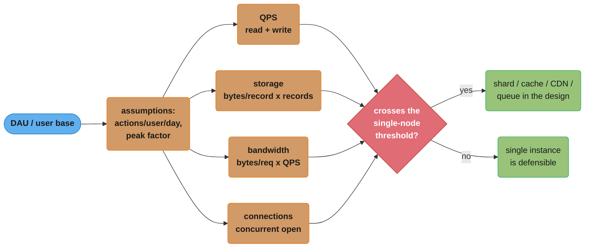
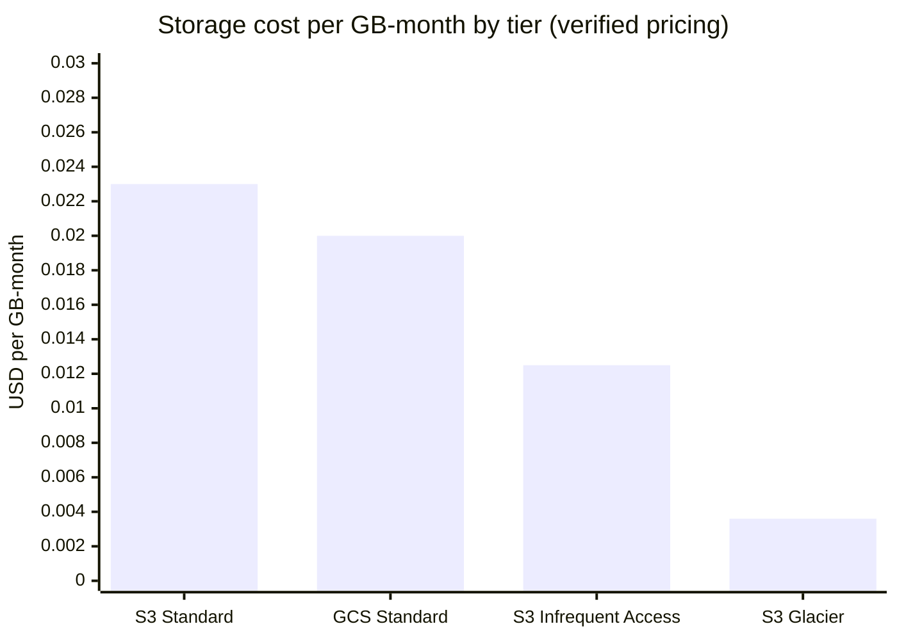
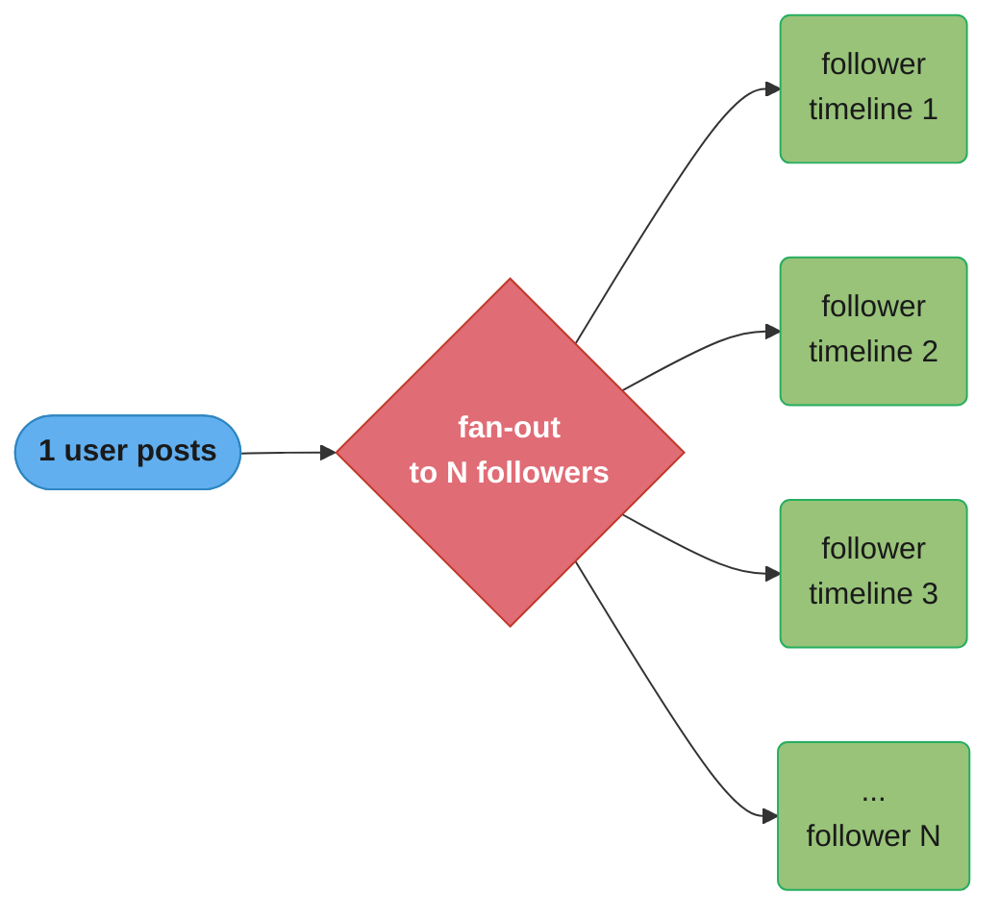
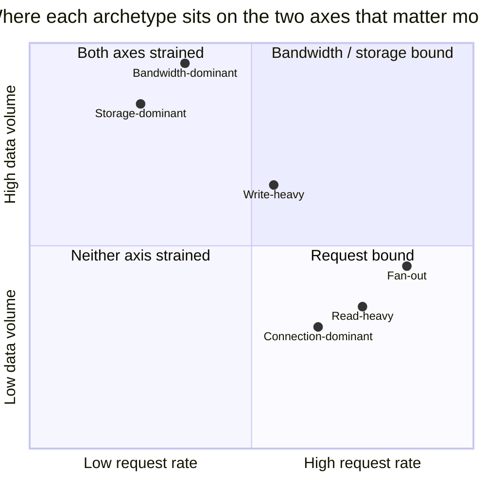
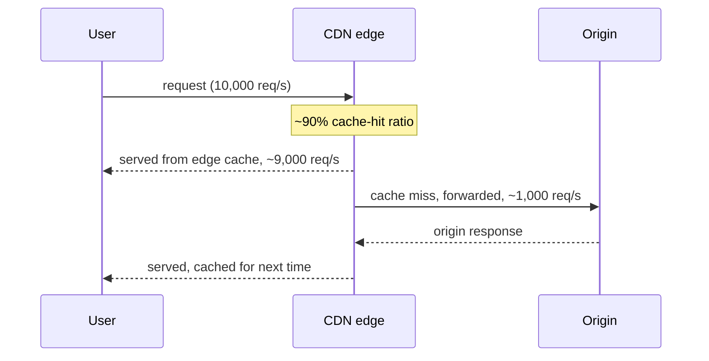

# Capacity Estimation and Back-of-the-Envelope Math

How to turn "design a URL shortener" into "12K writes/sec, 4TB/year, 30 app servers" before you draw a single box.

---

## 1. Concept Overview

**Capacity estimation** is the practice of deriving the numbers a system must handle — requests per second, bytes stored, bytes moved, connections held open — from a small set of stated or assumed inputs, using nothing but arithmetic. It is not a separate skill from system design; it is the *hidden arithmetic underneath every design decision*. "Should we shard the database?" is not answerable in the abstract — it's answerable once you know the write rate is 40K/sec and a single Postgres primary tops out around 5-10K/sec. "Do we need a CDN?" depends on whether egress is 2 GB/day or 200 TB/day. Every design question in this repository — [Scalability](../scalability/scalability.md), [Caching](../caching/caching.md), [Database Sharding](../database_sharding/database_sharding.md), [CDN](../cdn/cdn.md) — is secretly asking "at what number does the naive approach stop working?", and capacity estimation is how you find that number in the first five minutes of an interview instead of discovering it in production.

This module is a toolkit, not a case study. It teaches the four axes worth estimating (QPS, storage, bandwidth, connections), the mental shortcuts that make the arithmetic fast under interview pressure, the reference numbers you're expected to have memorized, and the pitfalls that turn a defensible estimate into a number that's wrong by two or three orders of magnitude. §14 applies all of it to one worked example, twice, at two different scales.

**This isn't only an interview skill.** The same arithmetic, run with production-grade rigor instead of interview-grade speed, is exactly what real infrastructure teams do under the name **capacity planning** — forecasting demand growth, setting headroom policy, and deciding when a purchase order needs to be filed months before a predicted threshold is crossed (Google's SRE Workbook devotes a full chapter to this discipline; see §11). The interview version compresses that same reasoning into minutes instead of a planning cycle and trades precision for speed (§8), but the underlying skill — deriving a defensible number from a small set of stated inputs, and using that number to justify a real decision — is identical in both settings.

The companion is [SDI Vol 1 — Back-of-the-Envelope Estimation](../../book/system_design_interview_vol_1/02_back_of_the_envelope_estimation/02_back_of_the_envelope_estimation.md), which walks the same discipline through Alex Xu's canonical worked examples; this module builds the underlying mental models and drills them with interview-style Q&As.

**Where this sits in an interview's timeline.** The standard system design interview shape (clarify requirements, estimate scale, sketch high-level architecture, deep-dive on components, discuss tradeoffs and failure modes) puts estimation second, immediately after requirements clarification and before a single box gets drawn — not because the numbers are the hardest part, but because every subsequent decision cites them. A candidate who skips this step and goes straight to architecture ends up justifying component choices with intuition ("Kafka feels right for this") instead of arithmetic ("at 40K writes/sec, a synchronous write path to a single primary is the wrong call") — and an interviewer who asks "why do you need that?" mid-design is really asking for the estimate that should have come earlier.

---

## 2. Intuition

> **One-line analogy**: Back-of-the-envelope math is a tape measure, not a blueprint — you're not designing the building, you're finding out whether it needs to be a shed or a skyscraper before you draw anything.

**Mental model — the one number you can anchor everything to**: Almost every estimation problem has exactly one input you're either given or can assume with confidence — usually **daily active users (DAU)** or **total user base**. Every other number in the problem — QPS, storage, bandwidth, connection count — is a chain of multiplications hanging off that one anchor. If you get DAU right and are disciplined about the multipliers, a wrong guess on any *one* multiplier only moves the final answer by that multiplier's own error, not by orders of magnitude. If you don't anchor to anything and instead guess QPS directly, there's nothing to sanity-check it against.

**Why it matters**: Interviewers use this phase to filter out candidates who jump straight to "we'll use Kafka and Cassandra" without ever establishing *why* — a design defended with real numbers ("at 40K writes/sec, a single Postgres primary is the wrong call; at 400 writes/sec, it's premature to shard") reads as engineering judgment. A design with no numbers at all reads as pattern-matching against blog posts. The numbers don't need to be *correct* — they need to be **defensible and self-consistent**, because the estimate's job is to pick the right order of magnitude, not the right integer.

**Key insight — estimation is a filter, not a forecast**: You are not trying to predict next year's traffic to the byte. You're trying to answer one binary question per subsystem: *does this number cross the threshold where the simple approach breaks?* 500 requests/sec fits on one well-tuned server; 500,000 requests/sec does not, no matter how well-tuned. The entire discipline exists to locate which side of that threshold you're on, fast, with numbers everyone in the room can verify on a whiteboard in under two minutes.

**The most common failure mode isn't a wrong number — it's silence.** Watch two candidates handle the same prompt: one says nothing about scale and starts drawing a load balancer, three app servers, and a database, regardless of whether the real answer is 500 users or 500 million. The other says "let's say 10 million DAU, that's roughly 5,000 average QPS, 15,000 peak" and *then* draws the same three boxes — but now every box on the diagram has a reason to be exactly that size. The architecture drawing can be identical in both cases; what differs is whether anyone in the room, including the candidate, can tell whether it's actually the right architecture for the stated problem.

**A second mental model — the multiplication chain as a physical pipe.** Picture each assumption as a segment of pipe with its own diameter (its own margin of error), joined end to end: DAU (wide, usually a confident number) feeds into actions/user/day (narrower, more assumption-driven) feeds into bytes/action (narrower still) feeds into a final storage or QPS figure. Water flowing through the whole pipe can only be as reliable as its *narrowest* segment — so the practical move is to identify which single link in the chain is the shakiest assumption and flag it explicitly ("the number I'm least sure of here is bytes/action — if that's off by 2x, the storage estimate is off by 2x too, but the QPS estimate is unaffected"), rather than presenting the final number as if every link were equally solid.

---

## 3. Core Principles

**1. Round aggressively, in the direction that keeps arithmetic clean.**
1 million ≈ 10⁶, 1 billion ≈ 10⁹. A day has ~86,400 seconds — round to **10⁵ seconds/day** (a ~15% overestimate you take on purpose, because it turns "divide by 86,400" into "divide by 10⁵," a mental no-op). A concrete before/after: "47,382 users x 8.7 actions" invites a slow, error-prone multiplication and a false sense of precision; "~50,000 users x ~9 actions" gets to the same order of magnitude in one mental step and is honest about what's actually known. Precision within 20-30% is the entire point of the exercise — see §8.

**2. Powers of two for bytes, powers of ten for counts — and never confuse them.**
1 KB = 2¹⁰ bytes = 1,024 bytes; 1 MB = 2²⁰ ≈ 1.05 × 10⁶ bytes; 1 GB = 2³⁰ ≈ 1.07 × 10⁹ bytes. For back-of-envelope purposes treat 1 KB ≈ 10³ bytes and 1 GB ≈ 10⁹ bytes — the ~7% drift is smaller than your other assumption errors. What you must never blur is **bits vs. bytes**: network and cloud-egress pricing is quoted in bytes (GB), but link speeds and some monitoring dashboards are quoted in bits (Gbps) — divide by 8 crossing that boundary or your bandwidth estimate is off by 8x (§10, §6.7 walks the conversion explicitly at every step of a real derivation).

**3. Four axes cover almost every estimation problem.**
**QPS** (requests/sec, read and write separately), **storage** (bytes/record × records, times retention), **bandwidth** (bytes/request × QPS, in and out separately), and **connections** (concurrent open connections, which drives server/load-balancer count via [Load Balancing](../load_balancing/load_balancing.md)). Almost every "design X" prompt reduces to deriving these four from DAU and per-user behavior. A useful habit: write all four as a short checklist at the top of the whiteboard before deriving any of them, so it's visible which ones are still unaddressed rather than discovering a forgotten axis mid-design.

**4. Little's Law connects concurrency, throughput, and latency — and it is exact, not a rule of thumb.**
**L = λ × W**: the average number of items in a system (**L**) equals the average arrival rate (**λ**) times the average time each item spends in the system (**W**). It holds for any stable queueing system regardless of arrival distribution or service-time distribution — that generality is why it's usable everywhere from thread-pool sizing to connection-pool sizing to "how many in-flight requests does this service carry." The canonical, non-technical version of the law: a coffee shop that serves 30 customers/hour (λ), where each customer spends an average of 10 minutes (W = 1/6 hour) in the shop from order to finish, has on average L = 30 x 1/6 = **5 customers in the shop at any instant** — no assumption about how evenly customers arrive or how consistent each order takes was needed for that to be exactly true. Used numerically in a systems context in §6.4.

**5. State every assumption out loud, then move on.**
"I'll assume 20% of DAU are active at peak, and reads outnumber writes 100:1" is a complete, defensible assumption — say it, write the number down, and don't relitigate it. An interview stalls not from wrong assumptions but from unstated ones, because nobody — including the candidate three steps later — can tell whether a downstream number is still consistent with an upstream guess.

**6. Peak, not average, sizes the system.**
A system provisioned for average load falls over at the first traffic spike. Average QPS tells you the *bill*; peak QPS tells you the *server count*. The two are related by a **peak factor** (§6.1) and conflating them is the single most common estimation error (§10).

**7. Compute bytes and requests as separate line items, even when one prompt asks for both.**
Storage and bandwidth are easy to conflate because they share the same "bytes per record" input, but they answer different questions and carry different multipliers — storage gets a replication factor and a retention window (§6.2); bandwidth gets a peak factor and, on the read side, a cache-hit ratio (§6.3, §12 Q18). Compute them on separate lines so a reviewer (or your own next step) can check each one against its own reference number instead of one blended figure that hides which axis is actually the risk.

**8. A number is only as trustworthy as the assumption chain underneath it — so keep the chain short.**
Every multiplication you add is another place a rounding error or a bad guess compounds. Three chained assumptions (DAU → actions/day → bytes/action) is normal and fine; six chained assumptions, each individually "close enough," can compound into a final number that's off by an order of magnitude even though no single step looks wrong. When a chain gets long, look for a shortcut that skips a step — a directly-recalled reference number (§5.2, §7) is more trustworthy than three multiplications stacked on top of a guess.

---

## 4. Types / Architectures / Strategies

Estimation problems cluster into a small number of recurring *archetypes*, each with its own dominant axis and its own worked shortcut.

| Archetype | Dominant axis | Example prompts | Shortcut |
|---|---|---|---|
| **Read-heavy** | QPS (read), then caching capacity | News feed, URL shortener redirect, product page | Read:write ratio often 100:1 to 1000:1 — most of the design *is* the cache/CDN layer, see [Caching](../caching/caching.md) |
| **Write-heavy** | QPS (write), storage growth rate | Metrics ingestion, IoT telemetry, ad click logging | Storage/year dominates; batching and columnar compression matter more than per-request latency |
| **Fan-out** | Connections + write amplification | Twitter timeline (push model), chat group broadcast, pub/sub | One write becomes N writes/pushes — N is usually the follower/group-member count, and it's the multiplier that breaks naive designs (see [Message Queues](../message_queues/message_queues.md)) |
| **Storage-dominant** | Bytes/object × object count × retention | Photo/video hosting, log/audit retention, backups | QPS is almost incidental; the number that matters is TB or PB, and it drives storage-tier and replication-factor decisions |
| **Bandwidth-dominant** | Bytes moved, not requests | Video streaming, large file transfer, live sports | Egress cost (§5, §6.3) and CDN placement dominate over server CPU |
| **Connection-dominant** | Concurrent open connections | Chat presence, long-poll/WebSocket notification fan-out | Server count is bounded by file-descriptor and memory limits per connection, not by CPU — see [Load Balancing](../load_balancing/load_balancing.md) |

Most real prompts are a blend — a chat system is fan-out *and* connection-dominant; a video platform is bandwidth-dominant *and* storage-dominant — so the first move is naming which axis is the bottleneck axis for *this* prompt, because that's the one you compute carefully and the others you can round harder on.

**One-line derivation per archetype**, to make the table concrete rather than abstract:

- *Read-heavy* (news feed, 20M DAU, 50 views/day): 20M x 50 / 10^5 s = **10,000 avg read QPS** — the number that decides whether a cache layer is optional or load-bearing.
- *Write-heavy* (metrics ingestion, 500K devices, 1 metric/sec each): 500,000 writes/sec **sustained**, not bursty — the number that rules out a naive per-write-transaction relational insert path in favor of batched/buffered writes.
- *Fan-out* (group chat, worked fully in §6.6): 1,000 writes/sec becomes 50,000 avg deliveries/sec at a 50-member average group size — the multiplier, not the write rate, sizes the delivery path.
- *Storage-dominant* (video archive, 10K hours uploaded/day at ~1 GB/hour compressed): 10,000 GB/day = **10 TB/day**, ~3.65 PB/year raw — QPS on this workload is almost irrelevant to the design.
- *Bandwidth-dominant* (worked fully in §6.7): 2M viewers x 5 Mbps = **10 Tbps** — an axis measured in bits/sec, not requests/sec, and priced accordingly (§6.3).
- *Connection-dominant* (worked fully in §6.4): 2M concurrent WebSocket connections — bounded by file descriptors and RAM (§5.5) long before it's bounded by CPU.

**Why the archetype matters more than the industry.** Two products in wildly different industries can share an archetype and therefore share a shortcut: a stock-ticker push feed and a sports-score live-update feed are both fan-out, and both get the same first question ("how many subscribers does one update reach, and does that number vary by three orders of magnitude between a quiet stock and a Super Bowl-adjacent one?"). Conversely, two products in the *same* industry can be different archetypes — a photo-hosting app is storage- and bandwidth-dominant, while a photo-tagging *search* feature bolted onto the same app is read-heavy and QPS-dominant, because the search index, not the photo bytes, is what a query touches. Name the archetype from the *access pattern*, not the product category.

---

## 5. Architecture Diagrams

### 5.1 The Estimation Pipeline



*Everything downstream of DAU is a multiplication chain; the only judgment call is where the "crosses the threshold" decision lands, and that's exactly the question the rest of the interview answers.*

### 5.2 Latency Ladder (the numbers to have memorized)

```
Operation                                  Time          Relative (L1 = 1)
--------------------------------------------------------------------------
L1 cache reference                         1 ns          1
Branch mispredict                          3 ns          3
L2 cache reference                         4 ns          4
Mutex lock/unlock                          17 ns         17
Main memory (RAM) reference                100 ns        100
Compress 1 KB with a fast compressor       2,000 ns      2,000
Send 1 KB over 1 Gbps network              10,000 ns     10,000
SSD random read (4 KB)                     16,000 ns     16,000        (~150 us on older SATA SSDs)
Read 1 MB sequentially from RAM            3,000 ns      3,000
Read 1 MB sequentially from SSD            49,000 ns     49,000
Round trip within same datacenter          500,000 ns    500,000
Read 1 MB sequentially from spinning disk  825,000 ns    825,000
Disk seek (spinning disk)                  4,000,000 ns  4,000,000
Send packet CA -> Netherlands -> CA        150,000,000 ns 150,000,000
```

*Canonical reference values, "Latency Numbers Every Programmer Should Know" (source in §11). The point isn't the exact nanosecond — hardware moves — it's the RATIO: memory is ~25x an L2 hit, an SSD read is ~100x memory, and a cross-region round trip is ~300x a same-datacenter one. Those ratios are what should drive "can this be a cache hit" and "should this call be same-region."*

### 5.3 Cloud Cost Comparison (verified pricing, §11 sources)



*S3 Standard ($0.023) and GCS Standard ($0.020) are within 15% of each other for hot storage; moving cold data to S3 Glacier Flexible Retrieval cuts storage cost ~6.4x versus S3 Standard — the lever worth pulling once retention (§6.2) is measured in years, not days.*

### 5.4 Fan-Out: One Write Becomes N Pushes



*A single write costs O(1); the fan-out it triggers costs O(N) where N is follower/group-member count — that N, not the original write rate, is what determines whether a push-model design survives a celebrity account or a large group chat (§12 Q19 covers the mixed push/pull answer).*

### 5.5 The Connection-Count Ceiling (per server)

```
resource              typical per-server ceiling            what it bounds
--------------------------------------------------------------------------
file descriptors       ~65,536 default, ~1M tuned            max IDLE conns held open
RAM per idle conn      ~10-50 KB (TCP buffers + app state)   idle conns x RAM = total
RAM per active conn    ~100 KB-1 MB (buffers + in-flight)     active conns x RAM
CPU per active conn    workload-dependent, NOT fixed          active conns only
```

*Idle connections (a chat client waiting for a push) are cheap and bounded mainly by RAM and file descriptors; active connections (mid-request) are the ones that also cost CPU. §6.4's Little's Law step computes the ACTIVE count — that's the number that determines server count, not the much larger idle count sitting in the file-descriptor budget above it.*

### 5.6 Archetype Positioning: Request Intensity vs. Data-Volume Intensity



*Fan-out sits furthest right (its effective request rate, after the fan-out multiplier, is the highest of any archetype) while bandwidth-dominant sits highest (its data volume dwarfs the others even though its request COUNT is comparatively modest) — the two axes of this chart are exactly the "which axis do I compute carefully" call from §4, made visual.*

### 5.7 A Cache-Hit Ratio Turns Origin Traffic Into a Small Fraction



*The number that changes the origin's provisioning isn't the 10,000 req/s users generate — it's the ~1,000 req/s (10% miss rate) that actually reaches the origin, a 10x reduction purely from the cache-hit ratio assumed in §6.3 and §14. Getting the hit-ratio assumption wrong (assuming 90% when the real traffic pattern only clears 60%) changes the origin's required capacity by roughly 4x — which is exactly why §10 pitfall 9 warns against reusing a memorized ratio without checking it against the actual access pattern.*

### 5.8 Where the Peak Factor Comes From

```
Hourly share of a day's total traffic, single-region consumer app (illustrative)

Hour(local) 00 02 04 06 08 10 12 14 16 18 20 22
Share(%)     1  1  1  2  4  5  6  6  7  9 10  8
             .                          ^^ ^^ ^^
             quiet overnight            evening peak window (18-22h)

Flat/uniform share would be 100/24 = ~4.2% every hour.
Peak hour (20:00) carries ~10% of the day's traffic in ~1/24 of the day
  -> peak-hour rate is ~10 / 4.17 = ~2.4x the UNIFORM-model average
Interview convention rounds this to "~3x" to cover:
  - the peak HOUR being denser than its own 60-minute average (sub-hour bursts)
  - weekday/weekend and regional-timezone skew stacking on top of the daily curve
```

*The 3x used throughout this module (§6.1, §14) isn't an arbitrary interview trick — it's a rounded-up stand-in for "how much denser is the busiest hour than a flat 24-hour average," and a real traffic curve (pulled from monitoring, per [Observability](../observability/observability.md)) replaces this illustrative shape with the product's actual one the moment real data exists.*

---

## 6. How It Works — Detailed Mechanics

### 6.1 DAU -> Peak QPS

Say a service has **50 million DAU**, and the average user makes **10 requests/day**.

```
Total requests/day = 50,000,000 x 10 = 5 x 10^8 requests/day
Average QPS         = 5x10^8 / 10^5 s/day  = 5,000 req/s
```

Average QPS is not what you provision for. Traffic isn't uniform across 24 hours — it clusters around waking hours and regional peaks. The standard move is a **peak factor of ~3x** the daily average (a widely used interview convention, grounded in the observation that a day's traffic typically compresses into a ~6-8 hour "peak window" rather than spreading evenly across 24):

```
Peak QPS = 5,000 x 3 = 15,000 req/s
```

Provision for peak QPS, not average — a fleet sized at 5,000 req/s falls over the first time real traffic arrives, which is every day at lunchtime.

### 6.2 Bytes/Row -> Storage per Year

Say each record (a tweet, a log line, a metadata row) averages **300 bytes**, and the write rate from §6.1's average QPS is **500 writes/sec**.

```
Writes/day    = 500 x 10^5 s/day = 5 x 10^7 writes/day
Bytes/day     = 5x10^7 x 300 bytes = 1.5 x 10^10 bytes/day = 15 GB/day
Bytes/year    = 15 GB x 365 = 5,475 GB ~ 5.5 TB/year (raw, single copy)
With 3x replication = 5.5 TB x 3 = ~16.5 TB/year of physical disk
```

**Never quote a storage number without a retention window.** "5.5 TB/year" and "5.5 TB, keep forever" and "5.5 TB, purge after 90 days (~1.35 TB resident)" are three different provisioning decisions from the same per-record math — see the §10 pitfall.

### 6.3 Egress -> $/Month

Using GCS Standard at $0.020/GB-month for storage and AWS's published $0.09/GB for the first 10 TB/month of internet egress (§11 sources): a service serving **200 GB/day** of egress (thumbnails, API responses, downloads) pays:

```
Egress/month = 200 GB x 30 = 6,000 GB = 6 TB/month
Egress cost  = 6,000 GB x $0.09/GB = $540/month
```

At 6 TB/month this is comfortably inside the first pricing tier. Cross the ~10 TB/month tier boundary and the marginal rate drops to $0.085/GB — small at this scale, but the same tiered-pricing shape is exactly why a CDN (which serves the bulk of bytes from edge cache, off the origin's egress meter entirely) becomes the cost-dominant design decision once egress reaches the hundreds of TB/month range. See [CDN](../cdn/cdn.md).

### 6.4 Connection Count -> Server Count, via Little's Law

A chat/presence service holds **2 million concurrent WebSocket connections** open (**L**), and the average connection sends a message roughly every **30 seconds**, with each message taking **~5 ms** to process server-side.

Rearranging Little's Law (**L = λW**) to solve for arrival rate:

```
lambda (message arrival rate) = L / W_between_messages
  -- NOT the same W as processing time; this is a separate application
     of the law to the "messages per connection" sub-system:

lambda = 2,000,000 connections / 30 s = 66,667 messages/sec system-wide
```

Now apply Little's Law again to the *processing* sub-system, where **W = 5 ms = 0.005 s** is the average time a message spends being handled:

```
L_in_flight (avg. messages being processed at any instant) = lambda x W
                                                             = 66,667 x 0.005
                                                             = ~333 messages in flight at once
```

If a single server can hold 200 in-flight requests before its handler pool saturates, this workload alone needs **ceil(333 / 200) = 2 servers** just to keep pace with in-flight processing — separate from the connection-count-per-server limit (file descriptors, ~64K-1M per box depending on tuning) that bounds how many of the 2M *idle* connections each server can hold open. Both constraints must be checked; the smaller server count wins the "not enough" argument.

### 6.5 Full Chain: 10M-DAU Photo App, One Pass

```
DAU                    = 10,000,000
Uploads/user/day       = 0.5  (1 photo every 2 days)
Photo size (post-compress) = 2 MB (original) + 3 thumbnails x 100 KB = ~2.3 MB/upload
Reads/user/day         = 20 (scrolling, viewing)
Read:write ratio       = 40:1

Upload QPS (avg)  = (10,000,000 x 0.5) / 10^5 s = 50 req/s
Read QPS (avg)    = (10,000,000 x 20)  / 10^5 s = 2,000 req/s
Peak (x3)         = Upload 150 req/s, Read 6,000 req/s

Storage/day       = 10,000,000 x 0.5 x 2.3 MB = 11.5 x 10^6 MB = 11.5 TB/day
Storage/year       = 11.5 TB x 365 = ~4.2 PB/year (before replication)
With 3x replication = ~12.6 PB/year of physical disk

Egress/day (reads) = 10,000,000 x 20 x 0.2 MB (thumbnail-weighted, ~200KB avg served) = ~40 TB/day
Egress/month        = ~1.2 PB/month -> firmly CDN territory (see 6.3's tier logic)
```

This is the shape every worked capacity problem takes: a handful of assumed per-user numbers, four short multiplication chains, and a small number of "this crosses a threshold" conclusions that then justify the architecture (§14 does this end to end with the "wrap up" tradeoffs the interview actually wants).

### 6.6 Fan-Out: Sizing a Group-Chat Broadcast

A messaging platform has **5 million daily active groups**, averaging **50 members** per group, and each group sends **20 messages/day**.

```
Messages sent/day (writes)   = 5,000,000 x 20 = 10^8 writes/day
Write QPS (avg)              = 10^8 / 10^5 s = 1,000 writes/sec

Fan-out multiplier           = 50 (members per group, each gets a copy/notification)
Fan-out deliveries/day       = 10^8 x 50 = 5 x 10^9 deliveries/day
Delivery QPS (avg)           = 5x10^9 / 10^5 s = 50,000 deliveries/sec
Delivery QPS (peak, x3)      = 150,000 deliveries/sec
```

The write QPS (1,000/sec) looks entirely unremarkable on its own — a single well-tuned service could handle it. The number that actually drives the architecture is the **fan-out delivery QPS**, which is 50x larger purely from the group-size multiplier, and peaks at 150,000/sec. That gap is why chat/social fan-out systems push work onto an async queue (see [Message Queues](../message_queues/message_queues.md)) rather than writing all 50 deliveries synchronously inside the original request — the *write* can stay fast and cheap while the *fan-out* happens off the critical path. This is precisely the "one write becomes N pushes" pattern from §5.4, with N = 50 here instead of a follower count.

### 6.7 Bandwidth-Dominant: Sizing Live Video Egress

A live-streaming platform has **2 million concurrent viewers** on a single high-profile stream, each pulling a **1080p** stream at an average encoded bitrate of **5 Mbps** (a typical adaptive-bitrate mid-tier for 1080p30, per common encoder presets).

```
Per-viewer bandwidth        = 5 Mbps = 5 / 8 MB/s = 0.625 MB/s

Total egress (instantaneous) = 2,000,000 viewers x 5 Mbps = 10,000,000 Mbps = 10 Tbps
Total egress (bytes/sec)     = 10,000,000 Mbps / 8 = 1,250,000 MB/s = ~1.25 TB/s
Total egress over 1-hour stream = 1.25 TB/s x 3,600 s = ~4.5 PB for that single hour
```

**10 Tbps sustained for one event is squarely in CDN/edge-network territory** — no single origin datacenter's uplink is provisioned for that (compare against Cloudflare's ~500+ Tbps *global* provisioned capacity in §7 — one event at 10 Tbps would be ~2% of Cloudflare's entire network footprint). This is exactly why live video at this scale is served from a purpose-built CDN with regional edge caches and adaptive bitrate (lower-bitrate renditions automatically served to viewers on constrained links, which also *reduces* the average per-viewer number used above) rather than from application servers — see [CDN](../cdn/cdn.md). Note the bits-to-bytes conversion (§3, Principle 2; §10 pitfall 4) done explicitly at every step — skipping it here would understate the byte-egress figure, and therefore the bill, by 8x.

### 6.8 The Whole Pipeline, Smallest Case: A URL Shortener

The opening line of this module promises turning "design a URL shortener" into concrete numbers — here's the full derivation, chosen deliberately because it's small enough to run in under two minutes end to end and touches all four axes.

**Assumptions:** 100 million new short URLs created per month; a 100:1 read (redirect):write (create) ratio, typical for link-shortening products where a link is created once and clicked many times; each stored record (short code, long URL, metadata) averages 500 bytes; retention is indefinite (a shortener that expires links breaks every link ever shared).

```
Write QPS:
  Writes/month = 100,000,000
  Writes/day   = 100,000,000 / 30 = ~3,333,333
  Writes/sec (avg) = 3,333,333 / 10^5 s = ~33 writes/sec
  Writes/sec (peak, x3) = ~100 writes/sec

Read QPS:
  Reads/sec (avg) = 33 x 100 = 3,300 reads/sec
  Reads/sec (peak, x3) = ~10,000 reads/sec

Storage:
  New records/year = 100,000,000 x 12 = 1.2 x 10^9 records/year
  Bytes/year = 1.2x10^9 x 500 bytes = 6 x 10^11 bytes = 600 GB/year (raw)
  With 3x replication = ~1.8 TB/year of physical disk
  Over 5 years of accumulation (nothing ever expires) = ~9 TB physical disk

Bandwidth:
  A redirect response is tiny (a 301/302 with a Location header, ~200-300 bytes) —
  at 10,000 peak reads/sec x 300 bytes = 3 MB/sec = ~24 Mbps peak egress,
  trivial next to the video example in 6.7
```

**What these numbers decide, in one pass:** 100 write QPS and 10,000 read QPS are both comfortably within a single well-tuned key-value store's range (this is the read-heavy archetype from §4, so the entire design effort goes into the read path) — a cache in front of a datastore mapping short code to long URL, per [Caching](../caching/caching.md), turns nearly all of that 10,000 reads/sec into cache hits, leaving the origin store to handle a small fraction plus the 100 writes/sec. Storage is the least interesting axis here: even five years of accumulated links, with zero deletion, is under 10 TB — nowhere near the threshold (§5.1) where sharding or object storage becomes necessary. This is the case where the estimate's real value is *negative* — it tells you, correctly, that most of the "distributed systems" machinery a candidate might reach for by pattern-matching (sharding, multi-region writes, a message queue) isn't justified by the numbers, and reaching for it anyway is the over-engineering failure mode, not the under-engineering one.

### 6.9 The Opposite Case: Write-Heavy IoT Telemetry Ingestion

Where §6.8 was small enough to skip most of the machinery, this one is the write-heavy archetype (§4) at a scale where the machinery is mandatory from day one — worth walking through so the contrast is concrete rather than asserted.

**Assumptions:** 2 million connected devices; each device reports one telemetry reading every 10 seconds; a reading is a compact ~80-byte binary record (device ID, timestamp, 3-4 sensor values); readings are retained hot for 30 days for alerting/dashboards, then rolled up and archived.

```
Write QPS (sustained, NOT bursty — this is a near-constant rate, not a daily-curve peak):
  Readings/sec = 2,000,000 devices / 10 s = 200,000 writes/sec, continuously

Storage:
  Bytes/day = 200,000 writes/sec x 86,400 s/day x 80 bytes = ~1.38 x 10^12 bytes/day
            = ~1.38 TB/day (raw)
  Hot retention (30 days) = ~41.4 TB resident, x 3 replication = ~124 TB physical disk
  Annual archive volume (post-rollup, assume 10x compression from downsampling) =
    (1.38 TB/day x 365) / 10 = ~50 TB/year archived
```

**What's different about this archetype's shape, compared to §6.1's DAU-driven QPS:** there is no meaningful "peak factor" multiplier here in the §6.1 sense — 200,000 writes/sec is not a daily average waiting to be multiplied by 3x for an evening peak, it's close to the *sustained floor*, because IoT devices report on a fixed interval regardless of time of day. The peak-factor conversation for this workload is about device *fleet growth* and *retry storms after a network partition* (every device that missed its window catches up simultaneously once connectivity returns) rather than daily human-activity curves — a fundamentally different kind of spike than §5.8's evening-peak shape, and one that argues for backpressure and buffering ([Message Queues](../message_queues/message_queues.md)) at the ingestion tier rather than simple fixed overprovisioning. At 200,000 sustained writes/sec, a single relational primary is off the table well before any interview discussion starts — this is exactly the write-heavy pattern (§4) where the design conversation is about a write-optimized, horizontally-scalable ingestion path (time-series-oriented storage, batched/buffered writes, partitioning by device ID or time bucket) from the first sentence, not something to grow into later.

### 6.10 Two Axes at Once: Sizing a Video-Conferencing Service

Some workloads genuinely need two axes computed together, because neither one alone determines the answer — video conferencing is the clean example: it's connection-dominant (a call is a long-lived session) AND bandwidth-dominant (each session moves real-time audio/video) at once.

**Assumptions:** 500,000 concurrent active calls platform-wide at peak; average call size 4 participants; each participant's stream (send + receive combined) averages 3 Mbps.

```
Concurrent connections (participants, not calls):
  500,000 calls x 4 participants = 2,000,000 concurrent active connections

Bandwidth:
  2,000,000 participants x 3 Mbps = 6,000,000 Mbps = 6 Tbps aggregate

Per-server budget (illustrative): if one media-relay server can handle 500 concurrent
participant-streams before CPU/NIC saturation (video transcoding/relay is CPU- and
bandwidth-heavy, unlike a simple request handler):
  Servers needed = 2,000,000 / 500 = 4,000 media-relay servers at peak
```

**What's notable here**: the 2 million connection count alone (§5.5's file-descriptor ceiling) would suggest a fairly ordinary connection-handling problem, solvable with a few hundred lightweight servers the way §6.4's chat example was. It's the *combination* with 6 Tbps of real-time, latency-sensitive media traffic and CPU-heavy per-stream processing that pushes the server count into the thousands — a reminder that the four axes (§3, Principle 3) aren't always independent, and a workload that's extreme on two axes simultaneously can need an order of magnitude more capacity than either axis alone would predict. This is also why real video-conferencing platforms use geographically-distributed media relay clusters and selective forwarding (only relaying the streams a participant is actually rendering) rather than a single central cluster — both are direct responses to this combined bandwidth-and-connection pressure.

### 6.11 Cross-Checking an Estimate a Second Way

A single derivation chain can hide an error that a second, independent path through the same numbers would catch — the fastest sanity check available under interview time pressure, and worth doing on whichever number the design hinges on most.

Take §6.9's 200,000 writes/sec. **Path A** (already shown): devices / report-interval = 2,000,000 / 10s = 200,000/sec. **Path B**, computed independently from a different starting fact — total daily reading volume, if that number happens to be known or quoted elsewhere in the prompt: if the platform is stated to ingest "17.28 billion readings/day," then 17,280,000,000 / 86,400 s = 200,000/sec, matching Path A. Agreement between two independently-derived paths is strong evidence neither has an arithmetic slip; a mismatch is exactly the signal to re-walk both chains before trusting either one. This costs perhaps thirty extra seconds when a second anchor fact is available, and it's the single cheapest form of the "precise, slow estimate" (§8) worth doing even inside a fast interview-paced pass.

---

## 7. Real-World Examples

- **Discord — message storage.** Discord's engineering blog "How Discord Stores Billions of Messages" documented the platform crossing **120 million messages/day** on the Cassandra-backed message store that motivated their now widely-cited storage architecture. The number mattered because it was the *trigger*, not a retrospective statistic — it was the point at which their prior storage choice stopped being defensible and a redesign became the engineering priority, which is exactly the role a capacity estimate is supposed to play inside a real organization, not just an interview (Discord Engineering Blog, discord.com/category/engineering).
- **Cloudflare — request throughput vs. database footprint.** Cloudflare has published that its edge handles roughly **55 million HTTP requests/second** while backing that traffic with a comparatively tiny **15 PostgreSQL clusters**. The gap between those two numbers — enormous edge QPS, tiny origin database footprint — is a concrete, published illustration of the §4 pattern where a cache/edge layer absorbs almost all of the QPS axis, leaving the origin's connection-count axis nearly two orders of magnitude smaller than the edge-facing number would naively suggest (Cloudflare Blog, "500 Tbps of capacity" post family, blog.cloudflare.com).
- **Cloudflare — network capacity.** Cloudflare's global network crossed **500+ Tbps** of provisioned external interconnection capacity (transit + peering + CNI ports summed across 330+ cities) as of their 2026 capacity-milestone post. That figure is a useful upper-bound sanity check: any single-tenant bandwidth estimate (§6.7) that comes out anywhere near a meaningful fraction of it should immediately be treated as a red flag worth re-deriving, the same reflex as §12 Q5's single-server QPS check but for the bandwidth axis (Cloudflare Blog, blog.cloudflare.com/500-tbps-of-capacity).
- **Netflix — Open Connect appliance throughput.** Netflix's own Open Connect documentation states its current-generation flash appliances sustain **100+ Gbps** of egress each, and Netflix has reported sustaining **over 18 Tbps** of aggregate Open Connect egress during 2026 Super Bowl peak traffic without a rebuffer-rate spike visible on public quality-of-experience dashboards. That's a real, published peak-factor event rather than an average — exactly the average-vs-peak distinction §6.1 and §10's first pitfall insist on, made concrete at internet scale (openconnect.netflix.com/en/appliances).
- **X (formerly Twitter) — write QPS.** X's publicly estimated posting volume runs at roughly **500 million posts/day**, i.e. on the order of **350,000 posts/minute** at typical load. That's a useful anchor for sanity-checking a candidate's own DAU-derived write QPS in a mock interview — if a proposed design for "a Twitter-scale service" derives a write QPS three orders of magnitude away from this published range, that's the moment to re-walk the assumption chain rather than defend the number (aggregated public usage statistics, 2026).

- **AWS S3 — published durability, as a capacity-planning input rather than a QPS/storage number.** AWS states S3 Standard is designed for **99.999999999% (eleven nines) of durability** for objects over a given year — a figure that matters for capacity estimation not because it's a QPS or byte count, but because it's the number that lets a storage-dominant design (§14's photo app, §6.5) legitimately treat "the object store loses my data" as outside the estimate entirely, freeing the rest of the capacity plan to focus on availability and cost rather than durability engineering of its own (aws.amazon.com/s3, S3 Standard storage class page).

**The pattern across all five**: none of these companies publish a number "for interview practice" — each number is either a capacity-planning trigger (Discord), a cost/architecture justification (Cloudflare's database-footprint contrast), a headline capability metric (Cloudflare's Tbps, Netflix's per-appliance throughput), or a scale anchor reporters and analysts derive from usage data (X). Reading a vendor engineering blog with that lens — "what design decision did this number justify?" — is a better study habit than memorizing the figure in isolation.

---

## 8. Tradeoffs

| Dimension | Fast, rough estimate | Precise, slow estimate |
|---|---|---|
| Time cost | 2-5 minutes, whiteboard arithmetic | Hours — spreadsheet, real traffic logs, load test |
| Precision | Order of magnitude (correct within ~2-3x) | Within single-digit percent |
| Interview fit | Exactly what's expected in the first 5-10 minutes | Wrong signal — reads as stalling, not rigor |
| Production fit | Wrong signal for a capacity-planning ticket that gates a purchase order | Exactly what's expected before committing real spend |
| Failure mode | A confidently-stated number that's off by 10x with no sanity check | Analysis paralysis; the "precise" number is often precisely wrong because an input assumption was never validated either |
| When it's used | System design interviews, initial architecture sketches, "should we even worry about this" triage | Vendor contract negotiation, SRE capacity headroom planning, cost-optimization projects |
| Inputs required | A handful of stated or reasonably-assumed figures (DAU, per-user actions, average payload size) | Historical telemetry, real traffic distributions, negotiated pricing tiers, growth forecasts |
| Typical output | A single order-of-magnitude number per axis, stated with its assumptions | A range with confidence bounds, often broken out by percentile (p50/p95/p99) rather than a single average |

**What a wrong estimate actually costs**, by the kind of decision it feeds:

| Decision fed by the number | Cost of a 2-3x underestimate | Cost of a 2-3x overestimate |
|---|---|---|
| "Do we need a cache?" (§9) | Origin database saturates under real load; likely a production incident | A cache layer built for traffic that never arrives; wasted engineering time, modest ongoing infra cost |
| Server fleet size (§6.1, §12) | Fleet falls over at real peak; user-facing outage during the exact moment traffic matters most | Over-provisioned compute spend every month until someone right-sizes it |
| Storage tier / replication plan (§6.2, §10) | Disk fills faster than monitoring alerts fire; an emergency scaling event | Paying for capacity months before it's needed; correctable at the next planning cycle |
| Vendor cost quote in a real negotiation (§9, §12) | Under-budgeting a real contract; a mid-year budget crisis | Overpaying for committed capacity; a wasted negotiation lever |

The pattern across every row: **underestimating tends to fail loud and late** (an outage, an emergency), while **overestimating tends to fail quiet and early** (a bigger bill, correctable at the next review) — which is why, when genuinely unsure which way to round, the conservative direction is usually to round *up* on capacity-sizing numbers and round *down* (i.e., be skeptical) on cost-savings claims.

The two are not competing methods — they're sequential. The fast estimate decides *whether* a subsystem needs the slow, precise treatment at all; running the slow method on every axis of every design, including the ones that are obviously fine at the given scale, is its own form of waste.

**A third axis worth naming explicitly: who the number is for.** A number produced for an interviewer needs to be defensible and self-consistent in real time — it does not need to survive an audit. A number produced for a vendor negotiation or an SRE capacity-headroom review needs to survive exactly that kind of scrutiny, because real money and real on-call pages are downstream of it. Conflating the two — treating an interview-grade estimate as if it were production-grade, or spending production-grade rigor inside a 45-minute interview — is a category error in both directions, and recognizing which mode you're in at the start of the exercise is itself part of the skill.

**A worked example of where the line actually falls.** Take §6.1's 15,000 peak QPS. If the true figure turns out to be 12,000 or 18,000 (a 20-25% swing), the design conclusion — "this needs more than one application server, and probably a load balancer in front of a small fleet" — doesn't change at all; the fast estimate was precise enough, full stop. Now take the same 20-25% swing applied to a $290,000/month storage bill (§14, Pass 1): that's a $60-70K/month difference, which is real money in a budget conversation and absolutely worth the slower, precise pass — pulling actual current per-GB pricing for every storage tier in play, modeling the exact lifecycle-transition schedule, and checking it against a committed-use discount — before anyone signs off on it. Same underlying skill, two very different precision bars, and the bar is set by what's downstream of the number, not by how the number was produced.

---

## 9. When to Use / When NOT to Use

**Estimate-first vs. design-first.** These aren't two equally valid orderings — estimate-first is the default, and design-first is the exception that needs its own justification. Designing first and estimating later inverts the entire point of the exercise: the estimate is what tells you *which* design decisions are load-bearing, so producing a design before the numbers exist means either re-deriving the numbers afterward to check work that's already been committed to (wasted motion if it turns out wrong), or never checking at all (the far more common failure — a design drawn from intuition or memorized patterns, presented with confidence, that nobody ever confirms against the actual scale of the stated problem). The only time design-first is legitimate is when the scale is already so obviously small or so obviously enormous that no plausible estimate would change the answer — and even then, saying so out loud ("this is clearly small-scale, I won't spend time estimating it") is itself the estimation step, just a fast one.

**Use back-of-the-envelope estimation when:**
- Opening any system design interview, before any architecture diagram is drawn — it's the step that tells you which axis (§4) actually constrains the design.
- Deciding whether a subsystem needs to exist at all — e.g., "do we need a cache?" is answered by comparing estimated read QPS against a single database's realistic read throughput.
- Sanity-checking a design someone else proposed — a design that requires 500K QPS/server or 50 PB/day should be caught by a two-minute recheck, not discovered in a postmortem.
- Choosing between architectural approaches whose cost profiles differ by orders of magnitude (e.g., push vs. pull fan-out for a social feed — see [Message Queues](../message_queues/message_queues.md)).

**Skip or abbreviate it when:**
- The prompt is explicitly about a fixed, small, known scale (e.g., "design a rate limiter for a single service with 3 known clients") — the arithmetic wouldn't change any decision; naming the scale as small and moving directly to the token-bucket vs. sliding-window tradeoff (see [Rate Limiting](../rate_limiting/rate_limiting.md)) is the better use of the time.
- You're deep in a low-level component design (e.g., "how does the WAL fsync work") where the relevant numbers were already fixed one level up — re-deriving DAU-to-QPS math in the middle of a storage-engine discussion re-litigates a decision the interview already made.
- Real production data already exists — pull the actual DAU, actual p99 payload size, actual query mix from monitoring instead of re-deriving assumptions; measurement beats estimation whenever measurement is available (see [Observability](../observability/observability.md)), and presenting a guessed number when a measured one is sitting in a dashboard is a worse signal than skipping the guess entirely.
- The decision is reversible and cheap either way — if the difference between "provision 3 servers" and "provision 5 servers" is a rounding error in the monthly cloud bill, spending five minutes deriving a precise number is more expensive than just picking the safer of the two and moving on.

---

## 10. Common Pitfalls

Every pitfall below shares one root cause: a step in the multiplication chain (§2's "physical pipe" model) that got dropped, forgotten, or silently swapped for a different unit — none of these are failures of arithmetic so much as failures of bookkeeping, which is exactly why "carry units through every step" (§13) is the single highest-leverage habit for avoiding all nine of them at once.

**1. Average QPS instead of peak QPS.**
Sizing a fleet off the average (§6.1) instead of applying a peak factor under-provisions by the peak factor itself — commonly 3-10x, depending on how spiky the traffic actually is (a live-sports or flash-sale workload can spike 20x+ over its own daily average, well past the generic 3x rule of thumb).

*Broken:* "DAU is 50M, average QPS is 5,000, so I'll provision for 5,000 req/s plus 20% headroom = 6,000 req/s."
*Fix:* "Average QPS is 5,000; applying a 3x peak factor for the daily traffic curve gives 15,000 req/s — that's the number the fleet is sized against, with headroom added on top of *that*."

**2. Forgetting the replication factor on storage.**
A raw-bytes calculation (§6.2's 5.5 TB/year) is not what gets provisioned — 3x replication (the [Database Sharding](../database_sharding/database_sharding.md) default for durability) turns 5.5 TB into 16.5 TB of physical disk, and skipping that multiplier is routinely a 3x underestimate on every storage-dominant design.

**3. Forgetting index and metadata overhead.**
A row's payload size is not the row's storage footprint. B-tree secondary indexes commonly add 20-50% on top of raw row size depending on how many columns are indexed, and per-row/per-object metadata (timestamps, foreign keys, soft-delete flags, replication headers) is easy to leave out of a napkin-math "bytes per record" figure — budget 20-30% overhead on top of the payload-only number unless the schema is already known.

**4. Confusing bits and bytes.**
A "1 Gbps link" is 1 gigabit/sec = 125 MB/sec, not 1 GB/sec — an 8x error that silently creeps in whenever a network spec (quoted in bits) gets compared directly against a storage or throughput figure (quoted in bytes). Convert everything to one unit family before comparing (§3, Principle 2).

**5. Quoting storage without a retention window.**
"We generate 15 GB/day" says nothing about provisioning until paired with "and we keep it for 90 days" (1.35 TB resident) or "forever" (growing unboundedly, and needing a tiering/archival plan by year two) — see §6.2.

**6. Treating the estimate as the design.**
An estimate answers "roughly how big" — it does not, by itself, answer "sharded how" or "cached where." Producing a precise-looking number and stopping there (without using it to decide an actual architecture choice) wastes the exercise; the number only earns its keep once it changes a decision (§9).

**7. Confusing bandwidth with request count.**
A 10 Tbps live-video estimate (§6.7) and a 150,000/sec fan-out delivery estimate (§6.6) look similar in scale but answer completely different provisioning questions — bandwidth sizes network links and CDN egress budget, request count sizes application servers and connection pools. Quoting one number where the design decision actually depends on the other produces a plausible-sounding answer to the wrong question.

*Broken:* "We need to handle 2 million concurrent viewers, so we'll provision 2 million requests/sec of application-server capacity."
*Fix:* "2 million concurrent viewers at 5 Mbps each is a 10 Tbps *bandwidth* problem, not an application-server QPS problem — the relevant server-side load is closer to periodic heartbeat/manifest requests per viewer, several orders of magnitude below 2 million/sec, while the bandwidth is what actually needs a CDN."

**8. Ignoring protocol and framing overhead on the wire.**
The "bytes/request" figure used for a bandwidth estimate should be the bytes actually on the wire, not just the application payload — HTTP headers, TLS record overhead, and framing (HTTP/2 or HTTP/3 stream/frame headers) commonly add tens to a few hundred bytes per request on top of a small JSON payload, which is negligible for a 10 MB video chunk but can double the effective size of a 100-byte heartbeat or notification payload. For very small, very high-frequency payloads (presence pings, telemetry beacons), re-check whether the payload or the overhead is actually the dominant cost before rounding it away.

**9. Treating a peak factor or ratio as a universal constant instead of a workload-specific input.**
The 3x peak factor (§5.8), the 100:1 read:write ratio, and the 90% cache-hit ratio used throughout this module are *illustrative defaults for a typical consumer workload*, not physical laws — a B2B analytics dashboard used only during business hours can have a peak factor closer to 5-8x (traffic concentrated in an 8-hour window instead of spread across 24), and a flash-sale or live-sports event can spike 20x+ over its own daily average. Reusing a memorized "3x" without checking whether the workload's actual shape matches the assumption that produced it is the same category of error as reusing a stale price (§10, pitfall 1) — state the number as an assumption tied to *this* workload, not as a fact.

**All nine, at a glance:**

| # | Pitfall | One-line fix |
|---|---|---|
| 1 | Average QPS, not peak | Apply a stated peak factor before sizing a fleet |
| 2 | Missing replication factor | Multiply logical bytes by the replication factor before calling it "disk" |
| 3 | Missing index/metadata overhead | Budget 20-30% on top of raw payload size |
| 4 | Bits vs. bytes | Convert to one unit family before comparing network and storage figures |
| 5 | No retention window | Always pair a daily-generation rate with how long it's kept |
| 6 | Estimate treated as the design | Use the number to make an actual architecture decision, then move on |
| 7 | Bandwidth confused with request count | Ask which axis (bytes or requests) the workload actually stresses |
| 8 | Ignored protocol/framing overhead | Check overhead-to-payload ratio for small, high-frequency messages |
| 9 | A ratio treated as universal | Re-derive or re-check peak factors and hit ratios per workload |

---

## 11. Technologies & Tools

| Tool / Reference | What it's for |
|---|---|
| **AWS Pricing Calculator** (calculator.aws) | Authoritative current pricing across EC2, S3, data transfer, RDS — the source to re-verify any cost number before quoting it in a real proposal |
| **GCP Pricing Calculator** (cloud.google.com/products/calculator) | Same, for Google Cloud — useful for cross-cloud storage/egress comparisons (§5.3) |
| **Azure Pricing Calculator** (azure.microsoft.com/pricing/calculator) | Same, for Azure |
| **"Latency Numbers Every Programmer Should Know"** (gist.github.com/jboner/2841832; interactive version at colin-scott.github.io/personal_website/research/interactive_latency.html) | The canonical latency ladder (§5.2), tracing back to a 2012 talk by Jeff Dean, popularized as a gist by Jonas Boner, kept updated for modern hardware by Colin Scott |
| **Little's Law** (queueing theory, general) | L = lambda x W — connects concurrency, arrival rate, and time-in-system; used in §6.4 and in sizing any thread pool, connection pool, or in-flight-request budget |
| **AWS S3 / EC2 published pricing pages** (aws.amazon.com/s3/pricing, aws.amazon.com/ec2/pricing/on-demand) | Primary source for the storage and compute figures in §5.3 and §6 |
| **Cloud vendor engineering blogs** (Cloudflare Blog, Netflix Tech Blog, Discord Engineering) | Where real published traffic/capacity numbers (§7) come from — always prefer a vendor's own blog post over a secondary aggregator when citing a number |
| **Load testing tools** (k6, Locust, Apache JMeter, Gatling) | Where an estimate gets validated against reality once the "should we build this" decision is made — see [Load and Performance Testing](../../backend/load_and_performance_testing/load_and_performance_testing.md) |
| **AWS data-transfer-out pricing page** (aws.amazon.com/ec2/pricing/on-demand, "Data Transfer" tab) | Source for the tiered internet-egress rates used in §6.3 ($0.09/GB first 10 TB/month, 100 GB/month free tier, dropping to $0.05/GB above 150 TB/month) |
| **Google Cloud Storage pricing page** (cloud.google.com/storage/pricing) | Source for the GCS Standard $0.020/GB-month figure in §5.3 — cross-checking one number against two vendors is a fast way to sanity-check a price before quoting it |
| **`EXPLAIN` / query planner output** (any RDBMS) | Where an estimate gets replaced by a measured number once a specific query is the bottleneck under discussion — see [Query Optimization](../../backend/query_optimization/query_optimization.md) |
| **Erlang C / queueing calculators** (general queueing theory tooling) | For workloads where request arrival is bursty enough that a plain average-based estimate materially understates the servers needed to hit a target wait-time percentile — a deeper tool than Little's Law alone when the *distribution* of arrivals, not just the mean rate, matters |
| **Google SRE Workbook, "Capacity Planning" chapter** (sre.google/workbook/capacity-planning) | The production-grade companion to this module's interview-grade discipline — demand forecasting, headroom policy, and load testing as an ongoing practice rather than a one-time estimate |

### Quick-Reference Numbers (verified, this module's sources)

| Figure | Value | Verified against |
|---|---|---|
| Seconds/day (rounded) | ~10⁵ (actual 86,400) | Arithmetic convention, §3 |
| Interview-standard peak factor | ~3x daily average | Interview convention, derivation in §5.8 |
| Default storage replication factor | 3x | [Database Sharding](../database_sharding/database_sharding.md) |
| L1 cache reference | 1 ns | jboner/2841832 gist, §5.2 |
| Main memory reference | 100 ns | jboner/2841832 gist, §5.2 |
| SSD 4 KB random read | ~16,000 ns | jboner/2841832 gist, §5.2 |
| Same-datacenter round trip | ~500,000 ns | jboner/2841832 gist, §5.2 |
| Cross-continent round trip | ~150,000,000 ns | jboner/2841832 gist, §5.2 |
| AWS S3 Standard (us-east-1, first 50 TB) | $0.023/GB-month | aws.amazon.com/s3/pricing |
| AWS S3 Glacier Flexible Retrieval | $0.0036/GB-month | aws.amazon.com/s3/pricing |
| GCP Cloud Storage Standard (us-central1) | $0.020/GB-month | cloud.google.com/storage/pricing |
| AWS internet egress, first 10 TB/month | $0.09/GB (100 GB/month free) | aws.amazon.com/ec2/pricing/on-demand |
| AWS EC2 m6i.large on-demand (us-east-1) | ~$0.096/hr (2 vCPU) | AWS EC2 pricing, current published rate |
| AWS S3 Standard durability | 99.999999999% (11 nines) | aws.amazon.com/s3 |

Treat this table as a starting point to re-verify at time of use (§9), not a value to memorize permanently — cloud pricing in particular changes, and §11's calculator links above are the authoritative current source.

---

## 12. Interview Questions with Answers

**Q: Should you provision for average QPS or peak QPS?**
**Short:** Peak — average tells you the bill, peak tells you the server count you actually need.

Provisioning for average QPS guarantees the fleet falls over at the first real traffic spike, because traffic is never uniform across a day — it clusters around waking hours, lunchtime, and regional peaks. The standard interview move is to compute average QPS from DAU and then apply a peak factor (commonly ~3x, more for spiky workloads like live sports or flash sales) to get the number that actually sizes the fleet. Always state which one you're quoting — "5,000 average, 15,000 peak" — so nobody downstream in the interview accidentally designs against the wrong one.

**Q: What's the single most common storage-estimation mistake?**
**Short:** Forgetting the replication factor, which silently undercounts physical disk by 3x.

A raw bytes-per-record calculation gives you logical data size, not what gets provisioned — durable storage systems default to 3x replication (see [Database Sharding](../database_sharding/database_sharding.md)), so 5.5 TB/year of logical writes becomes 16.5 TB/year of physical disk. The fix is a standing habit, not a one-off check: state the replication factor explicitly every time a storage number crosses from "bytes written" to "disk provisioned," the same way you'd state a peak factor for QPS.

**Q: Why does "we generate 15 GB/day" not answer a storage-provisioning question?**
**Short:** A storage figure without a retention window can't be sized — 90 days and forever are different answers.

15 GB/day kept for 90 days is 1.35 TB resident; kept forever it grows unboundedly and needs a tiering or archival plan within a year or two. The retention window is not a footnote to the storage estimate — it *is* the storage estimate, because it's the multiplier that turns a daily rate into an actual number of disks to buy. State the retention window in the same breath as the daily-generation rate every time.

**Q: What's the difference between 1 Gbps and 1 GB/sec, and where does confusing them bite?**
**Short:** 1 Gbps is one gigaBIT/sec = 125 MB/sec — an 8x gap that silently corrupts bandwidth math.

Network link speeds and some monitoring dashboards are quoted in bits (Gbps), while storage, egress pricing, and payload sizes are quoted in bytes (GB) — dividing or skipping the /8 conversion when comparing the two produces an answer that's exactly 8x off, in either direction depending on which way the error runs. The practical guard is to convert every number to one unit family (bytes, typically) before doing any arithmetic that mixes a network spec with a storage or payload figure.

**Q: A design needs 500,000 requests/sec on a single server. Is that a valid estimate?**
**Short:** No — it should trigger a recheck, since it's roughly two to three orders of magnitude past a realistic single-server ceiling.

A well-tuned server handling small, cacheable requests might sustain low tens of thousands of requests/sec; 500K/sec on one box is a red flag that an upstream assumption (DAU, actions/user/day, or the peak factor) was miscalculated, usually by a missing or duplicated order-of-magnitude step. The fix isn't to accept the number and reach for exotic hardware — it's to walk back up the multiplication chain and find which input produced an implausible output, which is exactly what estimation is *for*: catching a bad architecture decision two minutes in instead of in a postmortem.

**Q: Give an example where a 2x estimation error genuinely doesn't matter, and one where it's disqualifying.**
**Short:** 2x is fine deciding "cache or not"; 2x is disqualifying quoting a vendor cost figure.

If the real read QPS turns out to be 4,000 instead of an estimated 2,000, the design decision ("yes, add a cache layer") almost certainly doesn't change — both numbers are well past the threshold where an uncached single database struggles, so the estimate did its job even though it was 2x off. But a 2x error in a number used to negotiate a cloud storage contract, size a purchase order, or promise an SLA to a customer is a real, costly mistake — precision requirements scale with how consequential and how reversible the decision downstream of the number actually is.

**Q: How do you handle a system design prompt that gives you no numbers at all?**
**Short:** State a defensible DAU assumption yourself and say it out loud before deriving anything else.

An interviewer who gives no numbers is testing whether you can anchor a reasonable assumption (e.g., "I'll assume 10 million DAU for a service at this company's described scale") rather than freezing without an input to work from. State the assumption as an assumption, not a fact, and move forward — an interview stalls far more often from an unstated assumption three steps downstream than from a slightly-off DAU guess at step one.

**Q: What is Little's Law, and where does it actually get used in capacity estimation?**
**Short:** L = lambda x W — average items in a system equals arrival rate times average time in system.

It's an exact queueing-theory identity (not a rule of thumb) that holds for any stable system regardless of arrival or service-time distribution, which is why it applies equally to "how many requests are in flight on this server" and "how many customers are in this coffee shop." In estimation it's most useful for going from a connection count and per-message rate to a required in-flight processing capacity (§6.4: 2M connections, one message per 30s, 5ms processing time → ~333 messages in flight at any instant, which then bounds server count). Reach for it whenever a problem gives you two of {concurrency, rate, latency} and asks for the third.

**Q: Why do interviewers care about back-of-the-envelope math instead of just asking "how would you architect this"?**
**Short:** Numbers turn an architecture choice from a preference into a conclusion the interviewer can verify.

A candidate who says "we'll need a cache" because the estimated read QPS is 50x what a single database can sustain has demonstrated the actual skill being tested — deriving *when* a pattern is necessary, not just naming the pattern. A candidate who jumps straight to "Kafka, Cassandra, Redis" without ever computing a number is showing memorized pattern-matching, which is much easier to fake and much less useful on the job when the real numbers don't match the blog post's numbers.

**Q: How do you estimate storage for a write-heavy system when the record size varies a lot (e.g., some events are 50 bytes, some are 5 KB)?**
**Short:** Use a traffic-weighted average, not the biggest or smallest record size alone.

Pick a plausible mix (e.g., "80% of events are small heartbeats at ~50 bytes, 20% are payload-bearing at ~5 KB") and compute a weighted average bytes/record from that mix, rather than anchoring on whichever number is easiest to remember. State the mix as an assumption the same way you'd state DAU — it's defensible even if it's not exactly right, and it keeps the rest of the storage chain (§6.2) self-consistent.

**Q: Why is 10^5 seconds/day a useful rounding, given that a day actually has 86,400 seconds?**
**Short:** It turns "divide by 86,400" into "divide by 10^5," a 15% overestimate traded for mental speed.

The ~15% error rounds in the conservative direction (it slightly *underestimates* QPS, since you're dividing by a bigger number than the true 86,400), and it's smaller than the error already baked into every other assumption in the chain (DAU guess, actions/user/day, peak factor). Precision at that level was never the point (§8) — the point is finishing the arithmetic fast enough to spend the remaining interview time on the architecture the numbers justify.

**Q: How do you decide which of the four axes (QPS, storage, bandwidth, connections) to compute carefully versus round hard on?**
**Short:** Identify the workload's dominant axis first (§4), then spend your precision budget there.

A video-streaming prompt is bandwidth- and storage-dominant, so egress bytes and PB/year deserve careful arithmetic while QPS can be rounded hard; a chat-presence prompt is connection-dominant, so concurrent-connection count and Little's-Law-derived in-flight capacity matter most while storage is comparatively incidental. Naming the dominant axis out loud in the first sentence of the estimation phase is what lets you allocate the next few minutes efficiently instead of computing all four axes with uniform, wasted precision.

**Q: A candidate estimates 50M DAU but the company's actual product is a niche B2B tool with 50,000 total users. What went wrong?**
**Short:** The anchor number wasn't validated against the actual prompt — it was pattern-matched from a different scale.

Estimation only works if the anchor (DAU or total users) is grounded in what's actually described — a consumer social app and a niche B2B SaaS tool differ by 3-4 orders of magnitude in plausible user count, and defaulting to "big tech scale" numbers regardless of the prompt produces an architecture wildly mismatched to the real problem (e.g., proposing a multi-region sharded database for a tool with 50K users). Ask a clarifying question about scale before anchoring, and adjust every downstream number if the answer changes it.

**Q: What's the practical difference between "read-heavy" and "write-heavy" for how you'd spend your estimation time?**
**Short:** Read-heavy estimation centers on cache-hit capacity; write-heavy centers on storage growth rate.

For a read-heavy system (a 100:1 or 1000:1 read:write ratio is common — news feeds, product pages), the dominant question is whether a cache/CDN layer can absorb enough read QPS that the origin database only sees a small, manageable fraction; see [Caching](../caching/caching.md). For a write-heavy system (metrics ingestion, logging, IoT telemetry), the dominant question is storage growth per year and whether the write path can batch/compress well enough to avoid needing a distributed write-optimized store from day one. Naming which archetype you're in (§4) tells you which of those two questions to spend your remaining time on.

**Q: How do you size the number of application servers needed for a given peak QPS?**
**Short:** Divide peak QPS by one server's sustainable requests/sec, then add headroom for failover.

If peak QPS is 15,000 and load testing (or a reasonable assumption, stated as such) shows one server sustains ~500 req/s for this workload, that's 30 servers at bare capacity — then add N+1 or N+2 headroom so a single instance failure (or a rolling deploy) doesn't push the remaining fleet over its own limit. The "servers sustainable req/s" figure is workload-specific (a CPU-bound endpoint and a mostly-I/O-bound endpoint differ by an order of magnitude), so state it as an assumption rather than reusing a generic number across very different workloads.

**Q: Why might a design deliberately accept a slightly wrong estimate rather than spend more time refining it?**
**Short:** Because refining an estimate has a cost, and past the decision threshold it buys nothing.

Once an estimate has clearly landed on one side of the "does this cross the single-node threshold" line (§5.1), additional precision doesn't change any architecture decision — it only spends interview time or engineering time that could go toward the design itself. The discipline is knowing when to stop: an estimate is "done" the moment it's precise enough to justify the next decision, not when it's precise in some absolute sense.

**Q: How would you estimate the number of database connections a service needs, and why isn't "one per request" the right model?**
**Short:** Use Little's Law on request rate and average request duration, not a naive one-per-request count.

If peak QPS is 15,000 and the average database query takes 10ms, Little's Law gives the average number of concurrent in-flight queries as L = lambda x W = 15,000 x 0.01 = 150 — that's the number of connections the pool actually needs steady-state, not 15,000 (one per request per second), which wildly overprovisions a connection pool for a resource that's expensive per-connection on the database side. This is the same pattern as §6.4's chat example, applied to a connection pool instead of a message-processing budget.

**Q: What's a reasonable read:write ratio to assume when a prompt gives you none, and how would you justify it?**
**Short:** It depends entirely on the archetype (§4) — state the ratio and the reasoning, don't guess silently.

A social feed or product catalog is typically read-heavy at 100:1 to 1000:1 (many more views than posts); a metrics/logging pipeline can be closer to write-heavy or even write-only from the service's own perspective, with reads happening asynchronously via a separate query path. There's no single universal ratio — the defensible move is naming the archetype the prompt resembles and stating the ratio that archetype implies, so the interviewer can push back on the *reasoning*, not just accept an unexplained number.

**Q: If your estimate says a design needs 12.6 PB/year of storage, does that number alone tell you to shard?**
**Short:** No — PB/year says "you need distributed storage"; it doesn't by itself say how to shard it.

A large storage number establishes that a single-node filesystem or database is off the table and that the design needs object storage or a distributed store with a real partitioning scheme, but the *sharding key* and *partitioning strategy* are separate design decisions driven by access patterns (which queries need to fan out across shards, which don't) — see [Database Sharding](../database_sharding/database_sharding.md). Treat the estimate as the trigger for "this needs a distributed answer," not as the answer itself.

**Q: How do you estimate bandwidth cost when a service serves both cacheable and dynamic content?**
**Short:** Split egress into the CDN-served fraction and the origin-served fraction, and price them separately.

CDN-served bytes (static assets, cached API responses) typically cost less than origin egress and don't count against the origin's own tiered pricing (§6.3), so lumping all bytes into one egress calculation overstates cost and understates the CDN's value. Estimate a cache-hit ratio (often 80-95% for well-cacheable content), apply it to total egress to split the two pools, and price each against its own rate — see [CDN](../cdn/cdn.md) for how that hit ratio itself gets estimated.

**Q: A junior engineer proposes provisioning storage for exactly the DAU-derived estimate with zero headroom. What's missing?**
**Short:** Growth headroom — an estimate captures today's scale, not the scale at the end of the provisioning window.

Capacity planning for a system that will run for the next 6-12 months needs to account for expected user growth over that window, not just current DAU — a service growing 10% month-over-month roughly doubles in 7 months, and provisioning for today's number guarantees a scramble well before the next planning cycle. State a growth assumption explicitly (e.g., "add 50% headroom for 6 months of projected growth") the same way every other assumption in this module gets stated, rather than silently under-provisioning.

**Q: Why does a fan-out design (e.g., group chat, social feed) need a separate estimate from the raw write QPS?**
**Short:** Because delivery volume is write QPS multiplied by group size or follower count, often 10-100x larger.

A group-chat platform's raw message-send rate can look unremarkable — 1,000 writes/sec is nothing — while the actual *delivery* volume, once each write fans out to every group member, lands 50x higher (§6.6: 1,000 writes/sec becomes 50,000 average deliveries/sec). Sizing the system off the write rate alone under-provisions the delivery path by exactly that multiplier, which is why fan-out is treated as its own archetype (§4) rather than folded into ordinary write-heavy estimation.

**Q: A live-video estimate comes out to 10 Tbps for one event. Does that mean you need 10 Tbps of application-server QPS capacity too?**
**Short:** No — bandwidth and request-count are different axes, and video egress is almost entirely a bandwidth problem.

The 2-million-viewer stream in §6.7 generates 10 Tbps of *bandwidth*, but the application-server-facing request rate (periodic manifest refreshes, heartbeats) is several orders of magnitude smaller than "2 million requests/sec," because most of those bits never touch an application server at all — they're served from CDN edge caches once a viewer's player has fetched the manifest. Conflating the two axes (§10, pitfall 7) leads to wildly over-provisioning compute while under-thinking the CDN and edge-network side of the design, which is where this workload's real cost and real risk actually live.

**Q: When does a plain average-arrival-rate estimate stop being good enough, and what replaces it?**
**Short:** When arrivals are bursty rather than steady, since a mean-rate estimate hides how bad the worst moments are.

Little's Law and a flat peak factor both assume you can usefully summarize traffic by its rate; a genuinely bursty arrival pattern (many customers all trying to check out in the same ten seconds, not spread evenly across the hour) can blow past a server count that a mean-rate calculation says is sufficient, because queueing delay grows nonlinearly as utilization approaches capacity. When burstiness is a real concern — not just "traffic has a daily curve," which the peak factor already covers, but "arrivals cluster unpredictably within the peak window itself" — a queueing-theory tool like an Erlang C calculator (§11) that models the arrival distribution, not just its mean, is the appropriate next step up in rigor.

**Q: How does interview-grade estimation relate to what an SRE team actually does for capacity planning?**
**Short:** Same underlying math, different precision bar — interview estimation trades rigor for speed; SRE capacity planning doesn't.

An interview-grade estimate needs to be defensible and self-consistent inside a five-minute window (§13's execution script); a production capacity plan feeding a real purchase order or an on-call headroom policy needs to survive load testing, historical-trend analysis, and business-side demand forecasting, because the cost of being wrong is a real outage or a wasted budget line rather than a slightly-worse interview signal (§8's "who the number is for" distinction, §9's precision-vs-speed tradeoff). Recognizing which mode a given estimate needs to operate in — and not applying interview-speed rigor to a real budget decision, or production-grade thoroughness to a whiteboard exercise — is itself part of the skill this module teaches.

---

## 13. Best Practices

- **Round early and often** — 10⁵ seconds/day, 10⁶ = million, 10⁹ = billion; the arithmetic should be fast enough to do on a whiteboard without a calculator.
- **Carry units through every step** — "req/s," "bytes/day," "GB/month" written next to every number catches a dropped conversion (bits vs. bytes, per-day vs. per-second) before it propagates.
- **State every assumption out loud before using it** — DAU, actions/user/day, average payload size, peak factor, replication factor, retention window. An unstated assumption is what stalls an interview three steps later, not a slightly-wrong one that was named.
- **Compute the dominant axis first** — name the archetype (§4), then spend precision where it matters and round hard everywhere else.
- **Always distinguish average from peak** — quote both, and be explicit about which one is driving a provisioning decision.
- **Never quote a storage number without a retention window and a replication factor** — both turn "bytes generated" into "disks provisioned," and omitting either is a silent 3x-or-more error.
- **Sanity-check the final number against a known reference** — if a single-server estimate lands at 500K QPS or a storage estimate lands at 10 EB, that's the signal to re-walk the multiplication chain, not to accept it.
- **Use the estimate to make a decision, then stop** — an estimate that doesn't change an architecture choice was more precision than the problem needed.
- **Keep QPS, storage, bandwidth, and connections on separate lines** — each has its own multiplier (peak factor, replication factor, cache-hit ratio, in-flight ratio) and blending them into one number hides which axis is actually the risk (§3, Principle 7).
- **Name the dominant archetype before computing anything** — a one-sentence "this is read-heavy" or "this is fan-out" (§4) tells you which axis deserves careful arithmetic and which can be rounded hard.
- **Re-run the estimate at 10x scale before finalizing a design** — the number that breaks first at 10x (usually a single database or a single-region deployment) is very often the real interview question hiding underneath "design X" (§14).

### A Five-Minute Execution Script

A concrete timeline for running this entire module's toolkit inside the window a real interview actually gives it — useful as a rehearsal script, not a rigid recipe:

- **Minute 0-1 — anchor and archetype.** State the DAU/user-base assumption out loud (§3, Principle 5; §12 Q6), and name the dominant archetype (§4) in the same breath — "I'll assume 10 million DAU; this is read-heavy, so most of my time goes to the read path." This single minute is the one that determines where the next four get spent.
- **Minute 1-2 — QPS.** Derive average QPS from DAU and an assumed actions/user/day, then apply the peak factor (§6.1). State both numbers, not just peak.
- **Minute 2-3 — storage.** Derive bytes/record x records, apply the replication factor, and state the retention window explicitly (§6.2, §10 pitfalls 2 and 5) — never leave storage as a bytes/day figure with no window attached.
- **Minute 3-4 — bandwidth and connections.** Whichever of these two is closer to the archetype's dominant axis gets the careful pass; the other gets a rounded, stated-as-rounded number. If the workload has meaningful concurrent state (chat, presence, live collaboration), this is where Little's Law (§6.4) earns its keep.
- **Minute 4-5 — the "so what."** Convert the four numbers into one or two sentences that a design decision can hang off: "read QPS at this scale means a single database is fine with a cache in front of it; storage at this scale rules out anything but object storage." This is the sentence the rest of the interview builds on — skipping it is the §10 pitfall 6 failure (treating the estimate as the design) in its most common form.

The script compresses under time pressure (a rushed interview might collapse minutes 2-4 into one), but the order — anchor first, "so what" last — should hold regardless of how much total time is available.

**In one sentence**: anchor to a stated scale, derive QPS/storage/bandwidth/connections as separate short multiplication chains with every assumption said out loud, round aggressively but consistently, sanity-check the result against a memorized reference point, and stop the moment the number is precise enough to justify the next design decision — everything else in this module is that sentence, worked out in enough numeric detail to survive being asked "why?" at every step.

---

## 14. Case Study: Sizing a 10M-DAU Photo-Sharing Service — Then Re-Sizing It at 10x

**The prompt**: "Design a photo-sharing service. Assume 10 million DAU." This case study runs the estimation-to-decision pipeline end to end at that scale, then re-runs it at 100M DAU (10x) to show exactly which part of the design breaks first — which is the point of doing the exercise twice.

### Assumptions Table (stated once, reused at both scales)

| Assumption | Value | Why this number |
|---|---|---|
| Uploads/user/day | 0.5 | ~1 photo every 2 days is a reasonable casual-use rate for a general photo-sharing app (not a professional or influencer-heavy platform) |
| Photo size, post-compression | 2 MB original + 3 x 100 KB thumbnails (~2.3 MB) | Typical JPEG/HEIC compression for a modern phone camera photo at upload-optimized resolution, plus small/medium/large thumbnail renditions for feed, grid, and detail views |
| Reads/user/day | 20 | Scrolling and viewing behavior for a moderately-engaged social app user |
| Read:write ratio | 40:1 | Falls out of the two assumptions above (20 reads / 0.5 writes); consistent with the read-heavy archetype (§4) |
| Peak factor | 3x | The §6.1 interview-standard convention |
| Storage replication factor | 3x | The [Database Sharding](../database_sharding/database_sharding.md) durability default |
| Retention | Indefinite | Consumer-facing photo product; users expect uploads to persist unless explicitly deleted |
| CDN cache-hit ratio | ~90% | Popular/recent photos dominate view traffic; a well-tuned CDN cache-key strategy should clear 90% for this access pattern |

Every number in both passes below is a direct multiplication of DAU against this table — which is the entire point of writing the table down first: re-running the estimate at a different DAU means changing exactly one input and nothing else.

### Pass 1 — 10 Million DAU

Applying the assumptions table above to §6.5's chain:

```
Upload QPS: avg 50/s, peak 150/s
Read QPS:   avg 2,000/s, peak 6,000/s
Storage:    ~4.2 PB/year raw, ~12.6 PB/year with 3x replication
Egress:     ~40 TB/day, ~1.2 PB/month
```

**What these numbers decide:**
- **150 peak upload req/s** is comfortably within a modest fleet (a few dozen app servers) — no need for a write-path queue yet, though async thumbnail generation off the critical path is still good practice (see [Message Queues](../message_queues/message_queues.md)).
- **6,000 peak read req/s**, at 40:1 read:write, is exactly the read-heavy archetype (§4) — a CDN in front of thumbnail/photo serving, per [CDN](../cdn/cdn.md), is the load-bearing decision here, not a "nice to have."
- **12.6 PB/year** rules out a single filesystem or single database by a wide margin — object storage (S3-class) with lifecycle rules (hot for recent uploads, cheaper tiers for older, rarely-viewed photos — see §5.3's tier pricing) is the correct call, not a database blob column.
- **1.2 PB/month egress** confirms the CDN decision from a cost angle too: at $0.09/GB uncached, that's over $100K/month from origin alone — a CDN with a 90%+ cache hit ratio for popular/recent photos cuts that by roughly an order of magnitude.

**Wrap-up at this scale:** a single-region deployment, one primary metadata database with read replicas (photo *metadata* — owner, timestamp, privacy flag — is small; the photo *bytes* live in object storage, never in the relational database), a CDN in front of object storage, and an async thumbnail-generation queue. Nothing here demands sharding yet — the metadata database's QPS (a few thousand/sec peak) is within a well-tuned single primary's range, per the read-heavy caching pattern doing most of the work.

**Rough monthly storage cost at this scale**, using §5.3's verified pricing: 12.6 PB on S3 Standard ($0.023/GB-month) would be ~$290,000/month if every byte stayed hot — the reason lifecycle tiering matters isn't academic. Moving photos older than, say, 90 days to S3 Glacier Flexible Retrieval ($0.0036/GB-month) once view rates drop off (most social-photo views cluster heavily in the first days after upload) can plausibly cut that blended rate by more than half, which is a concrete, quantified reason to design the lifecycle policy now rather than as a later cost-optimization project.

### Pass 2 — 100 Million DAU (10x)

Every input scales linearly with DAU *except* the ones that don't — that's the entire point of re-running the pass.

```
Upload QPS: peak 1,500/s        (10x, linear)
Read QPS:   peak 60,000/s        (10x, linear)
Storage:    ~126 PB/year with replication   (10x, linear)
Egress:     ~12 PB/month                    (10x, linear)
```

**What breaks first — and it isn't storage.** Object storage and a CDN both scale close to linearly with more capacity purchased; 126 PB/year is a bigger bill, not a different architecture. **The metadata database is what breaks.** A single primary that comfortably handled a few thousand peak QPS at pass 1 does not comfortably handle the metadata-lookup load implied by 60,000 peak read req/s and 1,500 peak write req/s once cache misses, fan-out for social features (following/followers, likes, comments — all metadata, all relational-shaped), and replica lag under 10x the load are accounted for. This is the point where [Database Sharding](../database_sharding/database_sharding.md) stops being optional — the metadata store needs to be sharded (commonly by user ID, since almost every hot query is scoped to a user or that user's social graph) well before storage or CDN capacity becomes the binding constraint.

**What the two passes cost, side by side** (storage only, applying §5.3's S3 Standard rate as an all-hot baseline before any tiering discount):

| | Pass 1 (10M DAU) | Pass 2 (100M DAU) | Ratio |
|---|---|---|---|
| Storage (with replication) | ~12.6 PB/year | ~126 PB/year | 10x, linear |
| Storage cost/month (all-hot, no tiering) | ~$290,000 | ~$2,900,000 | 10x, linear |
| Peak read QPS | 6,000 | 60,000 | 10x, linear |
| Metadata DB architecture | Single primary + replicas | Sharded (by user ID) | **Not linear — a step change** |
| Deployment topology | Single region | Multi-region | **Not linear — a step change** |

The storage row is the control group in this table: it scales exactly 10x because storage genuinely is close to linear in DAU. The bottom two rows are the point of running the exercise twice — they don't have a "10x" answer, because "10x more of a single-primary database" isn't a real option past a certain point; the design itself has to change shape, not just size.

**The second thing that breaks: connection count on the read path.** At 60,000 peak read req/s with modest per-request latency, Little's Law-style reasoning (§6.4) on the load-balancer and app-server tier shows the *number of servers* needed to hold that many concurrent in-flight requests grows past what a single load-balancer tier comfortably fronts — multiple availability zones and likely multiple regions (to keep the cross-region round-trip cost out of the read path per §5.2's latency ladder) become the answer, not just "more of the same server."

**The one-sentence takeaway the estimate delivers:** at 10M DAU the interesting design decisions are caching and object storage; at 100M DAU the interesting design decision is sharding the metadata database and going multi-region — and the *only* reason that's knowable in the first five minutes, instead of discovered mid-incident, is that the arithmetic in §6 was cheap enough to run twice.

### Alternative Designs Considered — and Why the Estimate Rules Them Out or In

| Alternative | Looks reasonable at 10M DAU? | Verdict once the numbers run |
|---|---|---|
| Store photo bytes directly as BLOBs in the metadata relational database | No | Even at pass 1's ~12.6 PB/year, no mainstream relational database is a sane fit for that volume of blob storage; object storage was never optional, only the *tiering policy* on top of it was a real design choice |
| Skip the CDN, serve all reads from origin object storage | Marginally, at pass 1's 1.2 PB/month | The egress-cost math in §6.3 already shows this is the expensive path at pass 1 scale, and §6.7's video-bandwidth example shows how fast an uncached bandwidth bill escalates — the CDN decision doesn't get easier to defer, it gets more expensive to have deferred |
| Push-model fan-out of new uploads to every follower's feed, like §5.4/§6.6's chat pattern | Plausible at pass 1 | A photo app's "read" pattern (browsing, not a strict chronological following feed) makes pull-based reads-through-cache a better fit than push fan-out here — the fan-out archetype (§4) applies when the access pattern is genuinely push-shaped (chat, notifications), not by default to every social feature |
| Single-region deployment indefinitely | Yes, at pass 1; no, at pass 2 | This is exactly the number that flips between the two passes (§6.4-style connection/server-count reasoning plus the cross-region latency cost from §5.2) — it's a clean example of a decision that is correct at one scale and wrong at another, which is the whole reason this case study runs the math twice |
| Cache every read behind a single shared cache cluster, no partitioning | Yes, at pass 1 | At pass 2's 60,000 peak read QPS, a single cache cluster becomes its own bottleneck and single point of failure — the cache layer itself needs to scale out (consistent hashing across cache nodes, see [Consistent Hashing](../consistent_hashing/consistent_hashing.md)) at the same point the metadata database needs to shard, not before and not after |

### Sensitivity Analysis — Which Assumption Actually Matters

Not every input in the assumptions table carries equal weight. Perturbing each one by 2x, holding the others fixed, shows which links in the chain (§2's "physical pipe" model) are worth double-checking and which aren't:

| Assumption perturbed 2x | Effect on peak read QPS | Effect on PB/year storage | Worth double-checking? |
|---|---|---|---|
| Uploads/user/day (0.5 -> 1.0) | No effect (reads are independent of upload rate in this model) | 2x direct | Yes — this single number is the entire storage estimate's leverage |
| Photo size (2.3 MB -> 4.6 MB) | No effect | 2x direct | Yes — easy to get wrong if compression/thumbnail strategy isn't nailed down early |
| Reads/user/day (20 -> 40) | 2x direct | No effect | Yes — this is the number the whole caching/CDN argument (§9) rests on |
| Peak factor (3x -> 6x) | 2x direct on peak only, not average | No effect | Situational — worth checking against real traffic-curve data (§5.8) rather than assumed |
| CDN cache-hit ratio (90% -> 80%) | No effect on total reads, but ~2x the ORIGIN-facing read load (10% miss -> 20% miss) | No effect | Yes — origin capacity planning is disproportionately sensitive to this one ratio |

**The takeaway the table delivers**: uploads/user/day, photo size, and reads/user/day are the three genuinely load-bearing assumptions in this whole case study — get those roughly right and the rest of the derivation (peak factors, replication, retention) is standard machinery that doesn't need re-litigating. This is the same discipline as §3's Principle 8 (keep the assumption chain short) applied concretely: knowing *which* two or three numbers actually decide the outcome is more valuable than being precise about all eight.

### Interview Discussion Points

- **"Why didn't you shard from day one?"** Because pass 1's numbers don't justify the operational complexity sharding adds (see [Database Sharding](../database_sharding/database_sharding.md) for what that complexity actually costs) — a single well-tuned primary with read replicas comfortably covers a few thousand peak QPS, and provisioning for a problem that doesn't exist yet is the opposite of what the estimate is supposed to protect against (§9's "premature" framing).
- **"What's the first metric you'd watch to know pass 2 is approaching?"** Metadata-database read replica lag and primary CPU/connection saturation under peak load — both degrade measurably *before* an outright outage, giving a real-world lead time that a one-time estimate can't provide on its own (see [Observability](../observability/observability.md) for the SLO-based version of this same question).
- **"Would you have sharded by user ID or by photo ID?"** User ID — almost every hot query in a photo app ("show this user's photos," "show this user's feed") is scoped to a user, so co-locating a user's rows on one shard avoids cross-shard fan-out on the common path; photo ID would only make sense if the dominant query pattern were "look up one photo by its ID" in isolation, which it isn't for a social product.
- **"What's the first thing you'd measure in production to check this estimate against reality?"** Actual DAU, actual uploads/user/day, and actual CDN cache-hit ratio — the three assumptions the sensitivity analysis above flags as load-bearing are exactly the three worth instrumenting first, since they're the ones where being wrong by 2x actually changes the architecture (see [Observability](../observability/observability.md) for how that instrumentation gets built).

**What this case study is actually testing.** Not whether the candidate can multiply — every number in both passes is a two- or three-step multiplication chain a calculator could do instantly. It's testing whether the candidate can (a) state assumptions crisply enough that a stranger in the room can follow and challenge them, (b) recognize which of the four axes is the bottleneck at a given scale, and (c) notice when re-running the *same* estimate at a different input reveals that the architecture itself, not just its size, needs to change. That third skill — treating scale as a variable to interrogate rather than a fixed backdrop — is the difference between a candidate who can recite "shard when it gets big" and one who can say *at what number*, and *what breaks first*, and *why*.

---

**Related modules**: [Scalability](../scalability/scalability.md) · [Caching](../caching/caching.md) · [Database Sharding](../database_sharding/database_sharding.md) · [CDN](../cdn/cdn.md) · [Load Balancing](../load_balancing/load_balancing.md) · [Message Queues](../message_queues/message_queues.md) · [SDI Vol 1 — Back-of-the-Envelope Estimation](../../book/system_design_interview_vol_1/02_back_of_the_envelope_estimation/02_back_of_the_envelope_estimation.md)
